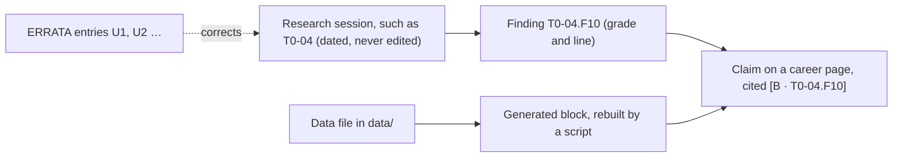

# Glossary

> Plain one-line definitions of the evidence codes, role and skill terms, and the hiring, pay, India, visa and governance vocabulary used across the repository, each linked to a page that uses it, so a newcomer or an AI agent can read any page.

**How it is organised.** By domain, in eight sections, followed by a list of abbreviations that need only an expansion. Within each section, terms are in alphabetical order with numbers and symbols first; section 1 opens with the evidence grades in grade order. Each row gives the term, a plain definition and a page that uses it. A fact inside a definition keeps its grade and source in the repository's citation style: [B · T0-04.F10] means grade B, finding F10 of research session T0-04; "L94" adds the line.

**Dates and advice.** Definitions follow the research sessions of 21–25 October 2026 and the career pages as of 5 November 2026. Legal, tax and visa entries restate T0-07, T0-08 and T0-15 as of 21–23 October 2026 and are due for re-checking by 2026-11-21. They are pointers, not legal or tax advice.

## The short answer

1. **Read the grade before the number.** A and B are measured or primary evidence; C is attributed vendor, small-sample or practitioner evidence; D is judgement; M is a model output that inherits its weakest input; [P] is standard practice that no session measured ([CONTRIBUTING §3](../../CONTRIBUTING.md#3-writing-standard-egp-10-in-brief)).
2. **Check which sense a code has.** "Tier", "L1", "C1", "T0", "V0", "DPO", "DSA" and "GCC" each carry two or more meanings in this repository; the [codes table](#codes-that-mean-different-things) separates them.
3. **Keep titles and skills apart.** A quorum counts live postings for a title; a [JD x%] tag counts postings that name a skill. A skill's share of postings never counts as demand for a title ([role rankings §1.1](../02-roles/role-rankings.md#11-design-rules-that-keep-bias-out)).
4. **Treat headline pay as part paper.** Total compensation mixes cash with equity, and private-company equity is discounted with model outputs (DF, RAV), not measured values ([section 5](#5-pay-and-equity)).
5. **Date-check anything legal.** Tax, visa and regulatory entries describe October 2026. Confirm them in the stage guide, and with a qualified professional, before you act.
6. **If a term is missing,** look in the [skills vocabulary](../03-skills-and-tech/skills-vocabulary.md) (every typed skill, with its posting wording) or the [role catalog](../02-roles/role-catalog.md) (every classified title).

## At a glance

| Section | What it covers | Entries |
|---|---|:---:|
| [Codes that mean different things](#codes-that-mean-different-things) | Letters, numbers and acronyms with more than one meaning | 18 codes |
| [1. Evidence and method](#1-evidence-and-method) | Grades, evidence tags, citation forms, the research layer | 21 |
| [2. Market, roles and rankings](#2-market-roles-and-rankings) | Posting counts, role classes, the CCI and the GenAI target order | 18 |
| [3. Skills and technology](#3-skills-and-technology) | Skill tiers, evidence ladders, GenAI, evaluation and inference terms | 29 |
| [4. Hiring and interviews](#4-hiring-and-interviews) | Screening, channels, interview formats, résumé layers | 14 |
| [5. Pay and equity](#5-pay-and-equity) | Compensation, equity mechanics and equity discounts | 13 |
| [6. India: tax, payments and work](#6-india-tax-payments-and-work) | Presumptive tax, GST, FEMA, employer of record | 9 |
| [7. Visas and relocation](#7-visas-and-relocation) | Talent and work-visa routes | 7 |
| [8. Governance and regulation](#8-governance-and-regulation) | AI laws, standards and credentials | 9 |
| [9. Abbreviations](#9-abbreviations) | Expansions only | 45 |

How a cited claim reaches a career page:

## Codes that mean different things

| Code | Meanings in this repository | How to tell them apart |
|---|---|---|
| A, B, C, D, E | Evidence grades; CCI bands S, A, B and C; status classes E and A; résumé variants A1–E3; T2-01's hours tiers A, B and C (8–10, 15–20 and 35–40 hours a week); Meta levels E5 and E6; T0-07's ledger IDs such as [E17] | A grade sits in brackets with a source, as in [B · T0-04]; a band follows a CCI score; a status class follows a role name |
| C1–C4 | T1-03's four behavioural competencies; résumé variants C1 (research engineering) and C2 (research science) | Interview pages mean the competencies; résumé pages mean the variants |
| D-001, D-002 … | Decisions in the append-only registry, [DECISIONS.md](../../research/DECISIONS.md). Sessions also number sections D1, D2 and so on (T0-01 D2, D4, D5, D10; T0-13 D1), and résumé variants run D1–D3 | Decisions have a hyphen and three digits |
| DPO | Direct Preference Optimization, a post-training method; data protection officer, a privacy role | Training pages mean the first; governance pages the second |
| DSA | Data structures and algorithms, on career pages; the EU Digital Services Act, in T0-15 | Interview and coding contexts mean the first |
| G | In sessions, a gap (searched and not found); in T0-15, role class G (a governance programme role) | Read the session's own legend |
| GCC | In India material, a global capability centre; in T0-02's pay tables, the Gulf region (Dubai, Abu Dhabi) | India pages mean the first |
| L1, L2 … | Session line numbers (T0-14 L576); role-map layers L1–L6; leadership ranks L1–L5; résumé layers L0–L4 and leadership résumé variants L1–L2; employer levels such as Google L5 or OpenAI L4 | A line number follows a session ID; layers, ranks and levels come with a name |
| M | Model-output grade; the Must tier, shortened to M in inventory self-assessment tables | Tier columns use M, I, S and O for Must, Important, Should and Optional |
| P | [P] for practice-curated, written "P (D)" in inventory evidence columns; percentiles P10–P90; project archetypes P1–P20; prior propositions P1–P5 at the start of sessions; Pave levels P4 and P6 in T0-02 | Practice-curated carries brackets or a grade |
| PR | Pull request (an upstream PR); permanent residence, in T0-08 | Visa pages mean permanent residence |
| S | Band S; the S09 posting corpus; source IDs S01, S02 … in session ledgers; skills S1–S12 in T0-06's readiness rubric; the Should tier in inventory tables | In inventory tables "S" in the tier column is Should, while "S (B)" in the evidence column means named in a session, grade B |
| T0, T1, T2 … | Session layers (T0-04 is a Layer 0 session); compensation tiers T0–T5 in T2-01, while FAD, T0-02, T0-17 and T1-03 use their own, conflicting tier bands (ERRATA U5, U7, U14); portfolio tiers T0–T4 in T0-13 | Session IDs have a hyphen and two digits; tiers stand alone |
| Tier | GenAI target tiers 1–5; inventory tiers Must to Avoid, from the skills ontology; D-004's three skill tiers, which the rankings' Durability scale uses; the compensation, portfolio and hours tiers above | Use the key on the page you are reading |
| Triton | OpenAI's Triton kernel language; NVIDIA's Triton Inference Server, listed in the vocabulary as NVIDIA Dynamo Triton | Kernel work means the language; serving means the server |
| U | Errata U1, U2 … in [ERRATA](../../research/ERRATA.md); status U (unmeasured buzzword) in the role catalog; upstream references such as U:T0-06 in T2-01 | Errata have only a number; T2-01's references have a colon |
| V | Status class V (verified, volume unmeasured); the verifiability ladder V0–V3 (T0-13); T1-02's volatility classes V0–V6; the valuation symbol V0 in T0-17's equity model | V0–V3 rate portfolio evidence; V0–V6 rate how fast a fact expires |
| X | In T0-16, a claim rejected as contradicted or untraceable | Used only in T0-16 |

## 1. Evidence and method

| Term | Definition | Where it is used |
|---|---|---|
| A (grade) | Primary evidence opened by the researcher: statutes and regulations, official data, filings, peer-reviewed results for their own sample, or a vendor's documentation about its own product. | [Role catalog §1.3](../02-roles/role-catalog.md#13-evidence-grades-and-conventions) |
| B (grade) | Authoritative secondary evidence, or data with a disclosed method, such as a survey or a platform aggregate. JobsPipe, Fast AI Jobs and Levels.fyi pages count as B even where a session graded its own reading A. | [Role catalog §1.3](../02-roles/role-catalog.md#13-evidence-grades-and-conventions) |
| C (grade) | Third-party, vendor, small-sample or single-source evidence. Always attributed ("Datadog reports…") and shown in tables only with its grade. | [Role rankings §1.4](../02-roles/role-rankings.md#14-evidence-confidence) |
| D (grade) | Judgement, recall, unverified material or a single anecdote. The rankings' Durability and Leverage pillars are D. | [Role rankings §1.2](../02-roles/role-rankings.md#12-pillars-and-weights) |
| E (grade) | Speculative, unverifiable or promotional, or nothing found after searching (T1-02 §10.3.1); never asserted as fact. Rare on career pages, where "(E)" after a role name means the Established status class. | [CONTRIBUTING §3](../../CONTRIBUTING.md#3-writing-standard-egp-10-in-brief) |
| M (grade) | Model output: a calculation, estimate or composite score such as the CCI. It inherits the weakest grade among its inputs. "Derived" marks arithmetic done in a career page. | [Role rankings](../02-roles/role-rankings.md) |
| [P] | Practice-curated: standard in the field but not measured in the corpus, and treated as D. Check it against 10–20 live postings before investing heavily. | [Role skill inventories §0](../03-skills-and-tech/role-skill-inventories.md#0-how-to-use-it) |
| [JD x%] and [S · T0-xx] | [JD x%] is the share of live postings for the role's title that name the skill (JobsPipe job-description counts, retrieved 2026-11-02; grade B). [S · T0-xx] means a research session, or a job description it cites, names the skill for the role; A–C depending on the source. | [Role skill inventories §0](../03-skills-and-tech/role-skill-inventories.md#0-how-to-use-it) |
| [S09 x%] and S09 | Share of S09, a corpus of 3,647 AI-engineering postings at 198 companies (snapshot 2026-08-05) that skews senior and infrastructure-heavy [B · T0-03 §6.3]. S09 also reports shares of companies, which are not shares of postings (ERRATA U12). | [T0-03 §6.3](../../research/sessions/T0-03-skills-compute-infra-eval-stack.md#63-skill-and-tool-mention-shares-s09-dataset-audit) |
| 🏷️, G, ↑, X | Markers. 🏷️ flags an interested-party source, such as a programme reporting its own results; attribute it [T1-02 L799]. In sessions, G means searched and not found, ↑ a grade inherited from an upstream session, and X (T0-16 only) a claim rejected as contradicted or untraceable [T1-03 L29–30; T0-16 L71]. | [Role catalog: Research Engineer](../02-roles/role-catalog.md#profile-research-engineer) |
| Compound grade | A grade such as A/B, B/C or C/D: the finding rests on sources of both grades. Quote the weaker one when you rely on the whole finding. | [Findings registry](../../research/findings.md) |
| Decision (D-001, D-002 …) | An entry in the append-only decision registry. Examples: D-001 the 12-stage funnel; D-002 the role quorum and title quarantine; D-004 the three-tier skill model; D-012 EGP-1.0; D-015 the stack map behind the role map; D-016 the guide pattern and the legacy-handbook policy; D-017 review-by dates; D-018 the evidence conventions for the stage guides (grade E, expiry classes, platform data at grade B). | [DECISIONS.md](../../research/DECISIONS.md) |
| EGP-1.0 | The Evidence-Grounding Protocol, the repository's evidence standard (decision D-012): grade every empirical claim, attribute C and below, date volatile facts, cite the line, give ranges with reasons, and never invent numbers. | [T1-02](../../research/sessions/T1-02-evidence-grounding-protocol.md) |
| Erratum (U1, U2 …) | A logged error in a sealed Phase 0 record (FAD, DECISIONS, T0-03, T0-06, T0-17, T1-01, T1-03 or T2-01), with its correct reading. Where a record and ERRATA disagree, ERRATA wins; career pages already apply the corrections. | [ERRATA](../../research/ERRATA.md) |
| Expiry class, last_verified, review_by | How long a volatile fact stays valid, counted from the date it was last verified (T1-02 §10.6; decision D-018): V0 live status of contested policies and pending rules, 14 days; V1 posting counts and other monthly series, 31 days; V2 tool, credential and product statuses, 90 days; V3 pay medians and skill-demand shares, 180 days, though this repository re-verifies pay after 90 days; V4 statute text and annual datasets, 365 days; V5 foundations, 1,095 days; V6 dated history, no expiry. last_verified is the date a page's facts were last checked; review_by is the earliest expiry among the page's facts (D-017), after which the validator lists the page as due. | [CONTRIBUTING §3](../../CONTRIBUTING.md#3-writing-standard-egp-10-in-brief) |
| FAD | Founding Architecture Document: the Phase 0 capstone synthesis and Phase 1 plan. A historical record, superseded in parts; ERRATA corrects several of its figures (for example U1–U5). | [Research index](../../research/README.md#key-documents) |
| Feeder / adjacent | A share measured on another title and used as a proxy: a feeder title is one people move from (DevOps Engineer postings standing in for AI Infrastructure), an adjacent title does similar work. It is not the role's own measurement. | [Role skill inventories §3](../03-skills-and-tech/role-skill-inventories.md#3-tier-decisions-backed-by-measured-shares) |
| Finding ID and citation forms | T0-04.F10 is finding 10 of session T0-04 in the findings registry, which lists every key finding with its grade and line. Inside sessions, KF1 is a key finding and R1 a recommendation; L576 or T0-14:L646 is a line; § is a section. Bracketed IDs such as [S24], [E17] or [US-01] point to a session's source ledger. | [Findings registry](../../research/findings.md) |
| Generated block | Text between BEGIN GENERATED and END GENERATED markers, or a whole file whose front matter has generated_by, written by a script from data/. Edit the data or the script, never the output. | [CONTRIBUTING §5](../../CONTRIBUTING.md#5-generated-content) |
| Lifecycle stage and 12-stage funnel | Career folders 00–11 are the stage value in front matter. Folders 01–05 match funnel stages 1–5 of decision D-001, but folder 06 holds stages 6–7, 07 holds 8, 08 holds 9–10, 09 holds 11 and 10 holds 12; 00 and 11 have no funnel stage. A stage README marked "Evidence only" has no guide yet and points to the findings and sessions. | [AGENTS.md §1](../../AGENTS.md#1-orientation) |
| Session (T0-xx, T1-xx, T2-xx) | A dated research report from Phase 0 (October 2026), never edited after sealing. The prefix is the pipeline layer, not a career tier: T0 marks the 18 foundational landscape sessions, T1 the 3 structural blueprints and T2 the action-plan synthesis. New research starts at T3. | [Research index](../../research/README.md#phase-0-pipeline-complete) |

## 2. Market, roles and rankings

| Term | Definition | Where it is used |
|---|---|---|
| Band (S, A, B, C) | CCI score bands: S ≥ 75, A 65–75, B 55–65, C < 55, on the unrounded score. Bands are not evidence grades. | [Role rankings §1.5](../02-roles/role-rankings.md#15-uncertainty-sensitivity-and-bands) |
| Canonical role and role family | A canonical role is a distinct function with its own skill signature, hired under one dominant title cluster; the catalog has 29 (24 individual-contributor roles plus 5 leadership and independent tracks). Other titles map to one as an alias, level variant or specialisation, or sit in a non-role bucket. A family groups related roles, such as Applied AI Engineering. | [Role catalog §1.1](../02-roles/role-catalog.md#11-what-counts-as-a-role) |
| CCI | Composite Career Index: a 0–100 score per role, CCI = Σ weight × pillar score ÷ 10. Five pillars are scored 0–10: Demand 25, Pay 25, Durability 20, Leverage 15, Access 15. Six weight profiles (Base, Equal, Pay-max, Hiring-safety, Moat-first, Switcher) test how robust a rank is. A model output (M). | [Role rankings §1.2](../02-roles/role-rankings.md#12-pillars-and-weights) |
| Evidence confidence | The rankings' label for a role's Demand and Pay evidence: High when both rest on A/B evidence; Medium when the weaker is C, or an M estimate built from B inputs; Low when either rests on judgement or a proxy, so the rank is likely to move. | [Role rankings §1.4](../02-roles/role-rankings.md#14-evidence-confidence) |
| FDE | Forward Deployed Engineer: an engineer embedded with customers who deploys, integrates and adapts AI products end to end, usually with domain depth and travel. In T0-01's October 2026 counts, the largest new title family at AI startups, and alias-heavy: about half of the 50 newest roles in the cluster were engineer-titled [B · T0-01.F3]. The dated counts are in its [role catalog profile](../02-roles/role-catalog.md#profile-forward-deployed-engineer). | [FDE hub](../02-roles/hubs/forward-deployed-engineer.md) |
| Frontier lab | A company training the most capable models. In the corpus mostly OpenAI and Anthropic, whose pay ladders mark the ceiling in the rankings and whose stock is semi-liquid through tenders [B · T0-02.F4, F7]. | [Role rankings §1.1](../02-roles/role-rankings.md#11-design-rules-that-keep-bias-out) |
| GCC | In India material, a global capability centre: a multinational's own centre in India. GCC, MNC and product employers form the higher-paying of India's two pay populations [B/C · T0-02.F3]. In T0-02's pay tables, GCC means the Gulf region (Dubai, Abu Dhabi). | [Role rankings §5.3](../02-roles/role-rankings.md#53-india-lens-india-demand-and-pay-replace-the-us-inputs) |
| GenAI target order and target tier | The order in which to target roles for GenAI work: each role's mean rank across eight lenses (the six weight profiles, the India lens and the Monte Carlo median), grouped into tiers 1–5 by rule; tier 1 needs a mean rank of 2.5 or lower and a top-4 place in all eight lenses. It differs from the CCI rank by design and is a model output (M). | [GenAI target roles §1.4](../02-roles/genai-target-roles.md#14-tier-rules) |
| IC and the leadership board | IC means individual contributor. The 24 IC roles are ranked together; the 5 leadership and independent tracks are ranked separately as L1–L5 (AI Engineering Manager, VP / Head of AI, CAIO, Independent AI Consultant, Fractional Head of AI), because people reach them only after years of experience. | [Role rankings §4](../02-roles/role-rankings.md#4-leadership-and-independent-tracks) |
| Lens | A re-ranking for one purpose: goal lenses (the weight profiles), persona lenses (Switcher weights per starting background, dropping roles not plausible within 12 months) and the India lens (India postings and pay replace the US inputs). | [Role rankings §5](../02-roles/role-rankings.md#5-lenses-the-best-job-for-you) |
| Live posting | A job advertisement visible on a platform on the count date. Live postings are not openings, and openings are not hires: duplicates, mass posters and ghost postings inflate counts [B/C · T0-01]. The [market overview](../01-landscape/market-overview.md#1-three-title-families-carry-the-measured-volume) gives the dated caveats, such as the share of postings left up for 45 days or more. | [Role catalog §1.3](../02-roles/role-catalog.md#13-evidence-grades-and-conventions) |
| Monte Carlo rank and P(top 5) | The rankings redraw every pillar score 20,000 times from a triangular distribution over its range (fixed seed) and report each role's median rank, its P10–P90 rank interval and P(top 5), the share of draws in which it ranks in the top five. | [Role rankings §1.5](../02-roles/role-rankings.md#15-uncertainty-sensitivity-and-bands) |
| MTS | Member of Technical Staff: the usual title at OpenAI and Anthropic, which hides both function and level [B · T0-02]. The catalog files it under Research Engineer. | [Role catalog: Research Engineer](../02-roles/role-catalog.md#profile-research-engineer) |
| Percentile (P10–P90) | The value below which that share of a sample falls; P50 is the median. Pay percentiles mostly come from Levels.fyi, a self-selected sample skewed to large, equity-paying employers, not the whole market [B · T0-02.F3]. Rank percentiles come from the Monte Carlo. | [T0-02](../../research/sessions/T0-02-global-regional-compensation-benchmarks.md) |
| Persona and corridor (●, ◐, ○) | A persona is one of five starting backgrounds used in the rankings and playbooks: Backend / Systems SWE; Data Scientist / BI; Frontend / Full-Stack; Non-Technical (5+ years in a domain); PhD / Academic Researcher. T2-01 rates each persona's route to each pay tier within 12 months as a corridor: ● high-volume, ◐ plausible but extended, ○ implausible. A design judgement [D · T2-01 §4.1]; its matrix has 5 ● cells, not the "8–12" its summary claims (ERRATA U9). | [Role rankings §5.2](../02-roles/role-rankings.md#52-persona-lenses-switcher-weights-roles-not-plausible-within-12-months-are-excluded) |
| Quorum and graduation tests | Quorum: at least 50 distinct active postings for an exact title or a declared alias cluster in a named corpus. In T0-01's October 2026 counts, only AI Engineer, Machine Learning Engineer and FDE clear it [B · T0-01]. A title leaves the watchlist or quarantine only by passing seven graduation tests: volume, persistence, breadth, skill signature, ladder, lab adoption and an alias test. | [Role catalog §1.4](../02-roles/role-catalog.md#14-quorum-and-graduation-tests-t0-01-d5) |
| Status class (E, V, W, A; Q, U) | The catalog's evidence label for a canonical role: E Established (50 or more live postings measured in a large corpus; 3 roles), V Verified title with volume unmeasured, W Emerging or watchlist, A Absorbed into other professions. Title strings can also be Q (quarantined speculative titles from T0-01 D4) or U (unmeasured buzzwords, never searched). | [Role catalog §1.2](../02-roles/role-catalog.md#12-status-classes-for-canonical-roles) |
| Work footprint | Where a role's work sits on the role map: a main layer among six (L1 Compute and hardware, L2 Foundation models and research, L3 Inference and ML platforms, L4 Post-training and adaptation, L5 Orchestration and context, L6 Applications and deployment), the other layers it touches, and its cross-cutting planes (Evaluation and quality; Security, safety and governance; Product and strategy; Leadership and independent practice). A judgement (D), not a pay or demand model. | [Role map](../02-roles/role-map.md#how-to-read-this-map) |

## 3. Skills and technology

| Term | Definition | Where it is used |
|---|---|---|
| 0–3 readiness scale | T0-06's self-rating scale, used in every inventory: 0 none, 1 tutorial-level awareness, 2 built and shipped something small with feedback, 3 owns it in production or could teach it. | [Role skill maps §1.1](../03-skills-and-tech/role-skill-maps.md#11-twelve-skill-readiness-rubric-t0-06-target-levels-for-an-ai-engineer-role) |
| A2A | Agent2Agent: an open protocol for agents to find each other (through an Agent Card) and exchange tasks with a defined task lifecycle. Version 1.0 shipped on 12 March 2026, and in August 2026 the project announced it was joining the Agentic AI Foundation [A · T0-16.F3]. | [Agentic protocols](../03-skills-and-tech/agentic-protocols.md) |
| AG-UI | Agent-User Interaction protocol, for streaming an agent's events to a user interface. Declared 1.0 on 18 September 2026; stewarded by CopilotKit and not part of the Agentic AI Foundation [A · T0-16.F4]. | [Skills vocabulary: protocols](../03-skills-and-tech/skills-vocabulary.md#type-protocol) |
| Agent and tool calling | An agent is an LLM system that takes multi-step actions through tools (APIs, code, search) in a loop toward a goal; tool calling is the model emitting a structured call that the application runs. "Agentic AI" is named in 59.3% of AI Engineer postings [B · T0-01.F4], but the Agentic AI Engineer title itself is small, a watchlist title whose derived 90-day count is in its catalog profile [C · T0-16 L389]. | [Role catalog: Agentic AI Engineer](../02-roles/role-catalog.md#profile-agentic-ai-engineer) |
| Context engineering | Designing what goes into a model's context: instructions, retrieved data, tool definitions and results, and memory. Gartner defines the discipline, but Context Engineer is a tiny, quarantined title covering three different jobs; the catalog's quarantine register gives its estimated count [C · T0-01.F5]. Prompt Engineer is a legacy title: 0.35% of 20,662 LinkedIn AI postings in a 2025 study [B · T0-03 KF2]. | [Role catalog §5.1](../02-roles/role-catalog.md#51-quarantined-titles-t0-01-d4-reconciled) |
| Continuous batching and PagedAttention | Continuous batching adds and removes requests at every decoding step rather than waiting for a whole batch to finish. PagedAttention stores the KV cache in fixed-size blocks; its paper found that earlier allocators used only 20.4–38.2% of KV memory for real token state [A/B · T0-14 L89]. | [Inference Engineer hub](../02-roles/hubs/inference-engineer.md) |
| DPO | Two meanings. In post-training, Direct Preference Optimization: training directly on pairs of preferred and rejected answers, without a separate reward model; the inventories list it as practice-curated [P]. In governance, a data protection officer: a privacy function that regulators such as EIOPA expect to absorb AI-governance work [B · T0-15 L353]. | [Skills vocabulary: concepts](../03-skills-and-tech/skills-vocabulary.md#type-concept) |
| Evals and eval gates | Systematic tests of whether an LLM system does its job: graders (code, model or human), capability and regression suites, repeated trials and online monitoring. An eval gate in CI blocks a change that makes the suite regress [A · T0-14 L92]. Evals appear at 68.2% of S09 companies but in 19.0% of its postings [B · T0-03 KF3]. | [AI Evaluation Engineer hub](../02-roles/hubs/ai-evaluation-engineer.md) |
| Fine-tuning: SFT, LoRA, QLoRA, PEFT | Further training a pretrained model on task data. SFT (supervised fine-tuning) learns from input-output examples; LoRA (low-rank adaptation) trains small added matrices while the base weights stay frozen; QLoRA does the same on a quantised base model; PEFT (parameter-efficient fine-tuning) is the umbrella term. Fine-tuning appears in 13.0% of S09 postings [B · T0-03 L178]. | [ML Engineer hub](../02-roles/hubs/ml-engineer.md) |
| Golden set | A fixed, labelled set of test cases (inputs with reference answers or rubrics) used to score a system and catch regressions. Anthropic's evaluation guide, as relayed by T0-14, advises starting with 20–50 tasks drawn from real failures [A · T0-14 L92]. | [AI Evaluation Engineer hub](../02-roles/hubs/ai-evaluation-engineer.md) |
| GPU kernel, CUDA and Triton | A kernel is a function that runs in parallel on a GPU; CUDA is NVIDIA's GPU programming platform. "Triton" names both OpenAI's Python-based kernel language and NVIDIA's Triton Inference Server, which the vocabulary lists as NVIDIA Dynamo Triton. CUDA or GPU-kernel work appears at 29.3% of S09 companies but in 6.6% of postings [B · T0-03 KF8]. | [GPU Kernel Engineer hub](../02-roles/hubs/gpu-kernel-engineer.md) |
| GRPO and RLVR | RLVR is reinforcement learning with verifiable rewards: the reward comes from an automatic check, such as a correct final answer or passing tests. GRPO (Group Relative Policy Optimization) is an RL algorithm used for it, which scores each sampled answer against the others in its group. The inventories list both as practice-curated [P]; the corpus's only count is a small keyword tally (GRPO: 2 on Rise) [C · T0-01.F9]. | [Research Engineer hub](../02-roles/hubs/research-engineer.md) |
| KV cache | The attention keys and values of tokens already processed, kept in GPU memory so they are not recomputed. Bytes per token = 2 × layers × KV heads × head dimension × bytes per element, so memory grows with context length and batch size [A/B · T0-14 L89]. ERRATA U11 corrects a T0-03 figure labelled FP8 that is in fact the BF16 value. | [Inference Engineer hub](../02-roles/hubs/inference-engineer.md) |
| LLM-as-a-judge | Using an LLM to grade outputs against a rubric. Judges agreed with humans over 80% of the time in Zheng et al. (NeurIPS 2023) but showed position, verbosity and self-enhancement bias, so calibrate them against human labels [A · T0-14 L92]. | [AI Evaluation Engineer hub](../02-roles/hubs/ai-evaluation-engineer.md) |
| MCP | Model Context Protocol: an open protocol that connects LLM applications and agents to tools and data through MCP servers. Hosted since December 2025 by the Agentic AI Foundation (AAIF), a Linux Foundation fund [A · T0-16.F1]. Named in 0.068% of 343,299 Fortune-1000 and API-provider postings in Q3 2026: small but fast-growing [C · T0-16.F9]. | [Agentic protocols](../03-skills-and-tech/agentic-protocols.md) |
| Observability and tracing | Recording each request's steps (prompt, retrieval, tool calls, tokens, latency and cost) as traces, so you can debug, evaluate and attribute cost. T0-03 found tracing products listed interchangeably in postings, so the vocabulary treats them as one choose-one class. | [Skills vocabulary §2](../03-skills-and-tech/skills-vocabulary.md#2-choose-one-classes) |
| pass@k and pass^k | Metrics over repeated trials of a non-deterministic system: pass@k means at least one success in k tries; pass^k means all k succeed. At a 75% per-trial success rate, pass^3 is about 42%, so use pass^k for user-facing reliability [A · T0-14 L717]. | [AI Evaluation Engineer hub](../02-roles/hubs/ai-evaluation-engineer.md) |
| Post-training: RLHF, PPO | Training after pretraining to make a model useful and safe: SFT, preference optimisation (DPO) and reinforcement learning, such as RLHF (a reward model trained on human preferences, classically optimised with PPO) or RLVR. As an exact job title it is below quorum (Rise counts: post-training 9, RLHF 17) and is carried under Research Engineer / MTS [C · T0-01.F9]. | [Role map: layers](../02-roles/role-map.md#layers) |
| Prefill and decode | Prefill processes the whole prompt at once and is compute-bound; decode generates one token at a time and is memory-bandwidth-bound [A/B · T0-14 L89]. A roofline analysis compares a workload's arithmetic intensity with the hardware's compute and bandwidth limits to show which one binds. Disaggregation runs prefill and decode on separate GPU pools, a frontier skill in T0-03 §6.4. | [Inference Engineer hub](../02-roles/hubs/inference-engineer.md) |
| Prompt injection and guardrails | Prompt injection is text in an input or a retrieved document that hijacks a model's instructions; guardrails are runtime filters and policies on inputs and outputs. Adaptive attacks bypassed 12 published defences with over 90% success in most cases, so containment (least privilege, egress control, approvals) is the primary control and classifiers are defence in depth [A/B · T0-14 L95]. | [AI Security Engineer hub](../02-roles/hubs/ai-security-engineer.md) |
| Proof of work, project archetypes and the anti-portfolio | Proof of work is public evidence that you can do the job, such as an evaluated system with a reproducible README. The repository scores 20 project archetypes (P1–P20) against each role's Must and Important skills. The anti-portfolio is the set of project types that are "disqualifying as presented", such as chat-with-your-PDF demos, thin wrappers over a model API and course-dataset staples; each has a redemption path [C · T0-13 D1]. | [Proof-of-work standards](../05-portfolio/proof-of-work-standards.md) |
| Quantisation (BF16, FP8, INT4) | Storing weights, activations or the KV cache in fewer bits, from 16-bit BF16 down to 8-bit FP8 or 4-bit INT4, to cut memory and cost at some risk to accuracy. FP8 halves KV-cache bytes compared with BF16. | [Inference Engineer hub](../02-roles/hubs/inference-engineer.md) |
| RAG and retrieval quality | Retrieval-augmented generation: fetch relevant passages, usually through embeddings and vector search, and put them in the prompt so the model answers from them. Named in 54.0% of AI Engineer postings [B · T0-01.F4]. Naive RAG is table stakes; T0-03 judges that retrieval quality (hybrid keyword-plus-vector search, reranking, recall@k) is what still differentiates [D · T0-03 L421]. | [AI Engineer hub](../02-roles/hubs/ai-engineer.md) |
| Red teaming | Adversarial testing of a model or AI system to find unsafe or exploitable behaviour before others do. The EU AI Act requires documented adversarial testing for general-purpose AI models with systemic risk [A · T0-15.F2]. | [AI Security Engineer hub](../02-roles/hubs/ai-security-engineer.md) |
| Skill tier | Two systems. The inventories' résumé tiers, set in the skills ontology and the source of truth for every role: Must (screen gate), Important (wins interviews and level), Should, Optional and Avoid (archived, dormant, deprecated or devalued). D-004's three tiers [T0-03 §6.4]: table stakes (gets you screened), differentiating (production evals, agent reliability, cost and serving work) and frontier (custom kernels, serving-engine internals, multi-node communication). Role pages no longer sort skills by D-004's tiers, whose posting-share thresholds erratum U20 finds unsupported; the rankings' Durability scale still uses them. | [Role skill inventories §0](../03-skills-and-tech/role-skill-inventories.md#0-how-to-use-it) |
| Skill type and choose-one class | Every skill in the vocabulary has one of 19 types: 2 knowledge types (concept, method), 11 concrete ones (language, framework, library, model, platform, data store, infrastructure tool, specialised product, hardware, protocol, regulation) and 6 non-technical ones. A choose-one class groups interchangeable tools, such as vector stores; any member satisfies the role's link. | [Skills vocabulary §0](../03-skills-and-tech/skills-vocabulary.md#0-how-to-read-this-file) |
| Tool status | The dated state of a volatile tool or credential: active, beta, development, acquired, renamed, dormant, archived or retired. Statuses must be re-verified by 2027-01-21; archived, dormant and retired items are tiered Avoid. | [Skills vocabulary §0](../03-skills-and-tech/skills-vocabulary.md#0-how-to-read-this-file) |
| TTFT, TPOT, ITL and goodput | Serving latency metrics: TTFT is time to first token; TPOT is time per output token after the first; ITL is inter-token latency; end-to-end latency is TTFT plus generation time [T0-05 L263; T0-14 L89]. Goodput is the request rate per GPU that meets both the TTFT and the TPOT target [T0-14 L228]. p95 and p99 are the 95th- and 99th-percentile values. | [Inference Engineer hub](../02-roles/hubs/inference-engineer.md) |
| V0–V3 verifiability ladder | T0-13's ladder for portfolio evidence: V0 self-asserted (a screenshot), V1 reproducible (one command regenerates the results), V2 externally attested (a merged upstream PR, a leaderboard row, an independent reproduction), V3 operationally evidenced (30 or more days of uptime and spend logs, a postmortem, real users). T0-13 asks for V1 or better on every headline claim. | [Proof-of-work standards](../05-portfolio/proof-of-work-standards.md#the-verifiability-ladder-and-the-level-model) |

## 4. Hiring and interviews

| Term | Definition | Where it is used |
|---|---|---|
| 45-minute blueprint | T1-03's timing for a system-design round: 5 minutes of requirements, 4 of estimates, 9 of high-level design, 16 for two deep dives, 7 on evaluation, safety and operations, and 4 to wrap up. The most convergent framework across coaching sources, with firm-specific variants [B/C · T1-03.F3]. | [T1-03](../../research/sessions/T1-03-interview-execution-offer-negotiation.md) |
| AI screening layer | Software that scores parsed applications against recruiter-written criteria, such as Eightfold, Workday HiredScore, Greenhouse Talent Matching and Ashby AI review. The vendors document ranking and grading, and say they do not auto-reject [A · T0-04.F3, F8]. | [ATS mechanics](../06-job-search/ats-mechanics.md) |
| AI-enabled coding round | A coding interview in which you work with an AI assistant and are scored on delegating, verifying and owning the logic; reported at Meta in spring 2026 as an early signal. "Vibe coding", accepting unverified AI output, is a strong No Hire signal [B/C · T1-03.F6]. | [T1-03](../../research/sessions/T1-03-interview-execution-offer-negotiation.md) |
| ATS | Applicant tracking system (Greenhouse, Lever, Ashby, Workday and others): it stores applications and parses résumés into fields. Parsing converts the file to text first, and most failures happen in that conversion [A · T0-04.F2, F3]. None of the vendor documents T0-04 retrieved describes rejection for a failed parse, though Ashby's and Taleo's behaviour on a failed parse is undocumented [A · T0-04.F1; T0-04 L170]. A portal résumé is single-column with a real text layer. | [ATS mechanics](../06-job-search/ats-mechanics.md) |
| "ATS score" checker | A keyword-matching tool (Jobscan, Teal, Rezi) that simulates an ATS. It has no demonstrated link to real ATS outputs, so use it only as a list of gaps against the posting [C · T0-04.F12; ERRATA U16]. | [ATS mechanics](../06-job-search/ats-mechanics.md) |
| C1–C4 | T1-03's four behavioural competencies for AI roles: C1 pragmatism under ambiguity, C2 explaining probabilistic trade-offs, C3 ownership and incident response, C4 responsible AI. A behavioural No Hire is a near-automatic veto at Anthropic and Google [B/C · T1-03.F4, F5]. Not the résumé variants C1 and C2. | [Behavioural calibration](../08-interviewing/behavioral-calibration.md) |
| Cold inbound | Applying through a portal with no contact at the employer. About 0.2% of engineering applications end in a hire, roughly one offer per 340–380 applications; candidates sourced by recruiters convert about 8 times better [B · T0-04.F9, F10]. | [Channels and boards](../06-job-search/channels-and-boards.md) |
| Expanding rings | The recommended order for a wide search: ring 1 is your primary family (one family résumé, one or two flagship projects, one interview track), ring 2 adds adjacent families, and ring 3 adds stretch families only once their proof of work exists. | [Job-search strategy: expanding rings](../06-job-search/job-search-strategy.md#recommended-sequencing-expanding-rings) |
| Knockout question | An employer-configured question on the application form, such as work authorisation or a required yes/no item. It is the only documented automatic-rejection path: none of the vendor documents T0-04 retrieved describes rejection for résumé wording or for a failed parse, and Ashby's and Taleo's behaviour on a failed parse is undocumented [A · T0-04.F1; T0-04 L170]. | [ATS mechanics](../06-job-search/ats-mechanics.md) |
| Loop | The interview rounds after the recruiter screen (coding, system design, behavioural and role-specific rounds), onsite or virtual. AI system design splits into an infrastructure track (serving, batching, GPU scheduling) and an application track (RAG, agents, evals), beside classic SWE design [B/C · T1-03.F2]. Covering every role means six tracks: application, infrastructure, ML design, research, product and governance. | [Interview loops](../08-interviewing/interview-loops.md#the-loop-map-three-engineering-classes-and-four-specialist-tracks) |
| Probation | The trial period after hiring. Public, named GenAI probation rubrics essentially do not exist; what can be observed are posting deliverables, onboarding metrics (time to first and tenth PR) and mechanics such as GitLab's 1–9-month probation by location [B/C · T0-09.F8]. | [T0-09](../../research/sessions/T0-09-onboarding-probation-first-90-days.md) |
| Referral | An application vouched for by someone at the employer. Referrals convert 11–36 times better per application than cold applications: an association driven by selection, not proof of cause [B · T0-04.F10]. | [Referrals and outreach](../07-networking/referrals-and-outreach.md) |
| Résumé layers and variants | The résumé system: L0 master inventory (private, never sent), L1 universal résumé, L2 family résumé, L3 role résumé, L4 posting-tailored résumé. The family layer is one of 15 variants: A1 Builder, A2 Deployer, B1–B3, C1–C2, D1–D3, E1–E3, and L1–L2 for leadership. | [Résumé strategy: the five layers](../06-job-search/resume-strategy.md#the-five-layers-and-their-jobs) |
| STAR-AI | Situation, Task, Action, Result with AI-specific additions: quantify the cost of a wrong answer, name the evaluation method, and end with a metric change and a continuous-monitoring step [B/C · T1-03.F5]. The template is T1-03's own synthesis [D · T1-03 L396]. | [Behavioural calibration](../08-interviewing/behavioral-calibration.md) |

## 5. Pay and equity

| Term | Definition | Where it is used |
|---|---|---|
| 409A valuation | The independent fair-market-value appraisal of a private company's common stock under US tax rules, used to set option strike prices. T0-17 asks for the last 409A value to see the gap between common and preferred prices [T0-17 L226; T0-10 L318]. | [T0-17](../../research/sessions/T0-17-compensation-progression-plateaus-equity.md) |
| 83(b) election | A US election to be taxed on restricted property, such as restricted stock or early-exercised options, when it is transferred rather than as it vests; it does not cover RSUs. It must be filed within 30 days of the transfer, with no extension [A · T0-17 L486]. T0-17 grades the scope statement A/B in its key findings but recalled (D) in its detailed section [T0-17 L180, L486]. | [T0-17](../../research/sessions/T0-17-compensation-progression-plateaus-equity.md) |
| DF and RAV | Two models that discount private-company equity to a cash-like value. DF (T0-02) is value to the employee ÷ grant-date paper value: 0.95–1.00 for public RSUs, 0.64–0.88 for tender-backed frontier-lab stock, 0.42–0.61 for late-stage private stock and 0.09–0.21 for Series A/B [D, model output · T0-02.F8]. RAV, from T0-17's equity risk-discount model (ERDM), is expected ÷ headline value before tax and vesting; its default bands are 0.5–0.8 for frontier-lab-like stock, 0.4–0.8 for Series C–D and 0.15–0.3 for stale-vintage unicorns [C/D · T0-17.F11, R3]. Quote the band and name the model. | [Role rankings §5.1](../02-roles/role-rankings.md#51-goal-lenses-computed-not-curated) |
| Hop | Changing employer. T0-17 puts a same-tier move at about +15–25% TC [C · T0-17 R1] and a move up a level at about +35–50% [B/C · T0-17 R1]; annualised, a hop beats staying only when the premium exceeds roughly 25% or promotion is blocked [C, derived · T0-17 L200]. | [T0-17](../../research/sessions/T0-17-compensation-progression-plateaus-equity.md) |
| LCA | Labor Condition Application: the wage filing a US employer makes for an H-1B worker. LCA wages are floors, not pay [B · T0-02.F6]; the rankings use LCA base as one pay instrument. | [Role rankings §1.2](../02-roles/role-rankings.md#12-pillars-and-weights) |
| Post-termination exercise window | The time a departing employee has to buy vested options before they lapse. T0-17 lists it as an offer-diligence question and marks the common 90-day default as recalled and unverified [D · T0-17 L181, L226]. | [T0-17](../../research/sessions/T0-17-compensation-progression-plateaus-equity.md) |
| Preference stack | The total liquidation preferences that preferred shareholders receive before common holders, employees included, get anything in an exit. In Q2 2026, 95.8% of deals were 1× and 96.4% non-participating, so overhang is a tail risk rather than the norm; common stock behaves like a call option struck at the stack [A · T0-17.F6]. | [T0-17](../../research/sessions/T0-17-compensation-progression-plateaus-equity.md) |
| Refresh grant | Equity granted after hire, yearly or at promotion. Pave data put the equity uplift at promotion at about +39%, and T0-17 advises negotiating the refresh cadence [B · T0-17 L501]. | [T0-17](../../research/sessions/T0-17-compensation-progression-plateaus-equity.md) |
| RSU | Restricted stock unit: a promise of shares delivered as they vest. Public-company RSUs are close to cash: T0-02's discount factor for them is 0.95–1.00, a model output [D · T0-02 L435]. | [T0-02](../../research/sessions/T0-02-global-regional-compensation-benchmarks.md) |
| Stock option | The right to buy shares at a fixed strike price. Exercising costs cash and may create a tax bill, so T0-17's offer checklist asks for the strike, the exercise cost, the tax at exercise and whether early exercise with an 83(b) election is available [T0-17 R5]. | [T0-17](../../research/sessions/T0-17-compensation-progression-plateaus-equity.md) |
| TC and posted base | TC is total compensation: base plus bonus plus the yearly value of equity, usually from Levels.fyi, whose stock-per-year figures do not state whether they use grant-date or current value [B · T0-02 L457]. Posted base is the base-pay range in a job posting; it excludes equity, which only 14% of 43,480 US AI-engineering postings mention [B/C · T0-02]. | [Role catalog §1.3](../02-roles/role-catalog.md#13-evidence-grades-and-conventions) |
| Tender offer and lock-up | A tender is an organised window in which employees can sell some vested shares to the company or to investors, usually gated by tenure, capped, and often closed to former employees [A/B · T0-17.F12]. A lock-up bars insiders from selling for a period after an IPO and can be staged and price-triggered [B · T0-17.F9]. | [T0-17](../../research/sessions/T0-17-compensation-progression-plateaus-equity.md) |
| Vesting and cliff | Vesting is the schedule by which granted equity becomes yours; a cliff delays the first vest. Shape matters: at 24 months a flat 25/25/25/25 schedule has vested 50%, an Amazon-style 5/15/40/40 schedule 20% and a Google-style 33/33/22/12 schedule 66% [B/C · T0-17 R2]. OpenAI removed its cliff for new hires in December 2025 [B · T0-17 L180]. | [T0-17](../../research/sessions/T0-17-compensation-progression-plateaus-equity.md) |

## 6. India: tax, payments and work

These entries restate T0-07 as of 21 October 2026; confirm anything you act on with a chartered accountant.

| Term | Definition | Where it is used |
|---|---|---|
| ₹L, ₹Cr and LPA | Indian number units: 1 lakh (L) = ₹100,000; 1 crore (Cr) = ₹10 million = 100 lakh. Rupee pay and billing figures such as ₹30L are annual unless a page says otherwise. LPA (lakh per annum) appears once, in a T0-18 source note. | [Role rankings §5.3](../02-roles/role-rankings.md#53-india-lens-india-demand-and-pay-replace-the-us-inputs) |
| §44ADA and s.58 | India's presumptive-taxation scheme for professionals, which taxes 50% of receipts as deemed profit. It is open to resident individuals and partnership firms other than LLPs, with a ₹50 lakh ceiling raised to ₹75 lakh when cash receipts are at most 5% of gross receipts [A · T0-07.F2]. Since 1 April 2026 the Income-tax Act 2025 carries it as s.58 [B · T0-07.F1]. | [Role catalog §0](../02-roles/role-catalog.md#0-summary) |
| ₹75 lakh cliff and dead zone | Above ₹75 lakh of receipts the presumptive scheme is lost, so one rupee more adds about ₹11.8 lakh of tax. Billing must reach roughly ₹92–98 lakh to match the take-home at ₹75 lakh; T0-07 calls that range the "dead zone" [M, inputs B · T0-07.F3, L125]. | [Role rankings §5.3](../02-roles/role-rankings.md#53-india-lens-india-demand-and-pay-replace-the-us-inputs) |
| EOR | Employer of record: a provider that employs you on a client's behalf and runs payroll and statutory benefits. Against §44ADA it cuts take-home by 22–24% at ₹75 lakh or less and is near parity at ₹1.2 crore; its value is non-tax: statutory benefits, no GST or export paperwork for you, and lower misclassification exposure for the client [A/B, M · T0-07.F5]. | [T0-07](../../research/sessions/T0-07-india-remote-tax-statutory-compliance.md) |
| FEMA, EDF and EDPMS | FEMA is India's foreign-exchange law. Under its export regulations in force from 1 October 2026, a service exporter files an Export Declaration Form (EDF), which replaces SOFTEX, with its authorised dealer (AD) bank within 30 days of the end of each invoice month; the bank loads the data to EDPMS, and each invoice must be realised within 9 months (12 for rupee invoices) [B · T0-07.F7]. | [T0-07](../../research/sessions/T0-07-india-remote-tax-statutory-compliance.md) |
| GST and LUT | GST is India's goods and services tax. Registration is compulsory at all four billing levels T0-07 models (₹30 lakh and up; the threshold is ₹20 lakh, or ₹10 lakh in special-category states). Exports of services are zero-rated under a Letter of Undertaking (LUT, Form GST RFD-11) filed each financial year; if payment in foreign exchange is not realised within one year, IGST and interest fall due [B · T0-07.F6]. | [T0-07](../../research/sessions/T0-07-india-remote-tax-statutory-compliance.md) |
| LLP and Pvt Ltd | Limited liability partnership and private limited company, the entity options above the presumptive ceiling; neither can use §44ADA. Up to ₹75 lakh, §44ADA beats both [M · T0-07.F4]; at ₹1.2 crore their cash outcomes sit within about ₹3–10 lakh of each other, an ordering that turns on a recalled remuneration cap [M, one input D · T0-07 L126]. | [Role catalog §0](../02-roles/role-catalog.md#0-summary) |
| Proof of receipt and purpose code | Documents that prove export income arrived: an e-FIRC (electronic foreign inward remittance certificate) from an AD bank; a lighter FIRA (foreign inward remittance advice) from many fintechs, which some GST officers may not accept for refunds; or an eBRC (electronic bank realisation certificate) on the DGFT portal [C · T0-07 L364–366]. The RBI purpose code is normally P0802, software consultancy and implementation, or P1006 for advisory work [A · T0-07.F8]. | [T0-07](../../research/sessions/T0-07-india-remote-tax-statutory-compliance.md) |
| W-8BEN | The US tax form a foreign individual gives a US client to certify foreign status; entities use W-8BEN-E. Pay for services performed in India is foreign-source, so no US withholding applies; the form is valid to the end of the third following calendar year [A · T0-07.F9]. | [T0-07](../../research/sessions/T0-07-india-remote-tax-statutory-compliance.md) |

## 7. Visas and relocation

These entries restate T0-08 as of 21 October 2026, when several routes were changing; check the visa guide before you act.

| Term | Definition | Where it is used |
|---|---|---|
| Canada Global Talent Stream (GTS) | An employer-driven Canadian work-permit route: the employer obtains a Labour Market Impact Assessment (LMIA) with a Labour Market Benefits Plan and pays at least the prevailing wage; IRCC aims to process complete applications in two weeks [A · T0-08.F8]. | [T0-08](../../research/sessions/T0-08-global-talent-visa-relocation-pathways.md) |
| EU Blue Card | An EU work and residence permit for qualified non-EU workers, with a salary floor set by each member state. T0-08 finds Germany the lowest-ambiguity route (a lower floor for shortage occupations including ICT, and a route for ICT specialists without a degree who have 3 years' experience in the last 7); France's floor is higher, and permanent residence there needs French [A/B · T0-08.F9, F10]. | [T0-08](../../research/sessions/T0-08-global-talent-visa-relocation-pathways.md) |
| H-1B | The US employer-sponsored work visa. Cap-subject petitions are lottery-bound, and T0-08 treats it as outside its scope; its LCA wage filings are the corpus's source of US base-pay floors [B · T0-02.F6]. | [T0-02](../../research/sessions/T0-02-global-regional-compensation-benchmarks.md) |
| O-1A and EB-1A | O-1A is a US visa for "sustained national or international acclaim", shown by a major award or by at least three of eight evidence criteria, then a final-merits review; USCIS policy sets no degree, PhD, citation or academic-employment requirement [A · T0-08.F1]. It is a bridge, not a green card: permanent residence needs a separate petition, such as EB-1A for extraordinary ability [B/C · T0-08.F6]. | [T0-08](../../research/sessions/T0-08-global-talent-visa-relocation-pathways.md) |
| ONE Pass, EP and COMPASS (Singapore) | ONE Pass is Singapore's pass for high earners at established companies. The Employment Pass (EP) is the standard work pass; it needs a salary floor plus 40 points on the COMPASS framework [A · T0-08.F11]. | [T0-08](../../research/sessions/T0-08-global-talent-visa-relocation-pathways.md) |
| UAE Golden Visa | A long-term UAE residence route. T0-08 finds its skilled-professional category salary-gated rather than talent-gated: UAE employment, a bachelor's degree, a high occupational level and a minimum monthly salary [A · T0-08.F12]. | [T0-08](../../research/sessions/T0-08-global-talent-visa-relocation-pathways.md) |
| UK Global Talent | The UK route that needs no employer. Stage 1 is an endorsement (for digital technology, by Tech Nation: one mandatory and two optional criteria, three dated letters, up to ten evidence items); stage 2 is the visa. Settlement comes after 3 years for Exceptional Talent or 5 for Exceptional Promise [A · T0-08.F7]. | [T0-08](../../research/sessions/T0-08-global-talent-visa-relocation-pathways.md) |

## 8. Governance and regulation

These entries restate T0-15 as of 23 October 2026.

| Term | Definition | Where it is used |
|---|---|---|
| AIGP | The IAPP Artificial Intelligence Governance Professional certification. Named in 8.9% of Axial's US AI-governance postings, with no demonstrated hiring gate or pay premium [C · T0-15.F9]. | [Skills vocabulary §4](../03-skills-and-tech/skills-vocabulary.md#4-credentials) |
| DPDP Act | India's Digital Personal Data Protection Act. Its Rules were notified on 13 November 2025, and the main obligations apply from 13 May 2027 [B · T0-15.F12]. | [AI Governance Lead hub](../02-roles/hubs/ai-governance-lead.md) |
| EU AI Act | The EU's risk-based AI regulation, phased in from 2025 to 2028: duties for general-purpose AI models first, then most rules, then high-risk systems [A · T0-15.F1]. For most high-risk uses, conformity assessment is the provider's own internal control, not a third-party audit [A · T0-15.F3]. | [AI Governance Lead hub](../02-roles/hubs/ai-governance-lead.md) |
| GPAI | General-purpose AI model: the AI Act's category for broadly capable models. Every provider must keep technical documentation, inform downstream providers, have an EU copyright policy and publish a training-content summary; models with systemic risk (presumed above 10^25 FLOP) add evaluation with adversarial testing, incident reporting and cybersecurity [A · T0-15.F2, F8]. | [Responsible AI Engineer hub](../02-roles/hubs/responsible-ai-engineer.md) |
| GRC | Governance, risk and compliance: the corporate function, and background, from which AI-governance programme roles usually hire, alongside privacy, audit and security, with about five years' experience [C · T0-15 L162]. | [AI Governance Lead hub](../02-roles/hubs/ai-governance-lead.md) |
| ISO/IEC 42001 | The international standard for an AI management system; certification is voluntary. It sits outside the EU harmonisation process, so it gives no presumption of conformity with the AI Act [B · T0-15.F3]. | [AI Risk & Assurance hub](../02-roles/hubs/ai-risk-assurance-specialist.md) |
| NIST AI RMF | The US National Institute of Standards and Technology's voluntary AI Risk Management Framework (version 1.0 of January 2023, with a Generative AI Profile of July 2024); NIST says it is being revised [B · T0-15.F11, L483]. | [AI Governance Lead hub](../02-roles/hubs/ai-governance-lead.md) |
| NYC Local Law 144 | New York City's law requiring independent bias audits and public notices for automated employment decision tools. Compliance and enforcement look thin: 18 of 391 employers studied had posted an audit report, and a state audit found the city flagged 1 likely violation where the auditors found 17 [A · T0-15.F7]. | [AI Risk & Assurance hub](../02-roles/hubs/ai-risk-assurance-specialist.md) |
| SR 26-2 | US bank supervisors' model-risk guidance, issued 17 April 2026, which superseded SR 11-7: predictive AI falls under model-risk management, while generative and agentic AI are excluded [B · T0-15 L355]. | [AI Risk & Assurance hub](../02-roles/hubs/ai-risk-assurance-specialist.md) |

## 9. Abbreviations

Expansions only; the skills vocabulary defines the tools, and the sections above define the terms that need more than an expansion.

| Abbreviation | Meaning |
|---|---|
| AAIF | Agentic AI Foundation, the Linux Foundation fund that hosts MCP; A2A announced in August 2026 that it was joining |
| ACL | Access-control list (as in permission-aware retrieval) |
| AI PM | AI product manager |
| API | Application programming interface |
| ASR, TTS | Automatic speech recognition; text-to-speech |
| AWS, GCP | Amazon Web Services; Google Cloud Platform |
| BM25 | A keyword-relevance ranking function used in lexical search |
| C2PA | Coalition for Content Provenance and Authenticity; its standard is a signed provenance manifest, not a watermark [A · T0-15.F2] |
| CAIO | Chief AI Officer: the executive accountable for an organisation's AI strategy, adoption and governance |
| CI/CD | Continuous integration and continuous delivery |
| DLP | Data loss prevention |
| DSA | Data structures and algorithms (in T0-15, the EU Digital Services Act) |
| EM | Engineering manager |
| GDPR | The EU General Data Protection Regulation |
| GEMM | General matrix multiplication, a core GPU kernel |
| GPU, TPU | Graphics processing unit; tensor processing unit (Google's accelerator) |
| GTM | Go-to-market |
| HBM | High-bandwidth memory (GPU memory) |
| HNSW | Hierarchical navigable small world, an approximate-nearest-neighbour index for vector search |
| HPC | High-performance computing |
| JD | Job description, meaning a posting |
| LLM | Large language model |
| MLE | Machine Learning Engineer |
| MLOps, LLMOps | Operating ML or LLM systems in production; LLMOps is a skill tag under ML Platform / MLOps, not a separate title |
| MNC | Multinational company |
| MoE | Mixture of experts: a model that routes each token to a few expert sub-networks |
| MRR, nDCG | Mean reciprocal rank; normalised discounted cumulative gain (retrieval metrics) |
| NLP | Natural language processing |
| OAuth, OIDC, SSO, RBAC | Delegated-authorisation standard; OpenID Connect; single sign-on; role-based access control |
| OMB | US Office of Management and Budget; its memo M-25-21 requires federal agencies to name a Chief AI Officer [B · T0-15 L357] |
| OSS | Open-source software |
| PII | Personally identifiable information |
| PR | Pull request (in visa material, permanent residence) |
| PRD | Product requirements document |
| RDMA | Remote direct memory access, used for fast networking between GPU servers |
| ROI | Return on investment |
| SDK | Software development kit |
| SIEM | Security information and event management |
| SLM | Small language model |
| SLO, SLA | Service-level objective; service-level agreement |
| SQL | Structured query language |
| SRE | Site reliability engineering, or engineer |
| SSE | Server-sent events, a way to stream data over HTTP |
| SWE | Software engineer |
| TP, PP | Tensor parallelism; pipeline parallelism (ways to split a model across GPUs) |

## Checklist

- [ ] Carry the grade and the date with any figure you quote from the repository.
- [ ] Before reading a letter code (A–E, C1, L1, P1, S, T0, U, V0 or "Tier"), check the [codes table](#codes-that-mean-different-things).
- [ ] Before relying on FAD, DECISIONS, T0-03, T0-06, T0-17, T1-01, T1-03 or T2-01, check [ERRATA](../../research/ERRATA.md).
- [ ] Treat [P] items and D-graded scores as hypotheses, and check them against 10–20 live postings.
- [ ] Before acting on a tax, visa or regulatory term, check this page's review date (2026-11-21) and the stage guide, and confirm with a qualified professional.
- [ ] When adding a term, confirm it appears in career/ or the findings registry, cite the line that defines it, keep the definition to one line, and add any new clash to the codes table.

## Evidence and limits

- **What the entries rest on.** Most definitions restate repository rules (CONTRIBUTING, AGENTS.md, the role and skills catalogs) or session text, cited in each row. Expansions and definitions that no session spells out (the expansions of GRPO, DPO, LCA and LMIA, what EB-1A covers and what a 409A valuation is for) are general knowledge, not evidence claims. Facts inside definitions keep their own grades and dates; the only figure this page adds is one currency conversion, marked M. Definitions compress longer session text, so follow the link for conditions and exceptions.
- **Conflicts flagged, not resolved:**
  - Grade E covers both speculative or promotional claims (T1-02 §10.3.1) and searches that found nothing; CONTRIBUTING §3 was aligned with T1-02 on 2026-11-06. Sessions also mark gaps with G, and T0-16 marks rejected claims with X.
  - For tender-backed frontier-lab stock, T0-02's DF gives 0.64–0.88 and T0-17's RAV bands give 0.5–0.8; both are model outputs ([role rankings §5.1](../02-roles/role-rankings.md#51-goal-lenses-computed-not-curated)).
  - FAD, T0-02, T0-17, T1-03 and T2-01 use different pay bands for their tiers, and ERRATA U5, U7 and U14 log the conflicts; T0-02 places Anthropic Staff in its Tier 4 where T0-17 places it in T3 ([role catalog](../02-roles/role-catalog.md)). Use tiers as experience labels, not pay bands.
  - D-004 gives posting-share thresholds for its skill tiers (over 80%, under 30% and under 5%) that the measured shares do not bear out (ERRATA U20): RAG of any kind is named in 54.0% of AI Engineer postings [B · T0-01.F4] and in 10.0% of S09 postings [B · T0-03 KF3]. This page defines the tiers by content.
  - T0-17 grades "83(b) does not cover RSUs" A/B in its key findings (L180) but marks it recalled (D) in its detailed section (L486); the 83(b) row reports both, so rely on the weaker grade until the scope is checked.
  - T2-01 L706 gives the India "dead zone" as $75K–$94K. At T2-01's own ₹96 to the dollar, T0-07's band of ₹75 lakh to ₹92–98 lakh is about $78K to $96–102K (M). Use the rupee band.
  - The findings registry shows one grade per finding, parsed from the session heading. T0-18.F5 appears as A, but the session grades only one published package A and the $8–13K monthly retainer band C (T0-18 L100). Read the line before quoting a registry grade.
- **Not defined, because the repository does not use them:** CTC (cost to company), ISO and NSO stock options, and the acronym PTEW (the sessions write "post-termination exercise window"). LPA appears once, in a T0-18 source note.
- **Freshness.** Legal, tax, visa and regulatory entries restate sessions dated 21–23 October 2026, and this page asks for them to be re-checked by 2026-11-21. Tool and protocol statuses (MCP, A2A, AG-UI, the Triton naming, credentials) are due by 2027-01-21. The expiry classes behind such dates are listed in [CONTRIBUTING §3](../../CONTRIBUTING.md#3-writing-standard-egp-10-in-brief) (decision D-018). Dated posting counts are not copied here: follow the links to the pages that hold them. Repository rules change only by decision.
- **What would change an entry:** a new session or erratum, a renamed or retired tool, a regulatory or tax change, or a change to the catalogs' rules.

## Next steps

- **Start from your situation:** [Start Here](../README.md) routes you by background and question.
- **Evidence:** the [findings registry](../../research/findings.md) by stage, the [research index](../../research/README.md), [ERRATA](../../research/ERRATA.md) and the full protocol in [T1-02](../../research/sessions/T1-02-evidence-grounding-protocol.md).
- **Roles:** the [role map](../02-roles/role-map.md), the [role hubs](../02-roles/hubs/README.md), the [role catalog](../02-roles/role-catalog.md), the [role rankings](../02-roles/role-rankings.md) and the [GenAI target roles](../02-roles/genai-target-roles.md).
- **Skills and proof:** the [skills vocabulary](../03-skills-and-tech/skills-vocabulary.md), the [skills radar](../03-skills-and-tech/skills-radar.md), [agentic protocols](../03-skills-and-tech/agentic-protocols.md) and [proof-of-work standards](../05-portfolio/proof-of-work-standards.md).
- **Hiring:** [ATS mechanics](../06-job-search/ats-mechanics.md), [interview loops](../08-interviewing/interview-loops.md) and [behavioural calibration](../08-interviewing/behavioral-calibration.md).
- **Pay:** [offer evaluation](../09-compensation/offer-evaluation.md) and the [negotiation playbook](../09-compensation/negotiation-playbook.md).
- **India, visas and governance:** [India remote tax](../09-compensation/india-remote-tax.md), [visa and relocation](../11-tracks/visa-and-relocation.md) and [governance careers](../11-tracks/governance-careers.md).
- **Tools across stages:** the [tool catalog](tool-catalog.md) and the [targeting workbook](targeting-workbook.md).
