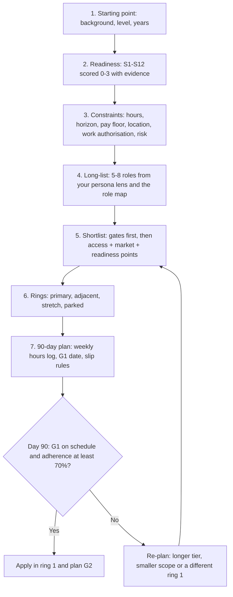

# Targeting Workbook: From Point Zero to a Ranked Target List and a 90-Day Plan

> A step-by-step workbook that takes you from point zero to a ranked target list in three rings (primary, adjacent, stretch) and a 90-day plan judged by gate G1. You supply your own evidence and keep your answers in your own career repository; every market input is graded and one click from its source.

**How to use it.** Work through the seven steps and record your answers in your own career repository, never in this one (decision D-022). The last column of [the seven steps](#the-seven-steps) names the file for each step in [pramedha-template](https://github.com/bhaskarjha-dev/pramedha-template), a free career-repository template; any private notes file also works. Steps 1–3 describe you, Steps 4–6 choose the roles, and Step 7 plans the work. At day 90, redo Steps 5–7 with what you have learned. Terms such as TC, P50, GCC and FDE are defined in the [glossary](glossary.md).

## The short answer

1. **Measure before you choose.** Score yourself 0–3 on twelve readiness skills (S1–S12), with evidence for every score. Your two or three largest gaps set the first 90 days [M · T0-06 D9].
2. **Constraints bind before skills.** Pick an hours tier you can keep: a 17.5-hour week (Tier B) uses 56–74% of an employed adult's average leisure in US time-use data [A data, M derivation · T0-06 KF-10]. If logged hours fall below 70% of plan for three weeks in a row, move to the next-longer timeline rather than push harder [M · T0-06 R1.4].
3. **Filter, then rank.** Park any role that fails a hard constraint (hours and horizon, location, work authorisation, pay floor, risk, legal/tax one-way doors). Rank the rest by access from your background, market position and your readiness on the role's Must skills [P scheme; inputs D and M].
4. **Check pay against measured, level-matched anchors, never tier bands.** The tier bands in the Phase 0 records are unmeasured or mis-sourced ([ERRATA](../../research/ERRATA.md) U4, U5, U7, U14). Use the Levels.fyi medians by level, title and city in [pay benchmarks](../09-compensation/pay-benchmarks.md) instead, matched to your population, level and location [B · T0-17 KF3, KF4; T0-45].
5. **Sequence in rings, targeting distinct fits at each employer.** One primary family first (one résumé family, one or two flagship projects, one interview track), adjacent families next, stretch roles only once their proof exists [D · job-search strategy, expanding rings]. Avoid spray-and-pray repeats at one employer: per-application rates fall from 5.9% to 2.4% at high volume, though applying to two or three genuinely distinct fits lifts the chance of at least one interview from 5.9% to 17.7% [B · T0-24 K3].
6. **Commit for 90 days and judge by the gate.** One route, one hours tier. At Tier B, the day-90 test is G1, a measured v0, not hours logged or courses finished [M · T0-06 R0, D3].

## At a glance



## The seven steps

| Step | You produce | Built from | Record it in (pramedha-template) |
|---|---|---|---|
| 1 Starting point | Background, level and years; the persona column that applies | [T0-06 R2](../../research/sessions/T0-06-career-transition-timelines-5-backgrounds.md#r2-per-archetype-recommendation-and-modeled-time-to-first-offer) and its level mapping | `identity/experience.yaml`; the current state in `VISION.md` |
| 2 Readiness | Twelve scores with evidence; three largest gaps; three fast tests | [T0-06 D9](../../research/sessions/T0-06-career-transition-timelines-5-backgrounds.md#d9-skills-diagnostic-matrix-and-three-fast-tests); [role skill maps §1.1](../03-skills-and-tech/role-skill-maps.md#11-twelve-skill-readiness-rubric-t0-06-target-levels-for-an-ai-engineer-role); T0-13 verifiability ladder | `identity/skills.yaml` (levels and evidence); the gaps in `strategy/study-plan.md` |
| 3 Constraints | Hours tier, horizon, pay floor, location, work authorisation, risk | T0-06 KF-10, R1.4, R2; [T0-17](../../research/sessions/T0-17-compensation-progression-plateaus-equity.md) KF3–KF4; [T0-02](../../research/sessions/T0-02-global-regional-compensation-benchmarks.md) | `VISION.md` (pay floor, horizon); `personal/preferences.yaml` (location, deal-breakers); `strategy/financial.md` (runway) |
| 4 Long-list | 5–8 candidate roles with their hubs read | [GenAI target roles §5](../02-roles/genai-target-roles.md#5-best-targets-by-background-genai-persona-lenses); [role map](../02-roles/role-map.md); role hubs | `strategy/target-roles.md` (the role evaluation table) |
| 5 Shortlist score | Gate results and 0–9 points per role | [Role rankings A.2](../02-roles/role-rankings.md#a2-persona-access-scores-inputs-to-the-access-pillar-and-the-persona-lenses); GenAI target order; role inventories | `strategy/target-roles.md` (the scores; mapping in Step 5) |
| 6 Rings | Rings 1–3 and parked roles | [Job-search strategy: expanding rings](../06-job-search/job-search-strategy.md#recommended-sequencing-expanding-rings); [T0-10](../../research/sessions/T0-10-career-tooling-ecosystem-12-stage-funnel.md); T0-06 R1 | `strategy/target-roles.md` (tiers and the résumé-variant mapping) |
| 7 90-day plan | Weekly plan, hours log, G1 date, slip rules | [T0-06 R3](../../research/sessions/T0-06-career-transition-timelines-5-backgrounds.md#r3-what-to-do-in-the-next-14-days), [D2](../../research/sessions/T0-06-career-transition-timelines-5-backgrounds.md#d2-weekly-hours-versus-pivot-duration-the-model), [D3](../../research/sessions/T0-06-career-transition-timelines-5-backgrounds.md#d3-the-shared-milestone-spine-g1-g4) | `strategy/study-plan.md`; the weekly hours in `records/learning-log.md` |

## How to do it

### Step 1. Name your starting point

The repository models five original backgrounds (`T0-06`) and four additional researched routes (`T0-67`: DevOps/SRE, product managers, India IT-services engineers, and students/new graduates) in [career transitions](../11-tracks/career-transitions.md). The computed [persona lenses](../02-roles/role-rankings.md#52-persona-lenses-switcher-weights-roles-not-plausible-within-12-months-are-excluded) cover the first five columns; pick the closest row below.

| Background | Recommended route | Target level | Persona column (Step 5) |
|---|---|---|---|
| Backend or systems engineer, 5+ years | Lateral move to applied AI engineer; specialise in reliability, evals in CI and cost control [M · T0-06 R2] | Mid–Senior | Backend / Systems SWE |
| Data scientist | AI engineer with an evaluation and error-analysis edge; close the production gap in the first 90 days [M · T0-06 R2] | Mid (watch for down-levelling) | Data Scientist / BI |
| BI analyst | Analytics-AI engineer: text-to-SQL and analytics copilots with execution-accuracy evals; learn Python seriously [M · T0-06 R2] | Junior–Mid | Data Scientist / BI |
| Frontend or full-stack engineer | AI product or full-stack engineer, with agent UX (and optionally on-device AI) as differentiators [M · T0-06 R2] | Mid | Frontend / Full-Stack |
| Non-technical, 5+ years in a domain | One lane: AI PM, AI ops or enablement, domain-evaluation lead, or solutions and FDE-adjacent work [M · T0-06 R2] | Senior in your domain | Non-Technical (5+ yrs) |
| Non-technical, aiming at engineering from zero code | Outside a 12-month horizon; treat it as a two-year plan [M · T0-06 R2] | Junior | None (skip lens) |
| Academic or quantitative PhD who can code | Applied AI engineer, applied scientist or research engineer; research-scientist roles are upside only [M · T0-06 R2] | Mid | PhD / Researcher |
| DevOps, SRE or cloud engineer (Route 6) | Inference engineer, AI infrastructure or ML platform; FDE infra only with 5+ yr customer record [B · T0-67 L120–L122] | Mid–Senior | Backend / Systems SWE (closest proxy) |
| Product manager (Route 7) | Enterprise or mid-size AI PM (~3 yr gate) first; frontier-lab AI PM after 5–10+ yrs and shipped LLM work [B · T0-67 L154–L155] | Mid–Senior | Non-Technical (5+ yrs) |
| India IT-services engineer (Route 8) | 2-quarter internal GenAI practice/bridge test, then GCC AI platform, enablement or applied AI at 4+ yrs [B · T0-67 L181–L183] | Mid | Backend / Systems SWE (or closest technical column) |
| Student or new graduate (Route 9) | Internships (in-person preferred), evaluated end-to-end project and structured early-career programmes [B · T0-67 L65, L88–L89] | Entry / Intern | None (use `--entry` in `gap_analysis.py`) |

- **Aim at your existing level.** T0-06 models career changers as moving laterally [M]. The entry-level squeeze is tech-wide rather than AI-specific: US SWE entry postings stood at 4.5% in Q1 2026 (Indeed) and Stanford Digital Economy Lab's ADP payroll series shows a 19% descriptive shortfall for ages 22–25 in AI-exposed occupations through 2026-06-30 (attenuates under education controls), yet within ICT occupations AI roles are 15.4% entry-level against 12.5% non-AI (JobsPipe) and India sits at 21.2% [B · T0-67 L52; T0-70 L80]. Prior tacit experience remains the hedge [A/B · T0-06.F2].
- **Levels, as T0-06 uses them:** Junior is under about 2 years of relevant experience, Mid about 3–7, Senior 8+ or clear ownership of production systems [M · T0-06 L78].
- **Non-technical with under 5 years in a domain:** build domain depth first. T0-06 does not expect an AI-specific role inside 12 months [M · T0-06 decision rules].
- **PhDs:** do not skip the skills stage. FAD said PhDs could skip it, but T2-01's own PhD playbook runs an 8-week skills block (ERRATA U18).
- **Routes 6–9 and people already in AI:** no longitudinal transition-time measurements exist for Routes 6–9 (`T0-67 L327–L332, E`); use all seven workbook steps, match your proof to your actual gate (serving/Kubernetes for Route 6 infra rather than evals alone [B/M · T0-67 L62]), and treat analogue timelines as unverified.

**Record five answers:** your closest background (row above); years of relevant experience; current level (Junior, Mid, Senior or Staff); the persona column you will read in Step 5; and whether your employer runs an AI initiative you could join (yes, no or unknown).

**Done when:** all five are recorded, and you know which persona column applies (or that none does).

### Step 2. Score your readiness on S1–S12

The rubric is T0-06's twelve-skill diagnostic, reproduced in the [role skill maps §1.1](../03-skills-and-tech/role-skill-maps.md#11-twelve-skill-readiness-rubric-t0-06-target-levels-for-an-ai-engineer-role). The scale runs 0–3: 0 none · 1 tutorial-level awareness · 2 built and shipped something small with feedback · 3 owns it in production or could teach it.

Give each score an evidence entry on the [verifiability ladder](../05-portfolio/proof-of-work-standards.md#the-verifiability-ladder-and-the-level-model): V0 self-asserted, V1 reproducible, V2 externally attested, V3 operationally evidenced [T0-13]. Treat a 2 or 3 backed only by V0 as a claim to test, not a score [P].

| # | Skill | Target (AI-engineer role) |
|---|---|:---:|
| S1 | Production Python or TypeScript (typing, async, packaging, tests) | 3 |
| S2 | LLM API fluency (structured output, tool calling, streaming, token budgets) | 3 |
| S3 | Retrieval and context engineering | 2–3 |
| S4 | Evaluation design (golden sets, judge calibration, regression tests) | 3 |
| S5 | Error analysis and data literacy | 2–3 |
| S6 | Agents and tool-use reliability | 2 |
| S7 | Production ops (CI/CD, deploy, observability, cost, security) | 2–3 |
| S8 | System design for LLM applications | 2 |
| S9 | Frontend and streaming UX for AI | 1 (3 for frontend targets) |
| S10 | Model and inference literacy | 1–2 |
| S11 | Domain judgement and rubric writing | 2 |
| S12 | Product sense and stakeholder communication | 2 |

Record your score (0–3), its evidence (a link and its V0–V3 level) and the gap for each skill.

- Targets are T0-06's levels for an AI-engineer role [M · T0-06 D9]. Compute each gap against the low end of a range.
- For any other role, use the role's own self-assessment: every [role inventory](../03-skills-and-tech/role-skill-inventories.md) has a table for its Must skills (target 3) and Important skills (target 2) on the same scale, for example [AI Engineer §7](../03-skills-and-tech/inventories/ai-engineer.md#7-self-assessment-must-and-important). Its targets are judgement [D]. Step 5 uses it.
- **To rate yourself against several roles at once,** run [scripts/gap_analysis.py](../../scripts/gap_analysis.py). It prints a rating template from your target roles' tiered skills; once you have filled in your 0–3 ratings, it prints each role's coverage of its Must and Important skills, the gaps to close first across all your targets, and the project archetypes that would evidence the most of them. Its target levels are the same judgement [D]. Keep the rating file in your own career repository, or in this repository's git-ignored `personal/` folder; usage is in the [Stage 00 index](README.md#personal-tool-skill-gap-analysis).

**Calibrate against your background.** T0-06's hypotheses for the largest gaps [M · Grade D]:

| Background | Largest gaps (T0-06 D9) |
|---|---|
| Backend or systems | S4, S2, S3 (and S1 if coming from Java or Go) |
| Data scientist | S1, S7, S8 (the production trio), then S2 and S6 |
| BI analyst | S1, S2, S3, S7 |
| Frontend or full-stack | S4, S3, S5, S7 |
| Non-technical | S4 (as evaluation fluency), S5, S2 and basic S1 |
| PhD | S1 and S7 (craft), S8 (interview loops), S12 |
| DevOps / SRE / Cloud | S10 (model/serving engines: vLLM, Triton, quantisation), S2, S4 [B · T0-67 L130] |
| Product manager | S4 (eval rubrics & golden sets), S2 (API limits/cost), S1 (prototype fluency) [B · T0-67 L63, L154] |
| India IT services | S4, S7 (production ownership vs delivery scripts), S8 (system design) [B · T0-67 L181–L183] |
| Student / New grad | S7 (deployment/observability), S4 (evals), S1 (tested production code) [B · T0-67 L65] |

Where your evidence disagrees with the hypothesis, go with your evidence. **Dual-purpose evidence ledger (T2-01):** if you plan to pursue a talent visa (US O-1A, UK Global Talent) within 12–24 months, tag portfolio artifacts in Step 2 that double as visa evidence—judging, public write-ups, open-source contributions with adoption metrics, or talks [P/C · T2-01; T0-08].

**Three fast tests, about a day each** [M · T0-06 D9; shapes from hiring write-ups, Grade D]:
1. **Q&A over 50 documents.** Build a pipeline for 20 questions with known answers; report recall@5 and answer faithfulness. *Pass:* a reproducible script, a metrics table and two failure cases explained.
2. **Explain the request.** Explain what happens between a user pressing Enter and the answer appearing in an LLM app: context assembly, retrieval, tool calls, streaming, cost. *Pass:* failure modes and cost named at each stage.
3. **Design the eval.** For a task in your domain, write 30 test cases, a rubric and a plan to validate an LLM judge. *Pass:* two reviewers score a 20-case pilot and you report their agreement.

**Done when:** all twelve skills have a score and an evidence entry, you have attempted the three tests, and your three largest gaps are written down.

### Step 3. Set your constraints

T0-06's finding is that hours, not compute, are the binding constraint [A data, M · KF-10]. Settle five constraints here: hours and horizon, pay floor, location, work authorisation and risk.

#### 3.1 Hours and horizon

| Tier | Hours a week (model value) | Adherence in the model | Effective hours a week | Fits | Share of average leisure: no child under 18 / child under 18 |
|---|---|:---:|:---:|---|---|
| A | 8–10 (9) | 0.75 | 6.75 | Employed, caregiving or a heavy workload | 29% / 38% |
| B | 15–20 (17.5) | 0.75 | 13.1 | Employed and disciplined; the central planning case | 56% / 74% |
| C | 35–40 (38) | 0.85 | 32.3 | Sabbatical, notice period, bench time or a full-time programme | 121% / 160%: not possible alongside full-time work |

Tiers and parameters are T0-06's model [M · D2]. The leisure shares divide each tier by the BLS American Time Use Survey 2025 averages for employed US adults [A data, M derivation · KF-10]. They are a plausibility check, not your capacity. [Career transitions](../11-tracks/career-transitions.md) owns this model, with its gates and a roadmap for each background; this workbook repeats only the tables its steps work from.

- **The 70% rule.** Log your hours every week. If logged hours fall below 70% of plan for three consecutive weeks, move to the next-longer tier's timeline instead of pushing harder [M · T0-06 R1.4]. T0-06 judges its own timelines probably optimistic for people who do not log hours [D · D11].
- **T0-06's decision rules** [M]:
  - Your employer has an AI initiative and a transfer is possible: go internal-first; Tier A can suffice.
  - You have 6+ months of runway and a strong base (backend, full-stack or data science): consider compressing with Tier C.
  - Under 8 hours a week: plan a 12–18-month horizon, or pick an adjacent role.

**Modelled months to a first offer** [M · T0-06 R2]:

| Background and route | Tier A | Tier B | Tier C | Confidence |
|---|:---:|:---:|:---:|:---:|
| Backend or systems, 5+ years | ~10 (6–14) | ~6 (3.5–8) | ~3 (2–4.5) | Medium-low |
| Data scientist | ~13 (9–19) | ~8 (5–11) | ~5 (3–6.5) | Low |
| BI analyst | ~18 (12–26) | ~11 (7–15) | ~6 (4–8) | Low |
| Frontend or full-stack | ~12 (8–18) | ~7 (5–11) | ~4 (3–6) | Low |
| Non-technical, 5+ years, AI-adjacent roles | ~10.5 (7–16) | ~7 (5–11) | ~5 (3.5–8) | Low |
| Non-technical, engineering from zero code | not meaningful (~39) | ~22 (15–34) | ~12 (8–18) | Low |
| PhD, applied roles | ~13 (9–20) | ~8 (5–12.5) | ~5 (3–8) | Low |

- These are model outputs. They are calibrated on one employed retrospective, a vendor reference class and Huntr's search medians, with the author's own parameters, so they inherit Grade D. No cohort data exists [D · T0-06 KF-9].
- The range runs from all-low to all-high parameters. It is not a statistical interval.
- Every value assumes you persist and eventually succeed; the success rate is unknown.
- The quantitative evidence is mostly US-based (T0-06 reading guide). Internal transfers can beat these numbers, but there is no timing data.

**Horizon test** [P]: if the central value for your row and tier is longer than the months you can wait for an offer, change the tier, the route or the target before you start. If only the high end is longer, keep a fallback, such as an internal move or a ring-2 role.

#### 3.2 Pay floor against measured anchors

Three rules [P]:
1. Compare like with like: total compensation (TC) with TC, base with base, at the same level and in the same location.
2. Title pages pool all levels (T0-02 §6.2). US medians rise by about ×1.2–1.5 per level [B · T0-17 KF3], so a senior candidate should read the upper part of a pooled distribution, not its median.
3. Never compare against a tier band.

> [!IMPORTANT]
> Do not use the tier pay bands in the Phase 0 records. None of them is measured, they conflict with each other, and two "T2 medians" are credited to the wrong session (ERRATA U4, U5, U7, U14). [Pay benchmarks](../09-compensation/pay-benchmarks.md#the-tier-band-problem) sets the conflicting bands beside the measured anchors.

**Where the anchors are.** [Pay benchmarks](../09-compensation/pay-benchmarks.md) holds every measured anchor, each with its grade, sample size and date. Read the one that matches your population, level and location:
- **US, by level:** the Levels.fyi all-company ladder from Entry to Principal, with the AI premium at each level ([the level ladder](../09-compensation/pay-benchmarks.md#the-level-ladder)). It covers software engineers at all companies, and all-company medians understate Big Tech baselines [C · T0-17 L132].
- **US, by title:** Levels.fyi percentiles for ML Engineer and AI Engineer, pooled across levels ([bands by title and city](../09-compensation/pay-benchmarks.md#united-states-bands-by-title-and-city)). The gap between the two titles reflects title and employer mix, not a measured skill premium [B · T0-02 F1].
- **India:** Greater Bengaluru percentiles for ML Engineer, AI Engineer and senior software engineers, and the best-paying employers' senior medians ([India by city, level and employer](../09-compensation/pay-benchmarks.md#india-by-city-level-and-employer)). India pay is two populations: Levels.fyi's self-selected samples are heavy in MNC, GCC and product firms, while broad-market sources centre far lower [B/C · T0-02 F3]. Know which population your target employers belong to. The corpus has no level-by-level India percentiles for AI titles (T0-02 L505).

**Record:** your current TC and base; the floor TC you will accept, and why; the anchor you compare with (population, level, location, date); where the floor sits (below P50, P50–P75, P75–P90 or above P90); and its effect (it rules out roles, filters employers, or neither).

**Reading rule** [P]: a floor above a role's P90 in your location fails that role, unless you can name employers who pay above it. A floor between the P75 and the P90 filters employers, not roles.

#### 3.3 Location, work authorisation and risk

**Location.** Measured facts; the dated counts and shares sit on the linked pages:
- AI titles are rarely remote, and less often than generic backend postings [B · JobsPipe, retrieved 2026-11-02]. The shares are in the [market overview's India section](../01-landscape/market-overview.md#8-india-more-ai-intensive-younger-smaller-in-counts-split-in-pay).
- Research scientist postings (all fields) are concentrated in the US, with a small India share [B · same source; shares in [role rankings A.3](../02-roles/role-rankings.md#a3-india-lens-inputs)].
- Forward Deployed Engineer postings were mostly non-remote in an August 2026 snapshot, with San Francisco and New York the largest locations [B · [T0-01](../../research/sessions/T0-01-genai-role-taxonomy-market-volume.md) L117; counts in the [role catalog profile](../02-roles/role-catalog.md#profile-forward-deployed-engineer)], and one posting asked for up to 50% travel [B · T0-01 L146].
- India demand by role: the [India-first order](../02-roles/genai-target-roles.md#6-india-first-target-order-genai-india-lens) and its inputs in A.3. Most inputs are Grade C or D, so treat the order as directional.

**Work authorisation.** List the right to work for each target location. For Indian engineers, [T0-08](../../research/sessions/T0-08-global-talent-visa-relocation-pathways.md) covers the US O-1A, UK Global Talent, Canada's Global Talent Stream and the EU Blue Card; the [visa and relocation guide](../11-tracks/visa-and-relocation.md) turns it into steps. The live status of contested visa policies and pending rules expires fastest, after 14 days in EGP-1.0's classes ([CONTRIBUTING §3](../../CONTRIBUTING.md#3-writing-standard-egp-10-in-brief); decision D-018), so re-check it before relying on it. This is a pointer, not legal advice.

**Risk and stage-gated one-way doors.** Facts to weigh before locking targets:
- **Frontier-lab equity and liquidity (ERRATA U52):** OpenAI remains private with tender-gated stock (59–72% of senior pay [B · T0-02 L561]), while Anthropic priced its IPO at $83.00/share (2026-11-18) and debuted on Nasdaq (`ANT`) on 2026-11-19 under a staggered lock-up [A/B · ERRATA U52]. See [offer evaluation](../09-compensation/offer-evaluation.md) for public-lock-up vs private-tender risk models.
- **Private-company equity discount:** T0-17's model values private equity near 0.7 of headline for stylised lab-like and Series C firms, and ~0.24 for stale-vintage unicorns (assumption-driven [C/D · T0-17 KF11]).
- **Legal, tax and independent-work one-way doors (T2-01):** several decisions cannot be undone retroactively—confirm before acting (pointers, not legal or tax advice):
  - *India cross-border contracting:* choose between Income-tax Act 2025 `s.58(2)` (old `§44ADA`, ≤₹75L with ≤5% cash receipts), LLP/Pvt Ltd or EOR **before** raising the first invoice, register GST + annual LUT before crossing ₹20L, and file FEMA EDF within 30 days of each invoice month ([India remote tax](../09-compensation/india-remote-tax.md)).
  - *US early-exercised options:* an `83(b)` election expires strictly 30 days after transfer with no extension [A · T0-17 L486].
  - *Talent visas (O-1A / UK Global Talent):* begin evidence assembly 12–18 months ahead [C · T0-08; ERRATA U22] ([visa and relocation](../11-tracks/visa-and-relocation.md)).
  - *Independent / fractional consulting gate (T2-01 KF7):* treat standalone consulting or fractional leadership as a Stage 6+ viability gate requiring 10+ years' seniority, warm pipeline and 6–12 months' runway—not a transition entry route ([freelance and fractional](../11-tracks/freelance-fractional.md)).
- **Expert-contract evaluation work** is at-will, project-based and credential-gated: a cashflow bridge, not primary career employment [C · T0-06 KF-7, D7; T0-66].
- **India GCC pilot trap:** "nearly 70%" of India GCCs are stuck at AI pilots [A-/B · [T0-09](../../research/sessions/T0-09-onboarding-probation-first-90-days.md) L77]. Ask whether a team's AI work is in production.

**Record each constraint with its value, whether it is hard or soft, and the roles it rules out or flags:**
- hours tier, and the hours you will log each week;
- horizon: months until you need an offer;
- location: city, remote, hybrid or relocation;
- work authorisation for each target location;
- pay floor (from 3.2);
- runway: months of expenses without a salary;
- the share of pay you accept as illiquid stock;
- travel and customer-facing work;
- at-will or contract work.

**Done when:** every constraint is recorded and marked hard (it rules a role out) or soft (it lowers a role's ring).

### Step 4. Build a long-list of 5–8 roles

1. Copy your background's row from [GenAI target roles §5](../02-roles/genai-target-roles.md#5-best-targets-by-background-genai-persona-lenses): a primary target, the next targets in the lens's order, and the stretch roles. The order is a model output [M]; the access scores behind it are judgement [D].
2. Searching in India? Read the [India-first order](../02-roles/genai-target-roles.md#6-india-first-target-order-genai-india-lens) as well.
3. Browse the [role map](../02-roles/role-map.md) for roles whose work interests you, and note each one's interview track ([choosing a direction](../02-roles/role-map.md#choosing-a-direction)).
4. Prefer one cluster. The target-roles guide advises: "pick one cluster, aim at its top title, and apply to two adjacent titles in the same cluster with the same portfolio" ([target clusters](../02-roles/genai-target-roles.md#7-target-clusters-one-skill-stack-several-titles)) [D].
5. Read every role's [hub](../02-roles/hubs/README.md): your access score, the Must skills, the proof, the interview track and the résumé variant. The [role catalog](../02-roles/role-catalog.md) defines each title and lists the aliases postings use.

Leadership and independent tracks are ranked separately and reached after years of experience; add them only if you already meet their entry conditions ([§8](../02-roles/genai-target-roles.md#8-leadership-and-independent-tracks-when-to-target-them)).

**Record 5–8 roles,** each with its hub, why it is on your list, its résumé variant and its interview track.

**Done when:** you have 5–8 roles, each with its hub read and its résumé variant and interview track noted.

### Step 5. Score the shortlist

Gates first, then points. The scheme is practice-curated [P]: no session tests a rule like it. Its inputs are graded, and you can change the cut-offs if you record why.

**Gates.** Check each role against your Step 3 constraints:
- **Pass:** no conflict.
- **Flag:** a soft conflict, or no evidence either way (for example, no India demand data).
- **Fail:** a hard conflict. Park the role and stop scoring it.

**Points (0–9):**

| Column | Where to read it | 3 points | 2 points | 1 point | 0 points |
|---|---|:---:|:---:|:---:|:---:|
| Access from your background | Your persona column in [role rankings A.2](../02-roles/role-rankings.md#a2-persona-access-scores-inputs-to-the-access-pillar-and-the-persona-lenses), also on each hub [D] | 7.5 or more (●) | 6–7.4 | 4–5.9 | Under 4 (○) |
| Market position | Rank in the [GenAI target order](../02-roles/genai-target-roles.md#0-the-sorted-target-list) [M]; for an India-based search, the India-first order | Rank 1–2 | Rank 3–8 | Rank 9–14 | Rank 15 or below, or outside the India top 12 |
| Readiness | Your scores on the role's Must skills (its inventory §7, or your gap-analysis report) | All at 2 or more | At least half at 2 or more | At least one at 2 or more | None at 2 or more |

- On A.2's scale, 7.5 or more is a high-volume corridor of about 6–8 months at 15–20 hours a week, 4–7 is plausible but extended, and under 4 is not plausible within 12 months [D · role rankings A.2].
- The rank cut-offs follow the GenAI tiers: ranks 1–2 are Tier 1, 3–8 Tiers 2–3 and 9–14 Tier 4 ([tier rules](../02-roles/genai-target-roles.md#14-tier-rules)).
- **Tie-breakers:** fewer Flags; then your own interest in the work [D]; then the order of your persona lens.

**Record, for each role,** its gate result with the reason, the score behind each column and its points, and the total. If you keep your targets in pramedha-template's 8-parameter role table (P1–P8), this workbook's inputs go into it as follows [P]:

| This workbook | pramedha-template `strategy/target-roles.md` |
|---|---|
| Gates | Checked before scoring: a role that fails is parked, not scored |
| Access from your background | P6 Time to close gaps |
| Market position | P3 Market demand |
| Readiness on the role's Must skills | P1 Skills match and P7 Interview readiness |
| Your pay floor against the role's anchor (Step 3.2) | P4 Salary potential |
| The role's growth path ([growth and progression](../10-onboarding/growth-and-progression.md)) | P5 Growth trajectory |
| Your interest in the work | P2 Interest |
| No measured input in this repository | P8 Competition: your judgement |

**Done when:** every long-listed role has a gate result and a total, and you have applied the tie-breakers to roles within one point of each other. A one-point difference is inside the uncertainty of the inputs; the final order is your decision.

### Step 6. Place roles in rings

The [job-search strategy](../06-job-search/job-search-strategy.md#recommended-sequencing-expanding-rings) sequences targets in expanding rings [D]. These thresholds turn your Step 5 results into rings [P]:

| Ring | Rule | What it gets |
|---|---|---|
| 1 Primary | The highest total with a Pass and access 6 or more, plus any role that shares its résumé variant and interview track | Universal résumé, one family résumé, one or two flagship projects, one interview track |
| 2 Adjacent | The next totals with access 6 or more and a different résumé variant or track; a Flag is allowed if you expect it to clear | Its family and role résumés, plus one project each |
| 3 Stretch | Access 4–5.9, an unmet gate (PhD, lab-tier bar, Staff-level depth), or a Flag you cannot clear yet | Nothing until the proof its hub asks for exists |
| Parked | Any Fail, or access under 4 | A note of the constraint that would bring it back |

Four rules apply across the rings:
- **Target distinct fits; avoid mass repeat applications at one employer.** In Huntr's Q3 2026 data, per-application interview rates fell from 5.9% (1 application) to 2.4% at high repeat volume, while applying to two or three genuinely distinct roles at one company raised the probability of landing at least one interview from 5.9% to 17.7% [B · T0-24 K3] (superseding the Phase 0 Q1 6.07% → 1.91% rule). Check whether an employer's ATS enforces per-email cooldown caps [A · T0-10 L238] and choose the best-matching posting first ([selection rule](../06-job-search/resume-strategy.md#for-each-posting-choose-by-content-then-tailor)).
- **Do not mix funnels.** Expert-contract work, AI PM, FDE and AI engineering have different gatekeepers and different proof [M · T0-06 R1.8; B · T0-67 L373]. Keep ring 1 inside one of them.
- **Calibrate portfolio depth to employer tier (T2-01 KF9).** Growth startups weigh a deployed, evaluated product demo heavily; Big Tech weighs coding/system design plus production ownership; frontier labs and safety orgs weigh upstream open-source PRs (vLLM, SGLang, Inspect Evals), benchmarks or research reproductions ([proof-of-work standards](../05-portfolio/proof-of-work-standards.md)).
- **Prepare for the loop type, not the title.** Applied-AI startups use take-homes, agent debugging and scoping rounds; big-company loops use algorithmic coding, system design and ML design; frontier labs are highly selective, an upside rather than a base case [M · T0-06 R1.3; B · [employer interview loops](../08-interviewing/employer-interview-loops.md)].

**Record your rings:** for each ring, its roles, résumé variant, flagship project (archetype), interview track and start (ring 1 from week 1, with applications from your computed start week; ring 2, for example, after G1; ring 3 when its proof exists), and for every parked role the constraint that would bring it back. In pramedha-template, record ring 1 as Tier A, ring 2 as Tier B and ring 3 as Tier C, and the résumé variants in the role table's variant mapping.

Each hub lists the project archetypes that cover most of the role's Must and Important skills; the job-search strategy's [constraints that bind first](../06-job-search/job-search-strategy.md#the-constraints-that-bind-first) computes the smallest project sets that cover several roles.

**Done when:** ring 1 has one interview track and one résumé family, every ring-2 role has a named project, and every parked role names the constraint that parks it.

### Step 7. Write the 90-day plan

Commit to one route and one hours tier for 90 days. Judge progress by pass/fail gates, not by hours logged or courses finished [M · T0-06 R0].

**Compute your own timeline** with T0-06's model [M · T0-06 D2]:

```text
effective hours a week = planned hours a week × adherence (0.75 at Tiers A and B, 0.85 at Tier C)
build weeks            = core hours ÷ effective hours a week
start applying         ≈ 0.7 × build weeks
weeks to first offer   = build weeks + search lag (weeks after the build ends)
months                 = weeks ÷ 4.345
```

| Background | Core hours: central (low–high) | Search lag after the build, weeks: central (low–high) |
|---|:---:|:---:|
| Backend or systems, 5+ years | 250 (150–350) | 6 (4–8) |
| Frontend or full-stack | 300 (200–450) | 9 (6–12) |
| Data scientist | 300 (200–450) | 11 (8–14) |
| BI analyst | 450 (300–650) | 12 (8–16) |
| Non-technical, AI-adjacent roles | 200 (120–300) | 16 (12–24) |
| Non-technical, engineering from zero code | 1,000 (700–1,500) | 20 (12–32) |
| PhD, applied roles | 300 (200–450) | 12 (8–20) |

- The two 70% figures differ. The adherence rule in Step 3 is about hours logged; starting applications at about 70% of the build is about progress [M · T0-06 D2, KF-11].
- Core hours is the model's least-validated parameter. Recalibrate it at G1 from your own pace [M · T0-06 D2].
- Lower adherence stretches the build: 0.6 instead of 0.75 adds 25% [M · T0-06 D2].

**The gates** [M · T0-06 D3]. [Career transitions](../11-tracks/career-transitions.md) owns them and adds how a stranger checks each one:

| Gate | Due at Tier B | Pass when |
|---|---|---|
| G1 Measured v0 | End of month 3 | A running LLM application over a real corpus or task from your domain; 50+ labelled eval cases (30+ hand-written from real work), versioned with the code; 2+ baselines compared; an error taxonomy from 100+ reviewed traces, with counts; a 500+ word "what broke" memo naming three specific failures. A stranger reproduces the headline numbers from the README in under 30 minutes |
| G2 Operable v1 | End of month 6 | Evals run in CI with a regression threshold; any LLM judge validated on 100+ human labels, with agreement reported and one bias tested; tracing with p50/p95 latency and cost per request; one real user other than you; one postmortem of a real regression, with the test added to prevent it |
| G3 Second pattern and external proof | End of month 9 | A second system with a different failure surface; one public write-up with numbers; one external contribution; 5+ mock loops; 15–20 targeted applications |
| G4 Convert or re-plan | End of month 12 | An offer or internal role change, or a written funnel diagnosis and a re-plan that changes loop type, level or tier |

- **Variants:** non-technical lanes use G1-domain, a golden set of 100+ real tasks with rubrics, adjudication rules and agreement between two reviewers, comparing 2–3 models against the existing human process. BI analysts use G1-lite, a text-to-SQL copilot over a public schema with 50 questions and gold SQL, scored by execution accuracy [M · T0-06 D5, D7].
- **Other tiers (reconciling T0-06 D2 vs T2-01 L153):** this workbook scales build-gate dates by **effective hours** (`T0-06 D2`): Tier A gives ~0.51× of Tier B's effective hours (6.75 vs 13.1 h/wk, ~×2.0 duration, placing G1 near month 6), while Tier C gives ~2.47× (32.3 vs 13.1 h/wk, ~×0.4 duration, placing G1 inside month 2) [M · T0-06 D2]. `T2-01 L153` cites a coarser ×1.5 / ×0.5 rule of thumb; use effective hours for solo build gates, and note that externally gated steps (user feedback, open-source reviews, visa letters) compress closer to ×0.5–×0.7 [P].
- **Behavioural and loop calibration (`STAR-AI`, T2-01 / T0-46):** schedule 30–60 minutes a week from week 9 onward to write four `STAR-AI` stories covering probabilistic trade-offs, incident ownership and responsible AI ([behavioural calibration](../08-interviewing/behavioral-calibration.md)). Behavioural screens act as a strict veto at Anthropic (values) and Amazon (Bar Raiser) and drive down-level / committee variance at Google HC [B · T0-46 K3].

**Weeks 1–2**, from T0-06 R3:
1. Finish Steps 1–2 and write down your scores.
2. Pick the route and the hours tier. Block the hours in your calendar and compare them with the leisure shares in Step 3.
3. Choose one real corpus or task from your own domain, and hand-write 30 evaluation cases from real work. G1 needs them.
4. Ship a v0 within two weeks on a hosted model API, logging every trace.
5. Find an internal sponsor or AI initiative and ask for a scoped assignment. T0-06 suggests 6–8 weeks of trying internally, in parallel with any external search; its evidence is four practitioner accounts [D · R1.2].
6. Open free accounts only, and do not pay for GPUs yet: most GenAI application work needs no GPU [A/B · T0-06 KF-12].
7. Put G1–G4 in your calendar, with a monthly review of funnel numbers: applications, screens, take-homes, onsite loops and offers.

Two habits run through the whole plan. Build the eval harness before the second feature: evaluation is the most-cited stack challenge in the 2026 AI Engineering Survey and the most consistent theme in hiring write-ups [B/C · T0-06 KF-4, R1.1]. And publish at G1 rather than building in private [D · T0-06 D11].

The template below assumes Tier B and follows T0-06's backend roadmap for weeks 3–12. At Tier A or C, stretch or compress weeks 3–12 by the scaling rule above; at Tier A, day 90 is a progress check at roughly half of G1, not the gate. For other backgrounds, the months 1–3 row of T0-06 D4–D8, or the [learning order by background](../03-skills-and-tech/learning-roadmaps.md#adjust-for-your-starting-background), changes the content but not the gate.

| Weeks | Focus | Deliverable | Done when |
|---|---|---|---|
| 1–2 | Diagnostic, route and v0 | Scores; 30 hand-written eval cases; a v0 with traces | The v0 runs end to end on your corpus |
| 3–6 | Measure | 50+ labelled cases; a harness with a metrics table; two baselines | One command regenerates the metrics table |
| 7–12 | Diagnose and fix | Error taxonomy from 100+ traces; top three failure classes fixed; cost and latency logged; memo; public write-up | The G1 criteria are met |
| 13 | Gate review | G1 and adherence checked; applications start at your computed start week | The decision is written down |
| Weekly | Hours log | Planned against logged | The 70% rule applied |
| Monthly | Funnel review | Applications, screens, take-homes, onsites, offers | Numbers recorded |

Record the plan, with hours planned and logged for each block, in your own career repository (pramedha-template: `strategy/study-plan.md`, with the weekly hours in `records/learning-log.md`).

**If a gate slips** [M · T0-06 D3; heuristics, Grade D]:
- G1 not passed by the end of month 4 at Tier B: check adherence first, then scope creep and a missing eval set. Move to the next-longer tier before adding hours.
- No screens after 15 targeted applications: the problem is positioning or résumé signal, not skill. Get a practitioner to review your artifacts and résumé.
- Three failed take-homes: invest in eval design and error analysis.
- Onsites failed at system design: practise system design and DSA for big-company loops, or retarget applied-AI loops.

**Done when:** every week has planned hours, G1 has a date in your calendar, and you have written down what you will do if G1 slips.

## Worked example: a senior backend engineer in Bengaluru

> [!NOTE]
> This is an illustrative persona, not a real person and not a recommendation. Its inputs (experience, scores, floor, horizon, runway) are invented for the example. Market pay figures come from RP2 `T0-45` (November 2026), and role ranks, statuses, Must counts and India demand signals reflect the repository as of 2026-11-19.

### Example inputs (Steps 1–3)

| Item | Value |
|---|---|
| Background and level | Backend engineer, 8 years, Java and Python; Senior |
| Employer | Runs a small AI initiative; a transfer is uncertain |
| Hours | Tier B, 17.5 a week; employed, no children |
| Horizon | 9 months to an offer |
| Runway | 4 months, below the 6 months T0-06's Tier C rule asks for |
| Location | Bengaluru, on-site or hybrid; no relocation; little travel |
| Work authorisation | Indian citizen; India-based roles only |
| Pay floor | No cut from existing TC, set here to the Bengaluru Senior software engineer Levels.fyi median, ≈ ₹56.1L [B · T0-45; T0-17 KF4] |
| Risk | Prefers cash to illiquid stock; no contract work |

**Step 2 scores.** The example uses T0-06's backend hypotheses [M · D9]. Where D9 gives a range or "varies", the example picks a value. S8 counts LLM system design; classical system design would score 3.

| | S1 | S2 | S3 | S4 | S5 | S6 | S7 | S8 | S9 | S10 | S11 | S12 |
|---|:---:|:---:|:---:|:---:|:---:|:---:|:---:|:---:|:---:|:---:|:---:|:---:|
| Score | 2 | 1 | 1 | 0 | 1 | 1 | 3 | 1 | 0 | 0 | 1 | 2 |
| Target (low end) | 3 | 3 | 2 | 3 | 2 | 2 | 2 | 2 | 1 | 1 | 2 | 2 |
| Gap | 1 | 2 | 1 | 3 | 1 | 1 | 0 | 1 | 1 | 1 | 1 | 0 |

The largest gaps are S4 evaluation design (3) and S2 LLM API fluency (2). Eight skills tie at 1; the example takes S3 retrieval third, following D9's backend row.

**Step 3 results.**
- **Horizon:** the backend model gives ~6 months (3.5–8) at Tier B [M · T0-06 R2]. Both the central value and the high end fit 9 months, so the horizon test passes. At Tier A (~10 months, 6–14) it would fail.
- **Hours:** 17.5 hours is about 56% of average leisure for an employed adult without children in US data. The corpus has no India equivalent.
- **Pay floor:** ₹56.1L sits near the P90 of the Bengaluru all-level Levels.fyi AI Engineer distribution (P50 ₹20.0L, P90 ₹60.6L [B · T0-45]) and between the P50 and P90 for ML Engineer (P50 ₹44.4L, P90 ₹80.7L [B · T0-45]); the single sampled India Inference Engineer posting band is ₹24–36L [C · T0-56], and 0 of 10 sampled India AI Infrastructure postings disclosed pay [B · T0-54]. The dated bands sit in [pay benchmarks](../09-compensation/pay-benchmarks.md#india-by-city-level-and-employer). **Effect:** the floor filters employers more than roles—for AI Engineer, AI Infrastructure and ML Platform titles, this persona must target the upper India pay population (Big Tech, global product firms and top-tier GCCs, where Bengaluru Senior/L5–L6 packages clear ₹56L–₹1.3Cr+ [B · T0-45]).

**Step 4 long-list.** The backend row of §5 (AI Engineer, FDE, Applied AI, AI Infrastructure, Agentic, ML Platform / MLOps, ML Engineer, and Inference as stretch) cross-checked against the [India-first order](../02-roles/genai-target-roles.md#6-india-first-target-order-genai-india-lens) ([role rankings §5.2](../02-roles/role-rankings.md#52-persona-lenses-switcher-weights-roles-not-plausible-within-12-months-are-excluded)).

### Example scores and gates (Step 5)

Access is the backend column of A.2. Market is the India-first order (as of 2026-11-19), because the search is India-based. Readiness counts the role's Must skills (`data/skills_ontology.json`, inventory §7) where the persona's self-score is 2 or more. RP2 dossiers (`T0-53`, `T0-54`, `T0-56`, `T0-58`) cleared the three Phase 0 "no India evidence" flags for AI Infrastructure, Applied AI and Inference.

| Role | Gate result | Access | Market (India) | Readiness | Total |
|---|---|:---:|:---:|:---:|:---:|
| [AI Engineer](../02-roles/hubs/ai-engineer.md) | Pass: live India postings measured [B · T0-48, T0-70]; floor filters employers | 9 → 3 | #1 → 3 | 1 of 4 → 1 | **7** |
| [AI Infrastructure Engineer](../02-roles/hubs/ai-infrastructure-engineer.md) | Pass (flag cleared): 10/35 sampled postings in India (NVIDIA, Sarvam, Soket, Deloitte USI) [B · T0-54]; 0/10 post pay | 7 → 2 | #5 → 2 | 6 of 8 → 2 | **6** |
| [ML Platform / MLOps Engineer](../02-roles/hubs/ml-platform-engineer.md) | Pass: graduated V→E (`T0-58`); 13/37 sampled in India [C · T0-58]; floor filters employers | 7 → 2 | #8 → 2 | 6 of 8 → 2 | **6** |
| [Applied AI Engineer](../02-roles/hubs/applied-ai-engineer.md) | Pass (flag cleared): verified India hiring (OpenAI Bengaluru, Anthropic field, startups) [C · T0-53]; lab-tier bar | 8.5 → 3 | #6 → 2 | 1 of 6 → 1 | **6** |
| [ML Engineer, GenAI track](../02-roles/hubs/ml-engineer.md) | Pass: live India postings measured, 45.0% naming LLM [B/M · T0-49] | 5.5 → 1 | #2 → 3 | 1 of 4 → 1 | **5** |
| [Inference Engineer](../02-roles/hubs/inference-engineer.md) | Flag (pay floor): India demand cleared (9/37 sampled [B · T0-56]), but sampled India band ₹24–36L sits below ₹56.1L floor [C] | 7 → 2 | #12 → 1 | 3 of 9 → 1 | **4** |
| [Agentic AI Engineer](../02-roles/hubs/agentic-ai-engineer.md) | Pass: kept Watch (`W`, `T0-57`); used on India services/GCC listings [C] | 8.5 → 3 | Outside top 12 → 0 | 1 of 5 → 1 | **4** |
| [Forward Deployed Engineer](../02-roles/hubs/forward-deployed-engineer.md) | Fail: mostly non-remote US hubs, travel expectations and `customer-application` track [B · T0-01, T0-51] (despite India 19× YoY growth from a low base [B · T0-25]) | 7.5 | #9 | — | Parked |

The example's self-scores on Must skills:
- **AI Engineer (4) & Agentic AI Engineer (5):** Python at 2; LLM APIs, agents, RAG, prompt/context design and tool calling at 1.
- **Applied AI Engineer (6):** Python at 2; LLM APIs, RAG, agents, customer scoping and LLM evaluation below 2.
- **AI Infrastructure (8):** Linux, Kubernetes, networking, Python, SRE and observability at 2+; Terraform / IaC and GPU fleet ops/scheduling below 2 (6 of 8).
- **ML Platform / MLOps (8):** Kubernetes, Git & CI/CD, Docker, Python, cloud and observability at 2+; Terraform / IaC and MLOps lifecycle below 2 (6 of 8).
- **Inference (9):** Python, system design and Kubernetes at 2+; C++, GPU fundamentals, PyTorch internals, serving engines (vLLM/SGLang/TensorRT-LLM) and continuous batching/KV cache below 2 (3 of 9).
- **ML Engineer (4):** Python at 2; ML fundamentals, PyTorch and deep learning/transformers below 2 (1 of 4).

### Example rings (Step 6)

| Ring | Roles | Résumé variant | Flagship project | Interview track | Work starts |
|---|---|---|---|---|---|
| 1 | AI Engineer (plus Agentic AI Engineer where India postings use the title) | A1 | P1 Evaluated RAG system over a real corpus, then P2 Reliable agent | Application | Week 1; applications from week 13 |
| 2 | AI Infrastructure Engineer; ML Platform / MLOps Engineer; Applied AI Engineer | D2; A2 | P6 Self-hosted LLM platform on Kubernetes (D2); Applied AI reuses P1 and P2 (A2) | Infrastructure; Customer-application | After G1 |
| 3 | ML Engineer (GenAI track); Inference Engineer | B1; D1 | P4 Prompt vs RAG vs fine-tune; P5 Single-GPU serving and quantisation study | Classic ML design; Infrastructure | When its proof exists |
| Parked | Forward Deployed Engineer | — | — | Customer-application (U48) | If relocation or travel becomes acceptable |

Why:
- AI Engineer leads Ring 1 (Total 7); Agentic AI Engineer drops outside the India top 12 (Total 4, kept Watch `W`) but stays a zero-extra-cost alias target on the same `A1` résumé family and Application track ([which roles need their own résumé](../06-job-search/resume-strategy.md#which-roles-need-their-own-résumé-computed)).
- AI Infrastructure (`#5` India), ML Platform (`#8` India, newly Established `E`) and Applied AI (`#6` India) all score Total 6 after RP2 cleared their India demand flags, moving into Ring 2 immediately behind AI Engineer.
- ML Engineer goes to Ring 3 on access (5.5) despite its India rank (`#2`) and higher pay; Inference stays in Ring 3 due to its Staff-level serving depth gate (3 of 9 Must skills) and thin disclosed India pay (`₹24–36L`).
- The infrastructure/platform family scores highest on readiness (6 of 8 Must skills). If Tier B slips, swapping Ring 1 (`A1`) and Ring 2 (`D2`) is a clean re-plan, though `T0-06` models no timeline for platform roles.

### Example 90-day plan (Step 7)

Model arithmetic [M · T0-06 D2]: 250 core hours (150–350) ÷ 13.1 effective hours a week ≈ 19 weeks of build (11–27). Applications start at about week 13 (0.7 × 19). Adding the 6-week search lag (4–8) gives about 25 weeks, or 5.8 months (3.6–8.0): D2's result for this background, which R2 rounds to ~6 (3.5–8).

| Weeks | Focus | Deliverable | Done when |
|---|---|---|---|
| 1–2 | Route, v0 and internal ask | 17.5 hours blocked; 30 eval cases hand-written from the persona's domain; a v0 on a hosted API with traces; a scoped-assignment request to the internal AI team | The v0 answers over the corpus, with every trace logged |
| 3–6 | Measure | 50 eval cases; a harness reporting retrieval recall@k, answer correctness against a rubric and citation faithfulness; two baselines | One command regenerates the metrics table |
| 7–12 | Diagnose, fix and calibrate | Error analysis of 100+ traces; top three failure classes fixed; hybrid retrieval and a reranker tested; cost and latency logged; memo; public write-up; 4 `STAR-AI` stories drafted | G1 passed and behavioural bank started |
| 13 | Gate review and first applications | G1 and adherence checked; first targeted ring-1 applications (1–3 distinct fits per employer where warranted); D2 family résumé drafted from existing platform work | Decision written; applications logged |
| Weekly | Hours log | 17.5 hours planned against logged | Under 70% (12.25 hours) for three weeks moves the plan to the Tier A timeline (~10 months), which breaks the 9-month horizon: re-plan scope or rings |

For GCC roles, the persona asks in screens whether the team's AI work is in production [A-/B · T0-09 L77].

### What would change the example

- The JobsPipe recount scheduled by 2026-12-01 may move the India-first order ([GenAI target roles §9](../02-roles/genai-target-roles.md#9-caveats-and-what-would-change-the-order)).
- Disclosed senior India pay bands above ₹56L for Inference Engineer or AI Infrastructure would clear Inference's pay-floor Flag.
- Accepting relocation or travel would un-park FDE (backend access 7.5, `#9` India).
- A runway of 6+ months would make Tier C (~3 months, 2–4.5) an option [M · T0-06 R2].

## Checklist

- [ ] I picked the background row that matches me across the nine researched routes, or noted that none does.
- [ ] All twelve skills have a 0–3 score and an evidence entry (V0–V3), with visa-reusable artifacts tagged if needed.
- [ ] I attempted the three fast tests and wrote down my three largest gaps.
- [ ] My hours tier fits my real week, and my hours log is set up.
- [ ] I compared my horizon with the modelled months for my background and tier (or noted unmeasured status for Routes 6–9).
- [ ] My pay floor is compared with a measured anchor of the same population, level and location, not a tier band.
- [ ] Every constraint and legal/tax one-way door is marked hard or soft before acting.
- [ ] I have 5–8 long-listed roles and have read each hub.
- [ ] Each role has a gate result and a 0–9 total.
- [ ] Ring 1 has one résumé family and one interview track; each ring-2 role has a named project calibrated to employer tier.
- [ ] I will target genuinely distinct fits per company rather than mass-applying, choosing by basic qualifications.
- [ ] My 90-day plan has weekly hours, a G1 date, a `STAR-AI` behavioural prep block and a slip rule.
- [ ] My day-90 review is in my calendar.

## Pitfalls

| Red flag | Why it hurts | Fix |
|---|---|---|
| Targeting the highest pay ceiling first | Frontier research roles are "not plannable", and lab slots are scarce [M · T0-06 D8, KF-8] | Plan on a corridor with access 6 or more; keep labs in ring 3 |
| Comparing your floor with a tier band | The bands are unmeasured or mis-sourced (ERRATA U4, U5, U7, U14) | Use a measured anchor matched on level and location |
| Mass-applying to repeated openings at one company | Per-application interview rate falls from 5.9% to 2.4% at high volume and ATSs can block repeats [B · T0-24 K3; A · T0-10 L238] | Apply only to 1–3 genuinely distinct fits per company |
| Running four funnels at once | AI PM, FDE, AI engineering and expert contracts have different gatekeepers and proof [M · T0-06 R1.8; B · T0-67 L373] | Keep ring 1 in one family |
| Planning Tier B without logging hours | 17.5 hours is 56–74% of average leisure, and unlogged plans run optimistic [A data, M; D · T0-06 KF-10, D11] | Log weekly and apply the 70% rule |
| Reading modelled months as a promise | Every timeline is conditional on success and rests on survivor-biased anchors; Routes 6–9 are unmeasured [D · T0-06 KF-9; E · T0-67 L379] | Judge by gates; recalibrate core hours at G1 |
| Studying foundations for months before shipping | Hiring write-ups ask for built and evaluated systems [D · T0-06 D11] | Ship a v0 within two weeks |
| Scoring roles before checking location | AI titles are rarely remote [B · JobsPipe, retrieved 2026-11-02] | Run the gates before the points |

## Evidence and limits

- **Measured (A, B):** the pay figures in the worked example (Levels.fyi Bengaluru via `T0-45`, November 2026); the remote and location patterns (JobsPipe 2026-11-02; Fast AI Jobs); US time-use averages (BLS ATUS 2025); Huntr Q3 2026 multi-application conversion rates (`T0-24 K3`); RP2 role-dossier India posting samples (`T0-53`, `T0-54`, `T0-56`, `T0-58`); Anthropic's 2026-11-19 Nasdaq IPO (`ERRATA U52`).
- **Single-source, vendor or correlational (C):** Huntr's self-tracked funnel rates; single-band India Inference pay (`₹24–36L`, `T0-56`); India Applied AI and Agentic listing samples.
- **Models and judgement (M, D):** time to first offer (`T0-06 R2`: medium-low confidence for backend, low for other backgrounds; Routes 6–9 unmeasured `E · T0-67`); starting-gap hypotheses; persona access scores (`role rankings A.2`); GenAI target order; S1–S12 targets.
- **Practice-curated [P]:** the 0–9 point scale, ring thresholds, pay-floor reading rule, horizon test and dual portfolio/visa evidence tagging. Change them if your situation differs, and record why.
- **Geography:** `T0-06` and BLS ATUS are US-centred; RP2 expanded India demand and Bengaluru pay evidence across `T0-45`, `T0-53`, `T0-54`, `T0-56`, `T0-58`, `T0-67`, though many role-level India pay cells remain proxies or Grade D.
- **Dates:** refreshed on 2026-11-19 against RP2 sessions; `review_by: 2027-01-10` (left unchanged by this refresh, which re-read sessions rather than live sources; check linked pages for 14-day V0 visa rules and 31-day V1 posting counts).
- **Errata applied:** U4, U5, U7, U14 (tier pay bands), U18 (PhDs keep the skills stage), U22 (O-1A 12–18m lead time is C), U48 (nine interview tracks), U52 (Anthropic Nasdaq `ANT` IPO 2026-11-19).
- **What would change this workbook:** a longitudinal cohort study of transition time-to-offer across all nine backgrounds; disclosed senior India pay bands for infrastructure and inference roles; or a JobsPipe recount shifting tier boundaries.

## Next steps

- **Your ring-1 roles:** open each role's hub (for example [AI Engineer](../02-roles/hubs/ai-engineer.md)) and fill in its inventory self-assessment ([AI Engineer §7](../03-skills-and-tech/inventories/ai-engineer.md#7-self-assessment-must-and-important); every role in the [inventories index](../03-skills-and-tech/role-skill-inventories.md)), or run the [gap-analysis script](README.md#personal-tool-skill-gap-analysis) across all your targets at once.
- **Check the landscape and hype:** [market overview](../01-landscape/market-overview.md), [target employers](../01-landscape/target-employers.md) and the [hype register](../01-landscape/hype-register.md).
- **Close the gaps:** [learning roadmaps](../03-skills-and-tech/learning-roadmaps.md), [learning resources](../03-skills-and-tech/learning-resources.md) and [credential catalog](../04-certifications/credential-catalog.md).
- **Build the proof:** [project archetypes](../05-portfolio/project-archetypes.md), [proof-of-work standards](../05-portfolio/proof-of-work-standards.md) and [constraints that bind first](../06-job-search/job-search-strategy.md#the-constraints-that-bind-first).
- **Run the search:** [application operating system](../06-job-search/application-operating-system.md), [résumé strategy](../06-job-search/resume-strategy.md), [résumé skills matrix](../06-job-search/resume-skills-matrix.md#resume-ai-engineer), [LinkedIn guide](../07-networking/linkedin-guide.md), [referrals and outreach](../07-networking/referrals-and-outreach.md) and [fellowships and residencies](../07-networking/fellowships-and-residencies.md).
- **Prepare the loop:** [interview loops](../08-interviewing/interview-loops.md), [employer interview loops](../08-interviewing/employer-interview-loops.md) and [behavioural calibration](../08-interviewing/behavioral-calibration.md).
- **Pay and offers:** [pay benchmarks](../09-compensation/pay-benchmarks.md) and [offer evaluation](../09-compensation/offer-evaluation.md).
- **By background or location:** [career transitions](../11-tracks/career-transitions.md), [country rankings](../11-tracks/country-rankings.md), [remote cross-border work](../11-tracks/remote-cross-border.md), [India remote playbook](../11-tracks/india-remote-playbook.md), [freelance and fractional](../11-tracks/freelance-fractional.md) and [visa and relocation](../11-tracks/visa-and-relocation.md).
- **The evidence:** findings for [roles](../../research/findings.md#stage-02) and for [tracks and transitions](../../research/findings.md#stage-11); back to [Start Here](../README.md).
