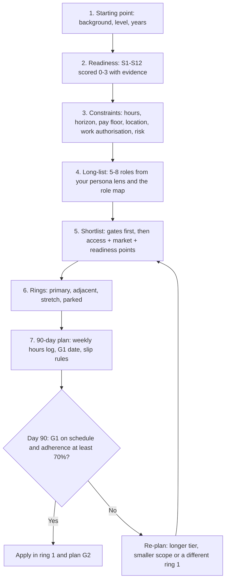

# Targeting Workbook: From Point Zero to a Ranked Target List and a 90-Day Plan

> A fill-in workbook that takes you from point zero to a ranked target list in three rings (primary, adjacent, stretch) and a 90-day plan judged by gate G1. You supply your own evidence; every market input is graded and one click from its source.

**How to use it.** Copy the fill-in tables into your own notes and replace each bracketed placeholder, such as `[ ]`, with your answer. Steps 1–3 describe you, Steps 4–6 choose the roles, and Step 7 plans the work. At day 90, redo Steps 5–7 with what you have learned. Terms such as TC, P50, GCC and FDE are defined in the [glossary](glossary.md).

## The short answer

1. **Measure before you choose.** Score yourself 0–3 on twelve readiness skills (S1–S12), with evidence for every score. Your two or three largest gaps set the first 90 days [M · T0-06 D9].
2. **Constraints bind before skills.** Pick an hours tier you can keep: a 17.5-hour week (Tier B) uses 56–74% of an employed adult's average leisure in US time-use data [A data, M derivation · T0-06 KF-10]. If logged hours fall below 70% of plan for three weeks in a row, move to the next-longer timeline rather than push harder [M · T0-06 R1.4].
3. **Filter, then rank.** Park any role that fails a hard constraint (hours and horizon, location, work authorisation, pay floor, risk). Rank the rest by access from your background, market position and your readiness on the role's Must skills [P scheme; inputs D and M].
4. **Check pay against measured, level-matched anchors, never tier bands.** The tier bands in the Phase 0 records are unmeasured or mis-sourced ([ERRATA](../../research/ERRATA.md) U4, U5, U7, U14). Use Levels.fyi median total compensation instead: US Senior ≈ $312K (2025 figures); Bengaluru Senior software engineer ≈ ₹56.0L (October 2026) [B · T0-17 KF3, KF4].
5. **Sequence in rings, one company at a time.** One primary family first (one résumé family, one or two flagship projects, one interview track), adjacent families next, stretch roles only once their proof exists [D · job-search strategy §2.7]. Apply once per company per cycle [C · T0-10].
6. **Commit for 90 days and judge by the gate.** One route, one hours tier. At Tier B, the day-90 test is G1, a measured v0, not hours logged or courses finished [M · T0-06 R0, D3].

## At a glance



## The seven steps

| Step | You produce | Built from |
|---|---|---|
| 1 Starting point | Background, level and years; the persona column that applies | [T0-06 R2](../../research/sessions/T0-06-career-transition-timelines-5-backgrounds.md#r2-per-archetype-recommendation-and-modeled-time-to-first-offer) and its level mapping |
| 2 Readiness | Twelve scores with evidence; three largest gaps; three fast tests | [T0-06 D9](../../research/sessions/T0-06-career-transition-timelines-5-backgrounds.md#d9-skills-diagnostic-matrix-and-three-fast-tests); [skills catalog §1.1](../03-skills-and-tech/role-skill-maps.md#11-twelve-skill-readiness-rubric-t0-06-target-levels-for-an-ai-engineer-role); T0-13 verifiability ladder |
| 3 Constraints | Hours tier, horizon, pay floor, location, work authorisation, risk | T0-06 KF-10, R1.4, R2; [T0-17](../../research/sessions/T0-17-compensation-progression-plateaus-equity.md) KF3–KF4; [T0-02](../../research/sessions/T0-02-global-regional-compensation-benchmarks.md) |
| 4 Long-list | 5–8 candidate roles with their hubs read | [GenAI target roles §5](../02-roles/genai-target-roles.md#5-best-targets-by-background-genai-persona-lenses); [role map](../02-roles/role-map.md); role hubs |
| 5 Shortlist score | Gate results and 0–9 points per role | [Role rankings A.2](../02-roles/role-rankings.md#a2-persona-access-scores-inputs-to-the-access-pillar-and-the-persona-lenses); GenAI target order; role inventories |
| 6 Rings | Rings 1–3 and parked roles | [Job-search strategy §2.7](../06-job-search/job-search-strategy.md#27-recommended-sequencing-expanding-rings); [T0-10](../../research/sessions/T0-10-career-tooling-ecosystem-12-stage-funnel.md); T0-06 R1 |
| 7 90-day plan | Weekly plan, hours log, G1 date, slip rules | [T0-06 R3](../../research/sessions/T0-06-career-transition-timelines-5-backgrounds.md#r3-what-to-do-in-the-next-14-days), [D2](../../research/sessions/T0-06-career-transition-timelines-5-backgrounds.md#d2-weekly-hours-versus-pivot-duration-the-model), [D3](../../research/sessions/T0-06-career-transition-timelines-5-backgrounds.md#d3-the-shared-milestone-spine-g1-g4) |

## How to do it

### Step 1. Name your starting point

T0-06 models five starting backgrounds, two of them split by route, and the [persona lenses](../02-roles/role-rankings.md#52-persona-lenses-switcher-weights-roles-not-plausible-within-12-months-are-excluded) in the role rankings use the same five. Pick the closest row.

| Background | Route T0-06 recommends | Target level |
|---|---|---|
| Backend or systems engineer, 5+ years | Lateral move to applied AI engineer; specialise in reliability, evals in CI and cost control | Mid–Senior |
| Data scientist | AI engineer with an evaluation and error-analysis edge; close the production gap in the first 90 days | Mid (watch for down-levelling) |
| BI analyst | Analytics-AI engineer: text-to-SQL and analytics copilots with execution-accuracy evals; learn Python seriously | Junior–Mid |
| Frontend or full-stack engineer | AI product or full-stack engineer, with agent UX (and optionally on-device AI) as differentiators | Mid |
| Non-technical, 5+ years in a domain | One lane: AI PM, AI ops or enablement, domain-evaluation lead, or solutions and FDE-adjacent work | Senior in your domain |
| Non-technical, aiming at engineering from zero code | Outside a 12-month horizon; treat it as a two-year plan | Junior |
| Academic or quantitative PhD who can code | Applied AI engineer, applied scientist or research engineer; research-scientist roles are upside only | Mid |

Source: T0-06 R2 [M].

- **Aim at your current level.** T0-06 models career changers as moving laterally [M]. The reason is that the junior door is the narrowest: employment of 22–25-year-olds in the most AI-exposed occupations is 19% below trend, with no comparable gap for experienced workers [A · T0-06 KF-2; descriptive, and contested in the literature].
- **Levels, as T0-06 uses them:** Junior is under about 2 years of relevant experience, Mid about 3–7, Senior 8+ or clear ownership of production systems [M · T0-06 L78].
- **Non-technical with under 5 years in a domain:** build domain depth first. T0-06 does not expect an AI-specific role inside 12 months [M · T0-06 decision rules].
- **PhDs:** do not skip the skills stage. FAD said PhDs could skip it, but T2-01's own PhD playbook runs an 8-week skills block (ERRATA U18).
- **No row fits** students, new graduates or people already in AI roles: T0-06 modelled pivots from these backgrounds only. Use the steps, skip the timeline model, and if you are early in your career, plan around the junior squeeze.

| Item | Your answer |
|---|---|
| Closest background (row above) | [ ] |
| Years of relevant experience | [ ] |
| Current level (Junior, Mid, Senior, Staff) | [ ] |
| Persona column you will read in Step 5 | [ ] |
| Does your employer run an AI initiative you could join? | [yes / no / unknown] |

**Done when:** every row has an answer, and you know which persona column applies (or that none does).

### Step 2. Score your readiness on S1–S12

The rubric is T0-06's twelve-skill diagnostic, reproduced in the [skills catalog §1.1](../03-skills-and-tech/role-skill-maps.md#11-twelve-skill-readiness-rubric-t0-06-target-levels-for-an-ai-engineer-role). The scale runs 0–3: 0 none · 1 tutorial-level awareness · 2 built and shipped something small with feedback · 3 owns it in production or could teach it.

Give each score an evidence entry on the [verifiability ladder](../03-skills-and-tech/role-skill-maps.md#13-proof-of-work-by-tier-t2-01-kf9-t0-13): V0 self-asserted, V1 reproducible, V2 externally attested, V3 operationally evidenced [T0-13]. Treat a 2 or 3 backed only by V0 as a claim to test, not a score [P].

| # | Skill | Target (AI-engineer role) | You (0–3) | Evidence (link, V0–V3) | Gap |
|---|---|:---:|:---:|---|:---:|
| S1 | Production Python or TypeScript (typing, async, packaging, tests) | 3 | [ ] | [ ] | [ ] |
| S2 | LLM API fluency (structured output, tool calling, streaming, token budgets) | 3 | [ ] | [ ] | [ ] |
| S3 | Retrieval and context engineering | 2–3 | [ ] | [ ] | [ ] |
| S4 | Evaluation design (golden sets, judge calibration, regression tests) | 3 | [ ] | [ ] | [ ] |
| S5 | Error analysis and data literacy | 2–3 | [ ] | [ ] | [ ] |
| S6 | Agents and tool-use reliability | 2 | [ ] | [ ] | [ ] |
| S7 | Production ops (CI/CD, deploy, observability, cost, security) | 2–3 | [ ] | [ ] | [ ] |
| S8 | System design for LLM applications | 2 | [ ] | [ ] | [ ] |
| S9 | Frontend and streaming UX for AI | 1 (3 for frontend targets) | [ ] | [ ] | [ ] |
| S10 | Model and inference literacy | 1–2 | [ ] | [ ] | [ ] |
| S11 | Domain judgement and rubric writing | 2 | [ ] | [ ] | [ ] |
| S12 | Product sense and stakeholder communication | 2 | [ ] | [ ] | [ ] |

- Targets are T0-06's levels for an AI-engineer role [M · T0-06 D9]. Compute each gap against the low end of a range.
- For any other role, use the role's own self-assessment: every [role inventory](../03-skills-and-tech/role-skill-inventories.md) has a table for its Must skills (target 3) and Important skills (target 2) on the same scale, for example [AI Engineer §7](../03-skills-and-tech/inventories/ai-engineer.md#7-self-assessment-must-and-important). Its targets are judgement [D]. Step 5 uses it.

**Calibrate against your background.** T0-06's hypotheses for the largest gaps [M · Grade D]:

| Background | Largest gaps (T0-06 D9) |
|---|---|
| Backend or systems | S4, S2, S3 (and S1 if coming from Java or Go) |
| Data scientist | S1, S7, S8 (the production trio), then S2 and S6 |
| BI analyst | S1, S2, S3, S7 |
| Frontend or full-stack | S4, S3, S5, S7 |
| Non-technical | S4 (as evaluation fluency), S5, S2 and basic S1 |
| PhD | S1 and S7 (craft), S8 (interview loops), S12 |

Where your evidence disagrees with the hypothesis, go with your evidence.

**Three fast tests, about a day each** [M · T0-06 D9; shapes from hiring write-ups, Grade D]:
1. **Q&A over 50 documents.** Build a pipeline for 20 questions with known answers; report recall@5 and answer faithfulness. *Pass:* a reproducible script, a metrics table and two failure cases explained.
2. **Explain the request.** Explain what happens between a user pressing Enter and the answer appearing in an LLM app: context assembly, retrieval, tool calls, streaming, cost. *Pass:* failure modes and cost named at each stage.
3. **Design the eval.** For a task in your domain, write 30 test cases, a rubric and a plan to validate an LLM judge. *Pass:* two reviewers score a 20-case pilot and you report their agreement.

**Done when:** all twelve skills have a score and an evidence entry, you have attempted the three tests, and your three largest gaps are written down.

### Step 3. Set your constraints

T0-06's finding is that hours, not compute, are the binding constraint [A data, M · KF-10]. Settle five constraints here: hours and horizon, pay floor, location, work authorisation and risk.

#### 3.1 Hours and horizon

| Tier | Hours a week (model value) | Adherence in the model | Effective hours a week | Fits | Share of average leisure: no child under 18 / child under 18 |
|---|---|:---:|:---:|---|---|
| A | 8–10 (9) | 0.75 | 6.75 | Employed, caregiving or a heavy workload | 29% / 38% |
| B | 15–20 (17.5) | 0.75 | 13.1 | Employed and disciplined; the central planning case | 56% / 74% |
| C | 35–40 (38) | 0.85 | 32.3 | Sabbatical, notice period, bench time or a full-time programme | 121% / 160%: not possible alongside full-time work |

Tiers and parameters are T0-06's model [M · D2]. The leisure shares divide each tier by the BLS American Time Use Survey 2025 averages for employed US adults [A data, M derivation · KF-10]. They are a plausibility check, not your capacity.

- **The 70% rule.** Log your hours every week. If logged hours fall below 70% of plan for three consecutive weeks, move to the next-longer tier's timeline instead of pushing harder [M · T0-06 R1.4]. T0-06 judges its own timelines probably optimistic for people who do not log hours [D · D11].
- **T0-06's decision rules** [M]:
  - Your employer has an AI initiative and a transfer is possible: go internal-first; Tier A can suffice.
  - You have 6+ months of runway and a strong base (backend, full-stack or data science): consider compressing with Tier C.
  - Under 8 hours a week: plan a 12–18-month horizon, or pick an adjacent role.

**Modelled months to a first offer** [M · T0-06 R2]:

| Background and route | Tier A | Tier B | Tier C | Confidence |
|---|:---:|:---:|:---:|:---:|
| Backend or systems, 5+ years | ~10 (6–14) | ~6 (3.5–8) | ~3 (2–4.5) | Medium-low |
| Data scientist | ~13 (9–19) | ~8 (5–11) | ~5 (3–6.5) | Low |
| BI analyst | ~18 (12–26) | ~11 (7–15) | ~6 (4–8) | Low |
| Frontend or full-stack | ~12 (8–18) | ~7 (5–11) | ~4 (3–6) | Low |
| Non-technical, 5+ years, AI-adjacent roles | ~10.5 (7–16) | ~7 (5–11) | ~5 (3.5–8) | Low |
| Non-technical, engineering from zero code | not meaningful (~39) | ~22 (15–34) | ~12 (8–18) | Low |
| PhD, applied roles | ~13 (9–20) | ~8 (5–12.5) | ~5 (3–8) | Low |

- These are model outputs. They are calibrated on one employed retrospective, a vendor reference class and Huntr's search medians, with the author's own parameters, so they inherit Grade D. No cohort data exists [D · T0-06 KF-9].
- The range runs from all-low to all-high parameters. It is not a statistical interval.
- Every value assumes you persist and eventually succeed; the success rate is unknown.
- The quantitative evidence is mostly US-based (T0-06 reading guide). Internal transfers can beat these numbers, but there is no timing data.

**Horizon test** [P]: if the central value for your row and tier is longer than the months you can wait for an offer, change the tier, the route or the target before you start. If only the high end is longer, keep a fallback, such as an internal move or a ring-2 role.

#### 3.2 Pay floor against measured anchors

Three rules [P]:
1. Compare like with like: total compensation (TC) with TC, base with base, at the same level and in the same location.
2. Title pages pool all levels (T0-02 §6.2). US medians rise by about ×1.2–1.5 per level [B · T0-17 KF3], so a senior candidate should read the upper part of a pooled distribution, not its median.
3. Never compare against a tier band.

> [!IMPORTANT]
> Do not use the tier pay bands in the Phase 0 records. Neither India band set is measured: T2 ₹60L–1.2Cr with a T3 floor of ₹1.2Cr (T0-17, T1-03), and T2 ₹30–75L with T3 ₹75L–1.5Cr (FAD, T2-01) (U14). FAD's US T0 and T1 caps sit below the measured Entry and Mid medians (U5), and T2-01's US tier ranges disagree with FAD's (U7). FAD's India "T2 median" of ₹1.06–1.22Cr is really the top five employers' senior medians, about the P90; its US "T2 median" of $312K is T0-17's all-company Senior median, credited to the wrong session (U4). Details: [ERRATA](../../research/ERRATA.md).

**US anchors.** Levels.fyi US all-company median TC by level, 2025 figures checked in T0-17 on 2026-10-23 [B · T0-17 KF3 L129–130]:

| Level | Approximate Big Tech level | Median TC | AI premium over non-AI engineers |
|---|---|:---:|:---:|
| Entry | L3 / E3 / SDE I | ≈ $155K | 6.2% |
| Mid (Levels.fyi "Engineer") | L4 / E4 / SDE II | ≈ $226K | 11.9% |
| Senior | L5 / E5 / SDE III | ≈ $312K | 14.2% |
| Staff | L6 / E6 | ≈ $457K | 18.7% |
| Principal | L7 / E7 | ≈ $551K | not reported |

- The level mapping is T0-17's approximation. All-company medians understate Big Tech baselines [C · T0-17 L132].
- By title (US, all levels, October 2026): AI Engineer P50 $154K, P75 $212.5K, P90 $280K (n = 335); ML Engineer P50 $280K, P75 $385.5K, P90 $497.5K (n = 1,063). The gap reflects title and employer mix, not a measured skill premium [B · T0-02 F1].

**India anchors.** Levels.fyi, Greater Bengaluru, TC:

| Population | P50 | P75 | P90 | Grade and source |
|---|:---:|:---:|:---:|---|
| Senior software engineer, not AI-specific (n = 4,836; October 2026) | ≈ ₹56.0L | ≈ ₹79.9L | ≈ ₹1.07Cr | B · T0-17 KF4 L137 |
| ML Engineer, all levels (n = 96; 2026-10-12) | ₹44.5L | ₹68.6L | ₹94.6L | B · T0-02 F3 |
| AI Engineer, all levels (small sample, unstable between snapshots; October 2026) | ₹21.4–24.5L | ₹40.4L | ₹62.6L | B · T0-17 L139; T0-02 L146 |
| ML Ops Engineer, all levels (cached page) | ₹23.6L | ₹41.1L | ₹63.5L | C · T0-02 L147 |

- The five best-paying employers' senior medians are ₹1.06–1.22Cr, about the senior P90 [B · T0-17 KF4].
- India pay is two populations. Levels.fyi's samples are self-selected and heavy in MNC, GCC and product firms; broad-market sources (Glassdoor, Indeed, Payscale, AIM Research) centre far lower [B/C · T0-02 F3]. Know which population your target employers belong to.
- The corpus has no level-by-level India percentiles for AI titles (T0-02 L505).

| Item | Your answer |
|---|---|
| Current TC and base | [ ] |
| Floor TC you will accept, and why | [ ] |
| Anchor you compare with (population, level, location, date) | [ ] |
| Where the floor sits: below P50, P50–P75, P75–P90 or above P90 | [ ] |
| Effect: rules out roles, filters employers, or none | [ ] |

**Reading rule** [P]: a floor above a role's P90 in your location fails that role, unless you can name employers who pay above it. A floor between the P75 and the P90 filters employers, not roles.

#### 3.3 Location, work authorisation and risk

**Location.** Measured facts:
- AI titles are rarely remote: 11.0% of AI Engineer and 14.0% of ML Engineer postings, against 31.6% of generic backend postings [B · JobsPipe, retrieved 2026-11-02, in the [skills catalog §2.1](../03-skills-and-tech/role-skill-maps.md#21-jobspipe-job-description-measurements-live-postings-retrieved-2026-11-02-b)].
- Research scientist postings (all fields) are 65.0% US and 3.7% India [B · same source; India share in [role rankings A.3](../02-roles/role-rankings.md#a3-india-lens-inputs)].
- Forward Deployed Engineer postings were mostly non-remote in an August 2026 snapshot (San Francisco 172, New York 133, remote 65 of about 779) [B · [T0-01](../../research/sessions/T0-01-genai-role-taxonomy-market-volume.md) L117], and one posting asked for up to 50% travel [B · T0-01 L146].
- India demand by role: the [India-first order](../02-roles/genai-target-roles.md#6-india-first-target-order-genai-india-lens) and its inputs in A.3. Most inputs are Grade C or D, so treat the order as directional.

**Work authorisation.** List the right to work for each target location. For Indian engineers, [T0-08](../../research/sessions/T0-08-global-talent-visa-relocation-pathways.md) covers the US O-1A, UK Global Talent, Canada's Global Talent Stream and the EU Blue Card; the [visa and relocation guide](../11-tracks/visa-and-relocation.md) turns it into steps. Visa and regulatory facts expire in 14–31 days, so re-check them before relying on them. This is a pointer, not legal advice.

**Risk.** Facts to weigh:
- At OpenAI and Anthropic, stock is 49–72% of senior-and-above pay (49% at Anthropic Senior, 59–60% at OpenAI L4–L5, 61–72% at Lead and Staff) [B · T0-02 L561].
- T0-17's model values private-company equity at about 0.7 of its headline for stylised lab-like and Series C companies, and about 0.24 for a stale-vintage unicorn. It is assumption-driven [C/D · T0-17 KF11].
- Expert-contract evaluation work is at-will, project-based and credential-gated: a bridge, not a destination [C · T0-06 KF-7, D7].
- "Nearly 70%" of India GCCs are stuck at AI pilots [A-/B · [T0-09](../../research/sessions/T0-09-onboarding-probation-first-90-days.md) L77]. Ask whether a team's AI work is in production.

| Constraint | Your value | Hard or soft | Roles it rules out or flags |
|---|---|:---:|---|
| Hours tier, and hours you will log each week | [ ] | [ ] | [ ] |
| Horizon: months until you need an offer | [ ] | [ ] | [ ] |
| Location: city, remote, hybrid, relocation | [ ] | [ ] | [ ] |
| Work authorisation for each target location | [ ] | [ ] | [ ] |
| Pay floor (from 3.2) | [ ] | [ ] | [ ] |
| Runway: months of expenses without a salary | [ ] | [ ] | [ ] |
| Share of pay you accept as illiquid stock | [ ] | [ ] | [ ] |
| Travel and customer-facing work | [ ] | [ ] | [ ] |
| At-will or contract work | [ ] | [ ] | [ ] |

**Done when:** every row is filled, and each constraint is marked hard (it rules a role out) or soft (it lowers a role's ring).

### Step 4. Build a long-list of 5–8 roles

1. Copy your background's row from the table below ([GenAI target roles §5](../02-roles/genai-target-roles.md#5-best-targets-by-background-genai-persona-lenses), as of 2026-11-04).
2. Searching in India? Read the [India-first order](../02-roles/genai-target-roles.md#6-india-first-target-order-genai-india-lens) as well.
3. Browse the [role map](../02-roles/role-map.md) for roles whose work interests you, and note each one's interview track ([choosing a direction](../02-roles/role-map.md#choosing-a-direction)).
4. Prefer one cluster. The target-roles guide advises: "pick one cluster, aim at its top title, and apply to two adjacent titles in the same cluster with the same portfolio" ([target clusters](../02-roles/genai-target-roles.md#7-target-clusters-one-skill-stack-several-titles)) [D].
5. Read every role's hub: your access score, the Must skills, the proof, the interview track and the résumé variant. The [role catalog](../02-roles/role-catalog.md) defines each title and lists the aliases postings use.

| Background | Primary | Next targets | Stretch or later |
|---|---|---|---|
| Backend or systems | [AI Engineer](../02-roles/hubs/ai-engineer.md) | [FDE](../02-roles/hubs/forward-deployed-engineer.md), [Applied AI](../02-roles/hubs/applied-ai-engineer.md), [AI Infrastructure](../02-roles/hubs/ai-infrastructure-engineer.md), [Agentic](../02-roles/hubs/agentic-ai-engineer.md), [ML Engineer](../02-roles/hubs/ml-engineer.md) | [Inference Engineer](../02-roles/hubs/inference-engineer.md) |
| Data scientist or BI | AI Engineer with an evals edge | ML Engineer, [AI Evaluation Engineer](../02-roles/hubs/ai-evaluation-engineer.md), Applied AI | [Applied Scientist](../02-roles/hubs/applied-scientist.md) |
| Frontend or full-stack | AI Engineer (full-stack) | FDE, Applied AI, Agentic | [AI Product Engineer](../02-roles/hubs/ai-product-engineer.md), applied for as "full-stack AI engineer" |
| Non-technical, 5+ years in a domain | [AI Product Manager](../02-roles/hubs/ai-product-manager.md) | FDE-adjacent roles (FDE proper requires coding), [AI Governance Lead](../02-roles/hubs/ai-governance-lead.md), [AI Solutions Architect](../02-roles/hubs/ai-solutions-architect.md) | [Domain evaluation](../02-roles/hubs/domain-evaluation-specialist.md), as a bridge |
| PhD or researcher | ML Engineer, or AI Engineer for volume | [Research Engineer / MTS](../02-roles/hubs/research-engineer.md), Applied Scientist | [Research Scientist](../02-roles/hubs/research-scientist.md) ("not plannable") |

The order is a model output [M]; the access scores behind it are judgement [D]. Leadership and independent tracks are ranked separately and reached after years of experience; add them only if you already meet their entry conditions ([§8](../02-roles/genai-target-roles.md#8-leadership-and-independent-tracks-when-to-target-them)).

| # | Role (hub) | Why it is on your list | Résumé variant | Interview track |
|---|---|---|---|---|
| 1 | [ ] | [ ] | [ ] | [ ] |
| 2 | [ ] | [ ] | [ ] | [ ] |
| 3 | [ ] | [ ] | [ ] | [ ] |
| 4 | [ ] | [ ] | [ ] | [ ] |
| 5 | [ ] | [ ] | [ ] | [ ] |
| 6–8 | [ ] | [ ] | [ ] | [ ] |

**Done when:** you have 5–8 roles, each with its hub read and its résumé variant and interview track noted.

### Step 5. Score the shortlist

Gates first, then points. The scheme is practice-curated [P]: no session tests a rule like it. Its inputs are graded, and you can change the cut-offs if you record why.

**Gates.** Check each role against your Step 3 constraints:
- **Pass:** no conflict.
- **Flag:** a soft conflict, or no evidence either way (for example, no India demand data).
- **Fail:** a hard conflict. Park the role and stop scoring it.

**Points (0–9):**

| Column | Where to read it | 3 points | 2 points | 1 point | 0 points |
|---|---|:---:|:---:|:---:|:---:|
| Access from your background | Your persona column in [role rankings A.2](../02-roles/role-rankings.md#a2-persona-access-scores-inputs-to-the-access-pillar-and-the-persona-lenses), also on each hub [D] | 7.5 or more (●) | 6–7.4 | 4–5.9 | Under 4 (○) |
| Market position | Rank in the [GenAI target order](../02-roles/genai-target-roles.md#0-the-sorted-target-list) [M]; for an India-based search, the India-first order | Rank 1–2 | Rank 3–8 | Rank 9–14 | Rank 15 or below, or outside the India top 12 |
| Readiness | Your scores on the role's Must skills (its inventory §7) | All at 2 or more | At least half at 2 or more | At least one at 2 or more | None at 2 or more |

- On A.2's scale, 7.5 or more is a high-volume corridor of about 6–8 months at 15–20 hours a week, 4–7 is plausible but extended, and under 4 is not plausible within 12 months [D · role rankings A.2].
- The rank cut-offs follow the GenAI tiers: ranks 1–2 are Tier 1, 3–8 Tiers 2–3 and 9–14 Tier 4 ([tier rules](../02-roles/genai-target-roles.md#14-tier-rules)).
- **Tie-breakers:** fewer Flags; then your own interest in the work [D]; then the order of your persona lens.

| Role | Gate result and reason | Access: score → points | Market: rank → points | Readiness: Must at 2+ → points | Total |
|---|---|:---:|:---:|:---:|:---:|
| [ ] | [Pass / Flag / Fail: why] | [ ] | [ ] | [ ] | [ ] |
| [ ] | [ ] | [ ] | [ ] | [ ] | [ ] |
| [ ] | [ ] | [ ] | [ ] | [ ] | [ ] |
| [ ] | [ ] | [ ] | [ ] | [ ] | [ ] |
| [ ] | [ ] | [ ] | [ ] | [ ] | [ ] |

**Done when:** every long-listed role has a gate result and a total, and you have applied the tie-breakers to roles within one point of each other. A one-point difference is inside the uncertainty of the inputs; the final order is your decision.

### Step 6. Place roles in rings

The [job-search strategy §2.7](../06-job-search/job-search-strategy.md#27-recommended-sequencing-expanding-rings) sequences targets in expanding rings [D]. These thresholds turn your Step 5 results into rings [P]:

| Ring | Rule | What it gets |
|---|---|---|
| 1 Primary | The highest total with a Pass and access 6 or more, plus any role that shares its résumé variant and interview track | Universal résumé, one family résumé, one or two flagship projects, one interview track |
| 2 Adjacent | The next totals with access 6 or more and a different résumé variant or track; a Flag is allowed if you expect it to clear | Its family and role résumés, plus one project each |
| 3 Stretch | Access 4–5.9, an unmet gate (PhD, lab-tier bar, Staff-level depth), or a Flag you cannot clear yet | Nothing until the proof its hub asks for exists |
| Parked | Any Fail, or access under 4 | A note of the constraint that would bring it back |

Three rules apply across the rings:
- **One company, one application per cycle** (T0-10 allows an exception for genuinely distinct roles) [C · T0-10 L159]. If a company has openings in two of your rings, apply to the one whose basic qualifications your evidence matches best ([selection rule](../06-job-search/job-search-strategy.md#23-selection-rule-choose-by-content-then-tailor)). In Huntr's vendor data the interview rate was 6.07% for one application at a company and 1.91% for eight or more (correlational) [C · T0-10 L71]. Many applicant tracking systems can also block repeat applications by email or phone, at the employer's choice [A · T0-10 L238]. T0-10 does not define how long a cycle lasts.
- **Do not mix funnels.** Expert-contract work, AI PM, FDE and AI engineering have different gatekeepers and different proof [M · T0-06 R1.8]. Keep ring 1 inside one of them.
- **Prepare for the loop type, not the title.** Applied-AI startups use take-homes, agent debugging and scoping rounds; big-company loops use algorithmic coding, system design and ML design; frontier labs are highly selective, an upside rather than a base case [M · T0-06 R1.3].

| Ring | Roles | Résumé variant | Flagship project (archetype) | Interview track | Work starts |
|---|---|---|---|---|---|
| 1 | [ ] | [ ] | [ ] | [ ] | Week 1; applications from your computed start week |
| 2 | [ ] | [ ] | [ ] | [ ] | [for example, after G1] |
| 3 | [ ] | [ ] | [ ] | [ ] | When its proof exists |
| Parked | [ ] | — | — | — | When [constraint] changes |

Each hub lists the project archetypes that cover most of the role's Must and Important skills; [job-search strategy §2.6](../06-job-search/job-search-strategy.md#26-the-constraints-that-bind-first) computes the smallest project sets that cover several roles.

**Done when:** ring 1 has one interview track and one résumé family, every ring-2 role has a named project, and every parked role names the constraint that parks it.

### Step 7. Write the 90-day plan

Commit to one route and one hours tier for 90 days. Judge progress by pass/fail gates, not by hours logged or courses finished [M · T0-06 R0].

**Compute your own timeline** with T0-06's model [M · T0-06 D2]:

```text
effective hours a week = planned hours a week × adherence (0.75 at Tiers A and B, 0.85 at Tier C)
build weeks            = core hours ÷ effective hours a week
start applying         ≈ 0.7 × build weeks
weeks to first offer   = build weeks + search lag (weeks after the build ends)
months                 = weeks ÷ 4.345
```

| Background | Core hours: central (low–high) | Search lag after the build, weeks: central (low–high) |
|---|:---:|:---:|
| Backend or systems, 5+ years | 250 (150–350) | 6 (4–8) |
| Frontend or full-stack | 300 (200–450) | 9 (6–12) |
| Data scientist | 300 (200–450) | 11 (8–14) |
| BI analyst | 450 (300–650) | 12 (8–16) |
| Non-technical, AI-adjacent roles | 200 (120–300) | 16 (12–24) |
| Non-technical, engineering from zero code | 1,000 (700–1,500) | 20 (12–32) |
| PhD, applied roles | 300 (200–450) | 12 (8–20) |

- The two 70% figures differ. The adherence rule in Step 3 is about hours logged; starting applications at about 70% of the build is about progress [M · T0-06 D2, KF-11].
- Core hours is the model's least-validated parameter. Recalibrate it at G1 from your own pace [M · T0-06 D2].
- Lower adherence stretches the build: 0.6 instead of 0.75 adds 25% [M · T0-06 D2].

**The gates** [M · T0-06 D3]:

| Gate | Due at Tier B | Pass when |
|---|---|---|
| G1 Measured v0 | End of month 3 | A running LLM application over a real corpus or task from your domain; 50+ labelled eval cases (30+ hand-written from real work), versioned with the code; 2+ baselines compared; an error taxonomy from 100+ reviewed traces, with counts; a 500+ word "what broke" memo naming three specific failures. A stranger reproduces the headline numbers from the README in under 30 minutes |
| G2 Operable v1 | End of month 6 | Evals run in CI with a regression threshold; any LLM judge validated on 100+ human labels, with agreement reported and one bias tested; tracing with p50/p95 latency and cost per request; one real user other than you; one postmortem of a real regression, with the test added to prevent it |
| G3 Second pattern and external proof | End of month 9 | A second system with a different failure surface; one public write-up with numbers; one external contribution; 5+ mock loops; 15–20 targeted applications |
| G4 Convert or re-plan | End of month 12 | An offer or internal role change, or a written funnel diagnosis and a re-plan that changes loop type, level or tier |

- **Variants:** non-technical lanes use G1-domain, a golden set of 100+ real tasks with rubrics, adjudication rules and agreement between two reviewers, comparing 2–3 models against the existing human process. BI analysts use G1-lite, a text-to-SQL copilot over a public schema with 50 questions and gold SQL, scored by execution accuracy [M · T0-06 D5, D7].
- **Other tiers:** scale the gate dates by effective hours. Tier A has about half of Tier B's effective hours (6.75 against 13.1), so G1 falls near month 6; Tier C has about 2.5 times as many (32.3), so G1 falls inside month 2 [M, derived from T0-06 D2]. Work that waits on other people, such as user feedback or reviewers, compresses less [P].

**Weeks 1–2**, from T0-06 R3:
1. Finish Steps 1–2 and write down your scores.
2. Pick the route and the hours tier. Block the hours in your calendar and compare them with the leisure shares in Step 3.
3. Choose one real corpus or task from your own domain, and hand-write 30 evaluation cases from real work. G1 needs them.
4. Ship a v0 within two weeks on a hosted model API, logging every trace.
5. Find an internal sponsor or AI initiative and ask for a scoped assignment. T0-06 suggests 6–8 weeks of trying internally, in parallel with any external search; its evidence is four practitioner accounts [D · R1.2].
6. Open free accounts only, and do not pay for GPUs yet: most GenAI application work needs no GPU [A/B · T0-06 KF-12].
7. Put G1–G4 in your calendar, with a monthly review of funnel numbers: applications, screens, take-homes, onsite loops and offers.

Two habits run through the whole plan. Build the eval harness before the second feature: evaluation is the most-cited stack challenge in the 2026 AI Engineering Survey and the most consistent theme in hiring write-ups [B/C · T0-06 KF-4, R1.1]. And publish at G1 rather than building in private [D · T0-06 D11].

The template below assumes Tier B and follows T0-06's backend roadmap for weeks 3–12. At Tier A or C, stretch or compress weeks 3–12 by the scaling rule above; at Tier A, day 90 is a progress check at roughly half of G1, not the gate. For other backgrounds, the months 1–3 row of T0-06 D4–D8, or the [learning order by background](../03-skills-and-tech/role-skill-maps.md#6-suggested-learning-order-by-background), changes the content but not the gate.

| Weeks | Focus | Deliverable | Done when | Hours planned | Hours logged |
|---|---|---|---|:---:|:---:|
| 1–2 | Diagnostic, route and v0 | Scores; 30 hand-written eval cases; a v0 with traces | The v0 runs end to end on your corpus | [ ] | [ ] |
| 3–6 | Measure | 50+ labelled cases; a harness with a metrics table; two baselines | One command regenerates the metrics table | [ ] | [ ] |
| 7–12 | Diagnose and fix | Error taxonomy from 100+ traces; top three failure classes fixed; cost and latency logged; memo; public write-up | The G1 criteria are met | [ ] | [ ] |
| 13 | Gate review | G1 and adherence checked; applications start at your computed start week | The decision is written down | [ ] | [ ] |
| Weekly | Hours log | Planned against logged | The 70% rule applied | [ ] | [ ] |
| Monthly | Funnel review | Applications, screens, take-homes, onsites, offers | Numbers recorded | [ ] | [ ] |

**If a gate slips** [M · T0-06 D3; heuristics, Grade D]:
- G1 not passed by the end of month 4 at Tier B: check adherence first, then scope creep and a missing eval set. Move to the next-longer tier before adding hours.
- No screens after 15 targeted applications: the problem is positioning or résumé signal, not skill. Get a practitioner to review your artifacts and résumé.
- Three failed take-homes: invest in eval design and error analysis.
- Onsites failed at system design: practise system design and DSA for big-company loops, or retarget applied-AI loops.

**Done when:** every week has planned hours, G1 has a date in your calendar, and you have written down what you will do if G1 slips.

## Worked example: a senior backend engineer in Bengaluru

> [!NOTE]
> This is an illustrative persona, not a real person and not a recommendation. Its inputs (experience, scores, floor, horizon, runway) are invented for the example. The market figures come from the cited sources as of October 2026, and the ranks and access scores from the role pages as of 2026-11-04.

### Example inputs (Steps 1–3)

| Item | Value |
|---|---|
| Background and level | Backend engineer, 8 years, Java and Python; Senior |
| Employer | Runs a small AI initiative; a transfer is uncertain |
| Hours | Tier B, 17.5 a week; employed, no children |
| Horizon | 9 months to an offer |
| Runway | 4 months, below the 6 months T0-06's Tier C rule asks for |
| Location | Bengaluru, on-site or hybrid; no relocation; little travel |
| Work authorisation | Indian citizen; India-based roles only |
| Pay floor | No cut from current TC, which for this example equals the Bengaluru Senior software engineer median, ≈ ₹56.0L [B · T0-17 KF4] |
| Risk | Prefers cash to illiquid stock; no contract work |

**Step 2 scores.** The example uses T0-06's backend hypotheses [M · D9]. Where D9 gives a range or "varies", the example picks a value. S8 counts LLM system design; classical system design would score 3.

| | S1 | S2 | S3 | S4 | S5 | S6 | S7 | S8 | S9 | S10 | S11 | S12 |
|---|:---:|:---:|:---:|:---:|:---:|:---:|:---:|:---:|:---:|:---:|:---:|:---:|
| Score | 2 | 1 | 1 | 0 | 1 | 1 | 3 | 1 | 0 | 0 | 1 | 2 |
| Target (low end) | 3 | 3 | 2 | 3 | 2 | 2 | 2 | 2 | 1 | 1 | 2 | 2 |
| Gap | 1 | 2 | 1 | 3 | 1 | 1 | 0 | 1 | 1 | 1 | 1 | 0 |

The largest gaps are S4 evaluation design (3) and S2 LLM API fluency (2). Eight skills tie at 1; the example takes S3 retrieval third, following D9's backend row.

**Step 3 results.**
- **Horizon:** the backend model gives ~6 months (3.5–8) at Tier B [M · T0-06 R2]. Both the central value and the high end fit 9 months, so the horizon test passes. At Tier A (~10 months, 6–14) it would fail.
- **Hours:** 17.5 hours is about 56% of average leisure for an employed adult without children in US data. The corpus has no India equivalent.
- **Pay floor:** ₹56.0L sits above the P75 and below the P90 of the Bengaluru all-level distributions for AI Engineer (₹40.4L and ₹62.6L) and ML Ops Engineer (₹41.1L and ₹63.5L), and between the P50 and P75 for ML Engineer (₹44.5L and ₹68.6L). There is no India pay data for Agentic AI Engineer (A.3 treats it as AI Engineer), AI Infrastructure, Inference, Applied AI or FDE. **Effect:** the floor filters employers more than roles. For AI Engineer and MLOps titles, this persona should target the upper population: MNC, GCC and product firms.

**Step 4 long-list.** The backend row of §5 (AI Engineer, FDE, Applied AI, AI Infrastructure, Agentic, ML Engineer, and Inference as stretch), plus ML Platform / MLOps, which is #4 in the India-first order and one of the backend lens's next-best roles ([role rankings §5.2](../02-roles/role-rankings.md#52-persona-lenses-switcher-weights-roles-not-plausible-within-12-months-are-excluded)).

### Example scores and gates (Step 5)

Access is the backend column of A.2. Market is the India-first order, because the search is India-based. Readiness counts the role's Must skills (its inventory §7) where the persona's self-score is 2 or more.

| Role | Gate result | Access | Market (India) | Readiness | Total |
|---|---|:---:|:---:|:---:|:---:|
| [AI Engineer](../02-roles/hubs/ai-engineer.md) | Pass: 398 live India postings [B]; the floor filters employers | 9 → 3 | #1 → 3 | 1 of 4 → 1 | **7** |
| [Agentic AI Engineer](../02-roles/hubs/agentic-ai-engineer.md) | Pass: appears on India listings [C]; pay treated as AI Engineer | 8.5 → 3 | #8 → 2 | 1 of 5 → 1 | **6** |
| [ML Platform / MLOps Engineer](../02-roles/hubs/ml-platform-engineer.md) | Pass: a common GCC title [C]; the floor filters employers | 7 → 2 | #4 → 2 | 6 of 7 → 2 | **6** |
| [AI Infrastructure Engineer](../02-roles/hubs/ai-infrastructure-engineer.md) | Flag: no India evidence [D] | 7 → 2 | #7 → 2 | 6 of 7 → 2 | **6** |
| [ML Engineer, GenAI track](../02-roles/hubs/ml-engineer.md) | Pass: 90 live India postings, ~41 naming LLM [B; M] | 5.5 → 1 | #2 → 3 | 1 of 4 → 1 | **5** |
| [Inference Engineer](../02-roles/hubs/inference-engineer.md) | Flag: no India evidence [D] | 7 → 2 | #6 → 2 | 3 of 7 → 1 | **5** |
| [Applied AI Engineer](../02-roles/hubs/applied-ai-engineer.md) | Flag: no India evidence [D] | 8.5 → 3 | #11 → 1 | 1 of 4 → 1 | **5** |
| [Forward Deployed Engineer](../02-roles/hubs/forward-deployed-engineer.md) | Fail: mostly non-remote postings, largest in San Francisco and New York [A]; up to 50% travel in one posting [B] | 7.5 | #10 | — | Parked |

The example's self-scores on Must skills:
- **AI Engineer, Agentic and Applied AI:** Python at 2; LLM APIs and tool calling, tool and function calling, agents and tool use, RAG, and prompt and context design at 1.
- **ML Platform and AI Infrastructure:** everything at 2 or more except Terraform / IaC (1).
- **Inference:** Python, system design and Kubernetes at 2 or more; C++, GPU fundamentals, PyTorch internals and serving engines below 2.
- **ML Engineer:** Python at 2; ML fundamentals, PyTorch, and deep learning and transformers below 2.

### Example rings (Step 6)

| Ring | Roles | Résumé variant | Flagship project | Interview track | Work starts |
|---|---|---|---|---|---|
| 1 | AI Engineer; Agentic AI Engineer | A1 | P1 Evaluated RAG system over a real corpus, then P2 Reliable agent | Application | Week 1; applications from week 13 |
| 2 | ML Platform / MLOps; AI Infrastructure where India postings exist | D2 | P6 Self-hosted LLM platform on Kubernetes | Infrastructure | After G1 |
| 3 | ML Engineer (GenAI track); Inference Engineer; Applied AI Engineer | B1; D1; A2 | P4 Prompt vs RAG vs fine-tune; P5 Single-GPU serving and quantisation study; Applied AI reuses P1 and P2 | Classic ML design; Infrastructure; Application | When its proof exists |
| Parked | Forward Deployed Engineer | — | — | — | If relocation or travel becomes acceptable |

Why:
- Agentic joins ring 1 because it shares AI Engineer's résumé variant (A1) and interview track, and the A1 family résumé plus tailoring covers it ([job-search strategy §2.5](../06-job-search/job-search-strategy.md#25-which-roles-need-their-own-resume-computed)).
- P1 covers 68% of AI Engineer's Must and Important skills and P2 covers 81% of Agentic's; P6 covers 92% of ML Platform's; P1 also covers 59% of Applied AI's [M · role hubs].
- ML Engineer goes to ring 3 on access (5.5) despite its India rank (#2) and higher pay. P4 is the project that covers it best (76%) [M · hub].
- Inference has a Staff-level depth gate (~10–14 months from backend) [D · hub] and no India evidence. Applied AI has a lab-tier hiring bar and no India evidence.
- The platform family scores highest on readiness (6 of 7 Must skills). If Tier B slips, swapping rings 1 and 2 is a reasonable re-plan, though T0-06 models no timeline for platform roles.

### Example 90-day plan (Step 7)

Model arithmetic [M · T0-06 D2]: 250 core hours (150–350) ÷ 13.1 effective hours a week ≈ 19 weeks of build (11–27). Applications start at about week 13 (0.7 × 19). Adding the 6-week search lag (4–8) gives about 25 weeks, or 5.8 months (3.6–8.0): D2's result for this background, which R2 rounds to ~6 (3.5–8).

| Weeks | Focus | Deliverable | Done when |
|---|---|---|---|
| 1–2 | Route, v0 and internal ask | 17.5 hours blocked; 30 eval cases hand-written from the persona's domain; a v0 on a hosted API with traces; a scoped-assignment request to the internal AI team | The v0 answers over the corpus, with every trace logged |
| 3–6 | Measure | 50 eval cases; a harness reporting retrieval recall@k, answer correctness against a rubric and citation faithfulness; two baselines | One command regenerates the metrics table |
| 7–12 | Diagnose and fix | Error analysis of 100+ traces; top three failure classes fixed; hybrid retrieval and a reranker tested; cost and latency logged; memo; public write-up | G1 passed |
| 13 | Gate review and first applications | G1 and adherence checked; first targeted ring-1 applications, one per company; the D2 family résumé drafted from existing platform work | Decision written; applications logged |
| Weekly | Hours log | 17.5 hours planned against logged | Under 70% (12.25 hours) for three weeks moves the plan to the Tier A timeline (~10 months), which breaks the 9-month horizon: re-plan scope or rings |

For GCC roles, the persona asks in screens whether the team's AI work is in production [A-/B · T0-09 L77].

### What would change the example

- The JobsPipe recount scheduled by 2026-12-01 may move the India-first order ([GenAI target roles §9](../02-roles/genai-target-roles.md#9-caveats-and-what-would-change-the-order)).
- India-based postings for Applied AI or AI Infrastructure would clear their Flags.
- Accepting relocation or travel would un-park FDE (backend access 7.5).
- A runway of 6+ months would make Tier C (~3 months, 2–4.5) an option [M · T0-06 R2].

## Checklist

- [ ] I picked the background row that matches me, or noted that none does.
- [ ] All twelve skills have a 0–3 score and an evidence entry (V0–V3).
- [ ] I attempted the three fast tests and wrote down my three largest gaps.
- [ ] My hours tier fits my real week, and my hours log is set up.
- [ ] I compared my horizon with the modelled months for my background and tier.
- [ ] My pay floor is compared with a measured anchor of the same population, level and location, not a tier band.
- [ ] Every constraint is marked hard or soft.
- [ ] I have 5–8 long-listed roles and have read each hub.
- [ ] Each role has a gate result and a 0–9 total.
- [ ] Ring 1 has one résumé family and one interview track; each ring-2 role has a named project.
- [ ] I will apply once per company per cycle, choosing by the posting's basic qualifications.
- [ ] My 90-day plan has weekly hours, a G1 date and a slip rule.
- [ ] My day-90 review is in my calendar.

## Pitfalls

| Red flag | Why it hurts | Fix |
|---|---|---|
| Targeting the highest pay ceiling first | Frontier research roles are "not plannable", and lab slots are scarce [M · T0-06 D8, KF-8] | Plan on a corridor with access 6 or more; keep labs in ring 3 |
| Comparing your floor with a tier band | The bands are unmeasured or mis-sourced (ERRATA U4, U5, U7, U14) | Use a measured anchor matched on level and location |
| Applying to several openings at one company | Interview rates fall with repeat applications (correlational), and many ATSs block repeats [C, A · T0-10] | One application per company per cycle |
| Running four funnels at once | AI PM, FDE, AI engineering and expert contracts have different gatekeepers and proof [M · T0-06 R1.8] | Keep ring 1 in one family |
| Planning Tier B without logging hours | 17.5 hours is 56–74% of average leisure, and unlogged plans run optimistic [A data, M; D · T0-06 KF-10, D11] | Log weekly and apply the 70% rule |
| Reading modelled months as a promise | Every timeline is conditional on success and rests on survivor-biased anchors [D · T0-06 KF-9] | Judge by gates; recalibrate core hours at G1 |
| Studying foundations for months before shipping | Hiring write-ups ask for built and evaluated systems [D · T0-06 D11] | Ship a v0 within two weeks |
| Scoring roles before checking location | AI titles are rarely remote (11.0% and 14.0% of postings) [B] | Run the gates before the points |

## Evidence and limits

- **Measured (A, B):** the pay anchors (Levels.fyi, October 2026; the US level medians are 2025 figures checked on 2026-10-23); posting shares (JobsPipe, retrieved 2026-11-02); US time-use averages (BLS ATUS 2025); repeat-application controls in applicant tracking systems.
- **Single-source, vendor or correlational (C):** Huntr's same-company interview rates; the small-sample India AI Engineer page; the cached MLOps page; India listing evidence for Agentic and MLOps titles.
- **Models and judgement (M, D):** time to first offer (T0-06 R2: confidence medium-low for backend, low for every other background); the starting-gap hypotheses; persona access scores (role rankings A.2); the GenAI target order; the S1–S12 targets. T0-06 found no longitudinal cohort study of GenAI career changers, so every timeline is conditional on persisting and succeeding.
- **Practice-curated [P]:** the point scale, the ring thresholds, the pay-floor reading rule, the horizon test and "evidence before score". No session tests them. Change them if your situation differs, and note why.
- **Geography:** T0-06's quantitative evidence is mostly US-based, and ATUS is US-only. Most India-lens inputs are Grade C or D.
- **Not covered:** timelines for students, new graduates and people already in AI roles; visa rules (see the visa guide).
- **Dates:** pay figures are as of October 2026; the earliest (Levels.fyi Bengaluru ML Engineer) is dated 2026-10-12, so this page is due for re-verification by 2027-01-10. Posting shares are point-in-time counts from 2026-11-02, and the FDE locations come from an August 2026 snapshot. The role order may move at the JobsPipe recount scheduled by 2026-12-01.
- **Errata applied:** U4, U5, U7 and U14 (tier pay bands) and U18 (PhDs keep the skills stage).
- **What would change this workbook:** a cohort study with time to offer by background would replace the R2 table; evidence that credentials beat artifacts for career changers would change the gates; a collapse in posting volumes would lengthen every horizon (T0-06, "What would change this recommendation"); a recount that moves roles across tier boundaries would change the market points.

## Next steps

- **Your ring-1 roles:** open each role's hub (for example [AI Engineer](../02-roles/hubs/ai-engineer.md)) and fill in its inventory self-assessment ([AI Engineer §7](../03-skills-and-tech/inventories/ai-engineer.md#7-self-assessment-must-and-important); every role in the [inventories index](../03-skills-and-tech/role-skill-inventories.md)).
- **Close the gaps:** [learning roadmaps](../03-skills-and-tech/learning-roadmaps.md) and the [learning order by background](../03-skills-and-tech/role-skill-maps.md#6-suggested-learning-order-by-background).
- **Build the proof:** [project archetypes](../05-portfolio/project-archetypes.md), [proof-of-work standards](../05-portfolio/proof-of-work-standards.md) and the smallest project sets in [job-search strategy §2.6](../06-job-search/job-search-strategy.md#26-the-constraints-that-bind-first).
- **Run the search:** the [application operating system](../06-job-search/application-operating-system.md), the [résumé strategy](../06-job-search/resume-strategy.md) and your role's block in the [résumé skills matrix](../06-job-search/resume-skills-matrix.md#resume-ai-engineer); referrals in [referrals and outreach](../07-networking/referrals-and-outreach.md).
- **Prepare the loop:** [interview loops](../08-interviewing/interview-loops.md).
- **Pay and offers:** [pay benchmarks](../09-compensation/pay-benchmarks.md) and [offer evaluation](../09-compensation/offer-evaluation.md).
- **By background or location:** [career transitions](../11-tracks/career-transitions.md), [PhD to industry](../11-tracks/phd-to-industry.md), [governance careers](../11-tracks/governance-careers.md), the [India remote playbook](../11-tracks/india-remote-playbook.md) and [visa and relocation](../11-tracks/visa-and-relocation.md).
- **The evidence:** findings for [roles](../../research/findings.md#stage-02) and for [tracks and transitions](../../research/findings.md#stage-11); back to [Start Here](../README.md).
