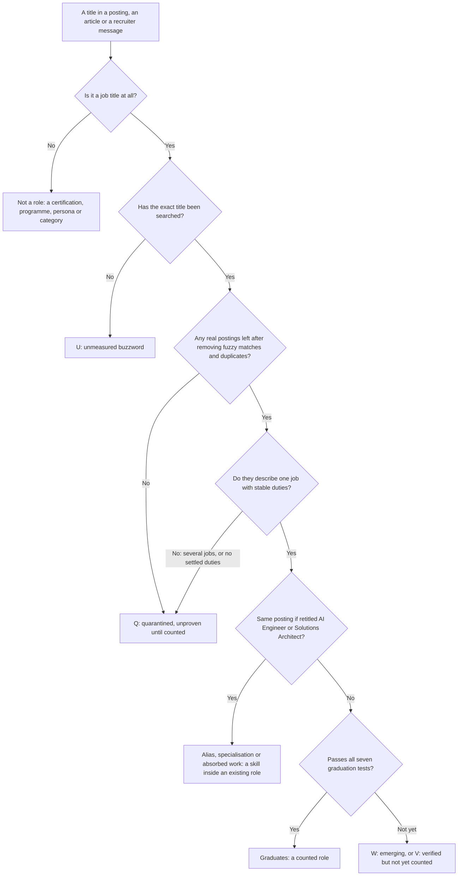

# Emerging GenAI Roles: How to Read a New Job Title

> How to read a new GenAI job title (a real role, a skill inside an existing role, or unproven hype): the seven graduation tests in plain words, a dated watchlist of emerging, candidate and quarantined titles updated through November 2026, what would change each status, and how to use emerging terms honestly on a résumé.

**Dates and grades.** Baseline catalog classifications come from the [role catalog](../02-roles/role-catalog.md) (as of 2026-11-04, applying the [research errata](../../research/ERRATA.md)), joined by November 2026 checks: Fast AI Jobs (`2026-11-11`) and AI Pulse (`2026-11-12`) in [T0-70](../../research/sessions/T0-70-market-pulse-hiring-layoffs-funding.md), and exact-title sweeps (`2026-11-14`) plus mid-September 2026 SANS security/GRC counts and BSI ISO/IEC 42001 data (`2026-10-21`) in [T0-69](../../research/sessions/T0-69-skill-tool-momentum-dated-series.md). Earlier Skillenai 90-day counts (window ending `2026-10-14`), JobsPipe title counts (`2026-10-19`, unchanged on `2026-11-13`) and JobsPipe skill shares (`2026-09-10`, unchanged on `2026-11-14`) are kept as **archived baselines** awaiting the `2026-12-01` recount. Exact-title sweeps in T0-69 §9 are un-deduplicated aggregator snippets (`Access: Extract`, Grade C), not market counts. Regulatory dates are as checked on `2026-11-13`; they are pointers, not legal advice. Grades follow EGP-1.0, and platform aggregates (JobsPipe, Fast AI Jobs) are graded B ([role catalog §1.3](../02-roles/role-catalog.md#13-evidence-grades-and-conventions)).

## The short answer

1. **Treat a new title as a claim about hiring, and check it.** The role catalog indexes 241 GenAI title strings: 29 canonical roles, 107 aliases, 22 seniority variants and 17 specialisations (2026-11-04 snapshot). Only three title families held a quorum-grade count (50+ live postings) in October 2026: AI Engineer, Machine Learning Engineer and Forward Deployed Engineer (FDE) [B · T0-01.F1, F3]. In November 2026, **Research Engineer** crossed 50 on two platforms (`223` on Fast AI Jobs `2026-11-11`; `569` in AI Pulse's category count `2026-11-12`) and is flagged as a quorum-crossing candidate pending a catalog-method recount [B/C · T0-70 L73, L164]. Meanwhile Indeed's count of frequently advertised AI-referencing titles rose from 264 (2022) to 822 (Q1 2026) [C · T0-01.F11].
2. **New work shows up as skills long before it shows up as a title.** Agentic AI is named in 59.3% of AI Engineer postings on JobsPipe (counted `2026-09-10`, unchanged `2026-11-14`), yet exact-title searches on `2026-11-14` still returned only `2` exact "Agent Architect" listings on one aggregator and real but uncounted "Context Engineer" listings across three archetypes [B · T0-69 L55, L276; C · T0-69 L426, L430, L528, L532]. Evaluation appeared in the postings of 68.2% of 198 companies in T0-03's `2026-08-05` corpus (not re-located in November 2026 [E · T0-69 L548]), while the AI Evaluation Engineer title stays small [B · T0-03.F3; C · T0-01 D2]. A skill's share of postings never counts as demand for a title ([role rankings §1.1](../02-roles/role-rankings.md#11-design-rules-that-keep-bias-out)). Own the skill; do not wait for the title.
3. **A title leaves the watchlist or quarantine only by passing seven tests:** volume, persistence, breadth, a shared skill set, a seniority ladder, adoption by a lab or Big Tech employer, and not being an alias ([role catalog §1.4](../02-roles/role-catalog.md#14-quorum-and-graduation-tests-t0-01-d5), from T0-01 D5). The [checklist](#checklist-how-to-judge-a-new-title) puts them in plain words.
4. **Hype has a signature, and November 2026 checks separated real niche titles from empty buzzwords.** Raw keyword counts, unsourced percentages and analyst definitions do not prove hiring: "Cognitive Architect" showed 339–1,000 raw board hits and one legacy posting [B · T0-01.F6], and combined exact-title searches on `2026-11-14` returned zero exact hits for Prompt Wizard, AI Whisperer, Neural Network Designer, Transformer Specialist, Cognitive Architect, Context Architect, Vibe Engineer, Reasoning Engineer and Foundation Model Engineer [C · T0-69 L61, L431–435, L530–544]. Conversely, two October "no posting evidence" claims were **contradicted** on `2026-11-14`: **Edge AI Engineer** returned at least 9 distinct listings on one aggregator plus Deepgram, and **Distributed Training Engineer** appeared verbatim at OpenAI and Periodic Labs — real niche titles, still ungraduated without deduplicated quorum counts [C · T0-69 L61, L427–428, L525, L529].
5. **Headline a canonical title; carry emerging terms as proved skills.** Screening software scores title similarity [A · T0-04.F8], and recruiter search strings are built from titles and stack terms [C · T0-11.F3]. Never headline a quarantined or legacy title ([role catalog §5.1](../02-roles/role-catalog.md#51-quarantined-titles-t0-01-d4-reconciled)).
6. **Statuses change at scheduled recounts.** T0-01's recounts are due on 2026-12-01 and 2027-01-15, and decision D-002, which set the quorum, is reviewed on 2027-01-31 [T0-01 L84; [D-002](../../research/DECISIONS.md)]. Re-read the watchlist after each.

## At a glance



The flow summarises the catalog's rules ([§1.1–§1.4](../02-roles/role-catalog.md#1-classification-rules)) and adds none of its own. One historical exception: Vibe Engineer was originally quarantined without a search [D · T0-01 D2]; on `2026-11-14` T0-69 searched it and found zero exact "Vibe Engineer" hits alongside four Gruve "AI Vibe Coding Engineer" listings [C · T0-69 L431, L540].

| Reading | Catalog class | Title strings | Examples | What to do |
|---|---|---:|---|---|
| A role with measured volume | E (established) | 3 | AI Engineer, Machine Learning Engineer, Forward Deployed Engineer | Headline it if you can claim it |
| A real title, not yet counted | V (verified) | 17 | Applied AI Engineer, Inference Engineer, Research Engineer | Use it if you can claim it. V describes counting, not career quality: Research Engineer is V, ranks #3 of 24 in the [role rankings](../02-roles/role-rankings.md) [M], and crossed 50 postings on two platforms in November 2026 [B/C · T0-70 L73, L164] |
| An emerging role | W (watchlist) | 8 | Agentic AI Engineer, AI Evaluation Engineer, AI Security Engineer | Apply to the title where it exists; otherwise apply under the larger title the work sits in |
| Work hired inside other professions | A (absorbed) | 1 | AI Risk, Audit & Compliance Specialist | Add AI to an audit, model-risk or privacy career |
| A variant or skill inside a role | Alias 107, level variant 22, specialisation 17, legacy 7, brief label 6, cluster variant 5 | 164 | GenAI Developer, Prompt Engineer, MCP Control Plane Engineer | Use the canonical title; carry the term as a skill |
| A plausible role, never counted | Candidate | 7 | Voice AI Engineer, On-Device / Edge AI Engineer, AI Developer Advocate | Treat it as a skill until it is counted (Edge AI Engineer, Distributed Training Engineer and AI Developer Advocate showed live listings on `2026-11-14` [C · T0-69 L61, L427–429]) |
| Unproven or hype | Q (quarantined) 10; U (unmeasured) 7 | 17 | Context Engineer, Cognitive Architect, Prompt Wizard, AI Whisperer | Never a headline; watch the recounts (five previously unmeasured titles returned zero exact hits on `2026-11-14` [C · T0-69 L435]) |
| Not a job | Not a role | 24 | Certification names, background personas, fellowships | Ignore it as a target |

Counts are from [role catalog §0](../02-roles/role-catalog.md#0-summary) and its [A–Z index](../02-roles/role-catalog.md#4-complete-az-title-index) (2026-11-04); they sum to 241. Formal status changes wait for the `2026-12-01` recount.

## Checklist: how to judge a new title

Run it on any title you meet in a posting, an article or a recruiter's message. The four screens apply T0-01's counting protocol [T0-01 D10]; the seven tests are the catalog's graduation tests in plain words ([§1.4](../02-roles/role-catalog.md#14-quorum-and-graduation-tests-t0-01-d5), from T0-01 D5).

**Screen first:**

- [ ] **It is a job.** Not a certification, fellowship, background persona, salary-guide category or newsletter. "Azure AI Engineer" is a credential (AI-102), retired on 30 June 2026 ([role catalog §6](../02-roles/role-catalog.md#6-not-a-role-register)).
- [ ] **The exact title returns real postings.** Search the exact string, open the first 20 results and drop near-misses [T0-01 D10]. Fuzzy matching is how "cognitive architect" reached 339–1,000 hits [B · T0-01.F6].
- [ ] **You counted openings, not postings.** One requisition posted in several cities counts once; one Deloitte AI-risk requisition appeared 16 times on ZipRecruiter [C · T0-15.F4].
- [ ] **The claim names its source, corpus and date.** Claims that Context Engineer is the fastest-rising title, or that it pays a premium, came with no counts [D · T0-01.F5].

**The seven graduation tests (a title must pass all seven):**

- [ ] **1. Volume.** At least 50 distinct openings for the exact title or its declared aliases, in two independent sources. One source must read employers' own applicant-tracking boards (Ashby, Greenhouse or Lever).
- [ ] **2. Persistence.** The count is still at least 50 when it is repeated at least 30 days later.
- [ ] **3. Breadth.** At least 10 employers; no employer holds more than 30% of the openings; at least 3 employers are not consultancies or staffing firms.
- [ ] **4. Shared skills.** At least 70% of the postings ask for the same three or more core skills, and that set differs from AI Engineer's by at least two core skills.
- [ ] **5. Ladder.** At least three seniority levels, each with its own pay band.
- [ ] **6. Lab adoption.** At least one tier-1 AI lab or Big Tech employer uses the title as a formal role family.
- [ ] **7. Not an alias.** Replace the title with "AI Engineer" or "Solutions Architect". If the posting still reads the same, the title is an alias.

The bar is a design judgement. Decision D-002 grades its own 50-posting threshold C and allows it to be recalibrated at review [D-002]. A fixed 50 also ignores corpus size: it is 0.13% of the Fast AI Jobs corpus and a rounding error in JobsPipe's [T0-01 objection 7].

**Read the result:**

| What you found | Reading | What to do |
|---|---|---|
| Not a job string | Not a role | Ignore it as a target; a credential can still be a tie-breaker ([credential ROI](../04-certifications/credential-roi.md)) |
| No postings, only fuzzy hits, or a few postings with different duties | Unproven: quarantine territory | Never headline it; learn the underlying skill if the work is real |
| Postings that read the same under "AI Engineer" or "Solutions Architect" | Alias or skill | Use the canonical title; carry the term as a skill |
| One coherent job, but fewer than 50 openings or one dominant employer | Emerging | Apply to the title where it exists; otherwise apply under the larger title and lead with the skill |
| Passes all seven tests | A role | Headline it if you can claim it |

### Red flags in title claims

| Red flag | Example from the research | What to do |
|---|---|---|
| A raw job-board count | "Cognitive architect": Indeed 921, ZipRecruiter 388, Glassdoor 339, SimplyHired 1,000. The only true match was a legacy IBM Watson-era posting [B · T0-01.F6] | Search the exact title and read the first 20 results |
| A skill share quoted as demand for a title | "Agentic AI Engineer is a verified role: agentic AI is in 59.3% of AI job descriptions." That figure is a skill share inside AI Engineer postings; the title is on the watchlist ([role catalog §9.2](../02-roles/role-catalog.md#92-claims-checked-during-classification-highlights)) | Count postings for the title, not mentions of the skill |
| A definition offered as demand | Gartner formally defines context engineering (A for its existence), but "a discipline definition is not a title-volume signal" [T0-01.F5] | Ask for a dated posting count |
| One blog says the title is real | Principal Agentic Context Engineer rests on one blog citation [D · T0-01 D4] | Treat it as unverified until you find an exact posting |
| A statistic with no traceable source | A "40% decline since 2023" for Prompt Engineer [D · T0-01.F8]; "78% of enterprise AI teams" running MCP in production, which T0-16 rejects as untraceable [T0-16.F5] | Trace it to the original measurement, or drop it |
| Interview-prep counts read as demand | Dataford's prep counts (FDE 229, GenAI Engineer 215, Agentic AI Engineer 125) are demand-side signals, not postings [C · T0-01 L97] | Count postings |
| Experience asks that disagree | Agent Architect postings ask for 3–5, 6–10, 7+ and 8+ years [C · T0-01.F7] | Read it as a title with no settled ladder (test 5) |
| Postings mostly at consultancies or staffing firms | Context Engineer postings are "mostly consulting/staffing" [C · T0-01 D4] | Check breadth (test 3) |

## The watchlist (October–November 2026)

Counts are as dated in each row. Ninety-day counts from Skillenai (window ending `2026-10-14`) are **archived baselines** over 90 days, not live counts. November 2026 checks come from Fast AI Jobs (`2026-11-11`), AI Pulse (`2026-11-12`) and T0-69's aggregator title sweeps (`2026-11-14`, un-deduplicated `Access: Extract`, Grade C). "What would promote it" names the tests a title has not yet passed, from the catalog's verdicts ([§5.1](../02-roles/role-catalog.md#51-quarantined-titles-t0-01-d4-reconciled), [§5.4](../02-roles/role-catalog.md#54-watchlist-against-the-graduation-tests)) unless a cell says otherwise. How to target each canonical role is in [GenAI target roles](../02-roles/genai-target-roles.md#the-24-roles-one-line-each).

### Quorum-crossing and category candidates (November 2026)

Before the `2026-12-01` recount, [T0-70](../../research/sessions/T0-70-market-pulse-hiring-layoffs-funding.md) checked canonical roles on Fast AI Jobs (`2026-11-11`), AI Pulse (`2026-11-12`) and Go Fractional:

| Role | Catalog status | November 2026 evidence | Quorum verdict | Grade · source |
|---|---|---|---|---|
| [Research Engineer](../02-roles/hubs/research-engineer.md) | V | `223` on Fast AI Jobs (`2026-11-11`, up from `171` in late July 2026) and `569` in AI Pulse's category count (`2026-11-12`) | **Candidate crossing (V → E).** Above 50 on two platforms, but Fast AI Jobs is AI-startups-only (and may fold in "Research Engineer / Scientist") and AI Pulse is outside the catalog's platform set. Needs a catalog-method recount | B / C · T0-70 L73, L144, L164 |
| [AI Product Manager](../02-roles/hubs/ai-product-manager.md); [AI Safety Researcher](../02-roles/hubs/ai-safety-researcher.md); [AI Engineering Manager](../02-roles/hubs/ai-engineering-manager.md) | V | AI Pulse category counts (`2026-11-12`): AI Product Manager `570`, AI Safety `89`, AI Engineering Manager `68` | **Category-level candidates only.** AI Pulse's category definitions are undisclosed ("AI Safety" may fold in trust-and-safety roles), so these corroborate direction rather than prove quorum | C · T0-70 L73, L165–167, L173 |
| [Applied Scientist](../02-roles/hubs/applied-scientist.md); [Fractional AI Leader / CAIO](../02-roles/hubs/fractional-ai-leader.md) | V | Applied Scientist `23` on Fast AI Jobs (postings to `2026-10-23`); Go Fractional CAIO page `10` posts in a rolling 90 days (`4` open) | **Below quorum.** Status V unchanged | B · T0-70 L73, L145–146, L168–169 |

### Emerging roles (W): real postings, below quorum

| Title | Status | Best evidence | What would promote it | Where the work sits |
|---|---|---|---|---|
| Agentic AI Engineer (also Agent Engineer, AI Agent Engineer) | W *(held at W; W→V rejected Nov 2026)* | Archived Oct 14 baseline: ~66 "Agentic AI Engineer" and 28 "Agent Engineer" in 90 days [C · T0-16 §9.2]; `T0-57` (Nov 2026, low 11% Read caveat) found strong regional divergence: exact title active in India IT services/GCCs (`6/10`: Capgemini, Wipro, Epitria, Exavalu) and European enterprise software (`5/10`: SAP, Workday), but **0/15 US product postings** and **0 tier-1 frontier labs / US Big Tech** use the exact title (they use SWE / AI Engineer titles); Skilark `107/28,771` (`0.37%`), UK IT Jobs Watch `~7/6mo`; live-verified Lightcast (2026-11-19) confirms agentic AI (~90k US postings in 2025) is absorbed as a skill [B/C · T0-57 L54, L80, L124, L329–335]. Agentic AI skill share is 59.3% of AI Engineer postings (`2026-09-10`, unchanged `2026-11-14`) [B · T0-69 L55] | Fails 3 of 7 graduation tests (volume, lab/Big Tech exact-title adoption, not-an-alias); `T0-57`'s W→V proposal was **rejected** on 2026-11-19. Retest only with a full-read n≥30 dated sample + reproducible title-only count series [T0-57 L329–335] | Inside [AI Engineer](../02-roles/hubs/ai-engineer.md) / SWE postings in US product firms; exact title usable in India IT/GCC and EU enterprise searches. Hub: [Agentic AI Engineer](../02-roles/hubs/agentic-ai-engineer.md) |
| AI Evaluation Engineer (also Evals Engineer, Model Quality Engineer) | W | "LLM evaluation" keyword: 26 postings on a small board (Rise, Oct 2026) [C · T0-01 D2]; titled postings at 6 named employers [B/C · [role catalog §3.5](../02-roles/role-catalog.md#profile-ai-evaluation-engineer)]. Evaluation appeared in 19.0% of 3,647 postings and at 68.2% of 198 companies in T0-03's `2026-08-05` corpus (not re-located in November 2026 [E · T0-69 L548]); seven eval/observability acquisitions or closures between `2025-05-05` and `2026-05-22` underscore that the skill outlives any tool brand [B · T0-69 L51, L370–376] | Volume (test 1) and 10 or more employers (test 3); its skill set is already distinct (eval statistics, judge calibration). No pay premium for pure eval roles is verified [T0-03] | As a skill inside AI Engineer and ML Engineer roles. Hub: [AI Evaluation Engineer](../02-roles/hubs/ai-evaluation-engineer.md) |
| AI Enablement Engineer | W | Archived Oct 14 baseline: about 53 postings in 90 days (derived); 30.2% (16) mention MCP, the highest share of any title [C · T0-16 §9.2] | Breadth is unknown (test 3), and the count is a 90-day total, not a live count. The role may be transitional (judgement, D) | Internal platform and developer-productivity teams. Hub: [AI Enablement Engineer](../02-roles/hubs/ai-enablement-engineer.md) |
| AI Security Engineer / AI Red Teamer | W | **SANS mid-September 2026 tracker** (published `2026-10-20`): more than `850` AI/ML security-engineer postings, about `100` AI red-team postings (`+13%` week on week), `93` AI supply-chain security, `48` AI security specialists and `36` AI SOC orchestrators [B · T0-69 L60, L246–249] — a far stronger single-date signal than Skillenai's archived Oct 14 count (`23` "AI Security Specialist"). JobsPipe lists 2,827 US Security Engineer (feeder) postings, AI share unmeasured (`2026-11-02`) [B · [role catalog §7](../02-roles/role-catalog.md#7-feeder-and-adjacent-occupations-market-refresh-2026-11-02)] | A deduplicated, exact-title count across two dates (tests 1–3) at the `2026-12-01` recount. The need is well evidenced: CVSS 9.8 flaws in SGLang and vLLM in 2026 [A/B · T0-03.F12] | Also application-security roles with LLM scope. Hub: [AI Security Engineer](../02-roles/hubs/ai-security-engineer.md) |
| AI Product Engineer (AI Frontend) | W | The four postings T0-06 examined in detail were all Staff-level, asking for 5–6+ years; no census of AI-frontend postings exists [C/D · T0-06.F6]. TypeScript is the fastest-growing major language on GitHub (`+66.63%` YoY to August 2025) [B · T0-69 L58, L263] | Volume, and openings below Staff level (tests 1 and 5; this page's reading) | Usually advertised as full-stack AI engineer. Hub: [AI Product Engineer](../02-roles/hubs/ai-product-engineer.md) |
| Physical AI / Robotics AI Engineer | W | 8 of the newest 50 AI Engineer rows on Fast AI Jobs (`2026-10-19`), all Figure AI "Helix AI Engineer" [B · T0-01.F2] | Breadth: 10 or more employers, none above 30% (test 3) | Robotics firms. Hub: [Physical AI Engineer](../02-roles/hubs/physical-ai-engineer.md) |
| Responsible AI / AI Governance Engineer | W | **SANS mid-September 2026** counted about `430` AI governance, risk and compliance lead postings [B · T0-69 L60, L248], and BSI awarded its 50th ISO/IEC 42001 certificate on `2026-10-21` (up from 11 in 2025, across >16 countries including India) [A · T0-69 L60, L250]. Technical-engineer counts remain thin: of 13 JDs T0-15 read, 4 were technical [C · T0-15.F6], and Regulation (EU) 2026/1744 defers Annex III high-risk duties to `2027-12-02` [B · T0-70 L295] | A title-level count for technical governance engineers (tests 1–3). T0-15 reads the work as an extension of ML-platform, MLOps and security engineering | MLOps and security teams in regulated firms. Hubs: [Responsible AI Engineer](../02-roles/hubs/responsible-ai-engineer.md), [ML Platform / MLOps](../02-roles/hubs/ml-platform-engineer.md) |
| Domain Evaluation Specialist / AI Trainer | W | A guide relaying TechCrunch says Mercor pays more than 30,000 experts [C/D · T0-06 L177]; LinkedIn's Jobs on the Rise 2026 ranks data annotators fourth [C · T0-06 L174] | The catalog sets no trigger: the demand evidence is a contract marketplace and a LinkedIn ranking, not posting counts. T0-06 calls the work "a bridge, not a destination" | Expert-contract marketplaces and in-house evaluation leads. Hub: [Domain Evaluation Specialist](../02-roles/hubs/domain-evaluation-specialist.md) |

### Skills sold as titles: specialisations, candidates and legacy titles

| Title you may see | Status | Best evidence | What would make it a role | Where the work sits |
|---|---|---|---|---|
| MCP / AI Control Plane Engineer; Agent Gateway Engineer | Specialisation; legacy label | No posting with the literal title "Agent Gateway Engineer" was found. Work appears under enterprise platform/control-plane titles [C · T0-16.F10]. "Model Context Protocol" was in 0.068% of 343,299 Fortune-1000 and API-provider postings (Q3 2026; full phrase undercount) and "MCP" in 0.7% of Skillenai's archived Oct 14 index [C · T0-16.F9], plus `16.9%` of 213 LangChain-ecosystem listings on one agentic board (`2026-04-19`) [C · T0-69 L112]. Registry supply tripled (`~9,650` May → `30,375` `2026-09-10`, though `62%` have one version and `~36%` went 3+ months without an update) [C, COI · T0-69 L53, L108–109]; no two-date employer-demand series exists | T0-16's heuristics (judgement, D): literal gateway-engineer postings in dozens, or Fortune-1000 MCP share above ~1% for two quarters [T0-16 L130] | [ML Platform / MLOps](../02-roles/hubs/ml-platform-engineer.md); also [AI Enablement](../02-roles/hubs/ai-enablement-engineer.md) and [Agentic AI Engineer](../02-roles/hubs/agentic-ai-engineer.md) |
| Post-Training / RLHF Engineer | Legacy (absorbed) | Small-board keyword counts (Rise, Oct 2026): post-training 9, RLHF 17, RL 9, SFT 4, GRPO 2 [C · T0-01.F9]. "Real demand is not disproven; the *title string* is" | An exact-title quorum (tests 1–3) | Carried under [Research Engineer / Member of Technical Staff (MTS)](../02-roles/hubs/research-engineer.md) at labs and data vendors |
| Prompt Engineer | Legacy (absorbed) | `72` of `20,662` LinkedIn AI postings (`0.35%`), traced by T0-69 to arXiv 2506.00058 (2024–25 vintage; no newer title count located) [B/M · T0-03.F2; T0-69 L347, L513]; Indeed's salary page rests on 52 data points over 36 months [B · T0-01.F8] | The catalog calls a reversal unlikely. Prompting survives as a co-requirement in `31.1%` of AI Engineer postings (`2026-09-10`) [B · T0-69 L290] | [AI Engineer](../02-roles/hubs/ai-engineer.md) |
| LLMOps Engineer | Legacy (absorbed) | A skill tag under ML Platform / MLOps, not a counted title [T0-01 Recommendation 3]. FAD §5.3 listed it as quarantined (ERRATA U3) | An isolated title count (none exists) | [ML Platform / MLOps](../02-roles/hubs/ml-platform-engineer.md) |
| Retrieval / Search Engineer (LLM); Vector Search & Retrieval Systems Engineer | Candidate | No title count; a combined `2026-11-14` search for "Retrieval Engineer" returned no direct hit [E · T0-69 L435, L524]. RAG is named in `54.0%` and vector databases in `32.6%` of AI Engineer postings (`2026-09-10`) [B · T0-69 L283, L289]; Databricks posts a "Senior Staff Applied AI Engineer – Context Retrieval" [B · T0-01 D7] | Any title count | [AI Engineer](../02-roles/hubs/ai-engineer.md); [Applied AI Engineer](../02-roles/hubs/applied-ai-engineer.md) |
| Conversational & Voice AI Engineer | Candidate | **Updated November 2026:** a dedicated voice-AI engineering job board exists (no title count obtained), voice-model adoption among paid Vercel AI Gateway teams rose from `~4%` (`2026-07`) to `~11%` (`2026-10`; `5%→14%` among teams active in both months), and LiveKit raised `$100M` at a `$1B` valuation (`2026-01-22`, company-stated) [B/C · T0-69 L62, L234–236, L527]. Also a reported ML system-design prompt (PracHub) [C · T0-14 A12] | A deduplicated title count; first measurement target | [AI Engineer](../02-roles/hubs/ai-engineer.md); [AI Product Engineer](../02-roles/hubs/ai-product-engineer.md) |
| On-Device / Edge AI Engineer | Candidate | **Contradicts October "no posting evidence" claim:** on `2026-11-14`, T0-69 found at least `9` distinct "Edge AI Engineer" listings on one aggregator, Deepgram "Embedded AI Engineer, On-Device Models", and "Applied ML Engineer, Edge Devices", alongside live listings across automotive, IoT and consumer hardware [C · T0-69 L61, L237, L428, L525]. WebGPU is supported across major browsers [A · T0-06.F6]. Still ungraduated: snippets are un-deduplicated and lack a quorum count | A deduplicated exact-title quorum count (tests 1–3) | [AI Product Engineer](../02-roles/hubs/ai-product-engineer.md); [Inference Engineer](../02-roles/hubs/inference-engineer.md) |
| Distributed Training Engineer | Candidate | **Contradicts October "title not found" claim:** on `2026-11-14`, T0-69 found exact-title aggregator listings at OpenAI ("Distributed Training Engineer, Sora") and Periodic Labs, plus "distributed training and inference engineer" on WeAreDevelopers [C · T0-69 L61, L427, L529]. Labs also advertise the work under runtime and ML-systems titles. Passes lab adoption (test 6) but fails breadth and volume | Volume and 10+ employers (tests 1–3) | [AI Infrastructure](../02-roles/hubs/ai-infrastructure-engineer.md); [Research Engineer / MTS](../02-roles/hubs/research-engineer.md) |
| AI Developer Advocate / DevRel (AI) | Candidate | **Upgraded November 2026 (closest candidate to passing):** on `2026-11-14`, T0-69 found AI developer-advocate openings at **six employers** — Temporal ("Principal Developer Advocate, AI"), MongoDB ("AI Staff Developer Advocate"), Fireworks AI, Encord, LlamaIndex and Apple ("Sr Software Engineer (Developer Advocacy, GenAI)") — showing employer breadth, a Senior–Staff–Principal ladder and Big Tech adoption [C · T0-69 L61, L429, L545] | Dated quorum counts across two corpora (tests 1–2) and confirmation it is not an alias of general DevRel (test 7) | No canonical role yet |
| Technical Program Manager (AI) | Candidate | Seen as "managers and TPMs (6)" among the newest 50 FDE-cluster rows (`2026-10-20`) [B · T0-01.F3]; no direct hit in a combined `2026-11-14` search for "Technical Program Manager, AI" [E · T0-69 L435, L546] | Any title-level count | No canonical role yet; seen inside the [FDE](../02-roles/hubs/forward-deployed-engineer.md) cluster |
| Conformity Assessor (notified body) | Specialisation | Under the EU AI Act's Art. 43, Annex III points 2–8 use internal control with no notified body; sectoral notified bodies must apply for AI designation by 28 January 2028; no harmonised standard had been cited as of 28 April 2026 [A/B · T0-15.F3]. Regulation (EU) 2026/1744 shifts Annex III to `2027-12-02` and Annex I to `2028-08-02` [A/B · T0-15.F1; T0-70 L295] | Designated notified bodies, and Annex I high-risk duties from 2 August 2028 [A · T0-15.F1]. T0-15 finds no notified-body labour market before 2028 | Most high-risk compliance is first-party work by the provider's own staff. Hub: [AI Risk, Audit & Compliance](../02-roles/hubs/ai-risk-assurance-specialist.md) |
| Algorithmic Auditor; ISO/IEC 42001 Auditor | Specialisation | NYC Local Law 144: 18 of 391 employers had posted an audit report (2024 study); 23 audit reports under the EU Digital Services Act in the 2025 cycle; ISACA's AAIA credential requires a CISA, CIA or CPA [A/B · T0-15.F7]. BSI awarded its 50th ISO/IEC 42001 certificate on `2026-10-21` (up from 11 in 2025) [A · T0-69 L250] | Sustained volume beyond certification bodies and assurance practices | Assurance firms, certification bodies and internal audit. Hub: [AI Risk, Audit & Compliance](../02-roles/hubs/ai-risk-assurance-specialist.md) |
| AI Safety Engineer | Alias of two different roles | Two small markets plus one unrelated use. No job board showed postings with this title at regulated enterprises; automotive "functional safety" is a different meaning of safety [B/C · T0-15.F8] | Read the duties, not the title | [AI Safety Researcher](../02-roles/hubs/ai-safety-researcher.md) (frontier) or [Responsible AI Engineer](../02-roles/hubs/responsible-ai-engineer.md) (enterprise) |
| AI Ethicist / AI Ethics Officer | Legacy (absorbed) | Whether the title vanished "cannot be shown either way" [B · T0-15.F5] | The catalog advises against standalone positioning | [AI Governance Lead](../02-roles/hubs/ai-governance-lead.md) |

The [role map](../02-roles/role-map.md#specialisations-inside-canonical-roles) lists 26 kinds of work that happen inside canonical roles, with the skills behind each and the catalog status of any title that names them.

### Aliases and variants that look new

| Title seen | Status | What it is | Where the work sits |
|---|---|---|---|
| Frontier Agents Engineer | Alias | The full title adds "(Forward Deployed Engineering)"; about 22 postings in 90 days (archived Oct 14 Skillenai baseline) [B · T0-01.F3; C · T0-16 §9.2] | [Forward Deployed Engineer](../02-roles/hubs/forward-deployed-engineer.md) |
| AI Deployment Engineer | Alias | OpenAI's title in July 2026 postings [B · T0-01 D7] | [Forward Deployed Engineer](../02-roles/hubs/forward-deployed-engineer.md) |
| Deployment Strategist; GTM Engineer | Cluster variants, not engineering | 6 and 4 of the newest 50 FDE-cluster rows in October [B · T0-01.F3]; in November 2026 (`2026-11-11`), 22 of the newest 50 Fast AI Jobs FDE rows were adjacent strategist, GTM or field roles and only 23 were IC FDE titles [B/M · T0-70 L74] | Inside the FDE cluster |
| Helix AI Engineer | Alias | Figure AI's title for robotics AI work [B · T0-01.F2] | [Physical AI / Robotics AI Engineer](../02-roles/hubs/physical-ai-engineer.md) |
| Site AI Engineer; Power Platform & AI Engineer | Specialisations | Construction and enterprise-automation variants inside the AI Engineer family [B · T0-01.F2] | [AI Engineer](../02-roles/hubs/ai-engineer.md) |
| GenAI Engineer / GenAI Developer; LLM Engineer | Aliases | GenAI Engineer is the dominant label at India's global capability centres (GCCs), per Taggd [C · T0-01 D8]; CIEL HR reports LLM engineer postings `+86.5%` YoY in India (denominators undisclosed) [C · T0-69 L416, L437] | [AI Engineer](../02-roles/hubs/ai-engineer.md) |
| Agentic AI Architect | Alias | At least 5 postings in October (Cognizant, Air India, Zoom and others) [C · T0-01.F7]; variants ("AI Agent Architect", "Agentic AI Architect") confirmed on `2026-11-14` [C · T0-69 L426] | [AI Solutions Architect](../02-roles/hubs/ai-solutions-architect.md) |
| Member of Technical Staff (MTS) | Alias (a wrapper title) | A frontier-lab title that hides seniority [B · T0-02 L106]. OpenAI's 2025 visa filings use it for functions from software and research engineering to hardware and data science [B · T0-02 L305–316]; xAI uses "Member of Technical Staff, Reasoning" and Reflection uses "Member of Technical Staff, Pre-training Infra" (`2026-11-14`) [C · T0-69 L432–433] | [Research Engineer / MTS](../02-roles/hubs/research-engineer.md) by default; read the duties |

### Quarantined and unmeasured titles

The quarantined (Q) and unmeasured (U) titles are registered, each with its best evidence and its gap to graduation, in [role catalog §5.1](../02-roles/role-catalog.md#51-quarantined-titles-t0-01-d4-reconciled) and [§5.2](../02-roles/role-catalog.md#52-unmeasured-buzzwords-never-searched). Never headline one. Three notes from the November 2026 searches (`2026-11-14`, `Access: Extract`, Grade C):

- **Context Engineer (`K20`) remains the one to watch, without a verified global count.** Real postings were confirmed on `2026-11-14` on ZipRecruiter (Minneapolis, "Sr Staff AI Engineer, Context Engineering" in Chicago, "LLM/Prompt-Context Engineer" in Atlanta), Novoflow ("Founding Prompt/Context Engineer") and PostHog ("Context Engineer"), matching at least three job archetypes and a Senior/Staff signal, alongside earlier EY roles [C · T0-01.F5; C · T0-69 L430, L532]. However, the October estimate of `10–25` live postings worldwide could not be verified (`unverifiable`), and no quorum count exists.
- **November 2026 searches closed six previously unsearched buzzwords and confirmed low-volume quarantines.** Zero exact hits returned on `2026-11-14` for **Prompt Wizard** (`K27`), **AI Whisperer** (`K29`), **Neural Network Designer** (`K30`), **Transformer Specialist** (`K31`), **Cognitive Architect** (`K26`) and **Context Architect** (`K23`) [C · T0-69 L435, L535, L538–543]. **Agent Architect** (`K16`) returned `2` exact listings on one aggregator (still an alias of AI / Solutions Architect) [C · T0-69 L426, L528]. **Vibe Engineer** (`K28`) returned zero exact hits, with `4` listings at a single employer (Gruve "AI Vibe Coding Engineer") plus "Vibe Coder" variants — failing breadth and volume [C · T0-69 L431, L540]. **Reasoning Engineer** (`K32`) returned zero exact hits (variants: xAI "Member of Technical Staff, Reasoning", Daivio "AI Engineer, Reasoning systems") [C · T0-69 L432, L544]. **Foundation Model Engineer** and **Foundation Model Pre-Training Engineer** (`K18–K19`) returned zero exact hits, with four employers posting four different pre-training variants (IFM, Sciforium, Reflection, Hyphen Connect) [C · T0-69 L433, L530–531].
- **Where the work sits:** context engineering inside [AI Engineer](../02-roles/hubs/ai-engineer.md) and [Agentic AI Engineer](../02-roles/hubs/agentic-ai-engineer.md); agentic architecture inside [AI Solutions Architect](../02-roles/hubs/ai-solutions-architect.md); reasoning-model work with [Research Scientist](../02-roles/hubs/research-scientist.md) and [Research Engineer](../02-roles/hubs/research-engineer.md); foundation-model pre-training and distributed training under [Research Engineer / MTS](../02-roles/hubs/research-engineer.md) and [AI Infrastructure](../02-roles/hubs/ai-infrastructure-engineer.md). Cognitive Architect, Prompt Wizard and Vibe Engineer map to no canonical role.

### Strings that are not jobs

Certification names ("Azure AI Engineer" is the AI-102 credential, retired on 30 June 2026), fellowships and residencies, background personas, a salary-guide category, a newsletter and two strings fabricated from source names are not jobs; the catalog's [not-a-role register](../02-roles/role-catalog.md#6-not-a-role-register) lists each one with its source.

### India: the titles differ

- **GCC titles.** GCCs advertise AI work as GenAI Engineer, AI/ML Engineer, MLOps Engineer and Prompt Engineer (Taggd) [C · T0-01 D8]. Prompt Engineer survives there although it is legacy in US data [B · T0-03.F2]. Read such postings by their duties, and present yourself under the canonical title that matches them [P].
- **Emerging titles do appear and grew on one vendor index.** Agentic AI Engineer, Principal Agentic AI Engineer and Forward Deployed AI Engineer appear on Weekday India listings [C · T0-01 D8], and one dated Context Engineer posting (BT) was mirrored on apna.co for Bengaluru [B/C · T0-01.F5]. CIEL HR's India posting data (March 2024 to May 2026, 2026 vs 2025, denominators undisclosed) report year-on-year growth for agentic AI engineers (`+260%`), GenAI solutions architects (`+120%`), LLM engineers (`+86.5%`) and MLOps engineers (`+82.2%`) — a directional signal only, with no dated posting counts [C · T0-69 L416, L437].
- **Not a title.** "GCC AI Specialist" was not found as a title [T0-01 D8].
- **Governance.** India's RBI FREE-AI report (13 August 2025) notes that some organisations created Responsible AI Officer roles; it does not recommend one [A · T0-15 L356]. The DPDP consent-manager start date (`13 November 2026`) has passed — verify Gazette status in [governance careers](../11-tracks/governance-careers.md). T0-15 expects privacy-engineering and data protection officer (DPO) demand to lead, with AI-specific roles following the DPDP main obligations on 13 May 2027 [B · T0-15.F12].
- **Gaps.** The corpus has no title-level GCC counts, and Indian job boards (Naukri, Instahyre) have category-level indices only, not exact-title quorum counts [T0-01 D8; T0-69 L418; [ROADMAP](../../ROADMAP.md) P1-2]. Whether the 50-posting quorum should change for India-specific boards is an open question (FAD OQ2).

## What would change a status

### The rules

- **Up from W or Q:** pass all seven tests at a recount ([role catalog §1.4](../02-roles/role-catalog.md#14-quorum-and-graduation-tests-t0-01-d5)). Under D-002, quarantined titles are "tracked, not deleted", and promoted when evidence accumulates [D-002].
- **Up from V:** a quorum-grade count, meaning at least 50 distinct live postings in a large corpus ([role catalog §1.2](../02-roles/role-catalog.md#12-status-classes-for-canonical-roles)). For Applied AI Engineer the catalog asks for an isolated count of at least 50 in two corpora.
- **Down:** the catalog defines no demotion test. Titles have fallen by collapsing into a larger family: T0-03 rates Prompt Engineer "devalued as a title; baseline as a skill" [B · T0-03 L419].
- **Faster recounts:** if more than three quarantined titles pass 50 postings between recounts, recounts move to quarterly [D-002].
- **Proposed, not adopted:** D-002 would add a "lab-validated" path if a lab-created title became an industry standard while staying under 50 openings; its example is fewer than 50 openings in total, but at five or more tier-1 labs [D-002]. T0-01 suggests adding a share-of-corpus floor to the fixed 50 [T0-01 objection 7].

### The calendar

| Date | Event | What to check |
|---|---|---|
| 2026-12-01 | T0-01 recount: exact-title searches on the JobsPipe API (once title pages refresh), Fast AI Jobs role pages and Indeed Hiring Lab data | First measurement targets: Research Engineer (candidate crossing), AI Security Engineer (SANS >850 check), Applied Scientist, Research Scientist, Inference Engineer, MLOps / ML Platform, AI Product Manager, AI Solutions Architect, Agentic AI Engineer, AI Evaluation Engineer, Context Engineer, Voice AI, Edge AI Engineer, Distributed Training Engineer and AI Developer Advocate ([role catalog §10](../02-roles/role-catalog.md#10-maintenance)). Applied Scientist's "~700 postings" in older records has no primary source (ERRATA U1) |
| 2026-12-12 | Page `review_by` (31 days from Fast AI Jobs `2026-11-11` recount) | Every live posting count on this page |
| 2027-01-15 | Second T0-01 recount | Persistence (test 2) for any title that passed volume on 2026-12-01 |
| 2027-01-31 | D-002 review | The quorum itself, and D-002's prediction that 8 to 12 GenAI roles will show verifiable live volume. As of November 2026, 3 are Established, 1 (Research Engineer) is a quorum-crossing candidate and 16 others remain Verified without a quorum count [role catalog §0; T0-70 L73] |

### Signals that would move a status

| Signal | What it would change | Grade · source |
|---|---|---|
| A direct exact-title count of 50+ distinct requisitions from LinkedIn, Indeed or Ashby | Context Engineer, Edge AI Engineer, AI Developer Advocate or Agent Architect, toward graduation | T0-01 L86; T0-69 L428–430 |
| MCP named in more than about 1% of Fortune-1000 postings for two consecutive quarters; a census-grade source above about 2% of tech postings; the literal gateway-engineer title in dozens of postings | Protocol and gateway work, toward a title of its own | D (T0-16's stated heuristics) · T0-16 L130 |
| MCP's posting share flat or falling for two quarters; a major MCP-attributed breach at a large enterprise; hyperscalers dropping MCP gateways for CLI or skills-first patterns; AAIF membership shrinking | Protocol skills, toward "overstated" | D · T0-16 L131 |
| Observed by November 2026: MCP `2026-07-28` removed protocol sessions and `initialize`, added `server/discover` and OTel trace context, and deprecated Roots, Sampling, Logging, HTTP+SSE and OAuth DCR (12-month window); official registry reached `30,375` unique servers (`2026-09-10`), yet `62%` have one version and `~36%` went 3+ months without an update; no two-date employer-demand series exists | Protocol work reads as fast-churning governed infrastructure rather than a settled standalone title | A/B/C, COI · T0-16.F12; T0-69 L53, L107–109, L392–398 |
| EU Digital Omnibus (Regulation (EU) 2026/1744, signed `2026-07-08`, in force `2026-07-27`) shifts Annex III to `2027-12-02` and Annex I to `2028-08-02`; sectoral notified bodies must apply for AI designation by `2028-01-28` | Conformity-assessor work; until then, most high-risk compliance is self-assessed by providers' own staff | A/B · T0-15.F1, F3; T0-70 L295 |
| India's DPDP main obligations from `2027-05-13` (consent-manager date `2026-11-13` passed) | Privacy-engineering and DPO roles first, AI-specific roles later (T0-15's expectation) | B · T0-15.F12 |
| Serving stack consolidation: Hugging Face TGI in maintenance mode / archived (`2026-03-21`); TensorRT-LLM removed legacy TensorRT backend and `trtllm-build` (`2026-11-03` docs, PyTorch sole backend); OpenAI Assistants API sunset (`2026-08-26`); CUDA Tile in CUDA 13.1 | Shifts Inference Engineer and GPU Kernel Engineer skill sets toward PyTorch-backed serving (vLLM, SGLang, `trtllm-serve`) and tile-level kernels | A/B · T0-03.F8; T0-69 L49, L136, L175–177 |
| Closed frontier-model prices falling a further 80% | Self-hosted inference skills narrowing to specialist vendors, defence and healthcare | D (a T0-03 tripwire) · T0-03 §4.5 |
| Generative-UI frameworks commoditising AI-frontend work | AI Product Engineer as a niche; T0-06 leaves this as an open question | T0-06 L854 |

## Using emerging terms on a résumé or profile

### The rules

1. **Headline a canonical title you can claim.** Use an E or V title, or a W title when the posting uses it. Mirror a posting's title only if it is a canonical title you can honestly claim ([résumé strategy: what changes, and what never changes](../06-job-search/resume-strategy.md#what-changes-and-what-never-changes)). Never headline a quarantined, legacy or unmeasured title ([role catalog §5.1](../02-roles/role-catalog.md#51-quarantined-titles-t0-01-d4-reconciled); [GenAI target roles](../02-roles/genai-target-roles.md#not-primary-genai-targets-and-titles-to-avoid-as-a-headline)). AI screening layers score title similarity and a predicted next title [A · T0-04.F8], and public recruiter search strings for AI/ML roles are built from titles, languages, frameworks and LLM terms [C · T0-11.F3].
2. **Put emerging work in skills and bullets, as skill phrases.** T0-01 tells employers to label quarantined work with skill tags such as "context/retrieval design" or "agent orchestration" rather than publish the titles; the catalog adapts that advice for candidates [T0-01 Recommendation 5; role catalog §5.1].
3. **Keywords only when true, each one proved.** List an emerging term only if you did the work, and back it with one evidence line: what, where, scale, result ([résumé strategy: what changes, and what never changes](../06-job-search/resume-strategy.md#what-changes-and-what-never-changes)). Some screening layers grade each criterion and cite the résumé text behind the grade [A · T0-04.F8].
4. **Never rename a past job title** ([résumé strategy](../06-job-search/resume-strategy.md#what-changes-and-what-never-changes)). If an employer titled you "Context Engineer" or "Prompt Engineer", keep that title in the experience entry and state the canonical function in your headline and summary [P]. Keep titles identical across your résumés (the [five layers](../06-job-search/resume-strategy.md#the-five-layers-and-their-jobs) all draw on one master inventory) and your profiles ([the résumé pitfalls](../06-job-search/resume-strategy.md#pitfalls)).
5. **Say which protocol work you did, and pin the spec version.** "MCP" alone conflates server authoring, gateway operation and client integration [C · T0-16 L126]. Name yours against revision `2026-07-28` (stateless requests, `server/discover`, Client ID Metadata Documents, OTel trace context) rather than deprecated 2025 primitives such as Roots, Sampling, Logging or HTTP+SSE [A, COI · T0-69 L69, L392–398].
6. **Lead with the practice, not the product — and pair a custom loop with one current framework.** Seven eval and observability vendors were acquired or closed in 13 months (`2025-05-05` to `2026-05-22`), so evaluation signal attaches to methodology, not a tool brand [B · T0-03.F3; B · T0-69 L51, L370–376]. Agent frameworks churn too: AutoGen had no PyPI release for `410` days to `2026-11-14` (superseded by Microsoft Agent Framework 1.0) [A · T0-69 L49, L134–135]. At the same time, production practice is split: in arXiv `2512.04123v2`, `85%` (`17/20`) of interviewed teams ran custom loops, yet `61%` of surveyed deployed agents used frameworks (LangChain/LangGraph `25.0%`), and one agentic job board named LangChain in `34.3%` and LangGraph in `22.1%` of 534 listings (`2026-04-19`) [B/C · T0-69 L54, L125–128]. Show a custom loop in your repository and name one active framework (such as LangGraph or Microsoft Agent Framework) in your skills so keyword filters pass [B · T0-69 L68].
7. **A credential is not a title.** List certifications by full name and date, after your projects, and mark retired ones as retired ([role catalog §6.2](../02-roles/role-catalog.md#62-certifications-frequently-misclassified-as-roles); [credential ROI](../04-certifications/credential-roi.md)).
8. **Profiles follow the same rules** [P]: the canonical title in the headline, and emerging terms in skills and featured work, each linked to proof ([online presence](../07-networking/online-presence.md)).

### Weak and strong

All examples are templates [P]; fill the brackets with your own facts.

| Weak | Strong | Why |
|---|---|---|
| Headline: "Context Engineer · Agentic AI" | Headline: "AI Engineer: RAG, agents, evaluation". Bullet: "Designed context and retrieval for a support agent over [N] documents; answer accuracy [x]% → [y]% on a [N]-item golden set" | The searched title in the headline; the emerging work proved in a bullet |
| Target title: "Prompt Engineer" | Title: "AI Engineer". Skills: "prompt and context design, with regression evals in CI" | Prompt Engineer is legacy; prompting is a co-requirement |
| "MCP expert" | "Built and ran an MCP gateway for [N] internal tools: default-deny registry, per-tool authorisation, audit logs; spec revision 2026-07-28" | Names the kind of MCP work and the specification version |
| "Agent Architect" | "AI Solutions Architect (agentic systems): designed [system] for [client type]; [result]" | The searched title, with the agentic scope in brackets |
| "Vibe Engineer" | "Shipped [feature] with coding agents behind tests and code review; [cycle-time result]" | A way of working is a skill, not a title |
| "Azure AI Engineer" listed as a job | "Microsoft Certified: Azure AI Engineer Associate (AI-102), [year]; retired 30 June 2026", under Certifications | A credential, listed as one, with its status |

### Template [P]

```text
Headline:    [canonical title you can claim]: [two or three skill areas from the posting]
Summary:     [canonical title], [N] years; [emerging work as a skill phrase]; [one result with a metric]
Skills:      [the posting's exact terms that you have used, e.g., agent orchestration; LLM evaluation; MCP (server authoring)]
Experience:  [official title, as your employer gave it] · [employer] · [dates]
             - [one bullet per emerging term: what, where, scale, result]
```

## Evidence and limits

- **Measured:** exact-title counts for the three established families plus November 2026 Fast AI Jobs role counts (B); job-description skill shares counted on `2026-09-10` (unchanged on `2026-11-14`, so a single-date level, not a series; B · T0-69 L55); SANS mid-September 2026 security/GRC counts (B · T0-69 L60); BSI ISO/IEC 42001 certificates (A · T0-69 L250); EU legal dates and primary deprecation/spec notices (A/B).
- **Weaker:** watchlist counts come from archived baselines (Rise small board, Skillenai 90-day index ending `2026-10-14`), AI Pulse category counts (undisclosed category definitions, Grade C · T0-70 L173), CIEL HR India growth rates (denominators undisclosed, Grade C · T0-69 L416) and T0-69 §9 exact-title sweeps (`2026-11-14`, un-deduplicated aggregator snippets, `Access: Extract`, Grade C · T0-69 L422). Single blog claims are D.
- **Conflicts of interest and source limits:** Anthropic originated MCP and builds Claude Code and Claude models; all MCP governance, registry and spec rows carry COI [T0-69 L593]. T0-69 read 59 of 69 sources via a summary fetch tool (load-bearing primary numbers verified independently) [T0-69 L95], and neither T0-69 nor T0-70 re-located T0-03's `2026-08-05` S09 corpus (`68.2%` of 198 companies naming evaluation) [E · T0-69 L548; T0-70 L320].
- **Judgement:** the 50-posting bar and the seven tests are design choices, and D-002 grades its threshold C. The reading flow, red flags, résumé rules and templates on this page are practice [P]. The "where the work sits" cells follow the catalog and the role map, whose footprints are Grade D.
- **Corpus-relative and frozen title pages:** LinkedIn, Indeed, Wellfound, Otta and Ashby could not be queried directly; JobsPipe and Fast AI Jobs are proxies [T0-01 D1]. JobsPipe's title pages (`3,944` global / `1,697` US / `398` India AI Engineer) did not move between `2026-10-19` and `2026-11-13` while its Pulse page refreshed daily, and JobsPipe's own method note warns that raw counts reflect crawl mix [B/M · T0-70 L71, L150–151]. Postings are not openings, and openings are not hires [T0-01 objection 2].
- **Young titles:** the first dated Context Engineer and agentic-architect postings appear in March–May 2026, so small counts may partly reflect crawl lag [T0-01 objection 4].
- **No demotion rule**, and no quorum-grade count yet for 16 of the 17 V roles (Research Engineer is the sole November 2026 quorum-crossing candidate pending a catalog-method recount [T0-70 L73]).
- **India:** no title-level GCC counts; Indian job boards (Naukri, Instahyre) have category indices only, not exact-title quorum counts; the quorum's fit for India is an open question (FAD OQ2).
- **Errata and November corrections applied** ([ERRATA](../../research/ERRATA.md)): U1, the "~700" Applied Scientist postings have no primary source (Fast AI Jobs showed `23` in November 2026 [T0-70 L168]); U3, FAD's quarantine list differs from T0-01's, and this page follows T0-01 D4 as reconciled in the catalog; U6, D-002's rationale cites T0-01 F6 inaccurately while the quorum rule stands; T0-69 contradicted Phase 0's "no posting evidence / title not found" lines for Edge AI Engineer (`K13`) and Distributed Training Engineer (`K17`) [C · T0-69 L525, L529].
- **What would change this page:** the `2026-12-01` recount; the D-002 review; a direct LinkedIn, Indeed or Naukri exact-title count; any event in the signals table.

**Re-check dates.** The front-matter `review_by` (`2026-12-12`) is 31 days after the November 2026 Fast AI Jobs count (`2026-11-11`, EGP-1.0 class V1). Archived October baselines (Skillenai `2026-10-14`, JobsPipe `2026-10-19`, SANS mid-September 2026) are marked as historical baselines awaiting the `2026-12-01` recount:

| Facts on this page | Dated | Re-check by | Where the refresh lives |
|---|---|---|---|
| November 2026 live role counts and title sweeps (T0-69, T0-70) | 2026-11-11 to 2026-11-14 | 2026-12-12 (31 days from Fast AI Jobs `2026-11-11`); scheduled catalog recounts on `2026-12-01` and `2027-01-15` | [Role catalog §10](../02-roles/role-catalog.md#10-maintenance) |
| Archived baselines (Skillenai 90-day index, JobsPipe title counts and skill shares, SANS mid-September tracker) | 2026-09-10 to 2026-10-19 (JobsPipe unchanged on `2026-11-13`/`14`) | Scheduled recount `2026-12-01` | [Role catalog](../02-roles/role-catalog.md) |
| Regulatory dates and status (EU Regulation 2026/1744, India DPDP) | Checked `2026-11-13` (DPDP consent-manager date `2026-11-13` passed) | 31 days: `2026-12-14` | [Governance careers](../11-tracks/governance-careers.md) |
| Protocol, tooling and credential statuses (MCP `2026-07-28`, TensorRT-LLM, AutoGen, eval M&A) | Checked `2026-11-14` | 90 days: `2027-01-21` (repo tool calendar) / `2027-02-12` | [Agentic protocols](../03-skills-and-tech/agentic-protocols.md); [credential ROI](../04-certifications/credential-roi.md) |
| Classification rules (D-002) | 2026-10-21 | Review on `2027-01-31` | [DECISIONS](../../research/DECISIONS.md) |

**Sessions:** [T0-01](../../research/sessions/T0-01-genai-role-taxonomy-market-volume.md) titles, quorum and quarantine · [T0-02](../../research/sessions/T0-02-global-regional-compensation-benchmarks.md) lab titles · [T0-03](../../research/sessions/T0-03-skills-compute-infra-eval-stack.md) skills and tripwires · [T0-04](../../research/sessions/T0-04-ats-filtering-funnel-conversion-math.md) screening · [T0-05](../../research/sessions/T0-05-unconventional-hiring-tactics-oss-audits.md) OSS employers · [T0-06](../../research/sessions/T0-06-career-transition-timelines-5-backgrounds.md) AI frontend and domain evaluation · [T0-11](../../research/sessions/T0-11-certification-cloud-credential-roi.md) credentials and recruiter search · [T0-14](../../research/sessions/T0-14-ai-system-design-interview-patterns.md) interview archetypes · [T0-15](../../research/sessions/T0-15-regulatory-ai-governance-career-families.md) governance titles · [T0-16](../../research/sessions/T0-16-agentic-protocol-stack-enterprise-demand.md) protocol roles · [T0-69](../../research/sessions/T0-69-skill-tool-momentum-dated-series.md) November 2026 title sweeps, protocol and stack momentum · [T0-70](../../research/sessions/T0-70-market-pulse-hiring-layoffs-funding.md) November 2026 role counts and quorum candidates · [T2-01](../../research/sessions/T2-01-tier-calibrated-execution-playbooks.md) on-device AI. All stage findings: [findings registry, stage 01](../../research/findings.md#stage-01) and [stage 02](../../research/findings.md#stage-02).

## Next steps

- **Roles:** the [role catalog](../02-roles/role-catalog.md) (quarantine, candidate and watch registers in [§5](../02-roles/role-catalog.md#5-quarantine-watchlist-and-unmeasured-register)), the [role map's specialisations](../02-roles/role-map.md#specialisations-inside-canonical-roles), [GenAI target roles](../02-roles/genai-target-roles.md) and the [role rankings](../02-roles/role-rankings.md).
- **Hubs for the emerging roles:** [Agentic AI Engineer](../02-roles/hubs/agentic-ai-engineer.md), [AI Evaluation Engineer](../02-roles/hubs/ai-evaluation-engineer.md), [AI Enablement Engineer](../02-roles/hubs/ai-enablement-engineer.md), [AI Security Engineer](../02-roles/hubs/ai-security-engineer.md), [AI Product Engineer](../02-roles/hubs/ai-product-engineer.md), [Physical AI Engineer](../02-roles/hubs/physical-ai-engineer.md), [Responsible AI Engineer](../02-roles/hubs/responsible-ai-engineer.md), [Domain Evaluation Specialist](../02-roles/hubs/domain-evaluation-specialist.md).
- **This stage:** the [market overview](market-overview.md) and the [employer landscape](employer-landscape.md).
- **Skills:** [role skill inventories](../03-skills-and-tech/role-skill-inventories.md), the [skills vocabulary](../03-skills-and-tech/skills-vocabulary.md), the [skills radar](../03-skills-and-tech/skills-radar.md), [agentic protocols](../03-skills-and-tech/agentic-protocols.md) and [learning roadmaps](../03-skills-and-tech/learning-roadmaps.md).
- **Résumé and profile:** [résumé strategy](../06-job-search/resume-strategy.md), the [résumé skills matrix](../06-job-search/resume-skills-matrix.md), [ATS mechanics](../06-job-search/ats-mechanics.md) and [online presence](../07-networking/online-presence.md).
- **Governance titles:** [governance careers](../11-tracks/governance-careers.md).
- **Words and worksheets:** the [glossary](../00-start/glossary.md) and the [targeting workbook](../00-start/targeting-workbook.md). Back to [Start Here](../README.md).
