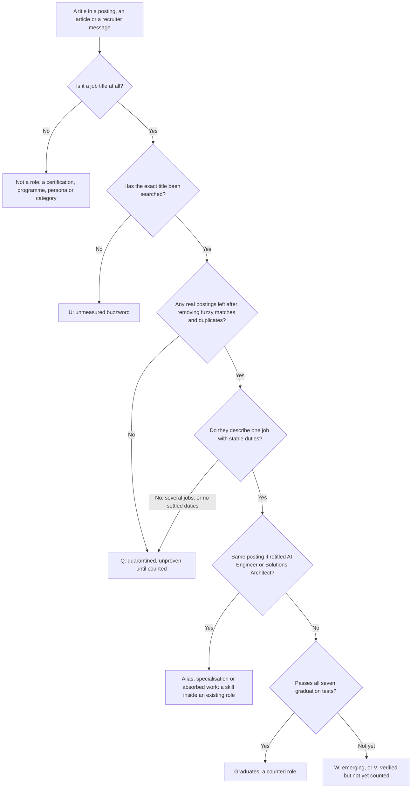

# Emerging GenAI Roles: How to Read a New Job Title

> How to read a new GenAI job title (a real role, a skill inside an existing role, or unproven hype): the seven graduation tests in plain words, a dated watchlist of emerging, candidate and quarantined titles, what would change each status, and how to use emerging terms honestly on a résumé.

**Dates and grades.** Posting counts date from 14–21 October 2026, and skill shares from 5 August to 10 September 2026, unless a row says otherwise; keyword counts from the small Rise board are undated cached pages, read for a session dated 2026-10-21. Regulatory dates are as retrieved on 21–23 October 2026; they are pointers, not legal advice. Grades follow EGP-1.0, and platform aggregates (JobsPipe, Fast AI Jobs) are graded B ([role catalog §1.3](../02-roles/role-catalog.md#13-evidence-grades-and-conventions)). Every status on this page comes from the [role catalog](../02-roles/role-catalog.md) (as of 2026-11-04), which applies the [research errata](../../research/ERRATA.md).

## The short answer

1. **Treat a new title as a claim about hiring, and check it.** The role catalog indexes 241 GenAI title strings. Just 29 are canonical roles; 107 are aliases of one, 22 are seniority variants and 17 are specialisations inside one (counted from the catalog's A–Z index, 2026-11-04). Only three title families clear the 50-posting quorum: AI Engineer, Machine Learning Engineer and Forward Deployed Engineer (FDE) [B · T0-01.F1, F3]. Meanwhile Indeed's count of frequently advertised AI-referencing titles rose from 264 (2022) to 822 (Q1 2026) [C · T0-01.F11].
2. **New work shows up as skills long before it shows up as a title.** Agentic AI is named in 59.3% of AI Engineer postings (counted 2026-09-10), yet the exact title "Agent Architect" had about 2 postings and "Context Engineer" roughly 10–25 worldwide, an estimate [B · T0-01.F4; C · T0-01.F5, F7]. Evaluation appears in the postings of 68.2% of 198 companies (snapshot 2026-08-05), while the AI Evaluation Engineer title stays small [B · T0-03.F3; C · T0-01 D2]. A skill's share of postings never counts as demand for a title ([role rankings §1.1](../02-roles/role-rankings.md#11-design-rules-that-keep-bias-out)). Own the skill; do not wait for the title.
3. **A title leaves the watchlist or quarantine only by passing seven tests:** volume, persistence, breadth, a shared skill set, a seniority ladder, adoption by a lab or Big Tech employer, and not being an alias ([role catalog §1.4](../02-roles/role-catalog.md#14-quorum-and-graduation-tests-t0-01-d5), from T0-01 D5). The [checklist](#checklist-how-to-judge-a-new-title) puts them in plain words.
4. **Hype has a signature:** raw keyword counts, a percentage with no source, a single blog, or an analyst's definition offered as demand. "Cognitive Architect" showed 339–1,000 job-board hits and one real, legacy posting [B · T0-01.F6]; "Prompt Wizard" returned none [B · T0-01.F8]. Unmeasured is not zero, though: five buzzwords listed in an early planning record (FAD §5.3) were never searched, so the catalog labels them unmeasured, not "zero postings" ([role catalog §5.2](../02-roles/role-catalog.md#52-unmeasured-buzzwords-never-searched)).
5. **Headline a canonical title; carry emerging terms as proved skills.** Screening software scores title similarity [A · T0-04.F8], and recruiter search strings are built from titles and stack terms [C · T0-11.F3]. Never headline a quarantined or legacy title ([role catalog §5.1](../02-roles/role-catalog.md#51-quarantined-titles-t0-01-d4-reconciled)).
6. **Statuses change at scheduled recounts.** T0-01's recounts are due on 2026-12-01 and 2027-01-15, and decision D-002, which set the quorum, is reviewed on 2027-01-31 [T0-01 L84; [D-002](../../research/DECISIONS.md)]. Re-read the watchlist after each.

## At a glance



The flow summarises the catalog's rules ([§1.1–§1.4](../02-roles/role-catalog.md#1-classification-rules)) and adds none of its own. One exception to it: Vibe Engineer was quarantined without a search [D · T0-01 D2].

| Reading | Catalog class | Title strings | Examples | What to do |
|---|---|---:|---|---|
| A role with measured volume | E (established) | 3 | AI Engineer, Machine Learning Engineer, Forward Deployed Engineer | Headline it if you can claim it |
| A real title, not yet counted | V (verified) | 17 | Applied AI Engineer, Inference Engineer, Research Engineer | Use it if you can claim it. V describes counting, not career quality: Research Engineer is V and ranks #3 of 24 in the [role rankings](../02-roles/role-rankings.md) [M] |
| An emerging role | W (watchlist) | 8 | Agentic AI Engineer, AI Evaluation Engineer, AI Security Engineer | Apply to the title where it exists; otherwise apply under the larger title the work sits in |
| Work hired inside other professions | A (absorbed) | 1 | AI Risk, Audit & Compliance Specialist | Add AI to an audit, model-risk or privacy career |
| A variant or skill inside a role | Alias 107, level variant 22, specialisation 17, legacy 7, brief label 6, cluster variant 5 | 164 | GenAI Developer, Prompt Engineer, MCP Control Plane Engineer | Use the canonical title; carry the term as a skill |
| A plausible role, never counted | Candidate | 7 | Voice AI Engineer, On-Device / Edge AI Engineer, Retrieval / Search Engineer | Treat it as a skill until it is counted |
| Unproven or hype | Q (quarantined) 10; U (unmeasured) 7 | 17 | Context Engineer, Cognitive Architect, Prompt Wizard, AI Whisperer | Never a headline; watch the recounts |
| Not a job | Not a role | 24 | Certification names, background personas, fellowships | Ignore it as a target |

Counts are from [role catalog §0](../02-roles/role-catalog.md#0-summary) and its [A–Z index](../02-roles/role-catalog.md#4-complete-az-title-index) (2026-11-04); they sum to 241.

## Checklist: how to judge a new title

Run it on any title you meet in a posting, an article or a recruiter's message. The four screens apply T0-01's counting protocol [T0-01 D10]; the seven tests are the catalog's graduation tests in plain words ([§1.4](../02-roles/role-catalog.md#14-quorum-and-graduation-tests-t0-01-d5), from T0-01 D5).

**Screen first:**

- [ ] **It is a job.** Not a certification, fellowship, background persona, salary-guide category or newsletter. "Azure AI Engineer" is a credential (AI-102), retired on 30 June 2026 ([role catalog §6](../02-roles/role-catalog.md#6-not-a-role-register)).
- [ ] **The exact title returns real postings.** Search the exact string, open the first 20 results and drop near-misses [T0-01 D10]. Fuzzy matching is how "cognitive architect" reached 339–1,000 hits [B · T0-01.F6].
- [ ] **You counted openings, not postings.** One requisition posted in several cities counts once; one Deloitte AI-risk requisition appeared 16 times on ZipRecruiter [C · T0-15.F4].
- [ ] **The claim names its source, corpus and date.** Claims that Context Engineer is the fastest-rising title, or that it pays a premium, came with no counts [D · T0-01.F5].

**The seven graduation tests (a title must pass all seven):**

- [ ] **1. Volume.** At least 50 distinct openings for the exact title or its declared aliases, in two independent sources. One source must read employers' own applicant-tracking boards (Ashby, Greenhouse or Lever).
- [ ] **2. Persistence.** The count is still at least 50 when it is repeated at least 30 days later.
- [ ] **3. Breadth.** At least 10 employers; no employer holds more than 30% of the openings; at least 3 employers are not consultancies or staffing firms.
- [ ] **4. Shared skills.** At least 70% of the postings ask for the same three or more core skills, and that set differs from AI Engineer's by at least two core skills.
- [ ] **5. Ladder.** At least three seniority levels, each with its own pay band.
- [ ] **6. Lab adoption.** At least one tier-1 AI lab or Big Tech employer uses the title as a formal role family.
- [ ] **7. Not an alias.** Replace the title with "AI Engineer" or "Solutions Architect". If the posting still reads the same, the title is an alias.

The bar is a design judgement. Decision D-002 grades its own 50-posting threshold C and allows it to be recalibrated at review [D-002]. A fixed 50 also ignores corpus size: it is 0.13% of the Fast AI Jobs corpus and a rounding error in JobsPipe's [T0-01 objection 7].

**Read the result:**

| What you found | Reading | What to do |
|---|---|---|
| Not a job string | Not a role | Ignore it as a target; a credential can still be a tie-breaker ([credential ROI](../04-certifications/credential-roi.md)) |
| No postings, only fuzzy hits, or a few postings with different duties | Unproven: quarantine territory | Never headline it; learn the underlying skill if the work is real |
| Postings that read the same under "AI Engineer" or "Solutions Architect" | Alias or skill | Use the canonical title; carry the term as a skill |
| One coherent job, but fewer than 50 openings or one dominant employer | Emerging | Apply to the title where it exists; otherwise apply under the larger title and lead with the skill |
| Passes all seven tests | A role | Headline it if you can claim it |

### Red flags in title claims

| Red flag | Example from the research | What to do |
|---|---|---|
| A raw job-board count | "Cognitive architect": Indeed 921, ZipRecruiter 388, Glassdoor 339, SimplyHired 1,000. The only true match was a legacy IBM Watson-era posting [B · T0-01.F6] | Search the exact title and read the first 20 results |
| A skill share quoted as demand for a title | "Agentic AI Engineer is a verified role: agentic AI is in 59.3% of AI job descriptions." That figure is a skill share inside AI Engineer postings; the title is on the watchlist ([role catalog §9.2](../02-roles/role-catalog.md#92-claims-checked-during-classification-highlights)) | Count postings for the title, not mentions of the skill |
| A definition offered as demand | Gartner formally defines context engineering (A for its existence), but "a discipline definition is not a title-volume signal" [T0-01.F5] | Ask for a dated posting count |
| One blog says the title is real | Principal Agentic Context Engineer rests on one blog citation [D · T0-01 D4] | Treat it as unverified until you find an exact posting |
| A statistic with no traceable source | A "40% decline since 2023" for Prompt Engineer [D · T0-01.F8]; "78% of enterprise AI teams" running MCP in production, which T0-16 rejects as untraceable [T0-16.F5] | Trace it to the original measurement, or drop it |
| Interview-prep counts read as demand | Dataford's prep counts (FDE 229, GenAI Engineer 215, Agentic AI Engineer 125) are demand-side signals, not postings [C · T0-01 L97] | Count postings |
| Experience asks that disagree | Agent Architect postings ask for 3–5, 6–10, 7+ and 8+ years [C · T0-01.F7] | Read it as a title with no settled ladder (test 5) |
| Postings mostly at consultancies or staffing firms | Context Engineer postings are "mostly consulting/staffing" [C · T0-01 D4] | Check breadth (test 3) |

## The watchlist (October 2026)

Counts are as dated in each row. Ninety-day counts come from one keyword index (Skillenai, window ending 2026-10-14): they are totals over 90 days, not live counts. "What would promote it" names the tests a title has not yet passed, from the catalog's verdicts ([§5.1](../02-roles/role-catalog.md#51-quarantined-titles-t0-01-d4-reconciled), [§5.4](../02-roles/role-catalog.md#54-watchlist-against-the-graduation-tests)) unless a cell says otherwise. How to target each canonical role is in [GenAI target roles](../02-roles/genai-target-roles.md#the-24-roles-one-line-each).

### Emerging roles (W): real postings, below quorum

| Title | Status | Best evidence | What would promote it | Where the work sits today |
|---|---|---|---|---|
| Agentic AI Engineer (also Agent Engineer, AI Agent Engineer) | W | About 66 "Agentic AI Engineer" postings (derived) and 28 "Agent Engineer" postings in 90 days [C · T0-16 §9.2]; about 5 of the newest 50 AI Engineer rows on Fast AI Jobs [C · T0-01 D2]. Agentic AI is a skill in 59.3% of AI Engineer postings (2026-09-10) [B · T0-01.F4] | Volume and persistence (tests 1–2): probably under 50 live at any one time. Its skills differ from AI Engineer's mainly by framework skills (test 4). The catalog expects it to stay a skill inside AI Engineer | Inside [AI Engineer](../02-roles/hubs/ai-engineer.md) postings. Hub: [Agentic AI Engineer](../02-roles/hubs/agentic-ai-engineer.md) |
| AI Evaluation Engineer (also Evals Engineer, Model Quality Engineer) | W | "LLM evaluation" keyword: 26 postings on a small board (Rise) [C · T0-01 D2]; titled postings at 6 named employers [B/C · [role catalog §3.5](../02-roles/role-catalog.md#profile-ai-evaluation-engineer)]. Evaluation is named in 19.0% of 3,647 postings and by 68.2% of 198 companies (snapshot 2026-08-05) [B · T0-03.F3] | Volume (test 1) and 10 or more employers (test 3); its skill set is already distinct (eval statistics, judge calibration). No pay premium for pure eval roles is verified [T0-03] | As a skill inside AI Engineer and ML Engineer roles. Hub: [AI Evaluation Engineer](../02-roles/hubs/ai-evaluation-engineer.md) |
| AI Enablement Engineer | W | About 53 postings in 90 days (derived); 30.2% (16) mention MCP, the highest share of any title [C · T0-16 §9.2] | Breadth is unknown (test 3), and the count is a 90-day total, not a live count. The role may be transitional (judgement, D) | Internal platform and developer-productivity teams. Hub: [AI Enablement Engineer](../02-roles/hubs/ai-enablement-engineer.md) |
| AI Security Engineer / AI Red Teamer | W | About 23 "AI Security Specialist" postings in 90 days (derived) [C · T0-16 §9.2]. JobsPipe lists 2,827 US Security Engineer (feeder) postings, with the AI share unmeasured (2026-11-02) [B · [role catalog §7](../02-roles/role-catalog.md#7-feeder-and-adjacent-occupations-market-refresh-2026-11-02)] | An AI-specific count (tests 1–3). The need itself is evidenced: CVSS 9.8 flaws in two serving engines in 2026 [A/B · T0-03.F12] | Also application-security roles with LLM scope. Hub: [AI Security Engineer](../02-roles/hubs/ai-security-engineer.md) |
| AI Product Engineer (AI Frontend) | W | The four postings T0-06 examined in detail were all Staff-level, asking for 5–6+ years; no census of AI-frontend postings exists [C/D · T0-06.F6] | Volume, and openings below Staff level (tests 1 and 5; this page's reading) | Usually advertised as full-stack AI engineer. Hub: [AI Product Engineer](../02-roles/hubs/ai-product-engineer.md) |
| Physical AI / Robotics AI Engineer | W | 8 of the newest 50 AI Engineer rows on Fast AI Jobs (2026-10-19), all Figure AI "Helix AI Engineer" [B · T0-01.F2] | Breadth: 10 or more employers, none above 30% (test 3) | Robotics firms. Hub: [Physical AI Engineer](../02-roles/hubs/physical-ai-engineer.md) |
| Responsible AI / AI Governance Engineer | W | A thin niche; "expect few openings" [T0-15 L163]. Of 13 job descriptions read (a purposive sample), 4 were technical: at IT-services firms, a staffing client and one hidden employer [C · T0-15.F6] | A count (tests 1–3). T0-15 reads the work as an extension of ML-platform, MLOps and security engineering | MLOps and security teams in regulated firms. Hubs: [Responsible AI Engineer](../02-roles/hubs/responsible-ai-engineer.md), [ML Platform / MLOps](../02-roles/hubs/ml-platform-engineer.md) |
| Domain Evaluation Specialist / AI Trainer | W | A guide relaying TechCrunch says Mercor pays more than 30,000 experts [C/D · T0-06 L177]; LinkedIn's Jobs on the Rise 2026 ranks data annotators fourth [C · T0-06 L174] | The catalog sets no trigger: the demand evidence is a contract marketplace and a LinkedIn ranking, not posting counts. T0-06 calls the work "a bridge, not a destination" | Expert-contract marketplaces and in-house evaluation leads. Hub: [Domain Evaluation Specialist](../02-roles/hubs/domain-evaluation-specialist.md) |

### Skills sold as titles: specialisations, candidates and legacy titles

| Title you may see | Status | Best evidence | What would make it a role | Where the work sits today |
|---|---|---|---|---|
| MCP / AI Control Plane Engineer; Agent Gateway Engineer | Specialisation; legacy label | No posting with the literal title "Agent Gateway Engineer" was found. The work appears as Senior Platform Engineer – Enterprise AI (Boston Scientific), Senior Enterprise AI Control Plane Engineer (PTC) and a Workato product role [C · T0-16.F10]. "Model Context Protocol" is named in 0.068% of 343,299 Fortune-1000 and API-provider postings (API Evangelist, Q3 2026; full phrase only, so an undercount) and "MCP" in about 0.7% of Skillenai's broad index [C · T0-16.F9] | T0-16's own heuristics (judgement, D): the literal gateway-engineer title in dozens of postings, or a Fortune-1000 MCP share above about 1% for two consecutive quarters, about 15 times the Q3 2026 level [T0-16 L130] | [ML Platform / MLOps](../02-roles/hubs/ml-platform-engineer.md); also [AI Enablement](../02-roles/hubs/ai-enablement-engineer.md) and [Agentic AI Engineer](../02-roles/hubs/agentic-ai-engineer.md) |
| Post-Training / RLHF Engineer | Legacy (absorbed) | Small-board keyword counts (Rise): post-training 9, RLHF 17, RL 9, SFT 4, GRPO 2 [C · T0-01.F9]. "Real demand is not disproven; the *title string* is" | An exact-title quorum (tests 1–3) | Carried under [Research Engineer / Member of Technical Staff (MTS)](../02-roles/hubs/research-engineer.md) at labs and data vendors |
| Prompt Engineer | Legacy (absorbed) | 72 of 20,662 LinkedIn AI postings (0.35%; a 2025 study) [B · T0-03.F2]; Indeed's salary page rests on 52 data points over 36 months [B · T0-01.F8] | The catalog calls a reversal unlikely. Prompting survives as a co-requirement in 31.1% of AI Engineer postings [B · T0-01.F4] | [AI Engineer](../02-roles/hubs/ai-engineer.md) |
| LLMOps Engineer | Legacy (absorbed) | A skill tag under ML Platform / MLOps, not a counted title [T0-01 Recommendation 3]. FAD §5.3 listed it as quarantined (ERRATA U3) | An isolated title count (none exists) | [ML Platform / MLOps](../02-roles/hubs/ml-platform-engineer.md) |
| Retrieval / Search Engineer (LLM); Vector Search & Retrieval Systems Engineer | Candidate | No title count. RAG is named in 54.0% of AI Engineer postings [B · T0-01.F4]; Databricks posts a "Senior Staff Applied AI Engineer – Context Retrieval" [B · T0-01 D7] | Any title count | [AI Engineer](../02-roles/hubs/ai-engineer.md); [Applied AI Engineer](../02-roles/hubs/applied-ai-engineer.md) |
| Conversational & Voice AI Engineer | Candidate | A real-time voice system is a reported design-interview prompt in a multi-company ML-design question pool (PracHub); no title count [C · T0-14 A12] | A title count; it is one of the catalog's first measurement targets | [AI Engineer](../02-roles/hubs/ai-engineer.md); [AI Product Engineer](../02-roles/hubs/ai-product-engineer.md) |
| On-Device / Edge AI Engineer | Candidate | "A differentiator, not a job by itself" [T2-01 L450]. WebGPU is supported in all major browsers [A · T0-06.F6]; no postings were counted | A title count; also a first measurement target | [AI Product Engineer](../02-roles/hubs/ai-product-engineer.md); [Inference Engineer](../02-roles/hubs/inference-engineer.md) |
| AI Developer Advocate / DevRel (AI) | Candidate | One Ollama Developer Relations opening on an aggregator [C · T0-05] | Any count | No canonical role yet |
| Technical Program Manager (AI) | Candidate | Seen only as "managers and TPMs (6)" among the newest 50 FDE-cluster rows [B · T0-01.F3] | Any title-level count | No canonical role yet; seen inside the [FDE](../02-roles/hubs/forward-deployed-engineer.md) cluster |
| Conformity Assessor (notified body) | Specialisation | Under the EU AI Act's Art. 43, Annex III points 2–8 use internal control with no notified body; sectoral notified bodies must apply for AI designation by 28 January 2028; no harmonised standard had been cited as of 28 April 2026 [A/B · T0-15.F3] | Designated notified bodies, and Annex I high-risk duties from 2 August 2028 [A · T0-15.F1]. T0-15 finds no notified-body labour market before 2028 | Most high-risk compliance is first-party work by the provider's own staff. Hub: [AI Risk, Audit & Compliance](../02-roles/hubs/ai-risk-assurance-specialist.md) |
| Algorithmic Auditor; ISO/IEC 42001 Auditor | Specialisation | NYC Local Law 144: 18 of 391 employers had posted an audit report (2024 study); 23 audit reports under the EU Digital Services Act in the 2025 cycle; ISACA's AAIA credential requires a CISA, CIA or CPA [A/B · T0-15.F7] | Not on this evidence: mandated audits have produced few audit jobs | Assurance firms, certification bodies and internal audit. Hub: [AI Risk, Audit & Compliance](../02-roles/hubs/ai-risk-assurance-specialist.md) |
| AI Safety Engineer | Alias of two different roles | Two small markets plus one unrelated use. No job board showed postings with this title at regulated enterprises; automotive "functional safety" is a different meaning of safety [B/C · T0-15.F8] | Read the duties, not the title | [AI Safety Researcher](../02-roles/hubs/ai-safety-researcher.md) (frontier) or [Responsible AI Engineer](../02-roles/hubs/responsible-ai-engineer.md) (enterprise) |
| AI Ethicist / AI Ethics Officer | Legacy (absorbed) | Whether the title vanished "cannot be shown either way" [B · T0-15.F5] | The catalog advises against standalone positioning | [AI Governance Lead](../02-roles/hubs/ai-governance-lead.md) |

The [role map](../02-roles/role-map.md#specialisations-inside-canonical-roles) lists 26 kinds of work that happen inside canonical roles, with the skills behind each and the catalog status of any title that names them.

### Aliases and variants that look new

| Title seen | Status | What it is | Where the work sits |
|---|---|---|---|
| Frontier Agents Engineer | Alias | The full title adds "(Forward Deployed Engineering)"; about 22 postings in 90 days (derived) [B · T0-01.F3; C · T0-16 §9.2] | [Forward Deployed Engineer](../02-roles/hubs/forward-deployed-engineer.md) |
| AI Deployment Engineer | Alias | OpenAI's title in July 2026 postings [B · T0-01 D7] | [Forward Deployed Engineer](../02-roles/hubs/forward-deployed-engineer.md) |
| Deployment Strategist; GTM Engineer | Cluster variants, not engineering | 6 and 4 of the newest 50 FDE-cluster rows; only about 48% of those rows were engineer-titled [B · T0-01.F3] | Inside the FDE cluster |
| Helix AI Engineer | Alias | Figure AI's title for robotics AI work [B · T0-01.F2] | [Physical AI / Robotics AI Engineer](../02-roles/hubs/physical-ai-engineer.md) |
| Site AI Engineer; Power Platform & AI Engineer | Specialisations | Construction and enterprise-automation variants inside the AI Engineer family [B · T0-01.F2] | [AI Engineer](../02-roles/hubs/ai-engineer.md) |
| GenAI Engineer / GenAI Developer; LLM Engineer | Aliases | GenAI Engineer is the dominant label at India's global capability centres (GCCs), per Taggd [C · T0-01 D8]; LLM Engineer has no separate count [D · T0-01 D2] | [AI Engineer](../02-roles/hubs/ai-engineer.md) |
| Agentic AI Architect | Alias | At least 5 postings (Cognizant, Air India, Zoom and others) [C · T0-01.F7] | [AI Solutions Architect](../02-roles/hubs/ai-solutions-architect.md) |
| Member of Technical Staff (MTS) | Alias (a wrapper title) | A frontier-lab title that hides seniority [B · T0-02 L106]. OpenAI's 2025 visa filings use it for functions from software and research engineering to hardware and data science [B · T0-02 L305–316] | [Research Engineer / MTS](../02-roles/hubs/research-engineer.md) by default; read the duties |

### Quarantined and unmeasured titles

The quarantined (Q) and unmeasured (U) titles are registered, each with its best evidence and its gap to graduation, in [role catalog §5.1](../02-roles/role-catalog.md#51-quarantined-titles-t0-01-d4-reconciled) and [§5.2](../02-roles/role-catalog.md#52-unmeasured-buzzwords-never-searched): Context Engineer and its variants, Context Harness Engineer, Principal Agentic Context Engineer, Agent Architect (as an exact title), Cognitive Architect, Prompt Wizard and Vibe Engineer (Q), and the never-searched buzzwords such as AI Whisperer and Foundation Model Engineer (U). Never headline one. Two notes this page adds:

- **Context Engineer is the one to watch.** Its roughly 10–25 live postings worldwide (an estimate) include EY roles posted on 4 March and 7 July 2026, and they describe three different jobs [C · T0-01.F5]. It fails tests 1–4, with tests 5–6 unmeasured [T0-01 D5]; a direct exact-title count of 50+ distinct requisitions would change the verdict (see the [signals](#signals-that-would-move-a-status)).
- **Where the work sits today:** context engineering inside [AI Engineer](../02-roles/hubs/ai-engineer.md) and [Agentic AI Engineer](../02-roles/hubs/agentic-ai-engineer.md); agentic architecture inside [AI Solutions Architect](../02-roles/hubs/ai-solutions-architect.md); reasoning-model work with [Research Scientist](../02-roles/hubs/research-scientist.md) and [Research Engineer](../02-roles/hubs/research-engineer.md); foundation-model pre-training and distributed training under [Research Engineer / MTS](../02-roles/hubs/research-engineer.md) and [AI Infrastructure](../02-roles/hubs/ai-infrastructure-engineer.md). Cognitive Architect, Prompt Wizard and Vibe Engineer map to no role, and the catalog gives Context Harness Engineer and Principal Agentic Context Engineer no mapping.

### Strings that are not jobs

Certification names ("Azure AI Engineer" is the AI-102 credential, retired on 30 June 2026), fellowships and residencies, background personas, a salary-guide category, a newsletter and two strings fabricated from source names are not jobs; the catalog's [not-a-role register](../02-roles/role-catalog.md#6-not-a-role-register) lists each one with its source.

### India: the titles differ

- **GCC titles.** GCCs advertise AI work as GenAI Engineer, AI/ML Engineer, MLOps Engineer and Prompt Engineer (Taggd) [C · T0-01 D8]. Prompt Engineer survives there although it is legacy in US data [B · T0-03.F2]. Read such postings by their duties, and present yourself under the canonical title that matches them [P].
- **Emerging titles do appear.** Agentic AI Engineer, Principal Agentic AI Engineer and Forward Deployed AI Engineer appear on Weekday India listings [C · T0-01 D8], and one dated Context Engineer posting (BT) was mirrored on apna.co for Bengaluru [B/C · T0-01.F5].
- **Not a title.** "GCC AI Specialist" was not found as a title [T0-01 D8].
- **Governance.** India's RBI FREE-AI report (13 August 2025) notes that some organisations created Responsible AI Officer roles; it does not recommend one [A · T0-15 L356]. T0-15 expects privacy-engineering and data protection officer (DPO) demand to lead, with AI-specific roles following the DPDP main obligations on 13 May 2027 [B · T0-15.F12].
- **Gaps.** The corpus has no title-level GCC counts, and Indian job boards (Naukri, Instahyre) have not been measured [T0-01 D8; [ROADMAP](../../ROADMAP.md) P1-2]. Whether the 50-posting quorum should change for India-specific boards is an open question (FAD OQ2).

## What would change a status

### The rules

- **Up from W or Q:** pass all seven tests at a recount ([role catalog §1.4](../02-roles/role-catalog.md#14-quorum-and-graduation-tests-t0-01-d5)). Under D-002, quarantined titles are "tracked, not deleted", and promoted when evidence accumulates [D-002].
- **Up from V:** a quorum-grade count, meaning at least 50 distinct live postings in a large corpus ([role catalog §1.2](../02-roles/role-catalog.md#12-status-classes-for-canonical-roles)). For Applied AI Engineer the catalog asks for an isolated count of at least 50 in two corpora.
- **Down:** the catalog defines no demotion test. Titles have fallen by collapsing into a larger family: T0-03 rates Prompt Engineer "devalued as a title; baseline as a skill" [B · T0-03 L419].
- **Faster recounts:** if more than three quarantined titles pass 50 postings between recounts, recounts move to quarterly [D-002].
- **Proposed, not adopted:** D-002 would add a "lab-validated" path if a lab-created title became an industry standard while staying under 50 openings; its example is fewer than 50 openings in total, but at five or more tier-1 labs [D-002]. T0-01 suggests adding a share-of-corpus floor to the fixed 50 [T0-01 objection 7].

### The calendar

| Date | Event | What to check |
|---|---|---|
| 2026-12-01 | T0-01 recount: exact-title searches on the JobsPipe API, Fast AI Jobs role pages and Indeed Hiring Lab data | The catalog's first measurement targets: Applied Scientist, Research Engineer and Research Scientist (live counts), Inference Engineer, MLOps / ML Platform, AI Product Manager and AI Solutions Architect (title-level), Agentic AI Engineer, AI Evaluation Engineer, Context Engineer, Voice AI and On-Device AI ([role catalog §10](../02-roles/role-catalog.md#10-maintenance)). Applied Scientist's "~700 postings" in older records has no primary source (ERRATA U1) |
| 2026-12-03 | Catalog posting counts due for re-verification (31-day cycle) | Every count on this page |
| 2027-01-15 | Second T0-01 recount | Persistence (test 2) for any title that passed volume on 2026-12-01 |
| 2027-01-31 | D-002 review | The quorum itself, and D-002's prediction that 8 to 12 GenAI roles will show verifiable live volume. As of October 2026, 3 are measured and 17 are verified but uncounted [role catalog §0] |

### Signals that would move a status

| Signal | What it would change | Grade · source |
|---|---|---|
| A direct exact-title count of 50+ distinct requisitions from LinkedIn, Indeed or Ashby | Context Engineer or Agent Architect, toward graduation | T0-01 L86 |
| MCP named in more than about 1% of Fortune-1000 postings for two consecutive quarters; a census-grade source above about 2% of tech postings; the literal gateway-engineer title in dozens of postings | Protocol and gateway work, toward a title of its own | D (T0-16's stated heuristics) · T0-16 L130 |
| MCP's posting share flat or falling for two quarters; a major MCP-attributed breach at a large enterprise; hyperscalers dropping MCP gateways for CLI or skills-first patterns; membership of the Agentic AI Foundation, MCP's host, shrinking | Protocol skills, toward "overstated" | D · T0-16 L131 |
| Observed by October 2026: a second-hand report of one company moving away from MCP, reference servers labelled not production-ready, a documented gateway bypass, deprecations with SDK breakage | Protocol work reads as governed infrastructure, not a frictionless standard | B/C · T0-16.F12 |
| EU notified bodies designated (sectoral bodies must apply for AI designation by 28 January 2028); Annex I high-risk duties from 2 August 2028 | Conformity-assessor work; until then, most high-risk compliance is self-assessed by providers' own staff | A/B · T0-15.F1, F3 |
| India's DPDP main obligations from 13 May 2027 | Privacy-engineering and DPO roles first, AI-specific roles later (T0-15's expectation) | B · T0-15.F12 |
| Kernel tooling moving from raw CUDA C++ to tile-level languages (CUDA Tile arrived in CUDA 13.1 in December 2025) | The skill mix of GPU Kernel Engineer; no labour data shows a decline either way | A/B · T0-03.F8; [role catalog §3.4](../02-roles/role-catalog.md#profile-gpu-kernel-engineer) |
| Closed frontier-model prices falling a further 80% | Self-hosted inference skills narrowing to specialist vendors, defence and healthcare | D (a T0-03 tripwire) · T0-03 §4.5 |
| Generative-UI frameworks commoditising AI-frontend work | AI Product Engineer as a niche; T0-06 leaves this as an open question | T0-06 L854 |

## Using emerging terms on a résumé or profile

### The rules

1. **Headline a canonical title you can claim.** Use an E or V title, or a W title when the posting uses it. Mirror a posting's title only if it is a canonical title you can honestly claim ([résumé strategy: what changes, and what never changes](../06-job-search/resume-strategy.md#what-changes-and-what-never-changes)). Never headline a quarantined, legacy or unmeasured title ([role catalog §5.1](../02-roles/role-catalog.md#51-quarantined-titles-t0-01-d4-reconciled); [GenAI target roles](../02-roles/genai-target-roles.md#not-primary-genai-targets-and-titles-to-avoid-as-a-headline)). AI screening layers score title similarity and a predicted next title [A · T0-04.F8], and public recruiter search strings for AI/ML roles are built from titles, languages, frameworks and LLM terms [C · T0-11.F3].
2. **Put emerging work in skills and bullets, as skill phrases.** T0-01 tells employers to label quarantined work with skill tags such as "context/retrieval design" or "agent orchestration" rather than publish the titles; the catalog adapts that advice for candidates [T0-01 Recommendation 5; role catalog §5.1].
3. **Keywords only when true, each one proved.** List an emerging term only if you did the work, and back it with one evidence line: what, where, scale, result ([résumé strategy: what changes, and what never changes](../06-job-search/resume-strategy.md#what-changes-and-what-never-changes)). Some screening layers grade each criterion and cite the résumé text behind the grade [A · T0-04.F8].
4. **Never rename a past job title** ([résumé strategy](../06-job-search/resume-strategy.md#what-changes-and-what-never-changes)). If an employer titled you "Context Engineer" or "Prompt Engineer", keep that title in the experience entry and state the canonical function in your headline and summary [P]. Keep titles identical across your résumés (the [five layers](../06-job-search/resume-strategy.md#the-five-layers-and-their-jobs) all draw on one master inventory) and your profiles ([the résumé pitfalls](../06-job-search/resume-strategy.md#pitfalls)).
5. **Say which protocol work you did.** "MCP" alone conflates server authoring, gateway operation and client integration; T0-16 tells employers to specify which they mean [C · T0-16 L126]. Name yours, and the specification revision you built against: 2026-07-28 was the revision in force on 21 October 2026 [A · T0-16.F2].
6. **Lead with the practice, not the product.** The hiring signal for evaluation attaches to the engineering practice, not to a vendor brand [B · T0-03.F3]. Agent frameworks churn: AutoGen had no release in the 365 days to late October 2026, and in one study 85% of production teams ran custom loops without a framework [A/B · T0-03.F9].
7. **A credential is not a title.** List certifications by full name and date, after your projects, and mark retired ones as retired ([role catalog §6.2](../02-roles/role-catalog.md#62-certifications-frequently-misclassified-as-roles); [credential ROI](../04-certifications/credential-roi.md)).
8. **Profiles follow the same rules** [P]: the canonical title in the headline, and emerging terms in skills and featured work, each linked to proof ([online presence](../07-networking/online-presence.md)).

### Weak and strong

All examples are templates [P]; fill the brackets with your own facts.

| Weak | Strong | Why |
|---|---|---|
| Headline: "Context Engineer · Agentic AI" | Headline: "AI Engineer: RAG, agents, evaluation". Bullet: "Designed context and retrieval for a support agent over [N] documents; answer accuracy [x]% → [y]% on a [N]-item golden set" | The searched title in the headline; the emerging work proved in a bullet |
| Target title: "Prompt Engineer" | Title: "AI Engineer". Skills: "prompt and context design, with regression evals in CI" | Prompt Engineer is legacy; prompting is a co-requirement |
| "MCP expert" | "Built and ran an MCP gateway for [N] internal tools: default-deny registry, per-tool authorisation, audit logs; spec revision 2026-07-28" | Names the kind of MCP work and the specification version |
| "Agent Architect" | "AI Solutions Architect (agentic systems): designed [system] for [client type]; [result]" | The searched title, with the agentic scope in brackets |
| "Vibe Engineer" | "Shipped [feature] with coding agents behind tests and code review; [cycle-time result]" | A way of working is a skill, not a title |
| "Azure AI Engineer" listed as a job | "Microsoft Certified: Azure AI Engineer Associate (AI-102), [year]; retired 30 June 2026", under Certifications | A credential, listed as one, with its status |

### Template [P]

```text
Headline:    [canonical title you can claim]: [two or three skill areas from the posting]
Summary:     [canonical title], [N] years; [emerging work as a skill phrase]; [one result with a metric]
Skills:      [the posting's exact terms that you have used, e.g., agent orchestration; LLM evaluation; MCP (server authoring)]
Experience:  [official title, as your employer gave it] · [employer] · [dates]
             - [one bullet per emerging term: what, where, scale, result]
```

## Evidence and limits

- **Measured:** exact-title counts for the three established families and null results such as Prompt Wizard (B); job-description skill shares counted on 2026-09-10 (B); EU legal dates (A).
- **Weaker:** watchlist counts come from a small keyword board (Rise), a 90-day keyword index (Skillenai), a union estimate (Context Engineer, 10–25) or single postings. Most are Grade C; single blog claims are D.
- **Judgement:** the 50-posting bar and the seven tests are design choices, and D-002 grades its threshold C. The reading flow, red flags, résumé rules and templates on this page are practice [P]. The "where the work sits" cells follow the catalog and the role map, whose footprints are Grade D.
- **Corpus-relative:** LinkedIn, Indeed, Wellfound, Otta and Ashby could not be queried directly; JobsPipe and Fast AI Jobs are proxies [T0-01 D1]. Postings are not openings, and openings are not hires [T0-01 objection 2].
- **Young titles:** the first dated Context Engineer and agentic-architect postings appear in March–May 2026, so small counts may partly reflect crawl lag [T0-01 objection 4].
- **No demotion rule**, and no quorum-grade count yet for the 17 V roles.
- **India:** no title-level GCC counts; Indian job boards unmeasured; the quorum's fit for India is an open question (FAD OQ2).
- **Errata applied** ([ERRATA](../../research/ERRATA.md)): U1, the "~700" Applied Scientist postings have no primary source; U3, FAD's quarantine list differs from T0-01's, and this page follows T0-01 D4 as reconciled in the catalog; U6, D-002's rationale cites T0-01 F6 for the stability of function-first classification, but F6 is about false-positive platform counts. The quorum rule itself is unaffected.
- **What would change this page:** a recount; the D-002 review; a direct LinkedIn, Indeed or Naukri count; any event in the signals table.

**Re-check dates.** The front-matter `review_by` (2026-11-14) is 31 days after the earliest posting count on the page (EGP-1.0 class V1, monthly series). Each class of fact expires on its own schedule:

| Facts on this page | Dated | Re-check by | Where the refresh lives |
|---|---|---|---|
| 90-day index counts (Skillenai) | Window ending 2026-10-14 | 2026-11-14 | [Role catalog](../02-roles/role-catalog.md) |
| Live counts and null results (T0-01) | 2026-10-19 to 2026-10-21 | 2026-11-19 to 2026-11-21; T0-01 recounts on 2026-12-01 and 2027-01-15 | [Role catalog §10](../02-roles/role-catalog.md#10-maintenance) |
| Regulatory dates and status (EU AI Act, DPDP) | Retrieved 2026-10-21 to 2026-10-23 | 31 days: 2026-11-23 | [Governance careers](../11-tracks/governance-careers.md) |
| Protocol, tooling and credential statuses | 2026-10-21 to 2026-10-24 | 90 days: 2027-01-19 to 2027-01-22 | [Agentic protocols](../03-skills-and-tech/agentic-protocols.md); [credential ROI](../04-certifications/credential-roi.md) |
| Classification rules (D-002) | 2026-10-21 | Review on 2027-01-31 | [DECISIONS](../../research/DECISIONS.md) |

**Sessions:** [T0-01](../../research/sessions/T0-01-genai-role-taxonomy-market-volume.md) titles, quorum and quarantine · [T0-02](../../research/sessions/T0-02-global-regional-compensation-benchmarks.md) lab titles · [T0-03](../../research/sessions/T0-03-skills-compute-infra-eval-stack.md) skills and tripwires · [T0-04](../../research/sessions/T0-04-ats-filtering-funnel-conversion-math.md) screening · [T0-05](../../research/sessions/T0-05-unconventional-hiring-tactics-oss-audits.md) OSS employers · [T0-06](../../research/sessions/T0-06-career-transition-timelines-5-backgrounds.md) AI frontend and domain evaluation · [T0-11](../../research/sessions/T0-11-certification-cloud-credential-roi.md) credentials and recruiter search · [T0-14](../../research/sessions/T0-14-ai-system-design-interview-patterns.md) interview archetypes · [T0-15](../../research/sessions/T0-15-regulatory-ai-governance-career-families.md) governance titles · [T0-16](../../research/sessions/T0-16-agentic-protocol-stack-enterprise-demand.md) protocol roles · [T2-01](../../research/sessions/T2-01-tier-calibrated-execution-playbooks.md) on-device AI. All stage findings: [findings registry, stage 01](../../research/findings.md#stage-01) and [stage 02](../../research/findings.md#stage-02).

## Next steps

- **Roles:** the [role catalog](../02-roles/role-catalog.md) (quarantine, candidate and watch registers in [§5](../02-roles/role-catalog.md#5-quarantine-watchlist-and-unmeasured-register)), the [role map's specialisations](../02-roles/role-map.md#specialisations-inside-canonical-roles), [GenAI target roles](../02-roles/genai-target-roles.md) and the [role rankings](../02-roles/role-rankings.md).
- **Hubs for the emerging roles:** [Agentic AI Engineer](../02-roles/hubs/agentic-ai-engineer.md), [AI Evaluation Engineer](../02-roles/hubs/ai-evaluation-engineer.md), [AI Enablement Engineer](../02-roles/hubs/ai-enablement-engineer.md), [AI Security Engineer](../02-roles/hubs/ai-security-engineer.md), [AI Product Engineer](../02-roles/hubs/ai-product-engineer.md), [Physical AI Engineer](../02-roles/hubs/physical-ai-engineer.md), [Responsible AI Engineer](../02-roles/hubs/responsible-ai-engineer.md), [Domain Evaluation Specialist](../02-roles/hubs/domain-evaluation-specialist.md).
- **This stage:** the [market overview](market-overview.md) and the [employer landscape](employer-landscape.md).
- **Skills:** [role skill inventories](../03-skills-and-tech/role-skill-inventories.md), the [skills vocabulary](../03-skills-and-tech/skills-vocabulary.md), the [skills radar](../03-skills-and-tech/skills-radar.md), [agentic protocols](../03-skills-and-tech/agentic-protocols.md) and [learning roadmaps](../03-skills-and-tech/learning-roadmaps.md).
- **Résumé and profile:** [résumé strategy](../06-job-search/resume-strategy.md), the [résumé skills matrix](../06-job-search/resume-skills-matrix.md), [ATS mechanics](../06-job-search/ats-mechanics.md) and [online presence](../07-networking/online-presence.md).
- **Governance titles:** [governance careers](../11-tracks/governance-careers.md).
- **Words and worksheets:** the [glossary](../00-start/glossary.md) and the [targeting workbook](../00-start/targeting-workbook.md). Back to [Start Here](../README.md).
