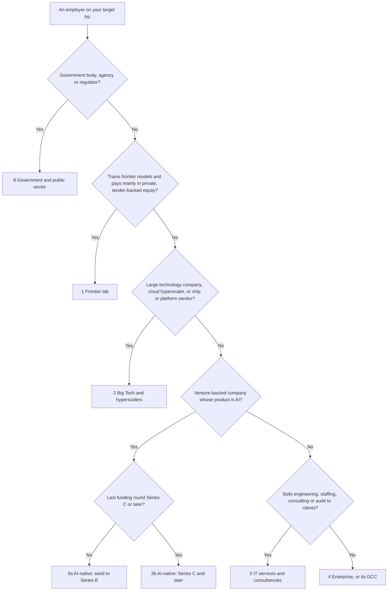

# The GenAI Employer Landscape

> One employer taxonomy for the GenAI job market as of October 2026: six types (frontier labs, Big Tech, AI-native startups by stage, enterprises and GCCs, IT services, public sector), each mapped to how it hires, interviews, pays, onboards and weighs credentials, plus a matrix and a career-stage chooser.

**Dates:** posting counts are from 19–21 October 2026. Pay figures were verified by the research sessions on 21–23 October 2026; inputs older than that carry their own dates. **Grades:** EGP-1.0. Platform aggregates (JobsPipe, Fast AI Jobs, Levels.fyi, Carta) are graded B, as in the [role catalog §1.3](../02-roles/role-catalog.md#13-evidence-grades-and-conventions). Equity discount factors are model outputs. The six types are a classification judgement (D) laid over the narrower taxonomies that individual research sessions use. Nothing here is tax, legal or investment advice.

## The short answer

1. **Classify the employer before you prepare, then ask the recruiter which loop it runs.** At AI labs, design rounds are AI-framed infrastructure problems; Big Tech SWE rounds stay mostly classic; applied-AI loops sit at scale-ups and in ML and GenAI teams [B/C · T0-14 L118–121, K2]. Preparing for the wrong round type is a failure mode on coaching red-flag lists [C · T0-14 K9].
2. **Compare offers on cash-equivalent value, never on headline pay.** Paper equity is 60% of an OpenAI L5 package and 72% of an Anthropic Staff package; Google ML L3–L4 pay 18–30% in liquid RSUs [B · T0-02 C3]. Count $1 of equity as $0.95–1.00 for public RSUs, $0.64–0.88 for tender-backed frontier-lab stock, $0.42–0.61 for late-stage private stock and $0.09–0.21 for Series A/B paper [D, model outputs · T0-02.F8]. T0-17's risk-adjusted bands are 0.5–0.8 (labs), 0.4–0.8 (Series C–D) and 0.15–0.3 (stale-vintage unicorns) [C/D · T0-17.F11; T1-03.F8].
3. **Read the frontier-lab premium as equity, and expect it to shrink after risk adjustment.** T0-17 puts lab headline pay at ×2.0–3.1 the US all-company medians at Senior and Staff, about ×1.7–2.4 after equity risk adjustment, and less against Big Tech, whose pay sits above those medians [C · T0-17 L131–133]. Lab base pay is only about 5–26% above the market for comparable senior roles [B/D · T0-02 L288].
4. **In India, the employer type is the pay decision.** Broad-market sources centre on ₹10–15L; the Levels.fyi Bengaluru ML Engineer median is ₹44.5L; senior SWE medians at named Bengaluru employers run from ₹24.9L to ₹121.9L [B/C · T0-02.F3, D2]. Place each employer in its population, and ask a GCC whether its AI work runs in production: "nearly 70%" of India GCCs are stuck at the pilot stage [B · T0-09 L77].
5. **Buy credentials only for services, staffing, hyperscaler-partner and GCC-volume channels.** There they act as a tie-breaker and are often employer-paid; at product companies they are marginal, and at frontier labs and AI-first startups close to nil [B/C · T0-11 L31, F8].
6. **Expect a different first 90 days by type.** Big Tech onboarding targets include a production change in week one [B · T0-09 L111]. Startups compress (a production-touching change by week 2–3); enterprises expand weeks 2–4 for approvals; India GCCs expand weeks 1–4 to map stakeholders [D · T0-09 L195–201].

The evidence is thickest for frontier labs, Big Tech and AI startups. It is thinnest for IT services and the public sector, where most cells below read "not measured".

## At a glance



| # | Type | Named in the evidence | Pays mainly in | Loop to expect | Credential weight |
|---|---|---|---|---|---|
| 1 | Frontier labs | OpenAI, Anthropic | Paper equity, semi-liquid through tenders | AI-lab infrastructure loop; values round | Close to nil |
| 2 | Big Tech and hyperscalers | Google, Meta, Microsoft, Apple, Amazon, NVIDIA, TikTok, Adobe | Base plus liquid RSUs | Classic with AI flavour; applied loop in ML and GenAI teams | Marginal |
| 3a | AI-native, seed to Series B | Braintrust (Series B) | Cash plus heavily discounted paper equity | Applied-AI startup loop; take-homes; work on their code | Close to nil |
| 3b | AI-native, Series C and later | Databricks; Carta's AI-native firms valued above $500M | Base plus late-stage private equity | Applied-AI loop; infrastructure tracks at some | Close to nil to marginal |
| 4 | Enterprises and GCCs | Capital One, American Express, large banks; Alstom and Eaton in India | Mostly cash | Not measured; GCC commentary reports portfolio reviews and take-homes | Tie-breaker in GCC volume hiring |
| 5 | IT services and consultancies | TCS, Infosys, Cognizant, Wipro, Deloitte, EY | Not measured | Not measured | Material, often employer-paid |
| 6 | Government and public sector | US federal agencies, the EU AI Office | Not measured | Not measured | Not measured |

**Boundary rules [D]:**
- **Labs inside Big Tech** (Google DeepMind, Meta FAIR) pay their parent's public RSUs: use card 2 for pay and card 1 for research interviews. The corpus has no verified pay premium for either [T0-02 L290].
- **A GCC follows its parent.** This page uses "GCC" for the India centres of type-4 parents. Big Tech India offices follow card 2, because their pay tracks the parent: Google Bengaluru ML pay is 0.22–0.45× Google US, against 0.17× for all-company medians [B · T0-02 L265].
- **Classify startups by their last funding round.** The value of $1 of equity differs two- to sevenfold between Series A/B (0.09–0.21) and late stage (0.42–0.61) [D · T0-02.F8]. The corpus records the stage of few named startups, so check it yourself [P].

## The six employer types

### 1. Frontier labs

*Companies that train frontier models and pay senior staff mainly in private equity made semi-liquid by tenders.* Almost all the evidence concerns OpenAI and Anthropic.

- **Who.** OpenAI and Anthropic. Google DeepMind and Meta FAIR were not sampled for titles or pay [T0-01 D7; T0-02 L290]. In T0-01's small-corpus search, post-training work at labs and data vendors (Cohere, Mercor) runs under Research Engineer or Member of Technical Staff titles, not a post-training title [C · T0-01.F9].
- **How they hire.** Applied and deployment titles: OpenAI posts "Applied AI Engineer" and "AI Deployment Engineer", Anthropic "Applied AI Engineer"; three frontier firms supplied 13 of the 50 newest AI Engineer-cluster rows on Fast AI Jobs in October 2026 [B · T0-01 D7]. Anthropic's fellowship runs about four months full-time with a stipend, needs no PhD or publications, and reports that over 40% of its first cohort joined full-time (the programme's own figure; conflict of interest disclosed) [B · T0-06 L188]. Both labs sponsor visas: OpenAI had 311 and Anthropic 292 certified H-1B LCAs across FY2025 and FY2026 to Q3 [B · T0-02.F6]. Both publish credential-agnostic criteria, and Anthropic asks applicants to put research, writing or open-source work at the top of the résumé [B · T0-11 L89, L98].
- **Interview loop.** Infrastructure and inference teams run the AI-lab infrastructure loop: serving, batching, batch APIs, GPU scheduling and weight distribution, with numbers early and 50–60-minute rounds [B/C · T0-14 L119]. In one aggregator's 112 Anthropic reports, an inference API was the most common design prompt (41) [B · T0-14 K1]. Anthropic has added a design-document review round (3 reports from April 2026), and its live rounds default to no AI assistance [B/C · T0-14 K11]. A behavioural "No Hire" in Anthropic's values round is a near-automatic veto [B/C · T1-03 KF4]. Research-engineer tracks and residencies are highly selective and test research taste plus engineering depth [B · T0-06 L320].
- **Pay.** Levels.fyi SWE medians: OpenAI $875K (n = 242, 20 Oct 2026) and Anthropic $882.5K (n = 49, 24 Sep 2026); cached copies of the OpenAI page ranged from $555K to $875K [B · T0-02.F4], so T0-17 treats lab medians as ±30–50% [C · T0-17 L131]. Paper equity is 60% of OpenAI L5 pay and 72% of Anthropic Staff pay, and bonus is about zero [B · T0-02 C3]. The premium is almost all equity: about 3× the market at total pay, about 5–26% above it in base [B/D · T0-02 L288]. Anthropic's Staff+ inference postings list base pay up to $485K (posted June 2026) [A/B · T0-03 KF1].
- **Onboarding.** No lab-specific evidence. OpenAI removed its vesting cliff for new hires in December 2025 [B · T0-17 KF12].
- **What they value.** Infrastructure fundamentals over model internals: one coaching guide says the design round treats the model as a black box and that strong infrastructure candidates without ML experience do well [B · T0-14 K1]. Public research, writing or open-source work [B · T0-11 L98]. Ownership, communication and ethical and safety judgement, which behavioural rounds score [B/C · T1-03 KF4].
- **Risks.** Liquidity runs on the company's schedule: tender tenure gates of two years (OpenAI and Anthropic, 2025) or one year (Anthropic, 2026) and per-person caps ($30M at OpenAI, $2M at Anthropic, both 2025) [B · T0-17 KF8]. No ex-employees were eligible in the median Carta tender [B · T0-17 KF8]. Selling at a tender can lock in an old price: Anthropic's 2026 tender priced at $350B pre-money, and its May 2026 primary round at $965B post-money [B/C · T0-17 KF7]. An IPO is not liquidity: SpaceX, which includes xAI, listed in June 2026 under a nine-stage lock-up with a price-triggered tranche, and traded 40–50% below its peak by early August [B · T0-17 KF9]. Lab research slots are scarce [M · T0-06 L192]. Two Indian advisory blogs report that India-based staff holding unlisted foreign shares owe tax at vest or exercise, before any sale [C · T0-17 R6; not tax advice].

### 2. Big Tech and hyperscalers

*Large technology companies, cloud hyperscalers and chip and platform vendors.* Most pay base plus liquid public RSUs; ByteDance, which is private [D], paid its Singapore ML Engineers mostly cash (base 72%, bonus 18%, equity 10%; Levels.fyi, updated 2 Nov 2025) [B · T0-02 L408].

- **Who.** Google, Meta, Microsoft, Apple, Amazon and NVIDIA; TikTok and Adobe are among the top ML Engineer posters; Stripe and Uber run the same classic design loop [B · T0-01.F2; B/C · T0-14 L121]. By T0-05's count of commit email domains, the people who ship vLLM and SGLang are mostly employees of hardware and platform vendors (AMD, NVIDIA, Intel, Red Hat/IBM, Meta) [C · T0-05.F6].
- **How they hire.** ML Engineer is their family: TikTok (74), Adobe (21) and Apple (20) lead the 1,084 US ML Engineer postings (JobsPipe, corpus 19 Oct 2026) [B · T0-01.F2]. Applied Scientist is a Big-Tech-heavy title whose volume is unmeasured [B · T0-01 D2]. T0-05's open-source route for these employers (tier T3): contribute to the repo the company staffs, add a referral, apply normally, and expect heavy ATS use [D · T0-05 L97]. Credentials carry little weight: 1.5% of AI postings at FAANG plus Microsoft named any AI-related certification (CSET/Burning Glass, 2010–2020), and AWS's own GenAI specialist posting asked for experience, not certification [B/C · T0-11.F4, F8].
- **Interview loop.** SWE design rounds are mostly classic (Meta E6: ad auctions, ticketing; Google L6: denylists, caches). AI-native prompts appear in ML and GenAI pools: Meta ML (LLM assistant, coding assistant, agentic ticket investigation) and Google's ML-platform and GenAI tracks [B/C · T0-14 K2]. Meta runs 2 × 45 minutes, Google L6 60 minutes [B/C · T0-14 K8]. A behavioural "No Hire" is a near-automatic veto at Google; at Meta it means downlevelling or rejection [B/C · T1-03 KF4]. Meta's AI-enabled coding round (spring 2026, an early signal) scores how you work with an assistant; blind reliance is a strong No Hire [B/C · T1-03 KF6].
- **Pay.** Base 64–77%, liquid RSUs 18–30% and bonus 5–6% at Google ML L3–L4 (Levels.fyi excerpt updated 4 Aug 2026) [B · T0-02 C3]; public RSUs keep 95–100% of their value in T0-02's model [D · T0-02.F8]. Google's US ML Engineer ladder: L3 $199–205K, L4 $294–312K, L5 $393–445K, L6 $607–646K (two undated snapshots) [B · T0-02 Table D]. India: Google Bengaluru ML pays ₹45.2L at L3, ₹65.2L at L4 and ₹168.3L at L5 (small samples) [B · T0-02 L254]. LinkedIn (₹109.6L) and Microsoft (₹71.5L) senior SWE medians sit above the Bengaluru all-company senior median of ₹56.0L [B · T0-02 D2; T0-17 KF4]. Benchmark a Big Tech India offer against its own employer's ratios, not all-company ratios [B · T0-02 L265].
- **Onboarding.** Targets include a production change in week one [B · T0-09 L111]. Meta made "AI-driven impact" a core expectation from 2026, and its performance tool counts AI-generated code among 200+ data points [B · T0-09 L112].
- **What they value.** Classic coding and distributed-systems design, plus ML system design for ML roles; candidates from ML and data-science backgrounds report system design and coding as the deciding rounds [D · T0-06 L319]. AI fluency in performance reviews (Meta) [B · T0-09 L112].
- **Risks.** A Senior plateau: Blind anecdotes report many engineers at Google L5 for four or more years (D), and a careers blog calls Meta E5 a practical terminal level for many (C) [T0-17 L500]. AI/ML promoted raises are near the bottom of R&D (6.5%, against 8.6% for all functions) [B · T0-17 L501]. Back-loaded vesting: an Amazon-style 5/15/40/40 schedule vests 20% of a new-hire grant at 24 months [B · T0-17 R2]. AI depth alone does not pass a classic loop; keep classic design sharp and prepare one or two LLM-flavoured prompts as insurance [B/C · T0-14 L121].

### 3. AI-native startups and private scale-ups

*Venture-backed companies whose product is AI: models, applications, tooling or infrastructure, below frontier-lab scale.* The card splits by last round: 3a seed to Series B, 3b Series C and later.

- **Who.** The corpus records the stage of few named startups. Series B: Braintrust, an eval vendor, raised $80M [A/B · T0-03 KF13]. Late stage: Databricks (Series L at $134B in December 2025; a further $5B at $190B in August 2026) [A/B · T0-17 L438]. Stage not recorded: inference vendors (Baseten, Inferact, RadixArk), open-source tool companies (LiteLLM, Ollama, Axolotl), deployment-heavy application companies (Writer, ElevenLabs, Didero, Scale) and robotics (Figure AI) [B · T0-03 KF1; T0-05 L95–96; T0-01.F2, F3].
- **How they hire.** Forward Deployed Engineer (FDE) is the largest new family: 933 FDE-cluster roles at 343 AI startups on Fast AI Jobs (20 Oct 2026), about 20% more than in early August; about 48% of the 50 newest rows were engineer-titled [B · T0-01.F3]. In the board's early-August snapshot (779 roles), the stage split was Series A 176, B 119, C 184, D 110 and G+ 147, and 65 roles were remote [B · T0-01.F3, D2]. The same board listed 326 AI Engineer roles at 183 startups and 273 ML Engineer roles at 159 (19 Oct 2026), drawn from company ATS pages (Ashby, Greenhouse, Lever) [B · T0-01.F1, L44]. Open-source work counts at open-source-centred companies: Hugging Face's Open-Source MLE role requires a public open-source track record, Inferact prefers open-source contributions, and RadixArk runs a paid one-year AI Infra Resident programme listed at $200,000 [A/B · T0-05.F5]. T0-05's routes: tier T1 (Inferact, RadixArk, Hugging Face) through outreach plus sustained contributions to their repo; tier T2 (LiteLLM, Ollama, Axolotl, Langfuse) through founder outreach that names a specific issue or PR [D · T0-05 L95–96].
- **Interview loop.** The applied-AI startup loop runs four to five rounds. One write-up describes a take-home ("answer questions over about 50 documents and report recall@5 and faithfulness on a 20-question set"), plus agent debugging, scoping and a customer-style conversation [C/D · T0-06 L318]. Some test on their own code: LiteLLM solves an issue on its GitHub with the candidate; Langfuse runs a code review, then feature-building [A/B · T0-05.F5]. Databricks runs AI-engineer, GenAI-engineer and MLE tracks with prompts such as RAG over sensitive, fast-changing documents and distributed LLM inference [B/C · T0-14 K2]; T1-03 files its GenAI-engineer track under infrastructure and its AI-FDE track under application [B/C · T1-03 L104–105].
- **Pay.** 3b: at AI-native companies valued above $500M, a P80–95 AI/ML engineer receives about $320K salary plus 0.146% equity, against $285K and 0.10% at non-AI-native peers (Carta, data to February 2026) [B · T0-02 L458]. Equity is at least 36% of that paper package and about 20–26% of its cash-equivalent value [B; split is a model output · T0-02 C3]. 3a: Carta's median AI/ML equity grants rose 59% at startups valued $1–10M and 30% at $25–50M from January 2024 to February 2026 [B · T0-02 L458]; cash pay at seed to Series B is not measured. Posted base at two inference vendors: Inferact $200–400K plus equity, Baseten $180–360K (2026 postings) [B · T0-03 KF1]. Equity value: Series A/B paper is worth $0.09–0.21 per $1 ($0.21–0.53 if you credit upside) and late-stage private stock $0.42–0.61 [D · T0-02.F8]. T0-17's bands: Series C–D 0.4–0.8; stale-vintage unicorns 0.15–0.3; for seed and Series A, "do not underwrite; treat as option value and ask for cash" [C/D · T0-17 R3].
- **Onboarding.** Compress: a production-touching change by week 2–3 and a first eval suite by week 4. Probation may be informal, so get what "good at 90 days" means in writing [D · T0-09 L199]. The corpus has no public evidence on startup probation or compute beyond credit programmes and anecdotes [B · T0-09 L119].
- **What they value.** Shipping cadence, scope judgement and cost discipline [D · T0-09 L199]; retrieval judgement, evals, error analysis, cost and latency, and communication [C/D · T0-06 L318]. FDE work adds customer judgement to coding, GenAI and infrastructure skills; FDE postings rose more than 1,000% from January to August 2026 against the same months of 2025, from a small base [B · T0-06 L175].
- **Risks.** Liquidity is unlikely early: Carta's two-year Series A→B graduation rate was about 28% for a normal (2018) cohort and 9–15% for 2022 cohorts [B · T0-02 L424], and about 70% of Carta's H1 2026 tenders were at Series C or later [B · T0-17 L441]. Down rounds were 11–12% of rounds (Cooley, Q2 2026; Carta, Q1 2026) [A/B · T0-17 KF6], and 2021-vintage names traded at a median −61% on Forge [A · T0-17 KF7]. Acqui-hires can exclude recent hires: in the 2025 Windsurf deal, employees hired within the prior year reportedly received no payout [B · T0-17 KF12]. Tool companies consolidate: ClickHouse acquired Langfuse (16 Jan 2026), and OpenAI announced it would acquire Promptfoo (9 Mar 2026) [A/B · T0-03 KF13]. One recruiter reports a Series B's first AI hire leaving at eight months after about $200,000 in salary "had produced nothing customers used" [C · T0-09 L82].

### 4. Enterprises and GCCs

*Organisations whose main business is not technology (banks, insurers, retailers, industrials, healthcare) and their global capability centres (GCCs), the captive engineering centres many run in India.*

- **Who.** Capital One (33) and American Express (16) are among the top posters of the 1,697 US AI Engineer roles [B · T0-01.F2]. 41 of 50 large banks had dedicated AI-governance staff at the end of 2024; JPMorgan had 20 [B · T0-15 L351]. Medtech and industrial firms (Stryker, Eaton) post AI-governance roles [C · T0-15.F6]. India has 2,100+ GCCs with 2.3M staff (NASSCOM-Zinnov, 2026) [C · T0-01 D8]; Alstom (Bangalore) and Eaton (Pune) post AI-governance roles there [C · T0-15 L469].
- **How they hire.** In the broad market, AI Engineer is an enterprise- and services-heavy title [B · T0-01.F2], and 28.4% of AI Engineer postings come from employers with 1,000+ staff (JobsPipe, September 2026) [B · T0-01 D6]. GCC titles include GenAI Engineer, AI/ML Engineer, MLOps Engineer and Prompt Engineer (Taggd) [C · T0-01 D8]. 56% of GCC hiring is for 4–10 years' experience, and about two in three new GCC roles need AI, data or automation skills (NASSCOM-Zinnov) [C · T0-01 D8]. GCC commentary reports a shift to portfolio reviews and take-homes [C · T0-11 L98]. Where the employer has an AI initiative and a transfer is possible, T0-06 puts the internal route first [M · T0-06 L301]. Agent protocols reach enterprise postings: 11.0% of sampled Fortune-1000 companies named "Model Context Protocol" in a Q3 2026 posting, against 8.1% of API providers (API Evangelist) [C · T0-16 L377].
- **Interview loop.** Not measured: the corpus's loop taxonomies come from technology firms. The nearest class is T0-06's big-company loop (coding, system design, ML design, behavioural) [D].
- **Pay.** Mostly cash: outside large US employers, equity is 5–10% of the median package in Bengaluru and NYC, and base is 84–91% of total in London, Bengaluru and Zurich [B · T0-02 L213]. In India, GCCs belong to the higher-paid MNC/GCC/product population, but medians vary widely by employer; Fidelity Investments' Bengaluru senior SWE median is ₹28.9L [B · T0-02.F3, D2]. Recruiter guides quote ₹38–65L for experienced and ₹55–80L+ for senior engineers at GCCs and top product companies [C · T0-02 L340].
- **Onboarding.** Enterprise: expand weeks 2–4 for intake and approvals, file the intake in week 2, and watch for shadow AI, approval queues and tool procurement [D · T0-09 L200]. India GCC: expand weeks 1–4 to map stakeholders and the dual mandate (global parent and India leadership); get probation terms and review dates in writing; name a pilot-to-production owner [D · T0-09 L201]. India sets no central cap on probation, and six months is typical according to one employer-of-record vendor [C · T0-09 L118].
- **What they value.** Security and privacy hygiene, cost allocation and platform dependencies [D · T0-09 L200]. GCC postings appear to bundle GenAI delivery, MLOps and governance more often than US postings (T0-01's inference; not measured) [D · T0-01 D8]. A credential matching the employer's primary cloud, if reimbursed or tied to internal mobility or pay [B/C · T0-11 L116].
- **Risks.** "Nearly 70%" of India GCCs are stuck at AI pilots, and "nobody owns the space between a successful pilot and a production deployment" (Dell-Zinnov; more than 50 senior GCC leaders, per trade press) [B · T0-09 L77]. 64% of GCCs have dual global mandates [B · T0-09 L117]. GCC attrition evidence conflicts: 18–25% in AI and cloud roles (Zinnov) against 9% overall (EY 2025) [B · T0-09 L117]. US bank guidance SR 26-2, issued on 17 Apr 2026, left generative and agentic AI out of its scope; T0-09 advises asking which internal policy governs approvals [A · T0-09 L103]. The "AI Engineer" title family includes robotics, construction and Power Platform roles [B · T0-01 L238].

### 5. IT services and consultancies

*Firms that sell engineering, staffing, consulting or assurance to clients.*

- **Who.** TCS, Infosys, Cognizant and Wipro; Deloitte, EY, PwC and KPMG; analytics and engineering-services firms such as Fractal and Quest Global; staffing agencies such as Beacon Hill [B/C · T0-01.F2, D2; T0-11.F8; T0-15.F6, F7].
- **How they hire.** TCS (22), Deloitte (13) and Infosys (12) are among the top posters of US AI Engineer roles [B · T0-01.F2]. AI and Agentic AI Architect titles are services-concentrated in the 6+ postings T0-01 saw [C · T0-01 D2], and the few exact-title Context Engineer postings are mostly consulting and staffing roles (EY) [C · T0-01.F5, D4]. TCS announced a target of certifying 25,000+ employees on AWS generative AI; Wipro cited 10,000+ cloud-certified staff and announced 10,000 AI-certified specialists with Google Cloud [B/C · T0-11.F8]. Partner tiers need few certified people (AWS Premier: 10 foundational and 25 technical), so they explain why firms sponsor credentials, not why one more changes a hiring decision [A · T0-11.F7]. Both staffing-agency GenAI postings in T0-11's sample listed certifications; three services-firm GenAI postings listed none [B/C · T0-11.F4, F8].
- **Interview loop.** Not measured.
- **Pay.** Not measured. In India they probably sit in the broad-market population, centred on ₹10–15L [D: inferred from T0-02.F3's two-population split]. In Axial's US AI-governance postings (pages updated August–September 2026), professional services lead on volume (32–36%) and have the lowest posted-range top of the five sectors reported ($219K) [C · T0-15.F10].
- **Onboarding.** Not covered by the corpus.
- **What they value.** Cloud credentials matched to client work. For consultants, pre-sales staff and solution architects at a systems integrator or hyperscaler partner, a professional-level credential (AWS AIP-C01 or Google PMLE) is staffing table stakes; get the employer to pay [B/C · T0-11 L117]. AWS and Azure top India's list of required certifications (Nasscom–Indeed; no shares published) [B/C · T0-11.F4]. Compliance-engineering roles at Cognizant and Infosys ask for Python, evaluation pipelines, guardrails, logging, model cards, cloud MLOps and EU AI Act, NIST AI RMF and ISO 42001 literacy [C · T0-15.F6].
- **Risks.** The value of a credential may arrive after hire (in staffing, billing and appraisal) rather than at screening [B/C · T0-11.F8]. AI errors in client work carry liability: Deloitte refunded over A$97,000 of an A$440,000 Australian government contract after a report contained a fabricated court-judgment quote and non-existent references [B · T0-18 L535]. Title inflation: a practitioner guide lists "Context Engineer (at consulting shops)" among theatre titles [C · T0-01.F11]. Some governance volume may be firms hiring to deliver governance to clients, so end-client demand may be smaller than the counts suggest (T0-15's untested inference) [D · T0-15.F10].

### 6. Government and public sector

*Government departments, agencies and regulators.* The corpus has almost no hiring evidence for this type.

- **Who.** US federal agencies: OMB memo M-25-21 (reported May 2025) directed each to name a Chief AI Officer within 60 days and to set up AI governance boards within 90 days, the one mandate in the corpus that names a role [B · T0-15 L357, L363]. The EU AI Office, which sent its first formal requests for information on 29 Aug 2026 [A · T0-15.F1] and is among the non-technical organisations in a 2025 AI-safety headcount estimate [C · T0-15 L380]. India's non-binding AI Governance Guidelines (5 Nov 2025) proposed new bodies, including an AI Safety Institute [B · T0-15 L465].
- **How they hire.** No posting counts. Signals only: four government-administration governance postings across eight EU countries (Axipro) [C · T0-15 L423], and ZipRecruiter "AI Ethics" listings dominated by DC-area cleared contractors (keyword noise) [C · T0-15 L497]. AI vendors staff public-sector deployments: Scale posts an "Applied AI Engineer, Global Public Sector", and Databricks splits FDE roles by vertical, including public sector [B/C · T0-01 D7, D3].
- **Interview loop.** No evidence.
- **Pay.** No evidence: Axial's AI-governance pay table does not report government and defence [C · T0-15 L414].
- **Onboarding.** No evidence.
- **What they value.** No evidence beyond the Chief AI Officer mandate.
- **Risks.** Treat this type as unresearched. US governance demand follows sector regulators, procurement and contracts more than AI statutes [B · T0-15 L487]. Vendors and consultancies doing public-sector work carry liability for AI errors (the Deloitte refund in card 5) [B · T0-18 L535].

## The comparison matrix

Each row is one of the narrower taxonomies a research session built for a single purpose; each column is one of the six types. "Not covered" means the source's taxonomy has no class for that type.

| Lens (source, grade) | 1 Frontier labs | 2 Big Tech | 3a AI-native, seed to B | 3b AI-native, C and later | 4 Enterprises and GCCs | 5 IT services | 6 Public sector |
|---|---|---|---|---|---|---|---|
| **Pay structure** (T0-02 C3; B) | Base 29–40%, paper 60–72%, bonus ≈0 (OpenAI L5, Anthropic Staff) | Base 64–77%, liquid RSUs 18–30%, bonus 5–6% (Google ML L3–L4) | Not measured | Base 64%, paper ≥36% of paper pay (Carta, valuations above $500M) | Mostly cash: base ≈85%, equity ≈4.5% (Bengaluru all-company proxy) | Not measured | Not measured |
| **Value of $1 of equity** (DF: T0-02.F8, D; RAV: T0-17.F11, T1-03.F8, C/D) | DF 0.64–0.88; RAV 0.5–0.8 | Public RSUs: DF 0.95–1.00 | DF 0.09–0.21 (0.21–0.53 with upside); seed and Series A: do not underwrite | DF 0.42–0.61; RAV 0.4–0.8 (Series C–D); 0.15–0.3 stale-vintage | Small equity; DF 0.95–1.00 where it is listed-parent RSUs [D] | Not measured | No evidence |
| **India pay population** (T0-02.F3, D2, L340; B/C) | No India data | Above the all-company median: LinkedIn ₹109.6L, Microsoft ₹71.5L (senior SWE) | Not measured | Not measured | MNC/GCC population, wide spread; recruiters quote ₹38–65L experienced (C) | Probably the broad market, centre ₹10–15L [D] | Not measured |
| **Interview-loop class** (T0-14 L118–121; T1-03 L102–106; B/C) | AI-lab infrastructure loop; applied loop for applied teams | Classic with AI flavour (SWE); applied loop (Google GenAI, Meta ML) | Applied-AI loop (not split by stage) | Applied-AI loop (Databricks, scale-ups); infrastructure track (Databricks GenAI engineer) | Not covered | Not covered | Not covered |
| **Transition loop type** (T0-06 L316–320; B to D) | Frontier lab or research residency | Big-company ML/AI loop | Applied-AI startup, dev-tool or vertical-AI loop | Applied-AI startup loop | Not covered; big-company loop is nearest [D] | Not covered | Not covered |
| **Certification segment** (T0-11 L31, L107, L113–114, L120, F8; B/C) | Close to nil | Marginal | Close to nil | Close to nil or marginal; stack-specific exceptions (Databricks) | Tie-breaker in GCC volume hiring; one reimbursed credential for the employer's cloud | Material: staffing table stakes, often employer-paid | Not measured |
| **Onboarding setting** (T0-09 L195–201, D; L111, B) | Not covered | Production change in week one (B) | Startup: compress (not split by stage) | Startup: compress (not split by stage) | Enterprise: expand weeks 2–4; GCC: expand weeks 1–4 | Not covered | Not covered |
| **Open-source route tier** (T0-05 L91–98; routes D) | Not researched | T3: AMD, NVIDIA, Intel, Red Hat/IBM, Meta | T1 or T2, by company, not by stage | T1 or T2, by company, not by stage | T4: standard application plus referral | T4 by judgement [D] | Not covered |
| **Posting employer mix** (T0-01.F2, F3, D7; B) | 3 frontier firms: 13 of the 50 newest AI Engineer-cluster rows | TikTok 74, Adobe 21, Apple 20 (US ML Engineer) | FDE stage split (August): Series A 176, B 119 | FDE stage split (August): C 184, D 110, G+ 147 | Capital One 33, American Express 16 (US AI Engineer) | TCS 22, Deloitte 13, Infosys 12 (US AI Engineer) | No counts; vendors post public-sector roles |
| **Governance employers** (T0-15.F5, F7, F8, L357, L380–381; B/C) | Frontier safety: ≈1,100 FTEs field-wide (2025 single-author estimate; C) | Responsible AI titles (Workday, Amazon); headcounts not measured | No evidence | No evidence | Programme leads dedicated (41 of 50 large banks); specialist work absorbed | Audit inside Big Four and certification bodies; compliance engineering at Cognizant, Infosys | Federal Chief AI Officer mandate (OMB M-25-21, reported May 2025) |
| **Pay step vs US all-company medians** (T0-17 L131–133; C) | Headline ×2.0–2.9 at Senior, ×2.8–3.1 at Staff; ≈×1.7–2.4 risk-adjusted | Above the medians, so the step to a lab is smaller | Not measured | Not measured | Not measured | Not measured | Not measured |

**Why the equity row has two numbers.** T0-02's discount factor (DF) multiplies a liquidity probability, retention after dilution and a time discount, and for labs applies a marketability discount to the share that tenders cannot absorb [D · T0-02 L436–438]. T0-17's risk-adjusted value (RAV) runs exit scenarios, from busts to breakouts, through the preference stack and discounts them; it swings with the discount rate (0.48–0.89 for a lab-like company as the rate moves from 25% to 10%) [C/D · T0-17 L175]. Neither is a valuation [T0-02 L461]. Use the lower figure as your floor and the higher as the case for accepting [D].

**Databricks sits in two loop classes.** T0-14 lists it under applied AI; T1-03 files its GenAI-engineer track under infrastructure and its AI-FDE track under application. Ask which track the role uses [B/C · T0-14 L120; T1-03 L104–105].

## Choose by career stage

These are judgements (D), each grounded in the cited evidence. Stage bands follow T0-02's operational tiers (0–2, 2–5, 5–8 and 8+ years), which are themselves a working definition [D · T0-02 §6.1].

| Your situation | Lean toward (D) | Grounding | Stretch or avoid (D) |
|---|---|---|---|
| **Student or new graduate (0–2 years)** | 3a and 3b through public artifacts; Big Tech new-graduate loops; in India, IT services and GCC volume hiring | Entry-level share of AI roles: India 21.2%, US 10.4% (JobsPipe, 11 Oct 2026) [B · T0-01.F10]. For product, startup and lab targets, spend the hours on public artifacts, not paid certificates; for services and GCC volume hiring, add one cloud credential to one or two deployed projects [B/C · T0-11 L113–114] | Frontier labs, except through fellowships or paid residencies [B · T0-06 L188, L320] |
| **Early career (2–5 years)** | 3a and 3b for scope; Big Tech for a ladder; India GCCs | Applied-AI startup loops favour software engineers and data scientists who can deploy [C/D · T0-06 L318]; 56% of GCC hiring is for 4–10 years' experience [C · T0-01 D8] | Equity-heavy seed or Series A offers: treat them as option value and ask for cash [C/D · T0-17 R3] |
| **Senior (5–8 years)** | Big Tech; 3b scale-ups; in India, the top-paying MNC and product employers; a lab only if T0-17's test passes | The AI premium over non-AI engineers is 14.2% at Senior [B · T0-17 KF3]. Bengaluru senior SWE medians: ₹56.0L all-company, ₹1.06–1.22Cr at the five top-paying employers [B · T0-17 KF4]. Series C–D RAV 0.4–0.8 [C/D · T0-17 R3] | A lab offer that fails T0-17's test: the risk-adjusted package does not clear about ×1.5 the Big Tech offer, you cannot hold through a lock-up, or you lack no-cliff terms, tender eligibility and a sign-on covering forfeited vest [D · T0-17 R6] |
| **Staff and above (8+ years)** | Frontier labs; Big Tech Staff roles | Headline ×2.8–3.1 the all-company Staff median, about ×1.7–2.4 risk-adjusted [C · T0-17 L132–133]; the AI premium rises to 18.7% at Staff [B · T0-17 KF3] | In India, a local Staff band is unverified; T0-17's routes are Staff scope at the top employers or a cash-heavy US-band remote contract [G/C · T0-17 R6] |
| **Engineer or data scientist moving into AI** | Your own employer first (any type with an AI initiative), then 3a, 3b and FDE roles | Internal route first where a transfer is possible [M · T0-06 L301]; experienced software engineers dominate the AI-engineer population [B · T0-06 KF-3]; 933 FDE roles at 343 AI startups [B · T0-01.F3] | A junior reset at a new employer: the junior door is the narrowest [A · T0-06 L118] |
| **PhD or researcher** | Big Tech applied science and research engineering; lab research roles as upside | New AI PhDs in the US and Canada rose 22% from 2022 to 2024, and the increase went to academia [A · T0-06 L186]; lab research slots are scarce, so applied engineering or science is the plannable path [M · T0-06 L192] | A frontier research-scientist offer as the base case [M · T0-06 L192] |
| **Non-technical domain expert (5+ years)** | Vertical-AI startups; governance programme roles in large regulated enterprises; audit and assurance inside consultancies | Vertical-AI loops favour domain experts [C/D · T0-06 L318]; governance roles are dedicated at programme-lead level and absorbed below it [B · T0-15.F5]; algorithmic audit sits inside Big Four, certification-body and internal-audit careers [B · T0-15.F7] | An engineering role from zero code: about 22 months (15–34) in T0-06's model [D · T0-06 L268] |
| **Needs cash certainty (visa, family, India tax on unlisted shares)** | Big Tech and other listed employers | Public RSU DF 0.95–1.00 against 0.09–0.21 for Series A/B paper [D · T0-02.F8]; two Indian advisory blogs report that India taxes perquisites on unlisted foreign shares at vest or exercise [C · T0-17 R6; not tax advice] | Seed to Series B offers that pay mainly in paper [C/D · T0-17 R3] |

## How to do it

1. **Classify each target employer** with the tree in [At a glance](#at-a-glance), and note the evidence: a listing, a parent company, or a dated funding round. *Done when:* every employer on your list has a type, and every startup a stage.
2. **Ask each recruiter which loop to expect,** using the classes: AI-lab infrastructure, applied AI, or classic with AI flavour [B/C · T0-14 L118–121]. *Done when:* each live process has a loop class and a list of round types, and your preparation follows the matching [system-design archetypes](../08-interviewing/system-design-archetypes.md).
3. **Price equity by type.** Apply the matrix's DF or RAV band to the equity line only; base and bonus pass at par [D · T0-02 L413]. *Done when:* each offer has one cash-equivalent annual figure, with the band and its source written beside it.
4. **Place each India employer in its pay population** [B/C · T0-02.F3]. *Done when:* each India target is tagged "MNC/GCC/product" or "broad market", with a dated anchor from [pay benchmarks](../09-compensation/pay-benchmarks.md).
5. **Decide credential spend by segment** [B/C · T0-11 L107]. *Done when:* you hold at most one credential per cloud, each tied to a named services, staffing, partner or GCC target, or you hold none.
6. **Choose a route for each type.** Referrals work for every type; spend open-source hours only where T0-05 places them, with its stop rule: no merged PR and no substantive maintainer exchange after eight weeks, then reallocate [D · T0-05 L83, L91–98]. *Done when:* every target has a named route, and every open-source bet a stop date.
7. **Run the type-specific due diligence, then plan the first 30 days for the setting** [C · T0-17 R5; D · T0-09 L195–201]. *Done when:* the answers are in writing and your 30-day plan matches the setting in [first 90 days](../10-onboarding/first-90-days.md).

## Templates and examples

### Employer card [P]

```text
Employer:               [name]
Type:                   [1 lab | 2 Big Tech | 3a seed–Series B | 3b Series C+ | 4 enterprise or GCC | 5 IT services | 6 public sector]
Evidence for the type:  [listing | parent company | last round and its date]
Loop (recruiter, date): [AI-lab infrastructure | applied AI | classic with AI flavour | other: ...]
Pay structure:          [base % / bonus % / liquid equity % / paper equity %]
Equity band:            [DF or RAV range for the type, with source]
Cash-equivalent a year: [base + bonus + band × annual equity]
India population:       [MNC/GCC/product | broad market | n/a]
Credential stance:      [material | tie-breaker | marginal | close to nil]
Onboarding setting:     [week-one change | compress | expand weeks 2–4 | expand weeks 1–4]
Route:                  [referral | sourced | open-source tier T1–T4 | cold, with a reason]
Open risks:             [tender gates | pilot stage | down round | vesting shape | ...]
Decision:               [apply | hold | drop], because [reason]
```

### Due-diligence questions by type [P]

The questions come from T0-17's offer-letter checklist and T0-09's setting notes; grouping them by type is a judgement. The full method is in [offer evaluation](../09-compensation/offer-evaluation.md).

| Type | Ask in writing before you sign | Why |
|---|---|---|
| 1 Frontier lab; 3b Series C and later | Dates, prices, caps, tenure gates and ex-employee eligibility of the last three tenders; vesting schedule and cliff; RSUs or options | Tenure gates, the company's timing and ex-employee eligibility bind more than dollar caps [B · T0-17 L443] |
| 3a Seed to Series B | Fully diluted share count; last preferred price and last 409A value; total preference stack and seniority; post-termination exercise window; acceleration on change of control; how recent hires fared in past acquisitions | Common stock receives nothing until exit value clears the preference stack [A · T0-17 KF6]; the Windsurf carve-out [B · T0-17 KF12] |
| 2 Big Tech | Vesting shape; refresh cadence; a sign-on to cover the unvested equity you forfeit | A back-loaded schedule vests 20% at 24 months [B · T0-17 R2] |
| 4 Enterprise | The intake and approval path for AI tools; who owns the data and the budget | Approval queues and shadow AI [D · T0-09 L200] |
| 4 India GCC | Is the AI work in production or in pilot? Who sets priorities, the parent or India leadership? Probation terms and review dates | "Nearly 70%" of India GCCs are at the pilot stage [B · T0-09 L77]; setting notes [D · T0-09 L201] |
| 5 IT services | Which client clouds and credentials the role needs; whether the firm pays for them | Partner tiers and staffing drive credential demand [A · T0-11.F7; B/C · T0-11.F8] |
| 6 Public sector | No evidence-based list; ask the enterprise questions [P] | Unresearched |

### Weak and strong employer claims

| Weak claim | Strong claim |
|---|---|
| "Frontier labs pay $875K." | OpenAI's Levels.fyi SWE median was $875K (n = 242, 20 Oct 2026); cached copies ranged down to $555K, and 60% of OpenAI L5 pay is paper equity [B · T0-02.F4, C3]. |
| "This Series A grant adds $100K a year." | $100K a year of Series A/B paper is worth about $9–21K in cash terms, or $21–53K if you credit upside [D · T0-02 L453]. |
| "GCCs in India pay ₹50L–₹1Cr." | That band describes senior engineers at the top product MNCs and GCCs, not the median; senior SWE medians at named Bengaluru employers run from ₹24.9L to ₹121.9L [B/C · T0-02 L343, D2]. |
| "IT services firms need certifications." | Credentials are material in services and staffing channels, but three services-firm GenAI postings listed none; the value may come after hire, in staffing and billing [B/C · T0-11.F8]. |
| "Big Tech interviews are all about LLMs." | Meta and Google SWE design rounds are mostly classic; AI-native prompts appear in ML and GenAI team loops [B/C · T0-14 K2]. |

## Checklist

- [ ] Every target employer has a type, and every startup a stage, with evidence.
- [ ] I asked each recruiter which loop to expect.
- [ ] Every offer has a cash-equivalent figure that uses its type's DF or RAV band.
- [ ] Every India target is placed in its pay population.
- [ ] Any credential I buy is tied to a services, staffing, partner or GCC-volume target, ideally employer-paid.
- [ ] I asked each GCC whether its AI work runs in production.
- [ ] For private equity, I know the tender rules: tenure gate, cap and ex-employee eligibility.
- [ ] My open-source hours go to a repo that a target employer staffs or stewards, with a stop date.
- [ ] My 30-day plan matches the onboarding setting.
- [ ] I ran the [offer evaluation](../09-compensation/offer-evaluation.md) due diligence before signing.

## Pitfalls

| Red flag | Why it hurts | Fix |
|---|---|---|
| Comparing headline pay across types | Paper is 60–72% of senior lab pay [B · T0-02 C3]; Series A/B paper is worth 9–21 cents on the dollar in T0-02's haircut view [D · T0-02.F8] | Price equity with the type's band first |
| One preparation plan for every employer | Loops differ by type and team; one Google candidate expected an AI-centred discussion and was steered to delivery guarantees, ordering and throughput [C · T0-14 K9] | Ask the recruiter; prepare the matching class |
| Treating "India AI pay" as one number | Two populations, 3–4× apart [B/C · T0-02.F3] | Place the employer before you set a pay floor |
| Paying for certificates to reach labs or AI startups | Their weight there is close to nil [B/C · T0-11 L31] | Put the hours into public artifacts |
| Assuming a GCC AI role ships to production | "Nearly 70%" of India GCCs are at the pilot stage [B · T0-09 L77] | Ask; name the pilot-to-production owner in week 1 |
| Counting on tender cash in year one | Tenure gates of one to two years; no ex-employees in the median Carta tender [B · T0-17 KF8] | Plan for no cash for 12–24 months unless a tender is scheduled and you are eligible [D · T0-17 R4] |
| Reading enterprise "AI Engineer" postings as GenAI work | The title family includes robotics, construction and Power Platform roles [B · T0-01 L238] | Classify by the requirements, not the title |
| Spending open-source hours to reach enterprises | Heavy open-source work pays less per hour at T4 employers [D · T0-05 L98]; a single merged contribution is the modal outcome and a weak signal [A/C · T0-05.F3] | Standard application plus referral; a short audit of a public AI feature |
| Expecting a lab to triple your pay | The premium is equity: about ×1.7–2.4 risk-adjusted against all-company medians, less against Big Tech [C · T0-17 L132–133] | Negotiate no cliff, tender eligibility and a sign-on for forfeited vest [D · T0-17 R6] |
| Planning around public-sector AI roles as a known market | No counts, loops or pay exist in the corpus | Verify directly; treat it as unresearched |

## Evidence and limits

- **Measured (B unless marked):** posting counts and employer mixes (JobsPipe, Fast AI Jobs; 19–21 October 2026); Levels.fyi pay structures, medians and India dispersion; Carta grant data; tender, dilution and secondary-market facts (A/B); interview-loop reports from coaching aggregators (B/C).
- **Model outputs:** T0-02's equity discount factors (inputs B, outputs D) and T0-17's risk-adjusted values (C/D). They put packages on a common footing; they are not valuations [T0-02 L461].
- **Judgement (D):** the six-type taxonomy and its boundaries; T0-09's onboarding settings; T0-05's tier routes; the IT-services pay placement; the career-stage table.
- **Not in the corpus:** public-sector counts, pay, loops and onboarding; IT-services pay, loops and onboarding; enterprise and GCC interview loops beyond trade-press commentary; frontier-lab onboarding and any India-based lab pay; pay premiums at Google DeepMind and Meta FAIR; the funding stage of most named startups. Conversion rates by employer type are unpublished: Gem's company-size table multiplies to 5–6× its own engineering headline, so T0-04 does not use it [B · T0-04 L91].
- **Conflicts, kept as ranges:** the two equity models differ for similar archetypes (labs 0.64–0.88 against 0.5–0.8; late stage 0.42–0.61 against 0.4–0.8) [D · T0-02.F8; C/D · T0-17 R3]; T0-17 gives the headline lab step as ×2.0–3.1 in its findings (L132) and ×1.6–2.9 in its recommendation table (L198) [C]; Databricks appears in two loop classes; GCC attrition is 18–25% (Zinnov, AI and cloud) or 9% (EY, overall) [B · T0-09 L117].
- **Conflicts of interest:** T0-17 was written by an AI model made by Anthropic, a company it analyses; T0-06's fellowship figures come from the programme owner. Re-verify Anthropic facts against primary filings.
- **Errata applied** ([ERRATA](../../research/ERRATA.md)): $312K is T0-17's US all-company Senior median, the baseline behind the lab multiples, not a T0-02 tier median (U4); India tier bands are unmeasured, so this page uses Levels.fyi anchors (U14). Not used: T2-01's "3–6 month" GCC probation (L340), which goes beyond T0-09's evidence of six months as typical, from one vendor [C · T0-09 L118].
- **What would change this page:** a funnel or pay series split by employer type; public-sector or GCC loop data; India pay for AI startups and lab offices; a public S-1 with lock-up terms for OpenAI or Anthropic (one of T0-17's re-run triggers) [T0-17 L233].

**Re-check dates.** The front-matter `review_by` (2026-11-19) is 31 days from the earliest headline observation, the posting counts of 19 October 2026: posting counts are a monthly series (EGP-1.0 class V1). Some inputs predate the date they were verified; refresh those first.

| Facts on this page | Dated | Re-check by | Where the refresh lives |
|---|---|---|---|
| Posting counts and employer mixes (T0-01) | Corpus 19–21 Oct 2026; the FDE stage split comes from a cached early-August snapshot | 2026-11-19 (31 days, class V1); T0-01 recounts on 2026-12-01 and 2027-01-15 | [Role catalog](../02-roles/role-catalog.md) |
| Pay structures, medians and India dispersion (T0-02) | Verified 21 Oct 2026; Levels.fyi stamps from 2 Nov 2025 (ByteDance Singapore) and 4 Aug 2026 (Google ML excerpt) to 20 Oct 2026; Carta data to February 2026 | 2027-01-19; refresh the ByteDance, Google and Carta inputs first | [Pay benchmarks](../09-compensation/pay-benchmarks.md) |
| Lab multiples, tender terms and RAV bands (T0-17); posted base ranges (T0-03) | Verified 23 Oct 2026; postings dated mid-2026 (June for Anthropic and Inferact) | 2027-01-21 | [Offer evaluation](../09-compensation/offer-evaluation.md) |
| Credential names (AIP-C01, PMLE) and certification segments (T0-11) | Verified 21 Oct 2026 | 2027-01-19 | [Credential ROI](../04-certifications/credential-roi.md) |

**Sessions:** [T0-01](../../research/sessions/T0-01-genai-role-taxonomy-market-volume.md) titles and employer mixes · [T0-02](../../research/sessions/T0-02-global-regional-compensation-benchmarks.md) pay structures, discount factors and India dispersion · [T0-03](../../research/sessions/T0-03-skills-compute-infra-eval-stack.md) posted pay and tool consolidation · [T0-04](../../research/sessions/T0-04-ats-filtering-funnel-conversion-math.md) funnel data gaps · [T0-05](../../research/sessions/T0-05-unconventional-hiring-tactics-oss-audits.md) open-source route tiers · [T0-06](../../research/sessions/T0-06-career-transition-timelines-5-backgrounds.md) transition loop types · [T0-09](../../research/sessions/T0-09-onboarding-probation-first-90-days.md) onboarding settings and GCC risks · [T0-11](../../research/sessions/T0-11-certification-cloud-credential-roi.md) certification segments · [T0-14](../../research/sessions/T0-14-ai-system-design-interview-patterns.md) loop classes · [T0-15](../../research/sessions/T0-15-regulatory-ai-governance-career-families.md) governance employers and the public sector · [T0-16](../../research/sessions/T0-16-agentic-protocol-stack-enterprise-demand.md) enterprise protocol demand · [T0-17](../../research/sessions/T0-17-compensation-progression-plateaus-equity.md) lab multiples, tenders and RAV · [T0-18](../../research/sessions/T0-18-freelance-fractional-ai-practice-economics.md) the liability case · [T1-03](../../research/sessions/T1-03-interview-execution-offer-negotiation.md) interview tracks and equity bands. All stage findings: [findings registry, stage 01](../../research/findings.md#stage-01).

## Next steps

- **Next stage, roles:** the [role catalog](../02-roles/role-catalog.md), the [GenAI target roles](../02-roles/genai-target-roles.md) and the [role map](../02-roles/role-map.md).
- **Role hubs by employer type:** labs: [Research Engineer](../02-roles/hubs/research-engineer.md), [Research Scientist](../02-roles/hubs/research-scientist.md), [AI Safety Researcher](../02-roles/hubs/ai-safety-researcher.md), [Inference Engineer](../02-roles/hubs/inference-engineer.md). Big Tech: [ML Engineer](../02-roles/hubs/ml-engineer.md), [Applied Scientist](../02-roles/hubs/applied-scientist.md). AI-native companies: [Forward Deployed Engineer](../02-roles/hubs/forward-deployed-engineer.md), [Applied AI Engineer](../02-roles/hubs/applied-ai-engineer.md), [AI Engineer](../02-roles/hubs/ai-engineer.md). Enterprises, GCCs and services: [AI Solutions Architect](../02-roles/hubs/ai-solutions-architect.md), [AI Governance Lead](../02-roles/hubs/ai-governance-lead.md), [Responsible AI Engineer](../02-roles/hubs/responsible-ai-engineer.md), [AI Risk and Assurance Specialist](../02-roles/hubs/ai-risk-assurance-specialist.md). Public sector: [Chief AI Officer](../02-roles/hubs/chief-ai-officer.md).
- **This stage:** the [market overview](market-overview.md) and [emerging roles](emerging-roles.md).
- **Interviews:** [interview loops](../08-interviewing/interview-loops.md), [system-design archetypes](../08-interviewing/system-design-archetypes.md), [behavioural calibration](../08-interviewing/behavioral-calibration.md), [coding rounds](../08-interviewing/coding-rounds.md) and the [prep packs](../08-interviewing/prep-packs.md).
- **Pay and offers:** [pay benchmarks](../09-compensation/pay-benchmarks.md), [offer evaluation](../09-compensation/offer-evaluation.md), the [negotiation playbook](../09-compensation/negotiation-playbook.md) and [India remote tax](../09-compensation/india-remote-tax.md).
- **Search and credentials:** [channels and boards](../06-job-search/channels-and-boards.md), [referrals and outreach](../07-networking/referrals-and-outreach.md), [credential ROI](../04-certifications/credential-roi.md) and the [proof-of-work standards](../05-portfolio/proof-of-work-standards.md).
- **After the offer:** [first 90 days](../10-onboarding/first-90-days.md) and [growth and progression](../10-onboarding/growth-and-progression.md).
- **Tracks:** the [India remote playbook](../11-tracks/india-remote-playbook.md), [visa and relocation](../11-tracks/visa-and-relocation.md), [governance careers](../11-tracks/governance-careers.md), [PhD to industry](../11-tracks/phd-to-industry.md), [career transitions](../11-tracks/career-transitions.md) and [freelance and fractional work](../11-tracks/freelance-fractional.md).
- **Words and terms:** the [glossary](../00-start/glossary.md). Back to [Start Here](../README.md).
