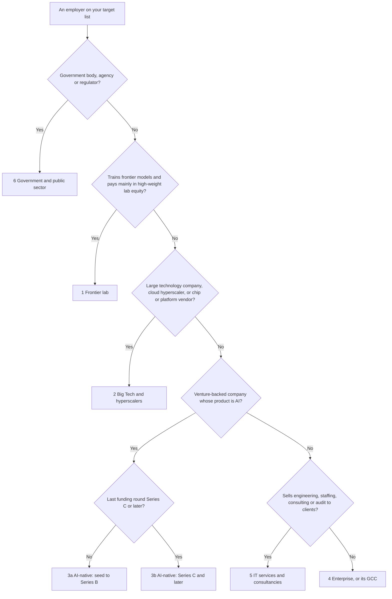

# The GenAI Employer Landscape

> One employer taxonomy for the GenAI job market as of November 2026: six types mapped to ATS patterns, sponsor registers, remote and India presence, interview loops, pay, onboarding and credentials, paired with the target-employers directory.

**Dates.** Employer census, ATS patterns, sponsor-register pointers, layoffs and India GCC/IT updates come from [T0-27](../../research/sessions/T0-27-target-employers-sponsor-registers-data.md) (retrieved 2026-11-13), [T0-25](../../research/sessions/T0-25-job-boards-regional-india-in-depth.md) (2026-11-11), [T0-24](../../research/sessions/T0-24-job-boards-global-ai-startup-remote.md) (2026-11-11), [T0-44](../../research/sessions/T0-44-pay-us-uk-europe-singapore-gulf.md), [T0-45](../../research/sessions/T0-45-pay-negotiation-india-city-employer.md), [T0-46](../../research/sessions/T0-46-interview-loops-genai-employers-2026.md) and [T0-70](../../research/sessions/T0-70-market-pulse-hiring-layoffs-funding.md) (2026-11-13), with key ATS URLs, Anthropic's Nasdaq IPO (`ANT`, 2026-11-19, ERRATA U52) and V0 US H-1B fee status verified on 2026-11-19. Earlier baseline posting mixes come from [T0-01](../../research/sessions/T0-01-genai-role-taxonomy-market-volume.md) (19–21 October 2026). November 2026 open-role snapshots (earliest 2026-11-01, class V1, 31 days) set `review_by: 2026-12-02`; V0 US sponsorship rules expire on 2026-12-03. **Directory:** for the 95 vetted companies, live ATS board URLs and seven official sponsor registers, see the generated [target employers directory](target-employers.md) (decision D-024). **Grades:** EGP-1.0 (A primary opened directly; B transparent secondary or platform aggregate, including Extract-only government pages downgraded from A during R6 verification; C vendor or single source; D judgement; M model output; P practice-curated). Nothing here is tax, legal or investment advice.

## The short answer

1. **Classify the employer before you prepare, then ask the recruiter which loop it runs.** At AI labs, design rounds are AI-framed infrastructure problems; Big Tech SWE rounds stay mostly classic; applied-AI loops sit at scale-ups and in ML and GenAI teams [B/C · T0-14 L118–121, K2]. Preparing for the wrong round type is a failure mode on coaching red-flag lists [C · T0-14 K9].
2. **Compare offers on cash-equivalent value, never on headline pay.** Equity makes up 60% of an OpenAI L5 package (private, tender-gated) and 72% of an Anthropic Staff package (newly public on Nasdaq under ticker `ANT` as of 2026-11-19 under a staggered lock-up [ERRATA U52]); Google ML L3–L4 pay 18–30% in liquid RSUs [B · T0-02 C3]. Count $1 of equity as $0.95–1.00 for liquid public RSUs, $0.64–0.88 for tender-backed private lab stock, $0.42–0.61 for late-stage private stock and $0.09–0.21 for Series A/B paper [D, model outputs · T0-02.F8]; price newly public lock-up grants explicitly in [offer evaluation](../09-compensation/offer-evaluation.md). T0-17's risk-adjusted bands are 0.5–0.8 (private labs), 0.4–0.8 (Series C–D) and 0.15–0.3 (stale-vintage unicorns) [C/D · T0-17.F11; T1-03.F8].
3. **Read the frontier-lab premium carefully: equity dominates, but filed base is also high.** T0-17 puts lab headline pay at ×2.0–3.1 US all-company medians at Senior and Staff (~×1.7–2.4 after equity risk adjustment) [C · T0-17 L131–133], while T0-27's August 2026 Levels.fyi cross-checks put OpenAI at ×2.9–3.0 ($795K–$800K) and Anthropic SWE at ×2.2–2.7 ($600K–$710K) against US MLE medians ($265K–$278K) [C/M · T0-27 L257]. On comparable senior roles, T0-02 put lab base 5–26% above market [B/D · T0-02 L288], whereas T0-27 notes 2025 H-1B filed base medians around $310K–$315K against broad MLE base of $160K–$190K (survivor-biased H-1B subset), so "almost entirely equity" overstates the split [C · T0-27 L257, L571].
4. **In India, the employer type is the pay and hiring-channel decision.** Broad-market base averages sit near ₹10–15L (Indeed ₹11.4L), middle-market CTC sits near ₹19.9L (Flexiple), and the Levels.fyi Bengaluru ML Engineer median is ₹44.4L (2026-11-12); senior SWE medians at named Bengaluru employers run from ₹24.9L to ₹121.9L, with Staff L6 reaching ₹1.38Cr–₹2.32Cr at Amazon/Google [B/C · T0-02.F3, D2; T0-45 L51, L140; ERRATA U47]. India holds 2,117 GCCs (2.36M staff, $98.4B FY26 revenue; ~200,000 net FY26 hires vs ~110,000 for IT services) [B · T0-25 L58; T0-27 L62]. Ask every GCC whether its AI work runs in production: Dell–Zinnov reports "nearly 70%" stuck at pilot stage (vendor-sponsored), while Infosys's 500-GCC index reports 27% achieving meaningful business impact (COI) [B · T0-25 L263; T0-27 L258].
5. **Buy credentials only for services, staffing, hyperscaler-partner and GCC-volume channels.** There they act as a tie-breaker and are often employer-paid; at product companies they are marginal, and at frontier labs and AI-first startups close to nil [B/C · T0-11 L31, F8].
6. **Match your ATS and sponsorship checks to the employer type.** Startups and frontier labs run mostly on Ashby, Greenhouse, Lever and Workable (with public JSON job endpoints), whereas Big Tech and large enterprises rely on custom portals or Workday [B/C/D · T0-27 L58, L122–L148]. Use official sponsor registers (US DOL LCA, UK CSV, NL IND, Canada LMIA, Denmark SIRI) as a screen — never a guarantee — and re-check V0 US sponsorship rules before acting [A/B · T0-27 L59–L61, L73].

The evidence is thickest for frontier labs, Big Tech, AI startups and India GCCs, and remains thinnest for IT-services pay/loops and public-sector pay outside UK AI Security Institute's posted bands. For individual company records, ATS links and official sponsor registers, open the [target employers directory](target-employers.md).

## At a glance



| # | Type | Named in the evidence | Typical ATS | Pays mainly in | Loop to expect | Credential weight |
|---|---|---|---|---|---|---|
| 1 | Frontier labs | OpenAI, Anthropic (Nasdaq `ANT`), Google DeepMind, Mistral AI, Cohere, Perplexity, Sakana AI, Thinking Machines Lab, xAI | Greenhouse, Ashby, Lever | High-weight equity (private tenders at OpenAI; newly public `ANT` staggered lock-up at Anthropic) plus high base | AI-lab infrastructure loop; values round | Close to nil |
| 2 | Big Tech and hyperscalers | Google, Meta, Microsoft, Apple, Amazon, NVIDIA, Cisco, TikTok, Adobe | Custom careers sites; Workday (NVIDIA) | Base plus liquid RSUs | Classic with AI flavour; applied loop in ML and GenAI teams | Marginal |
| 3a | AI-native, seed to Series B | Braintrust (Series B), Sarvam AI (India), LangChain, Etched | Ashby, Greenhouse, Lever, Workable | Cash plus heavily discounted paper equity | Applied-AI startup loop; take-homes; work on their code | Close to nil |
| 3b | AI-native, Series C and later | Databricks, Harvey, ElevenLabs, Sierra, Glean, Cursor, Anduril, Hugging Face | Ashby, Greenhouse, Workable | Base plus late-stage private equity | Applied-AI loop; infrastructure tracks at some | Close to nil to marginal |
| 4 | Enterprises and GCCs | JPMorgan Chase, Goldman Sachs, Capital One, Walmart, Booz Allen, GM, Qualcomm, American Express | Custom portals; Workday | Mostly cash | Not measured; GCC commentary reports portfolio reviews and take-homes | Tie-breaker in GCC volume hiring |
| 5 | IT services and consultancies | TCS, Infosys, HCLTech, Wipro, Tech Mahindra, Cognizant, CGI, Deloitte, EY | Custom portals; mass boards | Not measured | Not measured | Material, often employer-paid |
| 6 | Government and public sector | UK AI Security Institute (AISI), i.AI, US Tech Force (OPM), EU AI Office | Greenhouse (UK AISI/i.AI); USAJOBS / TechForce.gov | Cash + public pension (UK AISI posted GBP 65–145K) | Not measured | Not measured |

**Boundary rules [D]:**
- **Labs inside Big Tech** (Google DeepMind, Meta FAIR) pay their parent's public RSUs: use card 2 for pay and card 1 for research interviews. The corpus has no verified pay premium for either [T0-02 L290].
- **A GCC follows its parent.** This page uses "GCC" for the India centres of type-4 parents. Big Tech India offices follow card 2, because their pay tracks the parent: Google Bengaluru ML pay is 0.22–0.45× Google US, against 0.17× for all-company medians [B · T0-02 L265].
- **Classify startups by their last funding round.** The value of $1 of equity differs two- to sevenfold between Series A/B (0.09–0.21) and late stage (0.42–0.61) [D · T0-02.F8]. The corpus records the stage of few named startups, so check it yourself [P].

## The six employer types

### 1. Frontier labs

*Companies that train frontier models and pay senior staff heavily in lab equity (private tender-backed equity at OpenAI; newly public Nasdaq `ANT` stock under a staggered lock-up at Anthropic as of 2026-11-19 [ERRATA U52]).* Almost all the evidence concerns OpenAI and Anthropic.

- **Who.** OpenAI (Ashby), Anthropic (Greenhouse; public on Nasdaq `ANT` since 2026-11-19), Google DeepMind (Greenhouse), Mistral AI (Lever/Ashby), Cohere and Perplexity (Ashby/Lever conflict across trackers), Sakana AI (Tokyo), Thinking Machines Lab (SF) and xAI (reported absorbed into SpaceX in February 2026) [A/B/C · T0-27 L112–L119; T0-50 L65; ERRATA U52]. See the [target employers directory](target-employers.md#frontier-lab) for verified board URLs. In T0-01's small-corpus search, post-training work at labs and data vendors runs under Research Engineer or Member of Technical Staff titles, not a post-training title [C · T0-01.F9].
- **How they hire, remote & India presence.** Open-role scale (all functions): OpenAI listed 810 roles on 2026-11-01 (FourWeekMBA, B) and Anthropic's own Greenhouse board listed 682 roles on 2026-11-13 (Applied AI held 28 on page 3; A, COI) [A/B · T0-27 L55, L57]. Applied and deployment titles include "Applied AI Engineer" and "AI Deployment Engineer" [B · T0-01 D7]. Remote policy is mostly hub-based: Anthropic requires ≥25% in-office on sampled SF/London/Paris postings while tagging select US roles "Remote-Friendly" [A · T0-27 L454; T0-65 L575] and Sakana AI expects candidates physically based in Tokyo while offering visa assistance [B · T0-27 L461]. In India, labs entered sales-first: Anthropic opened its Bengaluru office on 2026-02-16 (sales, partnerships and applied AI; downgraded to B, corroborated 2026-11-19), OpenAI planned a New Delhi office (sales/strategy first, C), and Perplexity planned BD/partnership roles (C) [B/C · T0-27 L62, L112–L113, L118]. Anthropic's fellowship runs ~4 months full-time with a stipend; its self-reported full-time conversion figures diverge across programme pages (`>40%` Safety, `25–50%` RL, `>35%` Alignment) with no published cohort denominators (**Grade C, COI** per ERRATA U31) [C, COI · T0-21; T0-06 L188]. Both OpenAI (311) and Anthropic (292) had certified H-1B LCAs across FY2025–FY2026 Q3 [B · T0-02.F6], though neither appeared in top-volume all-title LCA lists [B · T0-27 L60]. Both publish credential-agnostic criteria [B · T0-11 L89, L98].
- **Interview loop.** Infrastructure and inference teams run the AI-lab infrastructure loop: serving, batching, batch APIs, GPU scheduling and weight distribution, with numbers early and 50–60-minute rounds [B/C · T0-14 L119]. In one aggregator's 112 Anthropic reports, an inference API was the most common design prompt (41) [B · T0-14 K1]. Anthropic has added a design-document review round (3 reports from April 2026), and its live rounds default to no AI assistance [B/C · T0-14 K11]. A behavioural "No Hire" in Anthropic's values round is a strict veto [B · T0-46 K3; T1-03 KF4]. Research-engineer tracks and residencies are highly selective and test research taste plus engineering depth [B · T0-06 L320].
- **Pay.** Levels.fyi SWE medians: OpenAI $875K (n = 242, 20 Oct 2026) and Anthropic $882.5K (n = 49, 24 Sep 2026, pre-IPO); cached copies of OpenAI ranged from $555K to $875K [B · T0-02.F4], and T0-27's secondary Levels.fyi pulls (15 Aug 2026) show OpenAI $795K–$800K (~2.9–3.0× US MLE median $265K–$278K) and Anthropic SWE $600K–$710K (~2.2–2.7×) [C/M · T0-27 L257], so treat lab medians as ±30–50% [C · T0-17 L131]. Equity is 60% of OpenAI L5 pay and 72% of Anthropic Staff pay, with bonus near zero [B · T0-02 C3]. Base pay also sits above broad-market MLE base: 5–26% above comparable senior peers in T0-02 [B/D · T0-02 L288], and ~$310K–$315K median filed base in 2025 H-1B filings against typical MLE base of $160K–$190K (survivor-biased H-1B subset) [C · T0-27 L257, L571]. Anthropic's Staff+ inference postings listed base up to $485K (June 2026) [A/B · T0-03 KF1].
- **Onboarding.** No lab-specific evidence. OpenAI removed its vesting cliff for new hires in December 2025 [B · T0-17 KF12].
- **What they value.** Infrastructure fundamentals over model internals: one coaching guide says the design round treats the model as a black box and that strong infrastructure candidates without ML experience do well [B · T0-14 K1]. Public research, writing or open-source work [B · T0-11 L98]. Ownership, communication and ethical and safety judgement, which behavioural rounds score [B/C · T1-03 KF4].
- **Risks.** Liquidity runs on the company's schedule: at private labs (OpenAI), tender tenure gates ran one to two years with per-person caps ($30M at OpenAI, $2M at Anthropic in 2025) and no ex-employees eligible in the median Carta tender [B · T0-17 KF8]. **An IPO is not instant liquidity:** SpaceX (including xAI) listed in June 2026 under a nine-stage lock-up and traded 40–50% below peak by August [B · T0-17 KF9], and Anthropic priced its IPO at $83.00/share on 2026-11-18 before debuting on Nasdaq (`ANT`) on 2026-11-19 under a staggered lock-up [A/B · ERRATA U52]. Lab research slots are scarce [M · T0-06 L192]. Two Indian advisory blogs report that India-based staff holding unlisted foreign shares owe tax at vest or exercise, before any sale [C · T0-17 R6; not tax advice].

### 2. Big Tech and hyperscalers

*Large technology companies, cloud hyperscalers and chip and platform vendors.* Most pay base plus liquid public RSUs; ByteDance, which is private [D], paid its Singapore ML Engineers mostly cash (base 72%, bonus 18%, equity 10%; Levels.fyi, updated 2 Nov 2025) [B · T0-02 L408].

- **Who.** Google, Meta, Microsoft, Apple, Amazon and NVIDIA; TikTok and Adobe are among the top ML Engineer posters; Stripe and Uber run the same classic design loop [B · T0-01.F2; B/C · T0-14 L121]. By T0-05's count of commit email domains, the people who ship vLLM and SGLang are mostly employees of hardware and platform vendors (AMD, NVIDIA, Intel, Red Hat/IBM, Meta) [C · T0-05.F6].
- **How they hire, ATS & sponsorship.** Big Tech holds the largest US AI-job counts on Chopping Block (2026-11-11): Google 451–632, Amazon 388–477, Apple 287–310, NVIDIA 178–220 and Meta 144–165 (ranges reflect two panels on one page) [B · T0-27 L56]. Google, Amazon, Microsoft, Meta and Apple run custom careers sites (D); NVIDIA runs Workday (D) [D · T0-27 L122–L127]. They dominate US H-1B sponsorship volume: FY2025 all-title certified LCAs were Amazon 21,585 (~15,500 in another count, C), Google 8,161, Microsoft 8,065, Apple 6,723 and Meta 5,824 [B/C · T0-27 L60, L190–L191], and DOL FY2026 YTD (to 2026-06-30) certified 45,025 positions for Amazon and 15,786 for Cisco [A · T0-27 L192]. Note divergent late-2026 restructuring despite zero named AI hiring freezes (`2026-10-01` to `11-13`): Microsoft offered `~60,000` voluntary exits (`~27%` of staff, US/UK/Canada/India, L70 and below, 2026-10-26, excluded from Challenger), Amazon cut 16,000 in Jan 2026 plus 345 in autumn, Meta cut ~10%, and Oracle ~21,000 — alongside the 2026-09-18 US executive order linking employer layoffs to H-1B scrutiny [B/C · T0-27 L61, L64; T0-70 L75–76, L193–203]. ML Engineer is their main family (JobsPipe 2026-11-13 global: TikTok 148, Waymo 53, Pinterest 33, Adobe 31, Apple 25, ByteDance 21) [B · T0-70 L82, L184]; Applied Scientist volume remains unmeasured [B · T0-01 D2]. Credentials carry little weight (1.5% of FAANG+Microsoft AI postings in 2010–2020) [B/C · T0-11.F4, F8].
- **Org structure & AI-tool expectations.** Engineering management spans widened to ~12 engineers per manager at Tech Majors (~15 at startups with "Super IC" expectations, SignalFire 2026 [B/C · T0-71 L65, L214]), and Meta, Microsoft, Google, Shopify, GitLab and Accenture have written AI-tool usage into performance or promotion expectations [B/C · T0-71 L125–130].
- **Interview loop.** SWE design rounds are mostly classic (Meta E6: ad auctions, ticketing; Google L6: denylists, caches). AI-native prompts appear in ML and GenAI pools: Meta ML (LLM assistant, coding assistant, agentic ticket investigation) and Google's ML-platform and GenAI tracks [B/C · T0-14 K2]. Meta runs 2 × 45 minutes, Google L6 60 minutes [B/C · T0-14 K8]. Behavioural screens act as a formal veto at **Amazon (Bar Raiser)** and Anthropic (values), while at **Google** Hiring Committee review drives committee variance and down-levelling risk alongside Meta's down-level/reject outcomes [B · T0-46 K3; T1-03 KF4]. Meta's AI-enabled coding round (spring 2026, an early signal) scores how you work with an assistant; blind reliance is a strong No Hire [B/C · T1-03 KF6].
- **Pay.** Base 64–77%, liquid RSUs 18–30% and bonus 5–6% at Google ML L3–L4 (Levels.fyi excerpt updated 4 Aug 2026) [B · T0-02 C3]; public RSUs keep 95–100% of their value in T0-02's model [D · T0-02.F8]. Google's US ML Engineer ladder: L3 $199–205K, L4 $294–312K, L5 $393–445K, L6 $607–646K (two undated snapshots) [B · T0-02 Table D]. India: Google Bengaluru ML pays ₹45.2L at L3, ₹65.2L at L4 and ₹168.3L at L5 (small samples) [B · T0-02 L254], and Google/Amazon Bengaluru Staff L6 packages reach ₹1.38Cr–₹2.32Cr [B · T0-45; ERRATA U47]. LinkedIn (₹109.6L) and Microsoft (₹71.5L) senior SWE medians sit above the Bengaluru all-company senior median of ₹56.1L [B · T0-02 D2; T0-45]. Benchmark a Big Tech India offer against its own employer's ratios, not all-company ratios [B · T0-02 L265].
- **Onboarding.** Targets include a production change in week one [B · T0-09 L111]. Meta made "AI-driven impact" a core expectation from 2026, and its performance tool counts AI-generated code among 200+ data points [B · T0-09 L112].
- **What they value.** Classic coding and distributed-systems design, plus ML system design for ML roles; candidates from ML and data-science backgrounds report system design and coding as the deciding rounds [D · T0-06 L319]. AI fluency in performance reviews (Meta) [B · T0-09 L112].
- **Risks.** A Senior plateau: Blind anecdotes report many engineers at Google L5 for four or more years (D), and a careers blog calls Meta E5 a practical terminal level for many (C) [T0-17 L500]. Note ERRATA U29: an earlier Phase 0 note comparing a "6.5%" AI/ML raise against "8.6% for all functions" misread Pave's half-year promotion rate (`8.6%`) and could not be independently re-verified in `T0-44` [ERRATA U29; T0-44]. Back-loaded vesting: an Amazon-style 5/15/40/40 schedule vests 20% of a new-hire grant at 24 months [B · T0-17 R2]. AI depth alone does not pass a classic loop; keep classic design sharp and prepare one or two LLM-flavoured prompts as insurance [B/C · T0-14 L121].

### 3. AI-native startups and private scale-ups

*Venture-backed companies whose product is AI: models, applications, tooling or infrastructure, below frontier-lab scale.* The card splits by last round: 3a seed to Series B, 3b Series C and later.

- **Who.** The corpus records the stage of few named startups. Series B: Braintrust, an eval vendor, raised $80M [A/B · T0-03 KF13]. Late stage: Databricks (Series L at $134B in December 2025; a further $5B at $190B in August 2026) [A/B · T0-17 L438]. Stage not recorded: inference vendors (Baseten, Inferact, RadixArk), open-source tool companies (LiteLLM, Ollama, Axolotl), deployment-heavy application companies (Writer, ElevenLabs, Didero, Scale) and robotics (Figure AI) [B · T0-03 KF1; T0-05 L95–96; T0-01.F2, F3].
- **How they hire, ATS & India startups.** Most sampled AI-native startups host on **Ashby** (ElevenLabs, Harvey, Sierra, LangChain, Sarvam AI) or **Greenhouse** (Databricks), with **Workable** (Hugging Face) and active ATS churn (Cursor conflicts between Ashby and Lever across trackers; Ashby rose from 14.1% to 19.1% of Huntr ATS-routed apps in Q3 2025–Q3 2026 while Lever fell from 10.6% to 5.3%) [B/C · T0-27 L58, L138–L148]. Scale snapshots: Databricks 734–904 all roles (to 2026-11-01), Anduril 522 AI jobs (Oct 2026; defence AI, US citizenship likely), Harvey 333, ElevenLabs 171, Sierra 158, Glean 131, Cursor 113 (July 2026 TrueUp snapshots — re-check live boards) [B · T0-27 L57, L138–L144]. In India, Sarvam AI leads domestic Indic-AI funding ($346M of $399M in 2026 per Tracxn, B) and listed 46 roles on 2026-11-02 (37 Bengaluru, Ashby, C) [B/C · T0-27 L62, L120, L164]. Note startup.jobs reported AI/ML at 1.6% of established-startup postings on 2026-10-27 (down 9.7% YoY) [B · T0-27 L216]. On earlier October 2026 Fast AI Jobs baselines, FDE was the largest new family (933 FDE-cluster roles at 343 startups on 20 Oct 2026; the 19 Oct 326-AI-Engineer snapshot could not be reproduced in T0-27, which saw 275 at 170 on 2026-07-30) [B · T0-01.F3; T0-27 L259]. Open-source work counts at OSS-centred firms (Hugging Face, Inferact, RadixArk, LiteLLM, Langfuse) [A/B/D · T0-05.F5, L95–L96].
- **Funding concentration & strategic M&A (Q3 2026):** Global VC cooled 25% QoQ to $159B (AI 64% / $102B, record 27 rounds ≥$1B including Databricks and SSI $5B each; PitchBook US $98.4B, ~−40% QoQ, with SpaceX's $60B acquisition of Anysphere/Cursor accounting for 53.1% of Q3 US exit value and only 211 emerging managers closing funds vs 927 in 2022) [B · T0-70 L78, L212–216]. Strategic Q3 bids/deals included Nvidia–Hugging Face ($12.9B), AMD–World Labs ($8.2B) and Stripe–OpenRouter ($7.5B), while Canva cut 22% (1,271 staff, 2026-11-04) [B · T0-70 L76, L78, L217]. Check runway and team-level requisitions, not aggregate VC headlines.
- **Interview loop.** The applied-AI startup loop runs four to five rounds. One write-up describes a take-home ("answer questions over about 50 documents and report recall@5 and faithfulness on a 20-question set"), plus agent debugging, scoping and a customer-style conversation [C/D · T0-06 L318]. Some test on their own code: LiteLLM solves an issue on its GitHub with the candidate; Langfuse runs a code review, then feature-building [A/B · T0-05.F5]. Databricks runs AI-engineer, GenAI-engineer and MLE tracks with prompts such as RAG over sensitive, fast-changing documents and distributed LLM inference [B/C · T0-14 K2]; T1-03 files its GenAI-engineer track under infrastructure and its AI-FDE track under application [B/C · T1-03 L104–105].
- **Pay.** 3b: at AI-native companies valued above $500M, a P80–95 AI/ML engineer receives about $320K salary plus 0.146% equity, against $285K and 0.10% at non-AI-native peers (Carta, data to February 2026) [B · T0-02 L458]. Equity is at least 36% of that paper package and about 20–26% of its cash-equivalent value [B; split is a model output · T0-02 C3]. 3a: Carta's median AI/ML equity grants rose 59% at startups valued $1–10M and 30% at $25–50M from January 2024 to February 2026 [B · T0-02 L458]; cash pay at seed to Series B is not measured. Posted base at two inference vendors: Inferact $200–400K plus equity, Baseten $180–360K (2026 postings) [B · T0-03 KF1]. Equity value: Series A/B paper is worth $0.09–0.21 per $1 ($0.21–0.53 if you credit upside) and late-stage private stock $0.42–0.61 [D · T0-02.F8]. T0-17's bands: Series C–D 0.4–0.8; stale-vintage unicorns 0.15–0.3; for seed and Series A, "do not underwrite; treat as option value and ask for cash" [C/D · T0-17 R3].
- **Onboarding.** Compress: a production-touching change by week 2–3 and a first eval suite by week 4. Probation may be informal, so get what "good at 90 days" means in writing [D · T0-09 L199]. The corpus has no public evidence on startup probation or compute beyond credit programmes and anecdotes [B · T0-09 L119].
- **What they value.** Shipping cadence, scope judgement and cost discipline [D · T0-09 L199]; retrieval judgement, evals, error analysis, cost and latency, and communication [C/D · T0-06 L318]. FDE work adds customer judgement to coding, GenAI and infrastructure skills; FDE postings rose more than 1,000% from January to August 2026 against the same months of 2025, from a small base [B · T0-06 L175].
- **Risks.** Liquidity is unlikely early: Carta's two-year Series A→B graduation rate was about 28% for a normal (2018) cohort and 9–15% for 2022 cohorts [B · T0-02 L424], and about 70% of Carta's H1 2026 tenders were at Series C or later [B · T0-17 L441]. Down rounds were 11–12% of rounds (Cooley, Q2 2026; Carta, Q1 2026) [A/B · T0-17 KF6], and 2021-vintage names traded at a median −61% on Forge [A · T0-17 KF7]. Acqui-hires can exclude recent hires: in the 2025 Windsurf deal, employees hired within the prior year reportedly received no payout [B · T0-17 KF12]. Tool companies consolidate: ClickHouse acquired Langfuse (16 Jan 2026), and OpenAI announced it would acquire Promptfoo (9 Mar 2026) [A/B · T0-03 KF13]. One recruiter reports a Series B's first AI hire leaving at eight months after about $200,000 in salary "had produced nothing customers used" [C · T0-09 L82].

### 4. Enterprises and GCCs

*Organisations whose main business is not technology (banks, insurers, retailers, industrials, healthcare) and their global capability centres (GCCs), the captive engineering centres many run in India.*

- **Who & India GCC scale.** US enterprise AI volume on Chopping Block (2026-11-11): Booz Allen Hamilton 186–187 (federal contractor), Capital One 173–187 (Workday), JPMorgan Chase 81 (custom portal) and General Motors 57; Qualcomm held 71,203 certified DOL FY2026 YTD LCA positions (likely multi-position LCAs) [A/B · T0-27 L56, L129–L135]. 41 of 50 large banks had dedicated AI-governance staff at end-2024 [B · T0-15 L351]. In India, NASSCOM–Zinnov (May 2026) counts **2,117 GCCs, 2.36M staff and $98.4B FY26 revenue** [B · T0-27 L62]; GCCs added ~200,000 net heads in FY26 against ~110,000 for IT services (Xpheno) [B · T0-25 L58]. JPMorgan Chase employs 60,000+ in India (~1,000 tech hires planned, Jul 2026) and Goldman Sachs's Bengaluru/Hyderabad GCCs exceed any site outside the US [B · T0-27 L129–L130].
- **How they hire.** AI, data and cybersecurity were 30.3% of India GCC tech hiring demand in Q2 FY27 [B/C · T0-25 L58; T0-27 L62]. GCCs recruit primarily via parent-company portals (Workday or custom, D), internal TA, RPO partners, LinkedIn sourcing and peer-GCC poaching (>50% GCC-to-GCC per a platform survey, COI) — rarely appearing under GCC names on mass Indian boards [B/C/D · T0-25 L58, L142; T0-27 L163]. Note Bloomberg reports banks automating entry-level India GCC tasks [B · T0-27 L163]. 56% of GCC hiring targets 4–10 years' experience [C · T0-01 D8], and 11.0% of sampled Fortune-1000 firms named MCP in Q3 2026 postings [C · T0-16 L377]. Where an internal transfer is possible, T0-06 puts it first [M · T0-06 L301].
- **Interview loop.** Not measured: the corpus's loop taxonomies come from technology firms. The nearest class is T0-06's big-company loop (coding, system design, ML design, behavioural) [D].
- **Pay.** Mostly cash: outside large US employers, equity is 5–10% of the median package in Bengaluru and NYC, and base is 84–91% of total in London, Bengaluru and Zurich [B · T0-02 L213]. In India, GCCs belong to the higher-paid MNC/GCC/product population, but medians vary widely by employer; Fidelity Investments' Bengaluru senior SWE median is ₹28.9L [B · T0-02.F3, D2]. Recruiter guides quote ₹38–65L for experienced and ₹55–80L+ for senior engineers at GCCs and top product companies [C · T0-02 L340].
- **Onboarding.** Enterprise: expand weeks 2–4 for intake and approvals, file the intake in week 2, and watch for shadow AI, approval queues and tool procurement [D · T0-09 L200]. India GCC: expand weeks 1–4 to map stakeholders and the dual mandate (global parent and India leadership); get probation terms and review dates in writing; name a pilot-to-production owner [D · T0-09 L201]. India sets no central cap on probation, and six months is typical according to one employer-of-record vendor [C · T0-09 L118].
- **What they value.** Security and privacy hygiene, cost allocation and platform dependencies [D · T0-09 L200]. GCC postings appear to bundle GenAI delivery, MLOps and governance more often than US postings (T0-01's inference; not measured) [D · T0-01 D8]. A credential matching the employer's primary cloud, if reimbursed or tied to internal mobility or pay [B/C · T0-11 L116].
- **Risks & org structure.** Hub-and-spoke is the preferred enterprise AI operating model for about two-thirds of senior respondents in one leader survey (Salt Solutions Group, Jul 2026 [C · T0-01 L73]), yet Dell–Zinnov ("India GCCs 2030", vendor-sponsored, 50+ leaders) reports "nearly 70%" of India GCCs stuck at AI pilots and Infosys's 500-GCC index offers a parallel framing of 27% achieving meaningful business impact (COI) [B · T0-09 L77; T0-25 L263; T0-27 L258]. Enterprise/GCC headcount also faces restructuring cycles: Barclays announced ~5,000 cuts (2026-10-22), Qualcomm began India cuts in Bengaluru/Hyderabad (~1,000 roles at risk, 2026-11-11) and Zomato reported ~250 cuts (2026-11-12) [B/C · T0-70 L76, L193–199]. 64% of GCCs have dual global mandates [B · T0-09 L117]. GCC attrition evidence conflicts: 18–25% in AI and cloud roles (Zinnov) against 9% overall (EY 2025) [B · T0-09 L117]. US bank guidance SR 26-2 (17 Apr 2026) left generative and agentic AI out of scope [A · T0-09 L103]. The "AI Engineer" title family also includes robotics, construction and Power Platform roles [B · T0-01 L238].

### 5. IT services and consultancies

*Firms that sell engineering, staffing, consulting or assurance to clients.*

- **Who.** TCS (598,056 staff at 2026-09-30), Infosys, HCLTech (230,339), Wipro, Tech Mahindra, Cognizant, CGI, Deloitte, EY, PwC, KPMG, analytics/engineering-services firms (Fractal, Quest Global) and staffing firms (Beacon Hill) [A/B/C · T0-01.F2; T0-27 L136–L137, L151–L156].
- **How they hire & headcount signals.** Consultancies, IT services and financial firms lead AI Engineer volume on JobsPipe (`2026-11-13` global: PwC 67, Capital One 34, TCS 31, Deloitte 31, Infosys 20, Amex 19; India: PwC 19, Deloitte 11, Teradata 9, Infosys 6, TCS 5, HCLTech 4) [B · T0-70 L82, L181–183], and IT services/staffing dominate India mass boards (foundit 67% IT services + 17% staffing; Hirist 72% services/analytics) [M · T0-25 L54]. In Q2 FY27, five large Indian IT firms added 13,918 net heads (HCLTech +6,450, Tech Mahindra +5,446, Infosys +4,480, TCS +4,258), while Wipro shrank by 6,716, Cognizant reportedly planned 12,000–15,000 cuts (May 2026, C) and Accenture ran an $865M restructuring tying senior promotion to internal AI-tool usage (2026-02-20 memo) [B/C · T0-27 L62, L151–156; T0-67 L197; T0-71 L129]. Firms disclose AI revenue and training rather than GenAI role counts (TCS >$3B annualised AI revenue, Infosys 8.2% AI revenue share, COI) [B/C · T0-27 L165]. Fresher hiring shrank and shifted toward AI-skilled intakes: TCS began FY27 with 25,000 fresher offers (lowest since FY20; 60% of FY26 freshers AI-skilled), Infosys 20,000+ and Wipro paused targets [B/C · T0-25 L59; T0-27 L64]. US visa filers include CGI (16,996 DOL FY2026 YTD positions, A) and Deloitte (1,682 SWE LCAs, C) [A/C · T0-27 L136–137]. Certification sponsorship remains prominent (TCS 25,000+ AWS GenAI target; Wipro 10,000 Google Cloud AI specialists) [B/C · T0-11.F8].
- **Interview loop.** Not measured.
- **Pay.** Not measured. In India they probably sit in the broad-market population, centred on ₹10–15L [D: inferred from T0-02.F3's two-population split]. In Axial's US AI-governance postings (pages updated August–September 2026), professional services lead on volume (32–36%) and have the lowest posted-range top of the five sectors reported ($219K) [C · T0-15.F10].
- **Onboarding.** Not covered by the corpus.
- **What they value.** Cloud credentials matched to client work. For consultants, pre-sales staff and solution architects at a systems integrator or hyperscaler partner, a professional-level credential (AWS AIP-C01 or Google PMLE) is staffing table stakes; get the employer to pay [B/C · T0-11 L117]. AWS and Azure top India's list of required certifications (Nasscom–Indeed; no shares published) [B/C · T0-11.F4]. Compliance-engineering roles at Cognizant and Infosys ask for Python, evaluation pipelines, guardrails, logging, model cards, cloud MLOps and EU AI Act, NIST AI RMF and ISO 42001 literacy [C · T0-15.F6].
- **Risks.** The value of a credential may arrive after hire (in staffing, billing and appraisal) rather than at screening [B/C · T0-11.F8]. AI errors in client work carry liability: Deloitte refunded over A$97,000 of an A$440,000 Australian government contract after a report contained a fabricated court-judgment quote and non-existent references [B · T0-18 L535]. Title inflation: a practitioner guide lists "Context Engineer (at consulting shops)" among theatre titles [C · T0-01.F11]. Some governance volume may be firms hiring to deliver governance to clients, so end-client demand may be smaller than the counts suggest (T0-15's untested inference) [D · T0-15.F10].

### 6. Government and public sector

*Government departments, AI safety institutes, agencies and regulators.* Evidence expanded in November 2026 via UK AISI and US Tech Force, though pay, interview loops and onboarding remain mostly unmeasured outside UK AISI's posted bands.

- **Who.** **UK AI Security Institute (AISI)** and **i.AI** (both hiring via Greenhouse) [A/B · T0-24 L62, L256]; **US Tech Force (OPM)** (announced 2025-12-15; two-year programme targeting ~1,000 early-career engineers, data scientists and AI specialists with partners Scale AI, Cisco, Cognition, Cognizant and Wiz) [B · T0-24 L257; T0-27 L157, L499]; US federal Chief AI Officers under **OMB M-25-21** (issued 2025-04-03, Grade A per ERRATA U43) [A · T0-61; ERRATA U43]; the EU AI Office [A · T0-15.F1]; and India's proposed AI Safety Institute under its non-binding November 2025 guidelines [B · T0-15 L465].
- **How they hire & eligibility.** UK AISI's Greenhouse posting read in full offers per-board alerts, BPSS vetting and explicitly states roles may be offered to **any nationality** (plus "Expression of Interest" pipeline roles; verify closing dates because apply forms can stay open past deadlines) [A · T0-24 L62, L256, L535]. US Tech Force applies through TechForce.gov and USAJOBS (Huntr Q3 interview rate 6.2% on USAJobs; federal roles generally require US citizenship, D) [B/D · T0-24 L257, L534]. Public-sector AI deployments are also staffed by private contractors (Scale AI, Databricks, Booz Allen Hamilton) [B/C · T0-01 D7; T0-27 L133].
- **Pay.** UK AISI's Greenhouse posting lists salary levels 3–7 at **GBP 65,000–145,000** (base plus technical allowance, with 28.97% employer pension on base) [A · T0-24 L256]. US federal and EU public-sector AI pay are not measured in the corpus.
- **Interview loop & onboarding.** No evidence.
- **Risks.** Citizenship, security clearance and vetting vary sharply by agency; confirm eligibility on the official posting before applying [A/D · T0-24 L680]. Vendors doing public-sector work carry AI-error liability (the Deloitte refund in card 5) [B · T0-18 L535].

## The comparison matrix

Each row is one of the narrower taxonomies a research session built for a single purpose; each column is one of the six types. "Not covered" means the source's taxonomy has no class for that type.

| Lens (source, grade) | 1 Frontier labs | 2 Big Tech | 3a AI-native, seed to B | 3b AI-native, C and later | 4 Enterprises and GCCs | 5 IT services | 6 Public sector |
|---|---|---|---|---|---|---|---|
| **Pay structure** (T0-02 C3; ERRATA U52; B) | Base 29–40%, equity 60–72% (OpenAI private; Anthropic Nasdaq `ANT` staggered lock-up), bonus ≈0 | Base 64–77%, liquid RSUs 18–30%, bonus 5–6% (Google ML L3–L4) | Not measured | Base 64%, paper ≥36% of paper pay (Carta, valuations above $500M) | Mostly cash: base ≈85%, equity ≈4.5% (Bengaluru all-company proxy) | Not measured | Not measured |
| **Value of $1 of equity** (DF: T0-02.F8, D; RAV: T0-17.F11, T1-03.F8, C/D) | Private labs: DF 0.64–0.88, RAV 0.5–0.8; newly public lock-up (`ANT`): price volatility & release schedule ([offer evaluation](../09-compensation/offer-evaluation.md)) | Public RSUs: DF 0.95–1.00 | DF 0.09–0.21 (0.21–0.53 with upside); seed and Series A: do not underwrite | DF 0.42–0.61; RAV 0.4–0.8 (Series C–D); 0.15–0.3 stale-vintage | Small equity; DF 0.95–1.00 where it is listed-parent RSUs [D] | Not measured | No evidence |
| **India pay population** (T0-02.F3, D2, L340; B/C) | No India data | Above the all-company median: LinkedIn ₹109.6L, Microsoft ₹71.5L (senior SWE) | Not measured | Not measured | MNC/GCC population, wide spread; recruiters quote ₹38–65L experienced (C) | Probably the broad market, centre ₹10–15L [D] | Not measured |
| **Interview-loop class** (T0-14 L118–121; T1-03 L102–106; B/C) | AI-lab infrastructure loop; applied loop for applied teams | Classic with AI flavour (SWE); applied loop (Google GenAI, Meta ML) | Applied-AI loop (not split by stage) | Applied-AI loop (Databricks, scale-ups); infrastructure track (Databricks GenAI engineer) | Not covered | Not covered | Not covered |
| **Transition loop type** (T0-06 L316–320; B to D) | Frontier lab or research residency | Big-company ML/AI loop | Applied-AI startup, dev-tool or vertical-AI loop | Applied-AI startup loop | Not covered; big-company loop is nearest [D] | Not covered | Not covered |
| **Certification segment** (T0-11 L31, L107, L113–114, L120, F8; B/C) | Close to nil | Marginal | Close to nil | Close to nil or marginal; stack-specific exceptions (Databricks) | Tie-breaker in GCC volume hiring; one reimbursed credential for the employer's cloud | Material: staffing table stakes, often employer-paid | Not measured |
| **Onboarding setting** (T0-09 L195–201, D; L111, B) | Not covered | Production change in week one (B) | Startup: compress (not split by stage) | Startup: compress (not split by stage) | Enterprise: expand weeks 2–4; GCC: expand weeks 1–4 | Not covered | Not covered |
| **Open-source route tier** (T0-05 L91–98; routes D) | Not researched | T3: AMD, NVIDIA, Intel, Red Hat/IBM, Meta | T1 or T2, by company, not by stage | T1 or T2, by company, not by stage | T4: standard application plus referral | T4 by judgement [D] | Not covered |
| **Posting employer mix** (T0-70 L82, L181–186; T0-01.F2; B) | OpenAI 810, Anthropic 682 all roles; 13/50 newest AI Eng rows | TikTok 148, Waymo 53, Pinterest 33, Adobe 31, Apple 25 (JobsPipe global MLE) | FDE stage split (Aug): Series A 176, B 119; 1,007 Fast AI Jobs FDE (`2026-11-11`) | Palantir 77/310 (25%), Databricks 94/870 (11%) FDE (`2026-09-08`) | Capital One 34, Amex 19 (global AI Eng) | PwC 67 (19 India), TCS 31, Deloitte 31, Infosys 20 (global AI Eng) | No counts; vendors post public-sector roles |
| **Governance employers** (T0-15.F5, F7, F8; T0-61; ERRATA U43; A/B/C) | Frontier safety: ≈1,100 FTEs field-wide (2025 single-author estimate; C) | Responsible AI titles (Workday, Amazon); headcounts not measured | No evidence | No evidence | Programme leads dedicated (41 of 50 large banks); specialist work absorbed | Audit inside Big Four and certification bodies; compliance engineering at Cognizant, Infosys | Federal Chief AI Officer mandate (OMB M-25-21, issued 2025-04-03, Grade A) |
| **Pay step vs US all-company medians** (T0-17 L131–133; T0-27 L257; C/M) | Headline ×2.0–3.1 (T0-17); OpenAI ×2.9–3.0, Anthropic ×2.2–2.7 vs MLE (T0-27); ≈×1.7–2.4 risk-adjusted | Above the medians, so the step to a lab is smaller | Not measured | Not measured | Not measured | Not measured | Not measured |
| **ATS & public board pattern** (T0-27 L58, L112–L157; T0-24 L256; A–D) | Greenhouse (Anthropic, DeepMind), Ashby (OpenAI), Lever (Mistral); some conflicts | Custom careers portals (D); Workday (NVIDIA, D) | Ashby, Greenhouse, Lever, Workable (public JSON feeds) | Ashby, Greenhouse, Workable (e.g. Databricks GH, Hugging Face Workable) | Custom portals or Workday (D) | Custom portals + mass boards | Greenhouse (UK AISI/i.AI); USAJOBS / TechForce.gov |
| **Sponsorship & remote signals** (T0-27 L59–L62, L454–L499; T0-24 L256; A–D) | H-1B filers (OpenAI, Anthropic); Sakana Tokyo visa help; hub-based (some US remote at Anthropic); sales-first India entry | Largest US H-1B LCA filers (Amazon 21.6K, Google 8.2K, MSFT 8.1K FY25); 2026 layoffs link to H-1B scrutiny | Role-by-role; check national sponsor registers (UK, NL, DK, CA) | Check national registers; defence AI (Anduril) citizenship-restricted | Large US LCA filers (Qualcomm, JPMorgan, Goldman); 2,117 India GCCs | High H-1B filing volume (CGI, Deloitte); India-headquartered mass delivery | UK AISI open to any nationality (BPSS); US federal citizenship generally required |

For individual employer ATS URLs, open-role snapshots and direct links to all seven official sponsor registers (US DOL LCA, USCIS H-1B Hub, UK CSV, NL IND, Canada LMIA, Denmark SIRI, Australia FOI), see the [target employers directory](target-employers.md). For contested V0 US visa litigation status (weighted selection `90 FR 60864` effective 2026-02-27; $100,000 fee vacated/blocked in federal court as of 2026-11-19), see [visa and relocation](../11-tracks/visa-and-relocation.md).

**Why the equity row has two numbers.** T0-02's discount factor (DF) multiplies a liquidity probability, retention after dilution and a time discount, and for labs applies a marketability discount to the share that tenders cannot absorb [D · T0-02 L436–438]. T0-17's risk-adjusted value (RAV) runs exit scenarios, from busts to breakouts, through the preference stack and discounts them; it swings with the discount rate (0.48–0.89 for a lab-like company as the rate moves from 25% to 10%) [C/D · T0-17 L175]. Neither is a valuation [T0-02 L461]. Use the lower figure as your floor and the higher as the case for accepting [D].

**Databricks sits in two loop classes.** T0-14 lists it under applied AI; T1-03 files its GenAI-engineer track under infrastructure and its AI-FDE track under application. Ask which track the role uses [B/C · T0-14 L120; T1-03 L104–105].

## Choose by career stage

These are judgements (D), each grounded in the cited evidence. Stage bands follow T0-02's operational tiers (0–2, 2–5, 5–8 and 8+ years), which are themselves a working definition [D · T0-02 §6.1].

| Your situation | Lean toward (D) | Grounding | Stretch or avoid (D) |
|---|---|---|---|
| **Student or new graduate (0–2 years)** | 3a and 3b through public artifacts; Big Tech new-graduate loops; in India, IT services and GCC volume hiring | Entry-level share of AI roles: India 21.2%, US 10.4% (JobsPipe, 11 Oct 2026) [B · T0-01.F10]. For product, startup and lab targets, spend the hours on public artifacts, not paid certificates; for services and GCC volume hiring, add one cloud credential to one or two deployed projects [B/C · T0-11 L113–114] | Frontier labs, except through fellowships or paid residencies [B · T0-06 L188, L320] |
| **Early career (2–5 years)** | 3a and 3b for scope; Big Tech for a ladder; India GCCs | Applied-AI startup loops favour software engineers and data scientists who can deploy [C/D · T0-06 L318]; 56% of GCC hiring is for 4–10 years' experience [C · T0-01 D8] | Equity-heavy seed or Series A offers: treat them as option value and ask for cash [C/D · T0-17 R3] |
| **Senior (5–8 years)** | Big Tech; 3b scale-ups; in India, the top-paying MNC and product employers; a lab only if T0-17's test passes | The AI premium over non-AI engineers is 14.2% at Senior [B · T0-17 KF3]. Bengaluru senior SWE medians: ₹56.0L all-company, ₹1.06–1.22Cr at the five top-paying employers [B · T0-17 KF4]. Series C–D RAV 0.4–0.8 [C/D · T0-17 R3] | A lab offer that fails T0-17's test: the risk-adjusted package does not clear about ×1.5 the Big Tech offer, you cannot hold through a lock-up, or you lack no-cliff terms, tender eligibility and a sign-on covering forfeited vest [D · T0-17 R6] |
| **Staff and above (8+ years)** | Frontier labs; Big Tech Staff roles | Headline ×2.8–3.1 the all-company Staff median, about ×1.7–2.4 risk-adjusted [C · T0-17 L132–133]; the AI premium rises to 18.7% at Staff [B · T0-17 KF3]. In Bengaluru, Big Tech Staff L6 packages reach ₹1.38Cr–₹2.32Cr at Amazon and Google [B · T0-45; ERRATA U47] ([pay benchmarks](../09-compensation/pay-benchmarks.md)) | In India, assuming broad-market Staff caps at ₹1.2Cr; verify top-tier MNC/product Staff bands directly or compare against cash-heavy US-band remote contracts [B/D · T0-45; T0-17 R6] |
| **Engineer or data scientist moving into AI** | Your own employer first (any type with an AI initiative), then 3a, 3b and FDE roles | Internal route first where a transfer is possible [M · T0-06 L301]; experienced software engineers dominate the AI-engineer population [B · T0-06 KF-3]; 1,007 FDE roles on Fast AI Jobs (`2026-11-11`) [B · T0-70 L72] | A junior reset at a new employer: the junior door is the narrowest [A · T0-06 L118] |
| **PhD or researcher** | Big Tech applied science and research engineering; lab research roles as upside | New AI PhDs in the US and Canada rose 22% from 2022 to 2024, and the increase went to academia [A · T0-06 L186]; lab research slots are scarce, so applied engineering or science is the plannable path [M · T0-06 L192] | A frontier research-scientist offer as the base case [M · T0-06 L192] |
| **Non-technical domain expert (5+ years)** | Vertical-AI startups; governance programme roles in large regulated enterprises; audit and assurance inside consultancies | Vertical-AI loops favour domain experts [C/D · T0-06 L318]; governance roles are dedicated at programme-lead level and absorbed below it [B · T0-15.F5]; algorithmic audit sits inside Big Four, certification-body and internal-audit careers [B · T0-15.F7] | An engineering role from zero code: about 22 months (15–34) in T0-06's model [D · T0-06 L268] |
| **Needs cash certainty (visa, family, India tax on unlisted shares)** | Big Tech and other listed employers | Public RSU DF 0.95–1.00 against 0.09–0.21 for Series A/B paper [D · T0-02.F8]; two Indian advisory blogs report that India taxes perquisites on unlisted foreign shares at vest or exercise [C · T0-17 R6; not tax advice] | Seed to Series B offers that pay mainly in paper [C/D · T0-17 R3] |

## How to do it

1. **Classify each target employer** with the tree in [At a glance](#at-a-glance), and note the evidence: a listing, a parent company, or a dated funding round. *Done when:* every employer on your list has a type, and every startup a stage.
2. **Ask each recruiter which loop to expect,** using the classes: AI-lab infrastructure, applied AI, or classic with AI flavour [B/C · T0-14 L118–121]. *Done when:* each live process has a loop class and a list of round types, and your preparation follows the matching [system-design archetypes](../08-interviewing/system-design-archetypes.md).
3. **Price equity by type.** Apply the matrix's DF or RAV band to the equity line only; base and bonus pass at par [D · T0-02 L413]. *Done when:* each offer has one cash-equivalent annual figure, with the band and its source written beside it.
4. **Place each India employer in its pay population** [B/C · T0-02.F3]. *Done when:* each India target is tagged "MNC/GCC/product" or "broad market", with a dated anchor from [pay benchmarks](../09-compensation/pay-benchmarks.md).
5. **Decide credential spend by segment** [B/C · T0-11 L107]. *Done when:* you hold at most one credential per cloud, each tied to a named services, staffing, partner or GCC target, or you hold none.
6. **Choose a route for each type.** Referrals work for every type; spend open-source hours only where T0-05 places them, with its stop rule: no merged PR and no substantive maintainer exchange after eight weeks, then reallocate [D · T0-05 L83, L91–98]. *Done when:* every target has a named route, and every open-source bet a stop date.
7. **Run the type-specific due diligence, then plan the first 30 days for the setting** [C · T0-17 R5; D · T0-09 L195–201]. *Done when:* the answers are in writing and your 30-day plan matches the setting in [first 90 days](../10-onboarding/first-90-days.md).

## Templates and examples

### Employer card [P]

```text
Employer:               [name]
Type:                   [1 lab | 2 Big Tech | 3a seed–Series B | 3b Series C+ | 4 enterprise or GCC | 5 IT services | 6 public sector]
Evidence for the type:  [listing | parent company | last round and its date]
Loop (recruiter, date): [AI-lab infrastructure | applied AI | classic with AI flavour | other: ...]
Pay structure:          [base % / bonus % / liquid equity % / paper equity %]
Equity band:            [DF or RAV range for the type, with source]
Cash-equivalent a year: [base + bonus + band × annual equity]
India population:       [MNC/GCC/product | broad market | n/a]
Credential stance:      [material | tie-breaker | marginal | close to nil]
Onboarding setting:     [week-one change | compress | expand weeks 2–4 | expand weeks 1–4]
Route:                  [referral | sourced | open-source tier T1–T4 | cold, with a reason]
Open risks:             [tender gates | pilot stage | down round | vesting shape | ...]
Decision:               [apply | hold | drop], because [reason]
```

### Due-diligence questions by type [P]

The questions come from T0-17's offer-letter checklist and T0-09's setting notes; grouping them by type is a judgement. The full method is in [offer evaluation](../09-compensation/offer-evaluation.md).

| Type | Ask in writing before you sign | Why |
|---|---|---|
| 1 Frontier lab; 3b Series C and later | Dates, prices, caps, tenure gates and ex-employee eligibility of the last three tenders; vesting schedule and cliff; RSUs or options | Tenure gates, the company's timing and ex-employee eligibility bind more than dollar caps [B · T0-17 L443] |
| 3a Seed to Series B | Fully diluted share count; last preferred price and last 409A value; total preference stack and seniority; post-termination exercise window; acceleration on change of control; how recent hires fared in past acquisitions | Common stock receives nothing until exit value clears the preference stack [A · T0-17 KF6]; the Windsurf carve-out [B · T0-17 KF12] |
| 2 Big Tech | Vesting shape; refresh cadence; a sign-on to cover the unvested equity you forfeit | A back-loaded schedule vests 20% at 24 months [B · T0-17 R2] |
| 4 Enterprise | The intake and approval path for AI tools; who owns the data and the budget | Approval queues and shadow AI [D · T0-09 L200] |
| 4 India GCC | Is the AI work in production or in pilot? Who sets priorities, the parent or India leadership? Probation terms and review dates | "Nearly 70%" of India GCCs are at the pilot stage [B · T0-09 L77]; setting notes [D · T0-09 L201] |
| 5 IT services | Which client clouds and credentials the role needs; whether the firm pays for them | Partner tiers and staffing drive credential demand [A · T0-11.F7; B/C · T0-11.F8] |
| 6 Public sector | No evidence-based list; ask the enterprise questions [P] | Unresearched |

### Weak and strong employer claims

| Weak claim | Strong claim |
|---|---|
| "Frontier labs pay $875K." | OpenAI's Levels.fyi SWE median was $875K (n = 242, 20 Oct 2026); cached copies ranged down to $555K, and 60% of OpenAI L5 pay is paper equity [B · T0-02.F4, C3]. |
| "This Series A grant adds $100K a year." | $100K a year of Series A/B paper is worth about $9–21K in cash terms, or $21–53K if you credit upside [D · T0-02 L453]. |
| "GCCs in India pay ₹50L–₹1Cr." | That band describes senior engineers at the top product MNCs and GCCs, not the median; senior SWE medians at named Bengaluru employers run from ₹24.9L to ₹121.9L [B/C · T0-02 L343, D2]. |
| "IT services firms need certifications." | Credentials are material in services and staffing channels, but three services-firm GenAI postings listed none; the value may come after hire, in staffing and billing [B/C · T0-11.F8]. |
| "Big Tech interviews are all about LLMs." | Meta and Google SWE design rounds are mostly classic; AI-native prompts appear in ML and GenAI team loops [B/C · T0-14 K2]. |

## Checklist

- [ ] Every target employer has a type, and every startup a stage, with evidence.
- [ ] I asked each recruiter which loop to expect.
- [ ] Every offer has a cash-equivalent figure that uses its type's DF or RAV band.
- [ ] Every India target is placed in its pay population.
- [ ] Any credential I buy is tied to a services, staffing, partner or GCC-volume target, ideally employer-paid.
- [ ] I asked each GCC whether its AI work runs in production.
- [ ] For private equity, I know the tender rules: tenure gate, cap and ex-employee eligibility.
- [ ] My open-source hours go to a repo that a target employer staffs or stewards, with a stop date.
- [ ] My 30-day plan matches the onboarding setting.
- [ ] I ran the [offer evaluation](../09-compensation/offer-evaluation.md) due diligence before signing.

## Pitfalls

| Red flag | Why it hurts | Fix |
|---|---|---|
| Comparing headline pay across types | Paper is 60–72% of senior lab pay [B · T0-02 C3]; Series A/B paper is worth 9–21 cents on the dollar in T0-02's haircut view [D · T0-02.F8] | Price equity with the type's band first |
| One preparation plan for every employer | Loops differ by type and team; one Google candidate expected an AI-centred discussion and was steered to delivery guarantees, ordering and throughput [C · T0-14 K9] | Ask the recruiter; prepare the matching class |
| Treating "India AI pay" as one number | Populations sit 2×–4× apart depending on base vs CTC and employer type [B/C · T0-36 K1; T0-45 L51] | Place the employer before you set a pay floor |
| Paying for certificates to reach labs or AI startups | Their weight there is close to nil [B/C · T0-11 L31] | Put the hours into public artifacts |
| Assuming a GCC AI role ships to production | "Nearly 70%" of India GCCs are at the pilot stage [B · T0-09 L77] | Ask; name the pilot-to-production owner in week 1 |
| Counting on tender cash in year one | Tenure gates of one to two years; no ex-employees in the median Carta tender [B · T0-17 KF8] | Plan for no cash for 12–24 months unless a tender is scheduled and you are eligible [D · T0-17 R4] |
| Reading enterprise "AI Engineer" postings as GenAI work | The title family includes robotics, construction and Power Platform roles [B · T0-01 L238] | Classify by the requirements, not the title |
| Spending open-source hours to reach enterprises | Heavy open-source work pays less per hour at T4 employers [D · T0-05 L98]; a single merged contribution is the modal outcome and a weak signal [A/C · T0-05.F3] | Standard application plus referral; a short audit of a public AI feature |
| Expecting a lab to triple your pay | The premium is equity: about ×1.7–2.4 risk-adjusted against all-company medians, less against Big Tech [C · T0-17 L132–133] | Negotiate no cliff, tender eligibility and a sign-on for forfeited vest [D · T0-17 R6] |
| Planning around public-sector AI roles as a known market | No counts, loops or pay exist in the corpus | Verify directly; treat it as unresearched |

## Evidence and limits

- **Measured and primary (A/B unless marked):** Anthropic Greenhouse board count (682, 2026-11-13, A, COI), UK AISI Greenhouse posting (A), DOL FY2026 Q3 Selected Statistics PDF (A) and UK sponsor-register page (A) [T0-24 L62; T0-27 L55, L59]; Chopping Block (2026-11-11), FourWeekMBA (2026-11-01), Huntr Q3 2026 ATS shares and NASSCOM–Zinnov / Xpheno India GCC totals (B) [T0-25 L58; T0-27 L56–L62]; October 2026 baseline posting mixes (JobsPipe, Fast AI Jobs), Levels.fyi pay structures/medians and Carta grant data (B); interview-loop reports (B/C).
- **Epistemic downgrades and deltas from R6 verification (2026-11-19):** T0-27 read only 5% of ledger sources in full. All Extract-only Grade A rows from T0-27 (NL IND, Canada LMIA, Denmark SIRI, Anthropic Bengaluru announcement, BLS USDL-26-1422, CNIL KASPR fine, Dealroom terms) were downgraded to Grade B here and in `data/target_employers.json` even where corroborated via live web search. T0-27 K2 cross-check yields a 0.57× US AI Engineer / ML Engineer median ratio (Aug 2026 Levels.fyi pull, M) vs 0.55–0.56× in T0-02; K3 adds 2025 H-1B filed base medians ($310K–$315K, C) tempering "almost entirely equity"; K5 could not reproduce the 2026-10-19 Fast AI Jobs snapshot (326 at 183 startups) [B/C/M · T0-27 L256–L259].
- **Model outputs:** T0-02's equity discount factors (inputs B, outputs D) and T0-17's risk-adjusted values (C/D). They put packages on a common footing; they are not valuations [T0-02 L461].
- **Judgement (D):** the six-type taxonomy and its boundaries; T0-09's onboarding settings; T0-05's tier routes; custom/Workday ATS attributions for Big Tech and banks; the IT-services pay placement; the career-stage table.
- **Not in the corpus (E):** raw DOL FY2025 AI/ML title LCA files (sandbox DNS failed for `dol.gov`); USCIS H-1B Employer Data Hub employer data (bot-blocked); own-site open-role counts for 45 of 46 T0-27 employers; European labs beyond Mistral (Aleph Alpha, DeepL, Black Forest Labs, Helsing), Gulf beyond G42, Korea, Israel and Australia employer censuses; IT-services and public-sector loops/onboarding; validated predictive power of funding or office launches for GenAI hiring [E · T0-27 L281–L296].
- **Conflicts, kept as ranges:** equity models (labs 0.64–0.88 vs 0.5–0.8; late stage 0.42–0.61 vs 0.4–0.8); lab headline multiples (×2.0–3.1 vs ×2.2–3.0); ATS attribution for Cohere, Perplexity and Cursor (Ashby vs Lever); Chopping Block AI-job definition shift (−80% between late Oct and Nov 11); Dell–Zinnov ("nearly 70%" pilot stage) vs Infosys ("27% meaningful business impact"); GCC attrition (18–25% Zinnov vs 9% EY).
- **Conflicts of interest:** T0-17 and T0-27 were authored by Anthropic's Claude models; Anthropic rows carry COI tags and were independently checked for board URL and Bengaluru opening on 2026-11-19. Dell–Zinnov, Infosys GCC Index and Ashby's customer list carry vendor COI.
- **Errata applied** ([ERRATA](../../research/ERRATA.md)): $312K is T0-17's US all-company Senior median (U4); India tier bands use Levels.fyi anchors (U14); Pave `8.6%` promotion-rate misread removed (U29); Anthropic Fellows conversion downgraded to C COI (U31); OMB M-25-21 dated `2025-04-03` Grade A (U43); India Staff Bengaluru L6 bands added from `T0-45` (U47); Anthropic Nasdaq `ANT` IPO (`2026-11-19`) reflected (U52).
- **What would change this page:** raw DOL FY2025/FY2026 AI/ML LCA extraction; INS-1 automated own-board counting; appellate rulings on the US $100,000 H-1B fee; an S-1 filing for OpenAI or Anthropic `ANT` lock-up expiry trading data; or a published funnel/pay series split by employer type.

**Re-check dates.** The front-matter `review_by` (`2026-12-02`) is 31 days from the earliest November 2026 V1 open-role snapshot (FourWeekMBA, `2026-11-01`); V0 US sponsorship rules verified on `2026-11-19` expire `2026-12-03`. Older October 2026 T0-01 baselines are retained as historical context only.

| Facts on this page | Dated | Re-check by | Where the refresh lives |
|---|---|---|---|
| Employer open-role counts & ATS directory (T0-27) | Nov 1–13, 2026 (TrueUp July 2026 marked historical) | 2026-12-02 (31 days, V1; `target-employers.md` 2026-11-28) | [Target employers directory](target-employers.md) |
| US H-1B policy status (weighted selection, $100K fee vacatur, layoff EO) | Verified 2026-11-19 | 2026-12-03 (14 days, V0) | [Visa and relocation](../11-tracks/visa-and-relocation.md) |
| Pay structures, medians and India dispersion (T0-02, T0-17, T0-27 cross-check) | Verified 21–23 Oct 2026; T0-27 Aug 2026 Levels.fyi pull | 2027-01-19 | [Pay benchmarks](../09-compensation/pay-benchmarks.md) |
| Credential segments (T0-11) | Verified 21 Oct 2026 | 2027-01-19 | [Credential ROI](../04-certifications/credential-roi.md) |

**Sessions:** [T0-27](../../research/sessions/T0-27-target-employers-sponsor-registers-data.md) employer census, ATS, sponsor registers, layoffs and India GCCs · [T0-25](../../research/sessions/T0-25-job-boards-regional-india-in-depth.md) India GCC/IT hiring and regional boards · [T0-24](../../research/sessions/T0-24-job-boards-global-ai-startup-remote.md) UK AISI and public-sector boards · [T0-01](../../research/sessions/T0-01-genai-role-taxonomy-market-volume.md) baseline titles · [T0-02](../../research/sessions/T0-02-global-regional-compensation-benchmarks.md) pay structures · [T0-03](../../research/sessions/T0-03-skills-compute-infra-eval-stack.md) posted pay · [T0-04](../../research/sessions/T0-04-ats-filtering-funnel-conversion-math.md) funnel gaps · [T0-05](../../research/sessions/T0-05-unconventional-hiring-tactics-oss-audits.md) OSS routes · [T0-06](../../research/sessions/T0-06-career-transition-timelines-5-backgrounds.md) loops · [T0-09](../../research/sessions/T0-09-onboarding-probation-first-90-days.md) onboarding and GCC risks · [T0-11](../../research/sessions/T0-11-certification-cloud-credential-roi.md) credentials · [T0-14](../../research/sessions/T0-14-ai-system-design-interview-patterns.md) loop classes · [T0-15](../../research/sessions/T0-15-regulatory-ai-governance-career-families.md) governance employers · [T0-16](../../research/sessions/T0-16-agentic-protocol-stack-enterprise-demand.md) enterprise protocol demand · [T0-17](../../research/sessions/T0-17-compensation-progression-plateaus-equity.md) lab multiples and RAV · [T0-18](../../research/sessions/T0-18-freelance-fractional-ai-practice-economics.md) liability · [T1-03](../../research/sessions/T1-03-interview-execution-offer-negotiation.md) tracks and equity bands. All stage findings: [findings registry, stage 01](../../research/findings.md#stage-01).

## Next steps

- **Browse the 95 vetted companies, live ATS links and sponsor registers:** [Target employers directory](target-employers.md).
- **Turn employers into a tiered watchlist:** [job-search strategy](../06-job-search/job-search-strategy.md) and [channels and boards](../06-job-search/channels-and-boards.md).
- **Next stage, roles:** the [role catalog](../02-roles/role-catalog.md), the [GenAI target roles](../02-roles/genai-target-roles.md) and the [role map](../02-roles/role-map.md).
- **Role hubs by employer type:** labs: [Research Engineer](../02-roles/hubs/research-engineer.md), [Research Scientist](../02-roles/hubs/research-scientist.md), [AI Safety Researcher](../02-roles/hubs/ai-safety-researcher.md), [Inference Engineer](../02-roles/hubs/inference-engineer.md). Big Tech: [ML Engineer](../02-roles/hubs/ml-engineer.md), [Applied Scientist](../02-roles/hubs/applied-scientist.md). AI-native companies: [Forward Deployed Engineer](../02-roles/hubs/forward-deployed-engineer.md), [Applied AI Engineer](../02-roles/hubs/applied-ai-engineer.md), [AI Engineer](../02-roles/hubs/ai-engineer.md). Enterprises, GCCs and services: [AI Solutions Architect](../02-roles/hubs/ai-solutions-architect.md), [AI Governance Lead](../02-roles/hubs/ai-governance-lead.md), [Responsible AI Engineer](../02-roles/hubs/responsible-ai-engineer.md), [AI Risk and Assurance Specialist](../02-roles/hubs/ai-risk-assurance-specialist.md). Public sector: [Chief AI Officer](../02-roles/hubs/chief-ai-officer.md).
- **This stage:** the [market overview](market-overview.md), [emerging roles](emerging-roles.md) and the [Hype Register](hype-register.md).
- **Interviews:** [interview loops](../08-interviewing/interview-loops.md), [system-design archetypes](../08-interviewing/system-design-archetypes.md), [behavioural calibration](../08-interviewing/behavioral-calibration.md), [coding rounds](../08-interviewing/coding-rounds.md) and the [prep packs](../08-interviewing/prep-packs.md).
- **Pay and offers:** [pay benchmarks](../09-compensation/pay-benchmarks.md), [offer evaluation](../09-compensation/offer-evaluation.md), the [negotiation playbook](../09-compensation/negotiation-playbook.md) and [India remote tax](../09-compensation/india-remote-tax.md).
- **Search and credentials:** [application operating system](../06-job-search/application-operating-system.md), [referrals and outreach](../07-networking/referrals-and-outreach.md), [credential ROI](../04-certifications/credential-roi.md) and the [proof-of-work standards](../05-portfolio/proof-of-work-standards.md).
- **After the offer:** [first 90 days](../10-onboarding/first-90-days.md) and [growth and progression](../10-onboarding/growth-and-progression.md).
- **Tracks:** the [India remote playbook](../11-tracks/india-remote-playbook.md), [visa and relocation](../11-tracks/visa-and-relocation.md), [governance careers](../11-tracks/governance-careers.md), [PhD to industry](../11-tracks/phd-to-industry.md), [career transitions](../11-tracks/career-transitions.md) and [freelance and fractional work](../11-tracks/freelance-fractional.md).
- **Words and terms:** the [glossary](../00-start/glossary.md). Back to [Start Here](../README.md).
