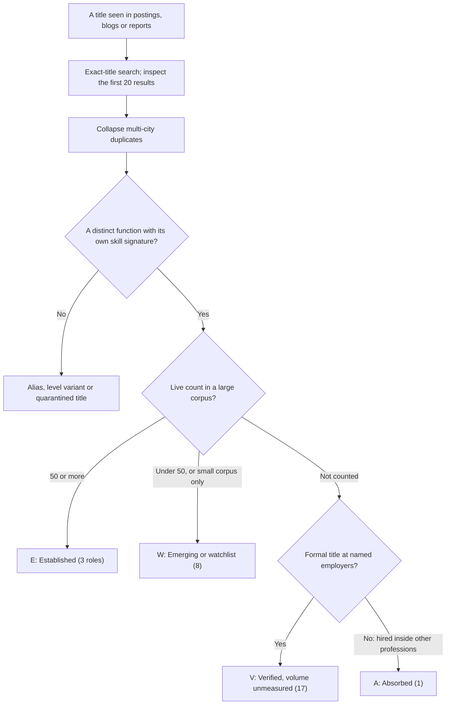

# The GenAI Job Market in October 2026

> What the GenAI job market looks like as of October 2026, globally and in India: which titles have measured volume, where demand, pay and applicant pressure sit, what is short and what is commoditised, and the decision rules that follow for each kind of job seeker.

**Dates:** live posting counts are from 19–21 October 2026 unless a row says otherwise. The S09 pay snapshot (5 August 2026) and the Q3 2025 AI premium by level passed their 90-day re-check on 2026-11-03, and the posting counts reach their 31-day limit from 2026-11-19; see the re-check table under [Evidence and limits](#evidence-and-limits). **Grades:** EGP-1.0. Platform aggregates (JobsPipe, Fast AI Jobs, Levels.fyi) are graded B, even where a session graded its own reading A ([role catalog §1.3](../02-roles/role-catalog.md#13-evidence-grades-and-conventions)). Regulatory dates are pointers, not legal advice.

## The short answer

1. **Target the three title families with measured volume, and carry new work as skills.** Only AI Engineer, Machine Learning Engineer and Forward Deployed Engineer (FDE) have a measured count above the 50-posting quorum. Agentic, context and evaluation work shows up as skills inside AI Engineer postings (agentic AI in 59.3%, RAG in 54.0%), not as new titles [B · T0-01.F1, F3, F4]. Seventeen other roles are real titles whose volume the research has not measured ([role catalog §0](../02-roles/role-catalog.md#0-summary)).
2. **Move at your current level; do not plan a reset to junior.** Of 43,480 US AI-engineering postings counted by Axial Search (January–July 2026), about 66% are individual-contributor roles: 35% mid-level and 31% senior [C · T0-06 L108]. Employment of 22–25-year-olds in the most AI-exposed occupations is 19% lower than if it had kept pace with less-exposed peers [A · T0-06 L118].
3. **For pay, choose the employer tier and the level, not the stack.** Median posted base is nearly the same for AI Engineer, infrastructure/platform and ML Engineer postings; the top of the band sits at labs and specialist vendors [B · T0-03.F1].
4. **Build where the market is short.** Evaluation is the broadest production signal (in the postings of 68.2% of the 198 companies in one corpus), yet only 52.4% of agent teams run offline evals [B · T0-03.F3; B/C · T0-03.F4]. T0-03 classes security and supply chain as mandatory production competencies, citing critical serving-engine CVEs and an eval-vendor breach in 2026 [A/B · T0-03.F12]. Thin-wrapper skills are commoditised, and Prompt Engineer is a legacy title [B · T0-03.F2; B/C · T0-01.F8].
5. **Compete on channel, not on application volume.** Applications per job rose about 110% from 2022 to 2025 (Greenhouse), and cold applications end in a hire about 0.2% of the time; referrals yield 11–36 times more per application [B · T0-04.F9, F10].
6. **In India, decide which of two markets you are in.** India has the highest AI-title share of postings of the five countries compared (3.0% vs 1.3% in the US) and about twice the US entry-level share of AI roles (21.2% vs 10.4%), but fewer live AI Engineer postings (398 vs 1,697) [B · T0-01.F10]. Pay splits into a broad market centred on ₹10–15L (Glassdoor, Indeed, AIM Research) [C] and an MNC, GCC and product-firm population; in the Levels.fyi sample that represents it, the Bengaluru ML Engineer median is ₹44.5L [B · T0-02.F3].

## At a glance

| Dimension | What the evidence shows (dates in brackets) | Grade · source |
|---|---|---|
| Titles with measured volume | 3 of 29 canonical roles are Established (≥50 live postings in a large corpus); 17 are verified titles with no quorum-grade count; 8 are emerging or watchlist; 1 is absorbed into other professions | B · T0-01; role catalog §0 |
| AI Engineer | 1,697 live US postings, 398 India, 3,944 global (JobsPipe, corpus 2026-10-19); 326 at 183 AI startups (Fast AI Jobs, 2026-10-19) | B · T0-01.F1; role catalog §7 |
| Machine Learning Engineer | 1,084 US, 90 India, 2,157 global; 273 at 159 AI startups (same dates) | B · T0-01.F1, D2 |
| Forward Deployed Engineer | 933 cluster roles at 343 AI startups (Fast AI Jobs, 2026-10-20); about 48% of the newest 50 are engineer-titled | B · T0-01.F3 |
| Short-run growth | AI Engineer +18.5%, ML Engineer +20.3%, FDE about +20% on Fast AI Jobs, from an early-August snapshot to 19–20 October 2026 | B · T0-01.F3 |
| What AI Engineer postings ask for | Python 78.4%, LLM 76.7%, agentic AI 59.3%, RAG 54.0% (counted 2026-09-10) | B · T0-01.F4 |
| Seniority | 66% individual contributor (35% mid, 31% senior) and about 10% management, of 43,480 US AI-engineering postings (Axial Search, January–July 2026) | C · T0-06 L108 |
| Junior market | 22–25-year-olds in the most AI-exposed occupations: employment 19% lower than if it had kept pace with less-exposed peers (Stanford, revised 12 August 2026) | A · T0-06 L118 |
| Pay structure | Median posted base: AI Engineer $200–275K, infrastructure/platform $203–270K, ML Engineer $213–288K (snapshot 2026-08-05); top of band at labs and specialist vendors | B · T0-03.F1 |
| Skills in short supply | Evaluation (in postings at 68.2% of 198 companies; offline evals run by only 52.4% of agent teams); security and supply chain | B · T0-03.F3; B/C · T0-03.F4; A/B · T0-03.F12 |
| Commoditised | Thin-wrapper skills; the Prompt Engineer title is 0.35% of 20,662 LinkedIn AI postings (2025 study) | B · T0-03.F2 |
| Applicant pressure | Applications per job 116 → 244 (Greenhouse, 2022–2025); cold-inbound application-to-hire about 0.2% | B · T0-04.F9 |
| India | AI-titled share of postings 3.0% (US 1.3%); entry-level share of AI roles 21.2% (US 10.4%) (2026-10-11) | B · T0-01.F10 |
| India pay | Broad-market centre ₹10–15L (Glassdoor, Indeed, AIM Research); Levels.fyi Bengaluru ML Engineer median ₹44.5L (n=96, 2026-10-12) | C, B · T0-02.F3 |
| Governance | 1,997 US AI-governance postings (Axial Search, January–September 2026); no India count | C · T0-15.F4 |
| Agent protocols | "Model Context Protocol" named in 0.068% of 343,299 Fortune-1000 and API-provider postings (API Evangelist, Q3 2026); no protocol job title in volume | C · T0-16.F9, F10 |

## The market in nine signals

### 1. Three title families carry the measured volume

**The test.** T0-01 counts a title as established only with 50 or more distinct active postings for the exact title or a declared alias cluster in a named corpus [T0-01 L43]. Indeed's own "AI-labeled title" rule uses a floor of 5 postings a quarter, so 50 is a conservative bar [C · T0-01 L43]. The catalog then sorts each canonical role into a status class ([role catalog §1.2](../02-roles/role-catalog.md#12-status-classes-for-canonical-roles)); a title moves up only by passing seven graduation tests ([§1.4](../02-roles/role-catalog.md#14-quorum-and-graduation-tests-t0-01-d5)).



| Family | Live postings (corpus, date) | Who posts most | Grade · source |
|---|---|---|---|
| AI Engineer | US 1,697; India 398; global 3,944 (JobsPipe, corpus 2026-10-19). AI startups: 326 at 183 (Fast AI Jobs, 2026-10-19). LinkedIn's Jobs on the Rise 2026 ranks it first | Capital One 33, TCS 22, American Express 16, Deloitte 13, Infosys 12: enterprise- and services-heavy | B · T0-01.F1, F2; role catalog §7 |
| Machine Learning Engineer | US 1,084; India 90; global 2,157. AI startups: 273 at 159 | TikTok 74, Adobe 21, Apple 20, Capital One 20: Big Tech, recommender systems, autonomous vehicles | B · T0-01.F1, F2, D2 |
| Forward Deployed Engineer | 933 cluster roles at 343 AI startups (Fast AI Jobs, 2026-10-20), up from 779 at 288 in an early-August snapshot | Named users include OpenAI, Databricks and Scale | B · T0-01.F3, D2 |

The ranking depends on the corpus. In the broad market (JobsPipe), AI Engineer is the largest family. On the AI-startup board, the FDE cluster (933) is larger than AI Engineer (326), and stays larger if only its engineer-titled roles are counted (roughly half of 933, extrapolated from the 50 newest rows) [B · T0-01.F1, F3; extrapolation C]. Applied AI Engineer is probably a large sub-node of AI Engineer (16 of the 50 newest AI Engineer rows on Fast AI Jobs), but it has not been counted separately [C · T0-01 D2].

**Read every count with these caveats:**
- **Counts are corpus-relative.** LinkedIn, Indeed, Wellfound, Otta and Ashby could not be queried directly; JobsPipe and Fast AI Jobs are proxies [T0-01 D1].
- **Family counts are not GenAI counts.** AI Engineer includes robotics, construction and Power Platform variants [B · T0-01.F2]. Keeping only postings that name LLM leaves about 1,300 US AI Engineer and about 490 US ML Engineer postings [M · [genai-target-roles §1.2](../02-roles/genai-target-roles.md#12-genai-restriction-of-the-two-mixed-title-families)].
- **Postings are not openings, and openings are not hires.** One vendor (JobsPipe) reports 9.5% of active postings visible for 45 days or more [C]; TikTok alone posted 74 of the 1,084 US ML Engineer roles [B · T0-01 objection 2].
- **Raw keyword counts mislead.** Job boards showed 339–1,000 "cognitive architect" jobs; the only exact match was a legacy IBM posting [B · T0-01.F6].
- **Half the FDE cluster is not engineering.** About 24 of the 50 newest rows (48%) were engineer-titled; the rest were deployment strategists, product managers, managers, TPMs and GTM roles [B · T0-01.F3].

Who hires, by employer type, is in the [employer landscape](employer-landscape.md).

### 2. New work shows up as skills, not titles

The title layer is stable; the skill layer is moving.

| Skill named in AI Engineer postings (JobsPipe, counted 2026-09-10) | Share |
|---|---:|
| Python | 78.4% |
| LLM | 76.7% |
| Agentic AI | 59.3% |
| RAG | 54.0% |
| Machine learning | 39.8% |
| Generative AI | 37.6% |
| Azure; AWS | 35.1% each |
| CI/CD | 34.4% |
| Vector databases | 32.6% |
| Prompt engineering | 31.1% |

Source: [B · T0-01.F4]. Across all salaried postings (1–18 September 2026), agentic AI (1.7%) appears more often than machine learning (1.5%) [B · T0-01.F4]. Fine-tuning is not in the AI Engineer top 12, so its share is below 31.1% [B · T0-01 D6].

AI work also spreads into occupations without an AI title. In JobsPipe's JD measurements (retrieved 2026-11-02), 24.0% of Software Engineer (feeder) postings name AI, 30.1% of Data Scientist (feeder) postings name LLM, and 15.4% of Product Manager (feeder) postings name AI. These are feeder-title shares, not measurements of any AI role [B · [role catalog §7](../02-roles/role-catalog.md#7-feeder-and-adjacent-occupations-market-refresh-2026-11-02)].

The titles that blogs promote are small. Context Engineer has roughly 10–25 live postings worldwide (an estimate, and three different jobs under one title) [C · T0-01.F5]. The exact title "Agent Architect" has about 2 [C · T0-01.F7]; Prompt Wizard has none [B · T0-01.F8]. Meanwhile Indeed's count of frequently advertised AI-referencing titles rose from 264 (2022) to 822 (Q1 2026) [C · T0-01.F11]. That title inflation is why the catalog maps 241 title strings onto 29 roles. Titles still under watch, with their graduation tests, are in [emerging roles](emerging-roles.md).

### 3. Demand is real, but it is an exception inside a soft tech market

- **Volume and shape.** Axial Search counted 43,480 US AI-engineering postings from January to July 2026, about 1,550 a week, peaking at 2,327 in one late-June week. About 66% are individual-contributor roles (35% mid, 31% senior) and about 10% management; the part of the page T0-06 read gave no entry-level share. 72% state a degree requirement [C · T0-06 L108].
- **Growth and premium.** PwC's 2026 AI Jobs Barometer (15 June 2026; over one billion job ads in 27 countries) reports 69% growth in AI-skill postings against 9% for all postings, and a 62% average wage premium for jobs requiring AI skills. The premium is correlational [B · T0-06 L110].
- **Context.** LinkedIn's March 2026 report puts US hiring 23% below its February 2020 pace, and technology, information and media 26% below [A · T0-06 L112]. T0-06's reading: "AI engineering is an exception inside a soft tech market, not a rising tide."
- **Who fills the roles.** The AI-engineer population is mostly experienced software engineers who pivoted; data scientists are a consistent second feeder [B · T0-06 KF-3]. A summary of the 2026 AI Engineering Survey reports a median of about 8 years writing code and 3 years in AI/ML [C · T0-06 L129].

| Direction of travel | Change | Grade · source |
|---|---|---|
| AI-startup postings (Fast AI Jobs) | +18.5% to about +20% for AI Engineer, ML Engineer and FDE, early August to 19–20 October 2026 | B · T0-01.F3 |
| FDE postings (Lightcast, via Fortune) | More than +1,000%, January–August 2026 vs the same months of 2025, from a small base | B · T0-06 L175 |
| AI-skill postings (PwC, 27 countries) | +69%, against +9% for all postings | B · T0-06 L110 |
| MCP mentions in engineering postings (landed.jobs) | 1.2% (January 2026) to between 2.7% and 4% (mid-2026); the report is internally inconsistent | C · T0-16.F9 |
| US hiring overall (LinkedIn) | 23% below the February 2020 pace (March 2026) | A · T0-06 L112 |

### 4. The junior door is the narrowest

- **The measurement.** Stanford Digital Economy Lab's *Canaries in the Coal Mine?* (revised 12 August 2026) finds employment of workers aged 22–25 in the most AI-exposed occupations 19% below where it would be had it kept pace with less-exposed peers. Experienced workers show no comparable gap, and the effect runs through reduced hiring rather than more separations [A · T0-06 L118]. Earlier versions gave 13% (August 2025) [B · T0-11.F11] and 16% (March 2026, via a secondary summary) [C · T0-06 L832]; the estimates are not strictly comparable.
- **Its limits.** The finding is descriptive, not causal, and contested: a Yale Budget Lab study is reported to find little relationship between AI exposure and employment [C · T0-06 L122].
- **The counterweight.** PwC finds AI-exposed entry-level roles seven times more likely to require traditionally senior skills such as judgement and leadership. These "seniorised" entry-level openings grew 35% since 2019, while other entry-level roles shrank 10% [B · T0-06 L122].
- **Inside the postings.** AI Engineer seniority labels read senior 24.6%, entry 7.0%, mid 6.0%, lead or manager 5.6% [B · T0-01 D3].
- **India differs.** 21.2% of India's AI roles are entry-level, against 10.4% in the US [B · T0-01.F10].

T0-06's implication: a junior GenAI role from scratch is the hardest target on the map; convert prior tacit experience into a lateral-level AI role [M · T0-06 L124].

### 5. Pay follows employer tier and level, not the app-versus-infra split

| Posting cut (S09: 3,647 postings at 198 companies, snapshot 2026-08-05) | Median posted base range | n (postings disclosing base) |
|---|---|---:|
| Mid-level or unspecified AI engineer | $179–247K | 599 |
| Senior AI engineer | $185–253K | 462 |
| Staff+ or principal AI engineer | $230–310K | 322 |
| AI Engineer (application) | $200–275K | 55 |
| Infrastructure / platform engineer | $203–270K | 52 |
| Machine Learning Engineer | $213–288K | 201 |
| Forward Deployed Engineer | $180–248K | 304 |

Source: [B · T0-03 §6.1.2].

- **Tier sets the ceiling.** Top-of-band posted ranges come from labs and specialist vendors (2026 postings): Anthropic Inference Runtime $405–485K, NVIDIA inference up to $356.5K, Baseten $180–360K [B · T0-03.F1].
- **Level sets the step.** The AI premium over non-AI engineers rises with level, from +6.2% at entry to +18.7% at Staff (Levels.fyi, Q3 2025) [B · T0-17 KF3].
- **The infrastructure premium is unproven.** T0-02 calls it "partially supported, not validated": +13% to +31% in base at two datasets, with seniority not controlled [B/C/D · T0-02.F12, L99].
- **Titles carry employer mix.** Levels.fyi US total-comp medians (18–19 October 2026) are $280K for ML Engineer and $154K for AI Engineer: "a title and employer-mix gap", not a measured skill premium [B · T0-02.F1].
- **Posted ranges exclude equity.** Only 14% of 43,480 US AI-engineering postings (Axial Search) mention equity [B/C · T0-02.F8].

Pay by role, tier and city is in [pay benchmarks](../09-compensation/pay-benchmarks.md).

### 6. In short supply: evaluation and security. Commoditised: thin-wrapper skills

| Area | Market signal | Reading (judgement) | Grade · source |
|---|---|---|---|
| Evaluation | Named by 68.2% of 198 companies and in 19.0% of 3,647 postings, ahead of fine-tuning (13.0%) and RAG (10.0%); evals beat fine-tuning in all three corpora T0-03 compared. Other analyses range from 12 of 100 postings to 59.7% of AI-first roles | **Short.** Only 52.4% of agent teams run offline evals and 37.3% online (LangChain survey, n=1,340, late 2025). Evaluation is the most-cited stack challenge (20%) in the 2026 AI Engineering Survey. No pay premium has been measured | B · T0-03.F3, L216; B · T0-13.F3; B/C · T0-03.F4; B · T0-06 L139 |
| Security and supply chain | CVSS 9.8 flaws in SGLang (CVE-2026-5760) and vLLM (CVE-2026-22778); an eval vendor's AWS breach on 2026-05-04. Security is the top MCP adoption obstacle (64%, a vendor-run survey fielded in December 2025) | **Short.** T0-03 classes it as a mandatory production competency; as a title, AI Security Engineer is still on the watchlist | A/B · T0-03.F12; B · T0-16.F5; role catalog §2.2 |
| Thin-wrapper skills | Prompt engineering in 7.5% of postings (38.4% of companies); LangChain in 3.6% of postings and in 0 of 10 top-band lab postings | **Commoditised.** SDK calls, naive RAG and prompt-only work are co-requirements, not differentiators | B · T0-03.F2, L179 |
| Prompt Engineer (title) | 72 of 20,662 LinkedIn AI postings (0.35%, a 2025 study). Indeed's salary page rests on 52 data points over 36 months. The "40% decline since 2023" figure has no traceable source | **Legacy.** Absorbed into AI Engineer | B · T0-03.F2; B/C · T0-01.F8 |
| Inference engines and kernels | Named engines in 2.0–3.9% of postings; CUDA/GPU kernels in 6.6% | **Narrow and deep.** Required at engine and hardware vendors, not in general AI Engineer roles | A/B · T0-03.F7, F8 |
| Fine-tuning | 13.0% of postings; 70% of 20 deployed systems in one study used off-the-shelf models without fine-tuning or RL | **Secondary** for most roles; frontier work for a few | B · T0-03 L178; A · T0-03 §6.5.2 |

### 7. More applicants per job: channel beats volume

- **More competition.** Greenhouse reports applications per job up about 110% (116 to 244) and applications per recruiter up 204% (1,610 to 4,890 a year) from 2022 to 2025. Gem's application-to-pre-onsite rate fell from 13% to 8% across all functions from 2021 to 2025 [B · T0-04 L91]. LinkedIn says US applicants per open role have doubled since spring 2022 [A · T0-06 L219].
- **Low cold yield.** Cold inbound for engineering converts about 0.2% application-to-hire, roughly 340–380 applications per offer; 3.6–6% of applications reach a first human stage [B · T0-04.F9].
- **Channels differ by an order of magnitude.** Referrals yield about 11–36 times inbound per application, and recruiter-sourced candidates about 8 times [B · T0-04.F10]. For technical roles with "AI" in the title, Ashby (July 2026) reports 37.1% of hires from inbound, 28.0% from sourcing, 9.2% from agencies and about 26% from referrals, internal moves and other routes [B · T0-04.F11].
- **Fraud dilutes the averages.** In a Greenhouse pilot for an ML role, more than 35% of applicants carried high-risk fraud signals [B · T0-04.F11]. A genuine, well-matched applicant therefore beats the average odds, by an amount nobody has published (T0-04's inference).
- **Searches take months.** Huntr's median from first saved job to first offer was 82 days in Q2 2026 (108 in Q1), counting only searches that ended in an offer [C · T0-06 L219].

How to act on this: [job-search strategy](../06-job-search/job-search-strategy.md#27-recommended-sequencing-expanding-rings), [channels and boards](../06-job-search/channels-and-boards.md) and [referrals and outreach](../07-networking/referrals-and-outreach.md).

### 8. India: more AI-intensive, younger, smaller in counts, split in pay

| Metric (source, date) | India | US | UK | Germany | France |
|---|---:|---:|---:|---:|---:|
| AI-titled share of all postings (JobsPipe, 2026-10-11) | 3.0% | 1.3% | 1.7% | 1.6% | 0.9% |
| Entry-level share of AI roles (JobsPipe, 2026-10-11) | 21.2% | 10.4% | 11.0% | 18.8% | 21.2% |
| Share of AI Engineer postings by country (JobsPipe, 2026-09-10) | 13.6% | 27.9% | 7.2% | 9.1% | 5.4% |
| Live AI Engineer postings (JobsPipe, corpus 2026-10-19) | 398 | 1,697 | n/a | n/a | n/a |
| AI keyword share of postings (Indeed AI Tracker, 2026-09-30) | not covered | 7.34% | 9.92% | 5.74% | 4.53% |

Sources: JobsPipe rows [B · T0-01.F10, D8]; Indeed row [A · T0-01.F10], with revisions of about ±0.3 points [T0-01 D1].

- **Counts are smaller, and the two JobsPipe figures disagree.** Live counts put India at 0.23× the US (398 vs 1,697), but the September JD page implies 0.49× (13.6% vs 27.9%). T0-01 flags the conflict without reconciling it, so use 0.23–0.49× [B · T0-01 L69]. India has 90 live ML Engineer postings [B · T0-01 D2].
- **Demand sits in GCCs.** NASSCOM-Zinnov puts India's global capability centres at 2,100+ centres and 2.3M staff. AI, data and analytics is the fastest-growing function (+38%), about two in three new GCC roles need AI, data or automation skills, and 56% of GCC hiring is for 4–10 years' experience. Quess estimates 18–43% supply gaps in AI, MLOps and platform clusters [C · T0-01 D8, F10]. Title-level GCC counts were not obtained.
- **Titles differ.** GCCs use GenAI Engineer, AI/ML Engineer, MLOps Engineer and Prompt Engineer as titles (Taggd) [C · T0-01 D8], although Prompt Engineer is legacy in US data.
- **Execution risk.** "Nearly 70%" of India GCCs are stuck at the AI pilot stage, according to a Dell-Zinnov survey of senior GCC leaders (more than 50, per a trade-press report; the whitepaper states no sample) [B · T0-09 L77, L364].
- **Pay is two populations.** Levels.fyi Greater Bengaluru ML Engineer: P25 ₹28.9L, P50 ₹44.5L, P75 ₹68.6L, P90 ₹94.6L (n=96, 2026-10-12) [B · T0-02.F3]. Broad-market sources (Glassdoor, Indeed, AIM Research) centre on ₹10–15L [C · T0-02.F3]. The 3–4× gap is employer type. For senior software engineers in Bengaluru, the median is ₹56.0L and the P90 ₹1.07Cr (Levels.fyi, n=4,836, 2026-10-21) [B · T0-17 KF4]. The India tier bands in older records are unmeasured ([ERRATA U14](../../research/ERRATA.md)).
- **Remote is the exception for AI titles.** Remote shares: AI Engineer 11.0%, ML Engineer 14.0%, generic backend 31.6% (JobsPipe JD measurements, 2026-11-02) [B · [role catalog §8.3](../02-roles/role-catalog.md#83-india-vs-us-realities)].
- **The India picture has blind spots.** India-specific boards (Naukri, Instahyre) were never measured ([FAD](../../research/FAD.md) OQ2), and Indeed's AI tracker does not cover India [A · T0-01.F10]. The India-centric board Weekday lists 2,527 India vs 490 US AI roles, which reflects its audience, not the market [C · T0-01 D8].

India targeting is in the [GenAI target roles India order](../02-roles/genai-target-roles.md#6-india-first-target-order-genai-india-lens) and the [India remote playbook](../11-tracks/india-remote-playbook.md).

### 9. Governance and agent protocols: real, small and moving fast

**Governance volumes** [C · T0-15.F4]:
- **US (Axial Search):** 1,997 AI-governance postings in January–September 2026, about 2,700 a year annualised. The source's own weekly figures disagree (71 quoted vs about 51 implied).
- **UK (ITJobsWatch):** 119 live postings mention the EU AI Act, against 17,685 AI-citing postings (about 0.7%).
- **EU (Axipro):** about 7 AI-builder postings per governance posting across 8 countries.
- **India:** no platform count; a small aggregator showed 0.

**Governance structure.** Dedicated roles exist at programme-lead level; specialist work is absorbed by privacy, legal, security, model-risk and audit teams [B · T0-15.F5]. EU high-risk duties start on 2 December 2027 (Annex III) and 2 August 2028 (Annex I) [A · T0-15.F1], and T0-15 finds no surge in technical compliance engineers (T0-15 L24). Paths in: [governance careers](../11-tracks/governance-careers.md).

**Agent protocols:**
- **Governance of the standards.** MCP is hosted by the Agentic AI Foundation (AAIF), a Linux Foundation fund announced on 9 December 2025; AAIF reported 247 member organisations by August 2026 [A · T0-16.F1]. As of 21 October 2026, the MCP specification revision is dated 2026-07-28 [A · T0-16.F2]. A2A v1.0 shipped on 12 March 2026, had 150+ participating organisations by 9 April, and announced on 27 August that it is joining AAIF [A; adoption count B · T0-16.F3].
- **Hiring.** Three indexes agree on "small but fast-growing". In Q3 2026, 234 of 343,299 Fortune-1000 and API-provider postings in API Evangelist's sample named "Model Context Protocol" (0.068%; 10.4% of companies). Skillenai counted 1,747 MCP postings in the 90 days to 14 October 2026, about 0.7% of its index [C · T0-16.F9].
- **No protocol title.** No "Agent Gateway Engineer" title exists in volume. In Skillenai's "Agentic AI Engineer" postings, LangGraph appears in 35.8% and MCP in 13.8% [C · T0-16.F10].

Learn the protocols as skills inside AI Engineer, platform and security roles; there is no protocol title to aim at. Details: [agentic protocols](../03-skills-and-tech/agentic-protocols.md).

## The 2026 calendar: dated events that matter to careers

Only events with a date in the research sessions appear here. Statuses are as of each session's date (21–24 October 2026). Two 2025 anchors frame the year: EU duties for general-purpose AI (GPAI) models have applied since 2 August 2025 [A · T0-15.F1], and the Linux Foundation announced AAIF on 9 December 2025 [A · T0-16.F1].

### January to October 2026

| Date (2026) | Event | Grade · source | What it means for careers (judgement) |
|---|---|---|---|
| 16 Jan; 9 Mar | Eval tooling consolidates: ClickHouse acquires Langfuse; OpenAI announces it is acquiring Promptfoo | A/B · T0-03.F13 | Learn evaluation as a practice, not as one product |
| 20 Feb | India's IT Rules amendment on synthetic content takes effect: permanent provenance markers, 3-hour takedowns | B · T0-15.F12 | India's nearest binding AI rule; provenance work for India-facing products |
| 12 Mar | A2A v1.0 ships | A · T0-16.F3 | Agent-to-agent interoperability has a stable specification |
| 16 Mar; 21 Mar | NVIDIA Dynamo 1.0 fronts vLLM, SGLang and TensorRT-LLM; Hugging Face archives TGI | A/B · T0-03.F6 | Drop TGI from a serving skill set; vLLM and SGLang are the open engines to know |
| 31 Mar | AWS Machine Learning – Specialty: last exam date. Generative AI Developer – Professional (AIP-C01) moves to standard registration | A · T0-11.F1 | A 2024-era AWS ML badge reads as legacy |
| 2 Apr | Microsoft Agent Framework 1.0 unifies Semantic Kernel and AutoGen; AutoGen had no release in the 365 days to late October 2026 | A/B · T0-03 §6.8.1 | Framework syntax ages fast; portable agent concepts last |
| 17 Apr | US bank guidance SR 26-2 supersedes SR 11-7 and leaves generative and agentic AI out of scope | A · T0-09 L103 | GenAI risk in US banks has no settled owner; approvals rest on internal policy |
| 27 Apr | Colorado's AI Act (SB 24-205) is barred from enforcement; SB26-189, a notice, disclosure and human-review regime, replaces it from 1 Jan 2027 | B · T0-15.F11 | US governance demand flows through sector regulators and contracts more than state statutes |
| 4 May | Braintrust, an eval SaaS vendor, confirms unauthorised AWS access; customers rotate keys | A/B · T0-03.F12 | Key handling and supply-chain security are part of an AI engineer's job |
| 30 Jun | Microsoft retires AI-102 (Azure AI Engineer Associate); the successor is AI-103 | B · T0-11.F1 | List the successor credential or the skills, not the retired name |
| 24 Jul; 27 Jul | The EU Digital Omnibus is published, then enters into force: Annex III high-risk duties move to 2 Dec 2027, Annex I to 2 Aug 2028 | A (new dates) / B (publication dates) · T0-15.F1; T0-09 L274 | No 2026 wave of enterprise conformity jobs |
| 28 Jul | MCP specification revision 2026-07-28: stateless core, authorisation hardening, deprecations | A · T0-16.F2 | Spec churn: tie any MCP claim to a spec version |
| 2 Aug | The EU AI Act applies generally; Art. 50 transparency duties and Art. 101 fines begin | A · T0-15.F1 | The legal pull falls on model and generative-system providers first |
| 27 Aug | A2A announces it is joining AAIF | A · T0-16.F3 | MCP and A2A share one neutral home |
| 29 Aug | The EU AI Office sends its first formal requests for information, including to more than 30 firms on training-content summaries and copyright | A · T0-15.F1 | Enforcement has begun for GPAI providers |
| 18 Sep | AG-UI declares 1.0; it is stewarded by CopilotKit and is not in AAIF | A · T0-16.F4 | A single-steward protocol; its adoption claims are company-reported |

### Dated next

| Date | Event | Grade · source | What it means for careers (judgement) |
|---|---|---|---|
| 13 Nov 2026 | India DPDP consent-manager rules start | B · T0-15.F12 | Consent and notice mapping for Indian personal data |
| 2 Dec 2026 | EU: grace period ends for generative systems placed on the market before 2 Aug 2026; new Art. 5 bans on generators of non-consensual intimate imagery and CSAM | A (bans) / B (grace) · T0-15.F1 | Marking duties reach older generative systems |
| 1 Jan 2027 | Colorado SB26-189 takes effect | B · T0-15.F11 | Notice and human-review duties, without impact assessments |
| 13 May 2027 | India DPDP main obligations (12 May per one firm) | B · T0-15.F12; T0-09 L275 | T0-15 expects privacy-engineering and DPO demand to lead, with AI-specific roles following |
| 2 Aug 2027 | EU deadline for legacy GPAI models | A · T0-15.F1 | Compliance work for providers of older models |
| 2 Dec 2027 | EU Annex III high-risk duties begin | A · T0-15.F1 | Mostly self-assessed by providers' own staff (T0-15.F3), not by an external assessor profession |
| 2 Aug 2028 | EU Annex I high-risk duties begin | A · T0-15.F1 | Sectoral notified bodies must apply for AI designation by 28 Jan 2028 (T0-15.F3) |

## What this means for you

Each rule is a judgement built on the graded evidence in its row. Modelled timelines assume 15–20 hours a week and are conditional on success [D · T0-06 R2].

| You are | What the market shows | Decision rule |
|---|---|---|
| **Experienced software engineer** (backend, full-stack, frontend) | Experienced software engineers are the main feeder into AI Engineer [B · T0-06 KF-3]. AI Engineer is the largest AI title family in the broad market; FDE is the largest at AI startups [B · T0-01.F1, F3] | Target AI Engineer at your current level; add FDE or Applied AI Engineer if you want customer work. Lead with evals in CI, agent reliability and cost control. Modelled: ~6 months (backend), ~7 (frontend or full-stack) |
| **Data scientist or BI analyst** | Data scientists are a consistent second feeder [B · T0-06 KF-3]; evaluation is the most-cited stack challenge, and eval work draws on data-science skills [B · T0-06 KF-4; C · T0-06 KF-5] | Reposition as an AI Engineer with an evals and error-analysis edge, or target the GenAI track of ML Engineer; close the production gap (tests, deployment) first. Modelled: ~8 months (data scientist), ~11 (BI analyst) |
| **Student, new graduate or junior** (under 2 years) | AI Engineer postings label 7.0% entry vs 24.6% senior [B · T0-01 D3]; employment of 22–25-year-olds in AI-exposed jobs is 19% below the pace of less-exposed peers [A · T0-06 L118]; "seniorised" entry roles grew 35% since 2019 [B · T0-06 L122] | Do not bet on a junior GenAI title alone. Combine software or data roles with AI scope, internal moves and the AI roles that do list entry level. Show judgement through one evaluated system: evaluation literacy is the most consistently cited separator [B · T0-13.F3]. In India the entry-level share is about twice the US share [B · T0-01.F10] |
| **PhD or academic researcher** | New AI PhDs in the US and Canada rose 22% from 2022 to 2024, and the increase went to academia, not industry [A · T0-06 L186] | Plan on applied AI engineering, applied science or research engineering; treat frontier research-scientist offers as upside [M · T0-06 L192]. Modelled: ~8 months. See [PhD to industry](../11-tracks/phd-to-industry.md) |
| **Non-technical professional** (5+ years in a domain) | AI PM, AI ops, domain evaluation and FDE-adjacent niches exist, each with an entry fee in experience, credentials or coding [C · T0-06 KF-7] | Pick one lane; AI Product Manager is the strongest non-engineering target in the [GenAI target order](../02-roles/genai-target-roles.md) [M]. Modelled: ~7 months for AI-adjacent roles; an engineering role from zero code is a ~22-month plan |
| **Infrastructure, SRE or systems engineer** | Named inference engines appear in 2.0–3.9% of postings, kernels in 6.6% [A/B · T0-03.F7, F8]; infrastructure posted base is level with AI Engineer [B · T0-03.F1] | Choose infrastructure for the employer tier (labs, inference vendors, GPU clouds), where top-of-band pay sits, not for a general premium, which is not validated [B/C/D · T0-02.F12] |
| **India-based engineer** | Two pay populations with a 3–4× gap [B/C · T0-02.F3]; AI titles are rarely remote [B · role catalog §8.3], and FDE postings were mostly not remote (65 of ~779 remote, August snapshot) [B · T0-01 D2]; "nearly 70%" of India GCCs are stuck at AI pilots [B · T0-09 L77] | For pay, target GCC, MNC and product employers, and ask in interviews whether the AI work runs in production. For US-remote work, expect few remote AI-titled postings, rely on non-cold channels, and settle the contracting set-up first ([India remote playbook](../11-tracks/india-remote-playbook.md); not tax advice) |
| **GRC, privacy, audit or legal professional** | Low thousands of US postings a year; India uncounted [C · T0-15.F4]; dedicated roles at programme-lead level, absorbed below it [B · T0-15.F5] | Add AI governance to an existing privacy, security, risk or audit base and aim for programme-lead roles. AIGP is a cheap differentiator, not a gate [C · T0-15.F9]. Do not wait for an EU-driven surge before the 2027–2028 high-risk dates [A · T0-15.F1] |

Fuller playbooks by background are in [career transitions](../11-tracks/career-transitions.md).

## How to read the market for your own target

1. **Name the role, not the buzzword.** Map your target to a canonical role in the [role catalog](../02-roles/role-catalog.md#22-registry) and note its status (E, V, W or A). *Done when:* you have one to three role ids with status codes, and no quarantined title in your headline ([quarantine register](../02-roles/role-catalog.md#51-quarantined-titles-t0-01-d4-reconciled)).
2. **Count it yourself, exactly.** Use T0-01's protocol: search the exact title, inspect the first 20 results for exact matches, collapse multi-city duplicates, and record the corpus and date [T0-01 D10]. *Done when:* each target has a dated count from two corpora, one of them an ATS-direct board.
3. **Read 20 recent postings.** Tally the skills. Mark those in most postings (table stakes) and those in few postings that recur at the employers you want (differentiators) [P]. *Done when:* you have a top-10 skill list with counts out of 20.
4. **Check level, location and work model.** Note each posting's seniority label, location and remote status [P]. *Done when:* you know what share of your sample is open at your level and in your location.
5. **Anchor pay by employer tier and level,** not by stack [B · T0-03.F1]. *Done when:* you have a median for your level at each employer tier you are considering, with its source and date, from [pay benchmarks](../09-compensation/pay-benchmarks.md).
6. **Pick the channel before you apply** [B · T0-04.F10]. *Done when:* every target employer has a named route (referral, recruiter or community contact) or a written reason to apply cold.
7. **Recount on a schedule.** AI-startup counts rose about 20% between early August and 19–20 October 2026 [B · T0-01.F3]. *Done when:* a recount date is in your calendar; T0-01's own recounts are due on 2026-12-01 and 2027-01-15 [T0-01 L84].

The [targeting workbook](../00-start/targeting-workbook.md) turns these steps into a worksheet.

## Templates and examples

### Market-claim check [P]

Use it on any market number before you act on it. The questions follow T0-01's counting method and EGP-1.0 grading; the template itself is unmeasured.

```text
Claim:            [e.g., "Context Engineer is the fastest-rising AI title"]
Source and date:  [publisher; retrieval date]
Corpus:           [which board or dataset; its size]
Title match:      [exact title | declared alias cluster | fuzzy keyword]
Unit:             [live postings | requisitions | hires | survey answers]
Duplicates:       [multi-city duplicates collapsed? yes | no]
Against quorum:   [n vs 50 distinct postings]
Grade:            [A | B | C | D per EGP-1.0]
Verdict:          [use | use with caveat | discard]
```

### Weak and strong market claims

| Weak claim | Strong claim |
|---|---|
| "There are 900+ Cognitive Architect jobs." | Raw counts of 339–1,000 come from fuzzy matching; the only exact match was a legacy IBM posting [B · T0-01.F6]. |
| "AI Engineer has split into Agent Architect and Context Engineer." | Exact-title Agent Architect has about 2 postings and Context Engineer roughly 10–25 (an estimate). The split shows up as skills: agentic AI is named in 59.3% of AI Engineer postings [B/C · T0-01.F4, F5, F7]. |
| "Prompt engineering is a hot job." | Prompt Engineer is a legacy title: 72 of 20,662 LinkedIn AI postings (0.35%) in a 2025 study [B · T0-03.F2]. Prompting is a co-requirement in 31.1% of AI Engineer postings [B · T0-01.F4]. |
| "AI engineers in India earn ₹50L–₹1Cr." | That is roughly P56 to just above P90 of the Levels.fyi Bengaluru ML Engineer sample (median ₹44.5L, n=96); broad-market sources centre on ₹10–15L [B/C · T0-02.F3]. |
| "Infrastructure engineers earn far more than application engineers." | Median posted base is nearly the same across AI Engineer, infrastructure/platform and ML Engineer families; pay concentrates by employer tier and level [B · T0-03.F1]. |
| "78% of enterprise AI teams run MCP in production." | The figure has no traceable primary source, and T0-16 rejects it [T0-16.F5]. In Q3 2026, 0.068% of the postings API Evangelist sampled named "Model Context Protocol" [C · T0-16.F9]. |

### Target market card [P]

```text
Canonical role:         [role id, e.g., ai-engineer]
Status:                 [E | V | W | A, from the role catalog]
Live count and date:    [n, corpus, date] / [n, second corpus, date]
GenAI share:            [share of postings naming LLM]
Top skills (20 JDs):    [skill: x/20; skill: x/20; ...]
Seniority mix:          [entry / mid / senior labels seen]
Location and remote:    [cities; remote share]
Pay anchor:             [median by employer tier and level; source; date]
Best channel:           [referral | sourced | community | cold, with reason]
Next recount:           [date]
```

## Checklist

- [ ] My headline title is a canonical title (status E or V), not a quarantined or legacy one.
- [ ] I have a dated, exact-title count for each target from two corpora.
- [ ] I know the top skills in 20 recent postings and which two or three differentiate.
- [ ] I am targeting my current level, not a junior reset.
- [ ] I chose employers by tier for pay, not by stack.
- [ ] My proof of work includes an evaluated system.
- [ ] Every target employer has a non-cold channel, or a reason to apply cold.
- [ ] (India) I know which pay population each target employer belongs to, and its remote policy.
- [ ] I checked the calendar events that touch my target (EU AI Act, credentials, protocols).
- [ ] I set a recount reminder.

## Pitfalls

| Red flag | Why it hurts | Fix |
|---|---|---|
| Quoting a raw job-board count for a new title | Fuzzy matching inflates speculative titles: 339–1,000 "cognitive architect" hits, one exact match [B · T0-01.F6] | Filter to the exact title and read the first 20 results |
| Reading AI Engineer counts as GenAI counts | The family includes robotics, construction and Power Platform roles [B · T0-01.F2] | Use the share of postings naming LLM (76.7%) to estimate the GenAI subset [M] |
| Treating postings as hires | Duplicates, ghost postings and mass posters inflate counts [C/B · T0-01 objection 2] | Compare counts only within one corpus and date; plan with conversion rates |
| A quarantined or legacy title in your headline | Recruiter searches and AI screening key on titles [A · T0-04.F8; C · T0-11.F3] | Use the canonical title; show agent, context or eval work as skills |
| Planning a junior reset into a GenAI title | The junior door is the narrowest part of the market [A/B · T0-06.F2] | Move laterally at your level, or transfer internally |
| Spraying cold applications | About 0.2% application-to-hire, while applications per job more than doubled [B · T0-04.F9] | Put the hours into referrals, sourced routes and tailored applications |
| Choosing infrastructure only for a premium | Family base medians are close, and the systems premium is not validated [B · T0-03.F1; B/C/D · T0-02.F12] | Choose by employer tier and the work you want to do |
| Expecting a regulation-driven hiring wave | EU high-risk duties start in December 2027 and August 2028; governance volumes are low thousands a year [A · T0-15.F1; C · T0-15.F4] | Build governance on an existing privacy, security, risk or audit base |
| Listing retired credentials as current | AWS ML Specialty (last exam 31 March 2026) and AI-102 (retired 30 June 2026) read as legacy [A/B · T0-11.F1] | Name the successor (AIP-C01, AI-103) or the skills; see [credential ROI](../04-certifications/credential-roi.md) |

## Evidence and limits

- **What is measured:** live posting counts and JD shares (JobsPipe, Fast AI Jobs; B), the Indeed AI tracker (A), Levels.fyi percentiles (B), EU legal dates (A; the Omnibus publication dates are B), and protocol and credential statuses (mostly A).
- **What is weaker:** Axial's volume and seniority figures (C), governance volumes (C), GCC scale and supply gaps (C), MCP hiring indexes (C), modelled transition times (D), and the decision rules, which are judgement built on the cited evidence.
- **Snapshots, not trends.** Most figures are single snapshots. The only like-for-like growth reading is Fast AI Jobs from early August to 19–20 October 2026 [B · T0-01.F3]. Skill shares were counted on 2026-09-10 and the S09 pay corpus on 2026-08-05.
- **Postings are not hires.** Counts include duplicates, ghost postings and mass posters, and family counts include non-GenAI roles [T0-01 objections 2–3].
- **Corpus-relative.** None of the five platforms named in the research brief could be queried directly [T0-01 D1], and a fixed quorum of 50 ignores corpus size [T0-01 objection 7].
- **India gaps.** India-specific boards are unresearched ([FAD](../../research/FAD.md) OQ2); Indeed's tracker excludes India; JobsPipe's two India ratios disagree (0.23× vs 0.49×) [T0-01 L69]; GCC title counts are missing; most India inputs are Grade C.
- **US-centric.** The seniority, junior-market and search-time evidence is mostly US data [T0-06 L39].
- **Errata applied** ([ERRATA](../../research/ERRATA.md)): only three families are established, and the "~700 Applied Scientist postings" figure has no primary source (U1, U2). The 11.1–19.2% engine figure is a share of companies, not postings (U12, U15), so this page uses posting shares (2.0–3.9%). The India tier bands are unmeasured (U14), so this page uses Levels.fyi anchors.
- **What would change this page:** a watchlist or quarantined title passing all seven graduation tests at a recount; direct LinkedIn, Indeed or Naukri counts; a measured pay premium for evaluation skills; a further change to EU AI Act dates.

**Re-check dates.** The front-matter `review_by` (2026-11-03) is 90 days from the S09 pay snapshot (2026-08-05). That date fell before the 2026-11-06 verification, so the pay figures, including the Q3 2025 premium by level, are due for a refresh. Each class is refreshed on its own page:

| Facts on this page | Dated | Re-check by | Where the refresh lives |
|---|---|---|---|
| Live posting counts | 2026-10-19 to 2026-10-21 | 31 days (EGP-1.0 class V1): 2026-11-19 to 2026-11-21; T0-01 recounts on 2026-12-01 and 2027-01-15 | [Role catalog](../02-roles/role-catalog.md) |
| Skill, seniority and India shares (JobsPipe) | 2026-09-10 to 2026-10-11 | 90 days: 2026-12-09 to 2027-01-09, or at the 2026-12-01 recount | [Role skill inventories](../03-skills-and-tech/role-skill-inventories.md) |
| Pay figures | S09 corpus 2026-08-05; Levels.fyi Q3 2025 (AI premium by level) and 2026-10-12 to 2026-10-21 | 90 days: passed for S09 (2026-11-03) and the Q3 2025 premium; 2027-01-10 for the 2026 Levels.fyi pages | [Pay benchmarks](../09-compensation/pay-benchmarks.md) |
| Regulatory dates (EU, India, US) | Retrieved 2026-10-21 to 2026-10-23 | 31 days: 2026-11-23 | [Governance careers](../11-tracks/governance-careers.md) |
| Protocol, tool and credential statuses | 2026-10-21 to 2026-10-24 | 90 days: 2027-01-19 to 2027-01-21 | [Agentic protocols](../03-skills-and-tech/agentic-protocols.md); [credential ROI](../04-certifications/credential-roi.md) |

**Sessions:** [T0-01](../../research/sessions/T0-01-genai-role-taxonomy-market-volume.md) role volumes · [T0-02](../../research/sessions/T0-02-global-regional-compensation-benchmarks.md) pay · [T0-03](../../research/sessions/T0-03-skills-compute-infra-eval-stack.md) skills, tools and posted pay · [T0-04](../../research/sessions/T0-04-ats-filtering-funnel-conversion-math.md) funnel and channels · [T0-06](../../research/sessions/T0-06-career-transition-timelines-5-backgrounds.md) demand, junior market and transitions · [T0-09](../../research/sessions/T0-09-onboarding-probation-first-90-days.md) GCC execution and governance gates · [T0-11](../../research/sessions/T0-11-certification-cloud-credential-roi.md) credentials · [T0-13](../../research/sessions/T0-13-production-portfolio-proof-of-work-standards.md) proof of work · [T0-15](../../research/sessions/T0-15-regulatory-ai-governance-career-families.md) regulation and governance · [T0-16](../../research/sessions/T0-16-agentic-protocol-stack-enterprise-demand.md) agent protocols · [T0-17](../../research/sessions/T0-17-compensation-progression-plateaus-equity.md) pay progression. All stage findings: [findings registry, stage 01](../../research/findings.md#stage-01).

## Next steps

- **Next stage, roles:** the [role catalog](../02-roles/role-catalog.md) (which roles exist), the [GenAI target roles](../02-roles/genai-target-roles.md) (what to target, in what order), the [role map](../02-roles/role-map.md) and the [role rankings](../02-roles/role-rankings.md).
- **Role hubs for the three established families:** [AI Engineer](../02-roles/hubs/ai-engineer.md), [Machine Learning Engineer](../02-roles/hubs/ml-engineer.md), [Forward Deployed Engineer](../02-roles/hubs/forward-deployed-engineer.md). For the short-supply skills: [AI Evaluation Engineer](../02-roles/hubs/ai-evaluation-engineer.md), [AI Security Engineer](../02-roles/hubs/ai-security-engineer.md), [AI Governance Programme Lead](../02-roles/hubs/ai-governance-lead.md).
- **This stage:** the [employer landscape](employer-landscape.md) and [emerging roles](emerging-roles.md).
- **Skills:** the [role skill inventories](../03-skills-and-tech/role-skill-inventories.md), the [AI Engineer skills map](../03-skills-and-tech/role-skill-maps.md#skills-ai-engineer) and the [learning roadmaps](../03-skills-and-tech/learning-roadmaps.md).
- **Search:** the [job-search strategy](../06-job-search/job-search-strategy.md#26-the-constraints-that-bind-first) and the [proof-of-work standards](../05-portfolio/proof-of-work-standards.md).
- **Pay and tracks:** [pay benchmarks](../09-compensation/pay-benchmarks.md), [career transitions](../11-tracks/career-transitions.md), the [India remote playbook](../11-tracks/india-remote-playbook.md) and [governance careers](../11-tracks/governance-careers.md).
- **Words and terms:** the [glossary](../00-start/glossary.md). Back to [Start Here](../README.md).
