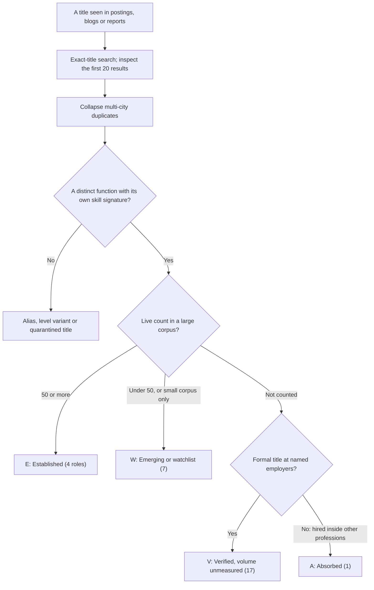

# The GenAI Job Market in November 2026

> What the GenAI job market looks like as of November 2026, globally and in India: which titles have measured volume, where demand, layoffs, funding, pay pressure and applicant competition sit, what is short and what is commoditised, and the decision rules that follow for each kind of job seeker.

**Dates:** November 2026 market-pulse figures come from [T0-70](../../research/sessions/T0-70-market-pulse-hiring-layoffs-funding.md) (searched `2026-11-13`: Fast AI Jobs `2026-11-11`, AI Pulse `2026-11-12`, JobsPipe Pulse `2026-11-13`, Challenger/Dice/BLS/Naukri October 2026, Crunchbase and PitchBook Q3 2026) and [T0-69](../../research/sessions/T0-69-skill-tool-momentum-dated-series.md) (searched `2026-11-14`). JobsPipe's title pages (`2026-10-19`) and AI Engineer skill shares (`2026-09-10`) were unchanged on `2026-11-13`/`14`, so they remain cross-sections awaiting the `2026-12-01` recount. Pending US H-1B court appeals and proposed DHS rules (EGP-1.0 class V0, 14-day review) plus the `2026-12-01` recount set `review_by: 2026-12-03`; see the re-check table under [Evidence and limits](#evidence-and-limits). Pay figures are not repeated here: [pay benchmarks](../09-compensation/pay-benchmarks.md) holds them, each with its date. **Grades:** EGP-1.0. Platform aggregates (JobsPipe, Fast AI Jobs, Levels.fyi) are graded B, even where a session graded its own reading A ([role catalog §1.3](../02-roles/role-catalog.md#13-evidence-grades-and-conventions)). Regulatory and visa items are pointers, not legal advice.

## The short answer

1. **Target the four title families with measured volume, watch Research Engineer, and carry new work as skills.** AI Engineer, Machine Learning Engineer, Forward Deployed Engineer (FDE) and **ML Platform / MLOps Engineer** (graduated `V→E` on Axial 1,959 US MLOps, ITJobsWatch 184 UK perm and Fast AI Jobs 1,099 [B · T0-58]) clear quorum, and **Research Engineer** (`223` on Fast AI Jobs `2026-11-11`; `569` in AI Pulse's category count `2026-11-12`) is a November 2026 quorum-crossing candidate pending a catalog-method recount [B/C · T0-70 L72–73, L164]. Agentic, context and evaluation work still shows up primarily as skills inside AI Engineer postings (agentic AI in 59.3%, RAG in 54.0%, counted `2026-09-10` and unchanged `2026-11-14`) [B · T0-69 L55, L276].
2. **Move at your existing level; the junior squeeze is tech-wide, not AI-specific.** In Axial Search's US AI-engineering postings sample, **66% is the mid-level (35%) plus senior (31%) subtotal**, while total individual-contributor roles sit near **86%** (correcting an earlier label error in T0-06) [C · T0-67 L54, L368]. Employment of 22–25-year-olds in the most AI-exposed occupations is 19% below counterfactual [B · T0-67 L52], yet Indeed Hiring Lab puts entry-level software postings at `4.5%` overall in Q1 2026 and JobsPipe shows AI roles inside ICT at `15.4%` entry-level versus `12.5%` for general tech [B · T0-70 L80, L246–249].
3. **Demand indicators rose through October 2026, while funding cooled and headlines diverged.** US tech postings rose `+20%` and AI/ML postings `+91%` YoY in October 2026 (Dice/Lightcast), and announced US layoffs fell `71%` YoY to `43,994` (`1,265` AI-cited, under `3%`), yet individual employers announced major cuts or buyouts (Microsoft `~60,000` voluntary exits, Canva `22%`, Qualcomm India `~1,000` at risk) and Q3 global VC cooled `25%` QoQ to `$159B` while concentrating in `27` mega-rounds (`≥$1B`) [B/C · T0-70 L75–78]. No named AI hiring freeze was found in October–November 2026 [T0-70 L76]. Check viral doom and boom claims against measured evidence in the [Hype Register](hype-register.md).
4. **For pay, choose the employer tier and the level, not the stack.** Median posted base is nearly the same across AI Engineer, infrastructure/platform and ML Engineer postings; the top of the band sits at labs and specialist vendors [B · T0-03.F1]. Across two JobsPipe windows to `2026-11-13`, the advertised pay premium for AI-mentioning developer postings was flat to slightly lower (`+28%` to `+25%`, not strictly like-for-like) [B/M · T0-70 L79, L233]. The figures by role, level and city live in [pay benchmarks](../09-compensation/pay-benchmarks.md).
5. **Build where the market is short: evaluation, security, multi-provider systems.** Evaluation appeared in 68.2% of 198 companies in T0-03's August 2026 corpus (not re-located in November [E · T0-69 L548]), yet only 52.4% of agent teams run offline evals [B/C · T0-03.F3, F4; T0-70 L287], and seven eval/observability tools were acquired or closed in 13 months [B · T0-69 L51]. SANS counted more than `850` AI/ML security-engineer postings in mid-September 2026 [B · T0-69 L60, L246]. Multi-provider use is the norm (`>70%` on 3+ models in Datadog telemetry; `81%` in a16z's CIO survey), while thin single-provider wrappers remain commoditised [B · T0-69 L52].
6. **Compete on channel, not application volume, and in India separate GCC/MNC growth from generic IT services.** Greenhouse measured `244` applications per job in 2025 (`+111%` since 2022), and Ashby reports `291` applications per hire in Q1 2026 (`~0.2%` inbound offer rate vs `7.3%` for referrals) [B/C · T0-70 L79, L224–228]. In India, AI/ML hiring grew `+32%` and GCC hiring `+18%` YoY in October 2026 (Naukri), while generic software postings fell on both Naukri and Indeed India [B · T0-69 L56; T0-70 L81]; pay remains split into populations `2×–4×` apart ([pay benchmarks](../09-compensation/pay-benchmarks.md#india-by-city-level-and-employer)) [B/C · T0-36 K1; T0-45].

## At a glance

| Dimension | What the evidence shows (dates in brackets) | Grade · source |
|---|---|---|
| Titles with measured volume | **4 of 29 canonical roles** are Established (`AI Engineer`, `MLE`, `FDE`, plus `ML Platform / MLOps` graduated `V→E` via `T0-58`); **Research Engineer** (`223` Fast AI Jobs `2026-11-11`; `569` AI Pulse `2026-11-12`) is a quorum-crossing candidate pending catalog recount; **17 V** (including `Physical AI` graduated `W→V` via `T0-64`); **7 W**; **1 A** | B/C · T0-01; T0-58; T0-64; T0-70 L73; role catalog §0 |
| AI Engineer | Fast AI Jobs `352` at AI startups (`2026-11-11`, `+28%` vs late Jul — coverage caveat). JobsPipe title pages unchanged since `2026-10-19` at `1,697` US / `398` India / `3,944` global (cross-section only) | B/M · T0-70 L71–72, L134–141 |
| Machine Learning Engineer | Fast AI Jobs `298` (`2026-11-11`, `+31%` vs late Jul). JobsPipe unchanged at `1,084` US / `90` India / `2,157` global | B/M · T0-70 L71–72, L137–142 |
| Forward Deployed Engineer | `1,007` on Fast AI Jobs (`2026-11-11`, `+29%` vs late Jul); `260–1,276` across six sources (`2026-10-12` to `11-11`); `23` of newest `50` Fast AI Jobs rows are IC FDE titles | B/C/M · T0-70 L72, L74 |
| Macro demand & layoffs (Oct 2026) | Dice/Lightcast US tech `+20%`, AI/ML `+91%` YoY; JOLTS `7.5M` (Sep); BLS `+165k`, unemployment `4.1%`. Challenger US cuts `43,994` (`−71%` YoY; AI-cited `1,265`, `<3%`; tech `5,576`), though Microsoft (`~60k` VEO) and Canva (`22%`) diverge | B/C · T0-70 L75–77 |
| Funding (Q3 2026) | Crunchbase global `$159B` (`−25%` QoQ, `+53%` YoY; AI `64%`, `27` rounds `≥$1B`). PitchBook US `$98.4B` (`~−40%` QoQ; AI `65.9%` Q3 / `82.7%` YTD); exits narrow | B · T0-70 L78, L212–216 |
| What AI Engineer postings ask for | Python `78.4%`, LLM `76.7%`, agentic AI `59.3%`, RAG `54.0%` (JobsPipe, counted `2026-09-10`, unchanged `2026-11-14`) | B · T0-69 L55, L278–290 |
| Seniority | Axial Search US AI-engineering postings: `66%` mid (`35%`) + senior (`31%`) subtotal, total IC near `86%` (companion date `2026-05-22`). Platform labels vary: `24.6%` senior (JobsPipe) vs `63%` (SimpleApply) | C · T0-67 L54, L368; T0-70 L284 |
| Junior market | 22–25-year-olds in most AI-exposed jobs `19%` below counterfactual (`2026-06-30`, Stanford). Squeeze is tech-wide: US SWE entry `4.5%` (Indeed Q1 2026); within ICT, AI roles are `15.4%` entry vs `12.5%` tech (JobsPipe); NY Fed grad unemployment `5.2%` (Q3 2026) | B · T0-67 L52; T0-70 L80, L246–252 |
| Pay structure & pressure | Family posted-base medians nearly equal; top of band at labs/vendors ([pay benchmarks](../09-compensation/pay-benchmarks.md#posted-base-by-role-family)). JobsPipe AI developer premium `+28%` (Sep) → `+25%` (to `2026-11-13`, not like-for-like) | B/M · T0-03.F1; T0-70 L79, L233 |
| Skills short vs commoditised | Short: evals (`52.4%` offline adoption; 7 vendor M&A/closures), AI security (`>850` SANS mid-Sep postings), multi-provider routing (`>70%` on 3+ models). Commoditised: thin single-provider wrappers; Prompt Engineer legacy (`0.35%`, 2024–25 study) | B · T0-69 L51–52, L60, L347; T0-70 L287 |
| Applicant pressure | `244` apps/job in 2025 (`+111%` vs 2022, Greenhouse); `291` apps/hire in Q1 2026, `~0.2%` inbound vs `7.3%` referral offer rate, `76d` median technical hire (Ashby). No AI-specific funnel series | B/C · T0-70 L79, L224–230 |
| India | Naukri Oct 2026 AI/ML `+32%`, GCC `+18%` YoY; Indeed India AI mentions `8.2%→11.7%`, SWE `−12.3%`. `2,117` GCCs / `2.36M` staff; `510,452` projected 2026 GCC hires (`30%` 0–3 yrs). AI-titled share `3.0%` vs US `1.3%` (Singapore higher at `3.7%`). Pay split `2×–4×` ([pay benchmarks](../09-compensation/pay-benchmarks.md#india-by-city-level-and-employer)) | B/C · T0-36 K1; T0-45; T0-69 L56; T0-70 L81, L265–272, L286 |
| Governance & regulation | `1,997` US governance postings (Jan–Sep 2026, Axial); `~430` AI GRC leads (SANS mid-Sep); BSI 50th ISO/IEC 42001 (`2026-10-21`). EU Digital Omnibus signed `2026-07-08` (Annex III `2027-12-02`, Annex I `2028-08-02`). US `$100K` H-1B fee blocked by courts (appeals pending, V0) | A/B/C · T0-15.F4; T0-69 L60, L250; T0-70 L83, L293–295 |
| Agent protocols | MCP: AAIF governance (`247` members Aug 2026), `30,375` registry servers (`2026-09-10`, `62%` single-version), `2026-07-28` breaking deprecations [COI]; `0.068%` Fortune-1000 postings (Q3 2026); no standalone protocol title | A/B/C · T0-16.F1, F9; T0-69 L53, L107–109 |

## The market in nine signals

<a id="1-three-title-families-carry-the-measured-volume"></a>
### 1. Four title families carry the measured volume

**The test.** T0-01 counts a title as established only with 50 or more distinct active postings for the exact title or a declared alias cluster in a named corpus [T0-01 L43]. Indeed's own "AI-labeled title" rule uses a floor of 5 postings a quarter, so 50 is a conservative bar [C · T0-01 L43]. The catalog then sorts each canonical role into a status class ([role catalog §1.2](../02-roles/role-catalog.md#12-status-classes-for-canonical-roles)); a title moves up only by passing seven graduation tests ([§1.4](../02-roles/role-catalog.md#14-quorum-and-graduation-tests-t0-01-d5)).



| Family | Live postings (corpus, date) | Who posts most (as of `2026-11-13`) | Grade · source |
|---|---|---|---|
| AI Engineer | Fast AI Jobs `352` at AI startups (`2026-11-11`, `+28%` vs `275` late Jul — coverage caveat). JobsPipe title pages unchanged from `2026-10-19` on `2026-11-13`: US `1,697`, India `398`, global `3,944` (cross-section only; a JobsPipe salary page showed `1,850` US undated). LinkedIn Jobs on the Rise 2026 ranks it first | JobsPipe global: PwC `67`, Capital One `34`, TCS `31`, Deloitte `31`, Infosys `20`, Amex `19` (consultancies, IT services and financial firms); India: PwC `19`, Deloitte `11`, Teradata `9`, Infosys `6`, TCS `5` | B/M · T0-70 L71–72, L82, L134–141, L181–183 |
| Machine Learning Engineer | Fast AI Jobs `298` (`2026-11-11`, `+31%` vs `227` late Jul). JobsPipe unchanged: US `1,084`, India `90`, global `2,157` | JobsPipe global: TikTok `148`, Waymo `53`, Pinterest `33`, Adobe `31`, Apple `25`, ByteDance `21` (large consumer-tech and autonomy firms) | B/M · T0-70 L71–72, L82, L137–142, L184 |
| Forward Deployed Engineer | Fast AI Jobs `1,007` (`2026-11-11`, `+29%` vs `779` late Jul); `260–1,276` across six sources (`2026-10-12` to `11-11`: Plank `1,276` at 547 firms, fdejobslist `391`, analyst count `260` at 44 firms) | Concentrated in AI platform vendors: Palantir `77` of `310` open roles (`25%`) and Databricks `94` of `870` (`11%`) on `2026-09-08`; OpenAI, Scale AI, Snorkel AI and Celonis recur on Fast AI Jobs | B/C/M · T0-70 L72, L74, L82, L185–186 |
| ML Platform / MLOps Engineer *(graduated V→E, Nov 2026)* | Axial `1,959` US MLOps postings, ITJobsWatch `184` UK permanent, Fast AI Jobs `1,099` (`T0-58`) | Cloud/platform teams, global product firms and India GCCs (`13/37` sampled in India) | B/C · T0-58 |
| Research Engineer *(quorum-crossing candidate, status V)* | Fast AI Jobs `223` (`2026-11-11`, `+30%` vs `171` late Jul); AI Pulse category `569` (`2026-11-12`, undisclosed category rules) | AI startups and frontier labs; awaits a catalog-method recount before moving from V to E | B/C · T0-70 L73, L144, L164 |

The ranking depends on the corpus and definition. In the broad market (JobsPipe), AI Engineer is the largest family; on the AI-startup board (Fast AI Jobs), the FDE cluster (`1,007`) leads AI Engineer (`352`), though only `23` of the newest `50` FDE rows on `2026-11-11` were individual-contributor FDE titles, alongside `5` managers/leaders and `22` adjacent deployment-strategist, GTM or field roles [B/M · T0-70 L74]. On AI Pulse (`2026-11-12`, Grade C), category counts also exceed 50 for AI Product Manager (`570`), AI Safety (`89`) and AI Engineering Manager (`68`), whereas Applied Scientist (`23` on Fast AI Jobs) and Go Fractional's CAIO page (`10` posts in a rolling 90 days) sit below quorum [B/C · T0-70 L73, L165–169]. Applied AI Engineer remains an uncounted sub-node of AI Engineer [C · T0-01 D2].

**Read every count with these caveats:**
- **JobsPipe title pages were frozen in November 2026, and raw counts reflect crawl mix.** JobsPipe's title pages (`3,944` global / `1,697` US / `398` India AI Engineer) did not move between `2026-10-19` and `2026-11-13` even as its Labour Market Pulse refreshed daily (`2026-11-13`), and JobsPipe's own method note warns that raw counts measure crawl mix as much as the market — quote cross-sections and shares, not trends [B/M · T0-70 L71, L150–151].
- **Fast AI Jobs's near-uniform `+28–31%` jump suggests coverage growth.** AI Engineer (`+28%`), MLE (`+31%`), FDE (`+29%`) and Research Engineer (`+30%`) rose almost identically between late July and `2026-11-11`, pointing partly to wider platform coverage rather than title-specific demand [B/M · T0-70 L72, L338].
- **Counts are corpus-relative and exclude direct queries of LinkedIn, Indeed or Ashby** [T0-01 D1].
- **Family counts are not GenAI counts.** AI Engineer includes robotics, construction and Power Platform variants [B · T0-01.F2]. Keeping only postings that name LLM leaves about 1,300 US AI Engineer and about 490 US ML Engineer postings [M · [genai-target-roles §1.2](../02-roles/genai-target-roles.md#12-genai-restriction-of-the-two-mixed-title-families)].
- **Postings are not hires.** Greenhouse reports `69.8%` of jobs closed with a hire in 2025 (about `30%` closed without) [B · T0-70 L336]; JobsPipe's ghost-job index flags `9.5%` of active postings visible for 45+ days [C · T0-01 L237]; consultancies post bench requisitions, and TikTok alone accounted for `148` global MLE postings on JobsPipe [B · T0-70 L82].
- **Raw keyword counts mislead.** Job boards showed 339–1,000 "cognitive architect" jobs; the only exact match was a legacy IBM posting [B · T0-01.F6].

Who hires, by employer type, is in the [employer landscape](employer-landscape.md).

### 2. New work shows up as skills, not titles

The title layer is stable; the skill layer is moving.

| Skill named in AI Engineer postings (JobsPipe, counted `2026-09-10`, unchanged `2026-11-14`) | Share |
|---|---:|
| Python | 78.4% |
| LLM | 76.7% |
| Agentic AI | 59.3% |
| RAG | 54.0% |
| Machine learning | 39.8% |
| Generative AI | 37.6% |
| Azure; AWS | 35.1% each |
| CI/CD | 34.4% |
| Vector databases | 32.6% |
| Prompt engineering | 31.1% |

Source: [B · T0-69 L55, L276–290]. Because JobsPipe's AI Engineer page showed identical shares on `2026-11-14`, these are a single-date level (`2026-09-10`), not a momentum series [B · T0-69 L55]. Across all salaried postings (`2026-09-01` to `2026-09-18`), agentic AI (`1.7%`) appears more often than machine learning (`1.5%`) [B · T0-70 L170]. Fine-tuning is not in the AI Engineer top 12, so its share is below `31.1%` [B · T0-01 D6].

AI work also spreads into occupations without an AI title. In JobsPipe's JD measurements (retrieved `2026-11-02`), `24.0%` of Software Engineer (feeder) postings name AI, `30.1%` of Data Scientist (feeder) postings name LLM, and `15.4%` of Product Manager (feeder) postings name AI. These are feeder-title shares, not measurements of any AI role [B · [role catalog §7](../02-roles/role-catalog.md#7-feeder-and-adjacent-occupations-market-refresh-2026-11-02)].

The titles that blogs promote remain small or ungraduated. On `2026-11-14`, T0-69 confirmed `2` exact "Agent Architect" listings, real but uncounted "Context Engineer" listings across three archetypes, and zero exact hits for Prompt Wizard, AI Whisperer, Cognitive Architect, Context Architect, Neural Network Designer, Transformer Specialist and Vibe Engineer, while surfacing niche candidate listings for Edge AI Engineer (`≥9` on one aggregator) and Distributed Training Engineer (OpenAI, Periodic Labs) [C · T0-69 L61, L426–435]. Meanwhile Indeed's count of frequently advertised AI-referencing titles rose from 264 (2022) to 822 (Q1 2026) [C · T0-01.F11]. Full watchlist and graduation tests: [emerging roles](emerging-roles.md).

### 3. Demand is real, layoffs softened in aggregate, and funding cooled into mega-rounds

- **Macro demand rose through October 2026.** Dice/Lightcast report US tech postings up `+20%` and AI/ML postings up `+91%` year on year in October 2026; US JOLTS openings rose to `7.5 million` in September (from `7.19 million` in August); BLS payrolls added `+165,000` in October with unemployment at `4.1%` [B · T0-70 L77]. Earlier in the year, LinkedIn's March 2026 benchmark put US hiring `23%` below February 2020 (`−26%` in tech/media) [A · T0-06 L112], and PwC's 2026 AI Jobs Barometer (`2026-06-15`, 27 countries) reported `+69%` growth in AI-skill postings against `+9%` overall with a correlational `+62%` wage premium [B · T0-06 L110].
- **Seniority shape (erratum corrected).** In Axial Search's US AI-engineering postings sample (`43,480` postings; companion report dated `2026-05-22`, January–July 2026 window unconfirmed), **`66%` is the mid-level (`35%`) plus senior (`31%`) subtotal**, while total individual-contributor roles sit near **`86%`** (including junior) and management near `10%`, with `72%` stating a degree requirement [C · T0-06 L108; T0-67 L54, L368]. Platform seniority labels vary widely (`24.6%` senior on JobsPipe AI Engineer vs `63%` on SimpleApply vs `36.3%` senior and `48.3%` mid-level on AI Pulse) [B/C · T0-70 L251, L253, L284].
- **Aggregate layoffs fell, while individual employers diverged.** Challenger announced US job cuts dropped `71%` YoY to `43,994` in October 2026 (three-year October low), with technology-sector cuts at `5,576` (2026 monthly low) and AI cited for `1,265` cuts (under `3%`, down from a May peak of `38,579`; `121,401` year-to-date, about `20%` of `617,189`, behind market and economic conditions at `130,531`) [B · T0-70 L75]. Company announcements diverged sharply: Microsoft offered voluntary exits to `~60,000` eligible staff across the US, UK, Canada and India on `2026-10-26` (buyout, excluded from Challenger), Canva cut `22%` (`1,271` people) on `2026-11-04`, Barclays announced `~5,000` cuts (`2026-10-22`), and Qualcomm began India cuts (`~1,000` roles reported at risk) [B/C · T0-70 L76, L193–199]. **No hiring-freeze announcement at an AI employer** dated `2026-10-01` to `2026-11-13` was found [T0-70 L76, L203].
- **Q3 2026 funding cooled and concentrated.** Crunchbase counted `$159B` globally in Q3 2026 (`−25%` from Q2's `$212B`, `+53%` on Q3 2025's `$104B`; `$679B` Q1–Q3 YTD), with AI at `64%` (`$102B`) driven by a record `27` rounds of `$1B+` (including Databricks and Safe Superintelligence at `$5B` each) [B · T0-70 L78, L210–L215]. PitchBook-NVCA counted `$98.4B` in the US across `~5,012` estimated Q3 deals (`~−40%` QoQ; `$511.1B` Q1–Q3 YTD combining H1 `$412.7B` + Q3 `$98.4B`; AI `65.9%` of Q3 and `82.7%` YTD) alongside narrow exits — one deal (`SpaceX` acquiring `Anysphere/Cursor` for `$60B`) made up `53.1%` of Q3 US exit value, and only `211` emerging VC managers closed a fund versus `927` in 2022 [B · T0-70 L78, L211–L216]. Major Q3 strategic deals included Nvidia–Hugging Face (`$12.9B`), AMD–World Labs (`$8.2B`) and Stripe–OpenRouter (`$7.5B`) [B · T0-70 L217]. **Anthropic IPO (ERRATA U52):** following its `2026-11-10` updated S-1, Anthropic priced its IPO at `$83.00/share` on `2026-11-18` and debuted on Nasdaq under ticker `ANT` on `2026-11-19` with a staggered lock-up [A/B, COI · ERRATA U52; T0-70 L78] (see [offer evaluation](../09-compensation/offer-evaluation.md)). Do not read headline funding 1:1 as hiring capacity.
- **Who fills the roles.** Experienced software engineers who pivoted are the main feeder into AI Engineer; data scientists are a consistent second feeder [B · T0-06 KF-3]. A summary of the 2026 AI Engineering Survey reports a median of about 8 years writing code and 3 years in AI/ML [C · T0-06 L129].

| Direction of travel | Change (dated window) | Grade · source |
|---|---|---|
| US tech and AI/ML postings (Dice/Lightcast) | Tech `+20%`, AI/ML `+91%` YoY (October 2026) | B · T0-70 L77 |
| US job openings and payrolls (JOLTS; BLS) | Openings `7.5M` (Sep, vs `7.19M` Aug); payrolls `+165,000`, unemployment `4.1%` (Oct 2026) | B · T0-70 L77 |
| Announced US job cuts (Challenger) | `43,994` in Oct 2026 (`−71%` YoY); AI-cited `1,265` (`<3%`, vs `38,579` in May); tech `5,576` (2026 low) | B · T0-70 L75 |
| Global VC funding (Crunchbase) | `$159B` in Q3 2026 (`−25%` QoQ; `+53%` YoY; AI `64%`; `27` rounds `≥$1B`) | B · T0-70 L78, L212, L215 |
| AI-startup postings (Fast AI Jobs) | `+28%` to `+31%` across AI Engineer, MLE, FDE and Research Engineer (late Jul to `2026-11-11`; coverage caveat) | B/M · T0-70 L72 |
| FDE postings (Lightcast, via Fortune) | More than `+1,000%`, Jan–Aug 2026 vs Jan–Aug 2025, from a small base | B · T0-06 L175 |
| AI-skill postings (PwC, 27 countries) | `+69%`, against `+9%` for all postings (`2026-06-15`) | B · T0-06 L110 |

### 4. The junior door is narrow — and the squeeze is tech-wide

- **The Stanford measurement and its limits.** Stanford Digital Economy Lab's *Canaries in the Coal Mine?* (revised `2026-08-12`, data to `2026-06-30`) finds employment of workers aged 22–25 in the most AI-exposed occupations `19%` below counterfactual, driven by reduced hiring rather than separations, with no comparable gap for experienced workers [B · T0-67 L52]. The Stanford AI Index 2026 similarly reports early-career software-developer employment (ages 22–25) down nearly `20%` from its 2024 peak [C · T0-70 L254]. The finding is descriptive, not causal, and contested: a Yale Budget Lab study finds little relationship between AI exposure and employment [C · T0-06 L122], and the NY Fed attributes nearly two-thirds of the earlier rise in young-graduate unemployment to remote-work exposure while reporting graduate unemployment easing to `5.2%` in Q3 2026 (`5.6%` in Q2; underemployment `42.5%`) [B · T0-70 L252, L257].
- **The squeeze is tech-wide, not AI-specific.** Entry-level roles made up just `4.5%` of all US software postings in Q1 2026 (`69.3%` senior, Indeed Hiring Lab) [B · T0-70 L80, L246]. On JobsPipe (`2026-10-11`), AI-titled postings are `16.4%` entry-level across all countries versus `38.3%` for all occupations (US `10.4%` vs `35.8%`), **yet within ICT occupations AI roles are `15.4%` entry-level against `12.5%` for general tech** [B · T0-70 L80, L247–249].
- **Definitions drive board entry-level shares.** Entry-level AI shares span `1.2%` on AI Pulse (`137` of `11,652`, `2026-11-12`) [C · T0-70 L251], `6%` on SimpleApply (`n = 2,698`, to `2026-10-15`) [C · T0-70 L253], `7.0%` for AI Engineer and `11.1%` for MLE on JobsPipe's entry-level filter [B/M · T0-70 L250], and `10.4%` on JobsPipe US AI-titled postings [B · T0-70 L248]. At the frontier, Anthropic reported its junior share of technical hires fell from `27%` to `9%` (`21%` to `14%` of technical staff, a share at one employer, not a market count) [C, COI · T0-70 L80, L192, L255].
- **The counterweight.** PwC finds AI-exposed entry-level roles seven times more likely to require traditionally senior skills such as judgement and leadership ("seniorised" entry openings grew `35%` since 2019 while other entry roles shrank `10%`) [B · T0-06 L122], and US employers surveyed by NACE projected `+5.6%` new-graduate hiring for the Class of 2026 [B · T0-67 L55].
- **India differs.** `21.2%` of India's AI roles are entry-level on JobsPipe, against `10.4%` in the US [B · T0-67 L53], and foundit projects `0–3` years' experience at `30%` of 2026 India GCC hiring (`+18%` YoY) [B · T0-70 L271].

Implication: a cold junior GenAI title from scratch remains the hardest target on the map; experienced professionals should convert prior tacit experience into a lateral-level AI role [M · T0-06 L124], and new graduates should combine structured graduate/SWE pipelines and internships with AI proof ([career transitions](../11-tracks/career-transitions.md#route-9-student-or-new-graduate)).

### 5. Pay follows employer tier and level, and advertised AI premiums are flat

- **Tier sets the ceiling.** Median posted base is nearly the same across the AI Engineer, infrastructure/platform and ML Engineer families; top-of-band posted ranges come from labs and specialist vendors [B · T0-03.F1].
- **Level sets the step.** Mid-level or unspecified AI-engineer postings carry the lowest posted base of the level cuts, and the AI premium over non-AI engineers rises with seniority; the figures, dated by dataset, are in [pay benchmarks](../09-compensation/pay-benchmarks.md#posted-base-by-role-family).
- **Advertised pay pressure did not accelerate into November 2026.** Across two JobsPipe developer windows (`2026-09-01` to `09-18` salaried postings vs rolling 30 days to `2026-11-13`, different denominators), the share of software-developer postings naming AI stayed flat (`39.5%` vs `39.1%`) and the advertised AI pay premium moved from `+28%` to `+25%` — signalling no fresh tightening, though JobsPipe cautions single-month readings are snapshots rather than trends [B/M · T0-70 L79, L232–233, L239].
- **The infrastructure premium is unproven.** T0-02 calls it "partially supported, not validated", with seniority not controlled [B/C/D · T0-02.F12, L99].
- **Titles carry employer mix.** The ML Engineer title's higher Levels.fyi total-comp median is "a title and employer-mix gap", not a measured skill premium [B · T0-02.F1].
- **Posted ranges exclude equity and vary in disclosure.** Only `14%` of Axial Search US AI-engineering postings mention equity [B/C · T0-02.F8]; on JobsPipe (`2026-11-13`), `45%` of MLE postings (`965/2,157`) and `28%` of AI Engineer postings (`1,107/3,944`) state pay [B · T0-70 L240].

The figures by family, level, city and employer, each with its date and sample size, are in [pay benchmarks](../09-compensation/pay-benchmarks.md).

### 6. In short supply: evaluation and security. Commoditised: thin-wrapper skills

| Area | Market signal | Reading (judgement) | Grade · source |
|---|---|---|---|
| Evaluation | Named by 68.2% of 198 companies and in 19.0% of 3,647 postings in T0-03's `2026-08-05` corpus (not re-located in November 2026 [E · T0-69 L548]). Seven eval/observability vendors were acquired or closed between `2025-05-05` and `2026-05-22` (W&B Weave, Humanloop, Langfuse, Helicone, Promptfoo, Traceloop, Galileo), while RAGAS resumed releases with `v0.4.4rc1` (`2026-11-13`) | **Short and brand-agnostic.** Only 52.4% of agent teams run offline evals and 37.3% online (LangChain survey, n=1,340, late 2025). Own the methodology and OpenTelemetry-compatible tracing, not one vendor tool | B · T0-03.F3; B/C · T0-70 L287; B · T0-69 L50–51, L370–377 |
| Security and supply chain | SANS mid-September 2026 tracker: more than `850` AI/ML security-engineer postings, about `100` AI red-team (`+13%` WoW) and `93` AI supply-chain security postings. CVSS 9.8 flaws in SGLang (CVE-2026-5760) and vLLM (CVE-2026-22778); an eval vendor AWS breach (`2026-05-04`) | **Short.** Mandatory production competency; AI Security Engineer remains on the watchlist pending catalog-method recount | A/B · T0-03.F12; B · T0-69 L60, L246–249 |
| Multi-provider routing vs thin wrappers | OpenAI telemetry share fell across three independent trackers (Datadog `75%→63%`, `>70%` using 3+ models; Langfuse Cloud `82.7%→55.3%`; Vercel paid teams `70→55` of 100); a16z CIO survey (`n=100`) puts 3+ model families at `81%` (up from `68%`) [COI Vercel/a16z] | **Multi-provider is standard; single-provider chat wrappers remain commoditised.** Build routing, fallback and cost accounting into every project | B/C · T0-69 L52, L217–222 |
| Agent frameworks vs custom loops | Datadog: organisations adopting agentic frameworks nearly doubled (`>9%` to `~18%`, early 2025 to early 2026). In arXiv `2512.04123v2`, `85%` (`17/20`) of interviewed teams ran custom loops, yet `61%` of surveyed deployed agents used frameworks (LangChain/LangGraph `25.0%`); one agentic board named LangChain `34.3%` and LangGraph `22.1%` of 534 listings (`2026-04-19`). AutoGen had no PyPI release for `410` days to `2026-11-14`; OpenAI Assistants API sunset `2026-08-26` | **Build a custom loop first, name one current framework second.** Framework syntax churns; durable loop, tool-schema and retry mechanics outlive SDKs | A/B/C · T0-69 L49, L54, L68, L124–136 |
| Coding agents and languages | Coding agents are rising as a class: JetBrains AI Pulse shows Claude Code work adoption `~3%→18%` (`2025 Q2` to `2026-01`, COI), Copilot `29%` stalled; Stack Overflow 2026 puts coding-agent use at `66%` of AI users. TypeScript is the fastest-growing language on GitHub (`+66.63%` YoY), while Python stays flat near `58%` in surveys and leads AI Engineer postings (`78.4%`) | **Baseline workflow shift.** Fluency with coding agents and verification is increasingly expected in engineering reviews | B · T0-69 L57–58, L201–208, L259–265 |
| Prompt Engineer (title) | `72` of `20,662` LinkedIn AI postings (`0.35%`), traced to arXiv `2506.00058` (2024–25 vintage; no newer title count found). Prompt engineering remains a co-requirement in `31.1%` of AI Engineer postings (`2026-09-10`) | **Legacy as a title; baseline as a skill.** Absorbed into AI Engineer | B/M · T0-69 L290, L347, L513 |
| Inference engines and kernels | Named engines in `2.0–3.9%` of postings; CUDA/GPU kernels in `6.6%`. Hugging Face put TGI in maintenance mode (archived `2026-03-21` per secondary), recommending vLLM, SGLang and llama.cpp/MLX; NVIDIA TensorRT-LLM removed legacy TensorRT backend and `trtllm-build` (`2026-11-03` docs, PyTorch sole backend) | **Narrow, deep and consolidating around PyTorch.** Drop TGI and `trtllm-build` engine compilation | A/B · T0-03.F7, F8; A · T0-69 L49, L175–177 |
| Fine-tuning and post-training | `13.0%` of postings (T0-03); `57%` of respondents in LangChain's survey were not fine-tuning; TRL reached `v1.0` (`2026-03-31`) while `torchtune` is no longer actively maintained | **Secondary** for most roles; use TRL rather than `torchtune` where post-training applies | A/B/C · T0-03 L178; T0-69 L49, L190–193 |

### 7. More applicants per job: channel beats volume

- **More competition.** Greenhouse measured `244` applications per job in 2025 (up `+111%` from `116` in 2022, across 6,000+ companies and 640M+ applications) [B · T0-70 L79, L224]. Gem's application-to-pre-onsite rate fell from 13% to 8% across all functions from 2021 to 2025 [B · T0-04 L91]. LinkedIn says US applicants per open role have doubled since spring 2022 [A · T0-06 L219].
- **Low cold yield and 2026 hiring ratios.** Ashby reports **`291` applications per hire** in Q1 2026 (implying `0.34%` overall hire rate) and an inbound-applicant offer rate near **`0.2%`** against **`7.3%`** for referrals, with technical roles taking a median of **`76` days** to first hire versus `56` for business roles (secondary compilation of Ashby Talent Trends) [C/M · T0-70 L79, L227–230]. Earlier engineering benchmarks similarly put cold inbound at about `0.2%` application-to-hire and referrals `11–36×` higher per application [B · T0-04.F9, F10]. Note: **no AI-role-specific funnel time series exists** as of November 2026 [T0-70 L238].
- **Hires by source and fraud dilution.** For technical roles with "AI" in the title, Ashby (July 2026) reported `37.1%` of hires from inbound, `28.0%` from sourcing, `9.2%` from agencies and about `26%` from referrals, internal moves and other routes [B · T0-04.F11]. In a Greenhouse pilot for an ML role, more than `35%` of applicants carried high-risk fraud signals [B · T0-04.F11], so a genuine, well-matched applicant beats raw averages.
- **Searches take months.** Huntr's median from first saved job to first offer was **102 days** in Q3 2026 (Q2 restated from 82 to 91 days; Q1 108 days), counting only searches that ended in an offer [B/C · T0-24 L217–218; T0-06 L219]; US BLS August 2026 puts general unemployment at a median `11.4` weeks, mean `26.3` weeks and `27.0%` out `27+` weeks [B · T0-67 L72].

How to act on this: [job-search strategy](../06-job-search/job-search-strategy.md#27-recommended-sequencing-expanding-rings), [channels and boards](../06-job-search/channels-and-boards.md) and [referrals and outreach](../07-networking/referrals-and-outreach.md).

### 8. India: more AI-intensive, younger, smaller in counts, split in pay

| Metric (source, date) | India | US | UK | Germany | France |
|---|---:|---:|---:|---:|---:|
| AI-titled share of all postings (JobsPipe, `2026-10-11`)* | 3.0% | 1.3% | 1.7% | 1.6% | 0.9% |
| Entry-level share of AI roles (JobsPipe, `2026-10-11`)* | 21.2% | 10.4% | 11.0% | 18.8% | 21.2% |
| Share of AI Engineer postings by country (JobsPipe, `2026-09-10` JD share; live `2026-10-19` arithmetic in brackets per ERRATA U33) | 13.6% (`10.1%` live) | 27.9% (`43.0%` live) | 7.2% | 9.1% | 5.4% |
| Live AI Engineer postings (JobsPipe, `2026-10-19`, unchanged `2026-11-13`) | 398 | 1,697 | n/a | n/a | n/a |
| AI keyword share of postings (Indeed AI Tracker, `2026-09-30`; revision band `±0.3 pp`) | not covered | 7.34% | 9.92% | 5.74% | 4.53% |

\*Scope caveat: India's `3.0%` AI-titled share is highest **among these five countries**, not globally — **Singapore leads at `3.7%`** on AI-titled share and **Japan leads at `27.2%`** on entry-level AI share in JobsPipe's 15-country table (`2026-10-11`) [B · T0-36 L58, L457; T0-70 L286, L305]. Treat Indeed AI Tracker values as roughly `±0.3 pp` given historical series revisions [A · T0-01 L108]. Sources: JobsPipe rows [B · T0-01.F10, D8; T0-70 L273]; Indeed row [A · T0-01.F10].

**Global hub concentration (33 countries, 51 cities):** Beyond the US (`$280B+` US+Canada AI VC; `1.12M` PwC AI postings), Europe's AI volume concentrates in the **UK** (`$17B` VC, #1 Europe; OpenAI and Anthropic London hubs), **Germany** (`$8.4B` VC; `56,300` EU Blue Cards) and **France** (`$8.5B` VC; Anthropic Paris), while APAC concentrates in **Singapore** (`340` `aimlroles` postings, #1 Lightcast `4.69%` AI share; OpenAI, Anthropic, DeepMind) and **India** (`1,558` `aimlroles` postings, Bengaluru `575`, `2,117` GCCs, `$4.09B` AI VC) [B · T0-35; T0-36]. Gulf hubs (UAE, Saudi Arabia) carry active 2026 regional conflict/disruption risk (EASA aviation bulletins, November 2026 UAE flight disruptions, IMF Qatar `-8.6%` / Bahrain `-0.5%` projections) [B · T0-36]. Full seven-lens country and city rankings live in [country and city rankings](../11-tracks/country-rankings.md).

- **Two independent Indian platforms agree: AI demand is rising while generic IT/software hiring lags.**
  - *Naukri JobSpeak:* AI/ML hiring grew YoY across every 2026 release (`+49%` Feb, `+22%` May, `+25%` Jun, `+20%` Sep, **`+32%` Oct 2026**; GCC hiring `+4%` Sep, **`+18%` Oct**), while generic IT and software services stayed weak (`−7%` May, `−3%` Jun, `−4%` Sep, `+5%` Oct flattered by a soft October 2025 base) [B/C · T0-69 L56, L406–410; T0-70 L81, L265–268]. Within IT in September 2026, AI/ML growth skewed sharply to experienced bands (`+54%` at `13–16` years, `+28%` at `8–12` years, `+19%` AI/ML freshers against `+1%` overall freshers) [B/C · T0-69 L412; T0-70 L269].
  - *Indeed India:* AI mentions in Indian postings climbed from `8.2%` (`2024-09`) to `10.6%` (`2025-06`) and `11.7%` (`2025-09`), while generic software-development postings fell `−12.3%` over three months to May 2026 (`IT infra −10.2%`, `data/analytics −6.7%`) [B · T0-69 L56, L414, L418].
- **Demand sits in GCCs, with real layoff exposure.** Zinnov–Nasscom (FY2026) counts **`2,117` GCCs** (`3,728` units, `2.36M` staff, `$98.4B`), UnearthIQ counts `111` greenfield GCCs in Jan–Aug 2026 (vs `100` in all of 2025), and foundit projects **`510,452` GCC hires in 2026** (`64%` needing AI, data or automation skills; `0–3` years' experience at `30%`, `+18%` YoY) [B/C · T0-70 L81, L270–272]. Yet GCCs are not immune to restructuring: Qualcomm began India cuts in Bengaluru and Hyderabad (`~1,000` roles reported at risk), Zomato cut `~250` roles, and Microsoft's voluntary exit offer covers India [B/C · T0-70 L76, L194, L198–199, L274].
- **Counts are smaller, and JobsPipe title pages stayed frozen.** Live JobsPipe counts (`398` India AI Engineer, `90` India MLE) did not change between `2026-10-19` and `2026-11-13` [B · T0-70 L273]. Per ERRATA U33, live arithmetic (`398 / 3,944 = 10.1%` [M], skewed toward consulting/IT-services posters such as PwC `19` and Deloitte `11`) sits below JobsPipe's September JD share (`13.6%`), and the live count ratio (`0.23×` US) still conflicts with its September JD share (`0.49×`) [B/M · T0-01 L69; ERRATA U33].
- **Titles and execution risk.** GCCs advertise GenAI Engineer, AI/ML Engineer, MLOps Engineer and Prompt Engineer (Taggd) [C · T0-01 D8], while CIEL HR reports YoY India posting growth for agentic AI engineers (`+260%`), GenAI solutions architects (`+120%`), LLM engineers (`+86.5%`) and MLOps engineers (`+82.2%`, denominators undisclosed) [C · T0-69 L416]. "Nearly 70%" of India GCCs remain stuck at the AI pilot stage (Dell–Zinnov) [B · T0-09 L77], and attrition evidence conflicts (`18–25%` Zinnov AI/cloud vs `9%` EY overall [B · T0-09 L117]).
- **Pay is split across populations.** Broad-market base averages (Indeed ₹11.4L), self-disclosed middle-market CTC (Flexiple ₹19.9L) and the MNC, GCC and product-firm population that Levels.fyi samples (Bengaluru ML Engineer ₹44.4L) sit `2×–4×` apart depending on base vs CTC construct and employer type [B/C · T0-36 K1; T0-45 L51]. Bands live in [pay benchmarks](../09-compensation/pay-benchmarks.md#india-by-city-level-and-employer) (older tier bands are unmeasured, [ERRATA U14](../../research/ERRATA.md)).
- **Remote is the exception for AI titles.** Remote shares of postings: AI Engineer `11.0%`, ML Engineer `14.0%`, Solutions Architect `16.2%` and Research Scientist `3.3%`, against `31.6%` for generic backend postings (JobsPipe JD measurements, retrieved `2026-11-02`) [B].
- **Remaining India blind spots.** Naukri JobSpeak measures category indices (postings + recruiter searches, inflated by free listings), not exact-title quorum counts or Indian AI-startup hiring totals [T0-69 L402; T0-70 L276].

India targeting is in the [GenAI target roles India order](../02-roles/genai-target-roles.md#6-india-first-target-order-genai-india-lens) and the [India remote playbook](../11-tracks/india-remote-playbook.md).

### 9. Governance, agent protocols and immigration rules: real, small and moving fast

**Governance volumes and standards:**
- **US (Axial Search):** `1,997` AI-governance postings in Jan–Sep 2026 (~2,700 annualised; internal weekly mismatch) [C · T0-15.F4]. **SANS (mid-September 2026):** about `430` AI GRC lead postings alongside `>850` AI/ML security engineers [B · T0-69 L60, L246–248]. **UK (ITJobsWatch):** `119` EU AI Act postings (~0.7% of AI postings); **EU (Axipro):** ~7 builder postings per governance posting; **India:** no platform count [C · T0-15.F4].
- **ISO/IEC 42001 and EU timetable.** BSI awarded its `50th` ISO/IEC 42001 certificate on `2026-10-21` (up from `11` in 2025, across >16 countries including India) [A · T0-69 L60, L250]. The EU Digital Omnibus on AI (Regulation (EU) 2026/1744, signed `2026-07-08`, in force `2026-07-27`) formally defers high-risk obligations to `2027-12-02` (Annex III) and `2028-08-02` (Annex I), dampening any near-term compliance-hiring surge [A/B · T0-15.F1; T0-70 L295]. Paths in: [governance careers](../11-tracks/governance-careers.md).

**Agent protocols:**
- **Governance and volatile spec.** MCP sits under the Agentic AI Foundation (AAIF, Linux Foundation; `146` members Feb 2026 → `247` by Aug 2026) [A, COI · T0-16.F1; T0-69 L105]. Revision `2026-07-28` made requests stateless (removing sessions and `initialize`), added `server/discover` and OpenTelemetry trace context, and deprecated Roots, Sampling, Logging, HTTP+SSE and OAuth Dynamic Client Registration with a 12-month window [A, COI · T0-69 L53, L107, L392–398]. The official MCP registry grew from `~9,650` unique servers (May 2026) to `30,375` (`2026-09-10`), though `62%` have one version and `~36%` went 3+ months without an update [C, COI · T0-69 L53, L108–109]. A2A `v1.0` shipped `2026-03-12`, reached `150+` organisations by `2026-04-09`, and announced joining AAIF on `2026-08-27` [A/B · T0-16.F3].
- **Hiring:** small and single-date — `0.068%` of Fortune-1000 postings (Q3 2026), `0.7%` of Skillenai's archived Oct 14 index [C · T0-16.F9], `16.9%` of 213 LangChain-ecosystem listings on one agentic board (`2026-04-19`) [C · T0-69 L112], and **no two-date employer-demand series** or standalone protocol title. Details: [agentic protocols](../03-skills-and-tech/agentic-protocols.md).

**US work-visa status (`V0` — pointers, not legal advice):**
- As of mid-November 2026, employers do **not** have to pay the `$100,000` H-1B proclamation fee after federal courts blocked/vacated it (`D. Mass. 2026-06-08`, First Circuit stay denied `2026-07-24`, `N.D. Cal. 2026-09-30`), though appeals are pending (a D.D.C. ruling had upheld it in December 2025) [B · T0-70 L83, L293].
- Separate proposed DHS rules — a `$103,265` fee on cap-subject H-1B workers (comment period closed `2026-09-24`) and proposed university-paid OPT fees (comments closed `2026-11-09`) — are **not final or in effect** as of mid-November 2026 [B · T0-70 L83, L294; T0-67 L66]. Track live status in [visa and relocation](../11-tracks/visa-and-relocation.md).

## The 2026 calendar: dated events that matter to careers

Only events with a date in the research sessions appear here. Statuses are as verified through `2026-11-19`. Two 2025 anchors frame the year: EU duties for general-purpose AI (GPAI) models have applied since 2 August 2025 [A · T0-15.F1], and the Linux Foundation announced AAIF on 9 December 2025 [A · T0-16.F1].

### January to November 2026

| Date (2026) | Event | Grade · source | What it means for careers (judgement) |
|---|---|---|---|
| 16 Jan; 9 Mar; 5–22 May | Eval and observability consolidation: ClickHouse acquires Langfuse (`16 Jan`), Helicone to Mintlify (`3 Mar`), OpenAI announces Promptfoo (`9 Mar`), Traceloop to ServiceNow (`5 May`), Galileo to Cisco (`22 May`) — seven acquisitions/closures in 13 months | A/B/C · T0-03.F13; T0-69 L51, L370–376 | Learn evaluation and OpenTelemetry tracing as portable practices, not one product |
| 20 Feb | India's IT Rules amendment on synthetic content takes effect: permanent provenance markers, 3-hour takedowns | B · T0-15.F12 | India's nearest binding AI rule; provenance work for India-facing products |
| 12 Mar; 9 Apr | A2A `v1.0` ships (`12 Mar`); Linux Foundation reports `150+` supporting organisations at one-year mark (`9 Apr`) | A/B · T0-16.F3; T0-69 L113 | Agent-to-agent interoperability has a stable specification |
| 16 Mar; 21 Mar | NVIDIA Dynamo 1.0 fronts vLLM, SGLang and TensorRT-LLM; Hugging Face archives TGI (maintenance notice on docs) | A/B/C · T0-03.F6; T0-69 L49, L175–176 | Drop TGI from a serving skill set; vLLM and SGLang are the open engines to know |
| 31 Mar | AWS Machine Learning – Specialty last exam date; AIP-C01 moves to standard registration; Hugging Face TRL hits `v1.0` | A · T0-11.F1; T0-69 L190 | A 2024-era AWS ML badge reads as legacy; TRL `v1.0` is the active post-training core |
| 2–3 Apr | Microsoft Agent Framework 1.0 unifies Semantic Kernel and AutoGen (AutoGen had no PyPI release for `410` days to `2026-11-14`) | A/B · T0-69 L49, L134–135 | Framework syntax ages fast; drop AutoGen-specific code |
| 17 Apr | US bank guidance SR 26-2 supersedes SR 11-7 and leaves generative and agentic AI out of scope | A · T0-09 L103 | GenAI risk in US banks has no settled owner; approvals rest on internal policy |
| 27 Apr | Stipulated order in *xAI v. Weiser* pauses Colorado AG enforcement of SB 24-205; Colorado later enacts SB 26-189 (`ERRATA U43`, V0 live status) | A/B · T0-61; T0-15.F11 | US governance demand flows through sector regulators and contracts more than state statutes |
| 4 May | Braintrust, an eval SaaS vendor, confirms unauthorised AWS access; customers rotate keys | A/B · T0-03.F12 | Key handling and supply-chain security are part of an AI engineer's job |
| 8 Jun; 30 Sep | Federal courts vacate/block the US `$100,000` H-1B proclamation fee (appeals pending; separate DHS `$103,265` H-1B and OPT fee proposals not final) | B · T0-70 L83, L293–294; T0-67 L66 | Immediate fee cost lifted, but plan around ongoing appellate and rulemaking uncertainty (pointer, not legal advice) |
| 30 Jun | Microsoft retires AI-102 (Azure AI Engineer Associate); the successor is AI-103 | B · T0-11.F1 | List the successor credential or the skills, not the retired name |
| 8 Jul; 27 Jul | EU Digital Omnibus on AI (Regulation (EU) 2026/1744) signed (`8 Jul`) and enters into force (`27 Jul`): Annex III moves to `2 Dec 2027`, Annex I to `2 Aug 2028` | A/B · T0-15.F1; T0-70 L295 | No 2026 wave of enterprise conformity jobs |
| 28 Jul | MCP specification revision `2026-07-28`: stateless core, `server/discover`, OTel trace context, deprecations (Roots, Sampling, Logging, HTTP+SSE, OAuth DCR) | A, COI · T0-69 L53, L107, L392–398 | Spec churn: pin the `2026-07-28` revision and avoid deprecated 2025 features |
| 2 Aug; 29 Aug | EU AI Act general application (`2 Aug`: Art. 50 transparency, Art. 101 fines); EU AI Office sends first formal information requests (`29 Aug`) | A · T0-15.F1 | Enforcement begins on model and generative-system providers first |
| 26 Aug; 27 Aug | OpenAI sunsets Assistants API (`26 Aug`, replaced by Responses/Conversations APIs); A2A announces joining AAIF (`27 Aug`) | A · T0-69 L49, L136; T0-16.F3 | Drop Assistants API; MCP and A2A share one neutral home |
| 18 Sep | AG-UI declares 1.0 (stewarded by CopilotKit, not in AAIF) | A · T0-16.F4 | Single-steward protocol; adoption claims company-reported |
| 21 Oct | BSI awards its `50th` ISO/IEC 42001 certificate (up from `11` in 2025) | A · T0-69 L60, L250 | Measurable enterprise standard adoption for governance roles |
| 26 Oct; 4 Nov | Divergent employer restructuring despite falling US layoff totals: Microsoft offers `~60,000` voluntary exits (`26 Oct`); Canva cuts `22%` / `1,271` (`4 Nov`) | B · T0-70 L76, L194, L196 | Check team-level open requisitions rather than extrapolating headlines to the whole AI market |
| 3 Nov | NVIDIA TensorRT-LLM documentation records removal of the TensorRT backend and `trtllm-build` (PyTorch sole backend) | A · T0-69 L49, L177 | Drop static `trtllm-build` engine compilation; target PyTorch-backed serving |
| 10–19 Nov | Anthropic files updated S-1 (`10 Nov`), prices IPO at `$83.00/share` (`18 Nov`) and debuts on Nasdaq (`ANT`, `19 Nov`) under a staggered lock-up (`ERRATA U52`) | A/B, COI · ERRATA U52; T0-70 L78 | Major frontier-lab public-listing liquidity milestone; evaluate offers on lock-up terms ([offer evaluation](../09-compensation/offer-evaluation.md)) |
| 13 Nov | India DPDP consent-manager rules effective date reached; RAGAS ships `v0.4.4rc1` (resuming releases after 304 days) | B · T0-15.F12; T0-69 L50, L165 | Verify DPDP Gazette status in [governance careers](../11-tracks/governance-careers.md); RAGAS is active again |

### Dated next

| Date | Event | Grade · source | What it means for careers (judgement) |
|---|---|---|---|
| 1 Dec 2026 | Scheduled T0-01 catalog recount across refreshed JobsPipe, Fast AI Jobs and Indeed data | T0-01 L84; T0-70 L110 | Tests Research Engineer (`V→E`), AI Security Engineer and frozen JobsPipe counts |
| 2 Dec 2026 | EU: grace period ends for generative systems placed on the market before 2 Aug 2026; new Art. 5 bans on generators of non-consensual intimate imagery and CSAM | A (bans) / B (grace) · T0-15.F1 | Marking duties reach older generative systems |
| 1 Jan 2027 | Colorado SB 26-189 effective date (subject to *xAI v. Weiser* enforcement pause, `ERRATA U43`, V0); UK Graduate Route drops to 18 months for bachelor's/master's | A/B · T0-61; T0-67 L66 | Check Colorado docket status before relying on state mandates; shorter UK post-study window |
| 13 May 2027 | India DPDP main obligations (12 May per one firm) | B · T0-15.F12; T0-09 L275 | T0-15 expects privacy-engineering and DPO demand to lead, with AI-specific roles following |
| 2 Aug 2027 | EU deadline for legacy GPAI models | A · T0-15.F1 | Compliance work for providers of older models |
| 2 Dec 2027 | EU Annex III high-risk duties begin | A · T0-15.F1; T0-70 L295 | Mostly self-assessed by providers' own staff (T0-15.F3), not by an external assessor profession |
| 2 Aug 2028 | EU Annex I high-risk duties begin | A · T0-15.F1; T0-70 L295 | Sectoral notified bodies must apply for AI designation by 28 Jan 2028 (T0-15.F3) |

## What this means for you

Each rule is a judgement built on the graded evidence in its row. Modelled timelines assume 15–20 hours a week and are conditional on success [D · T0-06 R2].

| You are | What the market shows | Decision rule |
|---|---|---|
| **Experienced software engineer** (backend, full-stack, frontend) | Experienced software engineers are the main feeder into AI Engineer [B · T0-06 KF-3]. AI Engineer is the largest AI title family in the broad market; FDE is the largest at AI startups (`23/50` newest rows IC FDE) [B/M · T0-70 L71–74] | Target AI Engineer at your current level; add FDE (checking duties against GTM/strategist roles) or Applied AI Engineer if you want customer work. Lead with evals in CI, multi-provider routing and cost control. Modelled: ~6 months (backend), ~7 (frontend or full-stack) |
| **Data scientist or BI analyst** | Data scientists are a consistent second feeder [B · T0-06 KF-3]; evaluation is the most-cited stack challenge, and eval work draws on data-science skills [B · T0-06 KF-4; C · T0-06 KF-5] | Reposition as an AI Engineer with an evals and error-analysis edge, or target the GenAI track of ML Engineer; close the production gap (tests, deployment) first. Modelled: ~8 months (data scientist), ~11 (BI analyst) |
| **Student, new graduate or junior** (under 2 years) | US software entry share is `4.5%` overall (Indeed Q1 2026), while inside ICT AI roles are `15.4%` vs `12.5%` (JobsPipe); 22–25-year-olds in AI-exposed jobs sit `19%` below counterfactual (`2026-06-30`); NY Fed grad unemployment eased to `5.2%` (Q3 2026) [B · T0-67 L52; T0-70 L80, L246–252] | Do not bet on a cold junior GenAI title alone. Combine structured graduate/SWE pipelines and in-person internships (`63.1%` conversion [B · T0-67 L65]) with one evaluated AI system. In India the AI entry share is `21.2%` and `0–3` years makes up `30%` of projected 2026 GCC hiring [B · T0-70 L271] |
| **PhD or academic researcher** | New AI PhDs in the US and Canada rose 22% from 2022 to 2024 (mostly to academia) [A · T0-06 L186]; Research Engineer (`223` Fast AI Jobs, `569` AI Pulse) is a November 2026 quorum-crossing candidate [B/C · T0-70 L73] | Plan on Research Engineer, Applied AI Engineer or Applied Scientist; treat frontier research-scientist offers as upside [M · T0-06 L192]. Modelled: ~8 months. See [PhD to industry](../11-tracks/phd-to-industry.md) |
| **Non-technical professional or PM** (5+ years in a domain) | AI PM (`570` AI Pulse category count [C · T0-70 L165]), AI ops, domain evaluation and FDE-adjacent niches exist, each with an entry fee in experience (5–10+ yrs at AI firms for AI PM [B · T0-67 L63]), credentials or coding | Pick one lane; AI Product Manager is the strongest non-engineering target in the [GenAI target order](../02-roles/genai-target-roles.md) [M]. Modelled: ~7 months for AI-adjacent roles; engineering from zero code is a ~22-month plan |
| **Infrastructure, DevOps/SRE or systems engineer** | Model-serving frameworks appeared in `11/11` and Kubernetes in `6/11` sampled inference/MLOps postings (`0/11` asked for model training) [B · T0-67 L62]; serving stacks are consolidating around PyTorch (vLLM, SGLang, `trtllm-serve`) [A · T0-69 L49] | Target Inference Engineer, AI Infrastructure or MLOps at employer tiers (labs, inference vendors, GPU clouds) where top-of-band pay sits, not for an unproven general infra premium [B/C/D · T0-02.F12] |
| **India-based engineer** | Naukri Oct 2026 AI/ML `+32%`, GCC `+18%` YoY; foundit projects `510,452` 2026 GCC hires (`64%` AI/data/automation), while generic IT services lags and layoffs hit specific employers (Qualcomm India `~1,000` at risk) [B/C · T0-69 L56; T0-70 L81, L274]; pay splits `2×–4×` [B/C · T0-36 K1; T0-45] | For pay, target GCC, MNC and product employers, verify production AI scope in interviews (`~70%` pilot trap [B · T0-09 L77]) and check team-level requisition stability. For US-remote work, expect few remote AI titles (`11%`) and settle contracting first ([India remote playbook](../11-tracks/india-remote-playbook.md); not tax advice) |
| **GRC, privacy, audit or legal professional** | `1,997` US governance postings (Jan–Sep 2026, Axial), `~430` AI GRC leads (SANS mid-Sep), BSI 50th ISO/IEC 42001 (`2026-10-21`); EU Digital Omnibus defers Annex III to `2027-12-02` [A/B/C · T0-15.F4; T0-69 L60; T0-70 L295] | Add AI governance and ISO/IEC 42001 to an existing privacy, security, risk or audit base and aim for programme-lead roles. Do not wait for a 2026 compliance hiring wave |

Fuller playbooks by background (9 routes, including DevOps/SRE, PM, IT services and students) are in [career transitions](../11-tracks/career-transitions.md).

## How to read the market for your own target

1. **Name the role, not the buzzword.** Map your target to a canonical role in the [role catalog](../02-roles/role-catalog.md#22-registry) and note its status (E, V, W or A). *Done when:* you have one to three role ids with status codes, and no quarantined title in your headline ([quarantine register](../02-roles/role-catalog.md#51-quarantined-titles-t0-01-d4-reconciled)).
2. **Count it yourself, exactly.** Use T0-01's protocol: search the exact title, inspect the first 20 results for exact matches, collapse multi-city duplicates, and record the corpus and date [T0-01 D10]. *Done when:* each target has a dated count from two corpora, one of them an ATS-direct board.
3. **Read 20 recent postings.** Tally the skills. Mark those in most postings (table stakes) and those in few postings that recur at the employers you want (differentiators) [P]. *Done when:* you have a top-10 skill list with counts out of 20.
4. **Check level, location, work model and employer health.** Note each posting's seniority label, location, remote status and live career-page requisitions (rather than extrapolating sector layoff or funding headlines) [P; T0-70 L93]. *Done when:* you know what share of your sample is open at your level and in your location.
5. **Anchor pay by employer tier and level,** not by stack [B · T0-03.F1]. *Done when:* you have a median for your level at each employer tier you are considering, with its source and date, from [pay benchmarks](../09-compensation/pay-benchmarks.md).
6. **Pick the channel before you apply** [B · T0-04.F10; C · T0-70 L79]. *Done when:* every target employer has a named route (referral, recruiter or community contact) or a written reason to apply cold.
7. **Recount on a schedule.** *Done when:* a recount date is in your calendar; T0-01's recounts are due on `2026-12-01` and `2027-01-15` [T0-01 L84].

The [targeting workbook](../00-start/targeting-workbook.md) turns these steps into a worksheet.

## Templates and examples

### Market-claim check [P]

Use it on any market number before you act on it. The questions follow T0-01's counting method and EGP-1.0 grading; the template itself is unmeasured.

```text
Claim:            [e.g., "Context Engineer is the fastest-rising AI title"]
Source and date:  [publisher; retrieval date]
Corpus:           [which board or dataset; its size]
Title match:      [exact title | declared alias cluster | fuzzy keyword]
Unit:             [live postings | requisitions | hires | survey answers]
Duplicates:       [multi-city duplicates collapsed? yes | no]
Against quorum:   [n vs 50 distinct postings]
Grade:            [A | B | C | D per EGP-1.0]
Verdict:          [use | use with caveat | discard]
```

### Weak and strong market claims

| Weak claim | Strong claim |
|---|---|
| "There are 900+ Cognitive Architect jobs." | Raw counts of 339–1,000 come from fuzzy matching; the only exact match was a legacy IBM posting, and November 2026 searches returned zero hits [B · T0-01.F6; C · T0-69 L435]. |
| "AI Engineer has split into Agent Architect and Context Engineer." | On `2026-11-14`, exact-title Agent Architect returned `2` listings on one aggregator and Context Engineer had real listings without a verified global count. The split shows up as skills: agentic AI is named in `59.3%` of AI Engineer postings (`2026-09-10`) [B/C · T0-69 L55, L426, L430]. |
| "Prompt engineering is a hot job." | Prompt Engineer is a legacy title: `72` of `20,662` LinkedIn AI postings (`0.35%`) in a 2024–25-vintage study. Prompting is a co-requirement in `31.1%` of AI Engineer postings [B/M · T0-69 L290, L347]. |
| "AI engineers in India earn ₹50L–₹1Cr." | That range runs from just above the median to just above the P90 of the Levels.fyi Bengaluru ML Engineer sample, an MNC- and product-heavy population; broad-market sources centre far lower [B/C · T0-02.F3]. The bands are in [pay benchmarks](../09-compensation/pay-benchmarks.md#india-by-city-level-and-employer). |
| "Q3 VC funding hit $159B, so startup hiring is booming." | Q3 2026 global VC fell `25%` QoQ and concentrated in `27` rounds of `$1B+`, with weak US exits (`53.1%` from one acquisition); funding totals do not map 1:1 to hiring capacity [B · T0-70 L78, L124, L215–216]. |
| "78% of enterprise AI teams run MCP in production." | The figure has no traceable primary source, and T0-16 rejects it [T0-16.F5]. In Q3 2026, `0.068%` of Fortune-1000/API-provider postings named "Model Context Protocol", and `62%` of official MCP registry servers had only one version [C · T0-16.F9; C, COI · T0-69 L53]. |

### Target market card [P]

```text
Canonical role:         [role id, e.g., ai-engineer]
Status:                 [E | V | W | A, from the role catalog]
Live count and date:    [n, corpus, date] / [n, second corpus, date]
GenAI share:            [share of postings naming LLM]
Top skills (20 JDs):    [skill: x/20; skill: x/20; ...]
Seniority mix:          [entry / mid / senior labels seen]
Location and remote:    [cities; remote share]
Pay anchor:             [median by employer tier and level; source; date]
Best channel:           [referral | sourced | community | cold, with reason]
Next recount:           [date]
```

## Checklist

- [ ] My headline title is a canonical title (status E or V), not a quarantined or legacy one.
- [ ] I have a dated, exact-title count for each target from two corpora (treating frozen JobsPipe title pages as cross-sections, not trends).
- [ ] I know the top skills in 20 recent postings and which two or three differentiate.
- [ ] I am targeting my current level, not a junior reset (or, as a new graduate, pairing SWE/internship pipelines with AI proof).
- [ ] I chose employers by tier for pay and checked live team requisitions, not just funding or layoff headlines.
- [ ] My proof of work includes an evaluated, multi-provider system rather than a single-provider wrapper or retired tool (`TGI`, `AutoGen`, `Assistants API`, `trtllm-build`).
- [ ] Every target employer has a non-cold channel, or a reason to apply cold.
- [ ] (India) I know which pay population each target employer belongs to, its production-versus-pilot maturity and its remote policy.
- [ ] I checked the calendar events that touch my target (EU AI Act, India DPDP, US H-1B/OPT status, credentials, protocols).
- [ ] I set a recount reminder.

## Pitfalls

| Red flag | Why it hurts | Fix |
|---|---|---|
| Reading frozen JobsPipe counts or uniform Fast AI Jobs jumps as demand trends | JobsPipe title pages did not refresh from `2026-10-19` to `2026-11-13` and reflect crawl mix; Fast AI Jobs rose a uniform `+28–31%`, signalling platform coverage growth [B/M · T0-70 L71–72, L151] | Use JobsPipe Pulse shares and within-platform cross-sections; corroborate with macro indices |
| Reading funding or layoff headlines 1:1 as AI hiring capacity | Q3 funding concentrated in mega-rounds while exits stayed narrow; Challenger counts stated reasons and excludes buyouts such as Microsoft's `~60k` VEO [B · T0-70 L75–78, L124–125] | Verify open requisitions on the specific employer's careers page |
| Treating FDE cluster counts as pure engineering roles | Only `23` of the newest `50` Fast AI Jobs FDE rows on `2026-11-11` were IC FDE titles; `22` were strategist, GTM or field roles [B/M · T0-70 L74] | Read duties and screen out sales-heavy roles if targeting engineering |
| Quoting a raw job-board count for a new title | Fuzzy matching inflates speculative titles: 339–1,000 "cognitive architect" hits, zero exact hits in November 2026 [B · T0-01.F6; C · T0-69 L435] | Filter to the exact title and read the first 20 results |
| Reading AI Engineer counts as GenAI counts | The family includes robotics, construction and Power Platform roles [B · T0-01.F2] | Use the share of postings naming LLM (`76.7%`) to estimate the GenAI subset [M] |
| A quarantined or legacy title in your headline | Recruiter searches and AI screening key on titles [A · T0-04.F8; C · T0-11.F3] | Use the canonical title; show agent, context or eval work as skills |
| Spraying cold applications | About `0.2%` inbound offer rate and `291` applications per hire (Ashby Q1 2026) [B · T0-04.F9; C · T0-70 L79] | Put the hours into referrals (`7.3%` offer rate), sourced routes and tailored outreach |
| Choosing infrastructure only for a premium | Family base medians are close, and the systems premium is not validated [B · T0-03.F1; B/C/D · T0-02.F12] | Choose by employer tier and the work you want to do |
| Expecting a regulation-driven hiring wave | EU Digital Omnibus formally defers Annex III to `2027-12-02` and Annex I to `2028-08-02` [A/B · T0-15.F1; T0-70 L295] | Build governance on an existing privacy, security, risk or audit base |
| Building on deprecated tools or listing retired credentials | Assistants API sunset `2026-08-26`, `trtllm-build` removed, AutoGen dormant `410` days, AWS ML Specialty and AI-102 retired [A/B · T0-11.F1; T0-69 L49] | Use active successors (`Responses API`, PyTorch serving, `AIP-C01`, `AI-103`) |

## Evidence and limits

- **What is measured:** November 2026 Fast AI Jobs counts and JobsPipe Pulse shares (B/M · T0-70); Dice/Lightcast, JOLTS, BLS, Crunchbase and PitchBook-NVCA series (B · T0-70); Challenger layoff totals via three corroborated outlets (B · T0-70 L75 — note T0-70's own source row S24 was headline-only Extract, so figures rely on the three corroborated reports); Naukri JobSpeak and Indeed India trends (B · T0-69, T0-70); SANS mid-September security/GRC counts and BSI ISO/IEC 42001 certificates (A/B · T0-69); EU legal dates and primary deprecation notices (A/B).
- **What is weaker:** AI Pulse category counts (undisclosed category definitions, C · T0-70 L173), Ashby funnel ratios via secondary compilation (C · T0-70 L227–230), Axial seniority and governance volumes (C), India layoff reports and CIEL HR growth rates (denominators undisclosed, C), MCP hiring indexes (C), modelled transition times (D), and the decision rules (judgement built on the cited evidence).
- **Conflicts of interest:** Anthropic originated MCP and builds Claude Code/Claude models; rows citing Anthropic's S-1, Anthropic's `27%→9%` junior-hire share, MCP adoption/registry counts, Claude Code adoption, Ramp's Anthropic share and Vercel/a16z provider mixes carry COI [T0-69 L593; T0-70 L78, L80].
- **Platform caveats and absences:** JobsPipe's title pages (`2026-10-19`) and AI Engineer skill shares (`2026-09-10`) were unchanged on `2026-11-13`/`14`, so no GenAI skill has a measured two-date employer-demand trend [T0-69 L55, L557; T0-70 L71]. Fast AI Jobs's uniform `+28–31%` jump across four titles likely reflects platform coverage growth [T0-70 L72]. **No AI-role-specific applicant-funnel series** and **no Indian AI-startup hiring series** were found [T0-70 L238, L276]. Neither T0-69 nor T0-70 re-located T0-03's `2026-08-05` S09 corpus (`68.2%` of 198 companies naming evaluation) [E · T0-69 L548; T0-70 L320].
- **Postings are not hires.** About `30%` of jobs closed without a hire in Greenhouse's 2025 data [B · T0-70 L336], aggregators duplicate postings, and consultancies post bench roles.
- **Errata and November corrections applied** ([ERRATA](../../research/ERRATA.md)): **4** canonical roles are Established (`AI Engineer`, `MLE`, `FDE`, plus `ML Platform / MLOps` via `T0-58`), **17** Verified (`Physical AI` graduated `W→V` via `T0-64`), **7** Watch and **1** Absorbed (`Research Engineer` flagged as a quorum-crossing candidate pending the `2026-12-01` recount); Applied Scientist's "~700" has no primary source (`23` on Fast AI Jobs, U1/U2); Axial Search's `66%` is the mid+senior subtotal while total IC is near `86%` (`T0-67 L54, L368`); India's `3.0%` AI-title share leads the five-country table only (Singapore `3.7%`), and live India JobsPipe arithmetic is `398/3,944 = 10.1%` (U33); engine shares use posting shares (`2.0–3.9%`, U12/U15); India tier bands are unmeasured (U14); Colorado AG enforcement paused under *xAI v. Weiser* (U43); Anthropic debuted on Nasdaq (`ANT`) on `2026-11-19` (U52).
- **What would change this page (explicit reversal tripwires, `T0-70 L92–L107`):** a refreshed JobsPipe reading dropping US AI Engineer below `1,500`, or Fast AI Jobs AI Engineer falling below `275`; a named hiring freeze at a major AI employer; the NY Fed Q4 2026 graduate-unemployment release (expected Feb 2027) reversing the Q3 `5.2%` improvement; Naukri AI/ML YoY falling below `+10%` without a base effect; an appellate ruling on the US H-1B fee or finalisation of DHS fee rules; or a two-date posting-share series for GenAI skills.

**Re-check dates.** The front-matter `review_by` (`2026-12-03`) follows EGP-1.0 class V0 (14 days) for pending US H-1B court appeals and proposed DHS rules, and aligns with the `2026-12-01` catalog recount. Pay figures live in [pay benchmarks](../09-compensation/pay-benchmarks.md). Each class is refreshed on its own page:

| Facts on this page | Dated | Re-check by | Where the refresh lives |
|---|---|---|---|
| Pending US H-1B appeals and DHS fee proposals (V0) | Checked `2026-11-13` | 14 days: `2026-12-03` | [Visa and relocation](../11-tracks/visa-and-relocation.md) |
| November 2026 live role counts (Fast AI Jobs, AI Pulse), macro pulse (Challenger, Dice, BLS, Naukri) and frozen JobsPipe pages | `2026-10-19` (JobsPipe frozen) to `2026-11-13` | `2026-12-01` recount / `2026-12-12` (31 days from Fast AI Jobs `2026-11-11`) | [Role catalog](../02-roles/role-catalog.md) |
| Skill, seniority, India and remote shares (JobsPipe) | `2026-09-10` (unchanged `2026-11-14`) to `2026-11-02` | `2026-12-01` recount / `2026-12-09` | [Role skill inventories](../03-skills-and-tech/role-skill-inventories.md) |
| Q3 2026 VC funding (Crunchbase, PitchBook) and applicant-funnel metrics | Q3 2026 / Q1 2026 | Q4 2026 release (`2027-01-15`) | [Employer landscape](employer-landscape.md); [channels and boards](../06-job-search/channels-and-boards.md) |
| Regulatory dates (EU Regulation 2026/1744, India DPDP) | Checked `2026-11-13` | 31 days: `2026-12-14` | [Governance careers](../11-tracks/governance-careers.md) |
| Protocol, tool and credential statuses | Checked `2026-11-14` | `2026-12-22` ([tool catalog](../00-start/tool-catalog.md)) / `2027-02-12` | [Agentic protocols](../03-skills-and-tech/agentic-protocols.md); [credential ROI](../04-certifications/credential-roi.md) |

**Sessions:** [T0-01](../../research/sessions/T0-01-genai-role-taxonomy-market-volume.md) role volumes · [T0-02](../../research/sessions/T0-02-global-regional-compensation-benchmarks.md) pay · [T0-03](../../research/sessions/T0-03-skills-compute-infra-eval-stack.md) skills, tools and posted pay · [T0-04](../../research/sessions/T0-04-ats-filtering-funnel-conversion-math.md) funnel and channels · [T0-06](../../research/sessions/T0-06-career-transition-timelines-5-backgrounds.md) demand, junior market and transitions · [T0-09](../../research/sessions/T0-09-onboarding-probation-first-90-days.md) GCC execution and governance gates · [T0-11](../../research/sessions/T0-11-certification-cloud-credential-roi.md) credentials · [T0-13](../../research/sessions/T0-13-production-portfolio-proof-of-work-standards.md) proof of work · [T0-15](../../research/sessions/T0-15-regulatory-ai-governance-career-families.md) regulation and governance · [T0-16](../../research/sessions/T0-16-agentic-protocol-stack-enterprise-demand.md) agent protocols · [T0-17](../../research/sessions/T0-17-compensation-progression-plateaus-equity.md) pay progression · [T0-67](../../research/sessions/T0-67-transitions-devops-pm-it-services-students.md) Axial seniority correction, entry-level and immigration · [T0-69](../../research/sessions/T0-69-skill-tool-momentum-dated-series.md) skill/tool momentum and India demand · [T0-70](../../research/sessions/T0-70-market-pulse-hiring-layoffs-funding.md) November 2026 market pulse, layoffs and funding. All stage findings: [findings registry, stage 01](../../research/findings.md#stage-01).

## Next steps

- **Next stage, roles:** the [role catalog](../02-roles/role-catalog.md) (which roles exist), the [GenAI target roles](../02-roles/genai-target-roles.md) (what to target, in what order), the [role map](../02-roles/role-map.md) and the [role rankings](../02-roles/role-rankings.md).
- **Role hubs for the four established families and Research Engineer candidate:** [AI Engineer](../02-roles/hubs/ai-engineer.md), [Machine Learning Engineer](../02-roles/hubs/ml-engineer.md), [Forward Deployed Engineer](../02-roles/hubs/forward-deployed-engineer.md), [ML Platform / MLOps Engineer](../02-roles/hubs/ml-platform-engineer.md), [Research Engineer](../02-roles/hubs/research-engineer.md). For the short-supply skills: [AI Evaluation Engineer](../02-roles/hubs/ai-evaluation-engineer.md), [AI Security Engineer](../02-roles/hubs/ai-security-engineer.md), [AI Governance Programme Lead](../02-roles/hubs/ai-governance-lead.md).
- **This stage:** the [employer landscape](employer-landscape.md), [target employers](target-employers.md), [emerging roles](emerging-roles.md) and the [Hype Register](hype-register.md).
- **Skills:** the [role skill inventories](../03-skills-and-tech/role-skill-inventories.md), the [AI Engineer skills map](../03-skills-and-tech/role-skill-maps.md#skills-ai-engineer) and the [learning roadmaps](../03-skills-and-tech/learning-roadmaps.md).
- **Search:** the [job-search strategy](../06-job-search/job-search-strategy.md#26-the-constraints-that-bind-first) and the [proof-of-work standards](../05-portfolio/proof-of-work-standards.md).
- **Pay and tracks:** [pay benchmarks](../09-compensation/pay-benchmarks.md), [career transitions](../11-tracks/career-transitions.md), the [India remote playbook](../11-tracks/india-remote-playbook.md), [visa and relocation](../11-tracks/visa-and-relocation.md) and [governance careers](../11-tracks/governance-careers.md).
- **Words and terms:** the [glossary](../00-start/glossary.md). Back to [Start Here](../README.md).
