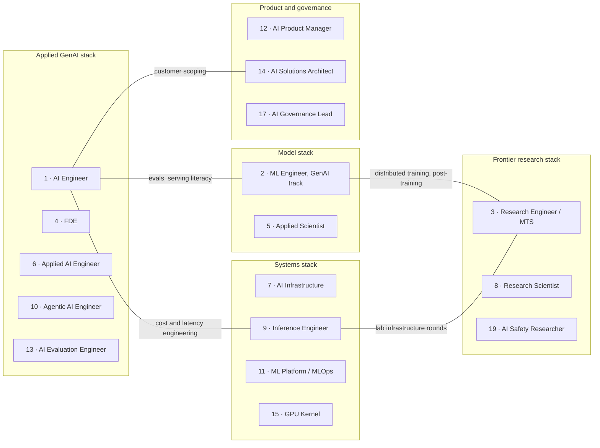

# GenAI Target Roles: The Sorted Shortlist

> Which GenAI roles to target, in order: a sorted shortlist from a consensus of eight lenses restricted to GenAI demand, with the tier rules, one line per role, and a method for choosing one cluster, its top title and two adjacent titles.

**Dates and grades.** The order is computed by `scripts/target_roles.py` from [data/role_scores.json](../../data/role_scores.json) (data as of 2026-11-02). Its GenAI restriction uses JobsPipe posting counts and shares retrieved on 2026-11-02, so this page is due for re-verification by 2026-12-03 (31 days, EGP-1.0 class V1). Grades follow EGP-1.0 ([CONTRIBUTING §3](../../CONTRIBUTING.md#3-writing-standard-egp-10-in-brief)): A is a primary source or measured data; B an established secondary source or a sizeable platform dataset; C third-party analysis, a vendor report or a single source, always attributed; D judgement; M a model output, which inherits the weakest grade among its inputs; P practice-curated. The order itself is Grade M.

**Scope.** GenAI work only. Classic-titled roles (ML Engineer, Applied Scientist, Research Scientist) are included through their GenAI track. The [role rankings](role-rankings.md) score all demand for each title instead, which is why their #1 is ML Engineer and this page's #1 is AI Engineer.

## The short answer

1. **Start with AI Engineer or the GenAI track of ML Engineer.** They are the only Tier 1 roles: both rank in the top four under all eight lenses [M]. Counting only postings that name LLM, AI Engineer has about 2.7× the US postings of ML Engineer (~1,300 vs ~490) [M · JobsPipe, 2026-11-02]; ML Engineer pays more, and about half of that gap is employer mix ([pay benchmarks](../09-compensation/pay-benchmarks.md#united-states-bands-by-title-and-city)) [B · T0-02.F1].
2. **Take a Tier 2 role only if you can pass its gate.** Research Engineer / MTS needs a PhD-level profile, a fellowship or strong open-source work; FDE means customer work and travel, and it has the lowest posted base of the measured families [B · T0-03]; Applied Scientist has a PhD-level bar, and Applied AI Engineer a lab-tier hiring bar [D].
3. **Carry agents, evals or inference as your edge, not as your only title.** They are the strongest differentiators in the evidence, but as titles they are small: agentic AI is named in 59.3% of AI Engineer postings [B · T0-01.F4], while Agentic AI Engineer sits on the catalog's [watchlist](role-catalog.md#54-watchlist-against-the-graduation-tests). Build one of them inside a Tier 1 or Tier 2 title.
4. **Pick one cluster, aim at its top title, and apply to two adjacent titles in the same cluster with the same portfolio** [D]. The five clusters are under [How to do it](#target-clusters-one-skill-stack-several-titles).
5. **Leave leadership and independent tracks until you meet their entry conditions.** People reach them after years of experience, so they are ranked separately, L1–L5 [D · role rankings §1.1].
6. **Read the order as a model output, not a measurement.** Within a tier, differences sit inside the uncertainty bands. Applied Scientist, Research Engineer / MTS, AI Product Manager, AI Solutions Architect and Applied AI Engineer are the ranks most likely to move at the 2026-12-01 recount, and the India order is directional because most of its inputs are Grade C or D [M].

<a id="0-the-sorted-target-list"></a>
## At a glance: the sorted target list

| # | Target role (GenAI track) | Tier | Consensus rank (mean of 8 lenses) | Lens range (best–worst) | GenAI centrality | Evidence confidence | Best for |
|:---:|---|:---:|:---:|:---:|---|:---:|---|
| 1 | [**AI Engineer**](hubs/ai-engineer.md) | 1 | 1.6 | 1–4 | Core (LLM named in 76.7% of postings) | High | Backend, frontend/full-stack, data scientists, India |
| 2 | [**Machine Learning Engineer, GenAI/LLM track**](hubs/ml-engineer.md) | 1 | 2.1 | 2–3 | Mixed: target the 45% of postings that name LLM | High | Data scientists, PhDs, ML-leaning backend engineers |
| 3 | [**Research Engineer / Member of Technical Staff**](hubs/research-engineer.md) | 2 | 3.8 | 1–9 | Core (frontier labs) | Medium | PhDs, fellowship alumni, strong OSS contributors |
| 4 | [**Forward Deployed Engineer (AI)**](hubs/forward-deployed-engineer.md) | 2 | 4.9 | 2–10 | Core (AI-startup cluster) | Medium | Backend/full-stack engineers who like customers and travel |
| 5 | [**Applied Scientist, GenAI/LLM teams**](hubs/applied-scientist.md) | 2 | 5.6 | 3–7 | Mixed: target LLM teams | Low | PhDs, applied ML researchers |
| 6 | [**Applied AI Engineer**](hubs/applied-ai-engineer.md) (labs and AI vendors) | 2 | 6.3 | 4–11 | Core | Low | Backend engineers, PhDs |
| 7 | [**AI Infrastructure / GPU Platform Engineer**](hubs/ai-infrastructure-engineer.md) | 3 | 7.5 | 7–9 | Majority (GPU clusters for training and inference) | Medium | SRE, DevOps, backend infrastructure |
| 8 | [**Research Scientist, LLM research**](hubs/research-scientist.md) | 3 | 7.9 | 3–15 | Mixed: target LLM / RL / post-training research | Medium | PhDs with publications |
| 9 | [Inference / LLM Serving Engineer](hubs/inference-engineer.md) | 4 | 9.5 | 6–12 | Core | Medium | Systems/C++ engineers; backend engineers with infrastructure depth |
| 10 | [Agentic AI Engineer](hubs/agentic-ai-engineer.md) | 4 | 9.8 | 6–12 | Core | Low | Backend and distributed-systems engineers |
| 11 | [ML Platform / MLOps (LLMOps) Engineer](hubs/ml-platform-engineer.md) | 4 | 10.1 | 4–12 | Majority | Low | DevOps, SRE, backend; India GCCs |
| 12 | [AI Product Manager](hubs/ai-product-manager.md) | 4 | 10.5 | 5–15 | Majority | Low | PMs; the best non-engineering target |
| 13 | [AI Evaluation Engineer](hubs/ai-evaluation-engineer.md) | 4 | 12.9 | 8–15 | Core | Low | Data scientists, PhDs, QA-minded engineers |
| 14 | [AI / GenAI Solutions Architect](hubs/ai-solutions-architect.md) | 4 | 14.0 | 13–16 | Majority | Low | Senior engineers, cloud architects, consultants |
| 15 | [GPU Kernel / ML Compiler Engineer](hubs/gpu-kernel-engineer.md) | 5 | 16.0 | 14–20 | Majority | Medium | CUDA/C++ systems engineers, PhDs |
| 16 | [AI Security Engineer / AI Red Teamer](hubs/ai-security-engineer.md) | 5 | 17.0 | 14–21 | Core (LLM and agent security) | Low | Application-security engineers |
| 17 | [AI Governance Programme Lead / Manager](hubs/ai-governance-lead.md) | 5 | 17.3 | 15–21 | Majority | Medium | GRC, privacy and audit professionals |
| 18 | [Physical AI / Robotics AI Engineer](hubs/physical-ai-engineer.md) | 5 | 18.3 | 17–21 | Adjacent (robot foundation / VLA models) | Low | Robotics and controls engineers with ML |
| 19 | [Frontier AI Safety / Alignment Researcher](hubs/ai-safety-researcher.md) | 5 | 18.5 | 12–24 | Core | Low | PhDs, fellowship alumni |
| 20 | [AI Enablement Engineer](hubs/ai-enablement-engineer.md) | 5 | 19.4 | 14–23 | Core | Low | Backend/DevEx engineers, ops leads |
| 21 | [AI Product Engineer (AI Frontend)](hubs/ai-product-engineer.md) | 5 | 20.1 | 17–22 | Core | Low | Frontend engineers (apply as "full-stack AI engineer") |
| 22 | [AI Risk, Audit & Compliance Specialist](hubs/ai-risk-assurance-specialist.md) | — | 21.4 | 18–23 | Adjacent (GenAI risk has no settled owner) | Medium | Not a primary GenAI target |
| 23 | [Responsible AI / AI Governance Engineer](hubs/responsible-ai-engineer.md) | — | 22.1 | 18–24 | Majority | Medium | Not a primary GenAI target |
| 24 | [Domain Evaluation Specialist / AI Trainer](hubs/domain-evaluation-specialist.md) | — | 23.6 | 22–24 | Core | Low | A bridge, not a destination |

Leadership and independent tracks are ranked separately: L1 AI Engineering Manager / Director, L2 VP / Head of AI, L3 CAIO, L4 Independent AI Consultant, L5 Fractional Head of AI ([when to target them](#leadership-and-independent-tracks-when-to-target-them)).

**How to read the table.** Tier, consensus rank and lens range are model outputs [M], checked against the data by `python3 -B scripts/target_roles.py --check`. GenAI centrality follows the filter below. Evidence confidence follows the [role rankings' rule](role-rankings.md#14-evidence-confidence): High when demand and pay both rest on A or B evidence, Low when either rests on judgement or a proxy.

## How the order is computed: a GenAI filter, eight lenses and five tiers

The order takes the 24 individual-contributor roles of the [role catalog](role-catalog.md), scored on five pillars in data/role_scores.json, and applies four steps. Every step is reproducible with `python3 -B scripts/target_roles.py`, which reuses the functions, fixed seed and data file of [scripts/rank_roles.py](../../scripts/rank_roles.py).

### 1. The GenAI-domain filter: four classes

All 29 canonical roles in the catalog touch GenAI, so none was removed. Each individual-contributor role is labelled by how central GenAI is to its work.

| Class | Roles | Basis |
|---|---|---|
| **Core**: the work *is* building, deploying, evaluating, securing or researching LLM / foundation-model systems | AI Engineer, Applied AI, Agentic, FDE (AI-startup cluster), Research Engineer/MTS, Inference, AI Evaluation, AI Security, AI Safety, AI Product Engineer, AI Enablement, Domain Evaluation | AI Engineer: LLM named in 76.7% of postings [B · JobsPipe JD]. Other roles: scope as defined in the catalog |
| **Majority**: GenAI drives most of the work, but the title also covers other ML | AI Infrastructure, GPU Kernel, ML Platform/MLOps, AI PM, AI Solutions Architect, AI Governance Lead, Responsible AI Engineer | Catalog scope [D] |
| **Mixed**: you must target the GenAI track | ML Engineer, Research Scientist, Applied Scientist | LLM is named in 45.0% of MLE postings and 24.4% of all-field research-scientist postings [B · JobsPipe JD]. Applied Scientist: share unmeasured [D] |
| **Adjacent**: related to GenAI but not centred on it | Physical AI, AI Risk/Audit/Compliance | Robot foundation models (Physical AI). SR 26-2 excludes generative and agentic AI, so GenAI risk has no settled owner [B · T0-15] (AI Risk) |

<a id="12-genai-restriction-of-the-two-mixed-title-families"></a>
### 2. The GenAI restriction of the two mixed title families

The catalog counts every AI Engineer and ML Engineer posting, including robotics, construction, recsys, ads and autonomous-vehicle work. For a GenAI target list only the GenAI subset matters. The share of postings that name LLM serves as the GenAI share; it is a lower bound, because some GenAI postings say "generative AI" without naming LLM.

| Role | Catalog count (US / India) | Postings naming LLM | GenAI subset (US / India) [M] | Demand score: catalog → GenAI | India demand: catalog → GenAI |
|---|---|:---:|---|:---:|:---:|
| AI Engineer | 1,697 / 398 [B · JobsPipe] | 76.7% | ~1,302 / ~305 | 10 → 9 | 10 → 10 |
| ML Engineer | 1,084 / 90 [B · JobsPipe] | 45.0% | ~488 / ~41 | 9 → 7 | 7 → 5.5 |

The restricted ranges and their arithmetic are recorded in data/role_scores.json (`genai_demand` and `genai_india_demand`, Grade M) and are used only for this order. No other input changes: the other roles are already scored on GenAI evidence (frontier labs, AI startups or LLM-specific titles).

**Effect on the scores** [M]:
- The GenAI CCI is AI Engineer 74.4, ML Engineer 72.9, Research Engineer 71.4, FDE 70.6.
- In the Monte Carlo (20,000 draws), AI Engineer is #1 in 58% of draws, ML Engineer in 23% and Research Engineer in 12%. Without the restriction, ML Engineer leads instead ([role rankings §0](role-rankings.md#0-the-answer)).
- The conclusion holds even if ML Engineer's true GenAI share were 60%: that is ~650 postings (band 8), still below AI Engineer's band 9.

### 3. Consensus across eight lenses

A role's target position is its **mean rank across eight lenses**, each weighted equally. Ties are broken by GenAI CCI.

| Lens | What it rewards |
|---|---|
| Base weights (25/25/20/15/15) | Balanced: demand, pay, durability, leverage, access |
| Equal weights | No pillar favoured |
| Pay-max | Pay (40%) |
| Hiring-safety | Demand (40%) |
| Moat-first | Durability of the work (40%) |
| Switcher | Ease of entry (35% Access) |
| India lens | India postings and India pay replace the US inputs |
| Monte Carlo median | Robustness to uncertainty in every input |

The lens range in the table shows the best and worst position a role takes across the eight lenses. A narrow range means a robust target.

<a id="14-tier-rules"></a>
### 4. Tier rules

| Tier | Rule | Meaning |
|:---:|---|---|
| 1 | Mean ≤ 2.5 and top 4 in all eight lenses | Primary targets |
| 2 | Mean ≤ 6.5 and top 10 in at least seven lenses | High-value targets with an entry gate |
| 3 | Mean ≤ 8 and top 10 in at least six lenses | Strong specialist targets |
| 4 | Mean ≤ 14 | Solid targets for specific backgrounds, or specialisations to carry inside a Tier 1 title |
| 5 | Mean ≤ 21 | Niche or conditional targets |
| — | Mean > 21 | Not recommended as a primary GenAI target |

## How to do it

Choose a cluster before you choose a title: one portfolio then serves three applications [D].

1. **Choose one cluster.** Read the five [target clusters](#target-clusters-one-skill-stack-several-titles) and pick the one whose shared core skills you hold, or can build within your timeline ([career transitions](../11-tracks/career-transitions.md)). *Done when:* you have named one cluster and listed which of its shared core skills you already hold.
2. **Make the cluster's top reachable title your primary target.** Read its line in [the 24 roles](#the-24-roles-one-line-each) and its hub, and check the gate. *Done when:* your primary target is one canonical title, and you meet its gate or have a dated step that will.
3. **Add two adjacent titles from the same cluster.** The cluster table's last column shows what each title adds to the shared stack. *Done when:* you have two adjacent titles, and one portfolio covers the proof that all three hubs ask for.
4. **Check your background and location.** Find your row in [best targets by background](#best-targets-by-background); if you search in India, read the [India-first order](#india-the-india-first-order). *Done when:* each of your three titles appears in your background row, or you have written down why not, and for an India search each sits in the India top 12.
5. **Write the shortlist down and set a recount date.** Record it in the [targeting workbook](../00-start/targeting-workbook.md) (its long-list and shortlist steps). *Done when:* the workbook holds your three titles with their gates, and a re-read after the 2026-12-01 recount is in your calendar.

<a id="7-target-clusters-one-skill-stack-several-titles"></a>
### Target clusters: one skill stack, several titles

The efficient strategy is to pick one cluster, aim at its top title, and apply to two adjacent titles in the same cluster with the same portfolio [D].



| Cluster | Shared core skills | Titles (target #) | What each title adds |
|---|---|---|---|
| **Applied GenAI** | Production Python/TypeScript, LLM APIs and tool calling, retrieval quality, evals, agent reliability, observability and cost | AI Engineer (1), FDE (4), Applied AI (6), Agentic (10), AI Evaluation (13); also AI Solutions Architect (14), AI Enablement (20), AI Product Engineer (21) | FDE: customer scoping and enterprise integration. Applied AI: customer delivery at labs. Agentic: durable execution and MCP. Evals: statistics and judge calibration |
| **Model** | ML and statistics depth, PyTorch, fine-tuning judgement, eval statistics, serving literacy | ML Engineer (2), Applied Scientist (5) | Applied Scientist: research-to-production and causal / A-B methods. MLE: serving and small-budget training evidence |
| **Frontier research** | PyTorch internals, distributed training, post-training/RL, evals at scale | Research Engineer/MTS (3), Research Scientist (8), AI Safety (19) | Research Scientist: publications. Safety: alignment and interpretability |
| **Systems** | Kubernetes, GPU scheduling, serving engines, KV cache, profiling, distributed systems | AI Infrastructure (7), Inference (9), ML Platform (11), GPU Kernel (15) | Inference: engine internals. Platform: gateways and MCP. Kernel: CUDA/Triton |
| **Product and governance** | Product sense, eval rubrics, regulation literacy, stakeholder communication | AI PM (12), AI Solutions Architect (14), AI Governance Lead (17) | Solutions Architect: cloud reference architectures. Governance: EU AI Act, NIST, ISO 42001 |

<a id="3-tiers-45-at-a-glance"></a>
### The 24 roles, one line each

One line per role, in target order. Each role's hub holds its numbers, skills, proof, interview track and résumé pointers, each with its grade. Gates and risks below are the catalog's readings (judgement, D) unless a grade is shown.

1. **[AI Engineer](hubs/ai-engineer.md)** (Tier 1, core): aim for AI Engineer, GenAI Engineer or Developer, LLM Engineer and Full-Stack AI Engineer postings; no formal gate; stay above commoditised wrapper work through evals, retrieval quality, agent reliability and cost and latency engineering.
2. **[Machine Learning Engineer, GenAI track](hubs/ml-engineer.md)** (Tier 1, mixed): filter for postings that name LLM work (fine-tuning, LLM inference, embeddings, LLM evals), because much ML Engineer hiring is recsys, ads and autonomous vehicles; gate: ML maths and statistics plus production engineering.
3. **[Research Engineer / Member of Technical Staff](hubs/research-engineer.md)** (Tier 2, core): frontier-lab titles for post-training, RL, training infrastructure and evals at scale; gate: a PhD-level profile, a fellowship or strong open-source work (vLLM, SGLang); the live count is unmeasured, and senior pay is mostly stock.
4. **[Forward Deployed Engineer (AI)](hubs/forward-deployed-engineer.md)** (Tier 2, core): apply to the engineer-titled roles in the cluster (FDE, AI Deployment Engineer, Forward Deployed AI Engineer), since only about 48% of the newest cluster rows are engineer-titled [B · T0-01.F3]; gate: customer-facing work, with up to 50% travel in one JD [B · T0-01 D3]; protect your engineering scope from drifting into pre-sales.
5. **[Applied Scientist, GenAI/LLM teams](hubs/applied-scientist.md)** (Tier 2, mixed, low confidence): Big Tech's research-to-production title on LLM teams; gate: ML and statistics depth (often a PhD) plus coding for big-company loops; with no Big Tech count or pay data, it is the rank most likely to move.
6. **[Applied AI Engineer](hubs/applied-ai-engineer.md)** (Tier 2, core, low confidence): customer-facing LLM engineering at labs and AI vendors, the bridge between AI Engineer and FDE; gate: the lab-tier bar on top of the full AI Engineer stack; pay is unmeasured.
7. **[AI Infrastructure / GPU Platform Engineer](hubs/ai-infrastructure-engineer.md)** (Tier 3, majority): GPU platform roles at labs, inference providers and large AI employers; gate: infrastructure depth (Kubernetes, networking, SRE practice); "strong infrastructure candidates without ML experience do well" in Anthropic design rounds [B · T0-14].
8. **[Research Scientist, LLM research](hubs/research-scientist.md)** (Tier 3, mixed): LLM, post-training, RL, reasoning or interpretability research; gate: a PhD plus publications; frontier offers are "not plannable" [D · T0-06], and it falls to #15 for career switchers.
9. **[Inference / LLM Serving Engineer](hubs/inference-engineer.md)** (Tier 4, core): the title at labs and inference vendors; backend engineers need infrastructure depth for Staff-level roles; risk: a small title, and the systems pay premium is not validated [B/C/D · T0-02.F12].
10. **[Agentic AI Engineer](hubs/agentic-ai-engineer.md)** (Tier 4, core): apply to the title where it exists, otherwise target AI Engineer roles and lead with agent reliability; risk: it may stay a skill inside AI Engineer.
11. **[ML Platform / MLOps (LLMOps) Engineer](hubs/ml-platform-engineer.md)** (Tier 4, majority): the MLOps or AI Platform Engineer title, strongest in India GCCs (#4 in the India lens); risk: no title count and a small pay sample.
12. **[AI Product Manager](hubs/ai-product-manager.md)** (Tier 4, majority): the best non-engineering GenAI target (#1 for non-technical backgrounds); risk: no AI-PM title count or pay data.
13. **[AI Evaluation Engineer](hubs/ai-evaluation-engineer.md)** (Tier 4, core): the title where it exists, otherwise evals as your edge inside AI Engineer or ML Engineer; risk: a small title with an unverified pay premium.
14. **[AI / GenAI Solutions Architect](hubs/ai-solutions-architect.md)** (Tier 4, majority): the title at hyperscalers, IT-services firms and staffing agencies; risk: no AI-architect title count or pay data.
15. **[GPU Kernel / ML Compiler Engineer](hubs/gpu-kernel-engineer.md)** (Tier 5, majority): the title at chip and inference vendors, reached through kernel PRs and GPU MODE leaderboards; risk: narrow access, and tile languages and kernel agents are abstracting raw kernel writing.
16. **[AI Security Engineer / AI Red Teamer](hubs/ai-security-engineer.md)** (Tier 5, core): the title, or application-security roles with LLM scope; risk: a small title and no pay data.
17. **[AI Governance Programme Lead / Manager](hubs/ai-governance-lead.md)** (Tier 5, majority): for GRC, privacy and audit professionals with about five years' experience; risk: mid-range pay, and not a fast switch for engineers.
18. **[Physical AI / Robotics AI Engineer](hubs/physical-ai-engineer.md)** (Tier 5, adjacent): the title at robotics firms; risk: one employer dominates the observed postings.
19. **[Frontier AI Safety / Alignment Researcher](hubs/ai-safety-researcher.md)** (Tier 5, core): lab research ladders, safety organisations and fellowships; risk: a small field, and it swings from #12 to #24 across the lenses.
20. **[AI Enablement Engineer](hubs/ai-enablement-engineer.md)** (Tier 5, core): the title, or internal platform roles; risk: small, and possibly transitional.
21. **[AI Product Engineer (AI Frontend)](hubs/ai-product-engineer.md)** (Tier 5, core): apply as a "full-stack AI engineer"; risk: thin, Staff-skewed demand [C/D · T0-06].
22. **[AI Risk, Audit & Compliance Specialist](hubs/ai-risk-assurance-specialist.md)**, 23. **[Responsible AI / AI Governance Engineer](hubs/responsible-ai-engineer.md)** and 24. **[Domain Evaluation Specialist / AI Trainer](hubs/domain-evaluation-specialist.md)**: not primary GenAI targets; see below.

<a id="4-not-primary-genai-targets-and-titles-to-avoid-as-a-headline"></a>
### Not primary GenAI targets, and titles to avoid as a headline

| Role | Why it is not a primary GenAI target | Use it as |
|---|---|---|
| [AI Risk, Audit & Compliance Specialist](hubs/ai-risk-assurance-specialist.md) (#22) | A specialisation inside audit, model-risk and privacy careers. SR 26-2 excludes GenAI, so GenAI risk has no settled owner [B · T0-15] | A move for auditors and model-risk professionals (AAIA requires CISA, CIA or CPA) |
| [Responsible AI / AI Governance Engineer](hubs/responsible-ai-engineer.md) (#23) | A thin niche ("expect few openings"), and an extension of ML-platform, MLOps and security engineering [C · T0-15] | A specialisation for MLOps and security engineers in regulated firms |
| [Domain Evaluation Specialist / AI Trainer](hubs/domain-evaluation-specialist.md) (#24) | Contract work; "a bridge, not a destination" [C/D · T0-06] | A paid bridge into AI for credentialed domain experts |

> [!CAUTION]
> Don't headline a quarantined, legacy or unmeasured title: Context Engineer, Prompt Engineer, Cognitive Architect, Agent Architect (as an exact title), Prompt Wizard, Vibe Engineer, AI Whisperer and the like. Use the canonical title, and show the work as skills in your project bullets. The registers, with their evidence, are in [role catalog §5](role-catalog.md#5-quarantine-watchlist-and-unmeasured-register); how to judge a new title is in [emerging roles](../01-landscape/emerging-roles.md).

<a id="5-best-targets-by-background-genai-persona-lenses"></a>
### Best targets by background

Scores use switcher weights and that background's own Access score; roles that are not plausible within 12 months are excluded [M]. The modelled time to a first offer for each background is kept in [career transitions](../11-tracks/career-transitions.md#modelled-months-to-a-first-offer) (T0-06, Grade D).

| Background | Primary target | Next targets (lens order) | Stretch or later |
|---|---|---|---|
| Backend / Systems SWE | AI Engineer (81) | FDE (73), Applied AI (72), AI Infrastructure (68), Agentic (68), ML Engineer (68) | Inference Engineer (Staff level, after infrastructure depth) |
| Data Scientist / BI | AI Engineer with an evals edge (75) | ML Engineer (73), AI Evaluation Engineer (65), Applied AI (65) | Applied Scientist |
| Frontend / Full-Stack | AI Engineer, full-stack (77) | FDE (71), Applied AI (65), Agentic (63) | AI Product Engineer, applied for as "full-stack AI engineer" |
| Non-technical (5+ years in a domain) | AI Product Manager (64) | FDE-adjacent roles (61; FDE proper requires coding), AI Governance Lead (60), AI Solutions Architect (56) | Domain evaluation (as a bridge) |
| PhD / Researcher | ML Engineer (73) or AI Engineer (74) for volume | Research Engineer/MTS (73), Applied Scientist (71) | Research Scientist ("not plannable") |

<a id="6-india-first-target-order-genai-india-lens"></a>
### India: the India-first order

The India lens replaces US demand and pay with India inputs [M]. Treat the order as directional: most India inputs are Grade C or D.

| India # | Role | India CCI | Note |
|:---:|---|:---:|---|
| 1 | AI Engineer | 73.8 | #1 in 94% of Monte Carlo draws [M]. GenAI Engineer / Developer is the top GCC label per Taggd [C · T0-01 D8] |
| 2 | ML Engineer (GenAI track) | 67.9 | Pays more, but its India GenAI subset is about 41 postings [M] |
| 3 | Applied Scientist | 63.8 | Proxies only: low confidence |
| 4 | ML Platform / MLOps | 62.7 | A common GCC title (Taggd) [C · T0-01 D8] |
| 5 | AI Product Manager | 62.3 | No AI-PM title count |
| 6 | Inference / LLM Serving | 60.6 | No India evidence |
| 7 | AI Infrastructure | 60.5 | No India evidence |
| 8 | Agentic AI Engineer | 60.2 | Appears on Weekday India listings [C · T0-01 D8] |
| 9 | Research Engineer / MTS | 60.1 | No India evidence |
| 10 | FDE | 59.3 | Mostly non-remote [B · T0-01 D2] |
| 11 | Applied AI Engineer | 59.2 | No India evidence |
| 12 | Research Scientist | 59.0 | India has 3.7% of all-field research-scientist postings [B · JobsPipe JD, 2026-11-02] |

The India market facts behind these notes (remote shares, GCC demand and pilot risk, the two pay populations) are in the [market overview's India section](../01-landscape/market-overview.md#8-india-more-ai-intensive-younger-smaller-in-counts-split-in-pay). Independent contracting tax is in [India remote tax](../09-compensation/india-remote-tax.md) (pointers, not tax advice), and the routes are in the [India remote playbook](../11-tracks/india-remote-playbook.md).

<a id="8-leadership-and-independent-tracks-when-to-target-them"></a>
### Leadership and independent tracks: when to target them

Their order and scores are in [role rankings §4](role-rankings.md#4-leadership-and-independent-tracks) [M].

| # | Track | When to target it | Evidence |
|:---:|---|---|---|
| L1 | [AI Engineering Manager / Director](hubs/ai-engineering-manager.md) | After Senior or Staff IC. AI engineers move into management in under 3 years on average (SignalFire) [C · T0-17] | "Lead or manager" labels on 5.6% of AI Engineer and 9.2% of MLE postings [B · JobsPipe JD]; one pay point, a visa-filing floor ([pay benchmarks](../09-compensation/pay-benchmarks.md#independent-contract-and-leadership-rates)) |
| L2 | [VP / Head of AI](hubs/vp-head-of-ai.md) | After EM or Director, with a delivery record | A Radford "Head of AI" survey job family exists (data paywalled) [B · T0-02]; no count or pay data |
| L3 | [Chief AI Officer](hubs/chief-ai-officer.md) | Executive track | OMB M-25-21 requires US federal agencies to appoint one [B · T0-15]; no pay data |
| L4 | [Independent AI Consultant](hubs/independent-ai-consultant.md) | Late career, with a network: 92% find clients through networks [C · T0-18] | Published rates are asking rates [C · T0-18.F1], and the modelled net income assumes you get traction [D · T0-18] ([freelance and fractional](../11-tracks/freelance-fractional.md)) |
| L5 | [Fractional Head of AI / CAIO](hubs/fractional-ai-leader.md) | Late career: 87% of Fractional Jobs respondents have 11+ years [C · T0-18] | T0-18 rates the CAIO demand evidence "conflicting", and employer-posted offers come in below asks [C · T0-18.F1] ([freelance and fractional](../11-tracks/freelance-fractional.md)) |

## Templates and examples

### Target shortlist [P]

A filled example for a backend engineer, built from the tables on this page:

```text
Background:        Backend engineer, 6 years (Python, Kubernetes)
Cluster:           Applied GenAI
Primary title:     AI Engineer (target #1, Tier 1); gate: none formal
Adjacent title 1:  Forward Deployed Engineer (#4, Tier 2); gate: customer work, travel
Adjacent title 2:  Applied AI Engineer (#6, Tier 2); gate: lab-tier hiring bar
Edge skill:        evaluation in CI (golden set, calibrated judge)
One portfolio:     one evaluated RAG system and one reliable agent
Location check:    India search? AI Engineer is India #1; FDE #10 (mostly non-remote)
Re-read after:     the 2026-12-01 recount
```

The blank version:

```text
Background:        [your row in "best targets by background"]
Cluster:           [Applied GenAI | Model | Frontier research | Systems | Product and governance]
Primary title:     [top title in the cluster whose gate you meet] (target #[n], Tier [t]); gate: [gate]
Adjacent title 1:  [title] (#[n], Tier [t]); gate: [gate]
Adjacent title 2:  [title] (#[n], Tier [t]); gate: [gate]
Edge skill:        [agents | evals | inference | other], proved by [artefact]
One portfolio:     [projects that cover the proof all three hubs ask for]
Location check:    [India rank of each title, or n/a]
Re-read after:     [next recount date]
```

### Weak and strong shortlists [P]

| Weak | Strong | Why |
|---|---|---|
| "Context Engineer, Prompt Engineer, AI Whisperer" | "AI Engineer; Agentic AI Engineer and FDE as adjacent titles" | Quarantined, legacy and unmeasured titles are not targets; the canonical title carries the work |
| "AI Engineer, Research Scientist, AI Governance Lead" | "AI Engineer, FDE, Applied AI Engineer" | Three clusters need three portfolios; one cluster needs one |
| "Agentic AI Engineer only" | "AI Engineer with agent reliability as the edge; Agentic AI Engineer where the title exists" | The skill is broad, the title small |

## Checklist

- [ ] I chose one cluster.
- [ ] My primary target is the highest-ranked title in that cluster whose gate I meet, or will meet by a dated step.
- [ ] I added two adjacent titles from the same cluster that one portfolio serves.
- [ ] I read the hub of each of my three titles.
- [ ] My edge skill (agents, evals or inference) sits inside a Tier 1 or Tier 2 title, not as my only target.
- [ ] No quarantined, legacy or unmeasured title is in my headline.
- [ ] I checked my background row, and the India-first order if I search in India.
- [ ] I added a leadership or independent track only because I already meet its entry conditions.
- [ ] The shortlist is in the targeting workbook, with a re-read date after the 2026-12-01 recount.

## Pitfalls

| Red flag | Why it hurts | Fix |
|---|---|---|
| Applying across three clusters at once | Each cluster needs its own portfolio, so no application gets your best proof [D] | One cluster: its top title plus two adjacent titles |
| Making a strong skill your only target title | Agents and evals are broad skills but small titles: agentic AI is named in 59.3% of AI Engineer postings [B · T0-01.F4], while Agentic AI Engineer and AI Evaluation Engineer stay on the catalog's watchlist | Target AI Engineer and lead with the skill; apply to the small title where it exists |
| Reading the CCI #1 as the GenAI #1 | The CCI counts all demand, including recsys, ads and autonomous-vehicle work; restricting to GenAI swaps #1 and #2 [M] | Use this order for GenAI work and the [role rankings](role-rankings.md) for the whole career |
| Splitting hairs inside a tier | Differences within a tier sit inside the uncertainty bands [M] | Choose within a tier by gate, background and location |
| Betting everything on a low-confidence rank | Applied Scientist and Applied AI Engineer rest on proxies: no Big Tech count, and pay unmeasured | Keep a Tier 1 title on the shortlist; re-read after the recount |
| A quarantined or legacy title in your headline | Screening layers score title similarity [A · T0-04.F8] | Use the canonical title; show the work as skills |
| Comparing a frontier-lab offer at paper value | 49–72% of senior lab packages is stock [B · T0-02] | Risk-adjust it first ([offer evaluation](../09-compensation/offer-evaluation.md)) |
| Planning a leadership track as a first move | People reach these tracks after years of experience [D] | Add one only once you meet its entry conditions |

<a id="9-caveats-and-what-would-change-the-order"></a>
## Evidence and limits

- **Measured (B):** the posting counts and the shares of postings that name LLM behind the GenAI restriction (JobsPipe, retrieved 2026-11-02), and the demand and pay inputs scored in [role rankings Appendix A](role-rankings.md#appendix-a-scoring-inputs), each with its own grade.
- **Model outputs (M):** the order, the tiers, the consensus means and lens ranges, the GenAI subsets and CCIs, the Monte Carlo shares and the persona and India lens values. All are computed by `scripts/target_roles.py` from data/role_scores.json (data as of 2026-11-02), and each inherits the weakest grade among its inputs.
- **Judgement (D):** the Durability and Leverage pillars, the centrality class of the Majority roles, the gates and risks in the role lines, and the one-cluster strategy.
- **The GenAI subsets are derived.** They use "LLM named" as the GenAI share, a lower bound; the AI Engineer > ML Engineer result holds even at a 60% share for ML Engineer.
- **Roles most likely to move at the next recount:** Applied Scientist (no Big Tech count, no pay), Research Engineer / MTS (no live count), AI Product Manager and AI Solutions Architect (no title counts) and Applied AI Engineer (pay unmeasured). T0-01's recounts are due on 2026-12-01 and 2027-01-15 [T0-01 L84].
- **India:** the India lens is directional, because most of its inputs are Grade C or D.
- **Dates:** review by 2026-12-03, 31 days after the posting counts were retrieved (EGP-1.0 class V1).
- **What would change the order:** live counts for Research Engineer / MTS, title-level counts for AI Product Manager and AI Solutions Architect, a Big Tech count and pay data for Applied Scientist, India job-board counts, or a measured change in the share of ML Engineer postings that name LLM.

## Next steps

- **Your three titles:** open each one's [role hub](hubs/README.md); every hub links its skills inventory, proof and interview pack.
- **Write the shortlist down:** the [targeting workbook](../00-start/targeting-workbook.md).
- **Explore around it:** the [role map](role-map.md) shows where the work sits, and [emerging roles](../01-landscape/emerging-roles.md) shows how to read a new title.
- **The evidence:** the [role catalog](role-catalog.md) (definitions, status classes and registers) and the [role rankings](role-rankings.md) (the all-demand CCI, its lenses and the scoring inputs).
- **Timelines and routes by background:** [career transitions](../11-tracks/career-transitions.md), [PhD to industry](../11-tracks/phd-to-industry.md) and the [India remote playbook](../11-tracks/india-remote-playbook.md).
- **Next stage:** [skills and technology](../03-skills-and-tech/README.md), starting with the [learning roadmaps](../03-skills-and-tech/learning-roadmaps.md), then the [proof-of-work standards](../05-portfolio/proof-of-work-standards.md).
