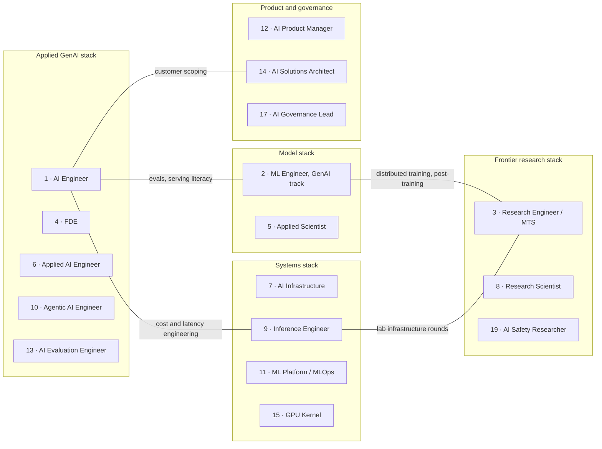

# GenAI Target Roles: The Sorted Shortlist

> **Updated:** 2026-11-04 · **Scope:** GenAI target-role consensus order from 8 equally weighted lenses.
> **Built from:**
> - [master catalog](role-catalog.md) (which roles exist)
> - [ranked catalog](role-rankings.md) (scores and lenses)
> - [skills catalog](../03-skills-and-tech/role-skill-maps.md) (what to learn)
> - [role_scores.json](../../data/role_scores.json) (inputs)
> - [role hubs](hubs/README.md) (one page per role) and the [role map](role-map.md) (where the work sits)
>
> **Scope:** GenAI-domain roles only. Classic-titled roles (ML Engineer, Applied Scientist, Research Scientist) are included through their GenAI track.
>
> **Evidence:** EGP-1.0 grades:
> - A, B: measured
> - C: practitioner, small corpus or vendor survey
> - D: judgement or model
> - M: derived from B inputs
>
> The order itself is a model output (Grade M). Within a tier, differences are inside the uncertainty bands.

---

## 0. The sorted target list

| # | Target role (GenAI track) | Tier | Consensus rank (mean of 8 lenses) | Lens range (best–worst) | GenAI centrality | Evidence confidence | Best for |
|:---:|---|:---:|:---:|:---:|---|:---:|---|
| 1 | **AI Engineer** | 1 | 1.6 | 1–4 | Core (LLM named in 76.7% of postings) | High | Backend, frontend/full-stack, data scientists, India |
| 2 | **Machine Learning Engineer, GenAI/LLM track** | 1 | 2.1 | 2–3 | Mixed: target the 45% of postings that name LLM | High | Data scientists, PhDs, ML-leaning backend engineers |
| 3 | **Research Engineer / Member of Technical Staff** | 2 | 3.8 | 1–9 | Core (frontier labs) | Medium | PhDs, fellowship alumni, strong OSS contributors |
| 4 | **Forward Deployed Engineer (AI)** | 2 | 4.9 | 2–10 | Core (AI-startup cluster) | Medium | Backend/full-stack engineers who like customers and travel |
| 5 | **Applied Scientist, GenAI/LLM teams** | 2 | 5.6 | 3–7 | Mixed: target LLM teams | Low | PhDs, applied ML researchers |
| 6 | **Applied AI Engineer** (labs and AI vendors) | 2 | 6.3 | 4–11 | Core | Low | Backend engineers, PhDs |
| 7 | **AI Infrastructure / GPU Platform Engineer** | 3 | 7.5 | 7–9 | Majority (GPU clusters for training and inference) | Medium | SRE, DevOps, backend infrastructure |
| 8 | **Research Scientist, LLM research** | 3 | 7.9 | 3–15 | Mixed: target LLM / RL / post-training research | Medium | PhDs with publications |
| 9 | Inference / LLM Serving Engineer | 4 | 9.5 | 6–12 | Core | Medium | Systems/C++ engineers; backend engineers with infrastructure depth |
| 10 | Agentic AI Engineer | 4 | 9.8 | 6–12 | Core | Low | Backend and distributed-systems engineers |
| 11 | ML Platform / MLOps (LLMOps) Engineer | 4 | 10.1 | 4–12 | Majority | Low | DevOps, SRE, backend; India GCCs |
| 12 | AI Product Manager | 4 | 10.5 | 5–15 | Majority | Low | PMs; the best non-engineering target |
| 13 | AI Evaluation Engineer | 4 | 12.9 | 8–15 | Core | Low | Data scientists, PhDs, QA-minded engineers |
| 14 | AI / GenAI Solutions Architect | 4 | 14.0 | 13–16 | Majority | Low | Senior engineers, cloud architects, consultants |
| 15 | GPU Kernel / ML Compiler Engineer | 5 | 16.0 | 14–20 | Majority | Medium | CUDA/C++ systems engineers, PhDs |
| 16 | AI Security Engineer / AI Red Teamer | 5 | 17.0 | 14–21 | Core (LLM and agent security) | Low | Application-security engineers |
| 17 | AI Governance Programme Lead / Manager | 5 | 17.3 | 15–21 | Majority | Medium | GRC, privacy and audit professionals |
| 18 | Physical AI / Robotics AI Engineer | 5 | 18.3 | 17–21 | Adjacent (robot foundation / VLA models) | Low | Robotics and controls engineers with ML |
| 19 | Frontier AI Safety / Alignment Researcher | 5 | 18.5 | 12–24 | Core | Low | PhDs, fellowship alumni |
| 20 | AI Enablement Engineer | 5 | 19.4 | 14–23 | Core | Low | Backend/DevEx engineers, ops leads |
| 21 | AI Product Engineer (AI Frontend) | 5 | 20.1 | 17–22 | Core | Low | Frontend engineers (apply as "full-stack AI engineer") |
| 22 | AI Risk, Audit & Compliance Specialist | — | 21.4 | 18–23 | Adjacent (GenAI risk has no settled owner) | Medium | Not a primary GenAI target (§4) |
| 23 | Responsible AI / AI Governance Engineer | — | 22.1 | 18–24 | Majority | Medium | Not a primary GenAI target (§4) |
| 24 | Domain Evaluation Specialist / AI Trainer | — | 23.6 | 22–24 | Core | Low | A bridge, not a destination (§4) |

Leadership and independent tracks are ranked separately, because people reach them only after years of experience (§8). Their order is: L1 AI Engineering Manager / Director, L2 VP / Head of AI, L3 CAIO, L4 Independent AI Consultant, L5 Fractional Head of AI.

**What the list says:**
1. **Target AI Engineer or the GenAI track of ML Engineer first.**
   - Both rank in the top four under every lens.
   - In GenAI-only terms, AI Engineer has about 2.7× the US postings: ~1,300 vs ~490 [M].
   - ML Engineer pays more: US total comp P50 $280K vs $154K [B].
2. **Tier 2 roles pay off, but each has a gate:**
   - Research Engineer/MTS needs a PhD, a fellowship or strong OSS work.
   - FDE means customer work and travel, and it has the lowest posted base of the measured families.
   - Applied Scientist has a PhD-level bar.
   - Applied AI Engineer has a lab-tier hiring bar.
3. **Several strong skills are small titles.** Agents, evals and inference are the strongest differentiators, but as titles they are small. Make one of them your edge inside a Tier 1 or Tier 2 title rather than your only target.
4. **Versus the ranked catalog:** the GenAI restriction swaps #1 and #2. The eight-lens consensus also reorders a few roles within their tiers:
   - Applied Scientist rises (India lens #3); Research Scientist falls (switcher #15, India #12).
   - Agentic AI Engineer rises (switcher #6); AI Product Manager falls (moat-first #15).
   - AI Security rises (moat-first #14, India #14).

---

## 1. How the order was built

### 1.1 GenAI-domain filter

All 29 canonical roles in the master catalog touch GenAI, so none was removed. Each role is labelled by how central GenAI is to its work.

| Class | Roles | Basis |
|---|---|---|
| **Core**: the work *is* building, deploying, evaluating, securing or researching LLM / foundation-model systems | AI Engineer, Applied AI, Agentic, FDE (AI-startup cluster), Research Engineer/MTS, Inference, AI Evaluation, AI Security, AI Safety, AI Product Engineer, AI Enablement, Domain Evaluation | AI Engineer: LLM named in 76.7% of postings [B · JobsPipe JD]. Other roles: scope as defined in the master catalog |
| **Majority**: GenAI drives most of the work, but the title also covers other ML | AI Infrastructure, GPU Kernel, ML Platform/MLOps, AI PM, AI Solutions Architect, AI Governance Lead, Responsible AI Engineer | Master-catalog scope [D] |
| **Mixed**: you must target the GenAI track | ML Engineer, Research Scientist, Applied Scientist | LLM is named in 45.0% of MLE postings and 24.4% of all-field research-scientist postings [B · JobsPipe JD]. Applied Scientist: share unmeasured [D] |
| **Adjacent**: related to GenAI but not centred on it | Physical AI, AI Risk/Audit/Compliance | Robot foundation models (Physical AI). SR 26-2 excludes generative and agentic AI, so GenAI risk has no settled owner [B · T0-15] (AI Risk) |

### 1.2 GenAI restriction of the two mixed title families

The catalog counts every AI Engineer and ML Engineer posting, including robotics, construction, recsys, ads and autonomous-vehicle work. For a GenAI target list, only the GenAI subset matters. The share of postings that name LLM serves as the GenAI share; it is a lower bound, because some GenAI postings say "generative AI" without naming LLM.

| Role | Catalog count (US / India) | Postings naming LLM | GenAI subset (US / India) [M] | Demand score: catalog → GenAI | India demand: catalog → GenAI |
|---|---|:---:|---|:---:|:---:|
| AI Engineer | 1,697 / 398 [B] | 76.7% | ~1,302 / ~305 | 10 → 9 | 10 → 10 |
| ML Engineer | 1,084 / 90 [B] | 45.0% | ~488 / ~41 | 9 → 7 | 7 → 5.5 |

No other inputs were changed: the other roles are already scored on GenAI evidence (frontier labs, AI startups or LLM-specific titles).

**Effect on the scores:**
- The GenAI CCI is AI Engineer 74.4, ML Engineer 72.9, Research Engineer 71.4, FDE 70.6.
- In the Monte Carlo (20,000 draws), AI Engineer is #1 in 58% of draws, ML Engineer in 23% and Research Engineer in 12%.
- Without the restriction, ML Engineer leads (64% vs 34%).
- The conclusion holds even if ML Engineer's true GenAI share were 60%: that is ~650 postings (band 8), still below AI Engineer's band 9.

### 1.3 Consensus across eight lenses

A role's target position is its **mean rank across eight lenses**, each weighted equally. Ties are broken by GenAI CCI.

| Lens | What it rewards |
|---|---|
| Base weights (25/25/20/15/15) | Balanced: demand, pay, durability, leverage, access |
| Equal weights | No pillar favoured |
| Pay-max | Pay (40%) |
| Hiring-safety | Demand (40%) |
| Moat-first | Durability of the work (40%) |
| Switcher | Ease of entry (35% Access) |
| India lens | India postings and India pay replace the US inputs |
| Monte Carlo median | Robustness to uncertainty in every input |

The "lens range" column shows the best and worst position a role takes across the eight lenses. A narrow range means a robust target.

### 1.4 Tier rules

| Tier | Rule | Meaning |
|:---:|---|---|
| 1 | Mean ≤ 2.5 and top 4 in all eight lenses | Primary targets |
| 2 | Mean ≤ 6.5 and top 10 in at least seven lenses | High-value targets with an entry gate |
| 3 | Mean ≤ 8 and top 10 in at least six lenses | Strong specialist targets |
| 4 | Mean ≤ 14 | Solid targets for specific backgrounds, or specialisations to carry inside a Tier 1 title |
| 5 | Mean ≤ 21 | Niche or conditional targets |
| — | Mean > 21 | Not recommended as a primary GenAI target |

The analysis is reproducible with [scripts/target_roles.py](../../scripts/target_roles.py) (`python3 scripts/target_roles.py`), which reuses the functions, fixed seed and data file of [scripts/rank_roles.py](../../scripts/rank_roles.py).

---

## 2. Target cards: Tiers 1–3

### 1 · AI Engineer · Tier 1 · GenAI core

- **Aim for:** AI Engineer, GenAI Engineer / GenAI Developer (the top GCC AI label in India per Taggd [C]), LLM Engineer, AI Application Engineer, Full-Stack AI Engineer.
- **Why #1 for GenAI:**
  - It is the largest GenAI-native title family: US 1,697, India 398, global 3,944 live postings [B], of which ~1,300 US name LLM [M].
  - It ranks #1 in six of the eight lenses and never below #4.
  - It has the shortest modelled switch routes: backend ~6 months, frontend ~7, data scientist ~8 [D · T0-06].
- **Gate:** no formal gate. Production engineering plus evaluation discipline.
- **Edge skills to build** ([skills map](../03-skills-and-tech/role-skill-maps.md#skills-ai-engineer)):
  - Eval harnesses: golden sets, judges calibrated with Cohen's κ, CI regression gates.
  - Retrieval quality: hybrid search with reranking; ACL-aware, fail-closed retrieval.
  - Agent reliability: durable state, step and token budgets, human approval for irreversible actions.
  - Cost and latency engineering: prompt-cache layout, routing, batch APIs, TTFT/TPOT budgets.
  - Tracing with OpenTelemetry GenAI conventions and per-tenant cost attribution.
- **Proof of work:**
  - At T0–T1, one evaluated system over a real corpus, with a metrics table, a cost/latency budget and a reproducible README.
  - At T2–T3, add a second system with a different failure surface, plus CI-gated evals, traces, a load test and a postmortem.
- **Interview:** the application track: RAG with ACL enforcement, agent loop control, eval architecture, context management [B/C · T1-03].
- **Pay:**
  - US total comp P50 $154K, P90 $280K [B]. Posted base for AI Engineer (Application) is $200–275K [B].
  - Bengaluru P50 ₹21.4–24.5L, P90 ₹62.6L [B].
  - About half the total-comp gap to ML Engineer is employer mix.
- **Watch:** wrapper-level work is commoditised. Stay at the top of the band through evals, agent reliability and cost engineering.
- [Profile](role-catalog.md#profile-ai-engineer) · [Ranked dossier](role-rankings.md#rank-2-ai-engineer)

### 2 · Machine Learning Engineer, GenAI/LLM track · Tier 1 · Mixed

- **Aim for:**
  - Machine Learning Engineer / ML Engineer / AI/ML Engineer / Deep Learning Engineer postings that name LLM; 45.0% of MLE postings do [B].
  - The GenAI work: fine-tuning and post-training, LLM inference, embedding and retrieval models, LLM evals.
- **Why #2:**
  - It has the highest broad-market pay distribution: US total comp P50 $280K, P90 $497.5K [B].
  - It is top 3 in all eight lenses (#2 in seven) and is the catalog's #1 before the GenAI restriction.
  - Its GenAI subset is ~490 US postings [M].
- **Gate:** ML maths and statistics plus production engineering.
- **Edge skills** ([skills map](../03-skills-and-tech/role-skill-maps.md#skills-ml-engineer)):
  - Transformers.
  - Knowing when *not* to fine-tune: in a 20-system study, 70% used off-the-shelf models [A · T0-03].
  - SFT and LoRA.
  - Embedding and retrieval models.
  - LLM evals with confidence intervals.
  - Serving literacy: vLLM/SGLang, batching, quantisation.
- **Proof of work:**
  - A baseline-first model with measured lift.
  - A prompt vs RAG vs fine-tune comparison with cost and quality numbers.
  - A serving benchmark: tokens/s, p95, $/M tokens.
  - Small-budget training evidence: FSDP2 smoke tests and scaled-down runs reporting MFU.
- **Interview:** classic ML system design plus coding, with a "where would an LLM help?" probe. Databricks MLE loops reportedly cover LLM training systems and RAG over millions of documents [C · T0-14].
- **Pay:**
  - Posted base $213–288K [B]; Meta E5 $458K; Google L5 $393–445K [B].
  - Bengaluru P50 ₹44.5L, P90 ₹94.6L [B].
- **Watch:** much MLE hiring is recsys, ads and autonomous vehicles, so filter for LLM work. India has only 90 live MLE postings, ~41 of them naming LLM [B; M].
- [Profile](role-catalog.md#profile-ml-engineer) · [Ranked dossier](role-rankings.md#rank-1-ml-engineer)

### 3 · Research Engineer / Member of Technical Staff · Tier 2 · GenAI core

- **Aim for:** frontier-lab titles such as MTS – Research Engineer, MTS – Software Engineer, MTS – AI Systems Engineer and Research Engineer. The work covers post-training, RL, training infrastructure and evals at scale.
- **Why:**
  - It has the highest engineering pay in the corpus: OpenAI/Anthropic SWE/MTS total-comp medians are ~$875–882.5K (n=242 and n=49) [B].
  - It is #1 under the pay-max and moat-first lenses.
  - It absorbs post-training and RL work.
- **Gate:** a PhD-level profile, a fellowship, or strong OSS work (vLLM, SGLang). On fellowships: Anthropic Fellows requires no PhD, and Anthropic reports that >40% of its first cohort later joined full-time 🏷️ (self-reported by the programme owner) [B · T0-06].
- **Edge skills** ([skills map](../03-skills-and-tech/role-skill-maps.md#skills-research-engineer)):
  - Distributed training: DDP/FSDP2, tensor and pipeline parallelism, MoE.
  - Debugging training runs.
  - Post-training: SFT, preference and RL methods (verl, OpenRLHF).
  - Evals at scale; profiling.
- **Proof of work:**
  - Paper re-implementations with rigorous evals.
  - A nano-vLLM-style engine (continuous batching, paged KV cache) benchmarked against vLLM.
  - DDP/FSDP2 smoke tests.
  - Upstream OSS contributions.
- **Interview:** a research talk plus coding. Frontier labs add infrastructure research-engineering rounds on KV cache, batching and GPU scheduling.
- **Pay caveat:**
  - 49–72% of senior lab packages is stock [B · T0-02].
  - Risk-adjust it to 0.5–0.8× (a T0-17 model output) [C/D].
- **Watch:**
  - The live posting count is unmeasured. The proxy is 2025 visa filings: OpenAI MTS-RE 84, Anthropic RE 63 positions [B].
  - It is only #9 in the India lens (no India evidence).
- [Profile](role-catalog.md#profile-research-engineer) · [Ranked dossier](role-rankings.md#rank-3-research-engineer)

### 4 · Forward Deployed Engineer (AI) · Tier 2 · GenAI core

- **Aim for:** engineer-titled roles in the cluster: FDE / FDSE, AI Deployment Engineer, Forward Deployed AI Engineer, "AI Engineer – FDE" (Databricks), Frontier Agents Engineer.
- **Why:**
  - It is the largest title family at AI startups: a 933-role cluster across 343 startups [B].
  - It is #2–#3 under the switcher, equal and hiring-safety lenses.
  - It shares the highest Leverage judgement (8.5, Grade D).
- **Gate:**
  - It is customer-facing work, and one JD lists up to 50% travel.
  - Only ~48% of the cluster is engineer-titled, so target those roles specifically.
- **Edge skills** ([skills map](../03-skills-and-tech/role-skill-maps.md#skills-forward-deployed-engineer)):
  - Discovery and scoping with customers.
  - Demos under time pressure.
  - Enterprise integration: ACL-enforced retrieval, OAuth/OIDC, RBAC.
  - Agent design for customer workflows, with evals tied to customer KPIs.
  - Vertical domain depth.
- **Proof of work:**
  - A customer pilot case study with numbers.
  - A demo on real data shown to at least two potential users.
  - A deployment write-up that covers failure modes.
- **Interview:** Databricks' AI-FDE loop covers RAG over sensitive, fast-changing documents and evaluating a multi-agent system [C · T0-14].
- **Pay:**
  - Posted base is $180–248K, the lowest median among the measured families [B]. Median advertised pay is >$188K, vs ~$145K for software engineers [B · T0-06].
  - Model Series C–D equity at 0.4–0.8× of its paper value [C/D · T0-17 model].
- **Watch:**
  - Postings were mostly non-remote in the August snapshot (Remote 65 of ~779), a weak fit for India-remote work. It is #10 in the India lens.
  - Protect your engineering scope against drift into pre-sales.
- [Profile](role-catalog.md#profile-forward-deployed-engineer) · [Ranked dossier](role-rankings.md#rank-4-forward-deployed-engineer)

### 5 · Applied Scientist, GenAI/LLM teams · Tier 2 · Mixed · Low confidence

- **Aim for:** Applied Scientist, Applied Research Scientist or ML Scientist roles on LLM or GenAI teams. This is Big Tech's research-to-production title.
- **Why:**
  - It is one of a PhD's two main high-volume corridors (~8 months) [D · T2-01].
  - It holds a narrow #3–#7 range across all eight lenses.
  - It is #3 in the India lens. That rests on proxy pay (Google Bengaluru MLE L5 ₹168.3L, small n).
- **Gate:** ML and statistics depth (often a PhD), plus coding and DSA for big-company loops.
- **Edge skills** ([skills map](../03-skills-and-tech/role-skill-maps.md#skills-applied-scientist)):
  - Research-to-production translation.
  - Evaluation statistics: confidence intervals, power analysis, judge-bias tests, drift.
  - Baseline-first discipline.
  - Causal inference and A/B testing.
  - LLM fine-tuning and alignment basics.
- **Proof of work:**
  - Your own method turned into a service with tests and CI.
  - At least three code reviews via OSS pull requests.
  - An eval-statistics write-up.
- **Watch:**
  - The corpus has no Big Tech count; the only count is 14 at 12 AI startups (June 2026) [B]. It also has no pay data; it is scored on a Big Tech MLE proxy.
  - The "~700 postings" figure in FAD/T1-01 has no source.
  - This is the rank most likely to move at the next recount.
- [Profile](role-catalog.md#profile-applied-scientist) · [Ranked dossier](role-rankings.md#rank-7-applied-scientist)

### 6 · Applied AI Engineer · Tier 2 · GenAI core · Low confidence

- **Aim for:** Applied AI Engineer roles at labs and AI vendors [B · T0-01]:
  - OpenAI: Startups, Digital Natives, Codex, Partner.
  - Anthropic: Beneficial Deployments, Startups, Enterprise Tech.
  - Scale: Global Public Sector.
  - Databricks: Context Retrieval.
- **Why:**
  - Customer-facing LLM engineering at the labs, and the bridge between AI Engineer and FDE.
  - It is #4–#6 in six of the eight lenses (#4 for switchers).
- **Gate:** the lab-tier hiring bar on top of the full AI Engineer stack.
- **Edge skills** ([skills map](../03-skills-and-tech/role-skill-maps.md#skills-applied-ai-engineer)):
  - Customer delivery of LLM applications.
  - Evals defined per use case.
  - Safety in regulated settings.
  - Model-behaviour knowledge.
  - Partner enablement and technical writing.
- **Watch:**
  - Pay is unmeasured.
  - The volume is an extrapolation: 16 of the 50 newest Fast AI Jobs AI-Engineer rows (2026-10-19) carry the title, ~100 if representative [C].
  - It is #11 in the India lens.
- [Profile](role-catalog.md#profile-applied-ai-engineer) · [Ranked dossier](role-rankings.md#rank-5-applied-ai-engineer)

### 7 · AI Infrastructure / GPU Platform Engineer · Tier 3 · GenAI majority

- **Aim for:** AI Infrastructure Engineer, ML Infrastructure Engineer and GPU platform roles at labs, inference providers and large AI employers.
- **Why:**
  - It is #7–#9 in every lens.
  - It is durable physical-systems work with high leverage on GPU spend.
- **Gate:** infrastructure depth (Kubernetes, networking, SRE practice). Its backend Access score of 7 is inferred [D].
- **Edge skills** ([skills map](../03-skills-and-tech/role-skill-maps.md#skills-ai-infrastructure-engineer)):
  - GPU fleet operations.
  - GPU scheduling and allocation ledgers.
  - Distributed-systems depth.
  - NCCL / RDMA / InfiniBand.
  - Checkpoint and storage throughput.
  - Reliability under hardware faults.
  - GPU cost governance.
- **Proof of work:** a self-hosted cluster with continuous synthetic load, automated failover, autoscaling and dashboards, plus a written postmortem.
- **Interview:** the infrastructure track. Anthropic's prompts include GPU cluster design, and "strong infrastructure candidates without ML experience do well" [B · T0-14].
- **Pay:** posted base $203–270K (n=52), level with AI Engineer [B]. OpenAI GPU-infrastructure postings show $230–490K base [C].
- [Profile](role-catalog.md#profile-ai-infrastructure-engineer) · [Ranked dossier](role-rankings.md#rank-8-ai-infrastructure-engineer)

### 8 · Research Scientist, LLM research · Tier 3 · Mixed

- **Aim for:** Research Scientist or MTS – Research Scientist roles in LLM, post-training, RL, reasoning or interpretability research. Among all-field research-scientist postings, 24.4% name LLM and 17.1% name RL [B].
- **Why:** it has the highest Pay score (9.5):
  - Research-scientist total comp is ~$1.25M at OpenAI [B, cached] and $0.75–0.83M at Anthropic [C].
  - Pave reports senior new-hire equity of $4.1–4.7M [A].
  - It is #3–#4 under the pay-max and moat-first lenses.
- **Gate:**
  - A PhD plus publications; frontier offers are "not plannable" [D · T0-06].
  - It falls to #15 for career switchers and #12 in India.
- **Edge skills:** research taste and novel methods; a publication record; RL and LLM research; communication ([skills map](../03-skills-and-tech/role-skill-maps.md#skills-research-scientist)).
- **Proof of work:** papers, open research code, talks.
- [Profile](role-catalog.md#profile-research-scientist) · [Ranked dossier](role-rankings.md#rank-6-research-scientist)

---

## 3. Tiers 4–5 at a glance

| # | Role | How to target it | Edge skills | Main risk |
|:---:|---|---|---|---|
| 9 | [Inference / LLM Serving Engineer](../03-skills-and-tech/role-skill-maps.md#skills-inference-engineer) | The title at labs and inference vendors (Anthropic, NVIDIA, Together AI, Baseten, Inferact). Backend engineers need ~10–14 months of infrastructure depth for Staff-level roles [D] | vLLM/SGLang, continuous batching, KV-cache math, speculative decoding, quantisation, roofline profiling, load-test method | Small title volume (Rise 28); the systems pay premium is "not validated" |
| 10 | [Agentic AI Engineer](../03-skills-and-tech/role-skill-maps.md#skills-agentic-ai-engineer) | Apply to the title where it exists. Otherwise target AI Engineer roles and lead with agent reliability | Durable execution, approvals, budgets, tool routers, sandboxes, deterministic replay, MCP spec 2026-07-28 | May stay a skill inside AI Engineer: "agentic AI" is named in 59.3% of AI Engineer postings |
| 11 | [ML Platform / MLOps Engineer](../03-skills-and-tech/role-skill-maps.md#skills-ml-platform-engineer) | The title (MLOps / AI Platform Engineer). Strongest in India GCCs (#4 in the India lens) | Model serving on Kubernetes, LLM and MCP gateways, OpenTelemetry GenAI traces, CI/CD for models and prompts, supply chain | No title count; small pay sample (n=10) |
| 12 | [AI Product Manager](../03-skills-and-tech/role-skill-maps.md#skills-ai-product-manager) | The title. The best non-engineering GenAI target (#1 for non-technical backgrounds) | AI literacy, eval fluency, metrics for non-deterministic systems, token economics, pilot execution | No AI-PM title count or pay data |
| 13 | [AI Evaluation Engineer](../03-skills-and-tech/role-skill-maps.md#skills-ai-evaluation-engineer) | The title where it exists (Haparz, Backbase, Artificial Analysis). Otherwise make evals your edge inside AI Engineer or MLE | Eval design, code-first graders, κ-calibrated judges, pass@k vs pass^k, online evals, CI gates | Small title; pay premium unverified |
| 14 | [AI / GenAI Solutions Architect](../03-skills-and-tech/role-skill-maps.md#skills-ai-solutions-architect) | The title at hyperscalers, IT-services firms and staffing agencies | RAG and agent reference architectures on managed services, model routing, cost models, governance | No AI-architect title count or pay data |
| 15 | [GPU Kernel / ML Compiler Engineer](../03-skills-and-tech/role-skill-maps.md#skills-gpu-kernel-engineer) | The title at NVIDIA, AMD, Together AI or River AI, plus kernel PRs and GPU MODE leaderboards | Triton/CUTLASS, fused attention, quantised kernels, roofline, Nsight | Narrow access; tile DSLs and kernel agents are abstracting raw kernel writing |
| 16 | [AI Security Engineer / Red Teamer](../03-skills-and-tech/role-skill-maps.md#skills-ai-security-engineer) | The title, or application-security roles with LLM scope | Prompt-injection defence, MCP authorisation, agent abuse, supply chain, OWASP LLM / Agentic Top 10 | ~23 postings in 90 days (derived); no pay data |
| 17 | [AI Governance Programme Lead](../03-skills-and-tech/role-skill-maps.md#skills-ai-governance-lead) | The title. For GRC, privacy and audit professionals with about 5 years' experience | EU AI Act, NIST AI RMF, ISO 42001, AI inventory and risk method | Mid pay (IAPP medians $151.8–169.7K); not a fast switch for engineers |
| 18 | [Physical AI / Robotics AI Engineer](../03-skills-and-tech/role-skill-maps.md#skills-physical-ai-engineer) | The title at robotics firms (e.g. Figure AI's "Helix AI Engineer") | Robot learning, vision-language-action models, sim-to-real, edge inference | One employer dominates the observed postings; GenAI-adjacent |
| 19 | [Frontier AI Safety Researcher](../03-skills-and-tech/role-skill-maps.md#skills-ai-safety-researcher) | Lab research ladders, safety organisations, fellowships | Alignment, interpretability, dangerous-capability evals | ~600 technical FTEs (a single-author estimate, C); swings from #12 to #24 across lenses |
| 20 | [AI Enablement Engineer](../03-skills-and-tech/role-skill-maps.md#skills-ai-enablement-engineer) | The title, or internal platform roles | MCP servers for internal systems, internal copilots, guardrails, adoption metrics | Small; may be transitional |
| 21 | [AI Product Engineer (AI Frontend)](../03-skills-and-tech/role-skill-maps.md#skills-ai-product-engineer) | Apply as a "full-stack AI engineer" | Streaming UI, visualising agent work, human-in-the-loop approval UX, agent-UX telemetry | Thin, Staff-skewed demand (C/D) |

---

## 4. Not primary GenAI targets, and titles to avoid as a headline

| Role | Why it is not a primary GenAI target | Use it as |
|---|---|---|
| AI Risk, Audit & Compliance Specialist (#22) | A specialisation inside audit, model-risk and privacy careers. SR 26-2 excludes GenAI, so GenAI risk has no settled owner | A move for auditors and model-risk professionals (AAIA requires CISA, CIA or CPA) |
| Responsible AI / AI Governance Engineer (#23) | A thin niche ("expect few openings"), and an extension of ML-platform, MLOps and security engineering | A specialisation for MLOps and security engineers in regulated firms |
| Domain Evaluation Specialist / AI Trainer (#24) | Contract work; "a bridge, not a destination" | A paid bridge into AI for credentialed domain experts |

> [!CAUTION]
> Don't put a quarantined or legacy title in your headline:
> - Context Engineer
> - Prompt Engineer (0.35% of LinkedIn AI postings, per a 2025 arXiv study)
> - Cognitive Architect, Agent Architect (exact title), Prompt Wizard, Vibe Engineer
> - The unmeasured buzzwords: AI Whisperer, Transformer Specialist and others
>
> Use the canonical title, and show the work as skills in your project bullets.

---

## 5. Best targets by background (GenAI persona lenses)

Scores use switcher weights and that background's own Access score. Roles that are not plausible within 12 months are excluded.

| Background | Primary target | Next targets (lens order) | Stretch or later | Modelled time to first offer [D · T0-06] |
|---|---|---|---|---|
| Backend / Systems SWE | AI Engineer (81) | FDE (73), Applied AI (72), AI Infrastructure (68), Agentic (68), ML Engineer (68) | Inference Engineer (Staff level ~10–14 months) | ~6 months (3.5–8) |
| Data Scientist / BI | AI Engineer with an evals edge (75) | ML Engineer (73), AI Evaluation Engineer (65), Applied AI (65) | Applied Scientist | Data scientist ~8 months (5–11); BI ~11 (7–15) |
| Frontend / Full-Stack | AI Engineer, full-stack (77) | FDE (71), Applied AI (65), Agentic (63) | AI Product Engineer, applied for as "full-stack AI engineer" | ~7 months (5–11) |
| Non-technical (5+ years in a domain) | AI Product Manager (64) | FDE-adjacent roles (61; FDE proper requires coding), AI Governance Lead (60), AI Solutions Architect (56) | Domain evaluation (as a bridge) | ~7 months (5–11); ~22 months to engineering from zero code |
| PhD / Researcher | ML Engineer (73) or AI Engineer (74) for volume | Research Engineer/MTS (73), Applied Scientist (71) | Research Scientist ("not plannable") | ~8 months (5–12.5) |

---

## 6. India-first target order (GenAI India lens)

| India # | Role | India CCI | Note |
|:---:|---|:---:|---|
| 1 | AI Engineer | 73.8 | #1 in 94% of Monte Carlo draws. GenAI Engineer/Developer is the top GCC label per Taggd (C) |
| 2 | ML Engineer (GenAI track) | 67.9 | Pays more (Bengaluru P50 ₹44.5L, P90 ₹94.6L) but has only 90 live postings, ~41 of them naming LLM |
| 3 | Applied Scientist | 63.8 | Proxies only: low confidence |
| 4 | ML Platform / MLOps | 62.7 | A common GCC title (Taggd, C). Quess estimates 18–43% supply gaps (C) |
| 5 | AI Product Manager | 62.3 | No AI-PM title count |
| 6 | Inference / LLM Serving | 60.6 | No India evidence |
| 7 | AI Infrastructure | 60.5 | No India evidence |
| 8 | Agentic AI Engineer | 60.2 | Appears on Weekday India listings |
| 9 | Research Engineer / MTS | 60.1 | No India evidence |
| 10 | FDE | 59.3 | Mostly non-remote |
| 11 | Applied AI Engineer | 59.2 | No India evidence |
| 12 | Research Scientist | 59.0 | India has 3.7% of all-field research-scientist postings |

India context:
- Remote work is rare for AI titles: 11.0% of AI Engineer and 14.0% of MLE postings, against 31.6% for generic backend postings [B].
- "Nearly 70%" of India GCCs are stuck at AI pilots [A-/B · T0-09].
- **Contracting tax:** for independent contracting, presumptive tax keeps ~83–84% of billing up to ₹75L, provided cash receipts are ≤5% [B · T0-07]. Not legal or tax advice.
- **Treat this order as directional:** most India inputs are Grade C/D.

---

## 7. Target clusters: one skill stack, several titles

The efficient strategy is to pick one cluster, aim at its top title, and apply to two adjacent titles in the same cluster with the same portfolio.

| Cluster | Shared core skills | Titles (target #) | What each title adds |
|---|---|---|---|
| **Applied GenAI** | Production Python/TypeScript, LLM APIs and tool calling, retrieval quality, evals, agent reliability, observability and cost | AI Engineer (1), FDE (4), Applied AI (6), Agentic (10), AI Evaluation (13); also AI Solutions Architect (14), AI Enablement (20), AI Product Engineer (21) | FDE: customer scoping and enterprise integration. Applied AI: customer delivery at labs. Agentic: durable execution and MCP. Evals: statistics and judge calibration |
| **Model** | ML and statistics depth, PyTorch, fine-tuning judgement, eval statistics, serving literacy | ML Engineer (2), Applied Scientist (5) | Applied Scientist: research-to-production and causal / A-B methods. MLE: serving and small-budget training evidence |
| **Frontier research** | PyTorch internals, distributed training, post-training/RL, evals at scale | Research Engineer/MTS (3), Research Scientist (8), AI Safety (19) | Research Scientist: publications. Safety: alignment and interpretability |
| **Systems** | Kubernetes, GPU scheduling, serving engines, KV cache, profiling, distributed systems | AI Infrastructure (7), Inference (9), ML Platform (11), GPU Kernel (15) | Inference: engine internals. Platform: gateways and MCP. Kernel: CUDA/Triton |
| **Product and governance** | Product sense, eval rubrics, regulation literacy, stakeholder communication | AI PM (12), AI Solutions Architect (14), AI Governance Lead (17) | Solutions Architect: cloud reference architectures. Governance: EU AI Act, NIST, ISO 42001 |

---

## 8. Leadership and independent tracks: when to target them

| # | Track | CCI | When to target it | Evidence |
|:---:|---|:---:|---|---|
| L1 | AI Engineering Manager / Director | 62.0 | After Senior/Staff IC. AI engineers move into management in under 3 years on average (SignalFire) [C] | "Lead or manager" labels on 5.6% of AI Engineer and 9.2% of MLE postings [B]. Anthropic MTS (Manager) LCA base median is $405K, a floor [B] |
| L2 | VP / Head of AI | 60.5 | After EM/Director, with a delivery record | A Radford "Head of AI" survey job family exists (data paywalled); no count or pay data |
| L3 | Chief AI Officer | 54.3 | Executive track | OMB M-25-21 requires US federal agencies to appoint one [B]; no pay data |
| L4 | Independent AI Consultant | 44.3 | Late career, with a network: 92% find clients through networks [C] | US asks $150–250/hr; modelled US net P50 $105K for practitioners who get traction [D]; India-based seniors quoted $50–100/hr [C] |
| L5 | Fractional Head of AI / CAIO | 38.8 | Late career: 87% of Fractional Jobs respondents have 11+ years [C] | Offers run at 0.59–0.91× of asks; T0-18 rates the CAIO demand evidence "conflicting" [C] |

---

## 9. Caveats, and what would change the order

- **The order is Grade M.** It combines graded measurements with labelled judgements: Durability and Leverage are Grade D. Within a tier, differences are inside the uncertainty bands.
- **The GenAI subsets are derived.** They use "LLM named" as the GenAI share. That is a lower bound, but the AI Engineer > ML Engineer result holds even at a 60% share for ML Engineer.
- **Roles most likely to move at the next recount:**
  - Applied Scientist (no Big Tech count, no pay)
  - Research Engineer/MTS (no live count)
  - AI PM and AI Solutions Architect (no title counts)
  - Applied AI Engineer (pay unmeasured)

  The catalogs schedule a JobsPipe-API recount by 2026-12-01.
- **Paper wealth:** 49–72% of senior frontier-lab pay is stock, so risk-adjust it before comparing offers.
- **India:** the India lens is directional, because most of its inputs are Grade C/D.
