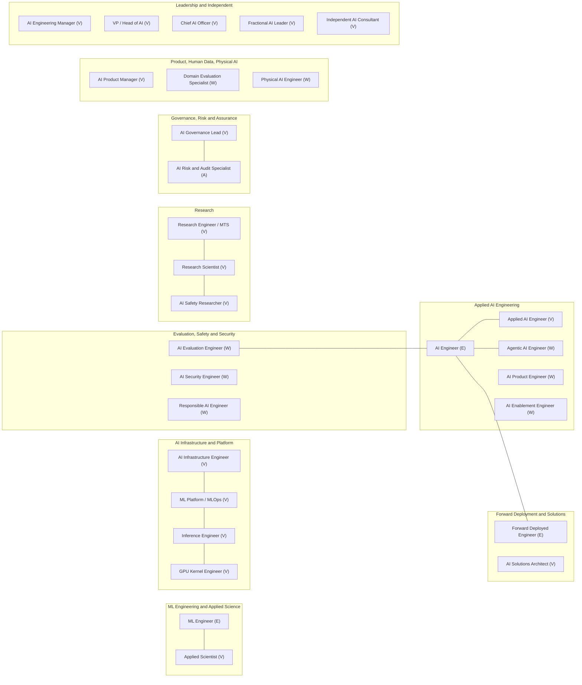

# GenAI Role Master Catalog
## Every GenAI, ML-Systems and AI-Governance Role: Classified, De-duplicated and Evidence-Graded

> **Updated:** 2026-11-04 · **Scope:** 29 canonical GenAI roles and 241 classified title strings, de-duplicated and calibrated against posting volume.
> **Evidence standard:** EGP-1.0 grades (A–E, M) · **Evidence window:** posting counts 2026-06-09 → 2026-11-02; pay, survey and regulatory evidence 2023–2026, dated at each use · **Temporal anchor:** October 2026
> **Inputs:** 22 research sessions, [FAD.md](../../research/FAD.md), [DECISIONS.md](../../research/DECISIONS.md) (D-002), and a public-page refresh of JobsPipe retrieved 2026-11-02
> **Companion files:** [role-rankings.md](role-rankings.md) ranks the roles · [role-skill-maps.md](../03-skills-and-tech/role-skill-maps.md) lists every skill per role · [data/role_scores.json](../../data/role_scores.json) and [scripts/rank_roles.py](../../scripts/rank_roles.py) reproduce the scores · [role-skill-inventories.md](../03-skills-and-tech/role-skill-inventories.md) and [skills-vocabulary.md](../03-skills-and-tech/skills-vocabulary.md) type every skill per role, with evidence · [resume-strategy.md](../06-job-search/resume-strategy.md) and [resume-skills-matrix.md](../06-job-search/resume-skills-matrix.md) turn each role's skills into resumes

---

## 0. Summary

This file answers one question: **which GenAI roles exist, what is each one, and how sure are we?** It is the source of truth for the role IDs (slugs) used by the ranked catalog, the skills catalog and future `02-roles/` pages.

| Bucket | Count | Meaning |
|---|---:|---|
| **Canonical roles** | **29** | 24 individual-contributor roles plus 5 leadership/independent tracks. Each has a profile (§3) and a score in the ranked catalog. |
| ↳ Established (E) | 3 | At least 50 live postings measured in a large corpus: AI Engineer, Machine Learning Engineer, Forward Deployed Engineer |
| ↳ Verified, volume unmeasured (V) | 17 | Real title at named employers, but no quorum-grade count yet |
| ↳ Emerging / watchlist (W) | 8 | Real postings, small or sub-quorum counts |
| ↳ Absorbed specialisation (A) | 1 | Work exists inside other professions (audit, model risk, privacy) |
| **Title strings indexed** (§4) | **241** | Every title seen in the research corpus or the market refresh, plus 26 labels with no source in the corpus (marked [P]), each mapped to a canonical role or to a non-role bucket |
| Quarantined title strings (Q) | 10 | The 8 quarantined title families of T0-01 D4 (Context Engineer counted with its 2 variants) |
| Unmeasured buzzwords (U) | 7 | Listed somewhere but never searched (5 from FAD §5.3, 2 unsourced labels [P]) |
| Candidate roles, not yet measured | 7 | Plausible roles with no title-level count yet (voice AI, on-device AI, retrieval engineer, DevRel, AI TPM, and two unsourced labels [P]) |
| Not a role | 24 | 8 persona strings, 4 certifications, 3 programmes (fellowships/residencies) and 9 other non-roles: a newsletter, an event name, a vendor document, a null search result, a salary-guide category, a persona heading, an out-of-scope "functional safety" title and two unverified titles |

**What the evidence corrects** (details in §9 and in [research/ERRATA.md](../../research/ERRATA.md)):

1. **Only three title families clear the 50-posting quorum: AI Engineer, Machine Learning Engineer and Forward Deployed Engineer.** That is T0-01's own verdict. FAD §5.1 adds Applied Scientist with "~700 US postings", but that number has no primary source: T0-01 measured 14 Applied Scientist postings at 12 AI startups and left Big Tech unmeasured. The "~700" first appears in T1-01:80 and was copied into FAD (ERRATA U1).
2. **241 title strings resolve to 29 canonical roles.** The others are aliases, seniority levels, transition personas, duplicate strings, certification names (one retired on 2026-06-30), a non-existent "AWS AI Solutions Architect", a newsletter ("Pragmatic Engineer") and two titles fabricated from source names ("Workday / ATS Systems Administrator", "AIDN Developer").
3. **The quarantine register matches T0-01 D4.** Five FAD-listed buzzwords were never searched: AI Whisperer, Neural Network Designer, Transformer Specialist, Foundation Model Engineer and Reasoning Engineer. This catalog labels them *unmeasured*, not "zero postings". LLMOps is a skill tag under ML Platform/MLOps, not a quarantined title.
4. **FAD's pay labels are corrected (ERRATA U4–U5).** **$312K** is the US all-company Senior median total comp (Levels.fyi 2025) and is not AI-specific. **₹1.06–1.22Cr** is the range of senior medians at the five best-paying Bengaluru employers, which is roughly the P90 ceiling; the Greater Bengaluru Senior SWE median on Levels.fyi (n=4,836, a large-employer-skewed sample) is **₹56.0L**. FAD's US Tier 0 and Tier 1 caps sit *below* the measured Entry ($155K) and Mid ($226K) medians.
5. **Every pay figure carries its source.** Per-role pay appears only where the corpus has a source; where it has none (for example FDE, AI PM and AI Solutions Architect), this file says so.
6. **India contractor tax, in numbers (T0-07).** §44ADA (s.58 under the Income-tax Act 2025) keeps about 83–84% of billing up to ₹75L and about 65% at ₹1.2Cr; ₹75L is about $79K. In the ₹75L to ~₹92–98L "dead zone" restructuring is not the answer; at ≥₹1Cr, T0-07 lists LLP and Pvt Ltd options whose cash outcomes differ by only ~₹3–10L.

**How the three files connect:** this catalog defines the role universe → the [ranked catalog](role-rankings.md) scores every canonical role on a 100-point index with uncertainty bands → the [skills catalog](../03-skills-and-tech/role-skill-maps.md) lists the full skill stack for each role.

---

## 1. Classification Rules

### 1.1 What counts as a role

Per **Decision D-002** (function-first taxonomy with a strict hiring quorum), a **canonical role** is a distinct *function*: it has its own skill signature and is hired under one dominant title cluster. Everything else maps onto a canonical role or into a non-role bucket:

| Type | Rule | Example |
|---|---|---|
| **Canonical** | Distinct function plus title cluster | AI Engineer |
| **Alias** | Different title, same function | GenAI Developer → `ai-engineer` |
| **Level variant** | Seniority word on a canonical role | Principal AI Engineer → `ai-engineer` |
| **Specialisation** | Narrow focus inside a canonical role | Context Retrieval → `applied-ai-engineer` |
| **Cluster variant** | Non-engineering role counted inside a title cluster | Deployment Strategist inside the FDE cluster |
| **Brief label** | Target label from the research-pipeline brief with no posting evidence | Post-Training Specialist |
| **Legacy / absorbed** | Title collapsed or folded into another role | Prompt Engineer → `ai-engineer` |
| **Quarantined** | Speculative title quarantined in T0-01 D4 (most failed the quorum with evidence; Vibe Engineer was not searched) | Cognitive Architect |
| **Unmeasured buzzword** | Listed somewhere but never searched | Transformer Specialist |
| **Candidate (unmeasured)** | Plausible role with no posting evidence in the corpus | Voice AI Engineer |
| **Persona / Certification / Programme / Not a role** | Origin background, credential, fellowship or non-job string | "Azure AI Engineer Associate" is a certification |

### 1.2 Status classes for canonical roles

| Code | Status | Test |
|:---:|---|---|
| **E** | Established | ≥50 distinct live postings for the title or alias cluster in a large corpus, Grade A/B measurement |
| **V** | Verified, volume unmeasured | Formal title in use at several named employers (or in visa wage filings), but no quorum-grade live count |
| **W** | Emerging / watchlist | Real postings with small-corpus or sub-quorum counts, or skill-mention evidence only |
| **A** | Absorbed specialisation | The work is real but hired inside other professions |

Leadership and independent tracks are not hired through a single posting title. For them, **V** means the track is evidenced by survey job families, mandates, rate cards or practitioner surveys, named in each profile (§3.9).

### 1.3 Evidence grades and conventions

- **Grades follow EGP-1.0** ([T1-02](../../research/sessions/T1-02-evidence-grounding-protocol.md)):
  - **A**: primary record opened by the researcher.
  - **B**: authoritative secondary source, or a platform aggregate with a disclosed method. Under EGP-1.0 rules, JobsPipe, Fast AI Jobs and Levels.fyi pages are Grade **B**, even where T0-01 or T0-02 used their own session-level "A".
  - **C**: practitioner reporting, small corpus or vendor survey.
  - **D**: judgement, model memory or recall.
  - **M**: model output, which inherits the weakest grade among its inputs.
- **Live postings are not openings, and openings are not hires.** Multi-city duplicates, mass posters and ghost postings inflate counts; one vendor reports 9.5% of postings visible for 45+ days ([T0-01](../../research/sessions/T0-01-genai-role-taxonomy-market-volume.md) objection 2).
- **Corpora used:**
  - **JobsPipe** (US/India/global role pages; JD skill shares): pages retrieved 2026-11-02 still show the 2026-10-19 corpus counts that T0-01 read.
  - **Fast AI Jobs** (AI-startup ATS boards).
  - **S09:** 3,647 AI-engineering postings at 198 companies, snapshot 2026-08-05. It skews senior and infra-heavy ([T0-03](../../research/sessions/T0-03-skills-compute-infra-eval-stack.md)).
  - **Skillenai:** a 90-day window to 2026-10-14 ([T0-16](../../research/sessions/T0-16-agentic-protocol-stack-enterprise-demand.md)).
  - **Levels.fyi** (pay; [T0-02](../../research/sessions/T0-02-global-regional-compensation-benchmarks.md), [T0-17](../../research/sessions/T0-17-compensation-progression-plateaus-equity.md)).
  - **US visa wage filings** (LCA; base-pay floors).
  - **Axial** (governance postings; [T0-15](../../research/sessions/T0-15-regulatory-ai-governance-career-families.md)).
- **Posted base excludes equity.** Axial found that only 14% of 43,480 US AI-engineering postings mention equity [B/C · T0-02], so every "posted base" comparison in this file (including FDE's "lowest family median") is base pay only.
- **Title inflation is real.** Indeed's count of frequently advertised AI-referencing titles rose from 264 (2022) to 822 (Q1 2026) [C · T0-01 F11]. That is why this catalog maps 241 title strings onto 29 functions.
- **"Derived"** marks arithmetic done for this catalog, for example "~66 postings" back-calculated from a share and its count.

### 1.4 Quorum and graduation tests (T0-01 D5)

A title moves up from W or Q only when it passes all seven tests:
1. **Volume:** ≥50 distinct requisitions (duplicates collapsed) in two independent corpora, one of them ATS-direct.
2. **Persistence:** holds on two counts ≥30 days apart.
3. **Breadth:** ≥10 employers; no single employer above 30%; ≥3 employers outside consulting and staffing.
4. **Skill signature:** ≥70% of postings share ≥3 core skills, and the set differs from AI Engineer by ≥2 core skills.
5. **Ladder:** ≥3 seniority levels with distinct pay bands.
6. **Lab adoption:** used as a formal role family by at least one tier-1 lab or Big Tech employer.
7. **Alias test:** if swapping in "AI Engineer" or "Solutions Architect" leaves the JD materially unchanged, the title is an alias.

Caveat (T0-01 objection 7): a fixed quorum of 50 ignores corpus size. It is 0.13% of Fast AI Jobs but a rounding error in JobsPipe, so T0-01 suggests adding a share-of-corpus floor.

### 1.5 Source key

| ID | Session | ID | Session |
|---|---|---|---|
| T0-01 | [Role taxonomy & market volume](../../research/sessions/T0-01-genai-role-taxonomy-market-volume.md) | T0-11 | [Certification ROI](../../research/sessions/T0-11-certification-cloud-credential-roi.md) |
| T0-02 | [Global compensation benchmarks](../../research/sessions/T0-02-global-regional-compensation-benchmarks.md) | T0-12 | [Communities & visibility](../../research/sessions/T0-12-high-signal-communities-technical-visibility.md) |
| T0-03 | [Skills, compute & eval stack](../../research/sessions/T0-03-skills-compute-infra-eval-stack.md) | T0-13 | [Portfolio standards](../../research/sessions/T0-13-production-portfolio-proof-of-work-standards.md) |
| T0-04 | [ATS & funnel math](../../research/sessions/T0-04-ats-filtering-funnel-conversion-math.md) | T0-14 | [AI system design interviews](../../research/sessions/T0-14-ai-system-design-interview-patterns.md) |
| T0-05 | [Unconventional hiring & OSS](../../research/sessions/T0-05-unconventional-hiring-tactics-oss-audits.md) | T0-15 | [Regulatory & governance careers](../../research/sessions/T0-15-regulatory-ai-governance-career-families.md) |
| T0-06 | [Transition timelines (5 backgrounds)](../../research/sessions/T0-06-career-transition-timelines-5-backgrounds.md) | T0-16 | [Agentic protocol stack demand](../../research/sessions/T0-16-agentic-protocol-stack-enterprise-demand.md) |
| T0-07 | [India remote tax](../../research/sessions/T0-07-india-remote-tax-statutory-compliance.md) | T0-17 | [Comp progression & equity](../../research/sessions/T0-17-compensation-progression-plateaus-equity.md) |
| T0-08 | [Visa pathways](../../research/sessions/T0-08-global-talent-visa-relocation-pathways.md) | T0-18 | [Freelance & fractional economics](../../research/sessions/T0-18-freelance-fractional-ai-practice-economics.md) |
| T0-09 | [First 90 days](../../research/sessions/T0-09-onboarding-probation-first-90-days.md) | T1-01 | [Repository architecture](../../research/sessions/T1-01-repository-information-architecture.md) |
| T0-10 | [Career tooling](../../research/sessions/T0-10-career-tooling-ecosystem-12-stage-funnel.md) | T1-03 | [Interview & negotiation](../../research/sessions/T1-03-interview-execution-offer-negotiation.md) |
| JP | JobsPipe public pages, retrieved 2026-11-02 ([jobspipe.dev/jobs](https://jobspipe.dev/jobs/ai-engineer/usa), [job-description](https://jobspipe.dev/job-description/ai-engineer)) | T2-01 | [Tier-calibrated playbooks](../../research/sessions/T2-01-tier-calibrated-execution-playbooks.md) |

---

## 2. Canonical Role Registry

### 2.1 Family map

### 2.2 Registry

Rank = position in the [ranked catalog](role-rankings.md). IC roles are ranked 1–24; leadership and independent tracks are ranked L1–L5 among themselves.

| Slug | Canonical role | Family | Status | Best demand evidence | Best pay evidence | Rank |
|---|---|---|:---:|---|---|:---:|
| `ml-engineer` | [Machine Learning Engineer](#profile-ml-engineer) | ML Eng & Applied Science | **E** | US 1,084 / global 2,157 / India 90 live [B · JP, T0-01] | US TC P50 $280K, P90 $497.5K [B · T0-02] | 1 |
| `ai-engineer` | [AI Engineer](#profile-ai-engineer) | Applied AI Engineering | **E** | US 1,697 / global 3,944 / India 398 live [B · JP, T0-01] | US TC P50 $154K, P90 $280K [B · T0-02] | 2 |
| `research-engineer` | [Research Engineer / MTS](#profile-research-engineer) | Research | V | 2025 LCA: OpenAI MTS-RE 84, Anthropic RE 63 positions; live count unmeasured [B · T0-02] | OpenAI/Anthropic SWE-MTS TC median $875K / $882.5K [B · T0-02] | 3 |
| `forward-deployed-engineer` | [Forward Deployed Engineer](#profile-forward-deployed-engineer) | Deployment & Solutions | **E** | 933-role cluster at 343 AI startups; ~48% engineer-titled [B · T0-01 F3] | Posted base $180–248K (n=304), lowest family median [B · T0-03] | 4 |
| `applied-ai-engineer` | [Applied AI Engineer](#profile-applied-ai-engineer) | Applied AI Engineering | V | 16 of newest 50 AI rows (~100 extrapolated) [C · T0-01] | None in corpus | 5 |
| `research-scientist` | [Research Scientist (AI/ML)](#profile-research-scientist) | Research | V | 2025 LCA: OpenAI MTS-RS 68 positions [B · T0-02] | OpenAI RS TC ~$1.25M [B]; Pave equity $4.1–4.7M [A · T0-02] | 6 |
| `applied-scientist` | [Applied Scientist](#profile-applied-scientist) | ML Eng & Applied Science | V | Only count: 14 at 12 AI startups (Jun 2026); Big Tech unmeasured [B · T0-01] | None in corpus (scored on a Big Tech MLE proxy) | 7 |
| `ai-infrastructure-engineer` | [AI Infrastructure / GPU Platform Engineer](#profile-ai-infrastructure-engineer) | Infra & Platform | V | 52 base-disclosing infra postings (S09) [B · T0-03] | Posted base $203–270K, level with AI Engineer [B · T0-03] | 8 |
| `inference-engineer` | [Inference / LLM Serving Engineer](#profile-inference-engineer) | Infra & Platform | V | Rise 28 (small corpus); ≥8 named JDs [C · T0-01, T0-03] | Typical JD base ~$270K; range $150–485K across 8 JDs [B/C · T0-03] | 9 |
| `ai-product-manager` | [AI Product Manager](#profile-ai-product-manager) | Product & Program | V | No AI-PM title count; ≥~970 US PM postings mention AI (upper bound, not titles) [M · JP] | None in corpus | 10 |
| `ml-platform-engineer` | [ML Platform / MLOps Engineer](#profile-ml-platform-engineer) | Infra & Platform | V | "Probable, count missing"; GCC gap 18–43% [C · T0-01] | Posted base $186–277K (n=10) [B · T0-03] | 11 |
| `agentic-ai-engineer` | [Agentic AI Engineer](#profile-agentic-ai-engineer) | Applied AI Engineering | W | ~66 + 28 postings in 90 days [C · T0-16] | None (AI Engineer variant) | 12 |
| `ai-solutions-architect` | [AI / GenAI Solutions Architect](#profile-ai-solutions-architect) | Deployment & Solutions | V | No AI-architect title count; ≥~350 US SA postings mention AI (upper bound, not titles) [M · JP] | None in corpus | 13 |
| `ai-evaluation-engineer` | [AI Evaluation Engineer](#profile-ai-evaluation-engineer) | Eval, Safety & Security | W | Rise 26; named JDs; skill in 19.0% of postings [C/B · T0-01, T0-03] | Premium unverified [T0-03] | 14 |
| `gpu-kernel-engineer` | [GPU Kernel / ML Compiler Engineer](#profile-gpu-kernel-engineer) | Infra & Platform | V | Kernels in 6.6% of S09 postings (a skill share) [B · T0-03] | NVIDIA base $152–356.5K [B · T0-03] | 15 |
| `ai-governance-lead` | [AI Governance Programme Lead](#profile-ai-governance-lead) | Governance & Assurance | V | 1,997 US postings Jan–Sep 2026 [C · T0-15] | Median $169K (probably top of range); IAPP $152–170K [C/B · T0-15] | 16 |
| `physical-ai-engineer` | [Physical AI / Robotics AI Engineer](#profile-physical-ai-engineer) | Physical AI | W | 8 of newest 50 AI rows, one employer [B · T0-01] | None in corpus | 17 |
| `ai-safety-researcher` | [Frontier AI Safety Researcher](#profile-ai-safety-researcher) | Research | V | ~600 technical FTEs across 67 orgs [C · T0-15] | None for this market | 18 |
| `ai-security-engineer` | [AI Security Engineer / AI Red Teamer](#profile-ai-security-engineer) | Eval, Safety & Security | W | ~23 postings in 90 days [C · T0-16] | None in corpus | 19 |
| `ai-enablement-engineer` | [AI Enablement Engineer](#profile-ai-enablement-engineer) | Applied AI Engineering | W | ~53 postings in 90 days [C · T0-16] | None in corpus | 20 |
| `ai-product-engineer` | [AI Product Engineer (AI Frontend)](#profile-ai-product-engineer) | Applied AI Engineering | W | Thin and senior-skewed [C · T0-06] | One posting $250–315K [C/D · T0-06] | 21 |
| `ai-risk-assurance-specialist` | [AI Risk, Audit & Compliance Specialist](#profile-ai-risk-assurance-specialist) | Governance & Assurance | A | Specialisation inside audit/model-risk [B/C · T0-15] | Deloitte $171.6–338.3K posted [C · T0-15] | 22 |
| `responsible-ai-engineer` | [Responsible AI / AI Governance Engineer](#profile-responsible-ai-engineer) | Eval, Safety & Security | W | Thin niche, few openings [C · T0-15] | Stryker $112.8–239.9K [C · T0-15] | 23 |
| `domain-evaluation-specialist` | [Domain Evaluation Specialist / AI Trainer](#profile-domain-evaluation-specialist) | Human Data & Eval Ops | W | Mercor >30,000 experts [C/D · T0-06] | ~$85–110/hr contract [C/D · T0-06] | 24 |
| `ai-engineering-manager` | [AI Engineering Manager / Director](#profile-ai-engineering-manager) | Leadership | V | Lead/manager label on 5.6% of AI Eng postings [B · JP] | Anthropic MTS (Manager) base median $405K [B · T0-02] | L1 |
| `vp-head-of-ai` | [VP / Head of AI](#profile-vp-head-of-ai) | Leadership | V | Radford "Head of AI" survey job family (data paywalled); no count [B · T0-02] | None in corpus | L2 |
| `chief-ai-officer` | [Chief AI Officer](#profile-chief-ai-officer) | Leadership | V | OMB M-25-21 federal mandate [B · T0-15] | None in corpus | L3 |
| `independent-ai-consultant` | [Independent AI Consultant](#profile-independent-ai-consultant) | Independent | V | Network-driven; no posting count | Asks $150–250/hr (US) [C · T0-18] | L4 |
| `fractional-ai-leader` | [Fractional Head of AI / CAIO](#profile-fractional-ai-leader) | Independent | V | CAIO 6 then 10 posts per 90 days (label "falling sharply") [C · T0-18] | Retainers ~$8–13K/month [C · T0-18] | L5 |

---

## 3. Role Profiles

Each profile extends the T1-01 role-page contract (definition, demand, skill requirements, journey) with pay evidence and watch-outs; the full skill list is in the [skills catalog](../03-skills-and-tech/role-skill-maps.md). Feeder timelines come from T0-06's model at 15–20 hours a week. They are **Grade D model outputs, conditional on success**; no persona-level success rates exist.

### 3.1 Applied AI Engineering

#### `ai-engineer`: AI Engineer · E · Rank 2
- **What it is:** builds LLM-powered product features: API orchestration, retrieval (RAG), agents, evals and deployment. The title is a heterogeneous umbrella; robotics, construction and Power Platform variants share it [B · T0-01 F2].
- **Demand:**
  - Counts [B · JP, T0-01 F1]: US 1,697 live; India 398; global 3,944. Fast AI Jobs lists 326 at 183 AI startups. LinkedIn Jobs on the Rise 2026 ranks it #1.
  - Posting mix [B · JP JD]:
    - Seniority labels: senior 24.6%, entry 7.0%, mid 6.0%, lead/manager 5.6%.
    - Remote 11.0%; pay disclosed 19.6%.
    - Where: US 27.9%, India 13.6%. These JD shares imply India at ~0.49× the US, but live counts give 0.23× (398 vs 1,697); T0-01 flags the conflict without reconciling it [B · T0-01 F10].
- **Pay:**
  - Levels.fyi US TC [B · T0-02]: P25 $110K / P50 $154K / P75 $212.5K / P90 $280K (n=335).
  - Posted base [B · T0-03]: AI Engineer (Application) $200–275K (n=55). Across all S09 AI-engineering postings: Senior $185–253K (n=462); Staff+/Principal $230–310K (n=322).
  - Bengaluru [B · T0-02, T0-17]: P50 ₹21.4–24.5L, P90 ₹62.6L (unstable between snapshots).
  - The title earns about 0.55× the MLE title at every percentile. T0-02 calls this "a title and employer-mix gap": about half is employer mix, and within Google the MLE title still earns 26–39% more [B · T0-02].
- **Skill signature:**
  - Python 78.4%, LLM 76.7%, agentic AI 59.3%, RAG 54.0%, ML 39.8%, Azure/AWS 35.1% each, CI/CD 34.4%, vector DBs 32.6%, prompt engineering 31.1% of postings [B · JP JD].
  - Differentiators: eval harnesses, durable agent runtimes, cost/latency engineering [B · T0-03]. → [Skills](../03-skills-and-tech/role-skill-maps.md#skills-ai-engineer)
- **Who hires (US):** Capital One 33, TCS 22, American Express 16, Deloitte 13, Infosys 12. Enterprise- and services-heavy [B · T0-01 F2].
- **Entry routes:** backend ~6 months; frontend ~7 (as an AI product/full-stack engineer); data scientist ~8; BI analyst ~11 [D · T0-06 R2].
- **Watch:** the table-stakes layer (SDK calls, naive RAG, prompt-only work) is commoditised [B · T0-03 §6.4]. GenAI-specific volume is lower than 1,697 because the family includes non-GenAI variants.
- **Aliases:** GenAI Engineer/Developer (India GCC label), AI Developer, LLM Engineer, AI Application Engineer, Full-Stack AI Engineer, Backend LLM Engineer. Legacy: Prompt Engineer.

#### `applied-ai-engineer`: Applied AI Engineer · V · Rank 5
- **What it is:** customer- and solutions-facing LLM engineering at labs and AI vendors: delivery for customers, evals, and safety in regulated settings [C · T0-01 D3].
- **Demand:**
  - 16 of the newest 50 Fast AI Jobs AI-Engineer rows (2026-10-19). That is about 100 of 326 if the sample is representative (an extrapolation) [C · T0-01 D2].
  - Named postings [B · T0-01 D7]:
    - OpenAI: Startups, Digital Natives, Codex, Partner Applied AI Engineer.
    - Anthropic: Beneficial Deployments, Startups, Enterprise Tech.
    - Scale: Global Public Sector.
    - Databricks: Context Retrieval.
- **Pay:** no role-specific data in the corpus. The employer mix includes frontier labs, whose SWE/MTS TC medians are $875–882.5K [B · T0-02]. → [Skills](../03-skills-and-tech/role-skill-maps.md#skills-applied-ai-engineer)
- **Entry routes:** main backend route (~6 months) and PhD route (~8 months) in T0-06 [D].
- **What would change the status:** an isolated count of ≥50 in two corpora.

#### `agentic-ai-engineer`: Agentic AI Engineer · W · Rank 12
- **What it is:** builds tool-using, multi-step agent systems: state machines, durable execution, tool gateways and human approvals.
- **Demand:**
  - Skillenai, 90 days to 2026-10-14 [C · T0-16]: ~66 "Agentic AI Engineer" postings (derived) plus 28 "Agent Engineer".
  - ~5 of the newest 50 AI rows [C · T0-01].
  - *Agentic AI* is a skill in 59.3% of AI Engineer postings: "the split is happening as skills inside AI Engineer postings, not as new titles" [B · T0-01 F4].
- **Pay:** no title-specific data.
- **Skill signature:** LangGraph is named in 35.8% of Agentic AI Engineer postings vs MCP in 13.8% [C · T0-16]. Also durable runtimes, human-in-the-loop (HITL), idempotency and sandboxing [B · T0-03]. → [Skills](../03-skills-and-tech/role-skill-maps.md#skills-agentic-ai-engineer)
- **Watch:** framework churn (AutoGen dormant; Microsoft Agent Framework 1.0 shipped 2026-04-02). In a 20-system study, 85% of production teams ran custom loops [A · T0-03 S31].
- **Aliases:** Agent Engineer, AI Agent Engineer, Agentic Systems / Multi-Agent Engineer, Principal Agentic AI Engineer.

#### `ai-enablement-engineer`: AI Enablement Engineer · W · Rank 20
- **What it is:** drives internal AI adoption: internal copilots and agents, MCP integrations, developer-productivity tooling. Its non-coding variant is the AI ops/enablement lead.
- **Demand:** ~53 postings in 90 days. 30.2% (16) mention MCP, the highest MCP share of any title [C · T0-16]. → [Skills](../03-skills-and-tech/role-skill-maps.md#skills-ai-enablement-engineer)
- **Pay:** none in corpus.
- **Entry routes:** backend/DevEx engineers; non-technical ops lane in ~7 months [D · T0-06].
- **Watch:** internal-adoption roles may be transitional.

#### `ai-product-engineer`: AI Product Engineer (AI Frontend) · W · Rank 21
- **What it is:** frontend and full-stack engineers building AI-native UX: streaming responses, tool-use visualisation, HITL checkpoints, generative components [C · T0-06].
- **Demand:** "thin and senior-skewed". Postings seen: Productboard, Artisan, and one recruiter-listed Staff AI Frontend role that appears under more than one company name [C/D · T0-06 KF-6].
- **Pay:** one Staff AI Frontend posting at $250–315K, 6+ years [C/D · T0-06]. → [Skills](../03-skills-and-tech/role-skill-maps.md#skills-ai-product-engineer)
- **Entry route:** frontend → AI product/full-stack engineer in ~7 months [D]. Apply under "full-stack AI engineer". Client-side/on-device AI "is a differentiator, not a job by itself" [T2-01].
- **Aliases:** AI-Frontend Engineer, Frontend Engineer (AI), Staff AI Frontend Engineer. Brief label: Agent Interface Architect.

### 3.2 ML Engineering and Applied Science

#### `ml-engineer`: Machine Learning Engineer · E · Rank 1
- **What it is:** builds, trains, adapts and serves models: training pipelines, fine-tuning, inference, recsys/ads/AV, and increasingly LLM systems. LLM is named in 45.0% of MLE postings [B · JP JD].
- **Demand:**
  - Counts [B · T0-01 D2]: US 1,084; global 2,157; India 90; UK 108; Canada 60. Fast AI Jobs lists 273 at 159 AI startups.
  - Posting mix [B · JP JD]:
    - Seniority labels in JD text: entry 13.7%, senior 23.2%, lead/manager 9.2%. JobsPipe *title facets* measure differently: senior 814, lead 359, entry 240 of 2,157 (~38% / 17% / 11%) [B · T0-01 D3].
    - Remote 14.0%; pay disclosed 38.5%.
    - Where: US 50.3%, India 7.7%.
- **Pay:**
  - Levels.fyi US TC [B]: P25 $200K / P50 $280K / P75 $385.5K / P90 $497.5K (n=1,063).
  - Big Tech levels [B · T0-02]: Meta E5 $458K, E6 $782K; Google L5 $393–445K, L6 $607–646K, L7 $743K.
  - Posted base [B · T0-03]: $213–288K (n=201).
  - India [B · T0-02]: Bengaluru P50 ₹44.5L, P90 ₹94.6L (n=96); Hyderabad P50 ₹30.3L.
- **Skill signature:** ML 98.6%, Python 71.3%, PyTorch 48.2%, LLM 45.0%, data structures 33.7%, deep learning 32.6%, TensorFlow 31.8%, A/B testing 23.5%, NLP 23.3%, C++ 23.3% [B · JP JD]. → [Skills](../03-skills-and-tech/role-skill-maps.md#skills-ml-engineer)
- **Who hires (US):** TikTok 74, Adobe 21, Apple 20, Capital One 20. Big Tech, recsys and AV [B · T0-01 F2].
- **Entry routes:** data scientist → MLE 6–18 months; career changer 12–24 months (vendor timelines) [D · T0-06]. PhD → applied roles ~8 months [D].
- **Watch:** in a study of 20 deployed systems, 70% used off-the-shelf models without SFT or RL [A · T0-03 S31]. In all three corpora (2026 snapshots), evals outrank fine-tuning in postings [B · T0-03].
- **Aliases:** ML Engineer, AI/ML Engineer, Deep Learning Engineer, Open-Source MLE. Domain variants (NLP, CV, RecSys) are not measured separately.

#### `applied-scientist`: Applied Scientist · V · Rank 7
- **What it is:** research-to-production scientists at large tech firms: modelling, experimentation and shipping models.
- **Demand:** Fast AI Jobs listed 14 at 12 AI startups (cached 2026-06-09) [B · T0-01 D2]. **Big Tech volume is unmeasured.** The "~700" figure in FAD §5.1 has no primary source (ERRATA U1).
- **Pay:** none in corpus. The ranked catalog scores it with Big Tech MLE as a proxy (Meta E5 $458K; Google L5 $393–445K) [B, proxy]. → [Skills](../03-skills-and-tech/role-skill-maps.md#skills-applied-scientist)
- **Entry route:** PhD → Tier 2 Applied Scientist in ~8 months, the primary high-volume PhD corridor in T2-01 [D].
- **Next action:** count it at the 2026-12-01 recount (employer career sites plus the JobsPipe API).
- **Aliases:** Applied Research Scientist (a Radford job family with paywalled data), ML Scientist.

### 3.3 Forward Deployment and Solutions

#### `forward-deployed-engineer`: Forward Deployed Engineer · E · Rank 4
- **What it is:** engineers embedded with customers who deploy, integrate and adapt AI products end to end. The work needs vertical depth; one JD lists 2–6 years of experience and up to 50% travel [B · T0-01 D3].
- **Demand:**
  - **Volume [B · T0-01 F3]:**
    - 933 FDE-cluster roles at 343 AI startups (Fast AI Jobs, 2026-10-20), up ~20% from 779 at 288 in early August. That growth was in line with AI Engineer (+18.5%) and ML Engineer (+20.3%) over a similar window.
    - In S09, FDE is named in 33.2% of postings and at 69% of companies, the largest company mention pool [B · T0-03].
  - **Composition:** only ~48% of the newest 50 rows are engineer-titled. The rest are Deployment Strategists 6, FD product managers 6, managers/TPMs 6 and GTM engineers 4 [B; extrapolation C].
  - **Growth:** FDE postings rose >1,000% Jan–Aug 2026 vs 2025, from a small base [B · T0-06].
  - **~Aug 3 cached snapshot (779 roles at 288 startups):** by funding stage Series C 184, A 176, G+ 147, B 119, D 110; by location SF 172, NY 133, Remote 65. T0-01's source register dates both splits to this snapshot, although F3 prints the stage split beside the Oct-20 count [B · T0-01 S11].
- **Pay:**
  - Posted base $180–248K (n=304), the **lowest family median** in the S09 corpus [B · T0-03]. Posted base excludes equity (§1.3).
  - Median advertised pay >$188K vs ~$145K for software engineers [B · T0-06].
  - Startup equity should be risk-adjusted to 0.4–0.8× at Series C–D [C/D · T0-17].
- **Skill signature:** production coding plus GenAI and infrastructure skills plus customer judgement [B · T0-06]. Databricks' AI-FDE loop covers RAG over sensitive, fast-changing documents and evaluating a multi-agent system [C · T0-14]; T1-03 files it under the Application track. → [Skills](../03-skills-and-tech/role-skill-maps.md#skills-forward-deployed-engineer)
- **Who hires:** OpenAI, Databricks ("AI Engineer – FDE"), Scale, Writer, ElevenLabs [B · T0-01].
- **Entry routes:**
  - Backend: FDE-adjacent offers can come early via internal routes.
  - Frontend: frontend-heavy FDE roles.
  - Non-technical: FDE-adjacent in ~10 months, and coding is required [D · T0-06, T2-01].
- **Watch:** half the cluster is non-engineering, so protect the engineering scope. Postings were mostly non-remote in the August snapshot (Remote 65 of ~779) and one JD lists up to 50% travel, which makes it a weak fit for India-remote arbitrage.
- **Aliases:** FDSE, AI Deployment Engineer, Deployment Engineer, Forward Deployed AI Engineer, AI Engineer – FDE, Frontier Agents Engineer. Cluster variants: Deployment Strategist, FDPM, GTM Engineer, Forward Deployed Banker.

#### `ai-solutions-architect`: AI / GenAI Solutions Architect · V · Rank 13
- **What it is:** designs enterprise AI solutions on cloud and vendor stacks; pre-sales and delivery architecture.
- **Demand:**
  - **Market refresh [M from B]:** JobsPipe lists 1,515 live US Solutions Architect postings (2026-11-02). *generative-ai* is named in 17.1% of them and *artificial-intelligence* in 23.2%. That implies at least ~350 AI-mentioning SA postings (up to ~610 if the two tags never overlap). These are keyword mentions, not AI-architect titles; no title-level count exists.
  - **T0-01 [C]:** AI / Agentic / GenAI Architect titles are "probable, services-concentrated", with 6+ postings seen (Cognizant, Air India, Zoom, Korn Ferry).
- **Pay:** no AI-architect pay in corpus.
- **Skill signature (generic SA postings):** AWS 53.6%, leadership 43.0%, communication 42.9%, mentoring 35.1%, Azure 29.5%, compliance 25.3%, Python 23.6%, GCP 22.6% [B · JP JD]. → [Skills](../03-skills-and-tech/role-skill-maps.md#skills-ai-solutions-architect)
- **Who hires:** hyperscalers (Amazon "Sr. Specialist SA, GenAI/Bedrock GTM"; Google Cloud "Customer Engineer, AI/ML"), IT-services firms (TCS, Wipro, Cognizant, Capgemini) and staffing agencies [B · T0-11].
- **Watch:** certifications are tie-breakers mainly in IT-services, staffing and hyperscaler-partner channels. No single certification was verified in more than 10% of GenAI JDs, though T0-11 calls that threshold unproven [B/C · T0-11 F4].
- **Aliases:** AI Architect, Enterprise AI Architect, Agentic AI Architect, Principal AI Architect – Agentic, Customer Engineer AI/ML, AWS AI Architect. "Agent Architect (exact)" is quarantined.

### 3.4 AI Infrastructure and Platform

#### `ai-infrastructure-engineer`: AI Infrastructure / GPU Platform Engineer · V · Rank 8
- **What it is:** runs the compute estate behind training and inference: GPU clusters, scheduling, networking (NCCL/RDMA/InfiniBand), storage, reliability and capacity.
- **Demand:**
  - 52 base-disclosing "Infrastructure / Platform Engineer (GPU clusters, inference platforms)" postings in S09 [B · T0-03].
  - Distributed systems is named in 19.1% of S09 postings [B · T0-03].
  - OpenAI GPU-infrastructure postings [C · T0-17]; Physical Intelligence ML Infra [C · T0-01].
- **Pay:** posted base $203–270K (n=52), level with AI Engineer (Application) at $200–275K [B · T0-03]. OpenAI GPU-infrastructure base ranges $230–490K [C · T0-17]. → [Skills](../03-skills-and-tech/role-skill-maps.md#skills-ai-infrastructure-engineer)
- **Entry routes:**
  - Backend, SRE and DevOps engineers. "Strong infrastructure candidates without ML experience do well" in Anthropic design rounds [B · T0-14].
  - RadixArk's paid AI Infra Residency, listed at $200K [B · T0-05].
- **Specialisation:** distributed training / pre-training infrastructure. That title is not found in the corpus; the work is carried under MTS, Research Engineer or infrastructure titles.
- **Aliases:** AI Infrastructure Engineer, ML Infrastructure Engineer, GPU Cluster & Infra Platform Engineer.

#### `inference-engineer`: Inference / LLM Serving Engineer · V · Rank 9
- **What it is:** owns the inference data path: batching, KV cache, scheduling, quantisation, speculative decoding, latency and cost. It splits into two kinds of work [B · T0-03]:
  - distributed-runtime engineering (Anthropic J1/J2);
  - engine and kernel optimisation (NVIDIA, Together, Baseten, Inferact).
- **Demand:**
  - Rise lists 28 "inference engineer" postings in a small corpus [C · T0-01 D2].
  - Named postings: Anthropic, NVIDIA, Together AI, Baseten, Inferact, RadixArk, Red Hat [A/B · T0-03, T0-05].
  - The inference-optimisation *concept* appears in 14.8% of S09 postings (57.1% of companies), but named engines in only 2.0–3.9% [B · T0-03].
- **Pay:** the typical posted base across the ≥8 named JDs is ~$270K, with a range of $150–485K [B/C · T0-03 §6.2].
  - Base pay by employer [A/B · T0-03]:

    | Employer | Base pay |
    |---|---|
    | Anthropic (inference) | $320–485K |
    | Anthropic (inference runtime) | $405–485K |
    | NVIDIA | $152–356.5K |
    | Together AI | $160–230K + equity |
    | Baseten | $150–360K |
    | Inferact | $200–400K + equity |

  - Systems and research-engineering titles show **+13–31% base in two datasets, "not validated"** [B · T0-02].
  - "Compensation tracks employer tier and seniority, not app vs infra" [B · T0-03 KF1].
- **Skill signature:** vLLM, SGLang, TensorRT-LLM, PagedAttention, chunked prefill, speculative decoding, FP8/FP4/AWQ/GPTQ, NVIDIA Dynamo, roofline analysis with Nsight. TGI was archived on 2026-03-21 [A/B · T0-03]. → [Skills](../03-skills-and-tech/role-skill-maps.md#skills-inference-engineer)
- **Entry routes:** backend → Tier 3 inference in ~10–14 months with infrastructure depth [D · T2-01]. The OSS route is demanding: vLLM committers had about 30+ substantial PRs [A · T0-05].
- **Watch:** a large drop in closed-model prices would narrow self-hosting demand (T0-03 tripwire).
- **Aliases:** LLM Serving Engineer, Inference Systems Engineer, Model Performance Engineer, Inference Runtime Engineer, MTS Inference, Optimization Engineer (LLM Serving).

#### `ml-platform-engineer`: ML Platform / MLOps Engineer · V · Rank 11
- **What it is:** builds the internal platform for the model lifecycle and LLM serving. Scope: Kubernetes serving, LLM/MCP gateways, observability, CI/CD for models and prompts, cost attribution. Also absorbs LLMOps and the AI control plane.
- **Demand:**
  - T0-01 rates it "probable, count missing"; the GCC supply gap in AI/MLOps/platform roles is 18–43% (Quess) [C].
  - 10 base-disclosing MLOps postings in S09 [B · T0-03].
  - Three enterprise MCP control-plane postings: Boston Scientific, PTC, and a Workato PM role [C · T0-16].
  - "Agent Gateway Engineer" returned 0 postings [C · T0-16].
- **Pay:** MLOps/ML Platform posted base $186–277K (n=10, small) [B · T0-03]. Bengaluru MLOps P50 ₹23.6L, P90 ₹63.5L [C · T0-02].
- **Skill signature:** vLLM/SGLang on Kubernetes, Dynamo / Dynamo Triton, Ray Serve, KServe; Prometheus/Grafana for TTFT, TPOT and KV saturation; OpenTelemetry; gateways (LiteLLM, APIM); OAuth/OIDC [A/B · T0-03, T0-16]. → [Skills](../03-skills-and-tech/role-skill-maps.md#skills-ml-platform-engineer)
- **Entry routes:** backend, DevOps and SRE. In DevOps postings, Kubernetes appears in 69.4% and Terraform in 59.1% [B · JP JD].
- **Aliases:** MLOps Engineer, AI Platform Engineer, Platform Engineer (Enterprise AI), Senior Enterprise AI Control Plane Engineer. Absorbed: LLMOps Engineer, Agent Gateway Engineer.

#### `gpu-kernel-engineer`: GPU Kernel / ML Compiler Engineer · V · Rank 15
- **What it is:** writes and tunes GPU kernels and compiler paths for training and inference (CUDA, Triton, CUTLASS, tile DSLs, XLA/NeuronX), and validates numerics.
- **Demand:** CUDA/GPU kernels are named in 6.6% of S09 postings (29.3% of companies) [B · T0-03]. Postings at NVIDIA, AMD, River AI and Together AI [B · T0-13].
- **Pay:** NVIDIA DL SWE base $152–356.5K; frontier runtime roles $405–485K base [A/B · T0-03]. → [Skills](../03-skills-and-tech/role-skill-maps.md#skills-gpu-kernel-engineer)
- **Watch:** tile DSLs (Helion, CuteDSL, CUDA Tile IR) and automated kernel agents are abstracting raw kernel writing [B · T0-03]. No labour data shows a decline either way. GPU MODE leaderboards give a verifiable artifact route [T0-12].
- **Aliases:** Kernel Engineer, CUDA Engineer, ML Compiler Engineer, DL SWE (NVIDIA), MTS Developer Technology.

### 3.5 Evaluation, Safety and Security

#### `ai-evaluation-engineer`: AI Evaluation Engineer · W · Rank 14
- **What it is:** designs eval harnesses, golden sets, LLM-judge calibration, regression gates and online monitoring.
- **Demand:**
  - **As a title:**
    - Rise keyword "LLM evaluation": 26 [C · T0-01].
    - Named postings [B/C]: Haparz (Senior & Staff AI Evaluation Engineer), Backbase (Principal, Hyderabad), deeprec (ML Engineer, LLM Evals & Agent Systems), Artificial Analysis (MTS, LM Evaluations), Auxilius (AI Engineer, LLMOps & Evaluation), FurtherAI.
  - **As a skill:**
    - In 19.0% of S09 postings and at 68.2% of companies [B · T0-03].
    - In 59.7% of AI-first roles, which T0-13 calls "common, not universal" [B · T0-13].
  - **The adoption gap:** in a vendor-run LangChain survey (n=1,340), 89% of agent teams report observability but only 52.4% run offline evals and 37.3% online evals [B/C · T0-03 KF4]. T0-03 calls this gap the primary hiring opportunity.
- **Pay:** the premium for pure eval roles is unverified [T0-03].
- **Skill signature:**
  - pytest CI regression; DeepEval or Promptfoo.
  - Judge calibration with Cohen's κ (raw agreement overstates quality by 33–41 points).
  - pass@k / pass^k; trace sampling [A/B · T0-03, T0-14].
  - Tool status: RAGAS dormant since Feb 2026; Promptfoo acquired by OpenAI. → [Skills](../03-skills-and-tech/role-skill-maps.md#skills-ai-evaluation-engineer)
- **Entry routes:** data scientists (eval edge), PhDs (measurement rigour), backend engineers (CI and observability) [D · T0-06].
- **Watch:** evals may stay a *skill inside AI Engineer* rather than becoming a standalone title. The career-safe move is to own evaluation inside whatever role you hold.
- **Aliases:** Evals Engineer, Model Quality Engineer, Staff / Principal AI Evaluation Engineer.

#### `ai-security-engineer`: AI Security Engineer / AI Red Teamer · W · Rank 19
- **What it is:** secures LLM and agent systems: prompt injection, tool and agent abuse, supply chain, MCP authorisation, red-teaming.
- **Demand:** ~23 "AI Security Specialist" postings in 90 days; 13.0% (3) mention MCP [C · T0-16]. JobsPipe lists 2,827 generic US Security Engineer postings (2026-11-02); the AI share is unmeasured [B · JP].
- **Pay:** none in corpus.
- **Evidence of need [A/B · T0-03, T0-16, T0-14]:**
  - CVSS 9.8 RCEs in SGLang and vLLM (2026).
  - Braintrust AWS breach (2026-05-04).
  - In ~5,200 OSS MCP servers, 53% rely on static secrets and 8.5% use OAuth.
  - The OWASP LLM and Agentic Top 10 lists.
  - → [Skills](../03-skills-and-tech/role-skill-maps.md#skills-ai-security-engineer)
- **Entry routes:** application-security and backend engineers. The Anthropic AI Security Fellow programme requires US/UK/Canada work authorisation [A · T0-12].
- **Aliases:** AI Security Specialist, AI Red Teamer, AI Security & Red Team Engineer.

#### `responsible-ai-engineer`: Responsible AI / AI Governance Engineer · W · Rank 23
- **What it is:** technical compliance engineering: guardrails; fairness, hallucination and subgroup evals; logging and documentation for the EU AI Act, NIST and ISO 42001 [B/C · T0-15].
- **Demand:** a thin technical niche; "expect few openings". Postings at Stryker, Beacon Hill, Cognizant (Chennai), Infosys (Bengaluru; fresher; closed) and Workday (title only) [C · T0-15].
- **Pay:** Stryker $112.8–239.9K and Beacon Hill $75–85/hr (posted, C); IAPP tech-sector *technical* AI-governance median $221K (B) [T0-15]. → [Skills](../03-skills-and-tech/role-skill-maps.md#skills-responsible-ai-engineer)
- **Note:** T0-15 treats this as "an extension of ML-platform, MLOps and security engineering" ("ordinary MLOps" plus regulatory controls).
- **Aliases:** Responsible AI Engineer, AI Governance Engineer, AI Safety Engineer (Enterprise), Senior Responsible AI Systems Engineer, Sr. Responsible AI Analyst.

### 3.6 Research

#### `research-engineer`: Research Engineer / Member of Technical Staff · V · Rank 3
- **What it is:** frontier-lab engineering for research: training runs, post-training/RL, evals and research infrastructure. At OpenAI and Anthropic the title is usually "Member of Technical Staff" (MTS), which hides both function and level [B · T0-02].
- **Demand:** the live count is unmeasured [T0-01]. 2025 visa wage filings (LCA) show [B · T0-02]:
  - OpenAI: MTS-Research Engineer 84, MTS-Software Engineer 107, MTS-AI Systems 67 positions.
  - Anthropic: Research Engineer 63, MTS 223 positions.
  - Filings are not live postings.
- **Pay:**
  - Lab TC medians [A/B · T0-02]: OpenAI SWE/MTS $875K (n=242); Anthropic $882.5K (n=49).
  - By level: OpenAI L2 $249K → L5 $911K [B · T0-02]; L7 ≈ $1.89M (snapshot median, ±30–50%) [C · T0-17]; Anthropic Senior $621K → Staff $1.41M [B · T0-02].
  - LCA base medians: OpenAI MTS-RE $335K; Anthropic RE $215K.
  - **Equity is 49–72% of senior lab packages** (OpenAI L4–L5 59–60%; Anthropic Senior 49%; Lead/Staff 61–72%) [B · T0-02]. Risk-adjust it to 0.5–0.8× (a model output); tenders are tenure-gated [C/D · T0-17].
  - → [Skills](../03-skills-and-tech/role-skill-maps.md#skills-research-engineer)
- **Entry routes:**
  - PhD → Tier 2 (high-volume) ~8 months; Tier 3 (extended) 12–18 months [D · T2-01].
  - Anthropic Fellows: no PhD required. Anthropic reports that >40% of the first cohort later joined it full-time 🏷️ (self-reported by the programme owner; T0-06 discloses an Anthropic conflict of interest) [B · T0-06].
- **Absorbs:** Post-Training / RLHF Engineer. That exact title is below quorum: Rise counts were post-training 9, RLHF 17, RL 9 [C · T0-01 F9].
- **Aliases:** MTS; MTS – Research Engineer / Software Engineer / AI Systems Engineer; Frontier Lab Research Engineer; Post-Training Specialist.

#### `research-scientist`: Research Scientist (AI/ML) · V · Rank 6
- **What it is:** originates new methods, publishes and leads research agendas.
- **Demand:** the AI-specific count is unmeasured. OpenAI filed 68 MTS-Research Scientist LCA positions in 2025 [B · T0-02]. JobsPipe research-scientist postings (all fields): LLM 24.4%, RL 17.1%, remote 3.3%, US 65.0% [B · JP JD].
- **Pay:**
  - Lab TC: OpenAI RS ~$1.25M (cached) [B]; Anthropic $0.75–0.83M [C].
  - Pave: AI research scientists' median new-hire equity is $4.09M (P6) / $4.72M (M6), more than double ML/AI Engineering [A · T0-02].
  - OpenAI MTS-RS LCA base median $360K [B]; DeepMind London L5 £210–290K [C].
  - → [Skills](../03-skills-and-tech/role-skill-maps.md#skills-research-scientist)
- **Entry route:** PhD. Frontier research offers are "not plannable", a "lottery-style upside" [D · T0-06].
- **Aliases:** AI Research Scientist, MTS – Research Scientist, Senior Research Scientist (Lab). Level: apex named researchers (Tier 5).

#### `ai-safety-researcher`: Frontier AI Safety / Alignment Researcher · V · Rank 18
- **What it is:** alignment, interpretability, dangerous-capability evals and safety research at frontier labs and safety organisations.
- **Demand:** ~600 technical plus ~500 non-technical FTEs across 67 and 49 organisations (single-author 2025 estimate) [C · T0-15]. Technical headcount is growing ~21% a year [C].
- **Pay:** "no pay or volume figures for this market" [T0-15]. Lab-employed researchers sit on Research Scientist / Research Engineer ladders. → [Skills](../03-skills-and-tech/role-skill-maps.md#skills-ai-safety-researcher)
- **Headcount:** no source in the corpus gives a headcount for interpretability researchers, so it is kept as a specialisation without one.
- **Aliases:** AI Safety Engineer (Frontier Alignment), Alignment Researcher. Specialisation: Mechanistic Interpretability.

### 3.7 Governance, Risk and Assurance

#### `ai-governance-lead`: AI Governance Programme Lead / Manager · V · Rank 16
- **What it is:** the one dedicated, mostly non-coding governance career. It runs the AI inventory, risk method, committees, and conformity with the EU AI Act, NIST AI RMF and ISO 42001 [B/C · T0-15].
- **Demand:**
  - Axial counted 1,997 US AI-governance postings Jan–Sep 2026: ~2,700 a year annualised and ≈51 a week by arithmetic, although Axial itself quotes ~71 a week [C].
  - Axial data quality is mixed: the same n=1,997 appears on four pages with different windows, and the professional-services share is 44.9% on one page against 32–36% on others. T0-15 grades it C.
  - The programme-owner class is 6 of 13 sampled JDs (a purposive sample) [C].
  - 56% of postings are at firms with 10,000+ staff; 73% are senior or above [C].
  - UK: 119 live postings mention the EU AI Act, against 17,685 AI-citing postings (0.7%) [C].
  - India: no count.
- **Pay:**
  - Axial's median of $169K is probably the top of posted ranges, so typical offers are lower [C].
  - IAPP medians: $151.8K (AI governance only); $169.7K (with privacy) [B].
  - Tops of ranges by seniority: senior $208K, manager $244K, director $268K [C]. UK median £107.5K.
  - INR ranges: none sourced.
- **Prerequisites:** about 5 years in GRC, privacy, audit or security. Domain certifications (CIPP/CIPM, CISSP/CISA/CRISC) come first; AIGP is optional. AIGP appears in 8.9% of postings, CISSP in 10.4% [B/C · T0-15]. → [Skills](../03-skills-and-tech/role-skill-maps.md#skills-ai-governance-lead)
- **Regulatory clock (EU AI Act) [A · T0-15]:**
  - GPAI duties have applied since 2 Aug 2025.
  - Annex III high-risk duties from 2 Dec 2027.
  - Annex I from 2 Aug 2028.
- **Fit:** strong for GRC, privacy and audit professionals; poor for engineers looking for a fast switch.
- **Aliases:** AI Governance Officer / Manager / Lead / Specialist / Analyst, Responsible AI Governance Lead, Responsible AI Officer (an RBI report term). Legacy: AI Ethicist.

#### `ai-risk-assurance-specialist`: AI Risk, Audit & Compliance Specialist · A · Rank 22
- **What it is:** AI risk, audit and compliance work done inside existing professions:
  - algorithmic audits (NYC LL144, EU DSA);
  - model-risk validation (predictive AI under SR 26-2);
  - privacy / DPO;
  - ISO 42001 audit.
- **Demand [A/B/C · T0-15]:**
  - A Deloitte AI Risk & Validation listing seen 16 times.
  - 41 of 50 large banks had dedicated AI-governance staff at end-2024; there were 247 responsible-AI staff across all 50 (≈4.9 per bank).
  - NYC LL144: 18 of 391 employers posted an audit. EU DSA: 23 audit reports.
- **Pay:** posted ranges: Deloitte Manager / Senior Manager $171.6–338.3K; PwC AI Governance Manager $99–252.5K [C · T0-15].
- **Prerequisites:** the AAIA credential requires CISA, CIA or CPA [B · T0-15]. → [Skills](../03-skills-and-tech/role-skill-maps.md#skills-ai-risk-assurance-specialist)
- **Note:** SR 26-2 *excludes* generative and agentic AI, so GenAI risk has no settled owner [B · T0-15].
- **Aliases:** Algorithmic Auditor, AI Risk Manager / Model Risk Validator, Senior AI Risk Analyst, DPO (AI), ISO 42001 Auditor, Conformity Assessor. Legacy: AI Compliance Specialist.

### 3.8 Product, Human Data and Physical AI

#### `ai-product-manager`: AI Product Manager · V · Rank 10
- **What it is:** owns AI product outcomes for probabilistic systems: scoping, eval rubrics, success metrics, token economics and pilots.
- **Demand:**
  - JobsPipe lists 6,289 live US Product Manager postings (2026-11-02). *artificial-intelligence* appears in 15.4% and *agentic-ai* in 13.6%. That implies at least ~970 AI-mentioning PM postings (up to ~1,820 if the two tags never overlap) [M from B]. These are keyword mentions, not AI-PM titles; no title-level count exists.
  - PMs are 8.0% of 1,747 MCP-mentioning postings [C · T0-16].
- **Pay:** none in corpus.
- **Entry fee:** 4+ years as a PM plus one shipped model-powered feature [D · T0-06]. No transition success data exists [T0-06].
- **Archetypes:** assistant/copilot PM, AI platform PM, ML-feature PM, AI-ops/internal-tools PM [D · T0-06]. → [Skills](../03-skills-and-tech/role-skill-maps.md#skills-ai-product-manager)
- **Aliases:** Non-Technical AI PM, AI PM. Cluster variant: Forward Deployed PM.

#### `physical-ai-engineer`: Physical AI / Robotics AI Engineer · W · Rank 17
- **What it is:** AI for robots and physical systems: foundation and VLA models for robotics, sim-to-real.
- **Demand:** 8 of the newest 50 Fast AI Jobs AI-Engineer rows were Figure AI "Helix AI Engineer", all from one employer [B · T0-01 F2]. JobsPipe's US sample includes "Physical AI Engineer". → [Skills](../03-skills-and-tech/role-skill-maps.md#skills-physical-ai-engineer)
- **Pay:** none in corpus.
- **Watch:** single-employer concentration fails the D5 breadth test.
- **Aliases:** Helix AI Engineer. "Autonomous Systems Engineer" is an unsourced label [P]; it is not found in any session.

#### `domain-evaluation-specialist`: Domain Evaluation Specialist / AI Trainer · W · Rank 24
- **What it is:** domain experts who write rubrics, label golden sets, adjudicate disagreements and grade model outputs, as in-house leads or expert contractors.
- **Demand:** LinkedIn Jobs on the Rise ranks data annotators #4 (median 3.5 years of experience) [C]. Mercor has >30,000 experts on contract [C/D · T0-06].
- **Pay [C/D · T0-06]:**
  - Mercor: ~$85+/hr, ~$110/hr on average (Bloomberg, as relayed).
  - Range: ~$120/hr for software engineers up to $400/hr for civil-rights attorneys.
  - Terms: ≥10 h/week, at-will.
- **Entry route:** "weeks, if credentialed": 4+ years of experience, and MA/JD/MD/PhD for premium rates [C/D · T2-01]. → [Skills](../03-skills-and-tech/role-skill-maps.md#skills-domain-evaluation-specialist)
- **Watch:** "a bridge, not a destination" [T0-06].
- **Aliases:** Domain Evaluation Lead, Data Annotator, Expert Contractor (AI training), Data Operations & RLHF Lead.

### 3.9 Leadership and Independent Tracks

#### `ai-engineering-manager`: AI Engineering Manager / Director of AI Engineering · V · Rank L1
- **Demand:**
  - "Lead or manager" labels appear on 5.6% of AI Engineer postings and 9.2% of MLE postings [B · JP JD].
  - Named roles [C · T0-01 D3]: Head / Director / Manager of AI Engineering at Teradata, Front and Harrington Starr; Director FDE & AI GTM at Aircall; FDE Lead at n8n.
- **Pay:** Anthropic "MTS (Manager)" LCA base median $405K [B · T0-02]; T0-02 rejects LCA wages as a pay anchor because they are floors. No broad engineering-manager pay in the corpus.
- **Path:** AI engineers move into management in under 3 years (SignalFire) [C · T0-17]. → [Skills](../03-skills-and-tech/role-skill-maps.md#skills-leadership)

#### `vp-head-of-ai`: VP / Head of AI · V · Rank L2
- **Why V:** Radford maintains a "Head of AI" survey job family (its data is paywalled) [B · T0-02], and T0-01 D3 found Head / Director of AI Engineering posts (mapped to `ai-engineering-manager`).
- **Evidence gaps:** no posting count and no pay data in the corpus. Treat the score as judgement-heavy (low evidence confidence).

#### `chief-ai-officer`: Chief AI Officer · V · Rank L3
- OMB M-25-21 requires US federal agencies to appoint a CAIO within 60 days [B · T0-15].
- "76% of firms report a CAIO" comes from IBM via a secondary source [C · T0-01 F12].
- The EU AI Act names no required officer [A · T0-15].
- No pay data in the corpus.

#### `independent-ai-consultant`: Independent AI Consultant / Contractor · V · Rank L4
- **Rates [C/D · T0-18]:**
  - US asks $150–250/hr ("$300+ is a stretch tier"); senior AI contractors $130–235/hr.
  - UK median £550/day.
  - India-based senior engineers are quoted $50–100/hr.
- **Modelled net income [D]:** P50 US $105K, India $53K.
- **How clients are found:** 92% find clients through networks [C].
- **India tax (T0-07) [B]:**
  - §44ADA (s.58 under the Income-tax Act 2025) presumptive taxation keeps ~83–84% of billing up to **₹75L (≈$79K)**, provided cash receipts are ≤5%.
  - One rupee above ₹75L adds ~₹11.8L of tax. It takes ~₹92–98L of billing to recover (the "dead zone"). About 65% is kept at ₹1.2Cr.
  - Not legal or tax advice. → [Skills](../03-skills-and-tech/role-skill-maps.md#skills-leadership)

#### `fractional-ai-leader`: Fractional Head of AI / Fractional CAIO · V · Rank L5
- **Rates [C · T0-18]:** asks average $190–208/hr (P25–P75 $150–250). Offers run at 0.59–0.91× of asks; CAIO offers are $125–189/hr.
- **Retainers:** about $8–13K a month for 10–13 hours a week [C].
- **Demand (Go Fractional) [C]:** CAIO had 6, then 10 posts in 90 days across two reads (Go Fractional's label: "falling sharply") against 326 profiles. Fractional CTO had 19, then 17 posts (labels "rising sharply", then "rising") against 1,042–1,116 profiles. T0-18 rates this demand evidence "conflicting".
- **Modelled US net income [D]:** P50 $105K. P25 is $83K, falling to $19–38K if 30–60% of entrants stall.
- **Who answers the survey:** Fractional Jobs respondents (n=1,733 across all functions, including past and aspiring fractionals): 87% have 11+ years of experience; 83% are Director-level or above [C]. → [Skills](../03-skills-and-tech/role-skill-maps.md#skills-leadership)

---

## 4. Complete A–Z Title Index

All 241 title strings, sorted alphabetically (case-insensitive, punctuation ignored). Entries are generated from one structured list in [scripts/build_index.py](../../scripts/build_index.py) (`--update` rewrites this table, `--check` verifies it), so the sort order and counts are computed, not typed by hand. Notes marked [P] are labels with no source in the research corpus; they are listed so that they can be mapped to a canonical role or rejected.

<!-- BEGIN GENERATED INDEX -->
| # | Title (as seen) | Type | Maps to | Evidence / note |
|:---:|---|---|---|---|
| 1 | Academic ML/NLP Researcher | Persona | feeder: phd | Unsourced label [P]; duplicate string for the PhD feeder persona |
| 2 | Academic / PhD Researcher | Persona | feeder: phd | ~8 months to applied scientist / RE (model) · T0-06 |
| 3 | Agent Architect (exact) | Quarantined | `ai-solutions-architect` | ~2 exact postings; alias of AI/Solutions Architect · T0-01 F7, D4 |
| 4 | Agent Engineer | Alias | `agentic-ai-engineer` | 28 postings/90 days (Skillenai) · T0-16 |
| 5 | Agent Gateway Engineer | Legacy/absorbed | `ml-platform-engineer` | 0 postings found; fold into platform · T0-16 |
| 6 | Agent Interface Architect | Brief label | `ai-product-engineer` | Pipeline-brief target; no posting count · T2-01 |
| 7 | Agentic AI Architect | Alias | `ai-solutions-architect` | ≥5 postings (Cognizant, Air India, Zoom) · T0-01 F7 |
| 8 | Agentic AI Engineer | Canonical | `agentic-ai-engineer` | W · ~66 postings/90 days (Skillenai, derived) · T0-16 |
| 9 | Agentic Systems / Multi-Agent Engineer | Alias | `agentic-ai-engineer` | Unsourced label [P]; no separate posting count |
| 10 | AI Agent Engineer | Alias | `agentic-ai-engineer` | ~5 of newest 50 AI rows · T0-01 D2 |
| 11 | AI Application Engineer | Alias | `ai-engineer` | ~30 postings/90 days (Skillenai, derived) · T0-16 §9.2 |
| 12 | AI Architect / Enterprise AI Architect | Alias | `ai-solutions-architect` | Probable, services-concentrated · T0-01 D2 row 13 |
| 13 | AI Compliance Specialist | Legacy/absorbed | `ai-risk-assurance-specialist` | Distinct career 'mostly no'; sits in privacy/legal/GRC · T0-15 |
| 14 | AI Consultant / Strategist | Alias | `independent-ai-consultant` | LinkedIn Jobs on the Rise #2; median 8.2 yrs (C) · T0-06 |
| 15 | AI Context Engineer | Quarantined | — | Adobe title; part of Context Engineer count · T0-01 F5 |
| 16 | AI Data Governance & Privacy Architect | Not a role | `ai-risk-assurance-specialist` | Unsourced label [P]; not found in any session |
| 17 | AI Deployment Engineer | Alias | `forward-deployed-engineer` | OpenAI posting (Jul 2026) · T0-01 D7 |
| 18 | AI Developer | Alias | `ai-engineer` | India broad-market title (Glassdoor n=167) · T0-02, T0-11 |
| 19 | AI Developer Advocate / DevRel (AI) | Candidate (unmeasured) | — | One Ollama DevRel opening on an aggregator · T0-05 |
| 20 | AI Developer Network (AIDN) Developer | Not a role | — | Fabricated from an event name 'AIDN Developer Day' · T0-12 |
| 21 | AI Enablement Engineer | Canonical | `ai-enablement-engineer` | W · ~53 postings/90 days (Skillenai, derived) · T0-16 |
| 22 | AI Enablement & Internal DevEx Lead | Level variant | `ai-enablement-engineer` | Unsourced label [P]; only 'AI Enablement Engineer' is evidenced |
| 23 | AI Engineer | Canonical | `ai-engineer` | E · US 1,697 / India 398 live (JobsPipe) · T0-01 F1 |
| 24 | AI Engineer – FDE | Alias | `forward-deployed-engineer` | Databricks, many countries · T0-01 D7 |
| 25 | AI Engineer, LLMOps & Evaluation | Alias | `ai-evaluation-engineer` | Auxilius AI, Munich · T0-03 J9 |
| 26 | AI Engineering Manager | Alias | `ai-engineering-manager` | Front 'AI Engineering Manager (Core AI Platform)' · JobsPipe |
| 27 | AI Engineering Manager / Director of AI Engineering | Canonical | `ai-engineering-manager` | V · lead/manager label on 5.6% of AI Eng postings · JobsPipe JD |
| 28 | AI Ethics Officer / AI Ethicist | Legacy/absorbed | `ai-governance-lead` | 'Not shown either way'; avoid standalone positioning · T0-15 |
| 29 | AI Evaluation Engineer | Canonical | `ai-evaluation-engineer` | W · Rise 'LLM evaluation' 26; named JDs · T0-01 D2, T0-03 J12 |
| 30 | AI-Frontend Engineer | Alias | `ai-product-engineer` | Productboard/Artisan-style postings · T0-06 |
| 31 | AI / GenAI Solutions Architect | Canonical | `ai-solutions-architect` | V · no AI-architect title count; ≥~350 US SA postings mention AI (upper bound, model) · JobsPipe 2026-11-02 |
| 32 | AI Governance Analyst | Level variant | `ai-governance-lead` | Hays (aviation client), contract · T0-15 |
| 33 | AI Governance & Compliance Lead | Alias | `ai-governance-lead` | Unsourced label [P] |
| 34 | AI Governance Engineer | Alias | `responsible-ai-engineer` | Stryker $112.8–239.9K; Beacon Hill $75–85/hr · T0-15 |
| 35 | AI Governance Officer / Manager / Lead | Alias | `ai-governance-lead` | PwC, ERGO, Alstom JDs · T0-15 |
| 36 | AI Governance Programme Lead / Manager | Canonical | `ai-governance-lead` | V · 1,997 US AI-governance postings Jan–Sep 2026 (C) · T0-15 |
| 37 | AI Governance Specialist | Alias | `ai-governance-lead` | Alstom Bangalore, Eaton Pune, EXL · T0-15 |
| 38 | AI Infra Resident | Programme | `ai-infrastructure-engineer` | RadixArk paid 1-year residency, listed $200K · T0-05 |
| 39 | AI Infrastructure Engineer | Alias | `ai-infrastructure-engineer` | Title not counted; infra cut in S09 · T0-03 |
| 40 | AI Infrastructure / GPU Platform Engineer | Canonical | `ai-infrastructure-engineer` | V · 52 base-disclosing infra postings (S09) · T0-03 §6.1.2 |
| 41 | AI/ML Engineer | Alias | `ml-engineer` | Common India GCC label · T0-01 D8 |
| 42 | AI/ML System Performance Specialist | Not a role | `inference-engineer` | Robert Half Zurich salary-guide category, not a posting title · T0-02 |
| 43 | AI Ops / Enablement Lead (non-coding) | Specialisation | `ai-enablement-engineer` | Non-technical lane ~7 months (model) · T0-06 R2 |
| 44 | AI Platform Engineer | Alias | `ml-platform-engineer` | No separate count |
| 45 | AI PM | Alias | `ai-product-manager` | Entry fee: 4+ yrs PM + one shipped model feature (D) · T0-06 |
| 46 | AI Product Engineer | Canonical | `ai-product-engineer` | W · thin, senior-skewed AI-frontend demand · T0-06 KF-6 |
| 47 | AI Product Manager | Canonical | `ai-product-manager` | V · no AI-PM title count; ≥~970 US PM postings mention AI (upper bound, model) · JobsPipe 2026-11-02 |
| 48 | AI Product Manager (AIPM) | Alias | `ai-product-manager` | Unsourced label [P] |
| 49 | AI Product Ops | Brief label | `ai-enablement-engineer` | Pipeline-brief target; no posting count · T2-01 |
| 50 | AI Red Teamer | Alias | `ai-security-engineer` | Red-teaming appears as a JD skill · T0-15 |
| 51 | AI Research Scientist (PhD Foundation) | Alias | `research-scientist` | Unsourced label [P] |
| 52 | AI Risk, Audit & Compliance Specialist | Canonical | `ai-risk-assurance-specialist` | A · specialisation inside audit/model-risk/privacy · T0-15 |
| 53 | AI Risk Manager / Model Risk Validator | Specialisation | `ai-risk-assurance-specialist` | Model-risk teams; SR 26-2 excludes GenAI · T0-15 |
| 54 | AI Safety Engineer (Enterprise Responsible AI) | Alias | `responsible-ai-engineer` | Exact title returned 0 at regulated enterprises · T0-15 |
| 55 | AI Safety Engineer (Frontier Alignment) | Alias | `ai-safety-researcher` | ~600 technical FTEs · T0-15 F8 |
| 56 | AI Security Engineer / AI Red Teamer | Canonical | `ai-security-engineer` | W · ~23 'AI Security Specialist' postings/90 days · T0-16 |
| 57 | AI Security Fellow | Programme | `ai-security-engineer` | Anthropic Fellows programme (US/UK/CA authorisation) · T0-12 |
| 58 | AI Security & Red Team Engineer | Alias | `ai-security-engineer` | Unsourced label [P] |
| 59 | AI Security Specialist | Alias | `ai-security-engineer` | 13.0% MCP share, n=3 (~23 postings/90 days) · T0-16 |
| 60 | AI Software Engineer | Alias | `ai-engineer` | Generic variant; no separate count |
| 61 | AI Whisperer | Unmeasured buzzword | — | 2023 media label (T0-05 W-13); listed in FAD §5.3 without a search |
| 62 | Algorithmic Auditor | Specialisation | `ai-risk-assurance-specialist` | Inside assurance firms; AAIA needs CISA/CIA/CPA · T0-15 |
| 63 | Alignment Researcher | Alias | `ai-safety-researcher` | No separate count |
| 64 | Analytics-AI Engineer | Specialisation | `ai-engineer` | BI route: text-to-SQL / analytics copilots · T0-06 R2 |
| 65 | Anthropic Fellow | Programme | `ai-safety-researcher` | ~4 months; >40% of first cohort joined Anthropic · T0-06, T0-12 |
| 66 | Apex / Named Frontier Researcher | Level variant | `research-scientist` | T5 bespoke packages; 'not observable in medians' · T0-17 |
| 67 | Applied AI Engineer | Canonical | `applied-ai-engineer` | V · 16 of newest 50 AI rows (Fast AI Jobs) · T0-01 D2 |
| 68 | Applied Research Scientist | Alias | `applied-scientist` | Radford job family; data paywalled · T0-02 |
| 69 | Applied Scientist | Canonical | `applied-scientist` | V · 14 at 12 AI startups (Jun 2026); Big Tech unmeasured · T0-01 D2 |
| 70 | Applied Scientist (GenAI) | Alias | `applied-scientist` | Unsourced label [P] |
| 71 | Autonomous Systems Engineer | Alias | `physical-ai-engineer` | Unsourced label [P]; not found in any session |
| 72 | AWS AI Architect | Alias | `ai-solutions-architect` | Staffing-agency posting; AWS certs preferred · T0-11 |
| 73 | AWS AI Solutions Architect | Not a role | `ai-solutions-architect` | Unsourced label [P]; neither a job title nor a certification in T0-11 |
| 74 | AWS and GenAI Engineer | Alias | `ai-engineer` | Staffing-agency posting · T0-11 |
| 75 | AWS Certified Machine Learning – Specialty | Certification | — | Retired 31 Mar 2026; successor MLA-C01 · T0-11 |
| 76 | Azure AI Engineer Associate (AI-102) | Certification | — | Retired 30 Jun 2026; replaced by AI-103 · T0-11 |
| 77 | Backend LLM Engineer | Alias | `ai-engineer` | n=1 (LiteLLM, $120–180K + equity) · T0-05 |
| 78 | Backend / Systems Software Engineer | Persona | feeder: backend | ~6 months to applied AI engineer at 15–20 h/wk (model) · T0-06 |
| 79 | Chief AI Officer (CAIO) | Canonical | `chief-ai-officer` | V · OMB M-25-21 federal mandate (B) · T0-15 |
| 80 | Chief AI Officer / VP of AI | Alias | `chief-ai-officer` | Unsourced label [P]; one string for two distinct roles (see Chief AI Officer and VP / Head of AI) |
| 81 | Cleared GenAI Engineer | Alias | `ai-engineer` | Accenture Federal Services posting · T0-11 |
| 82 | Client-Side AI Specialist | Not a role | `ai-product-engineer` | Persona-3 heading; on-device AI 'a differentiator, not a job' · T2-01 |
| 83 | Cognitive Architect | Quarantined | — | 339–1,000 raw hits are false positives, except one legacy IBM posting · T0-01 F6 |
| 84 | Computer Vision Engineer | Specialisation | `ml-engineer` | Domain variant; not measured in corpus |
| 85 | Conformity Assessor (Notified Body) | Specialisation | `ai-risk-assurance-specialist` | Not mandated for most Annex III uses · T0-15 |
| 86 | Context Architect / Enterprise Context Architect / AI Context Architect | Quarantined | — | 2–3 listings · T0-01 D4 |
| 87 | Context Engineer | Quarantined | — | Watchlist: 10–25 live globally, three archetypes · T0-01 F5, D4 |
| 88 | Context Harness Engineer | Quarantined | — | One aggregator count, likely fuzzy · T0-01 D4 |
| 89 | Context Retrieval Engineer | Specialisation | `applied-ai-engineer` | Databricks 'Senior Staff Applied AI Engineer – Context Retrieval' · T0-01 D7 |
| 90 | Conversational & Voice AI Engineer | Candidate (unmeasured) | `ai-engineer` | Voice is an interview archetype (C), no title count · T0-14 A12 |
| 91 | Customer Engineer, AI/ML | Alias | `ai-solutions-architect` | Google Cloud; experience-based · T0-11 |
| 92 | Data Annotator | Alias | `domain-evaluation-specialist` | LinkedIn Jobs on the Rise #4 (C) · T0-06 |
| 93 | Data / Context Engineer | Quarantined | — | Staffing listing; part of Context Engineer count · T0-01 F5 |
| 94 | Data Operations & RLHF Lead | Level variant | `domain-evaluation-specialist` | Unsourced label [P] |
| 95 | Data Protection Officer (DPO, AI) | Specialisation | `ai-risk-assurance-specialist` | Adjacent statutory role; India DPDP duties from 13 May 2027 · T0-15 |
| 96 | Data Scientist / BI Analyst | Persona | feeder: data_scientist | DS ~8 months, BI ~11 months (model) · T0-06 |
| 97 | Databricks Certified Generative AI Engineer Associate | Certification | — | $200 exam; 'Low' signal at startups · T0-11 |
| 98 | Deep Learning Engineer | Alias | `ml-engineer` | No separate count |
| 99 | Deep Learning Software Engineer, Inference (NVIDIA) | Alias | `gpu-kernel-engineer` | Base $152–356.5K · T0-03 J3, J4 |
| 100 | Deployment Engineer | Alias | `forward-deployed-engineer` | Engineer-titled FDE variant · T0-01 F3 |
| 101 | Deployment Strategist | Cluster variant | `forward-deployed-engineer` | Non-engineering; 6 of newest 50 FDE rows · T0-01 F3 |
| 102 | Director of AI Engineering | Alias | `ai-engineering-manager` | Posts at Teradata, Front, Harrington Starr · T0-01 D3 |
| 103 | Director of Forward Deployed Engineering & AI GTM | Alias | `ai-engineering-manager` | Aircall · T0-01 D3 |
| 104 | Distinguished AI Engineer / Fellow | Level variant | `ai-engineer` | T5 level; 'not observable in medians' · T0-17 |
| 105 | Distributed Training Engineer | Unmeasured buzzword | `ai-infrastructure-engineer` | Title not found; function carried under MTS/RE or infra titles · T0-03 Tier 3 |
| 106 | Domain Evaluation Lead | Alias | `domain-evaluation-specialist` | 'Highest leverage' non-technical lane · T0-06 |
| 107 | Domain Evaluation Specialist / AI Trainer | Canonical | `domain-evaluation-specialist` | W · expert-contract marketplaces (Mercor >30,000 experts) · T0-06 |
| 108 | Enterprise AI Solutions Architect | Alias | `ai-solutions-architect` | Unsourced label [P] |
| 109 | EU AI Office Staff | Specialisation | `ai-governance-lead` | >125 professionals; ~40 contract agents sought (D) · T0-15 |
| 110 | Evals Engineer | Alias | `ai-evaluation-engineer` | No separate count |
| 111 | Expert Contractor (AI Training) | Alias | `domain-evaluation-specialist` | Mercor ~$85–110/hr average (C/D) · T0-06 |
| 112 | FDE Lead / Manager, Forward Deployed Engineering | Level variant | `forward-deployed-engineer` | n8n, OpenAI postings · T0-01 D3, D7 |
| 113 | Forward Deployed AI Engineer | Alias | `forward-deployed-engineer` | Weekday India listings · T0-01 D8 |
| 114 | Forward Deployed AI Engineer (FDE / FDSE) | Alias | `forward-deployed-engineer` | Unsourced label [P] |
| 115 | Forward Deployed Banker | Cluster variant | `forward-deployed-engineer` | Single financial-services listing · T0-01 F3 |
| 116 | Forward Deployed Engineer (FDE) | Canonical | `forward-deployed-engineer` | E · 933-role cluster at 343 AI startups · T0-01 F3 |
| 117 | Forward Deployed Product Manager (FDPM) | Cluster variant | `forward-deployed-engineer` | 6 of newest 50 FDE rows; see ai-product-manager · T0-01 F3 |
| 118 | Forward Deployed Software Engineer (FDSE) | Alias | `forward-deployed-engineer` | Alias map · T0-01 Recommendation 1 |
| 119 | Foundation Model Engineer | Unmeasured buzzword | `research-engineer` | Listed in FAD §5.3; never searched in T0-01 |
| 120 | Foundation Model Pre-Training Engineer | Unmeasured buzzword | `research-engineer` | Unsourced label [P]; no posting evidence; Levels.fyi has no pre-training cut · T0-02 |
| 121 | Fractional AI Architect | Alias | `fractional-ai-leader` | Vantage Point package $1,800–6,400/month · T0-18 |
| 122 | Fractional AI CTO | Alias | `fractional-ai-leader` | Agency marketing $200–500/hr (C) · T0-18 |
| 123 | Fractional Chief AI Officer (Fractional CAIO) | Alias | `fractional-ai-leader` | Asks avg $190–208/hr; demand 'falling sharply' · T0-18 |
| 124 | Fractional Chief Technology Officer (Fractional CTO) | Alias | `fractional-ai-leader` | 19 then 17 posts vs 1,042–1,116 profiles (labels 'rising sharply', then 'rising') · T0-18 |
| 125 | Fractional Head of AI / Fractional CAIO | Canonical | `fractional-ai-leader` | V · Go Fractional rates and post counts · T0-18 |
| 126 | Frontend Engineer (AI) | Alias | `ai-product-engineer` | Forward-deployed frontend listing · T0-06 |
| 127 | Frontend / Full-Stack Engineer | Persona | feeder: frontend | ~7 months to AI product/full-stack engineer (model) · T0-06 |
| 128 | Frontend / Full-Stack Engineer (AI Product Engineer) | Persona | feeder: frontend | Unsourced label [P]; one string for a feeder persona and a target role (see AI Product Engineer) |
| 129 | Frontier Agents Engineer | Alias | `forward-deployed-engineer` | '(Forward Deployed Engineering)'; ~22 postings/90 days · T0-01 F3, T0-16 |
| 130 | Frontier AI Safety / Alignment Researcher | Canonical | `ai-safety-researcher` | V · ~600 technical FTEs across 67 orgs (C) · T0-15 F8 |
| 131 | Frontier Lab Research Engineer | Brief label | `research-engineer` | Pipeline-brief PhD target · T2-01 |
| 132 | Full-Stack AI Engineer | Alias | `ai-engineer` | Advice: apply under this title from frontend · T0-06 |
| 133 | Functional Safety Engineer (Automotive AI, ISO/PAS 8800) | Not a role | — | Different meaning of 'safety'; out of scope · T0-15 |
| 134 | GCC AI Specialist | Not a role | — | Null search: not found as a title · T0-01 D8 |
| 135 | GenAI Engineer / GenAI Developer | Alias | `ai-engineer` | Dominant India GCC label (Taggd, C) · T0-01 D8 |
| 136 | Generative AI Engineer | Alias | `ai-engineer` | Quest Global, Genia, Danta postings · T0-01 D2 |
| 137 | Google Cloud Professional ML Engineer (PMLE) | Certification | — | Active; refreshed for GenAI · T0-11 |
| 138 | GPU Cluster & Infra Platform Engineer | Alias | `ai-infrastructure-engineer` | Unsourced label [P]; scarcity claims unsupported |
| 139 | GPU Kernel / ML Compiler Engineer | Canonical | `gpu-kernel-engineer` | V · CUDA/kernels in 6.6% of S09 postings · T0-03 §6.3 |
| 140 | Graduate / Junior GenAI Engineer | Level variant | `ai-engineer` | Capgemini Singapore posting · T0-11 |
| 141 | GTM AI Engineer / GTM Engineer | Cluster variant | `forward-deployed-engineer` | 4 of newest 50 FDE rows · T0-01 F3 |
| 142 | Head of AI | Alias | `vp-head-of-ai` | Radford job family (paywalled) · T0-02 |
| 143 | Helix AI Engineer | Alias | `physical-ai-engineer` | Figure AI (8 of newest 50 AI rows) · T0-01 F2 |
| 144 | Independent AI Consultant / Contractor | Canonical | `independent-ai-consultant` | V · asking corridor $150–$250/hr (US) · T0-18 |
| 145 | Independent GenAI Consultant / Advisory Practitioner | Alias | `independent-ai-consultant` | '$300+ is marketing' · T0-18 |
| 146 | Inference Engineer | Alias | `inference-engineer` | Rise 'inference engineer' 28 (small corpus) · T0-01 D2 |
| 147 | Inference / LLM Serving Engineer | Canonical | `inference-engineer` | V · Rise 28; ≥8 named JDs · T0-01 D2, T0-03 §6.2 |
| 148 | Inference Runtime Engineer | Alias | `inference-engineer` | Anthropic Staff+ SWE, Inference Runtime ($405–485K) · T0-03 J2 |
| 149 | Inference & Serving Systems Engineer | Alias | `inference-engineer` | Unsourced label [P] |
| 150 | Inference Systems Engineer | Alias | `inference-engineer` | Archetype label · T0-03 §4.1 |
| 151 | ISO/IEC 42001 Auditor | Specialisation | `ai-risk-assurance-specialist` | No hiring-weight data · T0-15 |
| 152 | Kernel Engineer / CUDA Engineer | Alias | `gpu-kernel-engineer` | NVIDIA, AMD, River AI postings · T0-13 |
| 153 | Lead AI Engineer | Level variant | `ai-engineer` | JobsPipe sample posting |
| 154 | LLM Engineer | Alias | `ai-engineer` | Partial evidence; EggAI JD · T0-01 D2, T0-03 J11 |
| 155 | LLM Serving Engineer | Alias | `inference-engineer` | No separate count |
| 156 | LLMOps Engineer | Legacy/absorbed | `ml-platform-engineer` | Skill tag under ML Platform/MLOps (T0-01 Rec. 3); FAD §5.3 mislists it as quarantined |
| 157 | Machine Learning Engineer | Canonical | `ml-engineer` | E · US 1,084 / global 2,157 live (JobsPipe) · T0-01 F1 |
| 158 | Machine Learning Engineer (GenAI MLE) | Alias | `ml-engineer` | Unsourced label [P] |
| 159 | Manager / Senior Manager, AI Risk & Validation | Level variant | `ai-risk-assurance-specialist` | Deloitte, $171.6–338.3K (seen 16 times) · T0-15 |
| 160 | MCP Control Plane Engineer | Specialisation | `ml-platform-engineer` | No literal title (T0-16 KF-10); MCP hiring 'not verified at scale' (T0-16 verdict); fold into platform |
| 161 | Mechanistic Interpretability Researcher | Specialisation | `ai-safety-researcher` | Unsourced label [P]; no headcount source in the corpus |
| 162 | Member of Technical Staff, Developer Technology | Alias | `gpu-kernel-engineer` | RadixArk; 4+ yrs GPU/LLM infra · T0-05 |
| 163 | Member of Technical Staff, Inference | Alias | `inference-engineer` | Inferact ($200–400K + equity) · T0-03 J8, T0-05 |
| 164 | Member of Technical Staff, Language Model Evaluations | Alias | `ai-evaluation-engineer` | Artificial Analysis · T0-05 |
| 165 | Member of Technical Staff (MTS) | Alias | `research-engineer` | Title wrapper that hides level and function · T0-02 |
| 166 | ML Compiler Engineer | Alias | `gpu-kernel-engineer` | XLA/Triton/NeuronX toolchains in JDs · T0-03 J2 |
| 167 | ML Engineer | Alias | `ml-engineer` | Short form |
| 168 | ML Engineer, LLM Evals & Agent Systems | Alias | `ai-evaluation-engineer` | deeprec, London · T0-09 |
| 169 | ML Infrastructure Engineer | Alias | `ai-infrastructure-engineer` | Physical Intelligence 'ML Infra Engineer, Platform' · T0-01 D2 |
| 170 | ML Platform Engineer | Alias | `ml-platform-engineer` | Archetype · T0-03 §4.1 |
| 171 | ML Platform / MLOps Engineer | Canonical | `ml-platform-engineer` | V · probable; GCC supply gap 18–43% · T0-01 D2, F10 |
| 172 | MLOps Engineer | Alias | `ml-platform-engineer` | Partial evidence; posted base $186–277K (n=10) · T0-01, T0-03 |
| 173 | Model Performance Engineer | Alias | `inference-engineer` | Baseten 'SWE, Model Performance' ($150–250K) · T0-03 J6 |
| 174 | Model Quality Engineer / Evals Specialist | Alias | `ai-evaluation-engineer` | FurtherAI 'Evals & Model Quality' · T0-01 D2 |
| 175 | MTS – AI Systems Engineer | Alias | `research-engineer` | OpenAI LCA title; 67 positions, base median $335K · T0-02 |
| 176 | MTS – Research Engineer | Alias | `research-engineer` | OpenAI LCA title; 84 positions, base median $335K · T0-02 |
| 177 | MTS – Research Scientist | Alias | `research-scientist` | OpenAI LCA title; 68 positions, base median $360K · T0-02 |
| 178 | MTS – Software Engineer | Alias | `research-engineer` | OpenAI LCA title; 107 positions, base median $255K · T0-02 |
| 179 | Neural Network Designer | Unmeasured buzzword | — | Listed in FAD §5.3 without a search |
| 180 | NLP Engineer | Specialisation | `ml-engineer` | Domain variant; not measured in corpus |
| 181 | Non-Technical AI Product Manager | Alias | `ai-product-manager` | Non-technical lane ~7 months (model) · T0-06 |
| 182 | Non-Technical Professional (Product / Ops / Domain) | Persona | feeder: non_technical | ~7 months with 5+ yrs domain; ~22 months from zero code · T0-06 |
| 183 | On-Device / Edge AI Engineer | Candidate (unmeasured) | `ai-product-engineer` | No posting evidence; differentiator only · T2-01, T0-06 |
| 184 | On-Device & Edge SLM Engineer | Candidate (unmeasured) | `ai-product-engineer` | Unsourced label [P]; CoreML/ONNX claims not found in the corpus |
| 185 | Open-Source Machine Learning Engineer | Alias | `ml-engineer` | n=1 (Hugging Face, US Remote; merged PRs required) · T0-05 |
| 186 | Optimization Engineer (LLM Serving) | Alias | `inference-engineer` | Together AI 'LLM Inference Frameworks & Optimization Engineer' · T0-03 J5 |
| 187 | Partner Applied AI Engineer | Alias | `applied-ai-engineer` | OpenAI posting · T0-01 D7 |
| 188 | PhD / Academic ML Researcher | Persona | feeder: phd | Unsourced label [P]; duplicate string for the PhD feeder persona |
| 189 | Physical AI Engineer | Alias | `physical-ai-engineer` | JobsPipe US sample · T0-01 F2 |
| 190 | Physical AI / Robotics AI Engineer | Canonical | `physical-ai-engineer` | W · 8 of newest 50 AI rows were Figure AI · T0-01 F2 |
| 191 | Platform Engineer (Enterprise AI) | Alias | `ml-platform-engineer` | Boston Scientific 'Senior Platform Engineer – Enterprise AI' · T0-16 |
| 192 | Post-Training Engineer / RLHF Engineer | Legacy/absorbed | `research-engineer` | Below quorum as exact title; carried under RE/MTS · T0-01 F9 |
| 193 | Post-Training Specialist | Brief label | `research-engineer` | Pipeline-brief label; no tier, skills or demand data · T2-01 |
| 194 | Power Platform & AI Engineer | Specialisation | `ai-engineer` | Enterprise-automation variant inside the AI Engineer family · T0-01 F2 |
| 195 | Pragmatic Engineer | Not a role | — | A newsletter (G. Orosz), cited as a source · T0-06, T0-09, T0-10 |
| 196 | Pre-sales Field Engineer (AI) | Cluster variant | `forward-deployed-engineer` | 1 of newest 50 FDE rows · T0-01 F3 |
| 197 | Principal Agentic AI Engineer | Level variant | `agentic-ai-engineer` | Weekday India listing · T0-01 D8 |
| 198 | Principal Agentic Context Engineer | Quarantined | — | Single blog citation, unverified · T0-01 D4 |
| 199 | Principal AI Architect – Agentic | Level variant | `ai-solutions-architect` | One of ≥5 agentic-architect postings (employer unspecified) · T0-01 F7 |
| 200 | Principal AI Engineer | Level variant | `ai-engineer` | Staff+/Principal posted base $230–310K (n=322) · T0-03 |
| 201 | Principal AI Evaluation Engineer | Level variant | `ai-evaluation-engineer` | Backbase, Hyderabad · T0-09 |
| 202 | Principal ML Engineer, llama.cpp | Alias | `inference-engineer` | Red Hat ($189,600–351,050; closed) · T0-05 |
| 203 | Production AI Application Engineer | Brief label | `ai-engineer` | Pipeline-brief target for DS/BI; no posting count · T2-01 |
| 204 | Prompt & Context Optimization Engineer | Legacy/absorbed | `ai-engineer` | Unsourced label [P]; no posting evidence |
| 205 | Prompt Engineer | Legacy/absorbed | `ai-engineer` | 72 of 20,662 LinkedIn AI postings (0.35%; 2025 arXiv study) · T0-03 KF2; T0-01 F8 |
| 206 | Prompt Wizard | Quarantined | — | 0 postings (null result) · T0-01 F8 |
| 207 | Reasoning Engineer | Unmeasured buzzword | — | Listed in FAD §5.3 without a search |
| 208 | Recommender Systems Engineer | Specialisation | `ml-engineer` | MLE employer mix skews recsys/ads/AV · T0-01 F2 |
| 209 | Research Engineer | Alias | `research-engineer` | Anthropic LCA base median $215K (63 positions) · T0-02 |
| 210 | Research Engineer / Member of Technical Staff | Canonical | `research-engineer` | V · OpenAI MTS-RE 84, Anthropic RE 63 LCA positions (2025) · T0-02 |
| 211 | Research Scientist | Alias | `research-scientist` | JobsPipe JD (all fields): LLM 24.4%, RL 17.1% |
| 212 | Research Scientist (AI/ML) | Canonical | `research-scientist` | V · OpenAI MTS-RS 68 LCA positions (2025) · T0-02 |
| 213 | Responsible AI / AI Governance Engineer | Canonical | `responsible-ai-engineer` | W · thin technical niche · T0-15 F6 |
| 214 | Responsible AI Analyst / Senior AI Risk Analyst | Alias | `ai-risk-assurance-specialist` | Unsourced label [P]; one string for two different JD titles (see Sr. Responsible AI Analyst) |
| 215 | Responsible AI Engineer | Alias | `responsible-ai-engineer` | Cognizant (Chennai) · T0-15 |
| 216 | Responsible AI Governance Lead | Alias | `ai-governance-lead` | McKinsey JD (Dec 2024), $152.3–203K · T0-15 |
| 217 | Responsible AI Officer | Alias | `ai-governance-lead` | RBI FREE-AI report term (India), not a recommendation · T0-15 |
| 218 | Retrieval / Search Engineer (LLM) | Candidate (unmeasured) | `ai-engineer` | No title count in corpus; retrieval quality is a Tier-2 skill · T0-03 |
| 219 | Senior AI Engineer | Level variant | `ai-engineer` | Senior cut of all S09 AI-engineering postings: posted base $185–253K (n=462) · T0-03 §6.1.2 |
| 220 | Senior AI Engineer (Contractor) | Alias | `independent-ai-consultant` | $130–235/hr rate cards · T0-18 |
| 221 | Senior AI Risk Analyst | Alias | `ai-risk-assurance-specialist` | Victaulic title only · T0-15 |
| 222 | Senior Enterprise AI Control Plane Engineer | Specialisation | `ml-platform-engineer` | PTC (MCP/LLM gateways, OAuth/OIDC) · T0-16 |
| 223 | Senior Machine Learning Engineer | Level variant | `ml-engineer` | JobsPipe title facets: senior 814 of 2,157 (~38%; JD seniority labels give 23.2%) · T0-01 D3 |
| 224 | Senior Platform Engineer – Enterprise AI | Level variant | `ml-platform-engineer` | Boston Scientific (MCP gateway) · T0-16 |
| 225 | Senior Product Manager, Enterprise MCP/AI Control Plane | Level variant | `ai-product-manager` | Workato posting · T0-16 |
| 226 | Senior Research Scientist (Lab) | Level variant | `research-scientist` | Lab RS TC medians ~$0.75M–$1.25M · T0-02 |
| 227 | Senior Responsible AI Systems Engineer | Level variant | `responsible-ai-engineer` | Workday title, posting not read · T0-15 |
| 228 | Senior / Staff AI Inference Engineer | Brief label | `inference-engineer` | Pipeline-brief backend target · T2-01 |
| 229 | Site AI Engineer | Specialisation | `ai-engineer` | Construction domain variant (Suffolk Construction posting in the JobsPipe US sample, 2026-11-02) · T0-01 F2 |
| 230 | Sr. Responsible AI Analyst | Alias | `responsible-ai-engineer` | Infosys Bengaluru, fresher, closed · T0-15 |
| 231 | Sr. Specialist Solutions Architect, GenAI | Alias | `ai-solutions-architect` | Amazon (Bedrock GTM); no certification listed · T0-11 |
| 232 | Staff AI Engineer | Level variant | `ai-engineer` | Staff scope = shared eval/observability practice · T0-14 |
| 233 | Staff AI Evaluation Engineer | Level variant | `ai-evaluation-engineer` | Haparz 'Senior & Staff AI Evaluation Engineer' · T0-03 J12 |
| 234 | Staff AI Frontend Engineer | Level variant | `ai-product-engineer` | One recruiter posting, $250–315K (C/D) · T0-06 |
| 235 | Technical Program Manager (AI) | Candidate (unmeasured) | — | Only as 'managers and TPMs (6)' inside the FDE sample · T0-01 F3 |
| 236 | Transformer Specialist | Unmeasured buzzword | — | Listed in FAD §5.3 without a search |
| 237 | Vector Search & Retrieval Systems Engineer | Candidate (unmeasured) | `ai-engineer` | Unsourced label [P]; retrieval is a skill area (RAG in 54% of AI Eng JDs) |
| 238 | Vibe Engineer | Quarantined | — | Not searched; blog-labelled 'theater' · T0-01 D2, D4 |
| 239 | VP / Head of AI | Canonical | `vp-head-of-ai` | V · Radford 'Head of AI' survey job family (data paywalled); no count or pay in corpus · T0-02 |
| 240 | VP of AI / VP of Machine Learning | Alias | `vp-head-of-ai` | No count or pay in corpus |
| 241 | Workday / ATS Systems Administrator | Not a role | — | Fabricated from a vendor document title (T0-04 S10) |
<!-- END GENERATED INDEX -->

---

## 5. Quarantine, Watchlist and Unmeasured Register

### 5.1 Quarantined titles (T0-01 D4, reconciled)

| Title family | Best evidence | Why quarantined | Gap to graduation |
|---|---|---|---|
| **Context Engineer** (incl. AI Context Engineer, Data/Context Engineer) | ~10–25 live globally (EY, Adobe, BT, one staffing firm), an estimate [C · T0-01 F5] | Below quorum; three incompatible archetypes (semantic data engineering, SDLC agent context, RAG plumbing); consulting/staffing-heavy | Fails D5 tests 1–4; watchlist |
| **Agent Architect (exact)** | ~2 exact postings; enterprises use "(Agentic) AI Architect" [C · T0-01 F7] | Alias of AI / Solutions Architect; incoherent experience asks (3–5 to 8+ yrs) | 50+ requisitions and a stable ladder |
| **Context / Enterprise / AI Context Architect** | 2–3 listings [C · T0-01 D4] | Variant of Context Engineer | Same as Context Engineer |
| **Context Harness Engineer** | One aggregator count of 39, likely fuzzy [D] | Unverified | Exact-title verification |
| **Principal Agentic Context Engineer** | One blog citation [D] | Unverified | Exact-title verification |
| **Cognitive Architect** | 339–1,000 raw hits are false positives; one legacy IBM Watson-era posting [B · T0-01 F6] | No new-wave postings | Not plausible without a new, consistent JD signature |
| **Prompt Wizard** | 0 postings (null result, 2026-10-21) [B · T0-01 F8] | Marketing coinage | Any distinct postings |
| **Vibe Engineer** | *Not searched*; called "theater" in one blog [D · T0-01 D2] | A workflow, not a role | Postings plus stable duties |
| *Prompt Engineer (legacy, not quarantined)* | 72 of 20,662 LinkedIn AI postings (0.35%; 2025 arXiv study) [B · T0-03 KF2]; Indeed salary page rests on 52 data points over 36 months [B · T0-01 F8] | Collapsed and absorbed into AI Engineer | Reversal unlikely |

> [!CAUTION]
> Do not use quarantined titles as your headline title. Use the canonical title (AI Engineer, ML Engineer, FDE, Inference Engineer…). Put context or agent work in project bullets as skills, for example "context/retrieval design" or "agent orchestration" (adapted from T0-01 Recommendation 5, which advises employers).

### 5.2 Unmeasured buzzwords (never searched)

| Title | Where it came from | Status |
|---|---|---|
| AI Whisperer | FAD §5.3; a 2023 media label (Washington Post coverage of Riley Goodside, T0-05 W-13) | Unmeasured. Not "zero postings" |
| Neural Network Designer | FAD §5.3 | Unmeasured |
| Transformer Specialist | FAD §5.3 | Unmeasured |
| Reasoning Engineer | FAD §5.3 | Unmeasured |
| Foundation Model Engineer | FAD §5.3 | Unmeasured; the function is carried under `research-engineer` / `ai-infrastructure-engineer` |
| Foundation Model Pre-Training Engineer | Speculative title (lacks posting evidence) | Unmeasured; Levels.fyi has no pre-training cut; the function maps to `research-engineer` |
| Distributed Training Engineer | Speculative title | Title not found; function maps to `ai-infrastructure-engineer` |

FAD §5.3 lists the five FAD titles as quarantined "per D-002". D-002 itself sets the quorum rule but names no titles, so this catalog keeps them as **U** (unmeasured) until the next exact-title recount (T0-01 D10).

### 5.3 Candidate roles not yet measured (first in line for the next recount)

| Candidate (index type "Candidate") | Why it is plausible | Evidence today |
|---|---|---|
| Conversational & Voice AI Engineer | Real-time voice is an AI design-interview archetype at Meta (ML pool) | Interview archetype only [C · T0-14 A12]; speculative "sub-450 ms LiveKit" claims are not in any session (T0-14 cites ~800 ms voice-to-voice) |
| On-Device / Edge AI Engineer | WebGPU in all major browsers; Transformers.js v4 | "A differentiator, not a job by itself" [T2-01]; no postings counted |
| On-Device & Edge SLM Engineer (candidate label) | Same function as the row above | Speculative CoreML/ONNX claims are not in any session |
| Retrieval / Search Engineer (LLM) | RAG in 54% of AI Engineer JDs; Databricks "Context Retrieval" | Skill area; no title count |
| Vector Search & Retrieval Systems Engineer (candidate label) | Same function as the row above | Speculative title; lacks posting evidence |
| AI Developer Advocate / DevRel | Ollama had a DevRel opening | One aggregator listing [C · T0-05] |
| Technical Program Manager (AI) | "Managers and TPMs (6)" inside the FDE sample | Cluster share only [B · T0-01 F3] |

Domain ML variants (NLP, CV, RecSys, Speech) are long-standing specialisations, indexed as `ml-engineer` specialisations rather than candidates.

### 5.4 Watchlist against the graduation tests

| Title | Volume (test 1) | Breadth (test 3) | Skill signature (test 4) | Verdict |
|---|---|---|---|---|
| Agentic AI Engineer | ~94 postings in 90 days including Agent Engineer (C), so probably under 50 live | Multiple employers (PepsiCo, Fractal, Cato) | Differs from AI Engineer mainly by framework skills | Watchlist; likely to stay a skill inside AI Engineer |
| AI Evaluation Engineer | Small (Rise 26 keyword) | 6+ named employers | Distinct (eval statistics, judge calibration) | Watchlist; strong skill, weak title |
| Context Engineer | 10–25 | Consulting-heavy | Three archetypes | Fails 1–4 |
| AI Enablement Engineer | ~53 in 90 days | Unknown | MCP-heavy | Watchlist |
| MCP / AI Control Plane Engineer | 2 engineering + 1 PM posting | 3 employers | Gateway, IAM and API management | Specialisation of `ml-platform-engineer` |

---

## 6. Not-a-Role Register

### 6.1 Transition personas: where people come *from*

| Persona (T0-06 / T2-01) | Best first targets | Modelled time to first offer, 15–20 h/week [D] |
|---|---|---|
| Backend / Systems SWE (5+ yrs) | AI Engineer / Applied AI Engineer; FDE-adjacent; AI platform | ~6 months (3.5–8) |
| Data Scientist | AI Engineer with an evals edge; MLE | ~8 months (5–11) |
| BI Analyst | Analytics-AI engineer (text-to-SQL, copilots) | ~11 months (7–15) |
| Frontend / Full-Stack | AI product / full-stack AI engineer | ~7 months (5–11) |
| Non-technical, 5+ yrs domain | AI PM, AI ops/enablement, domain-evaluation lead, solutions/FDE-adjacent | ~7 months (5–11); ~22 months from zero code |
| Academic / Quantitative PhD (can code) | Applied AI engineer, Applied Scientist, Research Engineer | ~8 months (5–12.5); frontier research is "not plannable" |

The two PhD persona strings ("Academic ML/NLP Researcher", "PhD / Academic ML Researcher") map to one feeder persona, and the frontend persona is kept apart from the AI Product Engineer role (§4).

### 6.2 Certifications frequently misclassified as roles

| Misclassified "role" | What it is | Status (T0-11) |
|---|---|---|
| Azure AI Engineer | Azure AI Engineer Associate (AI-102) | **Retired 30 Jun 2026**; replaced by AI-103 (Azure AI Apps and Agents Developer Associate) |
| Databricks Generative AI Engineer | Databricks Certified Generative AI Engineer Associate | Active; "Low" signal at startups |
| Google Cloud Professional ML Engineer | Professional ML Engineer (PMLE) | Active; refreshed for GenAI |
| AWS AI Solutions Architect | Neither a title nor a certification in T0-11 | Nearest: AWS ML Specialty, retired 31 Mar 2026 (successor MLA-C01); AIP-C01 Generative AI Developer – Professional |

Certifications act as tie-breakers mainly in IT-services, staffing and hyperscaler-partner channels. No single certification was verified in more than 10% of GenAI JDs (T0-11 calls the threshold unproven), and non-certified AI skills command a larger pay premium (14–15%) than AI certifications (8.1–8.5%) [B/C · T0-11 F4].

### 6.3 Other strings that are not jobs

| String | What it actually is |
|---|---|
| Pragmatic Engineer | A newsletter (Gergely Orosz) cited as a source in T0-06, T0-09 and T0-10 |
| AI Developer Network (AIDN) Developer | Fabricated from the event name "AIDN Developer Day" in a Pune listing (T0-12) |
| Workday / ATS Systems Administrator | Fabricated from a vendor document title, "Workday Administrator Guide" (T0-04 S10) |
| GCC AI Specialist | A null search: "not found as a title" (T0-01 D8) |
| AI/ML System Performance Specialist | A Robert Half Zurich salary-guide category, not a posting title (T0-02) |
| Client-Side AI Specialist | A persona heading in T2-01, not a target role |
| AI Data Governance & Privacy Architect | Speculative title; appears in no research session or job posting |
| Functional Safety Engineer (ISO/PAS 8800) | Automotive functional safety, a different meaning of "safety" (T0-15) |

---

## 7. Feeder and Adjacent Occupations (market refresh, 2026-11-02)

JobsPipe public role pages, retrieved 2026-11-02 [B]. "AI share" is the share of that occupation's postings naming *artificial-intelligence*, *generative-ai*, *agentic-ai* or *llm* (JobsPipe JD measurements). Several feeder titles (backend, full-stack, research scientist, platform engineer) have JD pages but no published count page; JobsPipe publishes count pages only for a curated set of occupations, so a missing page says nothing about volume.

| Occupation | US live | Global live | India live | AI-related share of postings | Feeds into |
|---|---:|---:|---:|---|---|
| Software Engineer | 17,976 | 31,510 | 2,239 | AI 24.0% | AI Engineer, Applied AI, Agentic |
| Product Manager | 6,289 | 12,166 | 719 | AI 15.4%, agentic-AI 13.6% | AI Product Manager |
| Data Engineer | 3,162 | 7,233 | 871 | (data-governance 46.5%) | ML Platform, AI Engineer |
| Security Engineer | 2,827 | 4,791 | 239 | (appsec 26.5%) | AI Security Engineer |
| Data Scientist | 2,478 | 5,126 | 475 | LLM 30.1%, GenAI 22.0% | AI Engineer (evals edge), MLE, AI Evaluation |
| Data Analyst | 2,246 | 4,818 | 399 | n/a | Analytics-AI engineer |
| Solutions Architect | 1,515 | 2,718 | 64 | AI 23.2%, GenAI 17.1% | AI Solutions Architect |
| DevOps Engineer | 1,269 | 3,183 | 429 | n/a (Kubernetes 69.4%) | ML Platform, AI Infrastructure |
| Cloud Engineer | 803 | 1,587 | 128 | n/a | ML Platform, AI Infrastructure |
| Site Reliability Engineer | 776 | 1,838 | 240 | n/a | AI Infrastructure |
| Sales Engineer | 588 | 1,672 | 239 | n/a | FDE, AI Solutions Architect |

For scale, the same refresh shows AI Engineer at 1,697 US / 3,944 global / 398 India and Machine Learning Engineer at 1,084 / 2,157 / 90.

---

## 8. Cross-Cutting References

### 8.1 Pay tiers: FAD design bands vs measured anchors

D-003 calls the FAD §4.1 bands "research-validated". This catalog treats them as **design brackets** for navigation, because the US T0 and T1 caps sit below the measured medians (U5). The measured anchors below are all-company figures unless stated.

| Tier | FAD band (US / India) | Measured US anchor | Measured India anchor | Verdict |
|---|---|---|---|---|
| T0 Entry | $80–120K / ₹8–15L | All-company Entry median ≈ $155K [B · T0-17]; AI Engineer all-level P25 $110K [B · T0-02] | Broad market ₹10–15L [C]; Bengaluru entry SWE median ₹18.9L [C · T0-02] | **US cap below the measured median** |
| T1 Growth | $120–200K / ₹15–30L | Mid median ≈ $226K [B · T0-17] | Bengaluru AI Engineer P50 ₹21.4–24.5L [B] | **US cap below the measured median** |
| T2 Senior | $200–350K / ₹30–75L | Senior median ≈ **$312K** (all-company, not AI) [B · T0-17] | Bengaluru Senior SWE median **₹56.0L**; P75 ₹79.9L [B · T0-17] | Consistent at the median |
| T3 Staff | $350–500K / ₹75L–1.5Cr | Staff median ≈ $457K [B · T0-17] | Top-5 employers' senior medians **₹1.06–1.22Cr** ≈ all-company P90 ₹1.07Cr [B]; "a local Staff role typically does not reach ₹1.2Cr" [C] | US consistent; India Staff unmeasured |
| T4 Principal | $500–800K / ₹1.5–3Cr | Principal median ≈ $551K [B · T0-17]; Google MLE L7 $743K [B]; Anthropic Staff $1.41M (T0-02 maps it to its Tier 4, T0-17 to T3) [B · T0-02] | Google Bengaluru MLE L5 ₹168.3L (small n) [B] | India unmeasured |
| T5 Apex | $800K–2M+ / ₹3–5Cr+ | "Not observable in medians" [T0-17]; indirect only: Pave reports P90 new-hire equity of $45–60M at the most senior levels of private SF Bay companies that raised $1B–5B+ [B · T0-02] | None | Unmeasured |

- **The AI premium over non-AI engineers rises with level:** +6.2% Entry, +11.9% Engineer, +14.2% Senior, +18.7% Staff (Levels.fyi Q3 2025 report) [B · T0-17; T0-02 grades its relay C].
- **AI/ML retention and promotion:** AI/ML annual attrition is ~28% vs ~17% for software engineers; AI/ML promoted raises are near the bottom of R&D at 6.5%. At 28% attrition, the expected vested fraction of a 4-year grant is 0.56 (0.71 at 17%) [B inputs; vested fraction is a model output · T0-17].
- **Job moves (Grade C):** a same-tier hop is worth about +15–25% TC; a hop that also steps up a level about +35–50%. T0-17 itself notes it found "no verifiable source for 35–50%".
- **Private equity:** risk-adjust it (frontier labs 0.5–0.8×; Series C–D 0.4–0.8×; stale unicorns 0.15–0.3×; all model outputs) [C/D · T0-17].

### 8.2 Role × interview track × highest-signal proof of work

| Roles | Interview track (T1-03 / T0-14) | Highest-signal proof of work (T0-13 / T0-06 / T2-01) |
|---|---|---|
| AI Engineer, Applied AI, Agentic, AI Product Engineer, AI Enablement | Application: RAG with ACL enforcement, agent loop control, eval architecture, context management | T0–T1: one evaluated end-to-end system with metrics, cost and a reproducible README. T2–T3: two systems with different failure surfaces plus CI-gated evals |
| Machine Learning Engineer, Applied Scientist | Classic ML system design (recsys, fraud, ETA), plus "where would an LLM help?" | Baseline-first modelling with measured lift; production-quality code |
| Forward Deployed Engineer, AI Solutions Architect | Databricks' AI-FDE loop: RAG over sensitive, fast-changing documents and evaluating a multi-agent system (T0-14; T1-03 files it under Application); plus a scoping/customer round | Customer pilot case study; a demo on real data shown to ≥2 users |
| Inference, GPU Kernel, AI Infrastructure, ML Platform | Infrastructure: KV-cache math, decode roofline, continuous batching, P/D disaggregation, GPU scheduling, p95 debugging | A serving or kernel study with roofline analysis and an upstream PR (vLLM, SGLang, FlashInfer, Triton) |
| AI Evaluation Engineer | Eval design: golden set, judge calibration, online sampling, A/B | Eval harness with a κ-calibrated judge validated on ≥100 human labels |
| Research Engineer, Research Scientist, AI Safety Researcher | Research talk plus coding; full research loop at frontier labs | Papers, OSS paper re-implementations with rigorous evals, fellowships |
| AI Governance Lead, AI Risk & Audit, Responsible AI | Scoping/solutions round; frameworks | AI inventory, risk register and governance playbook mapped to the EU AI Act / NIST / ISO 42001 |
| AI Product Manager, Domain Evaluation Specialist | Scoping/product round | PRD plus eval rubric plus pilot metrics; a domain golden set with inter-rater agreement |

### 8.3 India vs US realities

- **Market shape:**
  - AI-titled share of all postings: India 3.0% vs US 1.3%.
  - Entry-level share of AI roles: India 21.2% vs US 10.4% [B · T0-01 F10].
  - Live AI Engineer postings: India 398 vs US 1,697. Live MLE postings: India 90 vs US 1,084 [B].
- **Titles and GCCs:** GCCs use GenAI Engineer, AI/ML Engineer, MLOps Engineer and Prompt Engineer as titles [C · T0-01 D8].
  - Scale and supply: 2,100+ centres; AI/data is the fastest-growing function (+38%); supply gaps of 18–43% in AI/MLOps/platform roles [C].
  - Risks: ~70% of India GCCs are stuck at the pilot stage [A-/B · T0-09]. GCC attrition evidence conflicts: Zinnov reports 18–25% in AI/Cloud against EY's 9% overall; samples and definitions differ, so T0-09 leaves it unresolved [B · T0-09].
- **Pay is two populations:**
  - Broad market: ₹10–15L [C].
  - MNC / GCC / product firms: Bengaluru MLE P50 ₹44.5L, P90 ₹94.6L [B]; Senior SWE median ₹56.0L, P90 ₹1.07Cr (Levels.fyi, n=4,836) [B · T0-17].
- **Remote share** (JobsPipe JD) [B]: AI Engineer 11.0%, MLE 14.0%, Solutions Architect 16.2%, Research Scientist 3.3%, Backend 31.6%. AI titles are rarely remote; generic backend postings are two to three times as likely to be remote. FDE postings were mostly non-remote in the August snapshot (Remote 65 of ~779).
- **Independent contracting (T0-07):**
  - Up to ₹75L, s.58 (old §44ADA) presumptive taxation keeps ~83–84% of billing, vs 67–73% under actual books.
  - Billing structure: GST LUT (zero-rated export); RBI purpose code P0802 (P1006 for advisory work); W-8BEN.
  - Above ₹75L there is a cliff and a "dead zone" up to ~₹92–98L; restructuring is not the answer there. At ≥₹1Cr, T0-07 lists LLP and Pvt Ltd options whose cash outcomes sit within ~₹3–10L of each other at ₹1.2Cr.
  - Not legal or tax advice.

---

## 9. Errata and Claims Checked

### 9.1 Upstream research errata

The 12 errors found in the sealed Phase 0 records (FAD, DECISIONS, T0-03, T1-01 and T2-01) while building this catalog are logged in [research/ERRATA.md](../../research/ERRATA.md), with their correct readings and evidence. This catalog applies them.

### 9.2 Claims checked during classification (highlights)

| Claim checked | What the evidence shows |
|---|---|
| Applied Scientist "~700 US postings", "Established" (FAD §5.1; T1-01:80) | Status V; volume unmeasured (ERRATA U1) |
| FDE: "~48% of FDEs write production code daily" | ~48% of the newest 50 cluster postings are engineer-*titled* |
| Agentic AI Engineer as a verified role on the strength of "59.3% in AI JDs" | 59.3% is a *skill* share inside AI Engineer JDs; the title is on the watchlist (~66 postings in 90 days) |
| AI Infrastructure Engineer "11–19% infra" | That is a company share of engine mentions, not a role count |
| Inference Engineer "High demand"; "28 postings on Rise; 11–19% of specialized infrastructure postings (Fast AI Jobs)" | Rise 28 is a small corpus; engines appear in only 2.0–3.9% of postings; the 11–19% is not from Fast AI Jobs |
| AI Platform / ML Platform "18–43% supply gap" cited to T0-01 F2, T0-03 P5, T0-06 and T0-16 | The source is Quess via T0-01 F10 (Grade C) |
| Frontier Agents Engineer "6 posts in landed.jobs" | Skillenai: 27.3% MCP share, n=6 (~22 postings in 90 days) |
| Five FAD buzzwords "ZERO DEMAND (0 postings)" | Never searched; "unmeasured" |
| Vibe Engineer "ZERO DEMAND (Twitter/X satire)" | Not searched (T0-01 D2) |
| Principal AI Evaluation Engineer "US / EU" | Backbase, Hyderabad |
| Responsible AI Officer "US / EU enterprise" | A term from India's RBI FREE-AI report; "not a recommendation" |
| MTS-AI Systems / RE / RS / SWE described as "formal leveling titles" | OpenAI visa-filing *job titles*, not levels (OpenAI levels are L2–L7) |
| India senior median "₹1.06–1.22Cr" (FAD §4.2–4.3) | Bengaluru Senior SWE median ₹56.0L (Levels.fyi); ₹1.06–1.22Cr is the top-employer ceiling (ERRATA U4) |
| Fractional Head of AI in Tier 3 ($350–500K) | Modelled revenue P90 $245K; best two-retainer case $259.2K revenue |
| "₹75L cliff ($90K)" | ₹75L ≈ $79K |

---

## 10. Maintenance

| Item | Cadence / trigger | Next date |
|---|---|---|
| Posting counts (volatile, EGP class V1) | Re-verify within 31 days | 2026-12-03 |
| T0-01 recount protocol (D10: JobsPipe API `job_title_or`, Fast AI Jobs role pages, Indeed Hiring Lab CSV; inspect the first 20 results; collapse duplicates) | T0-01 schedule | 2026-12-01 and 2027-01-15 |
| D-002 semi-annual review | Scheduled | 2027-01-31 |
| Pay figures (class V2, 90-day TTL per FAD R4) | Quarterly | 2027-01-31 |
| Regulatory dates (EU AI Act, DPDP, OMB) | 31-day TTL | 2026-12-03 |
| Graduation trigger | Any W/Q title passes all seven D5 tests | On recount |
| Escalation trigger | More than 3 quarantined titles pass 50 postings between recounts → move to quarterly recounts (D-002) | On recount |

**First measurement targets:** Applied Scientist, Research Engineer / Scientist (live counts), Inference Engineer, MLOps / ML Platform, AI Product Manager (title-level), AI Solutions Architect (title-level), Agentic AI Engineer, AI Evaluation Engineer, Context Engineer, Voice AI and On-Device AI.

---
*Catalog maintained under the Vivechak research governance framework. Evidence grades follow EGP-1.0; model outputs are labelled M or D. Not legal, tax or financial advice.*
