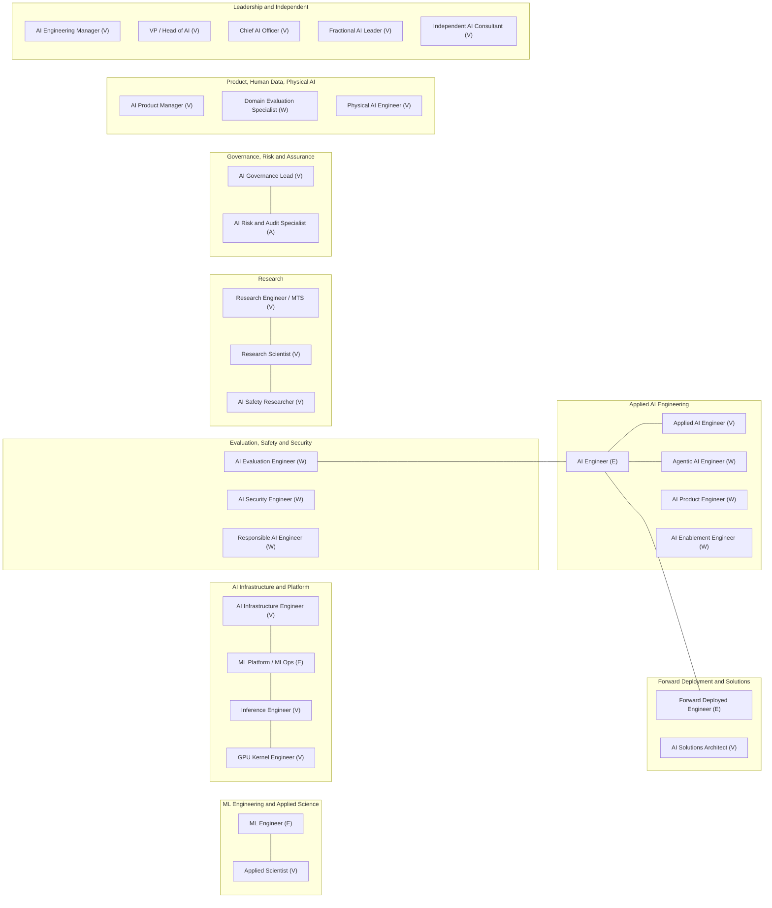

# GenAI Role Master Catalog
## Every GenAI, ML-Systems and AI-Governance Role: Classified, De-duplicated and Evidence-Graded

> **Scope:** 29 canonical GenAI roles and 418 classified title strings, de-duplicated and calibrated against posting volume.
> **Evidence standard:** EGP-1.0 grades (A–E, M) · **Evidence window:** posting counts 2026-06-09 → 2026-11-19; pay, survey and regulatory evidence 2023–2026, dated at each use · **Temporal anchor:** November 2026
> **Inputs:** 75 research sessions (22 Phase 0, 2 Phase 3, 51 Research Pipeline 2 dossiers and refreshes), [FAD.md](../../research/FAD.md), [DECISIONS.md](../../research/DECISIONS.md) (D-002), and JobsPipe/Fast AI Jobs/Skillenai/Levels.fyi refreshes through 2026-11-19
> **Companion files:** [role-rankings.md](role-rankings.md) ranks the roles · [role-skill-maps.md](../03-skills-and-tech/role-skill-maps.md) gives the narrative skill map per role (every skill, tiered, is in the [inventories](../03-skills-and-tech/role-skill-inventories.md)) · [data/role_scores.json](../../data/role_scores.json) and [scripts/rank_roles.py](../../scripts/rank_roles.py) reproduce the scores · [role-skill-inventories.md](../03-skills-and-tech/role-skill-inventories.md) and [skills-vocabulary.md](../03-skills-and-tech/skills-vocabulary.md) type every skill per role, with evidence · [resume-strategy.md](../06-job-search/resume-strategy.md) and [resume-skills-matrix.md](../06-job-search/resume-skills-matrix.md) turn each role's skills into resumes
> **Role hubs:** each role also has a one-page hub with its key facts and links to this evidence ([hubs](hubs/README.md)); the [role map](role-map.md) shows where each role's work sits.

---

## 0. Summary

This file answers one question: **which GenAI roles exist, what is each one, and how sure are we?** The role facts and slugs themselves are kept in [data/role_scores.json](../../data/role_scores.json), the source of truth ([AGENTS.md §2](../../AGENTS.md#2-sources-of-truth)); this catalog presents each role with its evidence, and the [role hubs](hubs/README.md) and the [role map](role-map.md) are generated from the same data.

| Bucket | Count | Meaning |
|---|---:|---|
| **Canonical roles** | **29** | 24 individual-contributor roles plus 5 leadership/independent tracks. Each has a profile (§3) and a score in the ranked catalog. |
| ↳ Established (E) | 4 | At least 50 live postings measured in a large corpus: AI Engineer, Machine Learning Engineer, Forward Deployed Engineer, ML Platform / MLOps Engineer (graduated Nov 2026 via Axial/ITJobsWatch/Fast AI Jobs [T0-58]) |
| ↳ Verified, volume unmeasured (V) | 17 | Real title at named employers (Physical AI graduated W→V in Nov 2026 [T0-64]; ML Platform moved V→E), no quorum-grade count yet |
| ↳ Emerging / watchlist (W) | 7 | Real postings, small or sub-quorum counts (Agentic AI Engineer remains W after failing 3 graduation tests [T0-57]) |
| ↳ Absorbed specialisation (A) | 1 | Work exists inside other professions (audit, model risk, privacy) |
| **Title strings indexed** (§4) | **418** | Every title seen in the research corpus or the market refresh, plus 26 labels with no source in the corpus (marked [P]), each mapped to a canonical role or to a non-role bucket |
| Quarantined title strings (Q) | 10 | The 8 quarantined title families of T0-01 D4 (Context Engineer counted with its 2 variants) |
| Unmeasured buzzwords (U) | 6 | Listed somewhere but never searched (5 from FAD §5.3, 1 unsourced label [P]; Distributed Training Engineer moved to Candidate per U38) |
| Candidate roles, not yet measured | 8 | Plausible roles with no quorum-grade title count yet (voice AI, on-device AI, retrieval engineer, DevRel, AI TPM, distributed training, and two unsourced labels [P]) |
| Not a role | 26 | 8 persona strings, 4 certifications, 4 programmes (fellowships/residencies) and 10 other non-roles: a newsletter, an event name, a vendor document, a null search result, a salary-guide category, a persona heading, an out-of-scope "functional safety" title and three unverified/out-of-scope labels |

**What the evidence corrects** (details in §9 and in [research/ERRATA.md](../../research/ERRATA.md)):

1. **Four title families clear the 50-posting quorum: AI Engineer, Machine Learning Engineer, Forward Deployed Engineer, and — graduated in November 2026 via T0-58 — ML Platform / MLOps Engineer.** Phase 0 (T0-01) cleared the first three; FAD §5.1 added Applied Scientist with "~700 US postings", a figure with no primary source (ERRATA U1; T0-01 measured only 14 at 12 AI startups). Research Pipeline 2 (`T0-52`) subsequently measured Amazon Science's 451 Applied Science category openings (~270 literally AS-titled, 90 in India as of 2026-11-13 [B]), keeping Applied Scientist Verified (`V`) pending a multi-employer second-corpus count.
2. **418 title strings resolve to 29 canonical roles.** The others are aliases, seniority levels, transition personas, duplicate strings, certification names (one retired on 2026-06-30), a non-existent "AWS AI Solutions Architect", a newsletter ("Pragmatic Engineer") and two titles fabricated from source names ("Workday / ATS Systems Administrator", "AIDN Developer").
3. **The quarantine register matches T0-01 D4.** Five FAD-listed buzzwords were never searched: AI Whisperer, Neural Network Designer, Transformer Specialist, Foundation Model Engineer and Reasoning Engineer. This catalog labels them *unmeasured*, not "zero postings". LLMOps is a skill tag under ML Platform/MLOps, not a quarantined title.
4. **FAD's pay labels are corrected (ERRATA U4–U5).** **$312K** is the US all-company Senior median total comp (Levels.fyi 2025) and is not AI-specific. **₹1.06–1.22Cr** is the range of senior medians at the five best-paying Bengaluru employers, which is roughly the P90 ceiling; the Greater Bengaluru Senior SWE median on Levels.fyi (a large-employer-skewed sample) was **₹56.0L** (n=4,836 [B · T0-17]) and **₹56.1L** in the November 2026 refresh (n=4,752 [B · T0-45]; Bengaluru Staff SWE is ₹1.02Cr, n=366 [B · U47]). FAD's US Tier 0 and Tier 1 caps sit *below* the measured Entry ($155K) and Mid ($226K) medians.
5. **Every pay figure carries its source.** Per-role pay appears only where the corpus has a source; Research Pipeline 2 (`T0-44`–`T0-66`) filled Phase 0 US pay gaps for FDE (Levels.fyi US TC $205K P50 / $350K P90 [B · T0-44, T0-51]), Applied Scientist (Amazon AS TC $245K–$653K [B · T0-52]), Applied AI Engineer (Levels.fyi US TC $250K P50 / $475K P75 [B · T0-44, T0-53]), AI Solutions Architect (US base $152K–$247.5K [B · T0-62]) and AI PM (lab senior base $240K–$490K [A · T0-59]), while remaining India pay gaps are flagged explicitly.
6. **India contractor tax, in numbers (T0-07).** §44ADA (s.58 under the Income-tax Act 2025) keeps about 83–84% of billing up to ₹75L and about 65% at ₹1.2Cr; ₹75L is about $79K. In the ₹75L to ~₹92–98L "dead zone" restructuring is not the answer; at ≥₹1Cr, T0-07 lists LLP and Pvt Ltd options whose cash outcomes differ by only ~₹3–10L. The full method is in [India remote tax](../09-compensation/india-remote-tax.md) (pointers, not tax advice).

**How the role pages connect:** this catalog defines the role universe and grades the evidence for each role → the [ranked catalog](role-rankings.md) scores every canonical role on a 100-point index with uncertainty bands, and [GenAI target roles](genai-target-roles.md) turns the same scores into a GenAI-only target order → the [role skill inventories](../03-skills-and-tech/role-skill-inventories.md) list the skills for each role → each [role hub](hubs/README.md) puts one role on one page.

---

## 1. Classification Rules

### 1.1 What counts as a role

Per **Decision D-002** (function-first taxonomy with a strict hiring quorum), a **canonical role** is a distinct *function*: it has its own skill signature and is hired under one dominant title cluster. Everything else maps onto a canonical role or into a non-role bucket:

| Type | Rule | Example |
|---|---|---|
| **Canonical** | Distinct function plus title cluster | AI Engineer |
| **Alias** | Different title, same function | GenAI Developer → `ai-engineer` |
| **Level variant** | Seniority word on a canonical role | Principal AI Engineer → `ai-engineer` |
| **Specialisation** | Narrow focus inside a canonical role | Context Retrieval → `applied-ai-engineer` |
| **Cluster variant** | Non-engineering role counted inside a title cluster | Deployment Strategist inside the FDE cluster |
| **Brief label** | Target label from the research-pipeline brief with no posting evidence | Post-Training Specialist |
| **Legacy / absorbed** | Title collapsed or folded into another role | Prompt Engineer → `ai-engineer` |
| **Quarantined** | Speculative title quarantined in T0-01 D4 (most failed the quorum with evidence; Vibe Engineer was not searched) | Cognitive Architect |
| **Unmeasured buzzword** | Listed somewhere but never searched | Transformer Specialist |
| **Candidate (unmeasured)** | Plausible role with no posting evidence in the corpus | Voice AI Engineer |
| **Persona / Certification / Programme / Not a role** | Origin background, credential, fellowship or non-job string | "Azure AI Engineer Associate" is a certification |

### 1.2 Status classes for canonical roles

| Code | Status | Test |
|:---:|---|---|
| **E** | Established | ≥50 distinct live postings for the title or alias cluster in a large corpus, Grade A/B measurement |
| **V** | Verified, volume unmeasured | Formal title in use at several named employers (or in visa wage filings), but no quorum-grade live count |
| **W** | Emerging / watchlist | Real postings with small-corpus or sub-quorum counts, or skill-mention evidence only |
| **A** | Absorbed specialisation | The work is real but hired inside other professions |

Leadership and independent tracks are not hired through a single posting title. For them, **V** means the track is evidenced by survey job families, mandates, rate cards or practitioner surveys, named in each profile (§3.9).

### 1.3 Evidence grades and conventions

- **Grades follow EGP-1.0** ([T1-02](../../research/sessions/T1-02-evidence-grounding-protocol.md)):
  - **A**: primary record opened by the researcher.
  - **B**: authoritative secondary source, or a platform aggregate with a disclosed method. Under EGP-1.0 rules, JobsPipe, Fast AI Jobs and Levels.fyi pages are Grade **B**, even where T0-01 or T0-02 used their own session-level "A".
  - **C**: practitioner reporting, small corpus or vendor survey.
  - **D**: judgement, model memory or recall.
  - **M**: model output, which inherits the weakest grade among its inputs.
- **Live postings are not openings, and openings are not hires.** Multi-city duplicates, mass posters and ghost postings inflate counts; one vendor reports 9.5% of postings visible for 45+ days ([T0-01](../../research/sessions/T0-01-genai-role-taxonomy-market-volume.md) objection 2).
- **Corpora used:**
  - **JobsPipe** (US/India/global role pages; JD skill shares): pages retrieved 2026-11-02 still show the 2026-10-19 corpus counts that T0-01 read.
  - **Fast AI Jobs** (AI-startup ATS boards).
  - **S09:** 3,647 AI-engineering postings at 198 companies, snapshot 2026-08-05. It skews senior and infra-heavy ([T0-03](../../research/sessions/T0-03-skills-compute-infra-eval-stack.md)).
  - **Skillenai:** a 90-day window to 2026-10-14 ([T0-16](../../research/sessions/T0-16-agentic-protocol-stack-enterprise-demand.md)).
  - **Levels.fyi** (pay; [T0-02](../../research/sessions/T0-02-global-regional-compensation-benchmarks.md), [T0-17](../../research/sessions/T0-17-compensation-progression-plateaus-equity.md)).
  - **US visa wage filings** (LCA; base-pay floors).
  - **Axial** (governance postings; [T0-15](../../research/sessions/T0-15-regulatory-ai-governance-career-families.md)).
- **Posted base excludes equity.** Axial found that only 14% of 43,480 US AI-engineering postings mention equity [B/C · T0-02], so every "posted base" comparison in this file (including FDE's "lowest family median") is base pay only.
- **Title inflation is real.** Indeed's count of frequently advertised AI-referencing titles rose from 264 (2022) to 822 (Q1 2026) [C · T0-01 F11]. That is why this catalog maps 418 title strings onto 29 functions.
- **"Derived"** marks arithmetic done for this catalog, for example "~66 postings" back-calculated from a share and its count.

### 1.4 Quorum and graduation tests (T0-01 D5)

A title moves up from W or Q only when it passes all seven tests:
1. **Volume:** ≥50 distinct requisitions (duplicates collapsed) in two independent corpora, one of them ATS-direct.
2. **Persistence:** holds on two counts ≥30 days apart.
3. **Breadth:** ≥10 employers; no single employer above 30%; ≥3 employers outside consulting and staffing.
4. **Skill signature:** ≥70% of postings share ≥3 core skills, and the set differs from AI Engineer by ≥2 core skills.
5. **Ladder:** ≥3 seniority levels with distinct pay bands.
6. **Lab adoption:** used as a formal role family by at least one tier-1 lab or Big Tech employer.
7. **Alias test:** if swapping in "AI Engineer" or "Solutions Architect" leaves the JD materially unchanged, the title is an alias.

Caveat (T0-01 objection 7): a fixed quorum of 50 ignores corpus size. It is 0.13% of Fast AI Jobs but a rounding error in JobsPipe, so T0-01 suggests adding a share-of-corpus floor.

### 1.5 Source key

| ID | Session | ID | Session |
|---|---|---|---|
| T0-01 | [Role taxonomy & market volume](../../research/sessions/T0-01-genai-role-taxonomy-market-volume.md) | T0-11 | [Certification ROI](../../research/sessions/T0-11-certification-cloud-credential-roi.md) |
| T0-02 | [Global compensation benchmarks](../../research/sessions/T0-02-global-regional-compensation-benchmarks.md) | T0-12 | [Communities & visibility](../../research/sessions/T0-12-high-signal-communities-technical-visibility.md) |
| T0-03 | [Skills, compute & eval stack](../../research/sessions/T0-03-skills-compute-infra-eval-stack.md) | T0-13 | [Portfolio standards](../../research/sessions/T0-13-production-portfolio-proof-of-work-standards.md) |
| T0-04 | [ATS & funnel math](../../research/sessions/T0-04-ats-filtering-funnel-conversion-math.md) | T0-14 | [AI system design interviews](../../research/sessions/T0-14-ai-system-design-interview-patterns.md) |
| T0-05 | [Unconventional hiring & OSS](../../research/sessions/T0-05-unconventional-hiring-tactics-oss-audits.md) | T0-15 | [Regulatory & governance careers](../../research/sessions/T0-15-regulatory-ai-governance-career-families.md) |
| T0-06 | [Transition timelines (5 backgrounds)](../../research/sessions/T0-06-career-transition-timelines-5-backgrounds.md) | T0-16 | [Agentic protocol stack demand](../../research/sessions/T0-16-agentic-protocol-stack-enterprise-demand.md) |
| T0-07 | [India remote tax](../../research/sessions/T0-07-india-remote-tax-statutory-compliance.md) | T0-17 | [Comp progression & equity](../../research/sessions/T0-17-compensation-progression-plateaus-equity.md) |
| T0-08 | [Visa pathways](../../research/sessions/T0-08-global-talent-visa-relocation-pathways.md) | T0-18 | [Freelance & fractional economics](../../research/sessions/T0-18-freelance-fractional-ai-practice-economics.md) |
| T0-09 | [First 90 days](../../research/sessions/T0-09-onboarding-probation-first-90-days.md) | T1-01 | [Repository architecture](../../research/sessions/T1-01-repository-information-architecture.md) |
| T0-10 | [Career tooling](../../research/sessions/T0-10-career-tooling-ecosystem-12-stage-funnel.md) | T1-03 | [Interview & negotiation](../../research/sessions/T1-03-interview-execution-offer-negotiation.md) |
| JP | JobsPipe public pages, retrieved 2026-11-02 ([jobspipe.dev/jobs](https://jobspipe.dev/jobs/ai-engineer/usa), [job-description](https://jobspipe.dev/job-description/ai-engineer)) | T2-01 | [Tier-calibrated playbooks](../../research/sessions/T2-01-tier-calibrated-execution-playbooks.md) |

---

## 2. Canonical Role Registry

### 2.1 Family map

### 2.2 Registry

Rank = position in the [ranked catalog](role-rankings.md). IC roles are ranked 1–24; leadership and independent tracks are ranked L1–L5 among themselves.

| Slug | Canonical role | Family | Status | Best demand evidence | Best pay evidence | Rank |
|---|---|---|:---:|---|---|:---:|
| `ml-engineer` | [Machine Learning Engineer](#profile-ml-engineer) | ML Engineering & Applied Science | **E** | US 1,084 / global 2,157 / India 90 live (static check 2026-11-13); Axial 13,776 US [B/C · JP, T0-49] | US TC P50 $287K, P90 $497.5K; Bengaluru P50 ₹44.4L [B · T0-44, T0-45] | 1 |
| `ai-engineer` | [AI Engineer](#profile-ai-engineer) | Applied AI Engineering | **E** | US 1,697 / global 3,944 / India 398 live (10.1% M; static 2026-11-13); Fast AI Jobs 352 [B · JP, T0-48] | US TC P50 $155K, P90 $280K; Bengaluru P50 ₹20.0L [B · T0-44, T0-45] | 2 |
| `forward-deployed-engineer` | [Forward Deployed Engineer](#profile-forward-deployed-engineer) | Forward Deployment & Solutions | **E** | Fast AI Jobs 1,007 cluster at 353 AI startups (2026-11-12; ~46% IC FDE) [B/M · T0-51, T0-70] | US TC P50 $205K, P90 $350K (Levels.fyi); startup base median $181K [B · T0-44, T0-51] | 3 |
| `research-engineer` | [Research Engineer / MTS](#profile-research-engineer) | Research | V | Fast AI Jobs 223 (2026-11-12; quorum candidate); Anthropic 670+, OpenAI 822 all-func [B · T0-50, T0-70] | Lab US base $205–850K; SWE/MTS TC medians $875–882.5K [B · T0-02, T0-50] | 4 |
| `applied-scientist` | [Applied Scientist](#profile-applied-scientist) | ML Engineering & Applied Science | V | Amazon Science 451 Applied Science (~270 AS-titled, 90 India, 2026-11-13) [B · T0-52] | Levels.fyi Amazon AS TC L4 $245K–L7 $653K (median $306–335K) [B · T0-52] | 5 |
| `applied-ai-engineer` | [Applied AI Engineer](#profile-applied-ai-engineer) | Applied AI Engineering | V | 21 of newest 50 Fast AI Jobs AI rows (42%, 2026-11-11); labs & AI vendors [C · T0-53] | Levels.fyi US TC P25 $200K, P50 $250K, P75 $475K, P90 $505–605K [B · T0-44, T0-53] | 6 |
| `research-scientist` | [Research Scientist (AI/ML)](#profile-research-scientist) | Research | V | Fast AI Jobs 333 RS at 171 startups; JobsPipe 3.7% India; BLS +21.8% [B · T0-27, T0-55] | OpenAI RS TC ~$1.25M; Pave equity $4.1–4.7M (downgraded to B) [B · T0-02, T0-55] | 7 |
| `ai-infrastructure-engineer` | [AI Infrastructure / GPU Platform Engineer](#profile-ai-infrastructure-engineer) | AI Infrastructure & Platform | V | 52 S09 infra postings; Inference Jobs 446 GPU-infra upper bound; 10/35 India [B/C · T0-03, T0-54] | US posted base median midpoint $261K (labs ~$360K; OpenAI $230–490K, Anthropic $320–485K) [A/B · T0-54] | 8 |
| `ml-platform-engineer` | [ML Platform / MLOps Engineer](#profile-ml-platform-engineer) | AI Infrastructure & Platform | **E** | Axial 1,959 US MLOps; ITJobsWatch 184 UK perm; Fast AI Jobs 1,099 broad [B · T0-58] | Levels.fyi US MLOps $145.2K; Fast AI Jobs $179.25K; senior/Big Tech $150–357K (midpoint $245K) [B · T0-58] | 9 |
| `ai-security-engineer` | [AI Security Engineer / AI Red Teamer](#profile-ai-security-engineer) | Evaluation, Safety & Security | W | SANS mid-Sep 2026 >850 AI/ML security, ~100 red-team, 93 supply-chain; 9 India [B · T0-60, T0-69] | US posted base $178–431.25K (Amazon/NVIDIA); India ₹25–50L [B · T0-60] | 10 |
| `inference-engineer` | [Inference / LLM Serving Engineer](#profile-inference-engineer) | AI Infrastructure & Platform | V | Inference Jobs 341 upper bound (2026-11-13); 37 verified active, 9 India [B/C · T0-56] | US posted base median midpoint $288K (IQR $261–344K, n=14) [B · T0-56] | 11 |
| `ai-solutions-architect` | [AI / GenAI Solutions Architect](#profile-ai-solutions-architect) | Forward Deployment & Solutions | V | Axial 16,927 US 'AI architecture' proxy; JobsPipe SA; active labs/clouds [B/C · T0-62] | US posted base $152–247.5K (Google CE/Databricks Local Pay Range); Bengaluru SA proxy [B/C · T0-45, T0-62] | 12 |
| `ai-product-manager` | [AI Product Manager](#profile-ai-product-manager) | Product & Program | V | AI Pulse 570 category (C); 41 in-window AI PM JDs read; JobsPipe PM 12,166 [B/C · T0-59, T0-70] | Lab senior base $240–490K + equity; Bengaluru Sr PM proxy [A/C · T0-45, T0-59] | 13 |
| `agentic-ai-engineer` | [Agentic AI Engineer](#profile-agentic-ai-engineer) | Applied AI Engineering | W | Skilark 107/28,771 (0.37%); active in India IT/GCCs; failed 3 graduation tests [C · T0-57] | US posted base median midpoint ~$197K (n=8); tracks AI Engineer [C · T0-57] | 14 |
| `ai-evaluation-engineer` | [AI Evaluation Engineer](#profile-ai-evaluation-engineer) | Evaluation, Safety & Security | W | 22 named postings (labs, Microsoft >=4, vendors); 5+ India roles [B · T0-60] | US posted base $120–304K (MSFT) to $310–500K (Transluce); India ₹12–36L [B · T0-60] | 15 |
| `gpu-kernel-engineer` | [GPU Kernel / ML Compiler Engineer](#profile-gpu-kernel-engineer) | AI Infrastructure & Platform | V | 41 core postings (8 India = 19.5%: AMD ×2, Sarvam, Intel, Google TPU, EPAM, Taglynk, recruiter; 0 NVIDIA India ML-kernel) [B · T0-63] | US posted base median midpoint $235.8K (IQR $217.5–275K, n=17) [B · T0-63] | 16 |
| `physical-ai-engineer` | [Physical AI / Robotics AI Engineer](#profile-physical-ai-engineer) | Embodied & Physical AI | V | 48 in-scope postings across 38 employer entries (graduated W→V); 35 India on physicalai.jobs [B/C · T0-64] | US posted base median midpoint ~$242.5K (n=18) [B · T0-64] | 17 |
| `ai-safety-researcher` | [Frontier AI Safety Researcher](#profile-ai-safety-researcher) | Research | V | McAleese ~600 FTEs (+21%/yr, C); 69 open roles at 8 non-lab orgs; 0 India [C · T0-60] | Labs $350–500K (Anthropic/OpenAI); independents $100K–$503K (METR/Goodfire overlap labs; FAR.AI $100–250K) [A/B · T0-60] | 18 |
| `ai-governance-lead` | [AI Governance Programme Lead](#profile-ai-governance-lead) | Governance, Risk & Assurance | V | Axial 1,997–3,700 US (C); SANS ~430 AI GRC leads (B); EU Annex III delayed to Dec 2027 [B/C · T0-61, T0-69] | Deloitte $134.5–265.1K [A]; GRC Careers $191K [B]; Axial top-of-band $169–268K; IAPP $152–170K [A/B/C · T0-15, T0-61] | 19 |
| `ai-product-engineer` | [AI Product Engineer (AI Frontend)](#profile-ai-product-engineer) | Applied AI Engineering | W | Alias family (16 postings, median 2 yrs exp — drops Staff-only claim) [C · T0-62] | US posted base $140–205K mid to $235–315K Staff AI Frontend [A/B · T0-62] | 20 |
| `ai-risk-assurance-specialist` | [AI Risk, Audit & Compliance Specialist](#profile-ai-risk-assurance-specialist) | Governance, Risk & Assurance | A | Deloitte >=10 AI risk/assurance, U.S. Bank >=4, Big 4/banking MRM [B · T0-61] | GRC Careers US AI-risk midpoints ~$150–215K (median $175K, n=18) [B · T0-61] | 21 |
| `responsible-ai-engineer` | [Responsible AI / AI Governance Engineer](#profile-responsible-ai-engineer) | Evaluation, Safety & Security | W | 6 core live/in-window titles globally (5/12 sampled in India) [B · T0-61] | US Workday $169–253K (C), Salesforce RAI & enterprise bands [B/C · T0-61] | 22 |
| `ai-enablement-engineer` | [AI Enablement Engineer](#profile-ai-enablement-engineer) | Applied AI Engineering | W | Skillenai 90-day count fell 57 → 42 (2026-11-05); small/contracting title [B · T0-62] | US bimodal base $120–140K adoption vs $160–180K builder [A/C · T0-62] | 23 |
| `domain-evaluation-specialist` | [Domain Evaluation Specialist / AI Trainer](#profile-domain-evaluation-specialist) | Human Data & Evaluation Operations | W | Standing pools (Mercor 3/3); LinkedIn #4 growth; 4/4 India salaried eval-eng [A/B · T0-66] | Generalist $20–70/hr, tech $60–120/hr, JD/MD/SWE $100–300/hr [A/B · T0-66] | 24 |
| `ai-engineering-manager` | [AI Engineering Manager / Director](#profile-ai-engineering-manager) | Leadership & Executive | V | Fast AI Jobs 608 EM at 239 AI startups (20–24% AI-system EMs; +54% vs Jul) [B · T0-65, T0-70] | US base $163–405K (SandboxAQ, NVIDIA, Scale, Anthropic) + equity; India SWE Mgr P50 ₹85.6L proxy [A/B · T0-45, T0-65] | L1 |
| `vp-head-of-ai` | [VP / Head of AI](#profile-vp-head-of-ai) | Leadership & Executive | V | Axial 65 US exec postings (6 mo); noisy boards (Indeed ~2,000 US) [C · T0-65] | US posted base $170–315K + bonus/equity; UK £120–150K [A/B · T0-65] | L2 |
| `chief-ai-officer` | [Chief AI Officer](#profile-chief-ai-officer) | Leadership & Executive | V | OMB M-25-21 federal mandate (2025-04-03, A); 10.7% F500+S&P500 prevalence (71/665, Crist Kolder, B, U47); 2 live JDs [A/B · T0-65] | Public/higher-ed $118–200K; SBI India up to ₹160L; corp $400K–$1M+ [B · T0-65] | L3 |
| `independent-ai-consultant` | [Independent AI Consultant](#profile-independent-ai-consultant) | Independent & Fractional | V | UK GenAI contracts tripled to 1,466 in 6 mo (ITJobsWatch, B); LinkedIn #2 US [B · T0-66] | UK GenAI median flat at £550/day (P75 £675, P90 £788); US agency $50–80/hr [B · T0-66] | L4 |
| `fractional-ai-leader` | [Fractional Head of AI / CAIO](#profile-fractional-ai-leader) | Independent & Fractional | V | 1/13 direct employer JD; Go Fractional 10 CAIO posts in 90d (4 open) [B · T0-66, T0-70] | Employer offers $75–150/hr; asks $150–250/hr; retainers $3K–20K/mo [B/C · T0-66] | L5 |

---

## 3. Role Profiles

Each profile extends the T1-01 role-page contract (definition, demand, skill requirements, journey) with pay evidence and watch-outs; the narrative skill map is in the [role skill maps](../03-skills-and-tech/role-skill-maps.md). Feeder timelines come from T0-06's model at 15–20 hours a week. They are **Grade D model outputs, conditional on success**; no persona-level success rates exist.

### 3.1 Applied AI Engineering

#### `ai-engineer`: AI Engineer · E · Rank 2
- **Hub:** [AI Engineer on one page](hubs/ai-engineer.md): key facts, scores, skills, proof and interview track, with links back here.
- **What it is:** builds LLM-powered product features: API orchestration, retrieval (RAG), agents, evals and deployment. The title is a heterogeneous umbrella; robotics, construction and Power Platform variants share it [B · T0-01 F2].
- **Demand:**
  - Counts [B · JP, T0-01 F1, T0-48, T0-70]: US 1,697 live; India 398 (10.1% of 3,944 global, correcting Phase 0's 13.6% erratum [M · U33]); global 3,944 (static on 2026-11-13 check; underlying skill-share count date 2026-09-10 [T0-69]). Fast AI Jobs lists 352 at 188 AI startups (2026-11-12, up from 326). LinkedIn Jobs on the Rise 2026 ranks it #1.
  - Posting mix [B · JP JD]:
    - Seniority labels: senior 24.6%, entry 7.0%, mid 6.0%, lead/manager 5.6%.
    - Remote 11.0%; pay disclosed 19.6%.
    - Where: US 27.9%, India 13.6% on the JD page vs 10.1% in live counts (398/3,944 = 0.23× the US [B/M · T0-01 F10, U33]).
- **Pay:**
  - Levels.fyi US TC [B · T0-44]: P25 $110K / P50 $155K / P75 $212K / P90 $280K (SF Bay P50 $225K / P90 $460K, 2026-11-11).
  - Posted base [B · T0-03, T0-44]: AI Engineer (Application) $200–275K (n=55); Axial US AI engineering posted base ceilings $170–270K (senior $213K, n=43,480; 5–12% below ML).
  - Bengaluru [B · T0-45]: P25 ₹13.8L / P50 ₹20.0L (variants ₹18.3–20.5L) / P75 ₹39.7L / P90 ₹60.6L (2026-11-12).
  - The title earns about 0.54–0.56× the MLE title across US percentiles; a within-Google check shows 62–69% of the log gap is employer and level mix [B/M · T0-02, T0-48].
- **Skill signature:**
  - Python 78.4%, LLM 76.7%, agentic AI 59.3%, RAG 54.0%, ML 39.8%, Azure/AWS 35.1% each, CI/CD 34.4%, vector DBs 32.6%, prompt engineering 31.1% of postings [B · JP JD].
  - Differentiators: eval harnesses (12/14 full-read postings in T0-48), durable agent runtimes, cost/latency engineering [B · T0-03, T0-48]. → [Skills](../03-skills-and-tech/role-skill-maps.md#skills-ai-engineer)
- **Who hires (US):** Capital One 33, TCS 22, American Express 16, Deloitte 13, Infosys 12. Enterprise- and services-heavy [B · T0-01 F2].
- **Entry routes:** backend ~6 months; frontend ~7 (as an AI product/full-stack engineer); data scientist ~8; BI analyst ~11 [D · T0-06 R2].
- **Watch:** the table-stakes layer (SDK calls, naive RAG, prompt-only work) is commoditised [B · T0-03 §6.4]. GenAI-specific volume is lower than 1,697 because the family includes non-GenAI variants.
- **Aliases:** GenAI Engineer/Developer (India GCC label), AI Developer, LLM Engineer, AI Application Engineer, Full-Stack AI Engineer, Backend LLM Engineer. Legacy: Prompt Engineer.

#### `applied-ai-engineer`: Applied AI Engineer · V · Rank 6
- **Hub:** [Applied AI Engineer on one page](hubs/applied-ai-engineer.md): key facts, scores, skills, proof and interview track, with links back here.
- **What it is:** customer- and solutions-facing LLM engineering at labs, AI vendors and product firms: reference architectures, production prototypes, evaluation harnesses and production deployment [B/C · T0-01 D3, T0-53].
- **Demand:**
  - 21 of the newest 50 Fast AI Jobs AI-Engineer rows (42%, 2026-11-11, up from 16/50 on 2026-10-19) carry "Applied AI" titles; JobsPipe has no standalone page [C · T0-53].
  - Named postings [A/B · T0-01 D7, T0-53]: OpenAI (Startups, Digital Natives, Codex, Partner, Bengaluru), Anthropic (Beneficial Deployments, Startups, Enterprise Tech, India partner/field), Mistral, Snorkel, Scale, Databricks.
- **Pay:** Levels.fyi US Applied AI Engineer TC (Nov 2026) is **P25 $200K / P50 $250K / P75 $475K / P90 $505K–$605K** (both T0-44 and T0-53 agree on P25–P75; P90 shifted from $605K on 2026-10-04 to $505K on 2026-11-11 [B · T0-44, T0-53]). US lab posted bands span $197K–$320K (OpenAI $197–278K + equity [B], Anthropic $200–320K [A, COI]; median midpoint $264.5K, n=5, base/OTE mix [T0-53]). → [Skills](../03-skills-and-tech/role-skill-maps.md#skills-applied-ai-engineer)
- **Entry routes:** main backend route (~6 months) and PhD route (~8 months) in T0-06 [D].
- **What would change the status:** an isolated count of ≥50 in two corpora.

#### `agentic-ai-engineer`: Agentic AI Engineer · W · Rank 14
- **Hub:** [Agentic AI Engineer on one page](hubs/agentic-ai-engineer.md): key facts, scores, skills, proof and interview track, with links back here.
- **What it is:** builds tool-using, multi-step agent systems: state machines, durable execution, tool gateways and human approvals.
- **Demand:**
  - Skilark found 107 "agentic"-titled listings of 28,771 (0.37%), failing three graduation tests [C · T0-57]; exact title is actively used by Indian IT services, GCCs and consultancies (6/10 India sample [T0-57]).
  - *Agentic AI* is a skill in 59.3% of AI Engineer postings: "the split is happening as skills inside AI Engineer postings, not as new titles" [B · T0-01 F4, T0-57].
- **Pay:** US senior-skewed posted base midpoint median ~$197K (n=8 in-window postings [C · T0-57]); tracks AI Engineer rather than a standalone premium. India has a single Weekday posting (Epitria Consulting ₹43–44 LPA senior/lead [C · T0-57]) plus Hello Edge ₹20–30L [A · T0-45].
- **Skill signature:** LangGraph, durable runtimes, human-in-the-loop (HITL), idempotency, evals (7/14) and sandboxing/guardrails (3/14) [B/C · T0-03, T0-16, T0-57]. → [Skills](../03-skills-and-tech/role-skill-maps.md#skills-agentic-ai-engineer)
- **Watch:** framework churn (AutoGen dormant; Microsoft Agent Framework 1.0 GA shipped 2026-04-03 [A · T0-69]). In a study of 20 interviewed production agent teams (arXiv 2512.04123v2), 85% ran custom loops rather than third-party agent frameworks [B · T0-03 S31, U36].
- **Aliases:** Agent Engineer, AI Agent Engineer, Agentic Systems / Multi-Agent Engineer, Principal Agentic AI Engineer.

#### `ai-enablement-engineer`: AI Enablement Engineer · W · Rank 23
- **Hub:** [AI Enablement Engineer on one page](hubs/ai-enablement-engineer.md): key facts, scores, skills, proof and interview track, with links back here.
- **What it is:** drives internal AI adoption across three variants: builder-enabler (60%), adoption/training lead (20%, mostly non-coding rollout) and internal AI-platform enabler (20%, gateways/IAM) [B/C · T0-62].
- **Demand:** Skillenai 90-day count fell from 57 (to 2026-09-03) to 42 (to 2026-11-05 [B · T0-62]); MCP appears in 19.0% of Skillenai listings (8/42) and 26.7% of sampled postings (4/15 [B/C · T0-62]). → [Skills](../03-skills-and-tech/role-skill-maps.md#skills-ai-enablement-engineer)
- **Pay:** bimodal US posted base across variants: Fabletics builder $160.4–180K [A] vs Scotiabank adoption $120–140K [C · T0-62]; single India junior posting Ather Energy Bengaluru ₹8–14 LPA [C · T0-62].
- **Entry routes:** backend/DevEx engineers; non-technical ops lane in ~7 months [D · T0-06].
- **Watch:** internal-adoption roles may be transitional; `application` interview track remains unverified (Grade E [T0-62 K24]).

#### `ai-product-engineer`: AI Product Engineer (AI Frontend) · W · Rank 20
- **Hub:** [AI Product Engineer (AI Frontend) on one page](hubs/ai-product-engineer.md): key facts, scores, skills, proof and interview track, with links back here.
- **What it is:** alias family (Product Engineer shipping AI features, AI-facing UI specialist, AI-native design/frontend engineer and full-stack AI chat engineer) building streaming UX, tool-use visualisation, HITL checkpoints and generative components [B/C · T0-06, T0-62].
- **Demand:** no exact title count; median stated experience is 2 years (n=6 in T0-62, dropping the Phase 0 "senior-skewed" claim [C · T0-62]); 2 of 16 sampled postings in India (CirrusLabs Bengaluru, Alpha remote India).
- **Pay:** US posted base spans $140–205K mid (Within [B]) to $235–315K Staff AI Frontend [A · T0-62]; small India sample (n=2: ₹4–18 LPA [B/C · T0-62]). → [Skills](../03-skills-and-tech/role-skill-maps.md#skills-ai-product-engineer)
- **Entry route:** frontend → AI product/full-stack engineer in ~7 months [D]; dedicated `product-frontend` interview track [B/C · T0-62]. Apply under "full-stack AI engineer" as well as product/frontend aliases.
- **Aliases:** AI-Frontend Engineer, Frontend Engineer (AI), Staff AI Frontend Engineer. Brief label: Agent Interface Architect.

### 3.2 ML Engineering and Applied Science

#### `ml-engineer`: Machine Learning Engineer · E · Rank 1
- **Hub:** [Machine Learning Engineer on one page](hubs/ml-engineer.md): key facts, scores, skills, proof and interview track, with links back here.
- **What it is:** builds, trains, adapts and serves models: training pipelines, fine-tuning, inference, recsys/ads/AV, and increasingly LLM systems. LLM is named in 45.0% of MLE postings [B · JP JD] and 17/36 (47.2%) in T0-49 [B/C].
- **Demand:**
  - Counts [B · T0-01 D2, T0-49, T0-70]: US 1,084; global 2,157; India 90; UK 108; Canada 60 (static on 2026-11-13 check). Fast AI Jobs lists 298 at AI startups (2026-11-12, up from 227); Axial H1 2026 US 13,776 (~490/wk [C]); FY2025 DOL exact-title LCAs 1,053–1,071 [B].
  - Posting mix [B · JP JD]:
    - Seniority labels in JD text: entry 13.7%, senior 23.2%, lead/manager 9.2%. JobsPipe *title facets* measure differently: senior 814, lead 359, entry 240 of 2,157 (~38% / 17% / 11%) [B · T0-01 D3].
    - Remote 14.0%; pay disclosed 38.5%.
    - Where: US 50.3%; India 4.2% live (90/2,157) vs 7.7% JD-page share (4–8% range [B · T0-49, T0-69]).
- **Pay:**
  - Levels.fyi US TC [B · T0-44]: P25 $200K / P50 $287K / P75 $389.9K / P90 $497.5K (n=1,027, 2026-11-11).
  - Big Tech levels [B · T0-44]: Meta E5 $472–497K, E6 $660–790K; Amazon L6 $401K; Google L5 $393–445K, L6 $607–646K, L7 $743K.
  - Posted base [B · T0-03, T0-44]: $213–288K (n=201); Axial ceilings $180–300K (senior $241K, n=13,776).
  - India [B · T0-45]: Greater Bengaluru (2026-11-12, n=97) P25 ₹30.3L / P50 ₹44.4–44.7L / P75 ₹65.7L / P90 ₹80.7L (down from Oct ₹94.6L); Hyderabad P50 ₹30.3L [B · T0-02].
- **Skill signature:** ML 98.6%, Python 71.3%, PyTorch 48.2%, LLM 45.0%, data structures 33.7%, deep learning 32.6%, TensorFlow 31.8%, A/B testing 23.5%, NLP 23.3%, C++ 23.3% [B · JP JD]; in T0-49 (n=36), evals led GenAI clusters at 30.6% (11/36). → [Skills](../03-skills-and-tech/role-skill-maps.md#skills-ml-engineer)
- **Who hires (US):** TikTok 74, Adobe 21, Apple 20, Capital One 20. Big Tech, recsys and AV [B · T0-01 F2].
- **Entry routes:** data scientist → MLE 6–18 months; career changer 12–24 months (vendor timelines) [D · T0-06]. PhD → applied roles ~8 months [D].
- **Watch:** in a study of 20 interviewed production agent teams (arXiv 2512.04123v2), 70% used off-the-shelf models without SFT or RL [B · T0-03 S31, U36]. In all three corpora (2026 snapshots), evals outrank fine-tuning in postings [B · T0-03].
- **Aliases:** ML Engineer, AI/ML Engineer, ML Systems Engineer, Deep Learning Engineer, Open-Source MLE. Domain variants (NLP, CV, RecSys) are not measured separately.

#### `applied-scientist`: Applied Scientist · V · Rank 5
- **Hub:** [Applied Scientist on one page](hubs/applied-scientist.md): key facts, scores, skills, proof and interview track, with links back here.
- **What it is:** research-to-production scientists at large tech firms: modelling, experimentation and shipping models (L6 application/deployment is primary in 74% [17/23] of T0-52 postings; L4 post-training in 26% [B/C · T0-52]).
- **Demand:** Amazon Science listed **451 Applied Science category openings** on 2026-11-13 (central estimate ~270 literally AS-titled, Wilson range 141–375; 90 India science openings = 14% of global [B · T0-52]), alongside Microsoft, Uber, Zalando and Mistral; Fast AI Jobs lists 23 AI-startup roles (up from 14 in Jun 2026 [B · T0-70]). The Phase 0 "~700" figure in FAD §5.1 had no primary source (ERRATA U1).
- **Pay:** Levels.fyi Amazon Applied Scientist US TC (2026-08-18): L4 $245K, L5 $324K, L6 $407K, L7 $653K (median $306–335K), corroborated by Microsoft/Uber posted US bands [B · T0-44, T0-52]. India pay remains Grade D (0/6 India postings disclose bands; adjacent proxies only [T0-52]). → [Skills](../03-skills-and-tech/role-skill-maps.md#skills-applied-scientist)
- **Entry route:** PhD → Tier 2 Applied Scientist in ~8 months (primary PhD corridor in T2-01 [D]); Microsoft (BS+2/MS+1) and Uber (BS+3–4/MS+2) open non-PhD routes [A/C · T0-52].
- **Next action:** multi-employer second-corpus count at the 2026-12-01 recount to test quorum graduation.
- **Aliases:** Applied Research Scientist (a Radford job family with paywalled data), ML Scientist.

### 3.3 Forward Deployment and Solutions

#### `forward-deployed-engineer`: Forward Deployed Engineer · E · Rank 3
- **Hub:** [Forward Deployed Engineer on one page](hubs/forward-deployed-engineer.md): key facts, scores, skills, proof and interview track, with links back here.
- **What it is:** engineers embedded with customers who deploy, integrate and adapt AI products end to end. The work needs vertical depth; one JD lists 2–6 years of experience and up to 50% travel [B · T0-01 D3].
- **Demand:**
  - **Volume [B/M · T0-51, T0-70]:**
    - 1,007 FDE-cluster roles at 353 AI startups (Fast AI Jobs, 2026-11-12, +29% vs 779 in early August); 260–1,276 across six boards (Plank 1,276, fdejobslist 391 [B/C · T0-51]).
    - In S09, FDE is named in 33.2% of postings and at 69% of companies, the largest company mention pool [B · T0-03].
  - **Composition:** 23 of the newest 50 Fast AI Jobs rows (46%) are IC FDE titles; 22 are adjacent strategist/GTM/field roles [B/M · T0-51, T0-70].
  - **Growth:** FDE postings rose >1,000% Jan–Aug 2026 vs 2025, from a small base [B · T0-06]; Indeed India / IANS (2026-10-14) reported ~19× YoY India growth from a low base [C · T0-25, T0-51].
  - **~Aug 3 cached snapshot (779 roles at 288 startups):** by funding stage Series C 184, A 176, G+ 147, B 119, D 110; by location SF 172, NY 133, Remote 65 [B · T0-01 S11].
- **Pay:**
  - Levels.fyi US FDE TC (2026-09-08): **P25 $172K / P50 $205K / P75 $277K / P90 $350K** (above US AI Engineer; Google FDE median $292K [B · T0-44, T0-51]). Fast AI Jobs startup posted base median $180,656 (n=164, range $75K–$375K [B · T0-51]); S09 posted base $180–248K (n=304 [B · T0-03]).
  - India [B · T0-51]: Levels.fyi India FDE TC median ₹16.75L (live-verified ~₹17.5–17.7L, P75 ₹42L) and Weekday/Bayt posted ₹25–40 LPA (5–7 yrs).
  - Startup equity should be risk-adjusted to 0.4–0.8× at Series C–D [C/D · T0-17].
- **Skill signature:** production coding plus GenAI and infrastructure skills plus customer scoping (50.0% in T0-51), agents (35.7%), evals (21.4%) and RAG (17.9%) [B/C · T0-06, T0-51]; interview track is `customer-application` (note: an earlier Phase 0 claim of a Databricks AI-FDE RAG/multi-agent interview loop was not substantiated in T0-51 [U48]). → [Skills](../03-skills-and-tech/role-skill-maps.md#skills-forward-deployed-engineer)
- **Who hires:** OpenAI, Anthropic, Palantir, Databricks ("AI Engineer – FDE"), Scale, Writer, ElevenLabs [A/B · T0-01, T0-51].
- **Entry routes:**
  - Backend: FDE-adjacent offers can come early via internal routes.
  - Frontend: frontend-heavy FDE roles.
  - Non-technical: FDE-adjacent in ~10 months, and coding is required [D · T0-06, T2-01].
- **Watch:** nearly half the cluster is non-engineering (28% clearly non-engineering / 46% non-FDE-eng+leader [T0-51 K7]), so protect the engineering scope. Postings are mostly non-remote with travel, making FDE a weak fit for India-remote arbitrage.
- **Aliases:** FDSE, AI Deployment Engineer, Deployment Engineer, Forward Deployed AI Engineer, AI Engineer – FDE, Frontier Agents Engineer. Cluster variants: Deployment Strategist, FDPM, GTM Engineer, Forward Deployed Banker.

#### `ai-solutions-architect`: AI / GenAI Solutions Architect · V · Rank 12
- **Hub:** [AI / GenAI Solutions Architect on one page](hubs/ai-solutions-architect.md): key facts, scores, skills, proof and interview track, with links back here.
- **What it is:** designs enterprise AI solutions on cloud and vendor stacks; pre-sales discovery (65.2%) and delivery architecture (34.8%) [B/C · T0-62].
- **Demand:**
  - **Proxies [B/C · T0-62]:** Axial tracked 16,927 US "AI architecture" postings (C); JobsPipe lists 1,515 live US Solutions Architect postings (2026-11-02; *generative-ai* 17.1%, *artificial-intelligence* 23.2% → ≥~350 AI-mentioning SA postings [M from B]) and 64 India SA live. Active hiring at OpenAI, Anthropic, Databricks, AWS, Microsoft and Google; no exact AI-SA title count exists.
- **Pay:** US posted base $152K–$247.5K (Google CE III $152–221K + 42.86% bonus target + equity [A]; Databricks $180–247.5K "Local Pay Range", OTE not stated [B]; AWS $153.6–239K [B]); Anthropic London £165–190K OTE [A, COI]; Levels.fyi US SA TC P50 $220K (n=1,200 [B · T0-62]); adjacent Greater Bengaluru Solution Architect P50 ₹49.3L (n=179 [B/C · T0-45]).
- **Skill signature:** RAG (56.5%), agents (52.2%) and cloud/vendor stacks (52.2%) in T0-62 AI-SA sample [B/C · T0-62]; generic SA postings list AWS 53.6%, leadership 43.0%, communication 42.9%, Azure 29.5%, Python 23.6%, GCP 22.6% [B · JP JD]. → [Skills](../03-skills-and-tech/role-skill-maps.md#skills-ai-solutions-architect)
- **Who hires:** hyperscalers (Amazon "Sr. Specialist SA, GenAI/Bedrock GTM"; Google Cloud "Customer Engineer, AI/ML"), labs (OpenAI, Anthropic), Databricks, IT-services firms (TCS, Wipro, Cognizant, Capgemini) and staffing agencies [A/B · T0-11, T0-62].
- **Watch:** certifications are tie-breakers mainly in IT-services, staffing and hyperscaler-partner channels. No single certification was verified in more than 10% of GenAI JDs, though T0-11 calls that threshold unproven [B/C · T0-11 F4].
- **Aliases:** AI Architect, Enterprise AI Architect, Agentic AI Architect, Principal AI Architect – Agentic, Customer Engineer AI/ML, AWS AI Architect. "Agent Architect (exact)" is quarantined.

### 3.4 AI Infrastructure and Platform

#### `ai-infrastructure-engineer`: AI Infrastructure / GPU Platform Engineer · V · Rank 8
- **Hub:** [AI Infrastructure / GPU Platform Engineer on one page](hubs/ai-infrastructure-engineer.md): key facts, scores, skills, proof and interview track, with links back here.
- **What it is:** runs the compute estate behind training and inference: GPU clusters (94.3%), Kubernetes (80.0%), networking (IB/RDMA/NCCL, 51.4%), Slurm (42.9%), storage, reliability and capacity [B/C · T0-54].
- **Demand:**
  - 52 base-disclosing postings in S09 [B · T0-03]; Inference Jobs 446 "GPU Infrastructure Engineering" listings (undeduplicated upper bound [C · T0-54]).
  - 10 of 35 core postings (28.6%) in India: NVIDIA ×4 (DGX Cloud, SRE research clusters, NCX, EngOps), Deloitte USI ×2, Sarvam AI ×2, AION and Soket AI Labs (0 GCC postings found in window [B · T0-54]).
- **Pay:** US posted-base median midpoint $261K (n=12): frontier labs ~$360K (OpenAI $230–490K + equity [A], Anthropic $320–485K [A, COI]) vs cloud/neocloud/enterprise $180–270K [A/B · T0-44, T0-54]; 0/10 India postings disclose pay [T0-54]. → [Skills](../03-skills-and-tech/role-skill-maps.md#skills-ai-infrastructure-engineer)
- **Entry routes:**
  - Backend, SRE and DevOps engineers. "Strong infrastructure candidates without ML experience do well" in Anthropic design rounds [B · T0-14].
  - RadixArk's paid AI Infra Residency, listed at $200K [B · T0-05].
- **Specialisation:** distributed training / pre-training infrastructure (live Distributed Training Engineer postings verified at OpenAI and Periodic Labs in Nov 2026 [C · T0-69 K17, U38]; remains an ungraduated candidate).
- **Aliases:** AI Infrastructure Engineer, ML Infrastructure Engineer, GPU Infrastructure Engineer, GPU Cluster & Infra Platform Engineer.

#### `inference-engineer`: Inference / LLM Serving Engineer · V · Rank 11
- **Hub:** [Inference / LLM Serving Engineer on one page](hubs/inference-engineer.md): key facts, scores, skills, proof and interview track, with links back here.
- **What it is:** owns the inference data path: batching, KV cache, scheduling, quantisation, speculative decoding, latency and cost. It splits into two kinds of work [B · T0-03]:
  - distributed-runtime engineering (Anthropic J1/J2);
  - engine and kernel optimisation (NVIDIA, Together, Baseten, Inferact).
- **Demand:**
  - Inference Jobs lists 341 "Inference Engineer" listings on 2026-11-13 (upper bound; page 1 ~40% aged ≤3 months); T0-56 verified 37 active postings across labs, inference clouds and hardware vendors, including 9 in India (24.3%: AI startups Sarvam/Gnani ×2/PrimaLabs/AION, DigitalOcean ×2, Rackspace and 1 Weekday recruiter client; 0 GCCs and 0 India silicon vendors [B/C · T0-56]).
  - The inference-optimisation *concept* appears in 14.8% of S09 postings (57.1% of companies), but named engines in only 2.0–3.9% [B · T0-03].
- **Pay:** date-clean US sample (n=14) posted base median midpoint **$288K** (IQR $261–344K, bounds $165–500K) plus equity [B · T0-56]; 1/9 India postings discloses pay (₹24–36L, 5+ yrs, Weekday client [B · T0-56]).
  - Base pay by employer [A/B · T0-03, T0-56]:

    | Employer | Base pay |
    |---|---|
    | Anthropic (inference) | $320–485K |
    | Anthropic (inference runtime) | $405–485K |
    | NVIDIA | $152–356.5K |
    | Together AI | $160–230K + equity |
    | Baseten | $150–360K |
    | Inferact | $200–400K + equity |

  - Systems and research-engineering titles show **+13–31% base in two datasets, "not validated"** [B · T0-02].
  - "Compensation tracks employer tier and seniority, not app vs infra" [B · T0-03 KF1].
- **Skill signature:** vLLM, SGLang, TensorRT-LLM, PagedAttention, chunked prefill, speculative decoding, FP8/FP4/AWQ/GPTQ, NVIDIA Dynamo, roofline analysis with Nsight. TGI was archived on 2026-03-21 [A/B · T0-03, T0-56]. → [Skills](../03-skills-and-tech/role-skill-maps.md#skills-inference-engineer)
- **Entry routes:** backend → Tier 3 inference in ~10–14 months with infrastructure depth [D · T2-01]. The OSS route is demanding: vLLM committers had about 30+ substantial PRs [A · T0-05].
- **Watch:** a large drop in closed-model prices would narrow self-hosting demand (T0-03 tripwire).
- **Aliases:** LLM Serving Engineer, LLM Inference Engineer, Inference Performance Engineer, Inference Systems Engineer, Model Performance Engineer, Inference Runtime Engineer, MTS Inference, Optimization Engineer (LLM Serving).

#### `ml-platform-engineer`: ML Platform / MLOps Engineer · E · Rank 9
- **Hub:** [ML Platform / MLOps Engineer on one page](hubs/ml-platform-engineer.md): key facts, scores, skills, proof and interview track, with links back here.
- **What it is:** builds the internal platform for the ML model lifecycle and serving: Kubernetes, IaC (Terraform), CI/CD, experiment tracking and registries (MLflow/Kubeflow), observability, feature stores and emerging LLMOps (32.3% of postings [B/C · T0-58]). Note: L5 LLM/MCP gateways and prompt CI/CD appeared in 0 of 37 postings in T0-58 [B · T0-58 K1/K8].
- **Demand:**
  - **Graduated V → E in November 2026 [B · T0-58]:** Axial 1,959 US MLOps postings Jan to 2026-07-13 (~70/wk steady [B]); ITJobsWatch 184 UK permanent jobs citing MLOps in 6 months [B]; Fast AI Jobs 1,099 broad ML-platform/infra listings [B].
  - India: 13 of 37 postings in India across GCCs (Walmart Global Tech, Rakuten Symphony, Aptiv) and IT services (HCLTech, Quantiphi), predominantly titled MLOps Engineer [C · T0-58]; Quess estimates an 18–43% GCC supply gap [C · T0-01 F10].
  - "Agent Gateway Engineer" returned 0 postings [C · T0-16].
- **Pay:** generalist-vs-Big-Tech split [B · T0-44, T0-58]: Levels.fyi US MLOps Engineer TC median $145.2K (P25 $120K / P75 $200K / P90 $295K, 2026-10-11 [B]) and Fast AI Jobs posted-base median $179.25K (n=430, 2026-11-12 [B]) vs senior/Big Tech ML Platform posted base $150–357K (median midpoint $245K, n=8 [M · T0-58]). Bengaluru MLOps P50 ₹23.6L, P75 ₹41.1L, P90 ₹63.5L [C · T0-02]; 0/13 India postings in T0-58 disclose pay [T0-58].
- **Skill signature:** Kubernetes, Terraform/IaC, CI/CD, MLflow/Kubeflow, drift monitoring, feature stores, Prometheus/Grafana, OpenTelemetry, and emerging serving/LLMOps (Dynamo-Triton renamed 2025-03-18; TGI archived [A/B · T0-03, T0-58]). → [Skills](../03-skills-and-tech/role-skill-maps.md#skills-ml-platform-engineer)
- **Entry routes:** backend, DevOps and SRE. In DevOps postings, Kubernetes appears in 69.4% and Terraform in 59.1% [B · JP JD].
- **Aliases:** MLOps Engineer, AI Platform Engineer, AI/ML Platform Engineer, Platform Engineer (Enterprise AI), Senior Enterprise AI Control Plane Engineer. Absorbed: LLMOps Engineer, Agent Gateway Engineer.

#### `gpu-kernel-engineer`: GPU Kernel / ML Compiler Engineer · V · Rank 16
- **Hub:** [GPU Kernel / ML Compiler Engineer on one page](hubs/gpu-kernel-engineer.md): key facts, scores, skills, proof and interview track, with links back here.
- **What it is:** writes and tunes GPU kernels and compiler paths for training and inference (CUDA, Triton, CUTLASS, tile DSLs, XLA/NeuronX), and validates numerics (43.9% inference, 14.6% training, 0% training-only in T0-63 [B · T0-63]).
- **Demand:** 41 core postings across 30 employers (16 W1; NVIDIA 6/41 core, 11/59 retained; Inference Jobs "GPU Kernel Development" tag lists 79 jobs where page 1 is 45% OS/driver, 30% stale, 15% fresh [B/C · T0-63]); CUDA/GPU kernels named in 6.6% of S09 postings (29.3% of companies [B · T0-03]). India accounts for 8/41 core postings (19.5%: AMD ×2, Sarvam AI, Intel, Google TPU compilers, EPAM, Taglynk, 1 recruiter client; 0 NVIDIA India ML-kernel postings found in window and Qualcomm India classed adjacent [B · T0-63]).
- **Pay:** US core sample (n=17) median posted base $190–287.5K (median midpoint $235.8K, IQR $217.5–275K); frontier labs and NVIDIA/AMD Staff/Principal reach $400–700K+ TC [B · T0-63]; one Bengaluru recruiter band ₹70–90L base [C · T0-63]. → [Skills](../03-skills-and-tech/role-skill-maps.md#skills-gpu-kernel-engineer)
- **Watch:** tile DSLs (Helion, CuteDSL, CUDA Tile 13.1 compiler hiring) and automated kernel agents (Cursor + NVIDIA SOL-ExecBench 235 kernels 1.38× vs single-agent PyTorch / 86% cuBLAS; Anthropic Opus 4.5 take-home redesigns) are abstracting raw kernel writing while agentic duties enter JDs [B/C · T0-03, T0-63]. No labour-market displacement series exists. GPU MODE leaderboards give a verifiable artefact route [T0-12].
- **Aliases:** Kernel Engineer, CUDA Engineer, GPU Kernel Developer, GPU Optimization Engineer, ML Compiler Engineer, DL SWE (NVIDIA), MTS Developer Technology.

### 3.5 Evaluation, Safety and Security

#### `ai-evaluation-engineer`: AI Evaluation Engineer · W · Rank 15
- **Hub:** [AI Evaluation Engineer on one page](hubs/ai-evaluation-engineer.md): key facts, scores, skills, proof and interview track, with links back here.
- **What it is:** designs eval harnesses, golden sets, LLM-judge calibration, regression gates and online monitoring.
- **Demand:**
  - **As a title:**
    - T0-60 documented 22 named postings globally across frontier labs (5), Big Tech (Microsoft ≥4), eval vendors/scale-ups (7) and enterprise/services, including 5 verified India postings (Glean, LogicMonitor, GlobalLogic Bengaluru; Backbase, HCLTech Hyderabad) plus 5 mirrored listings [B · T0-60].
  - **As a skill:**
    - In 19.0% of S09 postings and at 68.2% of companies [B · T0-03].
    - In 59.7% of AI-first roles, which T0-13 calls "common, not universal" [B · T0-13].
  - **The adoption gap:** in a vendor-run LangChain survey (n=1,340), 89% of agent teams report observability but only 52.4% run offline evals and 37.3% online evals [B/C · T0-03 KF4]. T0-03 calls this gap the primary hiring opportunity.
- **Pay:** bimodal US posted base bands [A/B · T0-60]: Microsoft AI IC4–IC5 $119.8–274.8K (NYC/SF to $304.2K [A]), Scale AI $179.4–270K [B], Transluce $310–500K [B] and frontier labs above $300K base + equity; India startup founding band ₹12–36L (Ressl AI [B · T0-60]).
- **Skill signature:**
  - pytest CI regression; DeepEval, Promptfoo, Braintrust, LangSmith, Inspect AI or lm-eval-harness [B/C · T0-03, T0-60].
  - Judge calibration with Cohen's κ (raw agreement overstates quality by 33–41 points).
  - pass@k / pass^k; trace sampling [A/B · T0-03, T0-14].
  - Tool status: RAGAS dormancy warning lifted on 2026-11-13 via v0.4.4rc1 [A · U37, T0-69]; Promptfoo acquired by OpenAI. → [Skills](../03-skills-and-tech/role-skill-maps.md#skills-ai-evaluation-engineer)
- **Entry routes:** data scientists (eval edge), PhDs (measurement rigour), backend engineers (CI and observability) [D · T0-06].
- **Watch:** evals may stay a *skill inside AI Engineer* rather than becoming a standalone title. The career-safe move is to own evaluation inside whatever role you hold.
- **Aliases:** Evals Engineer, Model Quality Engineer, Staff / Principal AI Evaluation Engineer.

#### `ai-security-engineer`: AI Security Engineer / AI Red Teamer · W · Rank 10
- **Hub:** [AI Security Engineer / AI Red Teamer on one page](hubs/ai-security-engineer.md): key facts, scores, skills, proof and interview track, with links back here.
- **What it is:** secures LLM and agent systems: prompt injection, tool and agent abuse, supply chain, MCP authorisation, red-teaming.
- **Demand:** SANS AI security job tracker (mid-Sep 2026, corroborated live 2026-11-19): >850 AI/ML security engineer postings, ~100 AI red-team (+13% WoW), 93 AI supply-chain security; queued for 2026-12-01 exact-title recount [B · T0-60, T0-69]. India accounts for 9 postings (36% of n=25 sample) across Wipro, GlobalLogic, Teamware, Backbase, Ekfrazo, Razorpay and o9 Solutions [B · T0-60].
- **Pay:** dated US posted base bands [A/B · T0-60]: Amazon Senior AI Red Team $178.4–226.7K + RSUs [A], Microsoft MTS $119.8–234.7K [B], NVIDIA Senior AI Security Researcher $224–431.25K + equity [B, mirror · T0-60 L262]. India posted bands: ₹25–35L (2–5 yrs) and up to ₹50L (founding AI/ML security engineer [B · T0-60]).
- **Evidence of need [A/B · T0-03, T0-16, T0-14]:**
  - CVSS 9.8 RCEs in SGLang and vLLM (2026).
  - Braintrust AWS breach (2026-05-04).
  - In ~5,200 OSS MCP servers, 53% rely on static secrets and 8.5% use OAuth.
  - The OWASP LLM and Agentic Top 10 lists.
  - → [Skills](../03-skills-and-tech/role-skill-maps.md#skills-ai-security-engineer)
- **Entry routes:** application-security and backend engineers. The Anthropic AI Security Fellow programme requires US/UK/Canada work authorisation [A · T0-12].
- **Aliases:** AI Security Specialist, AI Red Teamer, AI Security & Red Team Engineer.

#### `responsible-ai-engineer`: Responsible AI / AI Governance Engineer · W · Rank 22
- **Hub:** [Responsible AI / AI Governance Engineer on one page](hubs/responsible-ai-engineer.md): key facts, scores, skills, proof and interview track, with links back here.
- **What it is:** technical compliance engineering: L6 application/deployment guardrails, fairness/hallucination/subgroup evaluations (6/8 postings) and L5 orchestration controls (2/8) for the EU AI Act, NIST and ISO 42001 (0/8 read postings sat in L4/L3 [B/C · T0-15, T0-61]).
- **Demand:** thin niche confirmed: 6 core live/in-window titles globally (Cognizant [A], SnowHeap, Experian, Accenture, Workday, Salesforce); 5 of 12 sampled postings in India (Cognizant Chennai/Bengaluru/Hyderabad, Accenture Bengaluru [B · T0-61]).
- **Pay:** Workday Sr RAI Systems Eng $169–253K [C · T0-61], Stryker $112.8–239.9K [C · T0-15], IAPP tech-sector *technical* AI-governance median $221K [B · T0-15]; 0 employer-posted India INR bands (aggregator estimates ₹22–35L [C · T0-61]). → [Skills](../03-skills-and-tech/role-skill-maps.md#skills-responsible-ai-engineer)
- **Note:** EU Reg. (EU) 2026/1744 defers Annex III duties to 2027-12-02 (Annex I to 2028-08-02) while US EO 14365 pushes federal pre-emption [A/B · T0-61].
- **Aliases:** Responsible AI Engineer, AI Governance Engineer, AI Safety Engineer (Enterprise), Senior Responsible AI Systems Engineer, Sr. Responsible AI Analyst.

### 3.6 Research

#### `research-engineer`: Research Engineer / Member of Technical Staff · V · Rank 4
- **Hub:** [Research Engineer / Member of Technical Staff on one page](hubs/research-engineer.md): key facts, scores, skills, proof and interview track, with links back here.
- **What it is:** frontier-lab engineering for research: training runs, post-training/RL (55.6%), serving/infra (50% named), evals (33%) and research infrastructure. At OpenAI and Anthropic the title is usually "Member of Technical Staff" (MTS), which hides both function and level [B · T0-02, T0-50].
- **Demand:** Fast AI Jobs listed 223 Research Engineer roles on 2026-11-12 (up from 171; quorum-crossing candidate flagged for 2026-12-01 recount [B · T0-50, T0-70]); AI Pulse lists 569 [C]; Anthropic carries 670–674 total listings (≥30 RE on page 1) and OpenAI 822 via Epoch AI (2026-11-06 [B · T0-50]). Two verified live India RE postings (Google DeepMind Bangalore, Sarvam Bengaluru [C · T0-50]). 2025 LCA filings [B · T0-02]: OpenAI MTS-RE 84 / MTS-SWE 107 / MTS-AI Systems 67; Anthropic RE 63 / MTS 223.
- **Pay:**
  - Frontier US posted base bands (Nov 2026 [A/B · T0-44, T0-50]): Anthropic $315–850K, OpenAI $205–555K, xAI $180–600K, Thinking Machines $350–475K, DeepMind $166–244K; 0/2 live India RE postings disclose pay [T0-50].
  - Lab TC medians [A/B · T0-02]: OpenAI SWE/MTS $875K (n=242); Anthropic $882.5K (n=49); OpenAI L2 $249K → L5 $911K [B · T0-02]; L7 ≈ $1.89M (±30–50% [C · T0-17]); Anthropic Senior $621K → Staff $1.41M [B · T0-02].
  - **Equity is 49–72% of senior lab packages** [B · T0-02]. Private-lab stock (OpenAI, xAI) is semi-liquid (risk-adjust 0.5–0.8×; tenders are tenure-gated [C/D · T0-17]), whereas Anthropic's newly public `ANT` shares (2026-11-19) carry staggered lock-ups [A · U52].
  - → [Skills](../03-skills-and-tech/role-skill-maps.md#skills-research-engineer)
- **Entry routes:**
  - PhD → Tier 2 (high-volume) ~8 months; Tier 3 (extended) 12–18 months [D · T2-01]; only 1/18 T0-50 JDs required a PhD [B · T0-50].
  - Anthropic Fellows: no PhD required; requires US/UK/Canada work authorisation. Anthropic self-reports >40% first-cohort Safety conversion (25–50% RL [C, COI · T0-06, T0-22; U31]).
- **Absorbs:** Post-Training / RLHF Engineer. That exact title is below quorum: Rise counts were post-training 9, RLHF 17, RL 9 [C · T0-01 F9].
- **Aliases:** MTS; MTS – Research Engineer / Software Engineer / AI Systems Engineer; Frontier Lab Research Engineer; Post-Training Specialist.

#### `research-scientist`: Research Scientist (AI/ML) · V · Rank 7
- **Hub:** [Research Scientist (AI/ML) on one page](hubs/research-scientist.md): key facts, scores, skills, proof and interview track, with links back here.
- **What it is:** originates new methods, publishes and leads research agendas.
- **Demand:** Fast AI Jobs lists 333 open RS roles at 171 AI startups (54% Pre-Seed–Series B [B · T0-55]); ellis.com tracks 188 OpenAI MTS-RS LCA positions (filings grew 28 in 2023 to 96 in 2024 and 165 in 2025–2026 [B · T0-55]); BLS projects +21.8% US growth 2025–2035 [B · T0-27]. JobsPipe all-field RS shares (counted 2026-09-10): LLM 24.4%, RL 17.1%, remote 3.3%, US 65.0%, India 3.7% [B · JP JD, T0-55]; 9 verified India postings (DeepMind India, IBM Research India, GE Vernova, Sarvam AI, Accenture [B · T0-55]).
- **Pay:**
  - Frontier posted base bands $210–650K+ plus major equity [B · T0-55]; lab TC: OpenAI RS ~$1.25M (cached [B]), Anthropic $0.75–0.83M [C].
  - Pave: AI research scientists' median new-hire intended equity grant is $4.09M (P6) / $4.72M (M6), more than double ML/AI Engineering (downgraded from Grade A to Grade B as vendor intended grant value [B · T0-02, T0-55; U32]).
  - OpenAI MTS-RS LCA base median $360K [B]; DeepMind London L5 £210–290K [C]; Levels.fyi Google RS India L3 ₹30.5L (2026-07-20, n hidden [B · T0-55]).
  - → [Skills](../03-skills-and-tech/role-skill-maps.md#skills-research-scientist)
- **Entry route:** PhD plus top-venue publications (NBER WP 34964 confirms +63% top-firm move probability [B · T0-55]). Frontier research offers are "not plannable", a "lottery-style upside" [D · T0-06].
- **Aliases:** AI Research Scientist, MTS – Research Scientist, Senior Research Scientist (Lab). Level: apex named researchers (Tier 5; 0 sightings in Nov 2026 RP2 sample).

#### `ai-safety-researcher`: Frontier AI Safety / Alignment Researcher · V · Rank 18
- **Hub:** [Frontier AI Safety / Alignment Researcher on one page](hubs/ai-safety-researcher.md): key facts, scores, skills, proof and interview track, with links back here.
- **What it is:** alignment, interpretability, dangerous-capability evals and safety research at frontier labs and safety organisations.
- **Demand:** ~600 technical plus ~500 non-technical FTEs across 67 and 49 organisations (McAleese estimate, +21%/yr [C · T0-15, T0-60]); June 2026 snapshot recorded 69 open roles across 8 non-lab safety orgs (6% early-career [B · T0-60]); AI Pulse 89 category count [C · T0-70]; confirmed 0 of 23 safety postings in India [C · T0-60].
- **Pay:** wide dispersion across labs and independents [A/B/C · T0-60 KF12]: Anthropic Alignment $350–500K [A, COI], OpenAI Safety Systems $380–500K [B], DeepMind AGI Safety $174–300K+; independents span non-profit to near-lab bands — METR $250–503.1K [B] and Goodfire $200–400K SF / £150–300K London [B] overlap lab bands, UK AISI £65–145K + 28.97% pension [B], Apollo £100–200K [B], FAR.AI $100–250K [C]. → [Skills](../03-skills-and-tech/role-skill-maps.md#skills-ai-safety-researcher)
- **Headcount:** no source in the corpus gives a headcount for interpretability researchers, so it is kept as a specialisation without one.
- **Aliases:** AI Safety Engineer (Frontier Alignment), Alignment Researcher. Specialisation: Mechanistic Interpretability.

### 3.7 Governance, Risk and Assurance

#### `ai-governance-lead`: AI Governance Programme Lead / Manager · V · Rank 19
- **Hub:** [AI Governance Programme Lead / Manager on one page](hubs/ai-governance-lead.md): key facts, scores, skills, proof and interview track, with links back here.
- **What it is:** the one dedicated, mostly non-coding governance career. It runs the AI inventory, risk method, committees, and conformity with the EU AI Act, NIST AI RMF and ISO 42001 [B/C · T0-15, T0-61].
- **Demand:**
  - Axial counted 1,997–3,700 US AI-governance postings (K3 arithmetic fixed: 1,997 at ~71/wk implies ~28.1 wks [C · T0-61]); SANS tracked ~430 AI GRC leads (mid-Sep 2026 [B · T0-69]); GRC Careers lists 67 deduplicated [B · T0-61].
  - India: 4 of 21 core postings in T0-61 (Alstom Bengaluru confirmed 2026-10-30, EY GDS, Tech Mahindra, Capco, AlphaSense, Novartis; Phase 0 Eaton/EXL not re-seen; no valid India role count [C · T0-61]).
- **Pay:**
  - Deloitte US AI Governance Manager posted $134.5–265.1K ("hires are not typically made at the top of the range" [A · T0-61]); GRC Careers US median midpoint $191K (n=34 [B · T0-61]); UK £75–100K and Singapore SGD 120–150K [C · T0-61].
  - Axial's median of $169K (senior $208K, manager $244K, director $268K) reports tops of ranges, so typical offers are lower [C · T0-15, T0-61]; IAPP medians: $151.8K (AI governance only), $169.7K (with privacy [B]).
  - India: 0 employer-posted INR bands; aggregator/press estimates only (EY GDS manager ₹20–27.5L, Tech Mahindra lead ₹30–45L [C · T0-61]).
- **Prerequisites:** median stated minimum 10 years for lead/director (n=7 [C · T0-61]) vs ~5 years all-level in GRC, privacy, audit or security. Domain certifications (CIPP/CIPM, CISSP/CISA/CRISC) come first; AIGP is optional (8.9% of postings vs CISSP 10.4% [B/C · T0-15]). → [Skills](../03-skills-and-tech/role-skill-maps.md#skills-ai-governance-lead)
- **Regulatory clock [A · T0-15, T0-61, T0-70]:**
  - EU AI Act GPAI duties applied from 2025-08-02; Regulation (EU) 2026/1744 (Digital Omnibus, in force 2026-07-27) deferred Annex III high-risk duties 16 months to **2027-12-02** and Annex I to **2028-08-02**. Colorado repealed SB 24-205 (replaced by SB 26-189 [U43]). India DPDP consent-manager rules took effect 2026-11-13, with main obligations on 2027-05-13.
- **Fit:** strong for GRC, privacy and audit professionals; poor for engineers looking for a fast switch.
- **Aliases:** AI Governance Officer / Manager / Lead / Specialist / Analyst, Responsible AI Governance Lead, Responsible AI Officer (an RBI report term). Legacy: AI Ethicist.

#### `ai-risk-assurance-specialist`: AI Risk, Audit & Compliance Specialist · A · Rank 21
- **Hub:** [AI Risk, Audit & Compliance Specialist on one page](hubs/ai-risk-assurance-specialist.md): key facts, scores, skills, proof and interview track, with links back here.
- **What it is:** AI risk, audit and compliance work done inside existing professions:
  - algorithmic audits (NYC LL144, EU DSA);
  - model-risk validation (predictive AI under SR 26-2);
  - privacy / DPO;
  - ISO 42001 audit.
- **Demand [A/B/C · T0-15, T0-61]:**
  - Deloitte ≥10 AI governance/risk/assurance requisitions globally, U.S. Bank ≥4 AI-risk postings, plus Big 4 and banking model-risk teams [B · T0-61]; 1 core India posting in T0-61 (Deutsche Bank DWS Pune model validation [B]).
  - 41 of 50 large banks had dedicated AI-governance staff at end-2024 (247 responsible-AI staff across all 50, ≈4.9 per bank [B · T0-15]).
  - NYC LL144 is weak evidence of audit-job demand: 18 of 391 sampled employers (4.6%) posted an audit, and the NY State Comptroller (Dec 2025 [B · T0-61 KF9]) found enforcement ineffective. EU DSA: 23 audit reports.
- **Pay:** GRC Careers US AI-risk posted midpoints ~$150–215K (median $175K, middle half $149–250K, n=18 [B · T0-61], replacing the unretrieved Phase 0 Deloitte $171.6–338.3K figure); PwC AI Governance Manager $99–252.5K [C · T0-15]; 0 employer-posted India INR bands [T0-61].
- **Prerequisites:** the ISACA AAIA credential requires an active CISA or a qualifying international accounting credential (excluding Indian CA [A · T0-61, U43]); it is a credential gate, not a job gate. → [Skills](../03-skills-and-tech/role-skill-maps.md#skills-ai-risk-assurance-specialist)
- **Note:** Federal Reserve SR 26-2 (issued 2026-04-17) *excludes* generative and agentic AI, so GenAI risk has no settled banking-supervision owner [A/B · T0-15, T0-61]. India DPDP Rules 2025 consent-manager rules took effect 2026-11-13 and main obligations take effect 2027-05-13 [A · T0-61].
- **Aliases:** Algorithmic Auditor, AI Risk Manager / Model Risk Validator, Senior AI Risk Analyst, DPO (AI), ISO 42001 Auditor, Conformity Assessor. Legacy: AI Compliance Specialist.

### 3.8 Product, Human Data and Physical AI

#### `ai-product-manager`: AI Product Manager · V · Rank 13
- **Hub:** [AI Product Manager on one page](hubs/ai-product-manager.md): key facts, scores, skills, proof and interview track, with links back here.
- **What it is:** owns AI-powered products across two archetypes: (A) AI-fluent builder PM shipping LLM/agent features, eval rubrics and prototypes, or (B) senior consumer/platform PM leader at an AI company [B/C · T0-59].
- **Demand:**
  - JobsPipe lists 12,166 global / 6,289 US live Product Manager postings (2026-11-13; India 5.3% = ~645 live [B/M · T0-59]); AI Pulse tracks 570 AI PM category postings (flagged for 2026-12-01 recount [C · T0-70]); T0-59 read 41 in-window AI PM postings across frontier labs, Big Tech and startups (12 in India: Uber Bengaluru, Sarvam ×2, KPMG India, Target GCC, HCLTech and startups; 0 Microsoft India postings in sample [B/C · T0-59]).
  - PMs are 8.0% of 1,747 MCP-mentioning postings [C · T0-16].
- **Pay:** broad PM market anchors mid-6s while frontier-lab senior bands ($240–490K base + equity [A · T0-59]) lift the ceiling; India proxy Levels.fyi India PM (n=1,518) and Greater Bengaluru Senior PM (n=578, P50 ~₹55–65L+ [C · T0-45]).
- **Entry fee:** 4+ years as a PM plus one shipped model-powered feature [D · T0-06]; interview loops test AI product sense, eval rubrics and timed AI-assisted builds [B/C · T0-59]. → [Skills](../03-skills-and-tech/role-skill-maps.md#skills-ai-product-manager)
- **Aliases:** AI PM. Cluster variant: Forward Deployed PM. ("Non-Technical AI Product Manager" had 0 sightings as a literal title in T0-59.)

#### `physical-ai-engineer`: Physical AI / Robotics AI Engineer · V · Rank 17
- **Hub:** [Physical AI / Robotics AI Engineer on one page](hubs/physical-ai-engineer.md): key facts, scores, skills, proof and interview track, with links back here.
- **What it is:** AI for robots and physical systems: robot foundation and vision-language-action (VLA) models, and sim-to-real transfer (`robot-learning` interview track [B/C · T0-64]).
- **Demand:** **graduated W → V in November 2026 [B/C · T0-64]:** 48 in-scope postings across 38 distinct employer entries (33 named: robotics startups, OEMs, Big Tech, frontier labs, IT services); Phase 0's Figure "Helix" share was corrected because Helix is a Figure department prefix covering ML, Backend, Android and Data Infra, not standalone robotics-ML volume [A/B · T0-64, U38]. India: `physicalai.jobs` tracks 35 India roles (0.7% of 4,875, 2026-11-11 [B]); 8 India postings sampled across IT services (Wipro, TELUS Digital), industrial R&D (Siemens Energy India), robotics OEM (Addverb) and startups [B · T0-64]. → [Skills](../03-skills-and-tech/role-skill-maps.md#skills-physical-ai-engineer)
- **Pay:** US posted base sample (n=18) median midpoint ~$242.5K (~$235K per employer) plus equity at robotics labs and AV/humanoid firms [B · T0-64]; 0/8 India postings disclose pay (viral ₹22.4 LPA / 1,240 Bangalore claim is untraceable Grade E [T0-64]).
- **Watch:** robotics hardware startup shutdowns and capital-intensity cycles; real-robot learning experience is the main filter (controls named in only 13% [T0-64]).
- **Aliases:** AI Robotics Engineer, World Model Engineer, Helix AI Engineer (Figure department prefix, U38). "Autonomous Systems Engineer" is an unsourced label [P]; it is not found in any session.

#### `domain-evaluation-specialist`: Domain Evaluation Specialist / AI Trainer · W · Rank 24
- **Hub:** [Domain Evaluation Specialist / AI Trainer on one page](hubs/domain-evaluation-specialist.md): key facts, scores, skills, proof and interview track, with links back here.
- **What it is:** domain experts who write rubrics, label golden sets, adjudicate disagreements and grade model outputs, as in-house leads or expert contractors.
- **Demand:** LinkedIn Jobs on the Rise 2026 ranks US data annotators #4 (growth not volume [B · T0-66]); Mercor 3/3 full-read listings are standing pools rather than open vacancies (the Phase 0 ">30,000 experts" claim is stale vendor COI [A · T0-66, U47]). All 4 India postings in T0-66 are salaried office/hybrid evaluation-engineering employee roles in Hyderabad and Bengaluru (Kore.ai, BT, Backbase, HCLTech [B · T0-66]).
- **Pay [A/B · T0-44, T0-66]:**
  - Domain-segmented hourly contracts: generalist $20–70/hr (micro1 $20–35, Mercor $35–70, Outlier up to $50, xAI $35–75), professional/tech $60–120/hr, legal/medical/finance/specialised SWE $100–300/hr (Mercor $100–200, Scale HFC $300); Mercor's headline average is unstable ($80–141/hr; do not rely on Phase 0's "$110/hr average" [U47]).
  - India remote: micro1 $20–35/hr [B]; Outlier India coding tiers ~$13–27+/hr [C]; India salaried eval-eng postings disclose no pay.
- **Entry route:** "weeks, if credentialed": 4+ years of experience, and MA/JD/MD/PhD for premium rates; no formal interview track (`null`) [B/C · T2-01, T0-66]. → [Skills](../03-skills-and-tech/role-skill-maps.md#skills-domain-evaluation-specialist)
- **Watch:** "a bridge, not a destination" [T0-06]; early project endings and vendor risk (Mercor March 2026 LiteLLM security incident [B · T0-66]).
- **Aliases:** Domain Evaluation Lead, Data Annotator, Expert Contractor (AI training), Data Operations & RLHF Lead.

### 3.9 Leadership and Independent Tracks

#### `ai-engineering-manager`: AI Engineering Manager / Director of AI Engineering · V · Rank L1
- **Hub:** [AI Engineering Manager / Director of AI Engineering on one page](hubs/ai-engineering-manager.md): key facts, scores, skills, proof and interview track, with links back here.
- **Demand:**
  - Fast AI Jobs listed 608 EM roles at 239 AI startups on 2026-11-12 (+54% vs 394 in late July; 20–24% [~122–146] are AI-system EM roles [B · T0-65, T0-70]); Anthropic 8/15 EM titles lead AI-system teams [A, COI]; AI Pulse 68 category count [C]; "lead or manager" labels appear on 5.6% of AI Engineer and 9.2% of MLE postings [B · JP JD].
- **Pay:** dated US posted base bands [A/B · T0-44, T0-65]: SandboxAQ $163–306K, NVIDIA $200–356.5K, Scale AI Director $285.2–356.5K, Anthropic $320–405K (Growth EM $405–485K [A, COI]) plus equity. India proxy: Levels.fyi India Software Engineering Manager TC P25 ₹57.4L / P50 ₹85.6L / P75 ₹1.25Cr / P90 ₹1.62Cr (n=975 [B · T0-45]) and Amazon Bengaluru Director ₹5.54Cr [B].
- **Path:** text-visible postings (n=8) ask 8+ years engineering and 2–6 (median 3) years managing; 0/8 name certifications; backend/SRE/devtools EMs can cross without a research background [M · T0-65]. SignalFire 2026 shows management thinning (~12 reports at tech majors, ~15 at startups [B · T0-65]; Phase 0's "under 3 years into management" claim was retracted in ERRATA U30). → [Skills](../03-skills-and-tech/role-skill-maps.md#skills-leadership)

#### `vp-head-of-ai`: VP / Head of AI · V · Rank L2
- **Hub:** [VP / Head of AI on one page](hubs/vp-head-of-ai.md): key facts, scores, skills, proof and interview track, with links back here.
- **Demand:** Axial Search tracked 65 US executive AI-engineering postings over 6 months [C · T0-65]; broad board counts are noisy (Indeed US ~2,000, Glassdoor US 505, Indeed India 300); Radford maintains a paywalled "Head of AI" survey job family [B · T0-02].
- **Pay:** posted US base bands sit below vendor studies [A/B · T0-65]: Accela $240–280K + bonus [A], SimplePractice $250–315K [B], Synchrony VP $170–290K [B]; UK £120–150K [B]; equity/bonus lifts late-stage/enterprise TC. India: adjacent Amazon Bengaluru Director ₹5.54Cr [B · T0-45]; no all-employer India VP/Head of AI series.
- **Path:** text-visible postings (n=11) ask 5–15+ (median 10, n=7) years engineering or product leadership; 45% are hands-on player-coach seats and 55% report directly to CEO or CTO [C · T0-65].

#### `chief-ai-officer`: Chief AI Officer · V · Rank L3
- **Hub:** [Chief AI Officer on one page](hubs/chief-ai-officer.md): key facts, scores, skills, proof and interview track, with links back here.
- OMB M-25-21 (issued 2025-04-03 [A · U43]) mandates US federal agency CAIO designation (dual-hatted CIO/CDO/CTO permitted [T0-65]); the EU AI Act names no required officer [A · T0-15].
- Counted Fortune 500 + S&P 500 prevalence is **10.7%** (71/665, Crist Kolder, live-verified 2026-11-19 [B · U47, T0-65]), contrasted with IBM's 76% vendor-survey figure [C, COI · U47]. Rarely advertised externally (2 dated in-window employer postings: SBI India, UCSF Health); Avasant reports ~2.2-year average Fortune 500 tenure [C] and IBM IBV reports only 18% hold full direct AI budget [C · T0-65].
- **Pay [B/C · T0-45, T0-65]:** bifurcated between US public-sector/higher-ed posted base ($117.7–200K [B]) and SBI India GM & CAIO negotiable CTC up to ₹160L fixed term (live-verified 2026-11-19 [B]; private India CAIO vendor bands remain Grade E [T0-45]) versus private corporate executive packages ($400K–$1M+ [C]).

#### `independent-ai-consultant`: Independent AI Consultant / Contractor · V · Rank L4
- **Hub:** [Independent AI Consultant / Contractor on one page](hubs/independent-ai-consultant.md): key facts, scores, skills, proof and interview track, with links back here.
- **Demand & footprint [B · T0-66]:** UK GenAI contract adverts tripled to 1,466 in the 6 months to 2026-11-12 (vs 472 in 2025, 176 in 2024; 49 live LLM contracts on 2026-11-14; IT Jobs Watch [B]); LinkedIn Jobs on the Rise 2026 ranks US AI consultants/strategists #2 (growth not volume [B]). Most sampled postings (10/17) and UK ads are hands-on L6/L5 GenAI build/delivery, with advisory on the leadership plane [T0-66].
- **Rates [B/C/D · T0-18, T0-66]:**
  - UK GenAI median flat at **£550/day** (P25 £460, P75 £675, P90 £788, n=933; live senior picks £500–1,000/day [B · T0-66]); US agency contract postings $50–80/hr [B]; direct US senior asks $150–250/hr ("$300+ is a stretch tier" [C · T0-18]); India-based senior engineers quoted $50–100/hr [C].
- **Modelled net income [D]:** P50 US $105K, India $53K.
- **How clients are found:** independent freelancer surveys report **53–75%** network sourcing (vs Go Fractional's 92% sponsor survey [C · U47]).
- **India tax (T0-07) [B]:**
  - §44ADA (s.58 under the Income-tax Act 2025) presumptive taxation keeps ~83–84% of billing up to **₹75L (≈$79K)**, provided cash receipts are ≤5%.
  - One rupee above ₹75L adds ~₹11.8L of tax. It takes ~₹92–98L of billing to recover (the "dead zone"). About 65% is kept at ₹1.2Cr.
  - Not legal or tax advice. → [Skills](../03-skills-and-tech/role-skill-maps.md#skills-leadership)

#### `fractional-ai-leader`: Fractional Head of AI / Fractional CAIO · V · Rank L5
- **Hub:** [Fractional Head of AI / Fractional CAIO on one page](hubs/fractional-ai-leader.md): key facts, scores, skills, proof and interview track, with links back here.
- **Rates [B/C · T0-18, T0-66]:** employer-side postings $75–150/hr [B]; asking corridor $150–250/hr (Go Fractional $205/hr and from $5K/mo [C, COI]; Upwork $150–195/hr [C]; retainers $3K–20K/mo, T0-18 $8K–13K/mo for 10–13 h/wk).
- **Demand [B/C · T0-18, T0-66, T0-70]:** mostly bench/network/marketplace pages (only 1 of 13 qualifying postings on an employer's own page [T0-66]); Go Fractional CAIO logged 10 posts in rolling 90 days (4 open, checked 2026-11-12 [B · T0-70]). Fractional seats often convert or transition out once execution scales [C, COI · T0-66].
- **Modelled US net income [D]:** P50 $105K. P25 is $83K, falling to $19–38K if 30–60% of entrants stall.
- **Prerequisites:** 10+ years or 5+ years fractional C-suite (9/13 expect prior Head/VP/CTO seat [B · T0-66]); Fractional Jobs respondents (n=1,733): 87% have 11+ years; 83% Director+ [C · T0-18]. → [Skills](../03-skills-and-tech/role-skill-maps.md#skills-leadership)

---

## 4. Complete A–Z Title Index

All 418 title strings, sorted alphabetically (case-insensitive, punctuation ignored). Entries are generated from one structured list in [scripts/build_index.py](../../scripts/build_index.py) (`--update` rewrites this table, `--check` verifies it), so the sort order and counts are computed, not typed by hand. Notes marked [P] are labels with no source in the research corpus; they are listed so that they can be mapped to a canonical role or rejected.

<!-- BEGIN GENERATED INDEX -->
| # | Title (as seen) | Type | Maps to | Evidence / note |
|:---:|---|---|---|---|
| 1 | Academic ML/NLP Researcher | Persona | feeder: phd | Unsourced label [P]; duplicate string for the PhD feeder persona |
| 2 | Academic / PhD Researcher | Persona | feeder: phd | ~8 months to applied scientist / RE (model) · T0-06 |
| 3 | Agent Architect (exact) | Quarantined | `ai-solutions-architect` | ~2 exact postings; alias of AI/Solutions Architect · T0-01 F7, D4 |
| 4 | Agent Engineer | Alias | `agentic-ai-engineer` | 28 postings/90 days (Skillenai) · T0-16 |
| 5 | Agent Gateway Engineer | Legacy/absorbed | `ml-platform-engineer` | 0 postings found; fold into platform · T0-16 |
| 6 | Agent Harness Engineer | Alias | `agentic-ai-engineer` | JAPAN AI — Emerging harness-specialist alias. · T0-57 L112 |
| 7 | Agent Interface Architect | Brief label | `ai-product-engineer` | Pipeline-brief target; no posting count (0 sightings in Nov 2026 RP2 sample) · T2-01, T0-62 |
| 8 | Agentic AI Architect | Alias | `ai-solutions-architect` | ≥5 postings (Cognizant, Air India, Zoom) · T0-01 F7 |
| 9 | Agentic AI Engineer | Canonical | `agentic-ai-engineer` | W · Skilark 107/28,771 (0.37%); failed 3 graduation tests; active in India IT/GCCs · T0-57 |
| 10 | Agentic AI Engineering Expert | Alias | `agentic-ai-engineer` | SAP — European principal ladder title. · T0-57 L333 |
| 11 | Agentic AI II | Alias | `agentic-ai-engineer` | Capgemini India — India IT-services graded ladder alias. · T0-57 L492 |
| 12 | Agentic Software Engineer | Alias | `agentic-ai-engineer` | Goldman Sachs — Banking/GCC variant. · T0-57 L45 |
| 13 | Agentic Systems / Multi-Agent Engineer | Alias | `agentic-ai-engineer` | Unsourced label [P]; no separate posting count |
| 14 | AI Agent Engineer | Alias | `agentic-ai-engineer` | ~5 of newest 50 AI rows · T0-01 D2 |
| 15 | AI and Data SME (Contract) | Alias | `independent-ai-consultant` | UK day-rate contract (£700/day, security/governance focus) · T0-66 L345, L555 |
| 16 | AI Application Engineer | Alias | `ai-engineer` | ~30 postings/90 days (Skillenai, derived) · T0-16 §9.2 |
| 17 | AI Applied Researcher | Alias | `research-scientist` | Accenture applied-researcher title (prototyping duties) · T0-55 L143, L157, L591 |
| 18 | AI Architect / Enterprise AI Architect | Alias | `ai-solutions-architect` | Probable, services-concentrated · T0-01 D2 row 13 |
| 19 | AI Behavior Engineer | Alias | `ai-evaluation-engineer` | Transluce third-party non-profit evaluator ($310K–$500K base) · T0-60 L195, L582 |
| 20 | AI Compliance Engineer (Responsible AI) | Alias | `responsible-ai-engineer` | SnowHeap LLC (UAE, remote MENA/EU) · T0-61 L415, L636 |
| 21 | AI Compliance Specialist | Legacy/absorbed | `ai-risk-assurance-specialist` | Distinct career 'mostly no'; sits in privacy/legal/GRC · T0-15 |
| 22 | AI Consultant / Strategist | Alias | `independent-ai-consultant` | LinkedIn Jobs on the Rise #2; median 8.2 yrs (C) · T0-06 |
| 23 | AI Context Engineer | Quarantined | — | Adobe title; part of Context Engineer count · T0-01 F5 |
| 24 | AI Data Governance & Privacy Architect | Not a role | `ai-risk-assurance-specialist` | Unsourced label [P]; not found in any session |
| 25 | AI Deployment Engineer | Alias | `forward-deployed-engineer` | OpenAI posting (Jul 2026) · T0-01 D7 |
| 26 | AI Developer | Alias | `ai-engineer` | India broad-market title (Glassdoor n=167) · T0-02, T0-11 |
| 27 | AI Developer Advocate / DevRel (AI) | Candidate (unmeasured) | — | One Ollama DevRel opening on an aggregator · T0-05 |
| 28 | AI Developer Network (AIDN) Developer | Not a role | — | Fabricated from an event name 'AIDN Developer Day' · T0-12 |
| 29 | AI Enablement Engineer | Canonical | `ai-enablement-engineer` | W · Skillenai 42 postings/90 days to 2026-11-05 (down from 57) · T0-62 |
| 30 | AI Enablement & Internal DevEx Lead | Level variant | `ai-enablement-engineer` | Unsourced label [P]; only 'AI Enablement Engineer' is evidenced |
| 31 | AI Enablement Lead / Enterprise AI Enablement Lead | Alias | `ai-enablement-engineer` | 26 postings on Skillenai to 2026-09-02; Jorie AI, Liquidity Services · T0-62 L238, L445 |
| 32 | AI Enablement Specialist | Alias | `ai-enablement-engineer` | Allspring and enterprise internal-adoption postings · T0-62 L238 |
| 33 | AI Engineer | Canonical | `ai-engineer` | E · US 1,697 / India 398 (10.1%, U33) / global 3,944 live (JobsPipe); Fast AI Jobs 352 · T0-01 F1, T0-48, T0-70 |
| 34 | AI Engineer, Evaluation | Alias | `ai-engineer` | Distyl — Overlap with ai-evaluation-engineer. · T0-48 |
| 35 | AI Engineer – FDE | Alias | `forward-deployed-engineer` | Databricks, many countries · T0-01 D7 |
| 36 | AI Engineer, LLMOps & Evaluation | Alias | `ai-evaluation-engineer` | Auxilius AI, Munich · T0-03 J9 |
| 37 | AI Engineer, Quality (Evals) | Alias | `ai-engineer` | Fieldguide — Overlap with ai-evaluation-engineer. · T0-48 |
| 38 | AI Engineer & Researcher | Alias | `research-scientist` | xAI Post-training posting ($180K–$440K base) · T0-55 L87, L154, L574 |
| 39 | AI Engineering Manager | Alias | `ai-engineering-manager` | Front 'AI Engineering Manager (Core AI Platform)' · JobsPipe |
| 40 | AI Engineering Manager / Director of AI Engineering | Canonical | `ai-engineering-manager` | V · Fast AI Jobs 608 EM (20–24% AI-system, +54% vs Jul); US posted base $163–405K · T0-65, T0-70 |
| 41 | AI Ethics Officer / AI Ethicist | Legacy/absorbed | `ai-governance-lead` | 'Not shown either way'; avoid standalone positioning · T0-15 |
| 42 | AI Evaluation Engineer | Canonical | `ai-evaluation-engineer` | W · 22 named postings (labs, Big Tech, eval vendors, enterprise); 5 verified India · T0-60 |
| 43 | AI Evaluation Guidelines & Rubric Specialist | Alias | `domain-evaluation-specialist` | 24 Mag ($40–60/hr remote) · T0-66 L578 |
| 44 | AI Evaluation Specialist / QA AI Evaluator | Alias | `domain-evaluation-specialist` | micro1 global-remote ($20–35/hr) and India salaried roles (Kore.ai, BT Group) · T0-66 L324, L350, L569, L574-L575 |
| 45 | AI-Frontend Engineer | Alias | `ai-product-engineer` | Productboard/Artisan-style postings · T0-06 |
| 46 | AI / GenAI Solutions Architect | Canonical | `ai-solutions-architect` | V · Axial 16,927 US 'AI architecture' postings (C); active at labs and hyperscalers · T0-62 |
| 47 | AI Governance Analyst | Level variant | `ai-governance-lead` | Hays (aviation client), contract · T0-15 |
| 48 | AI Governance & Compliance Lead | Alias | `ai-governance-lead` | Unsourced label [P] |
| 49 | AI Governance Engineer | Alias | `responsible-ai-engineer` | Stryker $112.8–239.9K; Beacon Hill $75–85/hr · T0-15 |
| 50 | AI Governance Officer / Manager / Lead | Alias | `ai-governance-lead` | PwC, ERGO, Alstom JDs · T0-15 |
| 51 | AI Governance Programme Lead / Manager | Canonical | `ai-governance-lead` | V · Axial 1,997–3,700 US AI-governance postings (C); SANS ~430 AI GRC leads (B) · T0-61, T0-69 |
| 52 | AI Governance Specialist | Alias | `ai-governance-lead` | Alstom Bangalore, Eaton Pune, EXL · T0-15 |
| 53 | AI Infra Resident | Programme | `ai-infrastructure-engineer` | RadixArk paid 1-year residency, listed $200K · T0-05 |
| 54 | AI Infrastructure Engineer | Alias | `ai-infrastructure-engineer` | Title not counted; infra cut in S09 · T0-03 |
| 55 | AI Infrastructure & Governance Lead | Alias | `responsible-ai-engineer` | GE Vernova Chennai · T0-61 L639 |
| 56 | AI Infrastructure / GPU Platform Engineer | Canonical | `ai-infrastructure-engineer` | V · 35 core postings (10 India); 52 base-disclosing S09; Inference Jobs 446 upper bound · T0-03, T0-54 |
| 57 | AI Integration Consultant | Alias | `independent-ai-consultant` | AJAIA 1099 contract listing · T0-66 L345, L542 |
| 58 | AI/ML Engineer | Alias | `ml-engineer` | Common India GCC label · T0-01 D8 |
| 59 | AI/ML Platform Engineer | Alias | `ml-platform-engineer` | Veralto Bengaluru and enterprise ML-platform postings · T0-58 L450 |
| 60 | AI/ML Security Engineer | Alias | `ai-security-engineer` | Primary SANS tracker title (>850 postings, mid-Sep 2026, median advertised $140K) · T0-60 L71, L223, L284 |
| 61 | AI/ML System Performance Specialist | Not a role | `inference-engineer` | Robert Half Zurich salary-guide category, not a posting title · T0-02 |
| 62 | AI Model Serving Specialist | Alias | `inference-engineer` | Rackspace India · T0-56 L143 |
| 63 | AI Ops / Enablement Lead (non-coding) | Specialisation | `ai-enablement-engineer` | Non-technical lane ~7 months (model) · T0-06 R2 |
| 64 | AI Platform Engineer | Alias | `ml-platform-engineer` | No separate count |
| 65 | AI PM | Alias | `ai-product-manager` | Entry fee: 4+ yrs PM + one shipped model feature (D) · T0-06 |
| 66 | AI Product Engineer | Canonical | `ai-product-engineer` | W · alias family (16 postings, median 2 yrs exp; drops senior-skewed claim) · T0-62 |
| 67 | AI Product Lead | Level variant | `ai-product-manager` | ADT · T0-59 L108, L530 |
| 68 | AI Product Manager | Canonical | `ai-product-manager` | V · JobsPipe 12,166 global PM (B); AI Pulse 570 AI PM category (C); 41 sampled postings · T0-59, T0-70 |
| 69 | AI Product Manager (AIPM) | Alias | `ai-product-manager` | Unsourced label [P] |
| 70 | AI Product Manager I | Level variant | `ai-product-manager` | HCLTech Bengaluru (sole entry-level posting in n=41) · T0-59 L107, L519 |
| 71 | AI Product Ops | Brief label | `ai-enablement-engineer` | Pipeline-brief target; no posting count (0 sightings in Nov 2026 RP2 sample) · T2-01, T0-62 |
| 72 | AI Red Team Engineer | Alias | `ai-security-engineer` | White Circle, Lakera, Refractal, Amazon Senior Security Engineer (AI Red Team) · T0-60 L284, L400, L589, L607 |
| 73 | AI Red Teamer | Alias | `ai-security-engineer` | Red-teaming appears as a JD skill · T0-15 |
| 74 | AI Research Scientist (PhD Foundation) | Alias | `research-scientist` | Unsourced label [P] |
| 75 | AI Risk, Audit & Compliance Specialist | Canonical | `ai-risk-assurance-specialist` | A · Deloitte >=10, U.S. Bank >=4, Big 4/banking model risk; GRC Careers US p50 $175K · T0-61 |
| 76 | AI Risk Management Senior Associate | Level variant | `ai-risk-assurance-specialist` | Fifth Third Bank (first-line defence) · T0-61 L401, L614 |
| 77 | AI Risk Manager / Model Risk Validator | Specialisation | `ai-risk-assurance-specialist` | Model-risk teams; SR 26-2 excludes GenAI · T0-15 |
| 78 | AI Robotics Engineer | Alias | `physical-ai-engineer` | Figure AI LCA title alongside Helix department prefix · T0-64 L290 |
| 79 | AI Safety Engineer (Enterprise Responsible AI) | Alias | `responsible-ai-engineer` | Exact title returned 0 at regulated enterprises · T0-15 |
| 80 | AI Safety Engineer (Frontier Alignment) | Alias | `ai-safety-researcher` | ~600 technical FTEs · T0-15 F8 |
| 81 | AI Scientist | Alias | `research-scientist` | Mistral AI (also Lead AI Scientist) · T0-55 L87, L151, L577-L578; T0-52 L153 |
| 82 | AI Security Engineer / AI Red Teamer | Canonical | `ai-security-engineer` | W · SANS mid-Sep 2026 >850 AI/ML security, ~100 red-team (+13% WoW), 93 supply-chain · T0-60, T0-69 |
| 83 | AI Security Fellow | Programme | `ai-security-engineer` | Anthropic Fellows programme (US/UK/CA authorisation) · T0-12 |
| 84 | AI Security & Red Team Engineer | Alias | `ai-security-engineer` | Unsourced label [P] |
| 85 | AI Security Researcher / Research Engineer | Alias | `ai-security-engineer` | Brave, NVIDIA, Microsoft MTS Senior Security Researcher, Ekfrazo · T0-60 L284, L400, L590-L592, L608, L611 |
| 86 | AI Security Specialist | Alias | `ai-security-engineer` | 13.0% MCP share, n=3 (~23 postings/90 days) · T0-16 |
| 87 | AI Software Engineer | Alias | `ai-engineer` | Generic variant; no separate count |
| 88 | AI Supply-Chain Security Engineer | Specialisation | `ai-security-engineer` | SANS tracker specialisation (93 postings, mid-Sep 2026) · T0-60 L225, L284 |
| 89 | AI Technology Risk Manager / AI Tech Risk Officer | Alias | `ai-risk-assurance-specialist` | U.S. Bank (≥4 roles), Adyen NYC · T0-61 L401, L611, L615 |
| 90 | AI Training Consultant | Alias | `domain-evaluation-specialist` | Scale AI Outlier 1099 contract · T0-66 L324, L350, L566 |
| 91 | AI Tutor | Alias | `domain-evaluation-specialist` | xAI ($35–75/hr), Handshake AI ($75–125/hr older listings) · T0-66 L324, L350, L570 |
| 92 | AI Whisperer | Unmeasured buzzword | — | 2023 media label (T0-05 W-13); listed in FAD §5.3 without a search |
| 93 | Algorithmic Auditor | Specialisation | `ai-risk-assurance-specialist` | Inside assurance firms; ISACA AAIA requires active CISA or qualifying international accounting credential (excluding Indian CA, U43) · T0-15, T0-61 |
| 94 | Alignment Red Team / Control Red Team RE/RS | Alias | `ai-safety-researcher` | UK AI Security Institute technical safety research titles (distinct from commercial security red teams) · T0-60 L108, L369, L624-L625 |
| 95 | Alignment Researcher | Alias | `ai-safety-researcher` | No separate count |
| 96 | Analytics-AI Engineer | Specialisation | `ai-engineer` | BI route: text-to-SQL / analytics copilots · T0-06 R2 |
| 97 | Anthropic Fellow | Programme | `ai-safety-researcher` | 4 months full-time ($3,850/wk USD, £2,310/wk GBP, $4,300/wk CAD); requires US/UK/CA work authorisation (no sponsorship); self-reported offer rate conflicts across listings (25–50% RL vs >40% Safety; Grade C, COI) · T0-12 F8; T0-50 L69, L664; T0-60 L77, L766 |
| 98 | Anthropic Resident | Programme | `ai-safety-researcher` | Anthropic Residency (US/UK) for established technical leaders across Alignment, Interpretability, Frontier Red (COI) · T0-60 L371, L619 |
| 99 | Apex / Named Frontier Researcher | Level variant | `research-scientist` | T5 bespoke packages; 'not observable in medians' (0 sightings in Nov 2026 RP2 sample) · T0-17, T0-55 K2 |
| 100 | Applied AI Architect | Alias | `applied-ai-engineer` | Anthropic, OpenAI India — Pre-sales / architecture-heavy sibling. · T0-53 |
| 101 | Applied AI Engineer | Canonical | `applied-ai-engineer` | V · 21 of newest 50 AI rows (42%, Fast AI Jobs 2026-11-11); labs & AI vendors · T0-53 |
| 102 | Applied AI Engineer, Frontier | Alias | `applied-ai-engineer` | Frontier-lab customer-facing variant in RP2 Applied AI sample · T0-53 L85 |
| 103 | Applied AI Engineer, Inference | Alias | `inference-engineer` | CoreWeave, Baseten · T0-56 L140 |
| 104 | Applied AI Scientist | Alias | `applied-scientist` | External alias seen on aggregators (also AI Applied Scientist, Staff Applied AI Scientist) · T0-52 L156 |
| 105 | Applied Research Scientist | Alias | `applied-scientist` | Radford job family; data paywalled · T0-02 |
| 106 | Applied Scientist | Canonical | `applied-scientist` | V · Amazon Science 451 Applied Science openings (90 India, 2026-11-13); Fast AI Jobs 23 · T0-52, T0-70 |
| 107 | Applied Scientist (GenAI) | Alias | `applied-scientist` | Unsourced [P] label; not observed as a literal title in T0-52 (n=33) · T0-52 L437 |
| 108 | Applied Scientist II | Level variant | `applied-scientist` | Modal level-suffixed title (14/33 in sample: Amazon L5, Microsoft IC3, Uber) · T0-52 L146 |
| 109 | Applied Scientist / Research Engineer | Alias | `applied-scientist` | Mistral AI dual title (also maps to research-engineer for frontier labs) · T0-50 L115, L507; T0-52 L153 |
| 110 | Associate Applied Scientist | Level variant | `applied-scientist` | Garner Health and startup listings · T0-52 L155 |
| 111 | Autonomous Systems Engineer | Alias | `physical-ai-engineer` | Adjacent / autonomy-heavy (0/48 in T0-64 physical-AI sample; platform volume dominated by autonomous driving and defence) · T0-64 L94, L344 |
| 112 | AWS AI Architect | Alias | `ai-solutions-architect` | Staffing-agency posting; AWS certs preferred · T0-11 |
| 113 | AWS AI Solutions Architect | Not a role | `ai-solutions-architect` | Unsourced label [P]; neither a job title nor a certification in T0-11 |
| 114 | AWS and GenAI Engineer | Alias | `ai-engineer` | Staffing-agency posting · T0-11 |
| 115 | AWS Certified Machine Learning – Specialty | Certification | — | Retired 31 Mar 2026; successor MLA-C01 · T0-11 |
| 116 | Azure AI Engineer Associate (AI-102) | Certification | — | Retired 30 Jun 2026; replaced by AI-103 · T0-11 |
| 117 | Backend LLM Engineer | Alias | `ai-engineer` | n=1 (LiteLLM, $120–180K + equity) · T0-05 |
| 118 | Backend / Systems Software Engineer | Persona | feeder: backend | ~6 months to applied AI engineer at 15–20 h/wk (model) · T0-06 |
| 119 | Chief AI & Innovation Officer | Alias | `chief-ai-officer` | Broad Reach Partners listing · T0-65 L290, L568 |
| 120 | Chief AI Officer (CAIO) | Canonical | `chief-ai-officer` | V · OMB M-25-21 (2025-04-03, A, U43); Crist Kolder 10.7% (71/665, B, U47); SBI up to Rs160L · T0-65 |
| 121 | Chief AI Officer / VP of AI | Alias | `chief-ai-officer` | Unsourced label [P]; one string for two distinct roles (see Chief AI Officer and VP / Head of AI) |
| 122 | Chief Data/AI Officer (CDAO) | Alias | `chief-ai-officer` | Riverside Research; combined title in ProfessionLens Fortune 500 census (54 combined vs 24 standalone) · T0-65 L290, L301, L567 |
| 123 | Chief Health AI Officer (CHAIO) | Specialisation | `chief-ai-officer` | UCSF Health VP/CHAIO (2026-10-09) · T0-65 L290, L561 |
| 124 | Chief Technology & AI Officer (CTAIO) | Alias | `chief-ai-officer` | Combined executive title noted in Oct 2026 appointment roundups · T0-65 L288 |
| 125 | Cleared GenAI Engineer | Alias | `ai-engineer` | Accenture Federal Services posting · T0-11 |
| 126 | Client-Side AI Specialist | Not a role | `ai-product-engineer` | Persona-3 heading; on-device AI 'a differentiator, not a job' · T2-01 |
| 127 | Cloud Inference Engineer | Alias | `inference-engineer` | Anthropic Cloud Inference · T0-56 L145 |
| 128 | Cloud Integrated Infrastructure Engineer (AI Infra/HPC) | Alias | `ai-infrastructure-engineer` | Deloitte USI India x2 · T0-54 L125 |
| 129 | Cloud Solution Architect (AI / Agentic / Copilot) | Alias | `ai-solutions-architect` | Microsoft (post-sales customer success, incl. entry-level CSA 2026-11-10) · T0-62 L118, L430 |
| 130 | Cognitive Architect | Quarantined | — | 339–1,000 raw hits are false positives, except one legacy IBM posting · T0-01 F6 |
| 131 | Compliance Analyst – AI Governance | Level variant | `ai-governance-lead` | AlphaSense Bengaluru · T0-61 L160, L387, L590 |
| 132 | Computer Vision Engineer | Specialisation | `ml-engineer` | Domain variant; not measured in corpus |
| 133 | Conformity Assessor (Notified Body) | Specialisation | `ai-risk-assurance-specialist` | Not mandated for most Annex III uses · T0-15 |
| 134 | Context Architect / Enterprise Context Architect / AI Context Architect | Quarantined | — | 2–3 listings · T0-01 D4 |
| 135 | Context Engineer | Quarantined | — | Watchlist: 10–25 live globally, three archetypes · T0-01 F5, D4 |
| 136 | Context Harness Engineer | Quarantined | — | One aggregator count, likely fuzzy · T0-01 D4 |
| 137 | Context Retrieval Engineer | Specialisation | `applied-ai-engineer` | Databricks 'Senior Staff Applied AI Engineer – Context Retrieval' · T0-01 D7 |
| 138 | Conversational & Voice AI Engineer | Candidate (unmeasured) | `ai-engineer` | Voice is an interview archetype (C), no title count · T0-14 A12 |
| 139 | Customer Engineer, AI/ML | Alias | `ai-solutions-architect` | Google Cloud; experience-based · T0-11 |
| 140 | Data Annotator | Alias | `domain-evaluation-specialist` | LinkedIn Jobs on the Rise #4 (C) · T0-06 |
| 141 | Data & Applied Scientist | Alias | `applied-scientist` | Microsoft title; check scope carefully as some roles are pure SQL/Power BI analytics · T0-52 L157, L215 |
| 142 | Data / Context Engineer | Quarantined | — | Staffing listing; part of Context Engineer count · T0-01 F5 |
| 143 | Data Operations & RLHF Lead | Level variant | `domain-evaluation-specialist` | Unsourced label [P] |
| 144 | Data Protection & AI Governance Advisor | Alias | `ai-governance-lead` | neoshare Munich · T0-61 L160, L596 |
| 145 | Data Protection Officer (DPO, AI) | Specialisation | `ai-risk-assurance-specialist` | Adjacent statutory role; India DPDP consent-manager rules 2026-11-13, main obligations 2027-05-13 · T0-15, T0-61 |
| 146 | Data Scientist / BI Analyst | Persona | feeder: data_scientist | DS ~8 months, BI ~11 months (model) · T0-06 |
| 147 | Data Scientist (MLE) | Alias | `ml-engineer` | Walmart Global Tech India — Hybrid India GCC title with MLE scope. · T0-49 |
| 148 | Databricks Certified Generative AI Engineer Associate | Certification | — | $200 exam; 'Low' signal at startups · T0-11 |
| 149 | Deep Learning Engineer | Alias | `ml-engineer` | No separate count |
| 150 | Deep Learning Software Engineer, Inference (NVIDIA) | Alias | `gpu-kernel-engineer` | Base $152–356.5K · T0-03 J3, J4 |
| 151 | Deployed AI Engineer | Alias | `forward-deployed-engineer` | Helsing — European defence-AI variant. · T0-51 L590 |
| 152 | Deployment Engineer | Alias | `forward-deployed-engineer` | Engineer-titled FDE variant · T0-01 F3 |
| 153 | Deployment Strategist | Cluster variant | `forward-deployed-engineer` | Non-engineering; 6 of newest 50 FDE rows · T0-01 F3 |
| 154 | Director – AI Engineering Solutions | Level variant | `ai-engineering-manager` | Novo Nordisk GBS Bengaluru (15+ yrs, supplementary) · T0-65 L134, L544 |
| 155 | Director, Applied AI Engineering | Level variant | `ai-engineering-manager` | Scale AI ($285.2–356.5K base, undated) · T0-65 L134, L543 |
| 156 | Director, Chief AI Officer | Alias | `chief-ai-officer` | College of Charleston ($150–175K, reports to CIO — non-C-suite higher-ed seat) · T0-65 L285, L290, L565 |
| 157 | Director, Data and AI Governance | Level variant | `ai-governance-lead` | Visa Foster City · T0-61 L160, L387, L577 |
| 158 | Director, Model Risk – AI & Fraud / Director, AI Compliance | Level variant | `ai-risk-assurance-specialist` | OKX NYC, Robinhood · T0-61 L609, L613 |
| 159 | Director of AI / Director ML & AI Engineering | Alias | `vp-head-of-ai` | HERE Mumbai, Honeywell Bengaluru, Paylocity US · T0-65 L216, L552, L556-L557 |
| 160 | Director of AI Engineering | Alias | `ai-engineering-manager` | Posts at Teradata, Front, Harrington Starr · T0-01 D3 |
| 161 | Director of Forward Deployed Engineering & AI GTM | Alias | `ai-engineering-manager` | Aircall · T0-01 D3 |
| 162 | Distinguished AI Engineer / Fellow | Level variant | `ai-engineer` | T5 level; 'not observable in medians' · T0-17 |
| 163 | Distributed Training Engineer | Candidate (unmeasured) | `ai-infrastructure-engineer` | Live postings verified at OpenAI and Periodic Labs in Nov 2026 (C, U38); also carried under MTS/RE or infra titles; remains ungraduated candidate · T0-03 Tier 3, T0-69 K17 |
| 164 | Domain Evaluation Lead | Alias | `domain-evaluation-specialist` | 'Highest leverage' non-technical lane · T0-06 |
| 165 | Domain Evaluation Specialist / AI Trainer | Canonical | `domain-evaluation-specialist` | W · standing contract pools (Mercor 3/3 read); domain-segmented $20–300/hr (U47) · T0-66 |
| 166 | Domain Expert Reviewer | Alias | `domain-evaluation-specialist` | Turing (Master's + 3 yrs, 8-week assignment, assessment-gated) · T0-66 L324, L350, L567 |
| 167 | Embodied AI Engineer | Alias | `physical-ai-engineer` | UnitX, Qualcomm Embodied AI/VLA · T0-64 L121, L344 |
| 168 | Engineering Lead – Agentic Hive | Alias | `agentic-ai-engineer` | Wipro India — India IT-services alias. · T0-57 |
| 169 | Engineering Manager, Agent Prompts & Evals | Alias | `ai-engineering-manager` | Anthropic Greenhouse posting ($320–405K base, COI) · T0-65 L127, L527 |
| 170 | Engineering Manager, Applied AI | Alias | `ai-engineering-manager` | OpenAI Startups, General Matter, Percepta postings (counted sample) · T0-65 L134, L529, L533, L541 |
| 171 | Engineering Manager, LLM Inference & Deployment | Alias | `ai-engineering-manager` | NVIDIA JR2020646 · T0-65 L130, L536 |
| 172 | Enterprise AI Solutions Architect | Alias | `ai-solutions-architect` | Unsourced label [P] |
| 173 | Enterprise Applied AI Engineer | Alias | `applied-ai-engineer` | AssemblyAI · T0-53 L144 |
| 174 | EU AI Office Staff | Specialisation | `ai-governance-lead` | >125 professionals; ~40 contract agents sought (D) · T0-15 |
| 175 | Evals Engineer | Alias | `ai-evaluation-engineer` | No separate count |
| 176 | Evals Infrastructure Tech Lead / Manager | Level variant | `ai-evaluation-engineer` | Anthropic evaluation infrastructure leadership role (COI) · T0-60 L195, L565 |
| 177 | Expert Contractor (AI Training) | Alias | `domain-evaluation-specialist` | Mercor domain-segmented $35–200/hr; headline average unstable ($80–141/hr, U47) · T0-66 |
| 178 | FDE Lead / Manager, Forward Deployed Engineering | Level variant | `forward-deployed-engineer` | n8n, OpenAI postings · T0-01 D3, D7 |
| 179 | Forward Deployed AI Engineer | Alias | `forward-deployed-engineer` | Weekday India listings · T0-01 D8 |
| 180 | Forward Deployed AI Engineer (FDE / FDSE) | Alias | `forward-deployed-engineer` | Unsourced label [P] |
| 181 | Forward-Deployed AI Product Architect | Alias | `forward-deployed-engineer` | GlobalLogic — IT-services India variant. · T0-51 L590 |
| 182 | Forward Deployed Banker | Cluster variant | `forward-deployed-engineer` | Single financial-services listing · T0-01 F3 |
| 183 | Forward Deployed Engineer (AI Inference) | Alias | `inference-engineer` | DigitalOcean Bengaluru (deployment variant) · T0-56 L141 |
| 184 | Forward Deployed Engineer (FDE) | Canonical | `forward-deployed-engineer` | E · 1,007-role cluster at 353 AI startups (2026-11-12; ~46% IC FDE) · T0-51, T0-70 |
| 185 | Forward Deployed Machine Learning Engineer | Alias | `forward-deployed-engineer` | Mistral AI (cross-role boundary: forward-deployed-engineer, applied-ai-engineer, ml-engineer) · T0-49 |
| 186 | Forward Deployed Product Manager (FDPM) | Cluster variant | `forward-deployed-engineer` | 6 of newest 50 FDE rows; see ai-product-manager · T0-01 F3 |
| 187 | Forward Deployed Software Engineer (FDSE) | Alias | `forward-deployed-engineer` | Alias map · T0-01 Recommendation 1 |
| 188 | Forward Deployed Solutions Engineer | Alias | `forward-deployed-engineer` | Multiple AI startups — Adjacent/pre-sales risk — verify production code ownership. · T0-51 |
| 189 | Forward Deployment Engineer | Alias | `forward-deployed-engineer` | Neuron7, Infosys — Common India/enterprise spelling variant. · T0-51 L590 |
| 190 | Foundation Model Engineer | Unmeasured buzzword | `research-engineer` | Listed in FAD §5.3; never searched in T0-01 |
| 191 | Foundation Model Pre-Training Engineer | Unmeasured buzzword | `research-engineer` | Unsourced label [P]; no posting evidence; Levels.fyi has no pre-training cut · T0-02 |
| 192 | Founding AI Engineer | Level variant | `ai-engineer` | JobsPipe / AI startups — Early-stage startup variant. · T0-48 |
| 193 | Fractional AI Architect | Alias | `fractional-ai-leader` | Vantage Point package $1,800–6,400/month · T0-18 |
| 194 | Fractional AI CTO | Alias | `fractional-ai-leader` | Agency marketing $200–500/hr (C) · T0-18 |
| 195 | Fractional AI Delivery Engine Leader | Alias | `fractional-ai-leader` | Servant via Go Fractional (2026-09-01) · T0-66 L340, L536 |
| 196 | Fractional AI Strategy Leader | Alias | `fractional-ai-leader` | Arootah advisor network · T0-66 L340, L529 |
| 197 | Fractional AI Value Creation Leader | Alias | `fractional-ai-leader` | Observed in T0-66 fractional search · T0-66 L340 |
| 198 | Fractional Chief AI Officer (Fractional CAIO) | Alias | `fractional-ai-leader` | Asks avg $190–208/hr; demand 'falling sharply' · T0-18 |
| 199 | Fractional Chief Technology Officer (Fractional CTO) | Alias | `fractional-ai-leader` | 19 then 17 posts vs 1,042–1,116 profiles (labels 'rising sharply', then 'rising') · T0-18 |
| 200 | Fractional Head of AI / Fractional CAIO | Canonical | `fractional-ai-leader` | V · 1/13 direct employer JD; Go Fractional 10 posts/90d; employer $75–150/hr vs $150–250/hr asks · T0-66, T0-70 |
| 201 | Frontend Design Engineer (AI) | Alias | `ai-product-engineer` | Alpha India remote; Within AI Frontend overlaps design-engineer · T0-62 L326, L663 |
| 202 | Frontend Engineer (AI) | Alias | `ai-product-engineer` | Forward-deployed frontend listing · T0-06 |
| 203 | Frontend / Full-Stack Engineer | Persona | feeder: frontend | ~7 months to AI product/full-stack engineer (model) · T0-06 |
| 204 | Frontend / Full-Stack Engineer (AI Product Engineer) | Persona | feeder: frontend | Unsourced label [P]; one string for a feeder persona and a target role (see AI Product Engineer) |
| 205 | Frontier Agents Engineer | Alias | `forward-deployed-engineer` | '(Forward Deployed Engineering)'; ~22 postings/90 days · T0-01 F3, T0-16 |
| 206 | Frontier Agents Engineer (Applied AI) | Alias | `applied-ai-engineer` | Scale AI — Confirmed live on scale.com 2026-11-19. · T0-53 L439–L440 |
| 207 | Frontier AI Safety / Alignment Researcher | Canonical | `ai-safety-researcher` | V · ~600 technical FTEs (+21%/yr, C); 69 open across 8 non-lab orgs (Jun 2026) · T0-60, T0-70 |
| 208 | Frontier Lab Research Engineer | Brief label | `research-engineer` | Pipeline-brief PhD target · T2-01 |
| 209 | Full-Stack AI Engineer | Alias | `ai-engineer` | Advice: apply under this title from frontend · T0-06 |
| 210 | Full-Stack Software Engineer (Forward Deployed) | Alias | `forward-deployed-engineer` | Scale AI · T0-51 L590 |
| 211 | Functional Safety Engineer (Automotive AI, ISO/PAS 8800) | Not a role | — | Different meaning of 'safety'; out of scope · T0-15 |
| 212 | GCC AI Specialist | Not a role | — | Null search: not found as a title · T0-01 D8 |
| 213 | GenAI / Agentic AI Engineer | Alias | `agentic-ai-engineer` | Capgemini India · T0-57 L492 |
| 214 | GenAI Engineer / GenAI Developer | Alias | `ai-engineer` | Dominant India GCC label (Taggd, C) · T0-01 D8 |
| 215 | General Manager & Chief AI Officer | Alias | `chief-ai-officer` | State Bank of India CRPD/SCO/2026-27/30 (fixed term, CTC up to Rs160L) · T0-65 L290, L560 |
| 216 | Generative AI Engineer | Alias | `ai-engineer` | Quest Global, Genia, Danta postings · T0-01 D2 |
| 217 | GM & Chief AI Officer | Alias | `chief-ai-officer` | Exact State Bank of India CRPD/SCO/2026-27/30 posting title (up to Rs160L fixed term, B) · T0-65 L24, L290 |
| 218 | Google Cloud Professional ML Engineer (PMLE) | Certification | — | Active; refreshed for GenAI · T0-11 |
| 219 | GPU Cluster & Infra Platform Engineer | Alias | `ai-infrastructure-engineer` | Unsourced label [P]; scarcity claims unsupported |
| 220 | GPU Infrastructure Engineer | Alias | `ai-infrastructure-engineer` | Inference Jobs category label (446 undeduplicated listings) and employer title · T0-54 L61 |
| 221 | GPU Kernel Developer | Alias | `gpu-kernel-engineer` | Observed alias ('GPU Kernel Developer - AI Models') in RP2 kernel sample · T0-63 L386 |
| 222 | GPU Kernel / ML Compiler Engineer | Canonical | `gpu-kernel-engineer` | V · 41 core postings across 30 employers (8 India); CUDA/kernels in 6.6% of S09 · T0-03 §6.3, T0-63 |
| 223 | GPU Optimization Engineer | Alias | `gpu-kernel-engineer` | Performance/optimisation title family (31.7% of core kernel sample) · T0-63 L161, L386 |
| 224 | Graduate AI Engineer | Level variant | `ai-engineer` | JobsPipe — Entry-level AI Engineer variant. · T0-48 |
| 225 | Graduate / Junior GenAI Engineer | Level variant | `ai-engineer` | Capgemini Singapore posting · T0-11 |
| 226 | GTM AI Engineer / GTM Engineer | Cluster variant | `forward-deployed-engineer` | 4 of newest 50 FDE rows · T0-01 F3 |
| 227 | Head of AI | Alias | `vp-head-of-ai` | Radford job family (paywalled) · T0-02 |
| 228 | Head of AI Governance | Level variant | `ai-governance-lead` | Dotmatics Ireland, SIX Zurich · T0-61 L160, L387, L592, L595 |
| 229 | Head of AI Strategy & Operations | Alias | `vp-head-of-ai` | Accela Greenhouse ($240–280K base, enterprise strategy variant) · T0-65 L216, L545 |
| 230 | Head of AI Transformation | Alias | `vp-head-of-ai` | SimplePractice ($250–315K base) · T0-65 L216, L546 |
| 231 | Head of Applied AI | Alias | `vp-head-of-ai` | Player-coach startup variant reporting to CEO · T0-65 L216, L559 |
| 232 | Head of Security & AI Governance | Alias | `ai-governance-lead` | Flip Los Angeles (hybrid security/governance) · T0-61 L160, L585 |
| 233 | Helix AI Engineer | Alias | `physical-ai-engineer` | Figure AI department prefix covering ML, Backend (payments/auth), Android and Data Infra (not a pure robotics-ML alias; Whole-Body-Control RL omits prefix) · T0-01 F2; T0-64 L56, L344 |
| 234 | HPC Engineer / HPC Infrastructure Engineer | Alias | `ai-infrastructure-engineer` | NexGen Cloud, Soket AI Labs, Nebius-like (3/35) · T0-54 L122 |
| 235 | Independent AI Consultant / Contractor | Canonical | `independent-ai-consultant` | V · UK GenAI contract ads tripled to 1,466 (6 mo to 2026-11-12, median GBP 550/day, B) · T0-66 |
| 236 | Independent GenAI Consultant / Advisory Practitioner | Alias | `independent-ai-consultant` | '$300+ is marketing' · T0-18 |
| 237 | Inference Engineer | Alias | `inference-engineer` | Rise 'inference engineer' 28 (small corpus) · T0-01 D2 |
| 238 | Inference / LLM Serving Engineer | Canonical | `inference-engineer` | V · Inference Jobs 341 upper bound (2026-11-13); 37 verified active postings · T0-56 |
| 239 | Inference Performance Engineer | Alias | `inference-engineer` | US serving-optimisation posting ($124K–$241.5K posted range, B) · T0-56 L652 |
| 240 | Inference Runtime Engineer | Alias | `inference-engineer` | Anthropic Staff+ SWE, Inference Runtime ($405–485K) · T0-03 J2 |
| 241 | Inference & Serving Systems Engineer | Alias | `inference-engineer` | Unsourced label [P] |
| 242 | Inference Systems Engineer | Alias | `inference-engineer` | Archetype label · T0-03 §4.1 |
| 243 | ISO/IEC 42001 Auditor | Specialisation | `ai-risk-assurance-specialist` | No hiring-weight data · T0-15 |
| 244 | Junior Agentic AI Engineer | Level variant | `agentic-ai-engineer` | SAP — European entry ladder title. · T0-57 L250, L333 |
| 245 | Kernel Engineer / CUDA Engineer | Alias | `gpu-kernel-engineer` | NVIDIA, AMD, River AI postings · T0-13 |
| 246 | KI Platform Engineer / Cloud & MLOps Expert | Alias | `ml-platform-engineer` | German-language probe titles (Techniker Krankenkasse, enercity) · T0-58 L62, L125, L337 |
| 247 | Lead AI Engineer | Level variant | `ai-engineer` | JobsPipe sample posting |
| 248 | Lead Applied AI Engineer | Level variant | `applied-ai-engineer` | Mistral, Snorkel · T0-53 |
| 249 | Lead Compliance Risk Manager, Product Compliance – AI | Alias | `ai-risk-assurance-specialist` | Mercury · T0-61 L616 |
| 250 | LLM Engineer | Alias | `ai-engineer` | Partial evidence; EggAI JD · T0-01 D2, T0-03 J11 |
| 251 | LLM Inference Engineer | Alias | `inference-engineer` | Hippocratic AI and LLM serving postings · T0-56 L497 |
| 252 | LLM Serving Engineer | Alias | `inference-engineer` | No separate count |
| 253 | LLMOps Engineer | Legacy/absorbed | `ml-platform-engineer` | Skill tag under ML Platform/MLOps (T0-01 Rec. 3); FAD §5.3 mislists it as quarantined |
| 254 | Machine Learning Engineer | Canonical | `ml-engineer` | E · US 1,084 / global 2,157 live (JobsPipe); Fast AI Jobs 298; Axial H1 2026 US 13,776 · T0-01 F1, T0-49, T0-70 |
| 255 | Machine Learning Engineer (GenAI MLE) | Alias | `ml-engineer` | Unsourced label [P] |
| 256 | Machine Learning Engineering Manager | Alias | `ai-engineering-manager` | Trainline London (2026-10-16) · T0-65 L134, L540 |
| 257 | Machine Learning Software Engineer | Alias | `ml-engineer` | PhysicsX — European/UK applied engineering variant. · T0-49 |
| 258 | Machine Learning Systems Engineer | Alias | `ml-engineer` | Anthropic — Overlap with ai-infrastructure-engineer / ml-platform-engineer. · T0-49 |
| 259 | Manager, Generative AI (Big-4 consulting grade) | Not a role | `ai-engineering-manager` | Deloitte India req 101515 pairs designation Manager with role Generative AI Engineer; consulting grade, not people management · T0-65 L131, L515 |
| 260 | Manager, SAP AI & Agent Governance | Alias | `ai-governance-lead` | KPMG (listed across 10 US cities) · T0-61 L160, L583 |
| 261 | Manager / Senior Manager, AI Risk & Validation | Level variant | `ai-risk-assurance-specialist` | Deloitte Phase 0 $171.6–338.3K figure unretrieved in T0-61; GRC Careers US AI-risk p50 $175K (n=18, B) · T0-15, T0-61 |
| 262 | MCP Control Plane Engineer | Specialisation | `ml-platform-engineer` | No literal title (T0-16 KF-10); MCP hiring 'not verified at scale' (T0-16 verdict); fold into platform |
| 263 | Mechanistic Interpretability Researcher | Specialisation | `ai-safety-researcher` | Unsourced label [P]; no headcount source in the corpus |
| 264 | Member of Applied AI – Architect | Alias | `applied-ai-engineer` | DevRev Bangalore — India startup Applied AI alias. · T0-53 L355 |
| 265 | Member of Forward Deployed Staff (FDE) | Alias | `forward-deployed-engineer` | OpenAI LCAs · T0-51 L590 |
| 266 | Member of Go To Market Staff (FDE) | Alias | `forward-deployed-engineer` | OpenAI LCAs — GTM-aligned variant; check coding vs pre-sales split. · T0-51 L590 |
| 267 | Member of Technical Staff – Applied Science | Alias | `research-scientist` | Amazon AGI Autonomy New PhD posting with RS-style brief · T0-55 L59, L150, L593 |
| 268 | Member of Technical Staff, Developer Technology | Alias | `gpu-kernel-engineer` | RadixArk; 4+ yrs GPU/LLM infra · T0-05 |
| 269 | Member of Technical Staff, Evaluation Execution / Research (METR) | Alias | `ai-safety-researcher` | METR non-profit safety evaluator titles ($250K–$503.1K base) · T0-60 L369, L637-L638 |
| 270 | Member of Technical Staff (Forward Deployed Engineer) | Alias | `forward-deployed-engineer` | Anthropic LCAs · T0-51 L590 |
| 271 | Member of Technical Staff, GPU Infrastructure | Alias | `ai-infrastructure-engineer` | Prime Intellect · T0-54 L124 |
| 272 | Member of Technical Staff, Inference | Alias | `inference-engineer` | Inferact ($200–400K + equity) · T0-03 J8, T0-05 |
| 273 | Member of Technical Staff, Language Model Evaluations | Alias | `ai-evaluation-engineer` | Artificial Analysis · T0-05 |
| 274 | Member of Technical Staff (MTS) | Alias | `research-engineer` | Title wrapper that hides level and function · T0-02 |
| 275 | Member of Technical Staff – Post Training | Alias | `research-engineer` | Microsoft AI and xAI team-suffixed MTS pattern (54 of 84 Microsoft AI titles are MTS) · T0-50 L62, L115, L504 |
| 276 | ML Compiler Engineer | Alias | `gpu-kernel-engineer` | XLA/Triton/NeuronX toolchains in JDs · T0-03 J2 |
| 277 | ML Engineer | Alias | `ml-engineer` | Short form |
| 278 | ML Engineer, LLM Evals & Agent Systems | Alias | `ai-evaluation-engineer` | deeprec, London · T0-09 |
| 279 | ML Infrastructure Engineer | Alias | `ai-infrastructure-engineer` | Physical Intelligence 'ML Infra Engineer, Platform' · T0-01 D2 |
| 280 | ML Kernels & Runtime / GPU Kernel and Runtime Engineer | Alias | `gpu-kernel-engineer` | Graphcore, Waymo · T0-63 L159, L396 |
| 281 | ML Platform Engineer | Alias | `ml-platform-engineer` | Archetype · T0-03 §4.1 |
| 282 | ML Platform / MLOps Engineer | Canonical | `ml-platform-engineer` | E · graduated Nov 2026: Axial 1,959 US MLOps, ITJobsWatch 184 UK perm, Fast AI Jobs 1,099 · T0-58 |
| 283 | ML Researcher / Machine Learning Researcher | Alias | `research-scientist` | ElevenLabs, Sarvam AI Foundational Models · T0-55 L87, L153, L581, L589 |
| 284 | ML Systems Engineer | Alias | `ml-engineer` | Observed alias in RP2 MLE sample (alongside ML Software Engineer and SWE-ML) · T0-49 L377 |
| 285 | MLOps Engineer | Alias | `ml-platform-engineer` | Partial evidence; posted base $186–277K (n=10) · T0-01, T0-03 |
| 286 | Model Performance Engineer | Alias | `inference-engineer` | Baseten 'SWE, Model Performance' ($150–250K) · T0-03 J6 |
| 287 | Model Quality Engineer / Evals Specialist | Alias | `ai-evaluation-engineer` | FurtherAI 'Evals & Model Quality' · T0-01 D2 |
| 288 | MTS – AI Systems Engineer | Alias | `research-engineer` | OpenAI LCA title; 67 positions, base median $335K · T0-02 |
| 289 | MTS – Research Engineer | Alias | `research-engineer` | OpenAI LCA title; 84 positions, base median $335K · T0-02 |
| 290 | MTS – Research Scientist | Alias | `research-scientist` | OpenAI LCA title; 68 positions, base median $360K · T0-02 |
| 291 | MTS – Software Engineer | Alias | `research-engineer` | OpenAI LCA title; 107 positions, base median $255K · T0-02 |
| 292 | Neural Network Designer | Unmeasured buzzword | — | Listed in FAD §5.3 without a search |
| 293 | Neuron / NKI Kernel Engineer | Alias | `gpu-kernel-engineer` | Amazon AWS Annapurna Labs · T0-63 L162, L396 |
| 294 | NLP Engineer | Specialisation | `ml-engineer` | Domain variant; not measured in corpus |
| 295 | Non-Technical AI Product Manager | Alias | `ai-product-manager` | Non-technical lane ~7 months (model; 0 sightings as a literal title in Nov 2026 RP2 sample) · T0-06, T0-59 K2 |
| 296 | Non-Technical Professional (Product / Ops / Domain) | Persona | feeder: non_technical | ~7 months with 5+ yrs domain; ~22 months from zero code · T0-06 |
| 297 | Offensive Security Engineer (Agent Security) | Alias | `ai-security-engineer` | OpenAI and o9 Solutions offensive agent-security postings · T0-60 L284, L593, L605 |
| 298 | On-Device / Edge AI Engineer | Candidate (unmeasured) | `ai-product-engineer` | Live postings exist (at least 9 Edge AI Engineer aggregator listings + Deepgram in Nov 2026, C, U38); 0/16 in AI Product Engineer sample; remains ungraduated candidate · T2-01, T0-62, T0-69 |
| 299 | On-Device & Edge SLM Engineer | Candidate (unmeasured) | `ai-product-engineer` | Unsourced label [P]; CoreML/ONNX claims not found in the corpus |
| 300 | Open-Source Machine Learning Engineer | Alias | `ml-engineer` | n=1 (Hugging Face, US Remote; merged PRs required) · T0-05 |
| 301 | Optimization Engineer (LLM Serving) | Alias | `inference-engineer` | Together AI 'LLM Inference Frameworks & Optimization Engineer' · T0-03 J5 |
| 302 | Partner Applied AI Engineer | Alias | `applied-ai-engineer` | OpenAI posting · T0-01 D7 |
| 303 | Performance Engineer, GPU / Kernels | Alias | `gpu-kernel-engineer` | Anthropic ($280-850K), Sarvam AI (live Bengaluru) · T0-63 L159, L164, L396 |
| 304 | Performance Engineer, Inference | Alias | `inference-engineer` | Sarvam AI (live, Bengaluru) · T0-56 L138 |
| 305 | PhD / Academic ML Researcher | Persona | feeder: phd | Unsourced label [P]; duplicate string for the PhD feeder persona |
| 306 | Physical AI Engineer | Alias | `physical-ai-engineer` | JobsPipe US sample · T0-01 F2 |
| 307 | Physical AI / Robotics AI Engineer | Canonical | `physical-ai-engineer` | V · graduated Nov 2026: 48 postings across 38 employer entries; Figure Helix corrected as department prefix (U38) · T0-64 |
| 308 | Platform Engineer, AI Infrastructure | Alias | `ai-infrastructure-engineer` | Sarvam AI (build vs operate split) · T0-54 L127 |
| 309 | Platform Engineer, Data Infrastructure & MLOps | Alias | `ml-platform-engineer` | Mistral AI · T0-58 L71, L122 |
| 310 | Platform Engineer (Enterprise AI) | Alias | `ml-platform-engineer` | Boston Scientific 'Senior Platform Engineer – Enterprise AI' · T0-16 |
| 311 | Platform Engineer Lead – AI Enablement | Alias | `ai-enablement-engineer` | Platform/MCP/IAM variant (London fintech) · T0-62 L238, L445, L640 |
| 312 | Post-Training Engineer / RLHF Engineer | Legacy/absorbed | `research-engineer` | Below quorum as exact title; carried under RE/MTS · T0-01 F9 |
| 313 | Post-Training Specialist | Brief label | `research-engineer` | Pipeline-brief label; no tier, skills or demand data · T2-01 |
| 314 | Power Platform & AI Engineer | Specialisation | `ai-engineer` | Enterprise-automation variant inside the AI Engineer family · T0-01 F2 |
| 315 | Pragmatic Engineer | Not a role | — | A newsletter (G. Orosz), cited as a source · T0-06, T0-09, T0-10 |
| 316 | Pre-sales Field Engineer (AI) | Cluster variant | `forward-deployed-engineer` | 1 of newest 50 FDE rows · T0-01 F3 |
| 317 | Principal Agentic AI Engineer | Level variant | `agentic-ai-engineer` | Weekday India listing · T0-01 D8 |
| 318 | Principal Agentic Context Engineer | Quarantined | — | Single blog citation, unverified · T0-01 D4 |
| 319 | Principal AI Architect – Agentic | Level variant | `ai-solutions-architect` | One of ≥5 agentic-architect postings (employer unspecified) · T0-01 F7 |
| 320 | Principal AI Engineer | Level variant | `ai-engineer` | Staff+/Principal posted base $230–310K (n=322) · T0-03 |
| 321 | Principal AI Evaluation Engineer | Level variant | `ai-evaluation-engineer` | Backbase, Hyderabad · T0-09 |
| 322 | Principal Applied Scientist | Level variant | `applied-scientist` | Amazon L7, Microsoft, Zalando (incl. Senior Principal) · T0-52 L149 |
| 323 | Principal ML Engineer, llama.cpp | Alias | `inference-engineer` | Red Hat ($189,600–351,050; closed) · T0-05 |
| 324 | Principal Software Engineer, AI Infrastructure / CoreAI / Supercomputing Operations | Alias | `ai-infrastructure-engineer` | Microsoft x3 postings · T0-54 L123 |
| 325 | Product Engineer / Founding Product Engineer (AI) | Alias | `ai-product-engineer` | Most common real posting title (6 of 16: Anthropic Computer Use, Arlo, humans&, Dash0, Clera, The Flex, myDataValue) · T0-62 L326, L459 |
| 326 | Product Manager, Core Models / Model APIs / AI Studio / Context / Agents | Alias | `ai-product-manager` | Lab/Big-Tech naming pattern (0/17 lab & big-tech postings use literal 'AI Product Manager') · T0-59 L53, L104–L105 |
| 327 | Production AI Application Engineer | Brief label | `ai-engineer` | Pipeline-brief target for DS/BI; no posting count · T2-01 |
| 328 | Production Engineer, AI/HPC Systems | Alias | `ai-infrastructure-engineer` | Meta London · T0-54 L124 |
| 329 | Prompt & Context Optimization Engineer | Legacy/absorbed | `ai-engineer` | Unsourced label [P]; no posting evidence |
| 330 | Prompt Engineer | Legacy/absorbed | `ai-engineer` | 72 of 20,662 LinkedIn AI postings (0.35%; 2025 arXiv study) · T0-03 KF2; T0-01 F8 |
| 331 | Prompt Wizard | Quarantined | — | 0 postings (null result) · T0-01 F8 |
| 332 | Reasoning Engineer | Unmeasured buzzword | — | Listed in FAD §5.3 without a search |
| 333 | Recommender Systems Engineer | Specialisation | `ml-engineer` | MLE employer mix skews recsys/ads/AV · T0-01 F2 |
| 334 | Reinforcement Learning Engineer, Whole Body Control | Alias | `physical-ai-engineer` | 3/48 (Figure Controls dept, Apptronik, Skild) · T0-64 L120, L344 |
| 335 | Research Advisor (Human Frontier Collective) | Alias | `domain-evaluation-specialist` | Scale AI ($300/hr, 5–20 h/wk, US-only, MD/JD/finance) · T0-66 L324, L350, L565 |
| 336 | Research Engineer | Alias | `research-engineer` | Anthropic LCA base median $215K (63 positions) · T0-02 |
| 337 | Research Engineer, GPU Performance | Alias | `gpu-kernel-engineer` | Mistral AI Paris · T0-63 L161, L396 |
| 338 | Research Engineer, Inference / Latency & Throughput | Alias | `inference-engineer` | Mistral AI x2 · T0-56 L139 |
| 339 | Research Engineer / Member of Technical Staff | Canonical | `research-engineer` | V · Fast AI Jobs 223 (2026-11-12); AI Pulse 569 (C); Anthropic/OpenAI lab volume · T0-50, T0-70 |
| 340 | Research Engineer / Performance Engineer | Alias | `research-engineer` | Anthropic RL Distributed Systems posting · T0-50 L115, L494 |
| 341 | Research Engineer, Post-Training Model Evaluations | Alias | `ai-evaluation-engineer` | Anthropic lab model-evaluation variant ($500K–$850K base, COI) · T0-60 L195, L564 |
| 342 | Research Engineer, Robotics | Alias | `physical-ai-engineer` | ~13/48 (Physical Intelligence, Skild, DeepMind, 1X, Bosch, Hedra) · T0-64 L122, L344 |
| 343 | Research Engineer / Scientist | Alias | `research-engineer` | Dual title used by Anthropic Pre-training and OpenAI Post-Training (3/18 in sample) · T0-50 L111, L115; T0-55 L149 |
| 344 | Research Product Manager | Alias | `ai-product-manager` | Anthropic Model Behaviors (COI) · T0-59 L108, L160 |
| 345 | Research Scientist | Alias | `research-scientist` | JobsPipe JD (all fields): LLM 24.4%, RL 17.1% |
| 346 | Research Scientist (AI/ML) | Canonical | `research-scientist` | V · Fast AI Jobs 333 RS at 171 startups; OpenAI 188 LCA MTS-RS; BLS +21.8% 2025–35 · T0-27, T0-55 |
| 347 | Researcher, Safety / Alignment Science | Alias | `ai-safety-researcher` | OpenAI Safety Systems titles (Frontier Assurance, Agent Safety, RSI Safety, Misalignment, Alignment Science) · T0-60 L369, L632-L636 |
| 348 | Responsible AI / AI Governance Engineer | Canonical | `responsible-ai-engineer` | W · thin niche confirmed (6 core live/in-window postings globally) · T0-61 |
| 349 | Responsible AI Analyst / Senior AI Risk Analyst | Alias | `ai-risk-assurance-specialist` | Unsourced label [P]; one string for two different JD titles (see Sr. Responsible AI Analyst) |
| 350 | Responsible AI Engineer | Alias | `responsible-ai-engineer` | Cognizant (Chennai) · T0-15 |
| 351 | Responsible AI Governance Lead | Alias | `ai-governance-lead` | McKinsey JD (Dec 2024), $152.3–203K · T0-15 |
| 352 | Responsible AI Officer | Alias | `ai-governance-lead` | RBI FREE-AI report term (India), not a recommendation · T0-15 |
| 353 | Retrieval / Search Engineer (LLM) | Candidate (unmeasured) | `ai-engineer` | No title count in corpus; retrieval quality is a Tier-2 skill · T0-03 |
| 354 | Robot Learning Engineer / Robotic Learning Engineer | Alias | `physical-ai-engineer` | Most frequent explicit title (8/48: Agile Robots, Applied Intuition, Origin, Relari, 1X, Path Robotics, Laplacian) · T0-64 L56, L117, L344 |
| 355 | Senior AI Consultant / Generative AI Consultant | Alias | `independent-ai-consultant` | Dice 6–12 month contracts ($60–80/hr agency sample); in India 15/17 results are permanent employee roles · T0-66 L345, L545-L546, L705 |
| 356 | Senior AI Engineer | Level variant | `ai-engineer` | Senior cut of all S09 AI-engineering postings: posted base $185–253K (n=462) · T0-03 §6.1.2 |
| 357 | Senior AI Engineer, Agentforce Reasoning | Alias | `agentic-ai-engineer` | Salesforce — Product-agent alias. · T0-57 L100, L513 |
| 358 | Senior AI Engineer (Contractor) | Alias | `independent-ai-consultant` | $130–235/hr rate cards · T0-18 |
| 359 | Senior AI Risk Analyst | Alias | `ai-risk-assurance-specialist` | Victaulic title only · T0-15 |
| 360 | Senior AI Specialist | Alias | `ai-engineer` | GR8_TECH — Product AI engineering scope in European tech sample. · T0-48 |
| 361 | Senior Applied Scientist | Level variant | `applied-scientist` | 7/33 in sample (Amazon L6, Microsoft L63, Zalando, Uber, Outreach) · T0-52 L148 |
| 362 | Senior Developer, Agentic AI Engineering | Alias | `agentic-ai-engineer` | Workday Dublin — European ladder alias. · T0-57 L330, L333 |
| 363 | Senior Director – Head of AI | Level variant | `vp-head-of-ai` | PayU Bengaluru (Oct 2026) · T0-65 L216, L555 |
| 364 | Senior Enterprise AI Control Plane Engineer | Specialisation | `ml-platform-engineer` | PTC (MCP/LLM gateways, OAuth/OIDC) · T0-16 |
| 365 | Senior Frontend Software Engineer – AI UX | Alias | `ai-product-engineer` | Pebl · T0-62 L326, L650 |
| 366 | Senior/Lead Applied Scientist, Responsible AI | Alias | `responsible-ai-engineer` | Salesforce California · T0-61 L415, L644 |
| 367 | Senior Machine Learning Engineer | Level variant | `ml-engineer` | JobsPipe title facets: senior 814 of 2,157 (~38%; JD seniority labels give 23.2%) · T0-01 D3 |
| 368 | Senior Manager, Trustworthy AI / AI Governance & Assurance Strategy Manager | Alias | `ai-risk-assurance-specialist` | Deloitte US requisitions · T0-61 L401, L624, L627 |
| 369 | Senior Member of Technical Staff, AI Quality | Alias | `ai-evaluation-engineer` | Harper applied-evals posting · T0-60 L195, L577 |
| 370 | Senior ML Engineer – AI Safety (Enterprise) | Alias | `responsible-ai-engineer` | Experian Brazil · T0-61 L415, L637 |
| 371 | Senior ML Engineer – NLP | Alias | `ml-engineer` | voize — Domain-scoped MLE alias. · T0-49 |
| 372 | Senior Platform Engineer – Enterprise AI | Level variant | `ml-platform-engineer` | Boston Scientific (MCP gateway) · T0-16 |
| 373 | Senior Product Manager, Enterprise MCP/AI Control Plane | Level variant | `ai-product-manager` | Workato posting · T0-16 |
| 374 | Senior Research Scientist (Lab) | Level variant | `research-scientist` | Lab RS TC medians ~$0.75M–$1.25M · T0-02 |
| 375 | Senior Researcher | Alias | `research-scientist` | Microsoft Research (IC4) · T0-55 L87, L152, L568-L569 |
| 376 | Senior Responsible AI Systems Engineer | Level variant | `responsible-ai-engineer` | Workday title, posting not read · T0-15 |
| 377 | Senior Software Engineer (Agentic AI) | Alias | `agentic-ai-engineer` | Microsoft — US Big Tech parenthetical alias. · T0-57 L334 |
| 378 | Senior Software Engineering Manager, Generative AI | Level variant | `ai-engineering-manager` | Google Bengaluru (2026-09-02) · T0-65 L134, L539 |
| 379 | Senior / Staff AI Inference Engineer | Brief label | `inference-engineer` | Pipeline-brief backend target · T2-01 |
| 380 | Senior Staff AI-Native Software Engineer – Agentic Systems | Alias | `agentic-ai-engineer` | ServiceNow — Enterprise harness/platform alias. · T0-57 L65, L100 |
| 381 | Senior Staff / Staff Software Engineer – AI Enablement | Level variant | `ai-enablement-engineer` | Sofi, Phorest · T0-62 L238, L445, L635, L641 |
| 382 | Site AI Engineer | Specialisation | `ai-engineer` | Construction domain variant (Suffolk Construction posting in the JobsPipe US sample, 2026-11-02) · T0-01 F2 |
| 383 | Software Engineer, Agent | Alias | `agentic-ai-engineer` | Sierra — Primary US startup alias (also New Grad 2027). · T0-57 L112, L212, L220 |
| 384 | Software Engineer – AI Product Engineering | Alias | `ai-product-engineer` | CirrusLabs Bengaluru · T0-62 L326, L459, L657 |
| 385 | Software Engineer, API Agents | Alias | `agentic-ai-engineer` | OpenAI — US frontier-lab harness/platform alias. · T0-57 L65, L100, L270 |
| 386 | Software Engineer, Evals | Alias | `ai-evaluation-engineer` | Glean Bangalore and Principal SWE for Copilot Evals (Microsoft) · T0-60 L195, L569, L571 |
| 387 | Software Engineer, GPU Infrastructure / Compute Foundations / Frontier Clusters | Alias | `ai-infrastructure-engineer` | OpenAI x6 postings (3 opened live) · T0-54 L120 |
| 388 | Software Engineer, Inference / Model Inference / Inference Platform | Alias | `inference-engineer` | Most common family (11/37: Anthropic, OpenAI, Together, NVIDIA, Baseten, Fluidstack, DigitalOcean, AION) · T0-56 L130 |
| 389 | Software Engineer, Machine Learning | Alias | `ml-engineer` | Glean India, Walmart Global Tech India — Common Big Tech / GCC India alias (also abbreviated SWE–ML). · T0-49 |
| 390 | Software Engineer, ML / AI Platform | Alias | `ml-platform-engineer` | Big Tech convention (Uber Michelangelo, Netflix, Pinterest, Walmart Global Tech India) · T0-58 L121, L337 |
| 391 | Specialist Solutions Architect, AI/ML | Alias | `ai-solutions-architect` | Databricks field engineering · T0-62 L119, L430 |
| 392 | Sr. Responsible AI Analyst | Alias | `responsible-ai-engineer` | Infosys Bengaluru, fresher, closed · T0-15 |
| 393 | Sr. Software Development Engineer, Agentic AI | Alias | `agentic-ai-engineer` | Amazon — US Big Tech SDE alias. · T0-57 L334 |
| 394 | Sr. Software Engineer, AI | Alias | `ai-engineer` | NinjaTrader — SWE-prefixed AI Engineer alias. · T0-48 |
| 395 | Sr. Specialist Solutions Architect, GenAI | Alias | `ai-solutions-architect` | Amazon (Bedrock GTM); no certification listed · T0-11 |
| 396 | SRE, AI Research Clusters / Infrastructure SRE - HPC | Alias | `ai-infrastructure-engineer` | NVIDIA India, Sarvam AI · T0-54 L126 |
| 397 | Staff AI Engineer | Level variant | `ai-engineer` | Staff scope = shared eval/observability practice · T0-14 |
| 398 | Staff AI Evaluation Engineer | Level variant | `ai-evaluation-engineer` | Haparz 'Senior & Staff AI Evaluation Engineer' · T0-03 J12 |
| 399 | Staff AI Frontend Engineer | Level variant | `ai-product-engineer` | One recruiter posting, $250–315K (C/D) · T0-06 |
| 400 | Staff Applied AI Engineer | Level variant | `applied-ai-engineer` | Scale, Flexport, Crusoe · T0-53 |
| 401 | Staff Cloud AI Engineer | Level variant | `ai-engineer` | Teradata India — India GCC/enterprise senior AI Engineer alias. · T0-48 |
| 402 | Staff Infrastructure Engineer, Cluster Infrastructure / Node Infra | Alias | `ai-infrastructure-engineer` | Anthropic x3 postings (COI) · T0-54 L121 |
| 403 | Staff, Software Engineer (Machine Learning) | Alias | `ml-engineer` | Walmart Global Tech India — Senior/Staff GCC variant. · T0-49 |
| 404 | Systems ML — Compilers / Backend Engineer | Alias | `gpu-kernel-engineer` | Meta, Microsoft Maia, Google TPU Compilers · T0-63 L160, L396 |
| 405 | Technical Product Manager, AI Delivery / Agent Evaluation & Observability | Alias | `ai-product-manager` | American Express, McKinstry · T0-59 L108, L520, L529 |
| 406 | Technical Program Manager (AI) | Candidate (unmeasured) | — | Only as 'managers and TPMs (6)' inside the FDE sample · T0-01 F3 |
| 407 | Training Performance Engineer | Alias | `research-engineer` | OpenAI San Francisco training-runtime performance posting ($250K–$445K base) · T0-50 L115, L500 |
| 408 | Transformer Specialist | Unmeasured buzzword | — | Listed in FAD §5.3 without a search |
| 409 | Triton Compiler and Kernel Software Engineer | Alias | `gpu-kernel-engineer` | AMD, NVIDIA, Graphcore · T0-63 L159 |
| 410 | Vector Search & Retrieval Systems Engineer | Candidate (unmeasured) | `ai-engineer` | Unsourced label [P]; retrieval is a skill area (RAG in 54% of AI Eng JDs) |
| 411 | Vibe Engineer | Quarantined | — | Not searched; blog-labelled 'theater' · T0-01 D2, D4 |
| 412 | VLA / Robot Foundation Model Engineer | Alias | `physical-ai-engineer` | 5/48 (Humanoid, Foundation Robotics, Laplacian, Sereact, Wayve) · T0-64 L56, L119, L344 |
| 413 | VP & GM Technology (Gen AI, Agentic AI) | Alias | `vp-head-of-ai` | Wipro Bengaluru (2026-09-21) · T0-65 L216, L554 |
| 414 | VP / Head of AI | Canonical | `vp-head-of-ai` | V · Axial 65 US exec postings (6 mo); US posted base $170–315K, UK GBP 120–150K · T0-65 |
| 415 | VP, Head of Program Management – AI | Alias | `vp-head-of-ai` | Synchrony ($170–290K base, AI-office operations variant) · T0-65 L214, L547 |
| 416 | VP of AI / VP of Machine Learning | Alias | `vp-head-of-ai` | No count or pay in corpus |
| 417 | Workday / ATS Systems Administrator | Not a role | — | Fabricated from a vendor document title (T0-04 S10) |
| 418 | World Model Engineer | Alias | `physical-ai-engineer` | Laplacian Robotics and embodied world-model postings · T0-64 L424 |
<!-- END GENERATED INDEX -->

---

## 5. Quarantine, Watchlist and Unmeasured Register

### 5.1 Quarantined titles (T0-01 D4, reconciled)

| Title family | Best evidence | Why quarantined | Gap to graduation |
|---|---|---|---|
| **Context Engineer** (incl. AI Context Engineer, Data/Context Engineer) | ~10–25 live globally (EY, Adobe, BT, one staffing firm), an estimate [C · T0-01 F5] | Below quorum; three incompatible archetypes (semantic data engineering, SDLC agent context, RAG plumbing); consulting/staffing-heavy | Fails D5 tests 1–4; watchlist |
| **Agent Architect (exact)** | ~2 exact postings; enterprises use "(Agentic) AI Architect" [C · T0-01 F7] | Alias of AI / Solutions Architect; incoherent experience asks (3–5 to 8+ yrs) | 50+ requisitions and a stable ladder |
| **Context / Enterprise / AI Context Architect** | 2–3 listings [C · T0-01 D4] | Variant of Context Engineer | Same as Context Engineer |
| **Context Harness Engineer** | One aggregator count of 39, likely fuzzy [D] | Unverified | Exact-title verification |
| **Principal Agentic Context Engineer** | One blog citation [D] | Unverified | Exact-title verification |
| **Cognitive Architect** | 339–1,000 raw hits are false positives; one legacy IBM Watson-era posting [B · T0-01 F6] | No new-wave postings | Not plausible without a new, consistent JD signature |
| **Prompt Wizard** | 0 postings (null result, 2026-10-21) [B · T0-01 F8] | Marketing coinage | Any distinct postings |
| **Vibe Engineer** | *Not searched*; called "theater" in one blog [D · T0-01 D2] | A workflow, not a role | Postings plus stable duties |
| *Prompt Engineer (legacy, not quarantined)* | 72 of 20,662 LinkedIn AI postings (0.35%; 2025 arXiv study) [B · T0-03 KF2]; Indeed salary page rests on 52 data points over 36 months [B · T0-01 F8] | Collapsed and absorbed into AI Engineer | Reversal unlikely |

> [!CAUTION]
> Do not use quarantined titles as your headline title. Use the canonical title (AI Engineer, ML Engineer, FDE, Inference Engineer…). Put context or agent work in project bullets as skills, for example "context/retrieval design" or "agent orchestration" (adapted from T0-01 Recommendation 5, which advises employers).

### 5.2 Unmeasured buzzwords (never searched)

| Title | Where it came from | Status |
|---|---|---|
| AI Whisperer | FAD §5.3; a 2023 media label (Washington Post coverage of Riley Goodside, T0-05 W-13) | Unmeasured. Not "zero postings" |
| Neural Network Designer | FAD §5.3 | Unmeasured |
| Transformer Specialist | FAD §5.3 | Unmeasured |
| Reasoning Engineer | FAD §5.3 | Unmeasured |
| Foundation Model Engineer | FAD §5.3 | Unmeasured; the function is carried under `research-engineer` / `ai-infrastructure-engineer` |
| Foundation Model Pre-Training Engineer | Speculative title (lacks quorum count; live pre-training postings seen at 4 employers in Nov 2026 [C · T0-69 K18, U38]) | Unmeasured; Levels.fyi has no pre-training cut; the function maps to `research-engineer` |

FAD §5.3 lists the five FAD titles as quarantined "per D-002". D-002 itself sets the quorum rule but names no titles, so this catalog keeps them as **U** (unmeasured) until the next exact-title recount (T0-01 D10).

### 5.3 Candidate roles not yet measured (first in line for the next recount)

| Candidate (index type "Candidate") | Why it is plausible | Evidence (as of November 2026) |
|---|---|---|
| Conversational & Voice AI Engineer | A real-time voice system is a reported AI design-interview prompt: T0-14's firm table lists it in Meta's ML pool, and its A12 card traces it to a multi-company question pool (PracHub) | Interview archetype only [C · T0-14 L173, A12]; 0/16 in AI Product Engineer sample [T0-62]; speculative "sub-450 ms LiveKit" claims are not in any session (T0-14 cites ~800 ms voice-to-voice) |
| On-Device / Edge AI Engineer | WebGPU in all major browsers; Transformers.js v4 | Live postings verified (at least 9 Edge AI Engineer aggregator listings plus Deepgram in Nov 2026 [C · T0-69 K13, U38]; 0/16 in AI Product Engineer sample [T0-62]); remains ungraduated |
| On-Device & Edge SLM Engineer (candidate label) | Same function as the row above | Speculative CoreML/ONNX claims are not in any session |
| Distributed Training Engineer | Large-scale pre-training and distributed-cluster training systems | Live postings verified at OpenAI and Periodic Labs in Nov 2026 [C · T0-69 K17, U38]; also carried under MTS/RE or infra titles; remains ungraduated |
| Retrieval / Search Engineer (LLM) | RAG in 54% of AI Engineer JDs; Databricks "Context Retrieval" | Skill area; no title count |
| Vector Search & Retrieval Systems Engineer (candidate label) | Same function as the row above | Speculative title; lacks posting evidence |
| AI Developer Advocate / DevRel | Ollama had a DevRel opening | One aggregator listing [C · T0-05] |
| Technical Program Manager (AI) | "Managers and TPMs (6)" inside the FDE sample | Cluster share only [B · T0-01 F3] |

Domain ML variants (NLP, CV, RecSys, Speech) are long-standing specialisations, indexed as `ml-engineer` specialisations rather than candidates.

### 5.4 Watchlist against the graduation tests

| Title | Volume (test 1) | Breadth (test 3) | Skill signature (test 4) | Verdict |
|---|---|---|---|---|
| Agentic AI Engineer | Skilark 107/28,771 (0.37% [C · T0-57]); failed 3 graduation tests | Active in India IT/GCCs (6/10 India sample [T0-57]); US product firms use AI Engineer | Differs from AI Engineer mainly by framework skills | Watchlist; likely to stay a skill inside AI Engineer in US product firms |
| AI Evaluation Engineer | 22 named postings globally (5+ India [B · T0-60]) | Labs (5), Big Tech (Microsoft ≥4), eval vendors (7), enterprise | Distinct (eval statistics, judge calibration) | Watchlist; strong skill, smaller standalone title |
| Context Engineer | 10–25 | Consulting-heavy | Three archetypes | Fails 1–4 |
| AI Enablement Engineer | Skillenai 42 in 90 days to 2026-11-05 (down from 57 [B · T0-62]) | Three heterogeneous variants (60% builder, 20% adoption, 20% platform) | Teaching + MCP (19% Skillenai / 26.7% sample) | Watchlist; small/contracting standalone title |
| MCP / AI Control Plane Engineer | 2 engineering + 1 PM posting | 3 employers (0/37 ML Platform JDs in T0-58 named MCP gateways) | Gateway, IAM and API management | Specialisation of `ml-platform-engineer` |

---

## 6. Not-a-Role Register

### 6.1 Transition personas: where people come *from*

Background personas (backend or systems engineer, data scientist or BI analyst, frontend or full-stack engineer, non-technical domain professional, academic or quantitative PhD) describe where people come from, not jobs; the A–Z index types their strings as "Persona". The best first targets for each background and the modelled time to a first offer (T0-06 and T2-01; Grade D model outputs at 15–20 hours a week, conditional on success) are kept in [career transitions](../11-tracks/career-transitions.md#background-router); the GenAI target order by background is in [GenAI target roles](genai-target-roles.md#best-targets-by-background).

The two PhD persona strings ("Academic ML/NLP Researcher", "PhD / Academic ML Researcher") map to one feeder persona, and the frontend persona is kept apart from the AI Product Engineer role (§4).

### 6.2 Certifications frequently misclassified as roles

| Misclassified "role" | What it is | Status (T0-11) |
|---|---|---|
| Azure AI Engineer | Azure AI Engineer Associate (AI-102) | **Retired 30 Jun 2026**; replaced by AI-103 (Azure AI Apps and Agents Developer Associate) |
| Databricks Generative AI Engineer | Databricks Certified Generative AI Engineer Associate | Active; "Low" signal at startups |
| Google Cloud Professional ML Engineer | Professional ML Engineer (PMLE) | Active; refreshed for GenAI |
| AWS AI Solutions Architect | Neither a title nor a certification in T0-11 | Nearest: AWS ML Specialty, retired 31 Mar 2026 (successor MLA-C01); AIP-C01 Generative AI Developer – Professional |

Certifications act as tie-breakers mainly in IT-services, staffing and hyperscaler-partner channels. No single certification was verified in more than 10% of GenAI JDs (T0-11 calls the threshold unproven), and non-certified AI skills command a larger pay premium (14–15%) than AI certifications (8.1–8.5%) [B/C · T0-11 F4].

### 6.3 Other strings that are not jobs

| String | What it actually is |
|---|---|
| Pragmatic Engineer | A newsletter (Gergely Orosz) cited as a source in T0-06, T0-09 and T0-10 |
| AI Developer Network (AIDN) Developer | Fabricated from the event name "AIDN Developer Day" in a Pune listing (T0-12) |
| Workday / ATS Systems Administrator | Fabricated from a vendor document title, "Workday Administrator Guide" (T0-04 S10) |
| GCC AI Specialist | A null search: "not found as a title" (T0-01 D8) |
| AI/ML System Performance Specialist | A Robert Half Zurich salary-guide category, not a posting title (T0-02) |
| Client-Side AI Specialist | A persona heading in T2-01, not a target role |
| AI Data Governance & Privacy Architect | Speculative title; appears in no research session or job posting |
| Functional Safety Engineer (ISO/PAS 8800) | Automotive functional safety, a different meaning of "safety" (T0-15) |

---

## 7. Feeder and Adjacent Occupations (market refresh, 2026-11-02)

JobsPipe public role pages, retrieved 2026-11-02 [B]. "AI share" is the share of that occupation's postings naming *artificial-intelligence*, *generative-ai*, *agentic-ai* or *llm* (JobsPipe JD measurements). Several feeder titles (backend, full-stack, research scientist, platform engineer) have JD pages but no published count page; JobsPipe publishes count pages only for a curated set of occupations, so a missing page says nothing about volume.

| Occupation | US live | Global live | India live | AI-related share of postings | Feeds into |
|---|---:|---:|---:|---|---|
| Software Engineer | 17,976 | 31,510 | 2,239 | AI 24.0% | AI Engineer, Applied AI, Agentic |
| Product Manager | 6,289 | 12,166 | 719 | AI 15.4%, agentic-AI 13.6% | AI Product Manager |
| Data Engineer | 3,162 | 7,233 | 871 | (data-governance 46.5%) | ML Platform, AI Engineer |
| Security Engineer | 2,827 | 4,791 | 239 | (appsec 26.5%) | AI Security Engineer |
| Data Scientist | 2,478 | 5,126 | 475 | LLM 30.1%, GenAI 22.0% | AI Engineer (evals edge), MLE, AI Evaluation |
| Data Analyst | 2,246 | 4,818 | 399 | n/a | Analytics-AI engineer |
| Solutions Architect | 1,515 | 2,718 | 64 | AI 23.2%, GenAI 17.1% | AI Solutions Architect |
| DevOps Engineer | 1,269 | 3,183 | 429 | n/a (Kubernetes 69.4%) | ML Platform, AI Infrastructure |
| Cloud Engineer | 803 | 1,587 | 128 | n/a | ML Platform, AI Infrastructure |
| Site Reliability Engineer | 776 | 1,838 | 240 | n/a | AI Infrastructure |
| Sales Engineer | 588 | 1,672 | 239 | n/a | FDE, AI Solutions Architect |

For scale, the same refresh shows AI Engineer at 1,697 US / 3,944 global / 398 India and Machine Learning Engineer at 1,084 / 2,157 / 90.

---

## 8. Cross-Cutting References

These facts are kept on their owner pages; the headings stay because other pages and data files cite them.

### 8.1 Pay tiers: FAD design bands vs measured anchors

The FAD §4.1 tier bands (D-003) are design brackets for navigation, not pay data, because their US T0 and T1 caps sit below the measured Entry and Mid medians (ERRATA U5). The band sets, the measured anchor for each tier, the AI premium by level and the value of a job move are in [pay benchmarks](../09-compensation/pay-benchmarks.md#the-tier-band-problem); equity risk adjustments and the expected vested fraction of a grant are in [offer evaluation](../09-compensation/offer-evaluation.md).

### 8.2 Role × interview track × highest-signal proof of work

Each role's interview track is kept in [data/role_scores.json](../../data/role_scores.json) (`interview_tracks`, from T1-03 and T0-14) and shown in the role map's [choosing a direction](role-map.md#choosing-a-direction) table. Each role's highest-signal proof of work (T0-13, T0-06, T2-01) is on its [hub](hubs/README.md), under "How to prove it", and the standards are in [proof-of-work standards](../05-portfolio/proof-of-work-standards.md).

### 8.3 India vs US realities

India market facts (AI-title and entry-level shares, live counts, GCC demand, titles and risks, remote shares) are in the [market overview's India section](../01-landscape/market-overview.md#8-india-more-ai-intensive-younger-smaller-in-counts-split-in-pay); India pay bands in [pay benchmarks](../09-compensation/pay-benchmarks.md#india-by-city-level-and-employer); independent-contracting tax in [India remote tax](../09-compensation/india-remote-tax.md) (not legal or tax advice); India routes in the [India remote playbook](../11-tracks/india-remote-playbook.md).

---

## 9. Errata and Claims Checked

### 9.1 Upstream research errata

The 56 errata entries (`U1`–`U56`, covering Phase 0 sealed records and Research Pipeline 2 verification audits) are logged in [research/ERRATA.md](../../research/ERRATA.md), with their correct readings and evidence. This catalog applies them.

### 9.2 Claims checked during classification (highlights)

| Claim checked | What the evidence shows |
|---|---|
| Applied Scientist "~700 US postings", "Established" (FAD §5.1; T1-01:80) | Status V; Phase 0 volume was unmeasured (ERRATA U1). RP2 (`T0-52`) subsequently counted Amazon Science's 451 Applied Science openings (~270 literally AS-titled, 2026-11-13) |
| FDE: "~48% of FDEs write production code daily" | 46% of the newest 50 Fast AI Jobs cluster postings (23/50) are IC FDE-*titled* [T0-51, T0-70] |
| Agentic AI Engineer as a verified role on the strength of "59.3% in AI JDs" | 59.3% is a *skill* share inside AI Engineer JDs; the title stays on the watchlist (Skilark 107/28,771 = 0.37%; failed 3 graduation tests [T0-57]) |
| AI Infrastructure Engineer "11–19% infra" | That is a company share of engine mentions, not a role count |
| Inference Engineer "High demand"; "28 postings on Rise; 11–19% of specialized infrastructure postings (Fast AI Jobs)" | Rise 28 is a small corpus; engines appear in only 2.0–3.9% of postings; the 11–19% is not from Fast AI Jobs |
| AI Platform / ML Platform "18–43% supply gap" cited to T0-01 F2, T0-03 P5, T0-06 and T0-16 | The source is Quess via T0-01 F10 (Grade C) |
| Frontier Agents Engineer "6 posts in landed.jobs" | Skillenai: 27.3% MCP share, n=6 (~22 postings in 90 days) |
| Five FAD buzzwords "ZERO DEMAND (0 postings)" | Never searched; "unmeasured" |
| Vibe Engineer "ZERO DEMAND (Twitter/X satire)" | Not searched (T0-01 D2) |
| Principal AI Evaluation Engineer "US / EU" | Backbase, Hyderabad |
| Responsible AI Officer "US / EU enterprise" | A term from India's RBI FREE-AI report; "not a recommendation" |
| MTS-AI Systems / RE / RS / SWE described as "formal leveling titles" | OpenAI visa-filing *job titles*, not levels (OpenAI levels are L2–L7) |
| India senior median "₹1.06–1.22Cr" (FAD §4.2–4.3) | Bengaluru Senior SWE median ₹56.0L (Oct 2026, n=4,836 [T0-17]) / ₹56.1L (Nov 2026, n=4,752 [T0-45]); ₹1.06–1.22Cr is the top-employer ceiling (ERRATA U4) |
| Fractional Head of AI in Tier 3 ($350–500K) | Modelled revenue P90 $245K; best two-retainer case $259.2K revenue |
| "₹75L cliff ($90K)" | ₹75L ≈ $79K |

---

## 10. Maintenance

| Item | Cadence / trigger | Next date |
|---|---|---|
| Posting counts (volatile, EGP class V1) | Re-verify within 31 days | 2026-12-06 |
| T0-01 recount protocol (D10: JobsPipe API `job_title_or`, Fast AI Jobs role pages, Indeed Hiring Lab CSV; inspect the first 20 results; collapse duplicates) | T0-01 schedule | 2026-12-01 and 2027-01-15 |
| D-002 semi-annual review | Scheduled | 2027-01-31 |
| Pay figures (class V3 market estimates; this repository re-verifies pay after 90 days, FAD R4) | Quarterly | 2027-01-31 |
| Regulatory dates (EU AI Act, DPDP, OMB) | 31-day TTL | 2026-12-06 |
| Graduation trigger | Any W/Q title passes all seven D5 tests | On recount |
| Escalation trigger | More than 3 quarantined titles pass 50 postings between recounts → move to quarterly recounts (D-002) | On recount |

**Next measurement targets:** Research Engineer / MTS (quorum-crossing candidate), AI Security Engineer (exact-title deduplicated count after SANS >850), AI Product Manager (title-level), AI Solutions Architect (title-level), Applied AI Engineer (isolated count), Agentic AI Engineer, AI Evaluation Engineer, Context Engineer, Voice AI, On-Device / Edge AI and Distributed Training Engineer.

---
*Catalog maintained under the Vivechak research governance framework. Evidence grades follow EGP-1.0; model outputs are labelled M or D. Not legal, tax or financial advice.*
