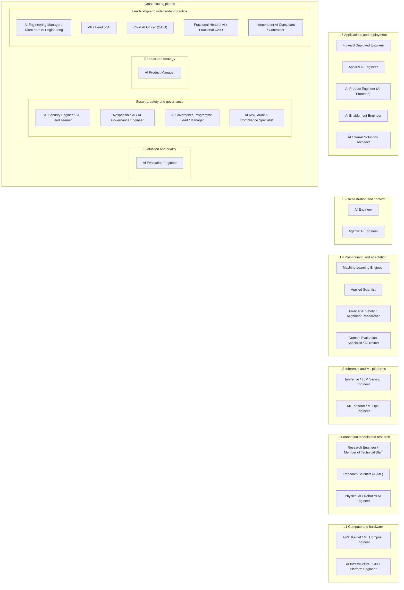

<!-- Generated by scripts/build_role_map.py from data/stack_model.json and data/role_scores.json. Edit the data, not this page. -->

# The GenAI Role Map: Where the Work Sits

> Six layers from compute to applications, four planes that cut across them, and where each of the 29 canonical roles works. Use it to see the field at a glance, find roles near your strengths and spot adjacent moves.

## How to read this map

- **Layers** run from L1 (compute and hardware) up to L6 (applications and deployment). **Planes** cut across every layer: evaluation; security, safety and governance; product; leadership and independent practice.
- Each role has a **work footprint**: the layer where most of its work sits, the other layers it regularly touches, and the planes it belongs to. Roles whose work is cross-cutting by nature have no main layer; their home is a plane.
- Footprints are judgement (Grade D) drawn from each role's definition in the [role catalog](role-catalog.md). Titles are not layers: umbrella titles such as AI Engineer span several, which is why every role lists its other layers.
- **This is not a pay or demand model.** Pay tracks employer tier and seniority, not application versus infrastructure work [B · T0-03 KF1]; the role rankings rejected the claim that GPU and inference roles have the highest pay ceilings. No pay, demand or value-capture figure is published per layer.
- To act on the map, open a role's hub (one page per role, with its evidence) or go to [choosing a direction](#choosing-a-direction).

## The stack at a glance

Only each role's main place is drawn. The tables below add the other layers and planes it works in.

## Layers

| Layer | What happens here | Roles based here | Also work here | Skill categories | Proof-of-work archetypes placed here |
|---|---|---|---|---|---|
| **L6 Applications and deployment** | AI features and products, deployment into customer environments, solution architecture, AI-native user experience | [Forward Deployed Engineer](hubs/forward-deployed-engineer.md), [Applied AI Engineer](hubs/applied-ai-engineer.md), [AI Product Engineer (AI Frontend)](hubs/ai-product-engineer.md), [AI Enablement Engineer](hubs/ai-enablement-engineer.md), [AI / GenAI Solutions Architect](hubs/ai-solutions-architect.md) | [AI Engineer](hubs/ai-engineer.md), [Agentic AI Engineer](hubs/agentic-ai-engineer.md), [AI Security Engineer / AI Red Teamer](hubs/ai-security-engineer.md), [AI Product Manager](hubs/ai-product-manager.md), [Physical AI / Robotics AI Engineer](hubs/physical-ai-engineer.md) | LLM applications, Frontend & UX | P14 Full-stack AI app with streaming agent UX and UX metrics |
| **L5 Orchestration and context** | agents and tool use, retrieval and RAG, agent protocols (MCP, A2A), memory and context pipelines | [AI Engineer](hubs/ai-engineer.md), [Agentic AI Engineer](hubs/agentic-ai-engineer.md) | [Forward Deployed Engineer](hubs/forward-deployed-engineer.md), [Applied AI Engineer](hubs/applied-ai-engineer.md), [AI Product Engineer (AI Frontend)](hubs/ai-product-engineer.md), [AI Enablement Engineer](hubs/ai-enablement-engineer.md), [AI / GenAI Solutions Architect](hubs/ai-solutions-architect.md), [ML Platform / MLOps Engineer](hubs/ml-platform-engineer.md), [AI Evaluation Engineer](hubs/ai-evaluation-engineer.md), [AI Security Engineer / AI Red Teamer](hubs/ai-security-engineer.md) | Retrieval & RAG, Agents | P1 Evaluated RAG system over a real corpus; P2 Reliable agent: approvals, sandboxed tools, replay, failure injection; P15 Internal AI-enablement pilot (MCP servers, adoption metrics) |
| **L4 Post-training and adaptation** | fine-tuning, preference optimisation and reinforcement learning, domain adaptation, model-level evaluation, human data for training | [Machine Learning Engineer](hubs/ml-engineer.md), [Applied Scientist](hubs/applied-scientist.md), [Frontier AI Safety / Alignment Researcher](hubs/ai-safety-researcher.md), [Domain Evaluation Specialist / AI Trainer](hubs/domain-evaluation-specialist.md) | [AI Evaluation Engineer](hubs/ai-evaluation-engineer.md), [Responsible AI / AI Governance Engineer](hubs/responsible-ai-engineer.md), [Research Engineer / Member of Technical Staff](hubs/research-engineer.md), [Research Scientist (AI/ML)](hubs/research-scientist.md), [Physical AI / Robotics AI Engineer](hubs/physical-ai-engineer.md) | Training & post-training, Human data & annotation | P7 Small-scale distributed training / post-training study |
| **L3 Inference and ML platforms** | serving engines and their optimisation, gateways and routing, MLOps and LLMOps platforms, observability | [Inference / LLM Serving Engineer](hubs/inference-engineer.md), [ML Platform / MLOps Engineer](hubs/ml-platform-engineer.md) | [Machine Learning Engineer](hubs/ml-engineer.md), [AI / GenAI Solutions Architect](hubs/ai-solutions-architect.md), [GPU Kernel / ML Compiler Engineer](hubs/gpu-kernel-engineer.md), [AI Infrastructure / GPU Platform Engineer](hubs/ai-infrastructure-engineer.md), [AI Security Engineer / AI Red Teamer](hubs/ai-security-engineer.md), [Responsible AI / AI Governance Engineer](hubs/responsible-ai-engineer.md) | Inference & serving, MLOps & platform, Observability & LLMOps | P5 Single-GPU serving and quantisation study; P6 Self-hosted LLM platform on Kubernetes |
| **L2 Foundation models and research** | pre-training, architectures and scaling, interpretability, new methods at frontier labs | [Research Engineer / Member of Technical Staff](hubs/research-engineer.md), [Research Scientist (AI/ML)](hubs/research-scientist.md), [Physical AI / Robotics AI Engineer](hubs/physical-ai-engineer.md) | [Machine Learning Engineer](hubs/ml-engineer.md), [Applied Scientist](hubs/applied-scientist.md), [Frontier AI Safety / Alignment Researcher](hubs/ai-safety-researcher.md) | ML & deep learning, Research, Models | P4 Prompt vs RAG vs fine-tune comparison; P8 Paper re-implementation with rigorous evals and a write-up; P18 Safety / interpretability research project |
| **L1 Compute and hardware** | accelerators, GPU kernels and compilers, clusters, interconnects and storage, capacity and reliability | [GPU Kernel / ML Compiler Engineer](hubs/gpu-kernel-engineer.md), [AI Infrastructure / GPU Platform Engineer](hubs/ai-infrastructure-engineer.md) | [Inference / LLM Serving Engineer](hubs/inference-engineer.md), [ML Platform / MLOps Engineer](hubs/ml-platform-engineer.md), [Research Engineer / Member of Technical Staff](hubs/research-engineer.md) | GPU & kernels, Infrastructure & HPC | P9 Custom Triton kernel with benchmarks and correctness tests |

Archetypes are placed where most of the skills they evidence sit (computed from the skill categories, Grade M). The [job-search strategy](../06-job-search/job-search-strategy.md#the-constraints-that-bind-first) computes which archetypes cover which roles.

## Cross-cutting planes

| Plane | What it covers | Roles based here | Roles that also work in it | Skill categories | Proof-of-work archetypes placed here |
|---|---|---|---|---|---|
| **Evaluation and quality** | measuring whether AI systems work at every layer: eval harnesses, golden sets, judge calibration, regression gates, online monitoring | [AI Evaluation Engineer](hubs/ai-evaluation-engineer.md) | [AI Engineer](hubs/ai-engineer.md), [Applied AI Engineer](hubs/applied-ai-engineer.md), [Applied Scientist](hubs/applied-scientist.md), [Frontier AI Safety / Alignment Researcher](hubs/ai-safety-researcher.md), [Domain Evaluation Specialist / AI Trainer](hubs/domain-evaluation-specialist.md) | Evaluation | P3 Eval harness with a calibrated judge and statistics; P17 Domain gold standard with inter-rater agreement |
| **Security, safety and governance** | security and red-teaming, responsible-AI controls, risk, audit and regulatory compliance | [AI Security Engineer / AI Red Teamer](hubs/ai-security-engineer.md), [Responsible AI / AI Governance Engineer](hubs/responsible-ai-engineer.md), [AI Governance Programme Lead / Manager](hubs/ai-governance-lead.md), [AI Risk, Audit & Compliance Specialist](hubs/ai-risk-assurance-specialist.md) | [Frontier AI Safety / Alignment Researcher](hubs/ai-safety-researcher.md), [Chief AI Officer (CAIO)](hubs/chief-ai-officer.md) | Security & safety, Governance, risk & compliance | P10 Red-team suite in CI against a working agent; P13 AI governance packet: inventory, risk register, framework mapping; P19 Model-validation / bias-audit report; P20 Responsible-AI compliance packet with runtime guardrails |
| **Product and strategy** | product outcomes for probabilistic systems: scoping, success metrics, economics, pilots | [AI Product Manager](hubs/ai-product-manager.md) | — | Product & business | P11 Customer pilot / reference architecture with a cost model; P12 AI PM case: PRD, eval rubric, pilot metrics |
| **Leadership and independent practice** | leading AI teams and organisations, or practising independently as a consultant or fractional leader | [AI Engineering Manager / Director of AI Engineering](hubs/ai-engineering-manager.md), [VP / Head of AI](hubs/vp-head-of-ai.md), [Chief AI Officer (CAIO)](hubs/chief-ai-officer.md), [Fractional Head of AI / Fractional CAIO](hubs/fractional-ai-leader.md), [Independent AI Consultant / Contractor](hubs/independent-ai-consultant.md) | — | Leadership | — |

Cross-cutting skill categories that belong to no single layer: Programming, Cloud & platforms, Data engineering, Infrastructure & DevOps, Communication & collaboration, Behavioural, Domain, Robotics & physical AI.

## Every role's footprint

| Family | Role | Main place | Also works at | Planes | Basis (Grade D) |
|---|---|---|---|---|---|
| Applied AI Engineering | [AI Engineer](hubs/ai-engineer.md) | L5 Orchestration and context | L6 Applications and deployment | Evaluation and quality | Catalog §3: API orchestration, RAG, agents, evals and deployment; AI Engineer postings name agentic work 59.3% and RAG 54.0% [A/B · T0-01 F4] |
| Applied AI Engineering | [Applied AI Engineer](hubs/applied-ai-engineer.md) | L6 Applications and deployment | L5 Orchestration and context | Evaluation and quality | Catalog §3: customer delivery, evals and safety at labs and AI vendors |
| Applied AI Engineering | [Agentic AI Engineer](hubs/agentic-ai-engineer.md) | L5 Orchestration and context | L6 Applications and deployment | — | Catalog §3: tool-using, multi-step agent systems with durable execution and tool gateways |
| Applied AI Engineering | [AI Product Engineer (AI Frontend)](hubs/ai-product-engineer.md) | L6 Applications and deployment | L5 Orchestration and context | — | Catalog §3: AI-native UX (streaming, tool-use visualisation, HITL checkpoints) |
| Applied AI Engineering | [AI Enablement Engineer](hubs/ai-enablement-engineer.md) | L6 Applications and deployment | L5 Orchestration and context | — | Catalog §3: internal copilots and agents, MCP integrations, developer-productivity tooling |
| ML Engineering & Applied Science | [Machine Learning Engineer](hubs/ml-engineer.md) | L4 Post-training and adaptation | L2 Foundation models and research, L3 Inference and ML platforms | — | Catalog §3: builds, trains, adapts and serves models; LLM named in 45.0% of postings [B · JobsPipe JD] |
| ML Engineering & Applied Science | [Applied Scientist](hubs/applied-scientist.md) | L4 Post-training and adaptation | L2 Foundation models and research | Evaluation and quality | Catalog §3: modelling, experimentation and shipping models; target card edge skills are eval statistics and fine-tuning |
| Forward Deployment & Solutions | [Forward Deployed Engineer](hubs/forward-deployed-engineer.md) | L6 Applications and deployment | L5 Orchestration and context | — | Catalog §3: deploy, integrate and adapt AI products end to end, embedded with customers |
| Forward Deployment & Solutions | [AI / GenAI Solutions Architect](hubs/ai-solutions-architect.md) | L6 Applications and deployment | L5 Orchestration and context, L3 Inference and ML platforms | — | Catalog §3: enterprise AI solutions on cloud and vendor stacks; pre-sales and delivery |
| AI Infrastructure & Platform | [Inference / LLM Serving Engineer](hubs/inference-engineer.md) | L3 Inference and ML platforms | L1 Compute and hardware | — | Catalog §3: the inference data path (batching, KV cache, quantisation, speculative decoding) |
| AI Infrastructure & Platform | [GPU Kernel / ML Compiler Engineer](hubs/gpu-kernel-engineer.md) | L1 Compute and hardware | L3 Inference and ML platforms | — | Catalog §3: GPU kernels and compiler paths (CUDA, Triton, CUTLASS, XLA/NeuronX) |
| AI Infrastructure & Platform | [AI Infrastructure / GPU Platform Engineer](hubs/ai-infrastructure-engineer.md) | L1 Compute and hardware | L3 Inference and ML platforms | — | Catalog §3: GPU clusters, scheduling, NCCL/RDMA/InfiniBand networking, storage |
| AI Infrastructure & Platform | [ML Platform / MLOps Engineer](hubs/ml-platform-engineer.md) | L3 Inference and ML platforms | L5 Orchestration and context, L1 Compute and hardware | — | Catalog §3: Kubernetes serving, LLM/MCP gateways, observability, CI/CD for models and prompts |
| Evaluation, Safety & Security | [AI Evaluation Engineer](hubs/ai-evaluation-engineer.md) | plane: Evaluation and quality | L5 Orchestration and context, L4 Post-training and adaptation | Evaluation and quality | Catalog §3: eval harnesses, golden sets, judge calibration, regression gates; mostly application-level evals |
| Evaluation, Safety & Security | [AI Security Engineer / AI Red Teamer](hubs/ai-security-engineer.md) | plane: Security, safety and governance | L5 Orchestration and context, L3 Inference and ML platforms, L6 Applications and deployment | Security, safety and governance | Catalog §3: prompt injection, agent abuse, supply chain, MCP authorisation; threats span serving engines to applications |
| Evaluation, Safety & Security | [Responsible AI / AI Governance Engineer](hubs/responsible-ai-engineer.md) | plane: Security, safety and governance | L4 Post-training and adaptation, L3 Inference and ML platforms | Security, safety and governance | Catalog §3: guardrails, fairness and hallucination evals, compliance logging; an extension of ML-platform, MLOps and security engineering |
| Research | [Research Engineer / Member of Technical Staff](hubs/research-engineer.md) | L2 Foundation models and research | L4 Post-training and adaptation, L1 Compute and hardware | — | Catalog §3: training runs, post-training/RL, evals and research infrastructure; absorbs post-training work |
| Research | [Research Scientist (AI/ML)](hubs/research-scientist.md) | L2 Foundation models and research | L4 Post-training and adaptation | — | Catalog §3: originates new methods, publishes, leads research agendas |
| Research | [Frontier AI Safety / Alignment Researcher](hubs/ai-safety-researcher.md) | L4 Post-training and adaptation | L2 Foundation models and research | Security, safety and governance, Evaluation and quality | Catalog §3: alignment (post-training), interpretability (model internals) and dangerous-capability evals |
| Governance, Risk & Assurance | [AI Governance Programme Lead / Manager](hubs/ai-governance-lead.md) | plane: Security, safety and governance | — | Security, safety and governance | Catalog §3: AI inventory, risk method, committees and regulatory conformity |
| Governance, Risk & Assurance | [AI Risk, Audit & Compliance Specialist](hubs/ai-risk-assurance-specialist.md) | plane: Security, safety and governance | — | Security, safety and governance | Catalog §3: risk, audit and compliance work inside existing professions |
| Product & Program | [AI Product Manager](hubs/ai-product-manager.md) | plane: Product and strategy | L6 Applications and deployment | Product and strategy | Catalog §3: product outcomes, eval rubrics, success metrics and token economics; product work spans layers |
| Human Data & Evaluation Operations | [Domain Evaluation Specialist / AI Trainer](hubs/domain-evaluation-specialist.md) | L4 Post-training and adaptation | — | Evaluation and quality | Catalog §3: rubrics, golden sets and grading of model outputs (human data for post-training and evaluation) |
| Embodied & Physical AI | [Physical AI / Robotics AI Engineer](hubs/physical-ai-engineer.md) | L2 Foundation models and research | L4 Post-training and adaptation, L6 Applications and deployment | — | Catalog §3: robot foundation and VLA models, sim-to-real; embodied AI sits partly outside an LLM stack, so the footprint is approximate |
| Leadership & Executive | [AI Engineering Manager / Director of AI Engineering](hubs/ai-engineering-manager.md) | plane: Leadership and independent practice | — | Leadership and independent practice | Catalog §3.9: Head / Director / Manager of AI Engineering postings; the team's layers vary |
| Leadership & Executive | [VP / Head of AI](hubs/vp-head-of-ai.md) | plane: Leadership and independent practice | — | Leadership and independent practice | Catalog §3.9: Head of AI survey job family; no posting count in the corpus |
| Leadership & Executive | [Chief AI Officer (CAIO)](hubs/chief-ai-officer.md) | plane: Leadership and independent practice | — | Leadership and independent practice, Security, safety and governance | Catalog §3.9: CAIO mandates and governance accountability |
| Independent & Fractional | [Fractional Head of AI / Fractional CAIO](hubs/fractional-ai-leader.md) | plane: Leadership and independent practice | — | Leadership and independent practice | Catalog §3.9: fractional Head of AI / CAIO retainers |
| Independent & Fractional | [Independent AI Consultant / Contractor](hubs/independent-ai-consultant.md) | plane: Leadership and independent practice | — | Leadership and independent practice | Catalog §3.9: independent practice found mostly through networks |

## Specialisations inside canonical roles

These are kinds of work that happen inside the canonical roles, not job titles. Many appear as titles in other guides; the catalog keeps them as aliases, candidates or quarantined titles until they pass its graduation tests ([role catalog §1.4](role-catalog.md#14-quorum-and-graduation-tests-t0-01-d5), decision D-002). Recruiters still search for them, so they belong in your skills and project descriptions.

| Specialisation | Where | Done inside | Key skills (ontology) | Status in the catalog |
|---|---|---|---|---|
| RAG and retrieval | L5 Orchestration and context | [AI Engineer](hubs/ai-engineer.md) | RAG, Retrieval quality (hybrid, reranking, recall@k), Permission-aware retrieval (ACLs, tenancy), Embeddings & vector search | Candidate title: Retrieval / Search Engineer (LLM), role catalog §5.3 |
| Graph RAG and knowledge graphs | L5 Orchestration and context | [AI Engineer](hubs/ai-engineer.md) | GraphRAG & knowledge graphs | No title of its own in the catalog |
| Document parsing and multimodal ingestion | L5 Orchestration and context | [AI Engineer](hubs/ai-engineer.md) | Document ingestion, parsing & chunking, Multimodal AI (vision, documents, audio) | No title of its own in the catalog |
| Vector search infrastructure | L5 Orchestration and context | [AI Engineer](hubs/ai-engineer.md), [ML Platform / MLOps Engineer](hubs/ml-platform-engineer.md) | Embeddings & vector search, Vector stores | Candidate title: Vector Search & Retrieval Systems Engineer, role catalog §5.3 |
| Context engineering | L5 Orchestration and context | [AI Engineer](hubs/ai-engineer.md), [Agentic AI Engineer](hubs/agentic-ai-engineer.md) | Context engineering, Prompt & context design | Quarantined title on the watchlist (Context Engineer), role catalog §5.1 and §5.4 |
| Agent memory | L5 Orchestration and context | [Agentic AI Engineer](hubs/agentic-ai-engineer.md) | Agent memory & state | No title of its own in the catalog |
| Multi-agent orchestration | L5 Orchestration and context | [Agentic AI Engineer](hubs/agentic-ai-engineer.md) | Multi-agent orchestration, Agent reliability (durable state, budgets, approvals) | Alias of Agentic AI Engineer in the A–Z index |
| Coding agents | L5 Orchestration and context | [Agentic AI Engineer](hubs/agentic-ai-engineer.md), [AI Engineer](hubs/ai-engineer.md) | Coding-agent rollout | No title of its own in the catalog |
| MCP and agent protocols | L5 Orchestration and context | [AI Enablement Engineer](hubs/ai-enablement-engineer.md), [ML Platform / MLOps Engineer](hubs/ml-platform-engineer.md), [Agentic AI Engineer](hubs/agentic-ai-engineer.md) | MCP (Model Context Protocol), LLM gateways | Specialisation label MCP Control Plane Engineer in the A–Z index; no literal title |
| Voice and conversational agents | L6 Applications and deployment | [AI Engineer](hubs/ai-engineer.md), [AI Product Engineer (AI Frontend)](hubs/ai-product-engineer.md) | Speech & voice AI (ASR, TTS, realtime voice agents) | Candidate title: Conversational & Voice AI Engineer, role catalog §5.3 |
| Edge and on-device models | L3 Inference and ML platforms | [AI Product Engineer (AI Frontend)](hubs/ai-product-engineer.md), [Inference / LLM Serving Engineer](hubs/inference-engineer.md) | On-device / WebGPU inference, Edge inference | Candidate title: On-Device & Edge SLM Engineer, role catalog §5.3 (a differentiator, not a job by itself) |
| Fine-tuning and domain adaptation | L4 Post-training and adaptation | [Machine Learning Engineer](hubs/ml-engineer.md), [Applied Scientist](hubs/applied-scientist.md) | Fine-tuning (SFT, LoRA), PEFT | No title of its own in the catalog |
| Post-training and reinforcement learning | L4 Post-training and adaptation | [Research Engineer / Member of Technical Staff](hubs/research-engineer.md) | Post-training (SFT, preference, RL), RLHF (reward models, PPO), Reward modelling | Absorbed into Research Engineer (legacy title in the A–Z index) |
| Synthetic data | L4 Post-training and adaptation | [Research Engineer / Member of Technical Staff](hubs/research-engineer.md), [Machine Learning Engineer](hubs/ml-engineer.md) | Synthetic data generation | No title of its own in the catalog |
| Benchmark design and model evaluation | Evaluation and quality | [AI Evaluation Engineer](hubs/ai-evaluation-engineer.md) | Benchmark construction, Eval statistics (CIs, power, pass^k) | Alias of AI Evaluation Engineer in the A–Z index |
| Quantisation and distillation | L3 Inference and ML platforms | [Inference / LLM Serving Engineer](hubs/inference-engineer.md) | Quantisation (FP8/FP4, AWQ, GPTQ), Distillation | No title of its own in the catalog |
| Disaggregated serving (prefill and decode) | L3 Inference and ML platforms | [Inference / LLM Serving Engineer](hubs/inference-engineer.md) | Prefill/decode disaggregation | No title of its own in the catalog |
| Gateways and model routing | L3 Inference and ML platforms | [ML Platform / MLOps Engineer](hubs/ml-platform-engineer.md) | LLM gateways | No title of its own in the catalog (Agent Gateway Engineer: legacy label, 0 postings) |
| Pre-training at scale | L2 Foundation models and research | [Research Engineer / Member of Technical Staff](hubs/research-engineer.md), [AI Infrastructure / GPU Platform Engineer](hubs/ai-infrastructure-engineer.md) | Pre-training at scale, Distributed training (FSDP2, TP/PP, MoE) | Unmeasured buzzword: Foundation Model Pre-Training Engineer, role catalog §5.2 |
| Mechanistic interpretability | L2 Foundation models and research | [Frontier AI Safety / Alignment Researcher](hubs/ai-safety-researcher.md) | Interpretability | Specialisation of Frontier AI Safety / Alignment Researcher in the A–Z index |
| Multimodal models | L2 Foundation models and research | [Research Scientist (AI/ML)](hubs/research-scientist.md) | Multimodal AI (vision, documents, audio) | No title of its own in the catalog |
| Reasoning models and test-time compute | L2 Foundation models and research | [Research Scientist (AI/ML)](hubs/research-scientist.md), [Research Engineer / Member of Technical Staff](hubs/research-engineer.md) | Reasoning models & test-time compute | Unmeasured buzzword: Reasoning Engineer, role catalog §5.2 |
| Red-teaming and adversarial testing | Security, safety and governance | [AI Security Engineer / AI Red Teamer](hubs/ai-security-engineer.md) | Red-teaming | Alias of AI Security Engineer (AI Red Teamer) in the A–Z index |
| Agent and tool security | Security, safety and governance | [AI Security Engineer / AI Red Teamer](hubs/ai-security-engineer.md) | Prompt-injection attack & defence, Agent abuse & MCP authorisation, OWASP agentic AI threat guidance | No title of its own in the catalog |
| Content provenance | Security, safety and governance | [Responsible AI / AI Governance Engineer](hubs/responsible-ai-engineer.md), [AI Security Engineer / AI Red Teamer](hubs/ai-security-engineer.md) | C2PA, Content provenance (EU AI Act Art. 50) | No title of its own in the catalog |
| Robot learning and VLA models | L2 Foundation models and research | [Physical AI / Robotics AI Engineer](hubs/physical-ai-engineer.md) | Vision-language-action (VLA) models, Robot learning & VLA models, Simulation & sim-to-real | Covered by the canonical Physical AI / Robotics AI Engineer |

## Choosing a direction

The map shows where work sits; it does not tell you where to go. Two things do, and both rest on evidence:

1. **Your background.** The [GenAI target roles by background](genai-target-roles.md#best-targets-by-background) and the [persona lenses in the role rankings](role-rankings.md#5-lenses-the-best-job-for-you) score how reachable each role is from five starting points.
2. **The interview track you can pass.** Employers interview by track, not by layer; pick the track whose loop you can prepare for:

| Interview track | What it tests | Roles |
|---|---|---|
| **Application** | RAG with access control, agent loop control, evaluation architecture, context management | [AI Engineer](hubs/ai-engineer.md), [Applied AI Engineer](hubs/applied-ai-engineer.md), [Agentic AI Engineer](hubs/agentic-ai-engineer.md), [AI Product Engineer (AI Frontend)](hubs/ai-product-engineer.md), [AI Enablement Engineer](hubs/ai-enablement-engineer.md) |
| **Application plus customer scoping** | RAG over sensitive, fast-changing documents and evaluating a multi-agent system (the Databricks AI-FDE loop), plus a scoping or customer round | [Forward Deployed Engineer](hubs/forward-deployed-engineer.md), [AI / GenAI Solutions Architect](hubs/ai-solutions-architect.md) |
| **Classic ML system design** | recommendation, fraud or ETA system design, plus where an LLM would help | [Machine Learning Engineer](hubs/ml-engineer.md), [Applied Scientist](hubs/applied-scientist.md) |
| **Infrastructure** | KV-cache maths, decode roofline, continuous batching, prefill/decode disaggregation, GPU scheduling, p95 debugging | [Inference / LLM Serving Engineer](hubs/inference-engineer.md), [GPU Kernel / ML Compiler Engineer](hubs/gpu-kernel-engineer.md), [AI Infrastructure / GPU Platform Engineer](hubs/ai-infrastructure-engineer.md), [ML Platform / MLOps Engineer](hubs/ml-platform-engineer.md) |
| **Evaluation design** | golden sets, judge calibration, online sampling, A/B tests | [AI Evaluation Engineer](hubs/ai-evaluation-engineer.md) |
| **Research** | a research talk plus coding; the full research loop at frontier labs | [Research Engineer / Member of Technical Staff](hubs/research-engineer.md), [Research Scientist (AI/ML)](hubs/research-scientist.md), [Frontier AI Safety / Alignment Researcher](hubs/ai-safety-researcher.md) |
| **Governance** | a scoping or solutions round, and fluency in the EU AI Act, NIST AI RMF and ISO 42001 | [Responsible AI / AI Governance Engineer](hubs/responsible-ai-engineer.md), [AI Governance Programme Lead / Manager](hubs/ai-governance-lead.md), [AI Risk, Audit & Compliance Specialist](hubs/ai-risk-assurance-specialist.md) |
| **Product** | a scoping or product round | [AI Product Manager](hubs/ai-product-manager.md), [Domain Evaluation Specialist / AI Trainer](hubs/domain-evaluation-specialist.md) |

No interview-track evidence in the corpus: [AI Security Engineer / AI Red Teamer](hubs/ai-security-engineer.md), [Physical AI / Robotics AI Engineer](hubs/physical-ai-engineer.md), [AI Engineering Manager / Director of AI Engineering](hubs/ai-engineering-manager.md), [VP / Head of AI](hubs/vp-head-of-ai.md), [Chief AI Officer (CAIO)](hubs/chief-ai-officer.md), [Fractional Head of AI / Fractional CAIO](hubs/fractional-ai-leader.md), [Independent AI Consultant / Contractor](hubs/independent-ai-consultant.md). Sources: T1-03, T0-14 (first collected in the role catalog §8.2; this file is the owner).

Adjacent moves are cheapest where footprints overlap: a role's other layers are where its skills transfer. Each role hub lists the most similar roles by skill overlap, which is the measured version of the same idea.

## Evidence and limits

- Layer names and order follow the legacy handbook's six-layer stack (structure only, decision D-016); the definitions, planes, footprints and specialisations are this repository's, drawn from the role definitions in career/02-roles/role-catalog.md §3. Footprints are judgement (Grade D).
- The archetype placement is a model output (Grade M) computed from skill categories.
- No layer has pay, demand or job-share figures, by design (decision D-015).
- Data as of 2026-11-05 (stack model) and 2026-11-02 (role scores).

## Next steps

- [Role hubs](hubs/README.md): one page per role with its numbers, skills, proof, interview track and résumé pointers.
- [Role catalog](role-catalog.md) for definitions and evidence status; [GenAI target roles](genai-target-roles.md) for the target order.
- [Role skill inventories](../03-skills-and-tech/role-skill-inventories.md) for every skill a role needs.
- [Start Here](../README.md) for paths by situation and background.
