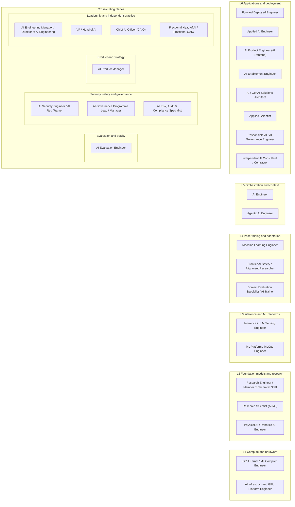

<!-- Generated by scripts/build_role_map.py from data/stack_model.json and data/role_scores.json. Edit the data, not this page. -->

# The GenAI Role Map: Where the Work Sits

> Six layers from compute to applications, four planes that cut across them, and where each of the 29 canonical roles works. Use it to see the field at a glance, find roles near your strengths and spot adjacent moves.

## How to read this map

- **Layers** run from L1 (compute and hardware) up to L6 (applications and deployment). **Planes** cut across every layer: evaluation; security, safety and governance; product; leadership and independent practice.
- Each role has a **work footprint**: the layer where most of its work sits, the other layers it regularly touches, and the planes it belongs to. Roles whose work is cross-cutting by nature have no main layer; their home is a plane.
- Footprints are judgement (Grade D) drawn from each role's definition in the [role catalog](role-catalog.md). Titles are not layers: umbrella titles such as AI Engineer span several, which is why every role lists its other layers.
- **This is not a pay or demand model.** Pay tracks employer tier and seniority, not application versus infrastructure work [B · T0-03 KF1]; the role rankings rejected the claim that GPU and inference roles have the highest pay ceilings. No pay, demand or value-capture figure is published per layer.
- To act on the map, open a role's hub (one page per role, with its evidence) or go to [choosing a direction](#choosing-a-direction).

## The stack at a glance

Only each role's main place is drawn. The tables below add the other layers and planes it works in.

## Layers

| Layer | What happens here | Roles based here | Also work here | Skill categories | Proof-of-work archetypes placed here |
|---|---|---|---|---|---|
| **L6 Applications and deployment** | AI features and products, deployment into customer environments, solution architecture, AI-native user experience | [Forward Deployed Engineer](hubs/forward-deployed-engineer.md), [Applied AI Engineer](hubs/applied-ai-engineer.md), [AI Product Engineer (AI Frontend)](hubs/ai-product-engineer.md), [AI Enablement Engineer](hubs/ai-enablement-engineer.md), [AI / GenAI Solutions Architect](hubs/ai-solutions-architect.md), [Applied Scientist](hubs/applied-scientist.md), [Responsible AI / AI Governance Engineer](hubs/responsible-ai-engineer.md), [Independent AI Consultant / Contractor](hubs/independent-ai-consultant.md) | [AI Engineer](hubs/ai-engineer.md), [Agentic AI Engineer](hubs/agentic-ai-engineer.md), [AI Security Engineer / AI Red Teamer](hubs/ai-security-engineer.md), [AI Product Manager](hubs/ai-product-manager.md), [Physical AI / Robotics AI Engineer](hubs/physical-ai-engineer.md), [VP / Head of AI](hubs/vp-head-of-ai.md) | LLM applications, Frontend & UX | P14 Full-stack AI app with streaming agent UX and UX metrics |
| **L5 Orchestration and context** | agents and tool use, retrieval and RAG, agent protocols (MCP, A2A), memory and context pipelines | [AI Engineer](hubs/ai-engineer.md), [Agentic AI Engineer](hubs/agentic-ai-engineer.md) | [Forward Deployed Engineer](hubs/forward-deployed-engineer.md), [Applied AI Engineer](hubs/applied-ai-engineer.md), [AI Product Engineer (AI Frontend)](hubs/ai-product-engineer.md), [AI Enablement Engineer](hubs/ai-enablement-engineer.md), [AI / GenAI Solutions Architect](hubs/ai-solutions-architect.md), [AI Evaluation Engineer](hubs/ai-evaluation-engineer.md), [AI Security Engineer / AI Red Teamer](hubs/ai-security-engineer.md), [Responsible AI / AI Governance Engineer](hubs/responsible-ai-engineer.md), [Independent AI Consultant / Contractor](hubs/independent-ai-consultant.md) | Retrieval & RAG, Agents | P1 Evaluated RAG system over a real corpus; P2 Reliable agent: approvals, sandboxed tools, replay, failure injection; P15 Internal AI-enablement pilot (MCP servers, adoption metrics) |
| **L4 Post-training and adaptation** | fine-tuning, preference optimisation and reinforcement learning, domain adaptation, model-level evaluation, human data for training | [Machine Learning Engineer](hubs/ml-engineer.md), [Frontier AI Safety / Alignment Researcher](hubs/ai-safety-researcher.md), [Domain Evaluation Specialist / AI Trainer](hubs/domain-evaluation-specialist.md) | [Applied Scientist](hubs/applied-scientist.md), [AI Evaluation Engineer](hubs/ai-evaluation-engineer.md), [Research Engineer / Member of Technical Staff](hubs/research-engineer.md), [Research Scientist (AI/ML)](hubs/research-scientist.md), [AI Product Manager](hubs/ai-product-manager.md), [Physical AI / Robotics AI Engineer](hubs/physical-ai-engineer.md) | Training & post-training, Human data & annotation | P7 Small-scale distributed training / post-training study |
| **L3 Inference and ML platforms** | serving engines and their optimisation, gateways and routing, MLOps and LLMOps platforms, observability | [Inference / LLM Serving Engineer](hubs/inference-engineer.md), [ML Platform / MLOps Engineer](hubs/ml-platform-engineer.md) | [Machine Learning Engineer](hubs/ml-engineer.md), [AI / GenAI Solutions Architect](hubs/ai-solutions-architect.md), [GPU Kernel / ML Compiler Engineer](hubs/gpu-kernel-engineer.md), [AI Infrastructure / GPU Platform Engineer](hubs/ai-infrastructure-engineer.md), [AI Security Engineer / AI Red Teamer](hubs/ai-security-engineer.md), [Research Engineer / Member of Technical Staff](hubs/research-engineer.md) | Inference & serving, MLOps & platform, Observability & LLMOps | P5 Single-GPU serving and quantisation study; P6 Self-hosted LLM platform on Kubernetes; P21 Category-level public technical micro-audit or benchmark |
| **L2 Foundation models and research** | pre-training, architectures and scaling, interpretability, new methods at frontier labs | [Research Engineer / Member of Technical Staff](hubs/research-engineer.md), [Research Scientist (AI/ML)](hubs/research-scientist.md), [Physical AI / Robotics AI Engineer](hubs/physical-ai-engineer.md) | [Machine Learning Engineer](hubs/ml-engineer.md), [Applied Scientist](hubs/applied-scientist.md), [Frontier AI Safety / Alignment Researcher](hubs/ai-safety-researcher.md) | ML & deep learning, Research, Models | P4 Prompt vs RAG vs fine-tune comparison; P8 Paper re-implementation with rigorous evals and a write-up; P16 Sim-to-real robotics project; P18 Safety / interpretability research project |
| **L1 Compute and hardware** | accelerators, GPU kernels and compilers, clusters, interconnects and storage, capacity and reliability | [GPU Kernel / ML Compiler Engineer](hubs/gpu-kernel-engineer.md), [AI Infrastructure / GPU Platform Engineer](hubs/ai-infrastructure-engineer.md) | [Inference / LLM Serving Engineer](hubs/inference-engineer.md), [ML Platform / MLOps Engineer](hubs/ml-platform-engineer.md), [Research Engineer / Member of Technical Staff](hubs/research-engineer.md) | GPU & kernels, Infrastructure & HPC | P9 Custom Triton kernel with benchmarks and correctness tests |

Archetypes are placed where most of the skills they evidence sit (computed from the skill categories, Grade M). The [job-search strategy](../06-job-search/job-search-strategy.md#the-constraints-that-bind-first) computes which archetypes cover which roles.

## Cross-cutting planes

| Plane | What it covers | Roles based here | Roles that also work in it | Skill categories | Proof-of-work archetypes placed here |
|---|---|---|---|---|---|
| **Evaluation and quality** | measuring whether AI systems work at every layer: eval harnesses, golden sets, judge calibration, regression gates, online monitoring | [AI Evaluation Engineer](hubs/ai-evaluation-engineer.md) | [AI Engineer](hubs/ai-engineer.md), [Machine Learning Engineer](hubs/ml-engineer.md), [Applied AI Engineer](hubs/applied-ai-engineer.md), [Agentic AI Engineer](hubs/agentic-ai-engineer.md), [Applied Scientist](hubs/applied-scientist.md), [Responsible AI / AI Governance Engineer](hubs/responsible-ai-engineer.md), [Research Engineer / Member of Technical Staff](hubs/research-engineer.md), [Research Scientist (AI/ML)](hubs/research-scientist.md), [Frontier AI Safety / Alignment Researcher](hubs/ai-safety-researcher.md), [AI Product Manager](hubs/ai-product-manager.md), [Domain Evaluation Specialist / AI Trainer](hubs/domain-evaluation-specialist.md), [Physical AI / Robotics AI Engineer](hubs/physical-ai-engineer.md) | Evaluation | P3 Eval harness with a calibrated judge and statistics; P17 Domain gold standard with inter-rater agreement |
| **Security, safety and governance** | security and red-teaming, responsible-AI controls, risk, audit and regulatory compliance | [AI Security Engineer / AI Red Teamer](hubs/ai-security-engineer.md), [AI Governance Programme Lead / Manager](hubs/ai-governance-lead.md), [AI Risk, Audit & Compliance Specialist](hubs/ai-risk-assurance-specialist.md) | [Applied AI Engineer](hubs/applied-ai-engineer.md), [AI Enablement Engineer](hubs/ai-enablement-engineer.md), [Responsible AI / AI Governance Engineer](hubs/responsible-ai-engineer.md), [Frontier AI Safety / Alignment Researcher](hubs/ai-safety-researcher.md), [Chief AI Officer (CAIO)](hubs/chief-ai-officer.md) | Security & safety, Governance, risk & compliance | P10 Red-team suite in CI against a working agent; P13 AI governance packet: inventory, risk register, framework mapping; P19 Model-validation / bias-audit report; P20 Responsible-AI compliance packet with runtime guardrails |
| **Product and strategy** | product outcomes for probabilistic systems: scoping, success metrics, economics, pilots | [AI Product Manager](hubs/ai-product-manager.md) | [AI Governance Programme Lead / Manager](hubs/ai-governance-lead.md) | Product & business | P11 Customer pilot / reference architecture with a cost model; P12 AI PM case: PRD, eval rubric, pilot metrics |
| **Leadership and independent practice** | leading AI teams and organisations, or practising independently as a consultant or fractional leader | [AI Engineering Manager / Director of AI Engineering](hubs/ai-engineering-manager.md), [VP / Head of AI](hubs/vp-head-of-ai.md), [Chief AI Officer (CAIO)](hubs/chief-ai-officer.md), [Fractional Head of AI / Fractional CAIO](hubs/fractional-ai-leader.md) | [Independent AI Consultant / Contractor](hubs/independent-ai-consultant.md) | Leadership | — |

Cross-cutting skill categories that belong to no single layer: Programming, Cloud & platforms, Data engineering, Infrastructure & DevOps, Communication & collaboration, Behavioural, Domain, Robotics & physical AI.

## Every role's footprint

| Family | Role | Main place | Also works at | Planes | Basis (Grade D) |
|---|---|---|---|---|---|
| Applied AI Engineering | [AI Engineer](hubs/ai-engineer.md) | L5 Orchestration and context | L6 Applications and deployment | Evaluation and quality | Catalog §3 & T0-48 K8: API orchestration, RAG (54.0%), agents (59.3%), evals/monitoring (12/14 full-read postings) and deployment [A/B · T0-01 F4, T0-48] |
| Applied AI Engineering | [Applied AI Engineer](hubs/applied-ai-engineer.md) | L6 Applications and deployment | L5 Orchestration and context | Evaluation and quality, Security, safety and governance | Catalog §3 & T0-53 K8: customer delivery (10/10 L6, 10/10 L5), evals (8/10) and safety/responsible-AI assurance (4/10) at labs and AI vendors [T0-53] |
| Applied AI Engineering | [Agentic AI Engineer](hubs/agentic-ai-engineer.md) | L5 Orchestration and context | L6 Applications and deployment | Evaluation and quality | Catalog §3 & T0-57 D11: tool-using multi-step agent systems with durable execution, tool gateways, evals (7/14) and guardrails/security (3/14) [T0-57] |
| Applied AI Engineering | [AI Product Engineer (AI Frontend)](hubs/ai-product-engineer.md) | L6 Applications and deployment | L5 Orchestration and context | — | Catalog §3 & T0-62 K37: 16/16 L6 AI-native UX (streaming, tool-use visualisation, HITL checkpoints) plus L5 agent runtime/orchestration at Anthropic, Taktile and Dash0 [T0-62] |
| Applied AI Engineering | [AI Enablement Engineer](hubs/ai-enablement-engineer.md) | L6 Applications and deployment | L5 Orchestration and context | Security, safety and governance | Catalog §3 & T0-62 K23/L313: internal copilots and agents (33.3%), MCP (26.7% sample / 19.0% Skillenai), developer-productivity tooling and platform/IAM assurance plane [T0-62] |
| ML Engineering & Applied Science | [Machine Learning Engineer](hubs/ml-engineer.md) | L4 Post-training and adaptation | L2 Foundation models and research, L3 Inference and ML platforms | Evaluation and quality | Catalog §3 & T0-49 K8: builds, trains, adapts and serves models; LLM named in 45.0% [B · JobsPipe JD]; T0-49 sample (n=36) shows evals 30.6% (#1 GenAI cluster), fine-tuning/RL 22%, serving 14% [T0-49] |
| ML Engineering & Applied Science | [Applied Scientist](hubs/applied-scientist.md) | L6 Applications and deployment | L4 Post-training and adaptation, L2 Foundation models and research | Evaluation and quality | Catalog §3 & T0-52 K8: application and deployment (L6) is primary in 74% (17/23), post-training (L4) primary in 4% (1/23) and named in 26% (AI-native/post-training variants), LLM evaluation in 43.5% [T0-52] |
| Forward Deployment & Solutions | [Forward Deployed Engineer](hubs/forward-deployed-engineer.md) | L6 Applications and deployment | L5 Orchestration and context | — | Catalog §3 & T0-51: deploy, integrate and adapt AI products end to end embedded with customers (customer scoping 50.0%, evals 21.4% [T0-51]) |
| Forward Deployment & Solutions | [AI / GenAI Solutions Architect](hubs/ai-solutions-architect.md) | L6 Applications and deployment | L5 Orchestration and context, L3 Inference and ML platforms | — | Catalog §3 & T0-62: L6 enterprise AI delivery, L5 RAG (56.5%) and agents (52.2%), L3 cloud and vendor stacks (52.2%) across pre-sales and delivery [T0-62] |
| AI Infrastructure & Platform | [Inference / LLM Serving Engineer](hubs/inference-engineer.md) | L3 Inference and ML platforms | L1 Compute and hardware | — | Catalog §3 & T0-56 §11: L3 serving/inference data path (37/37 postings: batching, KV cache, quantisation, speculative decoding) plus L1 non-NVIDIA accelerators (8/37 = 22%) [T0-56] |
| AI Infrastructure & Platform | [GPU Kernel / ML Compiler Engineer](hubs/gpu-kernel-engineer.md) | L1 Compute and hardware | L3 Inference and ML platforms | — | Catalog §3 & T0-63 K8: 41/41 L1/L3 hardware and serving/compiler paths (CUDA, Triton, CUTLASS, XLA/NeuronX; 43.9% inference, 14.6% training, 0% training-only) [T0-63] |
| AI Infrastructure & Platform | [AI Infrastructure / GPU Platform Engineer](hubs/ai-infrastructure-engineer.md) | L1 Compute and hardware | L3 Inference and ML platforms | — | Catalog §3 & T0-54 KF2: GPU/accelerator clusters (94.3%), Kubernetes (80.0%), IB/RDMA networking (51.4%), Slurm (42.9%) and storage [T0-54] |
| AI Infrastructure & Platform | [ML Platform / MLOps Engineer](hubs/ml-platform-engineer.md) | L3 Inference and ML platforms | L1 Compute and hardware | — | Catalog §3 & T0-58 K1/K8: L3 ML/serving platform primary (K8s, IaC, CI/CD, MLflow/Kubeflow, LLMOps 32.3%), L1 GPU scheduling in 5/31; L5 LLM/MCP gateways and prompt CI/CD appeared in 0/37 postings [T0-58] |
| Evaluation, Safety & Security | [AI Evaluation Engineer](hubs/ai-evaluation-engineer.md) | plane: Evaluation and quality | L5 Orchestration and context, L4 Post-training and adaptation | Evaluation and quality | Catalog §3 & T0-60: evaluation plane primary across L5/L6 application and L4 post-training layers (eval harnesses, golden sets, judge calibration, regression gates) [T0-60] |
| Evaluation, Safety & Security | [AI Security Engineer / AI Red Teamer](hubs/ai-security-engineer.md) | plane: Security, safety and governance | L5 Orchestration and context, L3 Inference and ML platforms, L6 Applications and deployment | Security, safety and governance | Catalog §3 & T0-60: assurance plane primary across L6/L5/L3 (prompt injection, agent abuse, supply chain, MCP authorisation and red-teaming) [T0-60] |
| Evaluation, Safety & Security | [Responsible AI / AI Governance Engineer](hubs/responsible-ai-engineer.md) | L6 Applications and deployment | L5 Orchestration and context | Security, safety and governance, Evaluation and quality | Catalog §3 & T0-61 L359: L6 application/deployment guardrails, evaluation plane (6/8 postings) and L5 orchestration frameworks (2/8); L4/L3 appeared in 0/8 read postings [T0-61] |
| Research | [Research Engineer / Member of Technical Staff](hubs/research-engineer.md) | L2 Foundation models and research | L4 Post-training and adaptation, L3 Inference and ML platforms, L1 Compute and hardware | Evaluation and quality | Catalog §3 & T0-50 K8: L2 training/research primary, L4 post-training/RL (55.6%), L3 serving/infra (50% named, 22% primary), L1 compute and evaluation plane (33% named, 11% primary) [T0-50] |
| Research | [Research Scientist (AI/ML)](hubs/research-scientist.md) | L2 Foundation models and research | L4 Post-training and adaptation | Evaluation and quality | Catalog §3 & T0-55 §11: L2 models/research (60.0%), L4 post-training (13.3% primary / 41.7% in n=12 full reads) and evaluation plane (41.7% in n=12 full reads) [T0-55] |
| Research | [Frontier AI Safety / Alignment Researcher](hubs/ai-safety-researcher.md) | L4 Post-training and adaptation | L2 Foundation models and research | Security, safety and governance, Evaluation and quality | Catalog §3 & T0-60: alignment (post-training L4), interpretability (model internals L2), assurance and dangerous-capability evaluations [T0-60] |
| Governance, Risk & Assurance | [AI Governance Programme Lead / Manager](hubs/ai-governance-lead.md) | plane: Security, safety and governance | — | Security, safety and governance, Product and strategy | Catalog §3 & T0-61 L359: assurance and product planes (AI inventory, risk method, committees and regulatory conformity; no stack engineering) [T0-61] |
| Governance, Risk & Assurance | [AI Risk, Audit & Compliance Specialist](hubs/ai-risk-assurance-specialist.md) | plane: Security, safety and governance | — | Security, safety and governance | Catalog §3 & T0-61: assurance plane (risk, audit and compliance work inside existing professions) [T0-61] |
| Product & Program | [AI Product Manager](hubs/ai-product-manager.md) | plane: Product and strategy | L6 Applications and deployment, L4 Post-training and adaptation | Product and strategy, Evaluation and quality | Catalog §3 & T0-59 L318–325: product plane primary across L6 apps (68%), L2/L4 models and post-training (12%) and evaluation/assurance plane (10%) [T0-59] |
| Human Data & Evaluation Operations | [Domain Evaluation Specialist / AI Trainer](hubs/domain-evaluation-specialist.md) | L4 Post-training and adaptation | — | Evaluation and quality | Catalog §3 & T0-66: rubrics, golden sets and grading of model outputs (human data for post-training and evaluation) [T0-66] |
| Embodied & Physical AI | [Physical AI / Robotics AI Engineer](hubs/physical-ai-engineer.md) | L2 Foundation models and research | L4 Post-training and adaptation, L6 Applications and deployment | Evaluation and quality | Catalog §3 & T0-64 K8: L2 models/research (15/48), L4 post-training (16/48), L6 deployment (13/48) plus simulation/data/evaluation plane (4/48); embodied AI sits partly outside an LLM stack [T0-64] |
| Leadership & Executive | [AI Engineering Manager / Director of AI Engineering](hubs/ai-engineering-manager.md) | plane: Leadership and independent practice | — | Leadership and independent practice | Catalog §3.9 & T0-65: leadership plane across AI-system teams (20–24% of Fast AI Jobs EM rows; 8/15 Anthropic EM titles); team layers vary [T0-65] |
| Leadership & Executive | [VP / Head of AI](hubs/vp-head-of-ai.md) | plane: Leadership and independent practice | L6 Applications and deployment | Leadership and independent practice | Catalog §3.9 & T0-65 KF8: leadership plane primary; 45% of text-visible postings (n=11) are hands-on player-coach seats shipping L6 production systems [T0-65] |
| Leadership & Executive | [Chief AI Officer (CAIO)](hubs/chief-ai-officer.md) | plane: Leadership and independent practice | — | Leadership and independent practice, Security, safety and governance | Catalog §3.9 & T0-65: leadership and assurance planes (strategy 100%, governance 86%, AI system technical depth 43%, n=7) [T0-65] |
| Independent & Fractional | [Fractional Head of AI / Fractional CAIO](hubs/fractional-ai-leader.md) | plane: Leadership and independent practice | — | Leadership and independent practice | Catalog §3.9 & T0-66: leadership plane (strategy 85%, governance/exec comm/change management 77% each; hands-on LLM depth 46%, n=13) [T0-66] |
| Independent & Fractional | [Independent AI Consultant / Contractor](hubs/independent-ai-consultant.md) | L6 Applications and deployment | L5 Orchestration and context | Leadership and independent practice | Catalog §3.9 & T0-66: 10/17 sampled postings and n=1,466 UK GenAI contract ads (IT Jobs Watch, B) are hands-on L6/L5 GenAI build/delivery, with advisory sitting on the leadership plane [T0-66] |

## Specialisations inside canonical roles

These are kinds of work that happen inside the canonical roles, not job titles. Many appear as titles in other guides; the catalog keeps them as aliases, candidates or quarantined titles until they pass its graduation tests ([role catalog §1.4](role-catalog.md#14-quorum-and-graduation-tests-t0-01-d5), decision D-002). Recruiters still search for them, so they belong in your skills and project descriptions.

| Specialisation | Where | Done inside | Key skills (ontology) | Status in the catalog |
|---|---|---|---|---|
| RAG and retrieval | L5 Orchestration and context | [AI Engineer](hubs/ai-engineer.md) | RAG, Retrieval quality (hybrid, reranking, recall@k), Permission-aware retrieval (ACLs, tenancy), Embeddings & vector search | Candidate title: Retrieval / Search Engineer (LLM), role catalog §5.3 |
| Graph RAG and knowledge graphs | L5 Orchestration and context | [AI Engineer](hubs/ai-engineer.md) | GraphRAG & knowledge graphs | No title of its own in the catalog |
| Document parsing and multimodal ingestion | L5 Orchestration and context | [AI Engineer](hubs/ai-engineer.md) | Document ingestion, parsing & chunking, Multimodal AI (vision, documents, audio) | No title of its own in the catalog |
| Vector search infrastructure | L5 Orchestration and context | [AI Engineer](hubs/ai-engineer.md), [ML Platform / MLOps Engineer](hubs/ml-platform-engineer.md) | Embeddings & vector search, Vector stores | Candidate title: Vector Search & Retrieval Systems Engineer, role catalog §5.3 |
| Context engineering | L5 Orchestration and context | [AI Engineer](hubs/ai-engineer.md), [Agentic AI Engineer](hubs/agentic-ai-engineer.md) | Context engineering, Prompt & context design | Quarantined title on the watchlist (Context Engineer), role catalog §5.1 and §5.4 |
| Agent memory | L5 Orchestration and context | [Agentic AI Engineer](hubs/agentic-ai-engineer.md) | Agent memory & state | No title of its own in the catalog |
| Multi-agent orchestration | L5 Orchestration and context | [Agentic AI Engineer](hubs/agentic-ai-engineer.md) | Multi-agent orchestration, Agent reliability (durable state, budgets, approvals) | Alias of Agentic AI Engineer in the A–Z index |
| Coding agents | L5 Orchestration and context | [Agentic AI Engineer](hubs/agentic-ai-engineer.md), [AI Engineer](hubs/ai-engineer.md) | Coding agents & AI-assisted engineering | No title of its own in the catalog |
| MCP and agent protocols | L5 Orchestration and context | [AI Enablement Engineer](hubs/ai-enablement-engineer.md), [ML Platform / MLOps Engineer](hubs/ml-platform-engineer.md), [Agentic AI Engineer](hubs/agentic-ai-engineer.md) | MCP (Model Context Protocol), LLM gateways | Specialisation label MCP Control Plane Engineer in the A–Z index; no literal title (MCP named in 19.0% of Skillenai / 26.7% of sampled AI Enablement postings [T0-62]) |
| Voice and conversational agents | L6 Applications and deployment | [AI Engineer](hubs/ai-engineer.md), [AI Product Engineer (AI Frontend)](hubs/ai-product-engineer.md) | Speech & voice AI (ASR, TTS, realtime voice agents) | Candidate title: Conversational & Voice AI Engineer, role catalog §5.3 (0/16 in AI Product Engineer sample [T0-62]; provisional gateway share rose 4% to 11% [T0-69]) |
| Edge and on-device models | L3 Inference and ML platforms | [AI Product Engineer (AI Frontend)](hubs/ai-product-engineer.md), [Inference / LLM Serving Engineer](hubs/inference-engineer.md) | On-device / WebGPU inference, Edge inference | Candidate title: On-Device & Edge SLM Engineer, role catalog §5.3 (at least 9 live Edge AI Engineer aggregator listings plus Deepgram in Nov 2026 [C · T0-69 K13; ERRATA U38]; 0/16 in AI Product Engineer sample [T0-62]) |
| Fine-tuning and domain adaptation | L4 Post-training and adaptation | [Machine Learning Engineer](hubs/ml-engineer.md), [Applied Scientist](hubs/applied-scientist.md) | Fine-tuning (SFT, LoRA), PEFT | No title of its own in the catalog |
| Post-training and reinforcement learning | L4 Post-training and adaptation | [Research Engineer / Member of Technical Staff](hubs/research-engineer.md) | Post-training (SFT, preference, RL), RLHF (reward models, PPO), Reward modelling | Absorbed into Research Engineer (legacy title in the A–Z index; named in 55.6% of RE [T0-50], 41.7% of RS [T0-55] and 26% of AS postings [T0-52]) |
| Synthetic data | L4 Post-training and adaptation | [Research Engineer / Member of Technical Staff](hubs/research-engineer.md), [Machine Learning Engineer](hubs/ml-engineer.md) | Synthetic data generation | No title of its own in the catalog |
| Benchmark design and model evaluation | Evaluation and quality | [AI Evaluation Engineer](hubs/ai-evaluation-engineer.md) | Benchmark construction, Eval statistics (CIs, power, pass^k) | Alias of AI Evaluation Engineer in the A–Z index (also 27% floor in AI PM [T0-59] and 75% in Responsible AI Engineer [T0-61]) |
| Quantisation and distillation | L3 Inference and ML platforms | [Inference / LLM Serving Engineer](hubs/inference-engineer.md) | Quantisation (FP8/FP4, AWQ, GPTQ), Distillation | No title of its own in the catalog |
| Disaggregated serving (prefill and decode) | L3 Inference and ML platforms | [Inference / LLM Serving Engineer](hubs/inference-engineer.md) | Prefill/decode disaggregation | No title of its own in the catalog |
| Gateways and model routing | L3 Inference and ML platforms | [ML Platform / MLOps Engineer](hubs/ml-platform-engineer.md) | LLM gateways | No title of its own in the catalog (Agent Gateway Engineer: legacy label, 0 postings; 0/37 ML Platform postings named LLM/MCP gateways [T0-58]) |
| Pre-training at scale | L2 Foundation models and research | [Research Engineer / Member of Technical Staff](hubs/research-engineer.md), [AI Infrastructure / GPU Platform Engineer](hubs/ai-infrastructure-engineer.md) | Pre-training at scale, Distributed training (FSDP2, TP/PP, MoE) | Candidate title (ungraduated): live pre-training postings at 4 employers and Distributed Training Engineer at OpenAI/Periodic Labs in Nov 2026 [C · T0-69 K17–K18; ERRATA U38], role catalog §5.2 |
| Mechanistic interpretability | L2 Foundation models and research | [Frontier AI Safety / Alignment Researcher](hubs/ai-safety-researcher.md) | Interpretability | Specialisation of Frontier AI Safety / Alignment Researcher in the A–Z index |
| Multimodal models | L2 Foundation models and research | [Research Scientist (AI/ML)](hubs/research-scientist.md) | Multimodal AI (vision, documents, audio) | No title of its own in the catalog |
| Reasoning models and test-time compute | L2 Foundation models and research | [Research Scientist (AI/ML)](hubs/research-scientist.md), [Research Engineer / Member of Technical Staff](hubs/research-engineer.md) | Reasoning models & test-time compute | Unmeasured buzzword: Reasoning Engineer, role catalog §5.2 |
| Red-teaming and adversarial testing | Security, safety and governance | [AI Security Engineer / AI Red Teamer](hubs/ai-security-engineer.md) | Red-teaming | Alias of AI Security Engineer (AI Red Teamer) in the A–Z index (SANS mid-Sep 2026 ~100 AI red-team postings, +13% WoW [B · T0-60]) |
| Agent and tool security | Security, safety and governance | [AI Security Engineer / AI Red Teamer](hubs/ai-security-engineer.md) | Prompt-injection attack & defence, Agent abuse & MCP authorisation, OWASP agentic AI threat guidance | No title of its own in the catalog |
| Content provenance | Security, safety and governance | [Responsible AI / AI Governance Engineer](hubs/responsible-ai-engineer.md), [AI Security Engineer / AI Red Teamer](hubs/ai-security-engineer.md) | C2PA, Content provenance (EU AI Act Art. 50) | No title of its own in the catalog (thin JD signal: 0/25 AI Security [T0-60], 0/11 Governance and 0/8 Responsible AI Engineer postings named C2PA/provenance [T0-61]) |
| Robot learning and VLA models | L2 Foundation models and research | [Physical AI / Robotics AI Engineer](hubs/physical-ai-engineer.md) | Robot learning & VLA models, Simulation & sim-to-real | Covered by the canonical Physical AI / Robotics AI Engineer |

## Choosing a direction

The map shows where work sits; it does not tell you where to go. Two things do, and both rest on evidence:

1. **Your background.** The [GenAI target roles by background](genai-target-roles.md#best-targets-by-background) and the [persona lenses in the role rankings](role-rankings.md#5-lenses-the-best-job-for-you) score how reachable each role is from five starting points.
2. **The interview track you can pass.** Employers interview by track, not by layer; pick the track whose loop you can prepare for:

| Interview track | What it tests | Roles |
|---|---|---|
| **Application** | Coding, RAG or agent system design, and evaluation (plus an emerging AI-assisted build variant at AI-native firms such as Sierra, OpenAI and Anthropic) | [AI Engineer](hubs/ai-engineer.md), [Agentic AI Engineer](hubs/agentic-ai-engineer.md), [AI Enablement Engineer](hubs/ai-enablement-engineer.md) |
| **Application plus customer scoping** | Coding and debugging (often practical or production-adjacent), system architecture or decomposition (RAG, agents, enterprise integration, evals), and customer scoping, discovery or technical-presentation rounds | [Forward Deployed Engineer](hubs/forward-deployed-engineer.md), [Applied AI Engineer](hubs/applied-ai-engineer.md), [AI / GenAI Solutions Architect](hubs/ai-solutions-architect.md) |
| **Classic ML system design** | ML depth and breadth, coding (including ML-from-scratch or AI-assisted coding at AI-native firms), behavioural and leadership rounds, plus at most one classic ML system design round (recommendation, ranking, fraud or ETA; absent in some Microsoft loops) | [Machine Learning Engineer](hubs/ml-engineer.md), [Applied Scientist](hubs/applied-scientist.md) |
| **Infrastructure** | sub-discipline specific: serving and inference (systems coding, distributed-systems design; KV-cache maths, decode roofline, continuous batching and prefill/decode disaggregation appear in prep guides [C]), GPU cluster ops (Slurm, InfiniBand/RDMA, NCCL debugging, bare-metal failure recovery, Kubernetes at scale), MLOps/ML platform (IaC, CI/CD, drift monitoring, feature stores, ML job schedulers) and GPU kernels (simulated-accelerator take-home [A, COI], profiler walkthrough, roofline analysis, numerics/dtype tolerances) | [Inference / LLM Serving Engineer](hubs/inference-engineer.md), [GPU Kernel / ML Compiler Engineer](hubs/gpu-kernel-engineer.md), [AI Infrastructure / GPU Platform Engineer](hubs/ai-infrastructure-engineer.md), [ML Platform / MLOps Engineer](hubs/ml-platform-engineer.md) |
| **Evaluation design** | golden sets, judge calibration, online sampling, A/B tests, plus 2–4 hour eval-harness take-homes and eval-system or eval-data design rounds (practitioner guides, C) | [AI Evaluation Engineer](hubs/ai-evaluation-engineer.md) |
| **Research** | coding-led loops and paid work trials for Research Engineer and AI Safety roles (Anthropic Python-only coding with AI-partnership rules [A, COI], xAI 1-week loop [A], FAR.AI 72-min coding plus work trial [B]; research talk not confirmed for RE or safety), versus quiz, coding and research/past-work talk for Research Scientist (DeepMind [A], xAI [A]) | [Research Engineer / Member of Technical Staff](hubs/research-engineer.md), [Research Scientist (AI/ML)](hubs/research-scientist.md), [Frontier AI Safety / Alignment Researcher](hubs/ai-safety-researcher.md) |
| **Governance** | scoping or solutions rounds, EU AI Act, NIST AI RMF and ISO 42001 fluency, and 45–90 minute risk-assessment work samples (vendor prep guides C/D; employer-confirmed loops absent E); Responsible AI Engineer adds hybrid coding and guardrail-engineering rounds | [Responsible AI / AI Governance Engineer](hubs/responsible-ai-engineer.md), [AI Governance Programme Lead / Manager](hubs/ai-governance-lead.md), [AI Risk, Audit & Compliance Specialist](hubs/ai-risk-assurance-specialist.md) |
| **Product** | AI product sense, offline and online evaluation design, failure-mode and rubric framing, and technical depth (plus timed AI-assisted build rounds at AI-native firms) | [AI Product Manager](hubs/ai-product-manager.md) |
| **AI product & frontend engineering** | Live streaming-UI and React/TypeScript build (token streaming, cancel/retry, state, accessibility), frontend system design including backing API, real-codebase take-home and product/design craft | [AI Product Engineer (AI Frontend)](hubs/ai-product-engineer.md) |
| **Robot learning** | real-hardware failure questions, demonstration curation, sim-to-real gaps, evaluation of rare but dangerous failures, practical coding rather than puzzles, and a presentation of past work or a design round on the employer's own robots (prep guides, C; Apptronik's knock-out application questions are employer-published, A) | [Physical AI / Robotics AI Engineer](hubs/physical-ai-engineer.md) |

No interview-track evidence in the corpus: [AI Security Engineer / AI Red Teamer](hubs/ai-security-engineer.md), [Domain Evaluation Specialist / AI Trainer](hubs/domain-evaluation-specialist.md), [AI Engineering Manager / Director of AI Engineering](hubs/ai-engineering-manager.md), [VP / Head of AI](hubs/vp-head-of-ai.md), [Chief AI Officer (CAIO)](hubs/chief-ai-officer.md), [Fractional Head of AI / Fractional CAIO](hubs/fractional-ai-leader.md), [Independent AI Consultant / Contractor](hubs/independent-ai-consultant.md). Sources: T0-06, T0-14, T0-46, T0-49, T0-50, T0-51, T0-52, T0-53, T0-54, T0-55, T0-56, T0-57, T0-58, T0-59, T0-60, T0-61, T0-62, T0-63, T0-64, T1-03.

Adjacent moves are cheapest where footprints overlap: a role's other layers are where its skills transfer. Each role hub lists the most similar roles by skill overlap, which is the measured version of the same idea.

## Evidence and limits

- Layer names and order follow the legacy handbook's six-layer stack (structure only, decision D-016); the definitions, planes, footprints and specialisations are this repository's, drawn from the role definitions in career/02-roles/role-catalog.md §3. Footprints are judgement (Grade D).
- The archetype placement is a model output (Grade M) computed from skill categories.
- No layer has pay, demand or job-share figures, by design (decision D-015).
- Data as of 2026-11-19 (stack model) and 2026-11-19 (role scores).

## Next steps

- [Role hubs](hubs/README.md): one page per role with its numbers, skills, proof, interview track and résumé pointers.
- [Role catalog](role-catalog.md) for definitions and evidence status; [GenAI target roles](genai-target-roles.md) for the target order.
- [Role skill inventories](../03-skills-and-tech/role-skill-inventories.md) for every skill a role needs.
- [Start Here](../README.md) for paths by situation and background.
