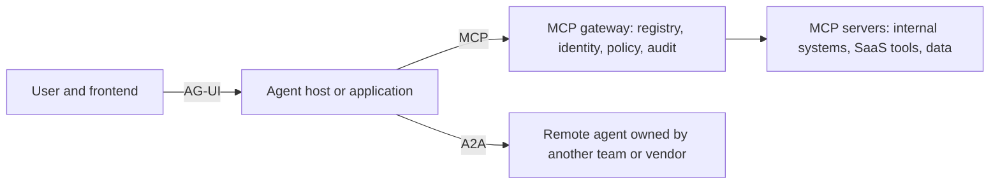
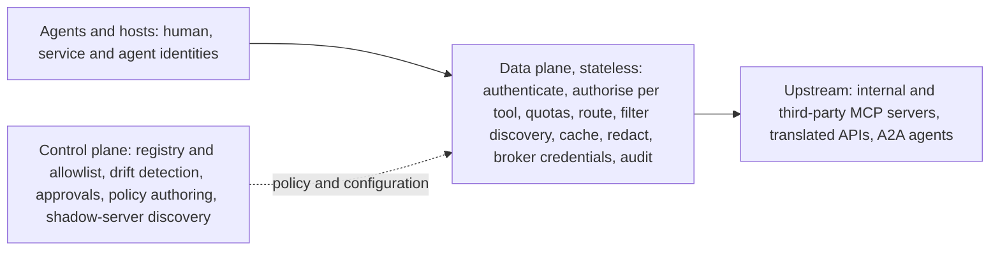

# Agentic Protocols: MCP, A2A and AG-UI

> What MCP, A2A and AG-UI are as of October 2026, how deep your target role needs you to go (awareness, build or operate), how employers ask for protocol skills, the security essentials, and how to prove the skill with work a reviewer can check.

Statuses on this page are as of 21 October 2026, the evidence cut-off of [T0-16](../../research/sessions/T0-16-agentic-protocol-stack-enterprise-demand.md); re-check them by 2027-01-19. The MCP posting indices are a monthly series (EGP-1.0 class V1) and expire first: the Skillenai window ends on 2026-10-14, so re-check them by 2026-11-14 (this page's `review_by`). Grades follow EGP-1.0 ([CONTRIBUTING §3](../../CONTRIBUTING.md#3-writing-standard-egp-10-in-brief)). Terms are defined in the [glossary](../00-start/glossary.md).

## The short answer

1. **Learn MCP first.** It has a neutral home and a dated specification: the Agentic AI Foundation (AAIF), a Linux Foundation fund, has hosted it since December 2025, and the revision in force is 2026-07-28 [A · T0-16.F1, F2]. T0-16's verdict: an industry standard for MCP, a standard with caveats for A2A, not yet a standard for AG-UI [A · T0-16 L115].
2. **Do not chase a protocol title.** T0-16's posting search found no "Agent Gateway Engineer" title in volume; the work is posted under platform, API-management, identity and security titles [C · T0-16.F10]. MCP is named in 0.068%–0.7% of all postings (API Evangelist, Skillenai) and in 2.7%–9% of engineering- or AI-focused samples (landed.jobs, S09, S11), depending on the universe [C · T0-16.F9; B and B/C · T0-03 L214].
3. **Match depth to role.** Awareness for most AI roles; build (client and server) for agentic, enablement and AI engineers whose postings name MCP; operate (gateway, identity, policy, audit) for platform and security engineers [D, from the skills-ontology tiers and the postings sampled in T0-16 §9.3, which are C].
4. **Keep frameworks and evaluation first for application roles.** In Skillenai's Agentic AI Engineer postings, LangGraph appears in 35.8% and MCP in 13.8% [C · T0-16.F10], and frameworks already wrap MCP through adapters [B/C · T0-16.F11]. MCP adds to that stack; it does not replace it.
5. **Security is the differentiator at every depth.** In a 2025 scan of about 5,200 open-source MCP servers, 53% relied on static secrets [B · T0-16.F7]; the verified 2026 CVEs cluster in URL and path handling [A/B · T0-16.F8]; security was the top adoption obstacle (64%) in Stacklok's vendor-run survey [B/C · T0-16.F5].
6. **Prove the kind of MCP work you did.** The keyword "MCP" conflates client integration, server authoring and gateway operation [D · T0-16 L126]. Say which, and back it with a project whose headline claims are reproducible, such as P2 or P15 [D · T0-13 L138].

## At a glance

| Protocol | Connects | Steward | Status, with date | What it standardises | T0-16 verdict |
|---|---|---|---|---|---|
| **MCP** (Model Context Protocol) | Agent ↔ tools and data | AAIF, a Linux Foundation fund launched 2025-12-09; the founders keep a veto in technical governance | Specification revision 2026-07-28; Tier 1 SDKs: TypeScript, Python, Go, C# | Tool discovery and calls, transports, an OAuth resource-server model, extensions (MCP Apps, Enterprise-Managed Authorization, Tasks), OpenTelemetry trace context | A standard that is still shedding features [A] |
| **A2A** (Agent2Agent) | Agent ↔ agent | Linux Foundation project; announced on 2026-08-27 that it is joining AAIF as a Growth Stage project | v1.0 shipped 2026-03-12; 150+ participating organisations reported on 2026-04-09 | Agent Card discovery, a task lifecycle with interrupt states, `contextId`, streaming and push delivery, version and modality negotiation | A standard with caveats and a thinner hiring signal [A; the count B] |
| **AG-UI** (Agent-User Interaction protocol) | Agent ↔ user interface | CopilotKit's `ag-ui-protocol` GitHub organisation; not in AAIF | 1.0 declared 2026-09-18 | An agent-to-frontend event channel: streaming chat, frontend tool calls, shared state, human-in-the-loop UI (CopilotKit's own framing) | Not yet a standard: one steward, adoption claims company-reported [A; the framing B] |
| **ACP** (IBM's Agent Communication Protocol) | Agent ↔ agent | Merged into A2A under LF AI & Data on 2025-08-29 | Absorbed | Nothing separate | No longer a separate standard [A] |

Sources: T0-16.F1–F4 and T0-16 §1 (L150–158).

**Other names you will meet.** "ACP" also names OpenAI and Stripe's Agentic Commerce Protocol, which T0-16 did not research [A, existence only · T0-16 L156]. MCP Apps (an MCP extension) and Google's A2UI are two other approaches to agent-generated UI [B · T0-16 L159]. AGENTS.md (instruction files) is an AAIF project [A · T0-16 L158]. WebMCP lets websites expose tools to in-browser agents; it is a draft with a changing API surface, so prototype only [A for Chrome's docs, C for the details · T0-06 L164].



## The depth ladder: awareness, build, operate

Depth uses the repository's 0–3 proficiency scale from T0-06 D9 [T0-06 L718]. Awareness is level 1 (tutorial-level awareness), build is level 2 (built and shipped something small, with feedback) and operate is level 3 (owns it in production, or could teach it). The "done when" tests are practice-curated [P].

| Depth | You can… | Done when [P] |
|---|---|---|
| **Awareness** (level 1) | Explain what each protocol standardises, who stewards it and its dated status; why production MCP runs behind a gateway; the main risks; the demand reality | You can talk through the at-a-glance table and one security trade-off for two minutes, with dates |
| **Build** (level 2) | Integrate an MCP client; author an MCP server with OAuth, least-privilege tools and traces; for A2A, write a client that survives the task lifecycle; for AG-UI, wire a streaming agent UI with approvals | One command rebuilds and tests a client–server pair, with tests for auth, malformed arguments and injection through tool output (V1) |
| **Operate** (level 3) | Run a gateway for many servers and identities: registry, per-tool policy, credential brokering, audit, drift detection, incident response | You can demonstrate a blocked call, an approval, a drift alert and the audit record of one tool call |

### MCP at each depth

**Awareness:**
- **Who controls it.** AAIF hosts MCP, but the project's contributor ladder reserves the Lead Maintainer role, with a veto, for its founders. Foundation hosting settles intellectual-property neutrality, not who steers the spec [A · T0-16.F1].
- **Revisions are named by date; SDKs carry version numbers.** The 2026-07-28 revision brought a stateless core, routing headers (`Mcp-Method`, `Mcp-Name`), cacheable tool lists with an explicit TTL and scope, multi-round-trip requests, authorisation hardening, formal extensions and OpenTelemetry trace-context conventions. It deprecated Roots, Sampling, Logging and the legacy HTTP+SSE transport [A · T0-16.F2]. The roadmap of 22 August 2026 lists agent identity (DPoP, workload identity federation) and progressive discovery among its five priorities [A · T0-16 L187].
- **Adoption figures are mostly self-reported.** The maintainers report close to half a billion monthly downloads across the Tier 1 SDKs [B]. The reference-servers repository has about 90,000 stars, which measure attention, not deployment [A]. In a vendor survey fielded in December 2025 (Stacklok, 100 software-company leaders), nearly half reported MCP in some production use and 19% in broad production [B/C]. The widely repeated "78% in production" figure has no traceable source [X · T0-16.F5].
- **The context-cost debate.** Loading every tool schema is expensive. In one illustrative Anthropic example, presenting tools as code APIs cut a task from about 150,000 to about 2,000 tokens; it is an example, not a benchmark [A · T0-16.F11]. Cloudflare enables Code Mode by default in its MCP server portals, and Uber makes a code-mode CLI the default for its coding agents; both keep MCP gateways underneath [A · T0-16.F11, L140].

**Build:**
- **Prerequisite.** Structured outputs and tool calling with JSON Schema; T0-03 places structured outputs and model-API orchestration in its table-stakes tier [B/C · T0-03 §6.4]. MCP's 2025-06-18 revision added structured tool outputs [B · T0-16 L169].
- **Client integration.** Connect an agent to servers through the SDK client or a framework adapter such as `langchain-mcp-adapters` [B · T0-16 §11]. Log raw requests and responses: being unable to explain what a framework sends over the wire is a portfolio anti-pattern in T0-13 [C · T0-13 L214].
- **Server authoring.** Use a Tier 1 SDK (TypeScript, Python, Go or C#; Tier 1 requires a 100% pass on the conformance suite) [A · T0-16 L185], and pin its major version, because SDK v2 migrations broke downstream packages [B · T0-16 L123, L190]. Target the 2026-07-28 revision: Streamable HTTP for remote servers (it replaced HTTP+SSE in the 2025-03-26 revision) [B · T0-16 L168], and no new reliance on Roots, Sampling or Logging [A · T0-16 L123].
- **Auth.** Remote servers act as OAuth resource servers. The 2026-07-28 revision adds issuer identification (RFC 9207) and Client ID Metadata Documents in place of dynamic client registration [A · T0-16.F2, F7]. Propagate the user's identity and never pass tokens through [A/B · T0-16 L356].
- **Tool design.** Least privilege, read-only defaults, idempotency keys and human approval for irreversible actions [D · T0-14 L743]. Keep tool lists small or add progressive discovery; every large deployment T0-16 found has some answer to tool-list bloat [B/C · T0-16 §6.3].
- **Tracing and tests.** Carry OpenTelemetry trace context from agent to gateway to server [A · T0-16 L183]. Test with repeated trials, injected faults and injection through tool output, as archetype P2 does [D · T0-13 R2].

**Operate:**
- **The converged architecture.** Production gateways split a control plane (registry, approvals, policy authoring, drift detection, shadow-server discovery) from a stateless data plane that authenticates, authorises per tool, rate-limits, routes, filters, redacts, brokers credentials and audits [A per vendor; B as a synthesis · T0-16.F6].
- **Reference deployments.** Uber runs 800+ MCP servers exposing 5,000+ tools; servers are disabled by default, configuration changes need diff approval, and authorisation is per tool (self-reported, 1 October 2026) [A · T0-16.F6]. AWS AgentCore Gateway (Cedar-based policy, generally available March 2026), Cloudflare MCP server portals, Microsoft's API Management AI gateway (preview), Databricks managed MCP servers and the AAIF-hosted agentgateway implement the same functions [A; agentgateway B · T0-16.F6]. Pinterest published "Building an MCP Ecosystem at Pinterest" on 2026-03-19, which T0-03 cites as a production registry case [A · T0-03 L413, L647].
- **Identity modes.** User-delegated (on-behalf-of or token exchange), service identity, third-party SaaS consent, and IdP-governed access through the Enterprise-Managed Authorization extension [A/B · T0-16 L306–313]. The extension's flow details are not verified in the corpus [D].
- **Authorisation depth.** Server-level allow or deny is the floor; tool level is what Uber and AgentCore Policy provide; argument level is possible with Cedar or CEL, with no verified production report [B · T0-16 L315].
- **Audit.** NSA recommends logging every tool and model invocation with identities and parameters [A · T0-16 L317]. T0-16's minimum record: timestamp, trace ID, principal and delegating principal, server and tool, argument hash plus redacted arguments, policy decision and rule ID, DLP actions, response size or hash, latency, outcome [D, synthesis · T0-16 L317].
- **Coverage.** A gateway governs only the traffic that passes through it. Microsoft documents a server-side path that can bypass a customer's gateway, and Cloudflare publishes shadow-MCP detection rules [A/B · T0-16 L299].
- **Buy before build.** T0-16 advises adopting a cloud or open-source gateway before building one, unless regulatory or scale needs resemble Uber's. Its thresholds are judgement, and no rate-limit or throughput numbers were verified for any platform [D · T0-16 L124, L296].



*The gateway pattern: T0-16's synthesis of Uber's account and five vendor implementations [B · T0-16 §6.1].*

### A2A at each depth

- **Awareness.** Agents collaborate without exposing their memory or tools, so a handoff is a task, its artifacts and a `contextId`, not shared memory [A · T0-16 L222]. v1.0 defines task states (submitted, working, completed, failed, canceled, rejected) and two interrupt states, input-required and auth-required [A · T0-16.F3]. It has no bid, price or auction negotiation [A · T0-16.F3]. T0-16's rule: MCP first for tools; A2A only when crossing team or vendor boundaries with opaque agents [D · T0-16 L144].
- **Build.** Discover peers through the Agent Card; handle both interrupt states; stream, poll or use push notifications. Re-fetch task state after reconnecting: messages are not a reliable-delivery mechanism, and send idempotency is permitted, not required [A · T0-16 L224]. Set the `A2A-Version` header explicitly, because an empty header is treated as version 0.3 [A · T0-16 L223].
- **Operate.** Allowlist peers, constrain multi-turn follow-ups and require human approval for sensitive actions. Unit 42's agent-session-smuggling proof of concept abused trust in stateful sessions; Unit 42 says it is not a protocol flaw, and no in-the-wild exploitation was reported [B · T0-16 L226]. Signed Agent Cards are specified, but whether clients must verify them is unresolved; one security vendor, grith.ai, claims verification is optional [C · T0-16 L225]. Gateways that federate A2A exist: agentgateway, and AgentCore's HTTP targets [A/B · T0-16 L227].

### AG-UI at each depth

- **Awareness.** One steward declared 1.0 on 2026-09-18, outside AAIF. The adoption list (Google, Microsoft, Amazon, Oracle, LangChain and others) and "4M+ weekly downloads" are CopilotKit's own claims [B and C · T0-16.F4, L248]. Agent-generated UI is unsettled: by CopilotKit's own framing, AG-UI, Google's A2UI and MCP Apps are three different approaches [B · T0-16 L235].
- **Build.** A streaming agent UI that shows tool calls and asks for approval before irreversible actions; archetype P14 is the natural host. AG-UI's transport and event types are not verified in the corpus [D · T0-16 L234], so work from the project's own documentation.
- **Operate.** No operate-level practice or demand is evidenced for AG-UI.

### Which roles need which depth

Tiers come from the skills ontology, as rendered in each role's [inventory](role-skill-inventories.md); "—" means the role's inventory does not list the skill. The depth column is judgement [D]: it applies the ontology's target levels (Must 3, Important 2, Should 1–2, Optional 0–1) and the gateway and identity duties in the postings T0-16 sampled [C].

| Role | MCP | A2A | AG-UI | Related skills (tier) | Depth to target [D] |
|---|---|---|---|---|---|
| [Agentic AI Engineer](../02-roles/hubs/agentic-ai-engineer.md) | Important | Should | Should | Tool and function calling (Must); OAuth 2.x and OWASP agentic guidance (Should) | Build in all three, plus operate-level security literacy |
| [AI Enablement Engineer](../02-roles/hubs/ai-enablement-engineer.md) | Important | — | — | OAuth/OIDC, RBAC, SSO (Must); LLM gateways (Important) | Build; operate for an internal gateway |
| [ML Platform / MLOps Engineer](../02-roles/hubs/ml-platform-engineer.md) | Should | — | — | LLM gateways and OAuth/OIDC, RBAC, SSO (Important) | Operate: control-plane postings ask you to run gateways |
| [AI Security Engineer](../02-roles/hubs/ai-security-engineer.md) | Should | Should | — | OAuth/OIDC, RBAC, SSO (Must); agent abuse and MCP authorisation, OAuth 2.x, OWASP agentic guidance (Important) | Operate the controls; build enough to test them |
| [AI Engineer](../02-roles/hubs/ai-engineer.md) | Optional | Optional | — | OAuth 2.x, structured output, SSE (Should) | Awareness; build when the posting names MCP |
| [Forward Deployed Engineer](../02-roles/hubs/forward-deployed-engineer.md) | Optional | — | — | OAuth/OIDC, RBAC, SSO (Important); OAuth 2.x (Should) | Build, for customer integrations |
| [AI Product Engineer](../02-roles/hubs/ai-product-engineer.md) | Optional (MCP Apps) | — | Should | SSE (Important) | Build, for AG-UI or MCP Apps |
| [Applied AI Engineer](../02-roles/hubs/applied-ai-engineer.md) | Optional | — | — | JSON Schema (Should) | Awareness; build when a posting asks |
| [AI / GenAI Solutions Architect](../02-roles/hubs/ai-solutions-architect.md) | Optional | — | — | OAuth/OIDC, RBAC, SSO (Important) | Awareness, plus design-level knowledge of gateway and identity patterns |
| [AI Product Manager](../02-roles/hubs/ai-product-manager.md) | Optional | — | — | — | Awareness; build-level literacy for control-plane products |
| [AI Governance Programme Lead](../02-roles/hubs/ai-governance-lead.md), [AI Risk, Audit & Compliance Specialist](../02-roles/hubs/ai-risk-assurance-specialist.md), [Responsible AI Engineer](../02-roles/hubs/responsible-ai-engineer.md) | — | — | — | — | Awareness of the risks and the guidance [P] |
| Other roles (ML, inference, kernel, research, evaluation) | — | — | — | — | Optional awareness [P] |

One tension to know: the ontology tiers MCP itself at Should for ML Platform engineers, while the postings T0-16 sampled ask that role to run gateways [C · T0-16 §9.3]. The operate target above follows the gateway duties in the postings.

## How employers ask for it

### A small, fast-growing keyword

The universes differ, so do not average these figures [C · T0-16.F9].

| Universe (source) | Window | MCP share | Grade |
|---|---|---|---|
| All postings at 984 large companies: 775 Fortune 1000 and 209 API providers (API Evangelist); counts only the full phrase "Model Context Protocol", so it undercounts | Q3 2026 | 234 of 343,299 postings (0.068%); 10.4% of companies (102) | C · T0-16 L377 |
| Postings index built from about 2,600 employers (Skillenai) | 90 days to 2026-10-14 | 1,747 postings, about 0.7% adjusted share (+9.7% against the prior four weeks) | C · T0-16 L378 |
| Engineering postings with an AI-native skew (landed.jobs; 115,348 postings) | January to mid-2026 | 1.2% → 2.7%–4% (the report is internally inconsistent) | C · T0-16 L379 |
| AI-engineering postings at 198 AI companies, skewed senior and infra (S09) | Published 2026-08-05 | 4.3% of 3,647 postings; 28.8% of companies | B · T0-03 L274, L630 |
| 315 sampled AI job ads (S11) | July–September 2026 | 9% of ads | B/C · T0-03 L214, L632 |

The narrower the sample is to AI work, the higher the share. The three T0-16 indexes all show growth from a small base, and no source here shows MCP as a majority requirement [C · T0-16.F9; B and B/C · T0-03 L214]. API Evangelist found that 95 of the 102 companies naming MCP also name a major AI vendor, and that the postings split between builder roles and reviewer or security-governance roles [C · T0-16 L381].

### Inside agent-titled roles, frameworks lead

Every figure in this list comes from the Skillenai index (90-day windows to mid-October 2026).

- **Agentic AI Engineer postings** name LangGraph in 35.8% and MCP in 13.8%. **Agent Engineer postings** (28 in 90 days) name LangChain in 42.9% and LangGraph in 39.3%, with MCP outside the top 15 skills [C · T0-16.F10].
- **MCP demand sits mostly outside the LangGraph audience:** only 14.9% of MCP postings (261 of 1,747) also mention LangGraph [C · T0-16 L391].
- **MCP postings by role:** software engineer 21.0%, AI engineer 9.2%, product manager 8.0% [C · T0-16 L392].
- **Title-level MCP shares** (small samples; the count is postings that mention MCP): AI Enablement Engineer 30.2% (16), Frontier Agents Engineer 27.3% (6), AI Application Engineer 20.0% (6), Agentic AI Engineer 13.8% (9), AI Security Specialist 13.0% (3) [C · T0-16 L389, L393].
- **Skills that co-occur with MCP:** Python 849, TypeScript 476, RAG 378, CI/CD 362, AWS 312, LLMs 282, SQL 273, LangGraph 261, Claude Code 258 and Kubernetes 254 of the 1,747 postings [C · T0-16 L394].
- **Who posts most:** MintMCP 40, ServiceNow 24, Cisco 23, Ping Identity 22, Anthropic 17, NVIDIA 17, Parloa 17; T0-16 reads this as a skew to gateway, identity and platform vendors [C · T0-16 L395].

### What the wording asks for

Three enterprise postings sampled in T0-16 show what operate depth looks like in a job description [C · T0-16 §9.3]:
- **Senior Platform Engineer – Enterprise AI (Boston Scientific):** build and operate MCP platforms; gateway and control-plane capabilities (service discovery, authentication, authorisation, routing, policy enforcement, observability); identity propagation and human-in-the-loop approvals; hands-on MCP client, server and gateway experience; API management and service mesh.
- **Senior Enterprise AI Control Plane Engineer (PTC; 5–8 years):** configure and operate MCP and LLM gateways, policies, access control, observability and agent registries; OAuth, OIDC, JWT, RBAC and managed identity; preferred experience with Azure API Management's MCP capabilities, Microsoft Foundry AI Gateway and LiteLLM.
- **Senior Product Manager, Enterprise MCP/AI Control Plane (Workato):** a roadmap for gateway pillars (OAuth, OIDC, dynamic client registration, machine-to-machine auth, policy, observability, runtime performance) and the MCP server lifecycle (tiering, certification).

T0-16 reads these as API-gateway, identity and AI-governance hybrids with MCP literacy. None of the excerpts lists JSON-RPC, SSE or WebSocket, and no dataset measures those as separate requirements [C · T0-16 L403, F10]. T0-16 advises employers to say whether "MCP experience" means server authoring, gateway operation or client integration [D · T0-16 L126]; do the same on your résumé.

### In interviews

None of the 15 system-design archetypes in T0-14 names MCP or A2A. These are the nearest rounds [T0-14 §6.3]:

| Archetype | Evidence that it is asked | Where the protocols fit [P] |
|---|---|---|
| A11 Long-running tool-using agent platform | C · T0-14 L196 | The tool router (schema validation, authorisation, idempotency keys) is where an MCP client and gateway sit [T0-14 L442] |
| A6 LLM gateway / internal AI platform | C · T0-14 L191 | Extend the gateway to MCP traffic: registry, per-tool policy, identity propagation |
| A15 Safety, abuse and prompt-injection defence | B/C · T0-14 L200 | Tool and peer outputs as untrusted input; the Rule of Two; permissions in the gateway, not the prompt |

The [prep packs](../08-interviewing/prep-packs.md) carry prompts for all three, such as "Design an agent system that executes tasks for users from a chat interface" (A11) and "Design safeguards for an AI system that can take actions on behalf of a user" (A15).

## Security essentials

Interviewers and reviewers look for controls placed by layer, not a promise to "add guardrails" [D · T0-14 §6.8]. Classifiers are one layer only: adaptive attacks bypassed 12 published prompt-injection defences with over 90% success in most cases [A · T0-14 L731].

**The Rule of Two.** In one session, an agent should have at most two of: untrusted input; access to sensitive data or systems; the ability to change state or communicate externally. If it needs all three, add human approval or fresh supervision [B · T0-14 L733].

| # | Threat | Control | Depth | Basis |
|---|---|---|---|---|
| 1 | Indirect prompt injection through tool or peer output | Treat every tool and A2A output as untrusted; filter outputs; least-privilege tools; apply the Rule of Two | Build | NSA [A]; Five Eyes advisory and OWASP [B] · T0-16 L355 |
| 2 | Confused deputy and privilege escalation | Propagate the user's identity (token exchange or on-behalf-of); no token pass-through; per-tool authorisation | Build | Uber, Databricks, AgentCore [A] · T0-16 L356; T0-14 L743 |
| 3 | SSRF in discovery, registration and fetch tools | Block private, link-local and metadata address ranges; HTTPS only; egress allowlists; validate redirects; harden client discovery and authorization-server metadata fetches alike | Build | CVE-2026-45609 and CVE-2026-104120 [A/B, B] · T0-16 L357 |
| 4 | Static or long-lived secrets | Short-lived OAuth tokens; secret brokering; rotation | Build | Astrix scan [B] · T0-16 L359 |
| 5 | Command execution through STDIO configuration | Never build commands from untrusted configuration; sandbox local servers; prefer authenticated remote servers | Build | NSA [A]; OX Security [B/C, disputed] · T0-16 L358 |
| 6 | Unvetted or shadow servers | Default-deny registry and allowlist; scan for unsanctioned servers | Operate | Uber, Cloudflare, NSA [A] · T0-16 L353 |
| 7 | Tool-definition drift after approval | Pin and hash tool definitions; diff, approve, and re-approve on change | Operate | Uber, NSA [A]; vendor guidance [C] · T0-16 L354 |
| 8 | Data exfiltration | Egress DLP; response projection; PII redaction | Operate | Uber, Cloudflare, NSA [A] · T0-16 L361 |
| 9 | Missing audit trail | Log every call with identity, parameters or their hash, and the policy decision; OpenTelemetry trace IDs; SIEM export | Operate | NSA and the spec's trace-context conventions [A] · T0-16 L362 |
| 10 | Runaway agents and abuse | Per-identity and per-tool quotas; budget caps | Operate | Microsoft [A]; agentgateway [B] · T0-16 L363 |
| 11 | Untrusted peer agents (A2A) | Allowlist peers; verify signed Agent Cards where supported; constrain multi-turn follow-ups; human approval for sensitive actions | Operate | Unit 42 [B]; A2A spec [A] · T0-16 L364 |
| 12 | Unmaintained servers and supply chain | Pin versions; SBOM; prefer maintained servers; treat reference servers as examples; track CVEs | Operate | Servers README, NSA [A]; AAIF report [A/B] · T0-16 L365 |

**What the record shows:**
- **The 2026 CVEs.** CVE-2026-45609 (SSRF through OAuth discovery with dynamic client registration, in a Spring AI community library); CVE-2026-27825 and CVE-2026-27826 (unauthenticated RCE and SSRF in the mcp-atlassian server); CVE-2026-104120 (SSRF in the reference fetch server); CVE-2026-44192 (path traversal reachable through indirect prompt injection, in Red Hat's Ansible Lightspeed MCP server). All four entries involve code that fetches or resolves attacker-influenced URLs or paths, and three sit in community or reference components [A/B · T0-16 L333–341].
- **Practice lags the spec.** The 2025 Astrix scan found 53% static secrets and 8.5% OAuth across about 5,200 open-source servers; the sample skews to local servers and predates the 2026 changes [B · T0-16.F7].
- **Guidance.** NSA's AI Security Center published MCP security design guidance, announced on 2026-05-20 and written against the earlier 2025-11-25 revision. It says MCP-aware security proxies are still maturing and recommends controls the base protocol lacks: message signing, DLP on outputs and full tool-call logging [A · T0-16.F7, L324]. OWASP published its Top 10 for Agentic Applications (ASI01–ASI10) on 2025-12-09 [B · T0-16 L326].
- **Disputed.** OX Security argues that STDIO's configuration-to-command execution is a systemic design flaw; Anthropic is reported to treat it as expected behaviour. The dispute is unresolved, and the researcher sells security products [B/C · T0-16.F8].
- **Missing.** No end-user company has published a postmortem of a production MCP or A2A incident. Absence of postmortems is not evidence of absence of incidents [T0-16 L367].

**How interviewers score this layer** (T0-14's synthesis; no firm-published rubric was found) [D · T0-14 L749–755]:

| Level | What it sounds like |
|---|---|
| Below bar | "Add guardrails"; telling the model to ignore malicious instructions; permissions enforced in the prompt |
| Senior | Controls placed by layer; least-privilege tools; output validation; human approval for irreversible actions; red-team tests |
| Staff or Principal | Starts from the trust boundary (Rule of Two); assumes injection will succeed and bounds the blast radius; egress control; incident response and kill switches; a policy for onboarding new tools; measures with adaptive attacks |

## How to do it

1. **Pick your depth per protocol.** Use the role table for your top one or two target roles, then check its wording against 10–20 live postings. *Done when:* you have written down a depth for MCP, A2A and AG-UI. [P]
2. **Close the prerequisite.** Write one tool-calling loop with structured outputs and JSON Schema, without a framework. *Done when:* your loop validates every tool argument against its schema and logs the raw request and response.
3. **Awareness pass.** Read the 2026-07-28 changelog, the A2A specification and the AAIF projects page. Hugging Face Learn offers a free MCP course [A · T0-06 L230]. *Done when:* you can explain the at-a-glance table and the gateway split from memory, with dates.
4. **Build pass.** One MCP server and one client on a Tier 1 SDK, pinned, targeting revision 2026-07-28, with OAuth, least-privilege tools and OpenTelemetry traces. *Done when:* one command rebuilds and tests it, including malformed arguments and injection through tool output (V1).
5. **Harden.** Apply the five build-depth rows of the security table. *Done when:* each row maps to a test or a configuration line you can show.
6. **Operate pass** (platform and security targets). Put a gateway in front of your servers with the minimum feature set below. *Done when:* you can demonstrate a blocked call, an approval, a drift alert and one audit record.
7. **Prove and present.** Package the work as P2, P15 or P10, name the kind of MCP work on your résumé, and rehearse the A6, A11 and A15 rounds. *Done when:* every headline claim is reproducible (V1 or better) and you can place MCP in a design in 30 seconds.

## How to prove it

The certification research (T0-11) lists no MCP, A2A or AG-UI credential, so these skills are proved with artefacts ([credential ROI](../04-certifications/credential-roi.md)).

### Projects, by depth

The archetypes are defined in [project archetypes](../05-portfolio/project-archetypes.md); their fields are practice standards, not measurements, and no source links any project type to hiring outcomes [D · T0-13.F1].

| Depth | Archetype | The protocol angle | Verifiability target and effort |
|---|---|---|---|
| Build | **P2** Reliable agent: approvals, sandboxed tools, replay, failure injection | Serve the least-privilege tools over MCP (the archetype allows MCP or plain function calls); inject faults, including prompt injection through tool output; report pass@1 and pass^k with cost per task | V3-lite (V1 plus a 30+ day demo log) under specification R2; effort M |
| Build, moving to operate | **P15** Internal AI-enablement pilot (MCP servers, adoption metrics) | One or two MCP servers for internal systems with least privilege, per-user identity and read-only defaults; model access through a gateway with budgets, PII redaction and logging; adoption, time saved and error rate against a baseline | V3; effort M |
| Operate (security) | **P10** Red-team suite in CI against a working agent | Attack the MCP tool boundary of your P2 agent; publish attack-success rates before and after each mitigation | V1; effort S |
| Build (interface) | **P14** Full-stack AI app with streaming agent UX | Using AG-UI or MCP Apps for the agent-to-UI channel is your choice [P], not part of the archetype | V1; effort M |

**Operate add-on** [P]. Put a gateway in front of the P2 or P15 servers with T0-16's minimum feature set: a default-deny registry, per-tool authorisation, identity propagation or token exchange, response DLP or projection, per-identity quotas, tool-definition drift detection, and OpenTelemetry or SIEM audit export [D · T0-16 L124]. Products T0-16 names include agentgateway (open source, AAIF), AWS AgentCore Gateway, Cloudflare MCP server portals and the Azure API Management AI gateway (preview); LiteLLM's MCP gateway appears as a bring-your-own option in an AWS sample [A/B; LiteLLM C · T0-16 L124, L455].

### Evidence a reviewer can check

- **Reproducible headline claims.** Every headline README claim at V1 (one command regenerates the results) or higher; a merged upstream pull request counts as V2, externally attested [D · T0-13 L134–138].
- **What goes over the wire.** Show raw requests and responses in traces, and implement one component, such as the tool loop, directly. This is T0-13's remedy for framework-only fluency [C · T0-13 L214].
- **The protocol evidence block** in Templates below.

### Open-source routes

T0-05 measured contribution dynamics in eight AI repositories (vLLM, SGLang, transformers, llama.cpp, LiteLLM, Langfuse, Ollama, Axolotl); none is an MCP project, so its rules transfer by analogy only [D]:
- **One merged PR does not distinguish you.** In those repositories, 49–82% of contributor identities have exactly one commit [A · T0-05.F3]. Headline open-source work only after 3+ merged or in-review PRs and 5+ reviews or triage actions in one area [D · T0-05 L83].
- **Start with what agents cannot do:** a bisected bug with a reproducer, a regression test, a minimal diff. Disclose AI assistance, open an issue first where the project requires it, and respect PR caps [A · T0-05.F4].
- **Stop-loss.** No merged PR and no substantive maintainer exchange after 8 weeks: move the hours elsewhere [D · T0-05 L83].
- **Candidate projects** named in T0-16, whose contribution gates nobody has studied: the official SDKs, the conformance suite (`modelcontextprotocol/conformance`), FastMCP, `langchain-mcp-adapters`, agentgateway (300+ contributors across 60+ organisations, as the project reports), and the A2A and AG-UI SDKs [B · T0-16 §11, L449]. LiteLLM sits in both studies: its onsite interview includes solving a repository issue together [A/B · T0-05.F5], and the PTC control-plane posting names it as preferred experience [C · T0-16 L401].
- **Specification work.** Core maintainers vote on spec enhancement proposals (SEPs), and chartered working groups, such as the Server Card group, decide within their scope [A · T0-16 L187, L203–204]. No evidence links spec participation to hiring.
- **Own-instance security audits.** Auditing open-source components on your own hardware is T0-05's safe zone; probing a vendor's production endpoints without explicit scope is not [A/B · T0-05.F8, L253]; this is a pointer, not legal advice. Report a vulnerability privately first; T0-05 treats 90 days (+30 if patched) as the reference norm, not a right [B · T0-05 L316]. The 2026 CVE pattern says where to look first: URL fetching, OAuth discovery and path handling [D · T0-16 L341, analysis].

## Templates and examples

**Résumé lines** [P]. Put numbers only where you measured them; the brackets are placeholders.

| Weak | Strong |
|---|---|
| "MCP, A2A, agentic AI" in a skills list | Skills line "MCP (server authoring, OAuth), A2A v1.0 (client)", with a bullet that proves each item |
| "Built MCP servers for internal tools." | "Built [n] MCP servers for [system] on the [language] SDK (spec revision 2026-07-28), with per-user OAuth and read-only defaults; [n] colleagues used them for [n] days; [metric] moved from [x] to [y] against a pre-pilot baseline ([link])." |
| "Implemented an agent gateway." | "Ran [gateway] in front of [n] MCP servers: default-deny registry, per-tool policy in [Cedar or CEL], token exchange, audit export to [SIEM]; [n] tool-definition changes held for review over [period] ([config and runbook link])." |
| "Strong understanding of agent security." | "Red-teamed an agent's MCP tool boundary in CI: attack success fell from [x]% to [y]% over [n] trials after least-privilege scopes and output filtering ([CI run link])." |

**Protocol evidence block for a README** [P]:

```markdown
## Protocol evidence
- Kind of work: [client integration / server authoring / gateway operation]
- Spec and SDK: MCP revision 2026-07-28; [language] SDK [major version], pinned in [lockfile]
- Identity: [OAuth flow]; user identity propagated by [token exchange / on-behalf-of]; no token pass-through
- Permissions: table of [tool -> scope -> read-only or approval-gated] in [file]
- Untrusted output: tool and peer outputs filtered by [method]; tests in [path]
- Security tests: injection through tool output, malformed arguments, SSRF against fetch tools ([n] cases, [result])
- Traces: raw request and response for one tool call in [path], with OpenTelemetry trace IDs
- Context cost: tokens per task with full tool schemas vs [progressive discovery / code mode], on [n] of your own tasks
- Reproduce: [one command] regenerates [results file]
```

**A 30-second answer for the tool boundary** [P, adapted from T0-14's safety script, L757]: "Tools sit behind a gateway. It authenticates the user, authorises each tool call, and exchanges the user's token instead of passing it through. Anything a tool or a peer agent returns is untrusted input. For each agent I check three properties: untrusted input, sensitive access, the ability to act externally. If all three are present, I split the agent or add approval. Every call is logged with identity, arguments and the policy decision."

## Checklist

- [ ] I have a written depth for MCP, A2A and AG-UI for each target role.
- [ ] I can explain the at-a-glance table with its dates, including why "ACP" needs its full name.
- [ ] I can write a tool-calling loop with structured outputs and JSON Schema, without a framework.
- [ ] My MCP server and client use a Tier 1 SDK pinned to a major version and target revision 2026-07-28, with no Roots, Sampling, Logging or HTTP+SSE.
- [ ] Remote servers use OAuth and per-user identity, with least-privilege, read-only-by-default tools and no token pass-through.
- [ ] Tool and peer outputs are untrusted; my tests cover injection through tool output and malformed arguments.
- [ ] Fetch tools block private, link-local and metadata addresses, and secrets are short-lived.
- [ ] Every tool call is traced with OpenTelemetry and logged with identity and policy decision.
- [ ] For A2A: an explicit `A2A-Version` header, task-state re-fetch after reconnecting, and idempotent sends.
- [ ] For operate targets: a gateway with a default-deny registry, per-tool policy, drift detection and audit export.
- [ ] My proof project (P2, P15 or P10) has every headline claim at V1 or better, and my résumé names client, server or gateway work.
- [ ] I will re-check protocol statuses after 2027-01-19.

## Pitfalls

| Red flag | Why it hurts | Fix |
|---|---|---|
| "MCP" as a bare keyword | It conflates client, server and gateway work [D · T0-16 L126], and reviewers discount claims they cannot verify [D · T0-13 §4.1] | Name the kind of work and link the artefact |
| Hunting for a protocol title | T0-16 found no "Agent Gateway Engineer" title in volume; the work sits under platform, API-management, identity and security titles [C · T0-16.F10] | Search those titles; mirror "control plane", "gateway" and "OAuth/OIDC" when true |
| Trading framework and evaluation skills for protocol skills | Skillenai's Agentic AI Engineer postings name LangGraph (35.8%) more often than MCP (13.8%) [C · T0-16.F10] | Keep framework, evaluation and reliability skills primary for application roles, and add MCP |
| Deprecated features or an unpinned SDK | Revision 2026-07-28 deprecates Roots, Sampling, Logging and HTTP+SSE; SDK v2 migrations broke downstream packages [A/B · T0-16.F2, F12] | Target 2026-07-28, pin major versions, and note migrations in the README |
| Shipping reference servers as production code | The servers repository says they are not production-ready, and many are archived; three of the four verified 2026 CVEs sit in community or reference components [A/B · T0-16 L341] | Treat them as examples; harden URL and path handling |
| Permissions in the prompt, or tokens passed through | "Below bar" in T0-14's rubric [D · T0-14 L753]; a confused-deputy risk [A/B · T0-16 L356] | Enforce permissions in the gateway and the tools; use token exchange or on-behalf-of |
| Loading every tool schema into context | Large tool lists cost context and degrade tool selection, as the maintainers acknowledge [A · T0-16 L187] | Progressive discovery or code mode; measure tokens per task on your own tasks |
| Quoting "78% of enterprise AI teams run MCP in production", "MCP is the HTTP of AI" or "mandated for all internal SaaS" | The first is untraceable; the other two are not supported as stated [X · T0-16.F5; T0-16 L137–138] | Quote dated, graded figures with their universe |
| Treating A2A as reliable delivery or as a negotiation protocol | v1.0 messages are not a reliable-delivery mechanism, and v1.0 has no bid or price negotiation [A · T0-16.F3] | Idempotent sends, task-state re-fetch, an explicit version header |
| Writing "ACP" unqualified | Three different things share the acronym (one unverified), and IBM's protocol was merged into A2A [A · T0-16 L63] | Write the full name |

## Evidence and limits

- **Primary sources (A), as of 2026-10-21:** governance and specification status for MCP and A2A, AG-UI's 1.0 and its steward, the vendors' own gateway documentation, NSA's guidance and the CVE records [T0-16 §1–§8].
- **Self-reported or vendor figures:** SDK download counts (B), AAIF membership (247 organisations by August 2026; A as the foundation's own count), A2A's 150+ participants (B), AG-UI's adoption list (B; its download claim C), Uber's architecture account (A as its own account) and the Stacklok survey (B/C) [T0-16.F1, F3–F6, L245].
- **Measured but weak (C):** every posting share comes from keyword indexes with different universes, phrase rules and denominators. They measure posting intent, not hires, and cannot be averaged [T0-16.F9, L371]. The S09 and S11 corpora are graded B and B/C [T0-03 L630, L632].
- **Judgement (D or P):** the depth ladder and its done-when tests, the role-to-depth mapping, the build-versus-buy advice, the open-source rules applied to MCP projects, and the templates.
- **Not measured anywhere in the corpus:** JSON-RPC, transport or tool-schema skills as separate requirements; A2A and AG-UI posting shares; hires as opposed to postings; required versus preferred status; any pay premium for protocol skills; interview prompts that name MCP; numeric gateway rate limits; India- or region-specific demand; enterprise incident postmortems.
- **Conflicts resolved on this page:**
  - T0-03 calls the 2026-07-28 revision a "2.0.0 spec" (L413) and a "v2.0 spec" (L528). T0-16's primary sources name revisions by date and use v2 for SDK lines; the Python SDK `mcp` was at 2.3.0 on 2026-10-02 [A · T0-03 L528]. This page follows T0-16.
  - [ERRATA](../../research/ERRATA.md) has no entry for T0-16. The S09 figure is quoted as T0-03 §6.3 defines it, with share of postings and share of companies kept apart, in line with errata U12 and U15.
- **Source interest.** T0-16 was produced by an Anthropic model reporting on a protocol that originated at Anthropic. It asks readers to weight non-Anthropic primary sources (NSA, hyperscaler documentation, CVE records) most heavily [T0-16 L507]. Most adoption figures come from parties with a stake in them [T0-16 R-2].
- **Timing.** The evidence ends on 2026-10-21. AGNTCon + MCPCon North America (22–23 October 2026) is not reflected [T0-16 L526].
- **What would change the advice** (T0-16's heuristics, judgement) [T0-16 L130–131]:
  - *Towards verified demand:* a Fortune-1000 posting share above about 1% for two consecutive quarters (about 15× the Q3 2026 level); a census-grade source reporting MCP above about 2% of all tech postings; the gateway-engineer title in dozens of postings; the MCP Registry reaching general availability. The registry was in preview, with no evidence of general availability, as of October 2026 [A · T0-16 L458].
  - *Towards overstated:* the share flat or falling for two quarters; a major MCP-attributed breach at a large enterprise; hyperscalers deprecating MCP gateways in favour of CLI- or skills-first patterns; AAIF membership shrinking or protocol governance fracturing.
- **Re-check.** Protocol and tool statuses expire 90 days after 2026-10-21, on 2027-01-19; the posting indices expire 31 days after their window, on 2026-11-14 (this page's `review_by`). The archetype data the projects table draws on is dated 2026-11-05.

## Next steps

- **Prove it:** [proof-of-work standards](../05-portfolio/proof-of-work-standards.md) and [project archetypes](../05-portfolio/project-archetypes.md) (P2, P10, P14, P15).
- **Present it:** [résumé strategy](../06-job-search/resume-strategy.md), and the résumé rows for [Agentic AI Engineer](../06-job-search/resume-skills-matrix.md#resume-agentic-ai-engineer), [AI Enablement Engineer](../06-job-search/resume-skills-matrix.md#resume-ai-enablement-engineer), [ML Platform Engineer](../06-job-search/resume-skills-matrix.md#resume-ml-platform-engineer) and [AI Security Engineer](../06-job-search/resume-skills-matrix.md#resume-ai-security-engineer).
- **Interview for it:** [system-design archetypes](../08-interviewing/system-design-archetypes.md) and [prep packs](../08-interviewing/prep-packs.md).
- **Learn it in order:** [learning roadmaps](learning-roadmaps.md), the [skills radar](skills-radar.md), the [protocol entries in the skills vocabulary](skills-vocabulary.md#type-protocol) and the protocol notes in the [Agentic AI Engineer skill map](role-skill-maps.md#skills-agentic-ai-engineer).
- **Market context:** the [market overview](../01-landscape/market-overview.md) and [emerging roles](../01-landscape/emerging-roles.md), on why there is no protocol title to aim at.
- **Role hubs:** [Agentic AI Engineer](../02-roles/hubs/agentic-ai-engineer.md) · [AI Enablement Engineer](../02-roles/hubs/ai-enablement-engineer.md) · [ML Platform / MLOps Engineer](../02-roles/hubs/ml-platform-engineer.md) · [AI Security Engineer](../02-roles/hubs/ai-security-engineer.md) · [AI Engineer](../02-roles/hubs/ai-engineer.md) · [AI Product Engineer](../02-roles/hubs/ai-product-engineer.md).
- **Evidence:** [T0-16](../../research/sessions/T0-16-agentic-protocol-stack-enterprise-demand.md), [stage 03 findings](../../research/findings.md#stage-03) and [errata](../../research/ERRATA.md). Back to [Start Here](../README.md).
