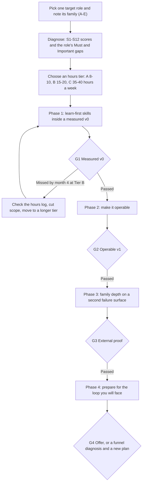

# Learning Roadmaps: What to Learn, in What Order, Resources Rated, and How Long It Takes

> How to learn what a target GenAI role needs: sequencing by family and background, sceptically rated free and paid resources, compute budgets, staleness traps, and the four gates that prove progress.

**Scope.** This page sequences learning and curates resources with an explicit rubric; it does not teach ML fundamentals ([charter](../../CHARTER.md)). For the full structured 60-item catalogue with per-family tables, refund checks, COI flags and hard gates, see [learning resources](learning-resources.md) (generated from `data/learning_resources.json`, D-027). **Dates:** sequencing and duration models are from [T0-06](../../research/sessions/T0-06-career-transition-timelines-5-backgrounds.md) (October 2026) and [T2-01](../../research/sessions/T2-01-tier-calibrated-execution-playbooks.md) (October 2026); rated learning resources, paid-programme refund checks, staleness audits and GPU pricing come from [T0-68](../../research/sessions/T0-68-learning-resources-rated.md) (13 November 2026), reconciled with [T0-21](../../research/sessions/T0-21-x-frontier-communities-fellowships-events.md) for Maven AI Evals (14 November 2026), [T0-67](../../research/sessions/T0-67-transitions-devops-pm-it-services-students.md) for transition routes and [T0-69](../../research/sessions/T0-69-skill-tool-momentum-dated-series.md) for tool statuses (14 November 2026). Marketplace GPU rental rates (class V1, 31 days from 2026-11-11) set `review_by: 2026-12-12`; tool, course and book statuses (class V2, 90 days) fall due by 2027-02-11. **Grades:** EGP-1.0. **Two upfront caveats:** (1) every planning duration here is a model output (Grade M) or design judgement (Grade D), not cohort data [D · T0-06.F9]; (2) T0-68 opened only 2 of 98 cited pages in full (96 read as search extracts, capping grades at B or C), and key pricing and status claims were re-checked on 2026-11-19 — still verify live price, refund terms and API versions at checkout before paying [T0-68 L22, L445].

## The short answer

1. **Learn by building toward a gate, not by finishing a syllabus.** For application roles, skip foundations-first: ship a hosted-model v0 in the first two weeks and learn theory when the build needs it. Reverse the order only for the research-engineer track, where depth is the differentiator [D · T0-06 R1.6, R3; T2-01 L234, L583]. The best-rated application resources are project-first, but no controlled evidence tests this learning order [P · T0-68 L401].
2. **Order skills by tier, and put evaluation first for application and PM roles — serving first for inference and infrastructure.** Close Must gaps first and build two or three Important skills into proof of work. Learn Should skills as your builds need them, Optional skills only when a posting names them, and nothing tiered Avoid [P · [role skill inventories §0](role-skill-inventories.md#0-how-to-use-it); the ontology codes the tiers M, I, S, O and X]. For application and AI-PM tracks, hand-write 30 eval cases in the first two weeks [M · T0-06 R1.1, R3; P · T0-68 L402]; evaluation was the top stack challenge (20%, n=1,053) [B · T0-06 KF-3, KF-4]. For DevOps/SRE moving into inference or AI infrastructure, start with model-serving frameworks and Kubernetes (11/11 and 6/11 extracts; model training 0/11) [B/M · T0-67 L62, L120–128].
3. **Pick an hours tier you can keep, and let the log decide.** Tier A is 8–10 hours a week, B 15–20 and C 35–40. A 17.5-hour week uses 56–74% of an employed US adult's average leisure. If logged hours fall below 70% of plan for three weeks running, move to the next-longer timeline instead of pushing harder [A data, M derivation · T0-06 KF-10, R1.4].
4. **Plan in months, and treat every duration as a model.** At Tier B, modelled time to a first offer runs from about 6 months (backend engineer, 5+ years) to about 11 months (BI analyst), and about 22 months for an engineering role from zero code [M · T0-06 R2]. No measured transition timelines exist for DevOps/SRE, PMs, IT-services engineers or students [E · T0-67 L327–330].
5. **Spend most hours on durable concepts; check version dates and pin fast-moving tools.** Context, retrieval, tool schemas and evaluation outlive frameworks [D · T0-06 R1.7]. In 2026, OpenAI retired the Assistants API (2026-08-26), Vercel AI SDK 6 (2025-12-22) was superseded by AI SDK 7 (2026-06-25), LangChain/LangGraph 1.0 (2025-10-22) deprecated legacy agent helpers, OWASP shipped its 2026 LLM Top 10 (August 2026), OpenAI acquired Promptfoo (2026-03-09) and ClickHouse acquired Langfuse (2026-01-16); RAGAS went quiet for 304 days after v0.4.3 before shipping v0.4.4rc1 on 2026-11-13 [B · T0-68 L79, L361–366; B · T0-69 L50, L520]. Reject fast-topic tutorials older than about 12 months [B · T0-68 L92].
6. **Start with the free minimal set, and never buy a course on placement statistics.** Free primary and university resources score 75–97 on T0-68's rubric across every family where a free route exists, and **no GenAI-specific course or bootcamp has independent audited outcome data** (CIRR audits exist only for three general software bootcamps, and Codesmith's audited 2023 cohort predates its AI/ML syllabus) [C/M · T0-68 L71, L74, L400]. Pay only for graded live feedback from named practitioners, after getting total cost (including lender interest) and a 14+ day full-refund window from the first session in writing [B · T0-68 L94]. Free notebook tiers have narrowed and free LLM API tiers exclude flagship models as of April–October 2026, so check quotas before assuming zero spend [B/C · T0-68 L80–81, L403].

## At a glance



| Phase | Months at Tier B | Learning goal | Gate |
|---|---|---|---|
| 1. Learn first | 1–3 | Close the role's Must gaps while building one measured system | G1 Measured v0 |
| 2. Deepen | 4–6 | Production practice: evals in CI, judge calibration, tracing, cost and latency, deployment | G2 Operable v1 |
| 3. Differentiate | 7–9 | Family-specific depth on a second failure surface, and public proof | G3 Second pattern and external proof |
| 4. Convert | 10–12 | Preparation for the loop type your targets use | G4 Convert or re-plan |

The gates are T0-06's design, each mapped to a hiring signal in its sources [M · T0-06 D3]; what each gate requires, how a stranger checks it and what to do when one slips are in [career transitions](../11-tracks/career-transitions.md#the-shared-spine-four-gates-and-an-hours-budget), which owns them. Non-technical lanes use domain variants of G1 and G2 (family E below). Gate dates at Tiers A and C are in [How long it takes](#how-long-it-takes).

## The roadmap: five families, four phases

The five résumé families group the 24 individual-contributor roles by the skills they share ([skills radar](skills-radar.md)). Find your role's family first.

| Family | Roles (hubs) |
|---|---|
| A · Applied GenAI Engineering | [AI Engineer](../02-roles/hubs/ai-engineer.md), [Forward Deployed Engineer](../02-roles/hubs/forward-deployed-engineer.md), [Applied AI Engineer](../02-roles/hubs/applied-ai-engineer.md), [Agentic AI Engineer](../02-roles/hubs/agentic-ai-engineer.md), [AI Evaluation Engineer](../02-roles/hubs/ai-evaluation-engineer.md), [AI Solutions Architect](../02-roles/hubs/ai-solutions-architect.md), [AI Enablement Engineer](../02-roles/hubs/ai-enablement-engineer.md), [AI Product Engineer](../02-roles/hubs/ai-product-engineer.md) |
| B · ML & Applied Science | [ML Engineer](../02-roles/hubs/ml-engineer.md), [Applied Scientist](../02-roles/hubs/applied-scientist.md), [Physical AI Engineer](../02-roles/hubs/physical-ai-engineer.md) |
| C · Frontier Research | [Research Engineer](../02-roles/hubs/research-engineer.md), [Research Scientist](../02-roles/hubs/research-scientist.md), [AI Safety Researcher](../02-roles/hubs/ai-safety-researcher.md) |
| D · AI Systems & Infrastructure | [AI Infrastructure Engineer](../02-roles/hubs/ai-infrastructure-engineer.md), [Inference Engineer](../02-roles/hubs/inference-engineer.md), [ML Platform Engineer](../02-roles/hubs/ml-platform-engineer.md), [GPU Kernel Engineer](../02-roles/hubs/gpu-kernel-engineer.md), [AI Security Engineer](../02-roles/hubs/ai-security-engineer.md) |
| E · AI Product, Governance & Assurance | [AI Product Manager](../02-roles/hubs/ai-product-manager.md), [AI Governance Lead](../02-roles/hubs/ai-governance-lead.md), [AI Risk & Assurance Specialist](../02-roles/hubs/ai-risk-assurance-specialist.md), [Responsible AI Engineer](../02-roles/hubs/responsible-ai-engineer.md), [Domain Evaluation Specialist](../02-roles/hubs/domain-evaluation-specialist.md) |

### Family × phase

**How to read it.** Every cell is a planning design: T0-06's roadmaps are model outputs [M], T2-01's week plans are design judgements [D], and the skill lists come from the computed skills radar [M]. Each role's own Must skills, in the [skills radar](skills-radar.md) and its [inventory](inventories/README.md), decide what you add for that role. Which projects prove a role is computed, not chosen here: the [project archetypes](../05-portfolio/project-archetypes.md#at-a-glance) table lists the roles each project covers best, with its effort and reference specification, and each role's hub lists its top projects [M].

| Family | Phase 1 → G1: learn first | Phase 2 → G2: deepen | Phase 3 → G3: differentiate | Phase 4 loop and gate notes |
|---|---|---|---|---|
| **A · Applied GenAI** | Production Python; LLM APIs (structured output, tool calling, streaming); retrieval with baselines (BM25, dense, hybrid, a reranker); an eval set and error analysis, over a corpus you know [M · T0-06 D4; D · T2-01 L239–241] | Evals in CI; judge calibration; tracing; p50/p95 latency and cost per request; timeouts, retries and budgets; container deployment; a real user [M · T0-06 L443] | A tool-using agent with approvals, budgets, sandboxed tools, replay and failure injection [M · T0-06 L444]. Role variants: a browser-side module for AI product engineers; a customer pilot for FDE and solutions roles [M · T0-06 L585, L607] | Applied-AI loops, per hiring write-ups: a take-home with retrieval and evals, agent debugging, a scoping or customer round [C/D · T0-06 D1]. Standard G1–G4 |
| **B · ML & Applied Science** | Packaging, tests, type checks, Docker and CI (the production gap); LLM application patterns; eval design with statistics: stratified trace samples, two-reviewer agreement, intervals on every metric [M · T0-06 L509; D · T2-01 L367–372] | A served API (async, auth, retries); a judge-calibration study (100+ labels, agreement, position and verbosity bias tests); a cost-quality frontier across models and prompts [M · T0-06 L510] | DSA basics and LLM-app system design; a second pattern such as a cost-reducing model router or an embedding fine-tune as a GPU lab [M · T0-06 L511]. Fine-tune only after prompting and retrieval baselines [B · T0-06 L496] | Candidates report coding and system design as the deciding rounds in big-company loops [D · T0-06 D5]. Budget 3–6 weeks of DSA: T2-01's floor to T0-06's roadmap [D · T2-01 L396; M · T0-06 L511]. Physical AI skills are measured in T0-64 (n=48: robot learning 79%, real-robot deployment 54%, simulation 46%, PyTorch 31% [B · T0-64 L170–192]), though transition sequencing remains unmeasured |
| **C · Frontier Research** | Research-engineer track: depth first, because depth is the differentiator (ML fundamentals, transformers, PyTorch internals, distributed training) [D · T0-06 R1.6; M · skills radar]. PhDs, whose usual gap is craft rather than knowledge, start with craft: packaging, tests, CI and code review through three open-source pull requests [B/C/D · T0-06.F8; M · T0-06 L701; D · T2-01 L574–581] | A method reproduced as a tested service or library; every sophisticated step must beat a simple baseline; evaluation infrastructure; a decision memo for a real user [M · T0-06 L701–702] | A measurement-rigour artifact (intervals, power for eval-set size, judge-bias tests, drift detection) [M · T0-06 L703]; a paper re-implementation (P8) or a post-training study (P7); fellowship or residency cycles for the research track [M · T0-06 L703] | Frontier research roles are upside, not a plan: run the applied track in parallel [M · T0-06 D8]. Acceptance rates for fellowships and residencies were not found [T0-06 L822] |
| **D · AI Systems & Infrastructure** | The role-defining fundamentals: KV-cache memory, continuous batching, prefill vs decode (inference, kernels); Kubernetes, infrastructure as code, observability (platform, infrastructure); threat modelling and LLM security (security) [M · skills radar; D · T2-01 L238]. Exercise them through a traced LLM application with cost tracking [D · T2-01 L251–253] | A load test against a latency SLO; a capacity and cost model; latency and cost reported with their method; pinned and patched serving engines [D · T2-01 L256; B · T0-13.F5; A/B · T0-03.F12] | A serving, quantisation or kernel study on one rented GPU: tokens per second, p95 latency and cost per million tokens against an API; one upstream contribution [M · T0-06 L444; D · T0-13 L267, L276] | A specialist niche: inference engines are named in 2.0–3.9% of postings [A/B · T0-03.F7]. Senior loops probe KV-cache sizing and latency budgets, per Grigorev's AI Engineering Field Guide [A/C · T0-03.F14]. Backend to Staff-level infrastructure work: about 10–14 months at Tier B [D · T2-01 L222] |
| **E · AI Product, Governance & Assurance** | AI literacy (tokens and context, retrieval vs fine-tuning vs prompting, cost and latency); evaluation fluency (rubrics, golden sets, inter-rater agreement); notebook-level SQL and Python [M · T0-06 D7]. Governance roles add the EU AI Act, NIST AI RMF and ISO/IEC 42001 [M · skills radar]. Responsible AI engineers hold production Python and ML fundamentals at Must, so they start from family A's Phase 1 [M · inventory] | A pilot with 5–10 colleagues measuring adoption, time saved and error rate; LLM-judge agreement with human labels; a PRD or runbook and a risk register [M · T0-06 L637] | A cost-per-task model; a governance and guardrails document; a de-identified write-up. Responsible-AI engineers add evaluation pipelines and runtime guardrails on an MLOps stack, as T0-15's 13-posting sample shows [M · T0-06 L638; C · T0-15.F6] | G1-domain (a golden set of 100+ real tasks with rubrics and two-reviewer agreement, against the existing human process) and G2-domain (pilot results) replace G1 and G2 [M · T0-06 D7]. Postings, recruiter guides and expert-marketplace listings show that each lane has an entry fee in years, credentials or coding [C · T0-06.F7]. Below programme-lead level, governance work is absorbed into privacy, legal, security, risk and audit roles [B · T0-15.F5] |

**Proof.** The project archetypes are specified as build cards, each with its effort (S, M or L) and any reference specification, in [project archetypes](../05-portfolio/project-archetypes.md), whose "Best for" column gives the roles each one covers (computed, M). One project rarely covers a role; the [minimal project sets](../05-portfolio/project-archetypes.md#minimal-project-sets) and the job-search strategy's [constraints that bind first](../06-job-search/job-search-strategy.md#the-constraints-that-bind-first) compute the smallest sets that do.

### Leadership and independent tracks

The corpus has no learning-order evidence for leadership or independent transitions, though all five tracks now carry RP2-evidenced skill inventories (`T0-65`, `T0-66`; [role index](role-skill-inventories.md#1-role-index)). Start from [growth and progression](../10-onboarding/growth-and-progression.md) and the hubs for [AI Engineering Manager](../02-roles/hubs/ai-engineering-manager.md), [VP / Head of AI](../02-roles/hubs/vp-head-of-ai.md) and [Chief AI Officer](../02-roles/hubs/chief-ai-officer.md). For independent work, see [freelance and fractional](../11-tracks/freelance-fractional.md) and the hubs for [independent AI consultant](../02-roles/hubs/independent-ai-consultant.md) and [fractional AI leader](../02-roles/hubs/fractional-ai-leader.md).

## Adjust for your starting background

The family sets the destination; your background sets what you close first and what you can skip. S-codes are T0-06's twelve-skill rubric ([role skill maps §1.1](role-skill-maps.md#11-twelve-skill-readiness-rubric-t0-06-target-levels-for-an-ai-engineer-role)); score yourself in the [targeting workbook](../00-start/targeting-workbook.md).

| Background | Close these first | Lean on | Skip or compress | Unlearn |
|---|---|---|---|---|
| Backend or systems, 5+ years | Evaluation design (S4), LLM API fluency (S2), retrieval (S3); Python (S1) if you come from Java or Go | Regression CI and observability | Landscape stages to about a week; credentials | Expecting 100% pass rates; a vector database before measuring; frameworks before patterns; infrastructure polish before measurement |
| Data scientist | Production code (S1), production ops (S7), system design (S8); then LLM APIs (S2) and agents (S6) | Error analysis, metric design, judge validation | Landscape to 1–2 weeks; credentials | Fine-tuning first (26% of surveyed teams fine-tune; 80% prompt); a notebook as the deliverable; generic, unvalidated metrics |
| BI analyst | Python (S1), LLM APIs (S2), retrieval (S3), production ops (S7) | SQL and metric definitions; execution-accuracy evals for text-to-SQL | Little: about two weeks of landscape; credentials optional | Dashboard thinking: a chat box with no evaluation of the SQL it generates |
| Frontend or full-stack | Evaluation (S4), retrieval (S3), error analysis (S5), production ops (S7) | UX and human-in-the-loop evals | Landscape to about a week; credentials | A polished interface over unmeasured quality; rebuilding for each framework release |
| Non-technical, 5+ years in a domain | Evaluation fluency (S4), error analysis (S5), AI literacy (S2), basic Python (S1) | Domain rubrics and ground truth | Nothing: walk every stage (a PM certificate is optional) | Collecting prompts and certificates instead of measured outcomes; trusting fluent output and unvalidated judges |
| PhD or researcher who can code | Production craft (S1, S7), loop preparation (S8), stakeholder communication (S12) | Measurement rigour | Landscape to about a week; credentials. Not the skills stage | Novelty before baselines; perfectionism; benchmark fixation; over-targeting lab research slots |
| DevOps, SRE or cloud engineer | Model-serving frameworks (vLLM, SGLang, TensorRT-LLM), GPU scheduling, quantisation, benchmarking [B/M · T0-67 L62, L120–122] | Kubernetes, SLOs, observability, cloud ops | Skip model training first (0/11 inference extracts [B · T0-67 L62]) | Building generic K8s demos without GPU serving or cost-per-token metrics; studying training before serving [B · T0-67 L339, L341] |
| Product manager | Evaluation design, LLM failure modes, cost/latency trade-offs, data literacy [B/C · T0-67 L154–156] | Product discovery, metrics, shipping, stakeholder alignment | Start at enterprise or mid-size AI teams (~3 yr gate) before frontier labs (5–10+ yr) [B · T0-67 L154–155] | Prompt collections without a scored eval set and ship-or-no-ship memo; relabelling generalist PM work [C/P · T0-67 L344–345] |
| IT-services engineer (India) | Deployed GenAI application patterns, evaluation harnesses, measured usage beyond training [B/C · T0-67 L61, L181, L195] | Enterprise integration, client delivery, QA discipline | Time-box internal bridge ask to 2 quarters, then target GCCs at 4+ yrs [B/C · T0-67 L80–81] | Counting employer AI certifications or training badges as production proof [B/C · T0-67 L61, L348] |
| Student or new graduate | One evaluated end-to-end LLM system, AI output evaluation, communication and teamwork [B/C · T0-67 L305, L314–321] | Internships (in-person preferred: 71.9% vs 56.2% offer rate [B · T0-67 L65]), campus placement | Avoid mass cold graduate applications (141 per UK vacancy [B · T0-67 L57]) | Treating competitions, open source or a CS master's (+6% cost-adjusted return [B · T0-67 L64]) as standalone hiring pipelines |

Sources: Routes 1–5 gaps [M · T0-06 D9 L737–743]; strengths [M · T0-06 KF-4 L146; BI from D5]; skips [D · T2-01 L719, L748–750]; traps [D/M · T0-06 D4–D8]; Routes 6–9 sequencing and traps [B/C/M · T0-67 L62–65, L118–361]. Full playbooks for all nine backgrounds live in [career transitions](../11-tracks/career-transitions.md). The PhD row applies [erratum U18](../../research/ERRATA.md): a PhD does not skip the skills stage, and T2-01's own PhD playbook runs an 8-week skills block.

Two routes sit outside the table. With under 5 years in a domain, build domain depth first and do not expect an AI-specific role within 12 months [M · T0-06 L304]. An engineering role from zero code is a two-year plan: about 22 months (15–34) at Tier B [M · T0-06 R2].

### The skills-stage block, week by week (Tier B)

| Background | Weeks | Order inside the block |
|---|---|---|
| Backend or systems | 1–8 | 1–2 serving architecture (KV-cache maths, continuous batching, prefill/decode disaggregation); 3–4 retrieval over a real corpus from your domain; 5–6 eval methodology (30+ hand-labelled cases, 2 baselines); 7–8 agent patterns, tracing every call |
| Data scientist | 1–12 | 1–3 packaging, testing, CI/CD; 4–6 RAG, tool use, agents; 7–9 eval methodology; 10–12 system design basics (API design, deployment, monitoring) |
| BI analyst | 1–12, up to 16 | 1–3 Python as scripts, tests and packages, not notebooks; 4–6 LLM patterns plus basic ML and NLP; 7–9 eval methodology and text-to-SQL patterns; 10–12 containers and cloud basics |
| Frontend or full-stack | 1–10 | 1–3 Python backend basics (FastAPI, basic cloud deployment); 4–6 RAG, tool use, streaming, agent UX; 7–8 UX and human-in-the-loop evals; 9–10 on-device AI (Transformers.js v4, Chrome built-in AI, WebGPU) |
| Non-technical, AI-adjacent (no coding) | 1–12 | 1–3 what LLMs can and cannot do, and the cost, latency and quality trade-offs; 4–6 rubrics, labelling, judging quality; 7–9 success metrics and reporting non-determinism; 10–12 hands-on prompt evaluation in a model console or playground |
| Non-technical, FDE-adjacent (coding) | 1–12 | 1–6 Python (scripts, APIs, basic data handling); 7–9 LLM API integration and basic RAG; 10–12 scoping, demos, technical communication |
| PhD or researcher | 1–8 | 1–2 production Python, CI/CD, code review; 3–4 serving, batching, cost; 5–6 evaluation pipelines rather than one-off experiments; 7–8 agent and tool-use patterns |

[D · T2-01 L236–241, L367–372, L433–438, L489–504, L576–581.] Two discrepancies, with reasons:
- T2-01 opens the backend block with serving architecture because its persona also targets inference roles. For applied roles, T0-06 opens with Python, API fluency and a v0 in weeks 1–2 [M · T0-06 L442].
- For BI analysts, T2-01's quick-reference table gives weeks 1–16, while its week plan details only weeks 1–12 [D · T2-01 L367–372, L749].

## How long it takes

Timelines are owned by [career transitions](../11-tracks/career-transitions.md); this section keeps what a learning plan needs on top of them.

### Hours tiers

Tier A is 8–10 hours a week, B 15–20 and C 35–40; the adherence, effective hours and share of average leisure behind each tier are in [career transitions](../11-tracks/career-transitions.md#hours-tiers) [A data (BLS American Time Use Survey 2025), M derivation · T0-06 KF-10, D2]. These are US averages, not personal capacity, and the corpus has no India equivalent. With under 8 hours a week, plan a 12–18-month horizon or pick an adjacent role [M · T0-06 L303].

### Modelled months to a first offer

Modelled months by background and hours tier, with their ranges, confidence, sensitivity and limits, are in [career transitions](../11-tracks/career-transitions.md#modelled-months-to-a-first-offer) [M · T0-06 R2 L261–269]; the short answer above gives the Tier B span. They include a search lag, because applications start at about 70% of the build gates, and T0-06 budgets 2–4 months of search in total [M · T0-06 D2; C · T0-06 KF-11]. That 70% measures build progress; the 70% rule above measures hours logged.

**By family.** The model is built per background, not per family:
- **Applied GenAI:** the backend, data-scientist, BI and frontend routes target applied AI engineering roles, and the PhD route includes them [M · T0-06 R2].
- **ML & Applied Science:** the PhD route covers applied scientist roles. For ML engineering, the only reference class is a mentoring marketplace's 6–18 months for a working data scientist with Python [D, vendor · T0-06 L200].
- **Frontier Research:** research-engineer roles sit inside the PhD route. Research-scientist roles are upside only, with no plannable timeline [M · T0-06 R2, L708].
- **AI Systems & Infrastructure:** one design estimate, about 10–14 months at Tier B from backend to Staff-level infrastructure work [D · T2-01 L222].
- **Product, Governance & Assurance:** the non-technical route covers AI PM, AI ops and domain evaluation. The corpus has no timeline for governance roles.

### Gate dates at Tiers A and C

Three estimates disagree, for stated reasons:
- **By effective hours alone,** a build gate takes about twice as long at Tier A as at Tier B (6.75 versus 13.1 effective hours a week) and about 0.4 times as long at Tier C (32.3) [M, derived from T0-06 D2].
- **T2-01** scales gate dates by about 1.5 at Tier A and 0.5 at Tier C [D · T2-01 L153].
- **T0-06's own roadmaps** add 3–7 months to their 12-month Tier B plan at Tier A, depending on background [M · T0-06 D4–D8].

Plan on the slowest figure until G1 shows your own pace [P].

### How long one proof takes

The part-time time box and compute cap of each of T0-13's reference specifications, R1 (new graduate to junior) to R4 (staff or principal), are in [proof-of-work standards](../05-portfolio/proof-of-work-standards.md#what-each-level-must-prove) [D · T0-13 L272–277]; each [project archetype](../05-portfolio/project-archetypes.md) card names the specification it applies, if any.

### Compute by phase (re-checked November 2026)

Free tiers narrowed in 2026 (Colab Pro for Education and SageMaker Studio Lab closed to new users; Kaggle's weekly quota floats in the account and is not in its docs; Hugging Face ZeroGPU gives free accounts 5 minutes a day; flagship LLM APIs were reported paid-only from April 2026) and GPU rental prices moved twice in six weeks [B/C · T0-68 L80–82, L383–394]. Re-check prices monthly before renting.

- **Lab 0, everyone, Phase 1 (hosted APIs and free notebooks):** start on free notebook tiers (Google Colab free, sessions ≤12 h with opaque GPU limits; Kaggle 12 h GPU/CPU and 9 h TPU sessions) and standing free LLM API tiers where non-flagship models suffice (8 of 17 providers on 2026-10-18: Gemini API, Mistral, Groq, OpenRouter, Z.ai, Cloudflare Workers AI, NVIDIA API Catalog and Cohere; OpenAI had no free tier, and flagship models were reported paid-only from April 2026). Typical published caps: **Groq** 30 req/min and ~1,000 req/day on some models (14,400/day on an 8B model); **OpenRouter** `:free` models 20/min and 50/day (1,000/day after a US$10 credit purchase) [B/C · T0-68 L383–387]. Check provider data-training terms before sending real data.
- **Lab 1, backend, DevOps/SRE, data science and PhD (serving):** serve an open-weight model once on a rented GPU and measure TTFT, tokens per second, p95 latency and cost per million tokens against an API [M · T0-06 D10, L444; B/P · T0-67 L137].
- **Lab 2, data science and PhD (small fine-tune):** use Modal's Starter tier (US$30/month credit, buying roughly 7.6 H100-hours at US$3.95/h; T4 US$0.59/h, L4 US$0.80/h, A100 40GB US$2.10/h; **academic grants up to US$10,000** by application [B/C · T0-68 L388]) or consumer/marketplace GPUs before paying for H100 clusters.
- **Rented GPU price anchors (September–November 2026; re-verify monthly):**
  - *Consumer / marketplace (2026-11-11 in-stock aggregator):* RTX 3090 US$0.29/h (LeaderGPU), RTX 4090 US$0.41/h (Vast.ai), A100 US$0.68/h (LeaderGPU), L4 US$0.93/h (Ori) [B · T0-68 L391].
  - *RunPod:* Community RTX 4090 from US$0.34/h (2026-08-04); Secure Cloud repriced twice in Sept–Oct 2026 to RTX 4090 **US$0.89/h**, A100 PCIe US$1.79/h, H100 PCIe US$2.89/h and H100 SXM US$3.99/h (2026-10-15). The "up to US$25K" credits claim was not verified [B · T0-68 L389, L415, L426].
  - *Lambda:* H100 SXM US$3.99 (8×) to US$4.29 (1×) per GPU-hour in Sept–Oct 2026 (a single-source tracker captured US$4.59 in early November); older US$2.99–3.29 snapshots are stale [C · T0-68 L390, L416].
- **Student, trial and startup credits (2026-09-21):** GitHub Student Pack (US$100 Azure + 5 GPU hours on Camber) and Azure for Students (US$100/12 mo); hyperscaler trials (Google Cloud US$300/90 d excludes GPUs, AWS up to US$200/6 mo, Azure US$200/30 d); startup programmes (Google for Startups up to US$200K / US$350K AI-first, AWS Activate up to US$200K, Microsoft up to US$150K, NVIDIA Inception) [B · T0-68 L392–394].
- **Frontend:** a browser-side lab needs no rented GPU, only a spread of test devices [M · T0-06 D10].

## Where the hours go: durable versus fast-moving

| Class | Examples | Why (evidence) | How to learn it |
|---|---|---|---|
| **Durable: most of your hours** | Evaluation design and error analysis; retrieval quality; context and tool-schema design; provider-independent routing; observability; cost and latency reasoning; tests, CI and deployment; system design | T0-06 names context, retrieval, tool schemas and evals as the durable concepts [D · T0-06 R1.7]. Multi-provider use is rising (more than 70% of organisations use 3+ models in Datadog telemetry; 81% of CIOs in a16z [B/C · T0-69 L52]). Postings reward the engineering practice, not a vendor brand [B · T0-03.F3] | Build them into every gate artifact and deepen them each phase |
| **Fast-moving: learn when a build needs it** | Framework and SDK APIs; eval and tracing products; serving-engine flags and build paths; model names and versions; hosting free tiers | OpenAI retired the Assistants API (2026-08-26) and is deprecating its hosted Evals platform (November 2026) [A · T0-69 L49; B · T0-71 L87, L352]. AI SDK 6 (2025-12-22) was superseded by AI SDK 7 (2026-06-25) [B · T0-68 L79]. Seven eval/observability tools were acquired or closed between May 2025 and May 2026 (including Langfuse and Promptfoo) [B · T0-69 L51]. RAGAS went 304 days without a release before shipping v0.4.4rc1 on 2026-11-13 [B · T0-69 L50, L520]. TGI entered maintenance mode/archive and TensorRT-LLM removed `trtllm-build` in favour of PyTorch-only execution [A · T0-69 L49]. | Freeze stack choices for six weeks; pin tool and model versions; date-stamp results [D · T0-06 R1.7; A/B · T0-13.F11] |

**Direction, not a ratio.** Put most of your hours into the durable row. A fixed split such as 80/20 is a rule of thumb [P]; no session measures the right ratio. For what to stop learning and what to watch, see rings 4 and 5 of the [skills radar](skills-radar.md) and the [watch list](skills-vocabulary.md#5-watch-list-tools-with-a-notable-status) of tool statuses.

## Curated learning resources and rating method (November 2026)

For the full 60-resource machine-generated catalogue across all 12 canonical role families — including exact URLs, refund checks, COI flags and hard gates — open [learning resources](learning-resources.md) (D-027).

> **Epistemic warning before using any rating below:** (1) **No GenAI-specific course or bootcamp has independent audited outcome data** — rubric scores measure authority, currency, hands-on depth, role fit and cost, NOT job-placement odds [C/M · T0-68 L71, L91]. (2) T0-68 opened only 2 of 98 cited pages in full (96 read as search extracts, capping grades at B or C), and 13 carry COI flags (including Claude Academy and Karpathy's materials after he joined Anthropic on 2026-05-19) [T0-68 L22, L85, L445]. Key pricing and status claims were re-checked on 2026-11-19 (including Maven AI Evals primary enrolment page read in T0-21), but always verify live price, refund terms and API version before paying.

### How resources are rated [M · T0-68 L121–142]

Each resource is scored 0–5 on five weighted criteria totalling 100 (`T = 4A + 4C + 4H + 5R + 3$`): **Authority** (20: 5 primary spec/maintainer/university → 3 vendor [COI] → 1 affiliate), **Currency** (20: fast topics ≤6 months = 5, ≤12 = 4, retired API = 0; medium/foundations doubled), **Hands-on depth** (20: 5 graded/reviewed capstone → 1 video/reference only), **Role fit** (25: judgement against family skills), and **Cost** (15: 5 free ≤40 h → 0 >US$5,000 or price unpublished). Five gates cap verdicts afterwards: **G1** fast-topic age >18 months caps at `use-with-care` (retired API: `avoid`); **G2** programmes above US$100 / ₹8,000 need a confirmed ≥14-day full-refund window from first session and traceable (or no) outcome claims to reach `use`; **G3** flags COI; **G4** caps seller-awarded unassessed titles at `watch` and flags regulator findings or closures `avoid`; **G5** caps incomplete courses at `use-with-care`. Bands: ≥75 `use`, 55–74 `use-with-care`, <55 `watch` (`avoid` under G4).

### Minimal free and optional paid sets by family

Free primary and university material scored 75–97 in every family where a free route exists; **no paid programme cleared G2 to reach `use`** [M · T0-68 L74, L306–319]. Start with the free column; treat paid options as optional upgrades only when employer-funded or when you specifically need graded live feedback.

| Family | Minimal free set (scores and caveats) | Books and optional paid upgrades |
|---|---|---|
| **A · Applied GenAI** (incl. FDE & Solutions) | [DataTalks.Club LLM Zoomcamp](https://datatalks.club/courses/llm-zoomcamp) (89, free 10-wk graded cohort; 2026 cohort began 2026-06-08; certificate live-cohort only [B · T0-68 L152, L412]); provider API docs (OpenAI Responses API, Google, Anthropic [COI]) + pinned SDK docs ([Vercel AI SDK 7](https://ai-sdk.dev/docs/ai-sdk-core/agents) or [LangChain/LangGraph ≥1.0](https://docs.langchain.com/oss/python/releases/langgraph-v1/index.html) [B · T0-68 L153–159]); [Hugging Face Agents Course](https://huggingface.co/learn/agents-course) (83, free certificate via Unit 1 + 80% quiz + assignment + >30% GAIA subset [B · T0-68 L154, L408]); [DeepLearning.AI Agentic AI](https://learn.deeplearning.ai/courses/agentic-ai/information) (80, videos free; skip paid Pro certificate unless you want hosted labs [B · T0-68 L157, L410]). *Use-with-care:* [roadmap.sh](https://roadmap.sh/ai-engineer) (58, checklist only, updated 2026-09-17 [B · T0-68 L189]); Claude Academy (70, 22–26 free courses, attendance cert, **COI** [C · T0-68 L160]). | Chip Huyen, *AI Engineering* (~US$55–80, Jan 2025 — concepts only; G1 currency cap on tooling [B · T0-68 L84, L161]). Maven AI Evals (**US$4,500** for the 2027-01-30 to 2027-03-27 cohort, ≥20% team discount for 2+ [A · T0-21 L91, L191, L278]; US$4,200 Oct 2026 [C · T0-68 L325]; `use-with-care` under G2) only if employer-funded after building harness v0. |
| **B · ML & Applied Science** (incl. Physical AI) | Karpathy, *Zero to Hero* (83, ~19 h, **COI-adjacent** after joining Anthropic 2026-05-19; do **not** wait for LLM101n — unshipped [B/C · T0-68 L170, L375, L459]); [Hugging Face LLM Course](https://huggingface.co/learn/llm-course) (88, ~15–20 h, relaunched 2025-04-03 [B · T0-68 L167]); HF smol course (79 [C · T0-68 L172]); DataTalks.Club ML / MLOps Zoomcamps (76 [C · T0-68 L173–174]); [Stanford CS336](https://cs336.stanford.edu/) optional (87 [B · T0-68 L168]). *Physical AI:* [NVIDIA Physical AI](https://docs.nvidia.com/learning/physical-ai/index.md) (87, free Isaac Sim/Lab/GR00T [B · T0-68 L274]); MIT [Underactuated Robotics](https://underactuated.mit.edu/) (75 [B · T0-68 L275]); HF Robotics/LeRobot (`use-with-care`, G5 partial release [B · T0-68 L276]). *Use-with-care:* freeCodeCamp ML with Python (66, free but TensorFlow-based [C · T0-68 L175]). | Sebastian Raschka, *Build a Reasoning Model (From Scratch)* (~US$60, 2026-06-30; score 84 [B · T0-68 L84, L169]) and *Build a Large Language Model (From Scratch)* (Oct 2024; score 80 [B · T0-68 L171]). |
| **C · Frontier Research** | [Stanford CS336](https://cs336.stanford.edu/) *Language Modeling from Scratch* (97, Spring 2026, 17–18 lectures + 5 implementation-heavy assignments [B · T0-68 L73, L221]); Karpathy *Zero to Hero* (83, COI-adjacent [C · T0-68 L223]); [BlueDot Technical AI Safety](https://bluedot.org/courses/technical-ai-safety) (83, 30 h free cohort, alumni claims COI [B · T0-68 L224]) or public ARENA curriculum (80, 4–5 wk full-time, ARENA 9.0 Oct–Nov 2026 [B · T0-68 L225]). *Use-with-care:* UC Berkeley RDI Agentic AI MOOC (70, Fall 2025 lectures only [B · T0-68 L230]). | Raschka, *Build a Reasoning Model* (optional [B · T0-68 L313]). |
| **D · AI Systems & Infrastructure** | Stanford CS336 GPU/parallelism/inference lectures (92 [B · T0-68 L196]); [GPU MODE lectures](https://github.com/gpu-mode/lectures) (84, 79+ lectures on CUDA, Triton, CUTLASS, NCCL, FlashAttention [B · T0-68 L198]); MLOps Zoomcamp (76 [C · T0-68 L199]); [OWASP GenAI LLM Top 10 2026](https://genai.owasp.org/home/resources/owasp-genai-llm-top-10-2026/) + Agentic Top 10 (80, security track [B · T0-68 L210]). | *Programming Massively Parallel Processors*, 5th ed. (~€66–74, 2026-06-03, score 89; authors NVIDIA-affiliated [B · T0-68 L84, L197]); NVIDIA DLI self-paced (US$30 or 90; workshops US$500+; `use-with-care`, strictly non-refundable [B · T0-68 L200, L336]); rented GPUs at US$0.29–0.93/h for labs [B · T0-68 L391]. |
| **E · Product, Governance, Evaluation & Assurance** | *Evaluation/Safety:* [Inspect AI docs](https://inspect.aisi.org.uk/) (92, UK AISI/Meridian Labs, MIT licence [B · T0-68 L207]); [Hamel Husain's blog](https://hamel.dev/) (84, free eval articles; markets Maven cohort, COI [B · T0-68 L208]); BlueDot Technical AI Safety (83) and OWASP 2026 (80) [B · T0-68 L209–210]. *Governance & Product:* [BlueDot Frontier AI Governance](https://bluedot.org/courses/ai-governance) (78 [B · T0-68 L238]), [BlueDot The Future of AI](https://bluedot.org/courses/future-of-ai) (65, 2 h free PM orientation, `use-with-care` [B · T0-68 L612]), [NIST AI RMF 1.0 + AI 600-1](https://www.nist.gov/itl/ai-risk-management-framework) (76; revision pending [B · T0-68 L239]), [EU AI Act Digital Omnibus explorer](https://artificialintelligenceact.eu/ai-act-explorer/digital-omnibus/) (76; verify dates on EUR-Lex [B · T0-68 L240]). *Human data:* aitrainer.work Academy (71, platform-run COI [C · T0-68 L265]). | No independently rated audit/compliance or human-data curriculum exists [C · T0-68 L83, L268]. Optional (employer-funded): Maven AI PM (~US$2,500 list, `use-with-care` [C · T0-68 L255]) or Maven AI Evals (**US$4,500** for 2027-01-30 cohort, ≥20% team discount [A · T0-21 L91, L191, L278]). Avoid seller-awarded "AI Evaluator" / "Certified CAIO" titles (G4) [C · T0-68 L266, L302]. |
| **Leadership & Independent** | [BlueDot AGI Strategy](https://bluedot.org/courses/agi-strategy) (78, 25 h [B · T0-68 L285]); LLM Zoomcamp (74, to see what teams actually build [B · T0-68 L286]); NIST AI RMF + EU AI Act explorer; Hamel Husain's blog; provider API docs [B · T0-68 L318–319]. | Huyen book for architecture vocabulary [B · T0-68 L318]. Executive programmes (e.g. upGrad × IIIT-B ₹2,25,000; Chicago Booth US$28,000 context only) lack independent outcome evidence [C · T0-68 L290, L318]. **Avoid** vendor-awarded "Certified AI Consultant / Fractional CAIO" short-course titles [C · T0-68 L302, L338]. |

### Paid cohorts, bootcamps and purchase diligence [B/C · T0-68 L76–78, L323–355]

No GenAI-specific paid programme has an independent outcomes audit. Treat any "X% placed" figure as Grade E unless the programme discloses the denominator, definition, time window and an independent auditor (such as CIRR) [B · T0-68 L93].

| Programme | Price (as captured Oct–Nov 2026) | Refund terms | Outcome status | Verdict | Grade |
|---|---|---|---|---|---|
| Maven AI Evals for Engineers & PMs (Parlance Labs) | **US$4,500** for 2027-01-30 to 2027-03-27 cohort (≥20% team discount for 2+, primary page 2026-11-14 [A · T0-21 L91, L191, L278]); US$4,200 Oct 2026 cohort (~US$3,000 in 2025) [C · T0-68 L325] | Full refund through end of Week 2 under Maven Guarantee badge (Week 1 listed as 2 days, so ≥14 days from first session unconfirmed) | No job claims; self-collected ratings (4.7★, n=1,012, COI) | `use-with-care` (G2) | A/C · T0-21; T0-68 L325 |
| DeepLearning.AI Pro | Videos free; Pro US$25/mo annual or US$30/mo monthly (7-day trial) | Monthly/annual subscription | Unproctored completion certificates; no outcome data | `use-with-care` (videos `use`) | B · T0-68 L75, L410 |
| Coursera (incl. Udemy after 2026-05-11 merger) | Varies by course/subscription | Platform terms | No MOOC ROI evidence; restructurings on 2026-07-06 and ~10% workforce cut on 2026-11-09 (SEC 8-K) | `use-with-care` | B · T0-68 L406, L456 |
| Scaler AI & ML with Agentic AI | ₹3,99,000 (EMI available) | 14 days from first class | Vendor-published 89% placement & KPMG-commissioned pay figures (COI; not independently audited) | `use-with-care` | B/C · T0-68 L327 |
| upGrad × IIIT-B (Applied AI / GenAI for Leaders) | ₹1,25,000 / ₹2,25,000 incl. GST | Before programme start only (30 working days to process) | Placement assistance; no placement promise | `use-with-care` | B/C · T0-68 L328–329 |
| Codesmith SWE + AI/ML Immersive | US$22,500 | Not confirmed in T0-68 | Only CIRR-audited example found: 43.6% in-field at 180 days on 2023 software cohort (70.1% at 12 mo per school) — predates 2024 AI/ML syllabus | `use-with-care` | C · T0-68 L333, L348 |
| Springboard ML Engineering Career Track | US$11,990 up front (~9 months) | Tuition-back terms not opened in T0-68 | Unverified list-site source only | `watch` | C · T0-68 L334, L622 |
| NVIDIA DLI | US$30 or 90 self-paced; workshops US$500+ | Strictly non-refundable | Assessment-based certificate of competency; vendor stack | `use-with-care` | B · T0-68 L336 |
| Great Learning × UT Austin McCombs PGP-AIML | US$3,950 (23-wk) / ₹2.1–3.35L + GST (12-mo) | UT Austin cancellation terms not opened; MIT variant charges US$250 after 7 days rising to 100% | No traceable outcome data; 2018 ASCI ad rulings (stale); 13 self-reported refund complaints on a paid complaints site | `watch` | C · T0-68 L330, L354 |
| Simplilearn AI/ML (Purdue × IBM & partners) | US$2,499–4,800 / ₹1.7–2.85L (listings conflict) | Withdrawal deducts admin charge; Wharton tracks: 7 days from purchase only | Advocacy allegations of rating inflation; no regulator finding located | `watch` | C · T0-68 L331, L353 |
| Interview Kickstart | Unpublished (India ₹1.1L+; US US$4.9K–9.6K third-party) | Conditional 50% on some tracks; none on listed India tracks | Unaudited 2021 claims; vendor states it is not a placement service | `watch` | B/C · T0-68 L332 |
| Masai / Newton School ISA (India) | ₹2.5–4.5L paid after placement, NBFC-financed | Varies by unit; read lender terms separately | Vendor-claimed 94% placed (unverified); no Indian regulator order found | `watch` | C · T0-68 L335 |
| ISA bootcamps (BloomTech model) | Closed | n/a | CFPB consent order (2024-04-17): ISAs were loans marketed as non-loans and hiring claims were false; closed 2025-12-31 (CA BPPE) | `avoid` | B · T0-68 L72, L344–346 |
| Vendor-awarded "Certified AI Consultant / Fractional CAIO" | Unpublished (3-day / 10-wk tracks) | n/d | No independent assessment or outcome evidence (G4) | `avoid` | C · T0-68 L302, L338 |

**Purchase diligence, university/India CEP programmes and consumer-protection pointer (not legal advice):**
- **Separate four credential types before paying (`T0-30`):** completion certificates (MOOCs / Indian CEP bundles), assessed certificates (NPTEL, DataCamp), credit-bearing graduate certificates (e.g. CMU $25,452), and peer-recognition programmes (GDE, Microsoft MVP, AWS Community Builders) [B · T0-30 L70, L81]. In `T0-30`'s posting check, **0 of 15 US and 0 of 14 India GenAI postings** named any MOOC, university executive programme, Indian institute CEP certificate or private credential body [B · T0-30 L71], and **Microsoft Coursera professional certificates do not count** toward Microsoft Solutions Partner Data & AI skilling [A/B · T0-30 L75]. Note that in Athey & Palikot's Coursera RCT (COI), the overall ITT lift is **+1.0 pp (+6% relative)** new employment and **+1.2 pp (+9%)** certificate-related jobs — the oft-cited "+11 pp" is the complier (LATE) effect for non-degree learners in developing markets [B · T0-30 L72; T3-01 L131].
- **India learners:** favour **NPTEL** (free IIT/IISc faculty lectures + ₹1,000 in-person proctored exam) and free open courses (Hugging Face Agents/MCP/Context, AWS Demonstrated sandboxes, free-audited DeepLearning.AI) over ₹1.3–2.3L non-refundable ed-tech CEP participation bundles (IIT Delhi CEP ₹2.30L incl. GST, IITM Pravartak/Jaro ₹1.30L+GST, IISc/IIIT-H TalentSprint), and avoid unverified private bodies (ARTiBA $750–$1,450, GSDC $200 unverified ISO 17024 PCB-168, Blockchain Council $249, IABAC, USAII) [B/C · T0-30 L73–74, L78, L82, L701–705; T0-29 L80; T3-01 L387]. Full ranked ratings live in [credential catalog](../04-certifications/credential-catalog.md).
- **Loans, ISAs and India consumer law:** treat every ISA, pay-after-placement or NBFC EMI contract as a loan — read the lender contract separately from the course contract, because the loan remains payable even if a course fails to deliver [B/C · T0-68 L95, L666]. In India, UGC's `2023-12-12` notice bans franchised online foreign degrees [A · T0-30 L77], consumer commissions have ordered full refunds on service-failure grounds despite no-refund clauses (*Sai Kumar v EduBridge Learning*, Hyderabad District Commission-I, 2024-06-14; Chandigarh State Commission against Eduonix, 2025-07-10; consumer ruling against Simplilearn; FIITJEE Delhi State Commission, reported 2025-11-20), and the CCPA penalised 24 coaching centres [B/C · T0-30 L77; T0-68 L78, L349–351]. Keep dated screenshots of every claim made at sale [C · T0-68 L97].

### What went stale in 2026: check before starting a tutorial [B/C · T0-68 L79, L359–377]

| Stale material to skip | Why it is outdated (as of November 2026) | Use instead |
|---|---|---|
| OpenAI Assistants API tutorials | API retired on 2026-08-26 [B · T0-68 L361; A · T0-69 L49] | OpenAI Responses API & Conversations API |
| LangChain pre-1.0 chains, `AgentExecutor`, LangGraph `create_react_agent` | Deprecated at 1.0 GA (2025-10-22); many top tutorials still show old patterns [B · T0-68 L362] | LangChain/LangGraph ≥1.0 (`create_agent`) |
| Vercel AI SDK 5 and 6 tutorials | AI SDK 6 (2025-12-22) superseded by AI SDK 7 (2026-06-25; ESM-only, Node.js 22+) [B · T0-68 L364] | AI SDK 7 (`npx @ai-sdk/codemod v7`) |
| Early WebMCP tutorials (`navigator.modelContext`) | API moved to `document.modelContext` (still a W3C community-group draft) [C · T0-68 L365] | Check W3C community-group draft |
| OWASP LLM Top 10 2023 / 2025 guides | Superseded by 2026 edition (2026-08-03/04) + Agentic Top 10 [B · T0-68 L366] | OWASP GenAI LLM Top 10 2026 |
| Pre-July 2026 EU AI Act guides citing a 2026-08-02 high-risk deadline | Regulation (EU) 2026/1744 (in force 2026-07-27) moved Annex III to 2027-12-02 and Annex I to 2028-08-02 [B · T0-68 L367] | EU AI Act as amended in July 2026 (verify on EUR-Lex) |
| Karpathy LLM101n; Hugging Face "NLP Course"; PMPP 4th ed. | LLM101n unshipped after Karpathy joined Anthropic (2026-05-19); HF NLP relaunched as LLM Course (2025-04-03); PMPP 5th ed. shipped 2026-06-03 [B/C · T0-68 L368, L374–375] | Zero to Hero / CS336; HF LLM Course; PMPP 5th ed. |
| "DeepLearning.AI short courses give free certificates"; TGI / AutoGen / torchtune / `trtllm-build` | Videos free, labs/certs require Pro [B · T0-68 L369]; TGI archived/maintenance, AutoGen no PyPI release for 410 days, torchtune unmaintained, `trtllm-build` removed [A · T0-69 L49] | DeepLearning.AI free videos; vLLM / SGLang / PyTorch TensorRT-LLM / MS Agent Framework / TRL 1.0 |

## How to do it

1. **Name one target and its family.** Pick a role with the [targeting workbook](../00-start/targeting-workbook.md). Open its hub and its [inventory](inventories/README.md), and note its family (A–E) and résumé variant. *Done when:* one role, one family and one variant are written down.
2. **Diagnose against the role, not a syllabus.** Score S1–S12 on the 0–3 scale and fill in the inventory's self-assessment for Must and Important skills. Run T0-06's three one-day tests: question answering over 50 documents, reporting recall@5 and faithfulness; explaining the request path of an LLM app; designing a 30-case eval [M · T0-06 D9]. *Done when:* you have a ranked gap list, Must gaps first.
3. **Fix the hours, the dates and the stop rule.** Choose a tier, block the hours, put G1–G4 in your calendar and start an hours log. If your employer has AI work, spend 6–8 weeks seeking a scoped AI assignment in parallel [D · T0-06 R1.2]. *Done when:* the gates have dates and week 1 is logged.
4. **Phase 1: learn inside a v0.** Ship a v0 on a hosted model API within two weeks, logging every trace. Hand-write 30 eval cases from real work. Learn your family's learn-first skills when the build needs them [M · T0-06 R3]. *Done when:* G1 passes and the work is public.
5. **Phase 2: deepen.** Make the system operable: evals in CI, judge calibration, tracing, cost and latency, deployment and a real user. *Done when:* G2 passes.
6. **Phase 3: differentiate.** Build your family's second system on a different failure surface, contribute once outside your own repositories and start targeted applications. *Done when:* G3 passes.
7. **Phase 4, and review throughout.** Prepare for the loop type your targets use ([interview loops](../08-interviewing/interview-loops.md)). Review hours weekly (the 70% rule) and funnel numbers monthly, and re-plan at month 6 from those numbers rather than from optimism [M · T0-06 R0]. *Done when:* G4 is met: an offer or internal move, or a written funnel diagnosis and a changed plan.

## Templates and examples

### Weekly learning routine at Tier B [P where unmeasured]

| Slot | Hours | What to do | Evidence |
|---|---|---|---|
| Build sessions (two or three) | 9 | Advance the current gate artifact; learn a concept when the build needs it | Split [P]; build-first rule [D · T0-06 R1.6] |
| Evaluation and error analysis | 3 | Label cases, read traces, update the error taxonomy | Split [P]; G1 needs 100+ reviewed traces [M · T0-06 D3] |
| Primary reading | 2 | One section of a specification or official document tied to this week's build | [P] |
| Community | 1.5 | One paper-club or depth-community session: the weekly LLM Paper Club, or GPU MODE, EleutherAI or vLLM for depth | Split [P]; communities [B · T0-12 L149–150] |
| Writing | 1.5 on average | One technical post every two to three weeks; publish no later than G1 | Split [P]; cadence is T0-12's judgement [C · T0-12 L152]; publish at G1 [D · T0-06 D11] |
| Weekly review | 0.5 | Compare logged with planned hours; apply the 70% rule; set next week's build target | Split [P]; 70% rule [M · T0-06 R1.4] |
| Monthly review | About 1 a month | Record funnel numbers: applications, screens, take-homes, onsite loops, offers | [M · T0-06 R3]; hours [P] |

- **Tier A (about 9 hours):** about 4.5 build, 1.5 evaluation, 1 reading, 1.5 community or writing in alternate weeks, 0.5 review [P].
- **From Phase 3:** move part of the build time to mock loops; G3 asks for at least five [M · T0-06 D3]. The split is [P].
- **Community routine:** T0-12's fuller plan assumes an India-based engineer with about six spare hours a week [C · T0-12 L143]; see the [communities guide](../07-networking/communities-guide.md).

### Six-week sprint card [P]

```text
Sprint [n]: weeks [start] to [start + 5]. Stack frozen until [date].
Target role and family: [role] ([family A-E])
Gate this sprint serves: [G1 / G2 / G3]. Criterion to pass: [one measurable criterion from the gate]
Learn-first skills (tier from the inventory): [skill] ([Must / Important]) -> artifact it produces: [artifact]
Pinned versions: [framework x.y] · [model ID and date] · [eval runner x.y]
Hours planned per week: [h]. 70% floor: [0.7 x h]
Primary reference for this sprint: [specification or official document, section]
Done when: [criterion met]. Review date: [date]
```

### Weak and strong learning-plan lines

| Weak | Strong | Why |
|---|---|---|
| "Finish an LLM course, then start a project." | "Ship a v0 over [corpus] on a hosted API by week 2; learn chunking and reranking when recall@5 falls short." | Build first for application roles [D · T0-06 R1.6] |
| "Learn LangChain." | "Implement tool calling, retries, state checkpoints and idempotent tools; adopt a framework only where it removes code." | Framework syntax is devalued; 85% of production teams in one study built custom loops [A/B · T0-03 L149, T0-03.F9] |
| "Get good at evals." | "30 hand-written cases by week 2; 50 labelled cases and two baselines by G1; any judge validated on 100 human labels by G2." | The G1 and G2 criteria [M · T0-06 D3] |
| "Learn GPU programming." | "Serve one open-weight model on a rented GPU and report tokens per second, p95 latency and cost per million tokens against an API." | T0-06's serving lab [M · T0-06 L444] |
| "Study the EU AI Act." | "Build an AI inventory and risk register for one public system, mapped to the EU AI Act, NIST AI RMF and ISO/IEC 42001 ([P13](../05-portfolio/project-archetypes.md#p13))." | Governance frameworks are among the skills that set family E apart in the [skills radar](skills-radar.md) [M] |

## Primary references

Official specifications, open curricula and documentation named in the research sessions. Read the section your current build needs, not the whole document.

| Area | Reference | Named in | Use it for |
|---|---|---|---|
| Evaluation | [Anthropic Engineering, "Demystifying evals for AI agents"](https://www.anthropic.com/engineering/demystifying-evals-for-ai-agents) (2026-01-09, COI); [Inspect AI docs](https://inspect.aisi.org.uk/) (UK AISI / Meridian Labs) | T0-13 S01; T0-14 S20; T0-68 S65 | Task sets from real failures, code graders first, human-calibrated model graders, pass@k and pass^k, open-source MIT eval harness [A · T0-13.F4; B · T0-68 L207] |
| Agent tool boundary | [MCP specification, 2026-07-28 changelog](https://modelcontextprotocol.io/specification/2026-07-28/changelog) | T0-16 S06; T0-69 S30 | Stateless tool/context protocol; avoids deprecated Roots/Sampling/Logging/HTTP+SSE; pin the revision [A, COI · T0-69 L107] |
| Agent to agent | [A2A Protocol Specification](https://a2a-protocol.org/latest/specification/) (v1.0.x, shipped 2026-03-12) | T0-16 S14; T0-69 S33 | Interoperability between agents |
| Agent security | [NSA AISC, "Model Context Protocol (MCP): Security Design Considerations for AI-Driven Automation"](https://www.nsa.gov/Portals/75/documents/Cybersecurity/CSI_MCP_SECURITY.pdf) (May 2026) | T0-16 S34 | Threats and controls at the tool boundary |
| Application security | [OWASP GenAI LLM Top 10 2026](https://genai.owasp.org/home/resources/owasp-genai-llm-top-10-2026/) (August 2026; replaces 2023/2025) and Agentic Top 10 (December 2025) | T0-68 S64; T0-13 S10 | Abuse resistance, unbounded consumption (denial-of-wallet) and agent security threats [B · T0-68 L210, L366] |
| Spend safety | [OpenAI spend limits](https://developers.openai.com/api/docs/guides/spend-limits); [Anthropic rate and spend limits](https://docs.anthropic.com/claude/reference/rate-limits) | T0-13 S50 | Hard caps before anything goes public; OpenAI's hard limit must be switched on [A · T0-13.F6] |
| Observability | OpenTelemetry GenAI semantic conventions (read through secondary sources; MCP 2026-07-28 adds OTel trace context) | T0-13.F7; T0-69 L304 | Portable tracing behind adapters as eval/observability vendors consolidate [B · T0-13.F7; B · T0-69 L51] |
| Serving | [vLLM: speculative decoding](https://docs.vllm.ai/en/latest/features/speculative_decoding/); [vLLM: `vllm.benchmarks.serve`](https://docs.vllm.ai/en/stable/api/vllm/benchmarks/serve/); [NVIDIA TensorRT-LLM PyTorch backend migration](https://nvidia.github.io/TensorRT-LLM/latest/legacy/tensorrt-backend-removal.html) | T0-14 S32; T0-05 T-15; T0-69 S23 | Serving features, benchmark method and PyTorch-only TensorRT-LLM workflow (`trtllm-build` removed) [A · T0-69 L49] |
| Serving metrics | [NVIDIA AIPerf metrics reference](https://docs.nvidia.com/aiperf/reference/ai-perf-metrics-reference); [NVIDIA NIM LLM benchmarking metrics](https://docs.nvidia.com/nim/benchmarking/llm/latest/metrics.html) | T0-14 S49, S16 | Definitions of time to first token, inter-token latency and throughput |
| Distributed training & systems | [PyTorch FSDP2 tutorial](https://docs.pytorch.org/tutorials/intermediate/FSDP_tutorial.html); [Stanford CS336](https://cs336.stanford.edu/) (Spring 2026); [GPU MODE lectures](https://github.com/gpu-mode/lectures) | T0-13 S51; T0-68 S59, S61 | Sharding on modest hardware, LLM systems from scratch and GPU kernel fundamentals [B · T0-13.F10; B · T0-68 L196, L198] |
| Governance | [EU AI Act, Commission AI Act Service Desk](https://ai-act-service-desk.ec.europa.eu/en/ai-act/article-113) and [Digital Omnibus explorer](https://artificialintelligenceact.eu/ai-act-explorer/digital-omnibus/) (verify on EUR-Lex); [NIST AI Risk Management Framework](https://www.nist.gov/itl/ai-risk-management-framework?WHB=1); ISO/IEC 42001 | T0-15 S01, S39; T0-68 S63, S89 | Primary texts behind governance postings (note Regulation (EU) 2026/1744 deadlines: 2027-12-02 Annex III, 2028-08-02 Annex I) [B · T0-68 L367] |
| Client-side AI & SDKs | [WebGPU in major browsers](https://web.dev/blog/webgpu-supported-major-browsers); [Transformers.js v4](https://huggingface.co/blog/transformersjs-v4); [Chrome built-in AI APIs](https://developer.chrome.com/docs/ai/built-in-apis); [Vercel AI SDK 7](https://ai-sdk.dev/docs/ai-sdk-core/agents) | T0-06 S17–S19; T0-68 S18, S80 | On-device modules and TypeScript agent workflows (pin AI SDK 7.x; ESM-only, Node.js 22+) [A · T0-06 L161–163; B · T0-68 L364] |

**Certificates.** Unproctored course completion certificates (Hugging Face, DeepLearning.AI Pro, Claude Academy) signal completion only; the only causal study of MOOC certificates found that they help weak-signal candidates and barely move strong ones [B · T0-11.F6; B · T0-68 L75]. See [credential ROI](../04-certifications/credential-roi.md).

## Checklist

- [ ] One target role, its family and its résumé variant are written down.
- [ ] S1–S12 are scored, and the role inventory's Must and Important self-assessment is filled in.
- [ ] An hours tier is chosen, the hours are blocked and G1–G4 have dates.
- [ ] A v0 on a hosted model API shipped within two weeks, with every trace logged (or an open-weight serving v0 for DevOps/SRE).
- [ ] 30 eval cases were hand-written from real work before the second feature (for application and PM roles).
- [ ] Every learning-plan line names an artifact and a gate criterion, not a course; the free minimal set was started before paying for any programme.
- [ ] Before paying for any course or cohort above US$100 / ₹8,000, total cost (including lender interest), a 14+ day full-refund window from first session and any outcome-claim method are confirmed in writing.
- [ ] The stack is frozen for the current six weeks; tool and model versions are pinned (no Assistants API, pre-1.0 LangChain, AI SDK 5/6 or pre-2026 OWASP/EU guides) and results are date-stamped.
- [ ] No GPU spend before a serving or fine-tuning lab needs it, and rental rates were re-checked before launching.
- [ ] The 70% rule is checked weekly, and funnel numbers are recorded monthly.
- [ ] The work was published at G1, and no Avoid-tier tool is in the build or on the résumé.

## Pitfalls

| Red flag | Why it hurts | Fix |
|---|---|---|
| Weeks of theory before the first build, for an application role | Foundations-first is untested; the one detailed retrospective dropped its four-week theory block as low-yield [D · T0-06 R1.6] | Ship a v0 in two weeks; learn the theory a failure points to |
| A framework before the pattern | Framework syntax ages fast (AutoGen stopped PyPI releases after 2025-09-30 [A · T0-69 L49]); in arXiv 2512.04123v2, 85% (17/20) of interviewed teams built custom loops, although 61% of surveyed deployed agents used frameworks [B · T0-69 L54] | Learn tool calling, state checkpoints, retries and idempotent tools first; adopt one framework (LangGraph ≥1.0 or MS Agent Framework) where it removes code |
| Following a 2024–25 tutorial without checking versions | Assistants API retired 2026-08-26; AI SDK 6 superseded by AI SDK 7; LangChain 1.0 deprecated old agents; EU Digital Omnibus moved high-risk deadlines [B · T0-68 L79, L361–367] | Reject fast-topic tutorials older than ~12 months and check the staleness table first |
| Buying a bootcamp on "X% placed" or signing an ISA / EMI blindly | No GenAI course has audited outcomes; CFPB found BloomTech's ISAs were loans and hiring claims false before it closed (2025-12-31) [B/C · T0-68 L71–72] | Start with the free minimal set; treat any ISA or NBFC EMI as a separate loan; demand written refund terms and sale-time screenshots |
| Fine-tuning before baselines | 26% of surveyed teams fine-tune, against 80% that prompt [B · T0-06 KF-4]; 57% of respondents in LangChain's survey were not fine-tuning [C · T0-69 L193] | Beat prompting and retrieval baselines first, then compare all three (P4) |
| An LLM judge nobody validated | Raw agreement overstates judge quality by 33–41 points against chance-corrected kappa [A/B · T0-03.F5] | Validate on 100+ human labels and report chance-corrected agreement (G2) |
| Pushing harder when the hours log falls short | A 17.5-hour Tier B week already takes 56–74% of average leisure (about 48–83% across 15–20 hours; ERRATA U25); T0-06 lists burnout as a risk [M · T0-06 L213, D11] | Apply the 70% rule and take the next-longer timeline |
| Course certificates as the plan | Completion certificates are unproctored [B · T0-68 L75]; the only causal study shows them helping weak-signal candidates and barely moving strong ones [B · T0-11.F6] | Turn each course into an artifact that passes a gate |
| Rebuilding for every release | AI SDK 6 became AI SDK 7 in six months; OpenAI is deprecating its hosted Evals platform [B · T0-68 L79; B · T0-71 L87] | Freeze stack choices for six weeks; pin versions; keep eval harnesses portable |
| Months of private work | The 8-month retrospective says visibility mattered after five months in private [D · T0-06 D11] | Publish at G1 |

## Evidence and limits

- **Timelines are a model.** T0-06's D2 model divides core hours by effective hours a week and adds a search lag. Its parameters are judgement, calibrated where possible on Huntr's search medians [C]. It was checked against three anchors only: an 8-month retrospective, Huntr's 82–108-day search medians and a vendor's 14–19-month reference class for career changers with no experience [M · T0-06 D2, L275]. Routes 6–9 (DevOps/SRE, PM, IT services, students) have no measured transition timelines [E · T0-67 L327–330].
- **Survivorship.** Every retrospective anchor comes from people who succeeded, and no denominator of attempts exists [D · T0-06.F9].
- **Hours data are US averages** from the BLS American Time Use Survey 2025 [A · T0-06 KF-10]. Check local conditions; the corpus has no India equivalent.
- **Learning orders are designs.** T0-06's roadmaps are model outputs, T2-01's week plans are design judgements [D · T2-01 L24], and T0-68 confirmed that neither build-first (K2) nor evaluation-first (K3) has controlled outcome evidence [P · T0-68 L401–402]. The PhD row applies erratum U18.
- **Resource ratings and T0-68's Extract-only caveat:** T0-68 scored 52 resources with a transparent rubric (`T = 4A + 4C + 4H + 5R + 3$`, Grade M), where role-fit scores are judgement and no numerical weight-sensitivity sweep was run [M · T0-68 L121, L142]. **Crucially, T0-68 opened only 2 of 98 cited pages in full (`S26` GPUPerHour, `S44` LiveLaw EduBridge); 96 sources were read as search extracts, capping their grade at B or C**, and 13 carry COI disclosures (including Claude Academy and Karpathy materials because T0-68 was authored by an Anthropic model) [T0-68 L13, L22, L445]. Key pricing and status figures (DeepLearning.AI Pro, AI SDK 7, Karpathy's move, RunPod/Lambda/Modal rates, Maven AI Evals, NVIDIA DLI, Stanford CS336, Codesmith CIRR, Coursera–Udemy merger/layoffs, BloomTech closure) were independently re-checked via live web search on 2026-11-19, but un-opened programme cancellation clauses and syllabus details must be verified live before paying.
- **Outcome-data absence (Grade E):** no independent outcome study exists for any GenAI-specific course or bootcamp [C/E · T0-68 L71, L422]. CIRR covers only three general software bootcamps, and Codesmith's 2023 audit predates its AI/ML syllabus. No Indian regulator or consumer-court order against upGrad, Great Learning, Simplilearn, Scaler or Interview Kickstart was located (district orders are scattered, so absence is weak evidence) [E · T0-68 L423, L446].
- **Unsearched gaps in T0-68:** non-English resources, Alammar's *Hands-On Large Language Models*, *Designing Data-Intensive Applications* 2nd edition, Stanford CS224N and CS25, primary EUR-Lex / ISO 42001 texts, and provider-owned free LLM API rate-limit pages were not opened [E · T0-68 L425–435].
- **Skill lists are computed** from the skills ontology, and project coverage on the archetype cards [M]. Practice-curated [P] skills are hypotheses to check against 10–20 live postings [P], and no source links any project type to hiring outcomes [D · T0-13 L604, T0-13.F1].
- **RAGAS status reconciled:** Phase 0 (`T0-03.F13`) and T0-68 (`L363`) reported RAGAS dormant after v0.4.3 (2026-01-13); T0-69 (dated one day later, 2026-11-14) and live verification on 2026-11-19 confirm `vibrantlabsai/ragas` shipped v0.4.4rc1 on 2026-11-13 (patching SSRF vulnerabilities) [B · T0-69 L50, L520]. Treat RAGAS as active-but-slow rather than permanently abandoned.
- **Freshness:** marketplace GPU rental rates are dated 2026-11-11 (class V1; re-verify by 2026-12-12, this page's `review_by`); RunPod/Lambda repriced twice in six weeks, so re-check monthly; course prices, refund rules and tool statuses are dated November 2026 (class V2, re-verify by 2027-02-17).
- **What would change the advice** [T0-06 L859–864; T0-68 L100]: independent audited outcomes (e.g. CIRR) for a GenAI-specific course or bootcamp; a cohort study showing different transition speeds by background; a regulator order against a named bootcamp; a major GPU or API pricing shift; or job-description mining replacing practice-curated skill tiers.

## Next steps

- **Browse all 60 rated resources:** [learning resources](learning-resources.md) (generated from `data/learning_resources.json`, D-027).
- **Set the target:** [targeting workbook](../00-start/targeting-workbook.md), [GenAI target roles](../02-roles/genai-target-roles.md), [role map](../02-roles/role-map.md), [market overview](../01-landscape/market-overview.md).
- **What to learn:** [skills radar](skills-radar.md), [role skill inventories](role-skill-inventories.md), [role skill maps](role-skill-maps.md), [agentic protocols](agentic-protocols.md).
- **Prove it:** [project archetypes](../05-portfolio/project-archetypes.md), [proof-of-work standards](../05-portfolio/proof-of-work-standards.md).
- **Credentials:** [credential ROI](../04-certifications/credential-roi.md), [credentials by role](../04-certifications/credentials-by-role.md).
- **Tools and platforms:** [tool catalog](../00-start/tool-catalog.md).
- **Be seen:** [communities guide](../07-networking/communities-guide.md).
- **Phase 4:** [interview loops](../08-interviewing/interview-loops.md), [coding rounds](../08-interviewing/coding-rounds.md), [system design archetypes](../08-interviewing/system-design-archetypes.md), [prep packs](../08-interviewing/prep-packs.md).
- **Your track:** [career transitions](../11-tracks/career-transitions.md), [PhD to industry](../11-tracks/phd-to-industry.md), [governance careers](../11-tracks/governance-careers.md).
- **Evidence:** findings for [stage 03](../../research/findings.md#stage-03) and [stage 11](../../research/findings.md#stage-11); sessions [T0-06](../../research/sessions/T0-06-career-transition-timelines-5-backgrounds.md), [T0-67](../../research/sessions/T0-67-transitions-devops-pm-it-services-students.md), [T0-68](../../research/sessions/T0-68-learning-resources-rated.md), [T0-69](../../research/sessions/T0-69-skill-tool-momentum-dated-series.md), [T2-01](../../research/sessions/T2-01-tier-calibrated-execution-playbooks.md), [T0-13](../../research/sessions/T0-13-production-portfolio-proof-of-work-standards.md) and [T0-03](../../research/sessions/T0-03-skills-compute-infra-eval-stack.md); [errata](../../research/ERRATA.md).

[← Stage 03 index](README.md) · [Start Here](../README.md)
