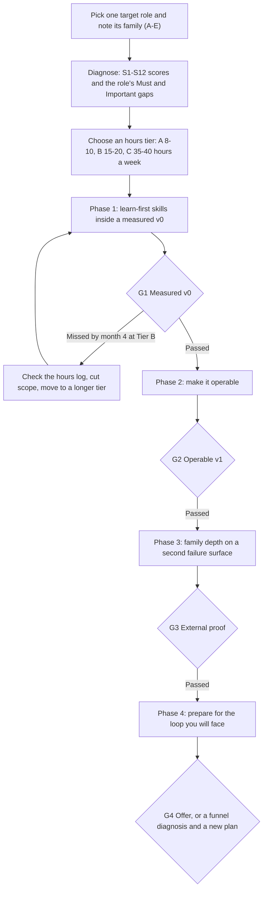

# Learning Roadmaps: What to Learn, in What Order, and How Long It Takes

> How to learn what a target GenAI role needs: the order by role family and starting background, how long it takes at 8–10, 15–20 or 35–40 hours a week, the four gates that prove progress, and where to spend hours (durable concepts) versus pin and wait (fast-moving tools).

**Scope.** This page sequences learning; it does not teach. The repository curates and evaluates learning resources and does not teach ML fundamentals ([charter](../../CHARTER.md)). **Dates:** evidence as of October 2026; tool statuses, compute prices and specification revisions are re-verified by 2027-01-19. **Grades:** EGP-1.0. Every planning duration here is a model output or a design judgement, not a measurement: mostly [T0-06](../../research/sessions/T0-06-career-transition-timelines-5-backgrounds.md)'s time model (Grade M, low confidence) and [T2-01](../../research/sessions/T2-01-tier-calibrated-execution-playbooks.md)'s playbooks (Grade D). No cohort study of GenAI career changers exists [D · T0-06.F9].

## The short answer

1. **Learn by building toward a gate, not by finishing a syllabus.** For application roles, skip foundations-first: ship a hosted-model v0 in the first two weeks and learn theory when the build needs it. Reverse the order only for the research-engineer track, where depth is the differentiator [D · T0-06 R1.6, R3; T2-01 L234, L583]. The rule is untested: it rests on one detailed retrospective that dropped a four-week theory block as low-yield.
2. **Order skills by tier, and put evaluation first in every family.** Close Must gaps first and build two or three Important skills into proof of work. Learn Should skills as your builds need them, Optional skills only when a posting names them, and nothing tiered Avoid [P · [role skill inventories §0](role-skill-inventories.md#0-how-to-use-it); the ontology codes the tiers M, I, S, O and X]. Hand-write 30 eval cases in the first two weeks and build the harness before the second feature [M · T0-06 R1.1, R3]. Evaluation was the most-cited stack challenge (20%) in a 2026 survey of 1,053 respondents, and it is the most consistently cited separator in hiring write-ups [B · T0-06 KF-3, KF-4; B · T0-13.F3].
3. **Pick an hours tier you can keep, and let the log decide.** Tier A is 8–10 hours a week, B 15–20 and C 35–40. A 17.5-hour week uses 56–74% of an employed US adult's average leisure. If logged hours fall below 70% of plan for three weeks running, move to the next-longer timeline instead of pushing harder [A data, M derivation · T0-06 KF-10, R1.4].
4. **Plan in months, and treat every duration as a model.** At Tier B, modelled time to a first offer runs from about 6 months (backend engineer, 5+ years) to about 11 months (BI analyst), and about 22 months for an engineering role from zero code [M · T0-06 R2]. The values assume you persist and succeed. Their ranges run from all-low to all-high parameters; they are not statistical intervals.
5. **Spend most hours on durable concepts; pin fast-moving tools and freeze stack choices for six weeks.** T0-06 names context, retrieval, tool schemas and evals as the durable concepts [D · T0-06 R1.7]. In 2026, AI SDK 6 and WebMCP changed shape within months; OpenAI acquired Promptfoo, ClickHouse acquired Langfuse and RAGAS went dormant [A/C · T0-06 KF-6; A/B · T0-03.F13].
6. **Spend time before money.** API credits and a free notebook tier cover months 1–6 of application-layer work; rent GPUs only for serving or fine-tuning labs [M, inputs A/B · T0-06.F12]. T0-06 found no outcome data for GenAI courses or bootcamps other than vendor-reported figures, so this page links primary specifications and documentation, not course rankings [D · T0-06 L203, L820].

## At a glance



| Phase | Months at Tier B | Learning goal | Gate |
|---|---|---|---|
| 1. Learn first | 1–3 | Close the role's Must gaps while building one measured system | G1 Measured v0 |
| 2. Deepen | 4–6 | Production practice: evals in CI, judge calibration, tracing, cost and latency, deployment | G2 Operable v1 |
| 3. Differentiate | 7–9 | Family-specific depth on a second failure surface, and public proof | G3 Second pattern and external proof |
| 4. Convert | 10–12 | Preparation for the loop type your targets use | G4 Convert or re-plan |

The gates are T0-06's design, each mapped to a hiring signal in its sources [M · T0-06 D3]; what each gate requires, how a stranger checks it and what to do when one slips are in [career transitions](../11-tracks/career-transitions.md#the-shared-spine-four-gates-and-an-hours-budget), which owns them. Non-technical lanes use domain variants of G1 and G2 (family E below). Gate dates at Tiers A and C are in [How long it takes](#how-long-it-takes).

## The roadmap: five families, four phases

The five résumé families group the 24 individual-contributor roles by the skills they share ([skills radar](skills-radar.md)). Find your role's family first.

| Family | Roles (hubs) |
|---|---|
| A · Applied GenAI Engineering | [AI Engineer](../02-roles/hubs/ai-engineer.md), [Forward Deployed Engineer](../02-roles/hubs/forward-deployed-engineer.md), [Applied AI Engineer](../02-roles/hubs/applied-ai-engineer.md), [Agentic AI Engineer](../02-roles/hubs/agentic-ai-engineer.md), [AI Evaluation Engineer](../02-roles/hubs/ai-evaluation-engineer.md), [AI Solutions Architect](../02-roles/hubs/ai-solutions-architect.md), [AI Enablement Engineer](../02-roles/hubs/ai-enablement-engineer.md), [AI Product Engineer](../02-roles/hubs/ai-product-engineer.md) |
| B · ML & Applied Science | [ML Engineer](../02-roles/hubs/ml-engineer.md), [Applied Scientist](../02-roles/hubs/applied-scientist.md), [Physical AI Engineer](../02-roles/hubs/physical-ai-engineer.md) |
| C · Frontier Research | [Research Engineer](../02-roles/hubs/research-engineer.md), [Research Scientist](../02-roles/hubs/research-scientist.md), [AI Safety Researcher](../02-roles/hubs/ai-safety-researcher.md) |
| D · AI Systems & Infrastructure | [AI Infrastructure Engineer](../02-roles/hubs/ai-infrastructure-engineer.md), [Inference Engineer](../02-roles/hubs/inference-engineer.md), [ML Platform Engineer](../02-roles/hubs/ml-platform-engineer.md), [GPU Kernel Engineer](../02-roles/hubs/gpu-kernel-engineer.md), [AI Security Engineer](../02-roles/hubs/ai-security-engineer.md) |
| E · AI Product, Governance & Assurance | [AI Product Manager](../02-roles/hubs/ai-product-manager.md), [AI Governance Lead](../02-roles/hubs/ai-governance-lead.md), [AI Risk & Assurance Specialist](../02-roles/hubs/ai-risk-assurance-specialist.md), [Responsible AI Engineer](../02-roles/hubs/responsible-ai-engineer.md), [Domain Evaluation Specialist](../02-roles/hubs/domain-evaluation-specialist.md) |

### Family × phase

**How to read it.** Every cell is a planning design: T0-06's roadmaps are model outputs [M], T2-01's week plans are design judgements [D], and the skill lists come from the computed skills radar [M]. Each role's own Must skills, in the [skills radar](skills-radar.md) and its [inventory](inventories/README.md), decide what you add for that role. Which projects prove a role is computed, not chosen here: the [project archetypes](../05-portfolio/project-archetypes.md#at-a-glance) table lists the roles each project covers best, with its effort and reference specification, and each role's hub lists its top projects [M].

| Family | Phase 1 → G1: learn first | Phase 2 → G2: deepen | Phase 3 → G3: differentiate | Phase 4 loop and gate notes |
|---|---|---|---|---|
| **A · Applied GenAI** | Production Python; LLM APIs (structured output, tool calling, streaming); retrieval with baselines (BM25, dense, hybrid, a reranker); an eval set and error analysis, over a corpus you know [M · T0-06 D4; D · T2-01 L239–241] | Evals in CI; judge calibration; tracing; p50/p95 latency and cost per request; timeouts, retries and budgets; container deployment; a real user [M · T0-06 L443] | A tool-using agent with approvals, budgets, sandboxed tools, replay and failure injection [M · T0-06 L444]. Role variants: a browser-side module for AI product engineers; a customer pilot for FDE and solutions roles [M · T0-06 L585, L607] | Applied-AI loops, per hiring write-ups: a take-home with retrieval and evals, agent debugging, a scoping or customer round [C/D · T0-06 D1]. Standard G1–G4 |
| **B · ML & Applied Science** | Packaging, tests, type checks, Docker and CI (the production gap); LLM application patterns; eval design with statistics: stratified trace samples, two-reviewer agreement, intervals on every metric [M · T0-06 L509; D · T2-01 L367–372] | A served API (async, auth, retries); a judge-calibration study (100+ labels, agreement, position and verbosity bias tests); a cost-quality frontier across models and prompts [M · T0-06 L510] | DSA basics and LLM-app system design; a second pattern such as a cost-reducing model router or an embedding fine-tune as a GPU lab [M · T0-06 L511]. Fine-tune only after prompting and retrieval baselines [B · T0-06 L496] | Candidates report coding and system design as the deciding rounds in big-company loops [D · T0-06 D5]. Budget 3–6 weeks of DSA: T2-01's floor to T0-06's roadmap [D · T2-01 L396; M · T0-06 L511]. Physical AI has no sequencing evidence, and most of its inventory is practice-curated ([role index](role-skill-inventories.md#1-role-index)) |
| **C · Frontier Research** | Research-engineer track: depth first, because depth is the differentiator (ML fundamentals, transformers, PyTorch internals, distributed training) [D · T0-06 R1.6; M · skills radar]. PhDs, whose usual gap is craft rather than knowledge, start with craft: packaging, tests, CI and code review through three open-source pull requests [B/C/D · T0-06.F8; M · T0-06 L701; D · T2-01 L574–581] | A method reproduced as a tested service or library; every sophisticated step must beat a simple baseline; evaluation infrastructure; a decision memo for a real user [M · T0-06 L701–702] | A measurement-rigour artifact (intervals, power for eval-set size, judge-bias tests, drift detection) [M · T0-06 L703]; a paper re-implementation (P8) or a post-training study (P7); fellowship or residency cycles for the research track [M · T0-06 L703] | Frontier research roles are upside, not a plan: run the applied track in parallel [M · T0-06 D8]. Acceptance rates for fellowships and residencies were not found [T0-06 L822] |
| **D · AI Systems & Infrastructure** | The role-defining fundamentals: KV-cache memory, continuous batching, prefill vs decode (inference, kernels); Kubernetes, infrastructure as code, observability (platform, infrastructure); threat modelling and LLM security (security) [M · skills radar; D · T2-01 L238]. Exercise them through a traced LLM application with cost tracking [D · T2-01 L251–253] | A load test against a latency SLO; a capacity and cost model; latency and cost reported with their method; pinned and patched serving engines [D · T2-01 L256; B · T0-13.F5; A/B · T0-03.F12] | A serving, quantisation or kernel study on one rented GPU: tokens per second, p95 latency and cost per million tokens against an API; one upstream contribution [M · T0-06 L444; D · T0-13 L267, L276] | A specialist niche: inference engines are named in 2.0–3.9% of postings [A/B · T0-03.F7]. Senior loops probe KV-cache sizing and latency budgets, per Grigorev's AI Engineering Field Guide [A/C · T0-03.F14]. Backend to Staff-level infrastructure work: about 10–14 months at Tier B [D · T2-01 L222] |
| **E · AI Product, Governance & Assurance** | AI literacy (tokens and context, retrieval vs fine-tuning vs prompting, cost and latency); evaluation fluency (rubrics, golden sets, inter-rater agreement); notebook-level SQL and Python [M · T0-06 D7]. Governance roles add the EU AI Act, NIST AI RMF and ISO/IEC 42001 [M · skills radar]. Responsible AI engineers hold production Python and ML fundamentals at Must, so they start from family A's Phase 1 [M · inventory] | A pilot with 5–10 colleagues measuring adoption, time saved and error rate; LLM-judge agreement with human labels; a PRD or runbook and a risk register [M · T0-06 L637] | A cost-per-task model; a governance and guardrails document; a de-identified write-up. Responsible-AI engineers add evaluation pipelines and runtime guardrails on an MLOps stack, as T0-15's 13-posting sample shows [M · T0-06 L638; C · T0-15.F6] | G1-domain (a golden set of 100+ real tasks with rubrics and two-reviewer agreement, against the existing human process) and G2-domain (pilot results) replace G1 and G2 [M · T0-06 D7]. Postings, recruiter guides and expert-marketplace listings show that each lane has an entry fee in years, credentials or coding [C · T0-06.F7]. Below programme-lead level, governance work is absorbed into privacy, legal, security, risk and audit roles [B · T0-15.F5] |

**Proof.** The project archetypes are specified as build cards, each with its effort (S, M or L) and any reference specification, in [project archetypes](../05-portfolio/project-archetypes.md), whose "Best for" column gives the roles each one covers (computed, M). One project rarely covers a role; the [minimal project sets](../05-portfolio/project-archetypes.md#minimal-project-sets) and the job-search strategy's [constraints that bind first](../06-job-search/job-search-strategy.md#the-constraints-that-bind-first) compute the smallest sets that do.

### Leadership and independent tracks

The corpus has no learning-order evidence for the leadership tracks, and most of the skills in their inventories are practice-curated ([role index](role-skill-inventories.md#1-role-index)). Start from [growth and progression](../10-onboarding/growth-and-progression.md) and the hubs for [AI Engineering Manager](../02-roles/hubs/ai-engineering-manager.md), [VP / Head of AI](../02-roles/hubs/vp-head-of-ai.md) and [Chief AI Officer](../02-roles/hubs/chief-ai-officer.md). For independent work, see [freelance and fractional](../11-tracks/freelance-fractional.md) and the hubs for [independent AI consultant](../02-roles/hubs/independent-ai-consultant.md) and [fractional AI leader](../02-roles/hubs/fractional-ai-leader.md).

## Adjust for your starting background

The family sets the destination; your background sets what you close first and what you can skip. S-codes are T0-06's twelve-skill rubric ([role skill maps §1.1](role-skill-maps.md#11-twelve-skill-readiness-rubric-t0-06-target-levels-for-an-ai-engineer-role)); score yourself in the [targeting workbook](../00-start/targeting-workbook.md).

| Background | Close these first | Lean on | Skip or compress | Unlearn |
|---|---|---|---|---|
| Backend or systems, 5+ years | Evaluation design (S4), LLM API fluency (S2), retrieval (S3); Python (S1) if you come from Java or Go | Regression CI and observability | Landscape stages to about a week; credentials | Expecting 100% pass rates; a vector database before measuring; frameworks before patterns; infrastructure polish before measurement |
| Data scientist | Production code (S1), production ops (S7), system design (S8); then LLM APIs (S2) and agents (S6) | Error analysis, metric design, judge validation | Landscape to 1–2 weeks; credentials | Fine-tuning first (26% of surveyed teams fine-tune; 80% prompt); a notebook as the deliverable; generic, unvalidated metrics |
| BI analyst | Python (S1), LLM APIs (S2), retrieval (S3), production ops (S7) | SQL and metric definitions; execution-accuracy evals for text-to-SQL | Little: about two weeks of landscape; credentials optional | Dashboard thinking: a chat box with no evaluation of the SQL it generates |
| Frontend or full-stack | Evaluation (S4), retrieval (S3), error analysis (S5), production ops (S7) | UX and human-in-the-loop evals | Landscape to about a week; credentials | A polished interface over unmeasured quality; rebuilding for each framework release |
| Non-technical, 5+ years in a domain | Evaluation fluency (S4), error analysis (S5), AI literacy (S2), basic Python (S1) | Domain rubrics and ground truth | Nothing: walk every stage (a PM certificate is optional) | Collecting prompts and certificates instead of measured outcomes; trusting fluent output and unvalidated judges |
| PhD or researcher who can code | Production craft (S1, S7), loop preparation (S8), stakeholder communication (S12) | Measurement rigour | Landscape to about a week; credentials. Not the skills stage | Novelty before baselines; perfectionism; benchmark fixation; over-targeting lab research slots |

Sources: gaps [M · T0-06 D9 L737–743]; strengths [M · T0-06 KF-4 L146; BI from D5]; skips [D · T2-01 L719, L748–750]; traps [D/M · T0-06 D4–D8]. The PhD row applies [erratum U18](../../research/ERRATA.md): a PhD does not skip the skills stage, and T2-01's own PhD playbook runs an 8-week skills block.

Two routes sit outside the table. With under 5 years in a domain, build domain depth first and do not expect an AI-specific role within 12 months [M · T0-06 L304]. An engineering role from zero code is a two-year plan: about 22 months (15–34) at Tier B [M · T0-06 R2].

### The skills-stage block, week by week (Tier B)

| Background | Weeks | Order inside the block |
|---|---|---|
| Backend or systems | 1–8 | 1–2 serving architecture (KV-cache maths, continuous batching, prefill/decode disaggregation); 3–4 retrieval over a real corpus from your domain; 5–6 eval methodology (30+ hand-labelled cases, 2 baselines); 7–8 agent patterns, tracing every call |
| Data scientist | 1–12 | 1–3 packaging, testing, CI/CD; 4–6 RAG, tool use, agents; 7–9 eval methodology; 10–12 system design basics (API design, deployment, monitoring) |
| BI analyst | 1–12, up to 16 | 1–3 Python as scripts, tests and packages, not notebooks; 4–6 LLM patterns plus basic ML and NLP; 7–9 eval methodology and text-to-SQL patterns; 10–12 containers and cloud basics |
| Frontend or full-stack | 1–10 | 1–3 Python backend basics (FastAPI, basic cloud deployment); 4–6 RAG, tool use, streaming, agent UX; 7–8 UX and human-in-the-loop evals; 9–10 on-device AI (Transformers.js v4, Chrome built-in AI, WebGPU) |
| Non-technical, AI-adjacent (no coding) | 1–12 | 1–3 what LLMs can and cannot do, and the cost, latency and quality trade-offs; 4–6 rubrics, labelling, judging quality; 7–9 success metrics and reporting non-determinism; 10–12 hands-on prompt evaluation in a model console or playground |
| Non-technical, FDE-adjacent (coding) | 1–12 | 1–6 Python (scripts, APIs, basic data handling); 7–9 LLM API integration and basic RAG; 10–12 scoping, demos, technical communication |
| PhD or researcher | 1–8 | 1–2 production Python, CI/CD, code review; 3–4 serving, batching, cost; 5–6 evaluation pipelines rather than one-off experiments; 7–8 agent and tool-use patterns |

[D · T2-01 L236–241, L367–372, L433–438, L489–504, L576–581.] Two discrepancies, with reasons:
- T2-01 opens the backend block with serving architecture because its persona also targets inference roles. For applied roles, T0-06 opens with Python, API fluency and a v0 in weeks 1–2 [M · T0-06 L442].
- For BI analysts, T2-01's quick-reference table gives weeks 1–16, while its week plan details only weeks 1–12 [D · T2-01 L367–372, L749].

## How long it takes

Timelines are owned by [career transitions](../11-tracks/career-transitions.md); this section keeps what a learning plan needs on top of them.

### Hours tiers

Tier A is 8–10 hours a week, B 15–20 and C 35–40; the adherence, effective hours and share of average leisure behind each tier are in [career transitions](../11-tracks/career-transitions.md#hours-tiers) [A data (BLS American Time Use Survey 2025), M derivation · T0-06 KF-10, D2]. These are US averages, not personal capacity, and the corpus has no India equivalent. With under 8 hours a week, plan a 12–18-month horizon or pick an adjacent role [M · T0-06 L303].

### Modelled months to a first offer

Modelled months by background and hours tier, with their ranges, confidence, sensitivity and limits, are in [career transitions](../11-tracks/career-transitions.md#modelled-months-to-a-first-offer) [M · T0-06 R2 L261–269]; the short answer above gives the Tier B span. They include a search lag, because applications start at about 70% of the build gates, and T0-06 budgets 2–4 months of search in total [M · T0-06 D2; C · T0-06 KF-11]. That 70% measures build progress; the 70% rule above measures hours logged.

**By family.** The model is built per background, not per family:
- **Applied GenAI:** the backend, data-scientist, BI and frontend routes target applied AI engineering roles, and the PhD route includes them [M · T0-06 R2].
- **ML & Applied Science:** the PhD route covers applied scientist roles. For ML engineering, the only reference class is a mentoring marketplace's 6–18 months for a working data scientist with Python [D, vendor · T0-06 L200].
- **Frontier Research:** research-engineer roles sit inside the PhD route. Research-scientist roles are upside only, with no plannable timeline [M · T0-06 R2, L708].
- **AI Systems & Infrastructure:** one design estimate, about 10–14 months at Tier B from backend to Staff-level infrastructure work [D · T2-01 L222].
- **Product, Governance & Assurance:** the non-technical route covers AI PM, AI ops and domain evaluation. The corpus has no timeline for governance roles.

### Gate dates at Tiers A and C

Three estimates disagree, for stated reasons:
- **By effective hours alone,** a build gate takes about twice as long at Tier A as at Tier B (6.75 versus 13.1 effective hours a week) and about 0.4 times as long at Tier C (32.3) [M, derived from T0-06 D2].
- **T2-01** scales gate dates by about 1.5 at Tier A and 0.5 at Tier C [D · T2-01 L153].
- **T0-06's own roadmaps** add 3–7 months to their 12-month Tier B plan at Tier A, depending on background [M · T0-06 D4–D8].

Plan on the slowest figure until G1 shows your own pace [P].

### How long one proof takes

The part-time time box and compute cap of each of T0-13's reference specifications, R1 (new graduate to junior) to R4 (staff or principal), are in [proof-of-work standards](../05-portfolio/proof-of-work-standards.md#what-each-level-must-prove) [D · T0-13 L272–277]; each [project archetype](../05-portfolio/project-archetypes.md) card names the specification it applies, if any.

### Compute by phase

- **Lab 0, everyone, Phase 1:** hosted-model API calls only, no GPU. Open free accounts and do not pay for GPUs yet [M · T0-06 D10, R3].
- **Lab 1, backend, data science and PhD:** serve an open-weight model once on a rented GPU; measure tokens per second, p95 latency and cost per million tokens against an API. T0-06's backend and data-science roadmaps place their GPU labs in months 7–9 [M · T0-06 D10, L444, L511].
- **Lab 2, data science and PhD:** a small fine-tune or embedding fine-tune on a free 16 GB notebook GPU, or a rented 24 GB card. 100 GPU-hours on a 24 GB card cost roughly US$35–70 at community or secure rates (tracker prices, August–September 2026) [M, inputs A/C · T0-06 L233, D10].
- **Frontend:** a browser-side lab needs no rented GPU, only a spread of test devices [M · T0-06 D10].

## Where the hours go: durable versus fast-moving

| Class | Examples | Why (evidence) | How to learn it |
|---|---|---|---|
| **Durable: most of your hours** | Evaluation design and error analysis; retrieval quality; context and tool-schema design; observability; cost and latency reasoning; tests, CI and deployment; system design | T0-06 names context, retrieval, tool schemas and evals as the durable concepts [D · T0-06 R1.7]. Evaluation, error analysis, observability and cost control persisted across 2026's framework changes, on one year of survey data [D · T0-06 L806]. Postings reward the engineering practice, not a vendor brand [B · T0-03.F3] | Build them into every gate artifact and deepen them each phase |
| **Fast-moving: learn when a build needs it** | Framework and SDK APIs; eval and tracing products; serving-engine flags and build paths; model names and versions; hosting free tiers | AI SDK 6 and WebMCP changed shape within months [A/C · T0-06 KF-6]. OpenAI acquired Promptfoo (2026-03-09), ClickHouse acquired Langfuse (2026-01-16) and RAGAS went dormant [A/B · T0-03.F13]. TGI was archived (2026-03-21) and TensorRT-LLM 1.3 removed trtllm-build [A/B · T0-03.F6]. Hugging Face changed its free Spaces tier [A/B · T0-13.F11]. A hiring guide's screen treating "Sonnet 5" as fabricated went stale when the model shipped on 2026-06-30 [B · T0-13.F12] | Freeze stack choices for six weeks; pin tool and model versions; date-stamp results [D · T0-06 R1.7; A/B · T0-13.F11] |

**Direction, not a ratio.** Put most of your hours into the durable row. A fixed split such as 80/20 is a rule of thumb [P]; no session measures the right ratio. For what to stop learning and what to watch, see rings 4 and 5 of the [skills radar](skills-radar.md) and the [watch list](skills-vocabulary.md#5-watch-list-tools-with-a-notable-status) of tool statuses.

## How to do it

1. **Name one target and its family.** Pick a role with the [targeting workbook](../00-start/targeting-workbook.md). Open its hub and its [inventory](inventories/README.md), and note its family (A–E) and résumé variant. *Done when:* one role, one family and one variant are written down.
2. **Diagnose against the role, not a syllabus.** Score S1–S12 on the 0–3 scale and fill in the inventory's self-assessment for Must and Important skills. Run T0-06's three one-day tests: question answering over 50 documents, reporting recall@5 and faithfulness; explaining the request path of an LLM app; designing a 30-case eval [M · T0-06 D9]. *Done when:* you have a ranked gap list, Must gaps first.
3. **Fix the hours, the dates and the stop rule.** Choose a tier, block the hours, put G1–G4 in your calendar and start an hours log. If your employer has AI work, spend 6–8 weeks seeking a scoped AI assignment in parallel [D · T0-06 R1.2]. *Done when:* the gates have dates and week 1 is logged.
4. **Phase 1: learn inside a v0.** Ship a v0 on a hosted model API within two weeks, logging every trace. Hand-write 30 eval cases from real work. Learn your family's learn-first skills when the build needs them [M · T0-06 R3]. *Done when:* G1 passes and the work is public.
5. **Phase 2: deepen.** Make the system operable: evals in CI, judge calibration, tracing, cost and latency, deployment and a real user. *Done when:* G2 passes.
6. **Phase 3: differentiate.** Build your family's second system on a different failure surface, contribute once outside your own repositories and start targeted applications. *Done when:* G3 passes.
7. **Phase 4, and review throughout.** Prepare for the loop type your targets use ([interview loops](../08-interviewing/interview-loops.md)). Review hours weekly (the 70% rule) and funnel numbers monthly, and re-plan at month 6 from those numbers rather than from optimism [M · T0-06 R0]. *Done when:* G4 is met: an offer or internal move, or a written funnel diagnosis and a changed plan.

## Templates and examples

### Weekly learning routine at Tier B [P where unmeasured]

| Slot | Hours | What to do | Evidence |
|---|---|---|---|
| Build sessions (two or three) | 9 | Advance the current gate artifact; learn a concept when the build needs it | Split [P]; build-first rule [D · T0-06 R1.6] |
| Evaluation and error analysis | 3 | Label cases, read traces, update the error taxonomy | Split [P]; G1 needs 100+ reviewed traces [M · T0-06 D3] |
| Primary reading | 2 | One section of a specification or official document tied to this week's build | [P] |
| Community | 1.5 | One paper-club or depth-community session: the weekly LLM Paper Club, or GPU MODE, EleutherAI or vLLM for depth | Split [P]; communities [B · T0-12 L149–150] |
| Writing | 1.5 on average | One technical post every two to three weeks; publish no later than G1 | Split [P]; cadence is T0-12's judgement [C · T0-12 L152]; publish at G1 [D · T0-06 D11] |
| Weekly review | 0.5 | Compare logged with planned hours; apply the 70% rule; set next week's build target | Split [P]; 70% rule [M · T0-06 R1.4] |
| Monthly review | About 1 a month | Record funnel numbers: applications, screens, take-homes, onsite loops, offers | [M · T0-06 R3]; hours [P] |

- **Tier A (about 9 hours):** about 4.5 build, 1.5 evaluation, 1 reading, 1.5 community or writing in alternate weeks, 0.5 review [P].
- **From Phase 3:** move part of the build time to mock loops; G3 asks for at least five [M · T0-06 D3]. The split is [P].
- **Community routine:** T0-12's fuller plan assumes an India-based engineer with about six spare hours a week [C · T0-12 L143]; see the [communities guide](../07-networking/communities-guide.md).

### Six-week sprint card [P]

```text
Sprint [n]: weeks [start] to [start + 5]. Stack frozen until [date].
Target role and family: [role] ([family A-E])
Gate this sprint serves: [G1 / G2 / G3]. Criterion to pass: [one measurable criterion from the gate]
Learn-first skills (tier from the inventory): [skill] ([Must / Important]) -> artifact it produces: [artifact]
Pinned versions: [framework x.y] · [model ID and date] · [eval runner x.y]
Hours planned per week: [h]. 70% floor: [0.7 x h]
Primary reference for this sprint: [specification or official document, section]
Done when: [criterion met]. Review date: [date]
```

### Weak and strong learning-plan lines

| Weak | Strong | Why |
|---|---|---|
| "Finish an LLM course, then start a project." | "Ship a v0 over [corpus] on a hosted API by week 2; learn chunking and reranking when recall@5 falls short." | Build first for application roles [D · T0-06 R1.6] |
| "Learn LangChain." | "Implement tool calling, retries, state checkpoints and idempotent tools; adopt a framework only where it removes code." | Framework syntax is devalued; 85% of production teams in one study built custom loops [A/B · T0-03 L149, T0-03.F9] |
| "Get good at evals." | "30 hand-written cases by week 2; 50 labelled cases and two baselines by G1; any judge validated on 100 human labels by G2." | The G1 and G2 criteria [M · T0-06 D3] |
| "Learn GPU programming." | "Serve one open-weight model on a rented GPU and report tokens per second, p95 latency and cost per million tokens against an API." | T0-06's serving lab [M · T0-06 L444] |
| "Study the EU AI Act." | "Build an AI inventory and risk register for one public system, mapped to the EU AI Act, NIST AI RMF and ISO/IEC 42001 ([P13](../05-portfolio/project-archetypes.md#p13))." | Governance frameworks are among the skills that set family E apart in the [skills radar](skills-radar.md) [M] |

## Primary references

Official specifications and documentation named in the research sessions. Read the section your current build needs, not the whole document.

| Area | Reference | Named in | Use it for |
|---|---|---|---|
| Evaluation | [Anthropic Engineering, "Demystifying evals for AI agents"](https://www.anthropic.com/engineering/demystifying-evals-for-ai-agents) (2026-01-09) | T0-13 S01; T0-14 S20 | Task sets from real failures, code graders first, model graders calibrated against human labels, pass@k and pass^k [A · T0-13.F4] |
| Agent tool boundary | [MCP specification, 2026-07-28 changelog](https://modelcontextprotocol.io/specification/2026-07-28/changelog) | T0-16 S06 | The tool and context protocol; pin the revision [A · T0-16.F2] |
| Agent to agent | [A2A Protocol Specification](https://a2a-protocol.org/latest/specification/) (v1.0.x) | T0-16 S14 | Interoperability between agents |
| Agent security | [NSA AISC, "Model Context Protocol (MCP): Security Design Considerations for AI-Driven Automation"](https://www.nsa.gov/Portals/75/documents/Cybersecurity/CSI_MCP_SECURITY.pdf) (May 2026) | T0-16 S34 | Threats and controls at the tool boundary |
| Application security | [OWASP GenAI Security Project, LLM10:2025 Unbounded Consumption](https://genai.owasp.org/llmrisk/LLM10/), part of the Top 10 for LLM Applications | T0-13 S10 | Abuse resistance and denial-of-wallet risk for public demos [A · T0-13.F6] |
| Spend safety | [OpenAI spend limits](https://developers.openai.com/api/docs/guides/spend-limits); [Anthropic rate and spend limits](https://docs.anthropic.com/claude/reference/rate-limits) | T0-13 S50 | Hard caps before anything goes public; OpenAI's hard limit must be switched on [A · T0-13.F6] |
| Observability | OpenTelemetry GenAI semantic conventions (the session read them through secondary sources) | T0-13.F7; T0-03 L145 | Trace attributes, still at Development status in mid-September 2026; isolate them behind adapters [B · T0-13.F7] |
| Serving | [vLLM: speculative decoding](https://docs.vllm.ai/en/latest/features/speculative_decoding/); [vLLM: `vllm.benchmarks.serve`](https://docs.vllm.ai/en/stable/api/vllm/benchmarks/serve/) | T0-14 S32; T0-05 T-15 | Serving features and benchmark method |
| Serving metrics | [NVIDIA AIPerf metrics reference](https://docs.nvidia.com/aiperf/reference/ai-perf-metrics-reference); [NVIDIA NIM LLM benchmarking metrics](https://docs.nvidia.com/nim/benchmarking/llm/latest/metrics.html) | T0-14 S49, S16 | Definitions of time to first token, inter-token latency and throughput |
| Distributed training | [PyTorch FSDP2 tutorial](https://docs.pytorch.org/tutorials/intermediate/FSDP_tutorial.html) | T0-13 S51 | Sharding on modest hardware, with CPU smoke tests [B · T0-13.F10] |
| Governance | [EU AI Act, Commission AI Act Service Desk](https://ai-act-service-desk.ec.europa.eu/en/ai-act/article-113) (consolidated text); [NIST AI Risk Management Framework](https://www.nist.gov/itl/ai-risk-management-framework?WHB=1); ISO/IEC 42001 (named throughout T0-15; its ledger holds no link to the standard itself) | T0-15 S01, S39 | The primary texts behind governance postings |
| Client-side AI | [WebGPU in major browsers](https://web.dev/blog/webgpu-supported-major-browsers); [Transformers.js v4](https://huggingface.co/blog/transformersjs-v4); [Chrome built-in AI APIs](https://developer.chrome.com/docs/ai/built-in-apis) | T0-06 S17–S19 | On-device modules for AI product engineers; check support per release |

**Courses.** Free official courses exist, for example [Hugging Face Learn](https://huggingface.co/learn) (LLM, Agents, MCP and smol courses) [A · T0-06 KF-12]. Only vendor-reported outcome figures exist for GenAI courses and bootcamps [D · T0-06 L820], so this page ranks none. Use a course for the concept a gate needs, not as proof. The only causal study of certificates found that they help weak-signal candidates and barely move strong ones [B · T0-11.F6]; see [credential ROI](../04-certifications/credential-roi.md).

## Checklist

- [ ] One target role, its family and its résumé variant are written down.
- [ ] S1–S12 are scored, and the role inventory's Must and Important self-assessment is filled in.
- [ ] An hours tier is chosen, the hours are blocked and G1–G4 have dates.
- [ ] A v0 on a hosted model API shipped within two weeks, with every trace logged.
- [ ] 30 eval cases were hand-written from real work before the second feature.
- [ ] Every learning-plan line names an artifact and a gate criterion, not a course.
- [ ] The stack is frozen for the current six weeks; tool and model versions are pinned and results are date-stamped.
- [ ] No GPU spend before a serving or fine-tuning lab needs it.
- [ ] The 70% rule is checked weekly, and funnel numbers are recorded monthly.
- [ ] The work was published at G1.
- [ ] No Avoid-tier tool is in the build or on the résumé.

## Pitfalls

| Red flag | Why it hurts | Fix |
|---|---|---|
| Weeks of theory before the first build, for an application role | Foundations-first is untested; the one detailed retrospective dropped its four-week theory block as low-yield [D · T0-06 R1.6] | Ship a v0 in two weeks; learn the theory a failure points to |
| A framework before the pattern | Framework syntax is devalued; in one study, 85% of production teams built custom loops [A/B · T0-03.F9] | Learn tool calling, state checkpoints, retries and idempotent tools; adopt a framework where it removes code |
| Fine-tuning before baselines | 26% of surveyed teams fine-tune, against 80% that prompt [B · T0-06 KF-4] | Beat prompting and retrieval baselines first, then compare all three (P4) |
| An LLM judge nobody validated | Raw agreement overstates judge quality by 33–41 points against chance-corrected kappa [A/B · T0-03.F5] | Validate on 100+ human labels and report chance-corrected agreement (G2) |
| Pushing harder when the hours log falls short | A 17.5-hour Tier B week already takes 56–74% of average leisure (about 48–83% across 15–20 hours; ERRATA U25); T0-06 lists burnout as a risk [M · T0-06 L213, D11] | Apply the 70% rule and take the next-longer timeline |
| Course certificates as the plan | T0-06 found no source showing that certificates carry hiring signal [D · T0-06 L624]; the only causal study shows them helping weak-signal candidates and barely moving strong ones [B · T0-11.F6] | Turn each course into an artifact that passes a gate |
| Rebuilding for every release | AI SDK 6 and WebMCP changed shape within months [A/C · T0-06 KF-6] | Freeze stack choices for six weeks; pin versions |
| Months of private work | The 8-month retrospective says visibility mattered after five months in private [D · T0-06 D11] | Publish at G1 |

## Evidence and limits

- **Timelines are a model.** T0-06's D2 model divides core hours by effective hours a week and adds a search lag. Its parameters are judgement, calibrated where possible on Huntr's search medians [C]. It was checked against three anchors only: an 8-month retrospective, Huntr's 82–108-day search medians and a vendor's 14–19-month reference class for career changers with no experience [M · T0-06 D2, L275].
- **Survivorship.** Every anchor comes from people who succeeded, and no denominator of attempts exists [D · T0-06.F9].
- **Hours data are US averages** from the BLS American Time Use Survey 2025 [A · T0-06 KF-10]. Check local conditions; the corpus has no India equivalent.
- **Learning orders are designs.** T0-06's roadmaps are model outputs. T2-01 is a synthesis with no new primary research, and its prescriptions are design judgements [D · T2-01 L24]. The PhD row applies erratum U18; no other erratum touches the lines used here.
- **Skill lists are computed** from the skills ontology, and project coverage on the archetype cards [M]. Practice-curated [P] skills are hypotheses to check against 10–20 live postings [P], and no source links any project type to hiring outcomes [D · T0-13 L604, T0-13.F1].
- **The durable-versus-fast-moving split rests on one year of survey data** [D · T0-06 L806]. Any fixed ratio is [P].
- **Courses:** only vendor-reported outcome figures exist [D · T0-06 L820].
- **Freshness:** tool statuses, compute prices and specification revisions are as of October 2026; re-verify by 2027-01-19.
- **What would change the advice** [T0-06 L859–864]: a cohort study showing different speeds by background would rewrite the timing tables; evidence that credentials beat artifacts would change the gates; a change in screening, such as agent-run interviews, would change Phase 4; a collapse in posting volumes would lengthen every horizon. Job-description mining, which is planned, would replace practice-curated tiers with measured ones.

## Next steps

- **Set the target:** [targeting workbook](../00-start/targeting-workbook.md), [GenAI target roles](../02-roles/genai-target-roles.md), [role map](../02-roles/role-map.md), [market overview](../01-landscape/market-overview.md).
- **What to learn:** [skills radar](skills-radar.md), [role skill inventories](role-skill-inventories.md), [role skill maps](role-skill-maps.md), [agentic protocols](agentic-protocols.md).
- **Prove it:** [project archetypes](../05-portfolio/project-archetypes.md), [proof-of-work standards](../05-portfolio/proof-of-work-standards.md).
- **Credentials:** [credential ROI](../04-certifications/credential-roi.md), [credentials by role](../04-certifications/credentials-by-role.md).
- **Be seen:** [communities guide](../07-networking/communities-guide.md).
- **Phase 4:** [interview loops](../08-interviewing/interview-loops.md), [coding rounds](../08-interviewing/coding-rounds.md), [system design archetypes](../08-interviewing/system-design-archetypes.md), [prep packs](../08-interviewing/prep-packs.md).
- **Your track:** [career transitions](../11-tracks/career-transitions.md), [PhD to industry](../11-tracks/phd-to-industry.md), [governance careers](../11-tracks/governance-careers.md).
- **Evidence:** findings for [stage 03](../../research/findings.md#stage-03) and [stage 11](../../research/findings.md#stage-11); sessions [T0-06](../../research/sessions/T0-06-career-transition-timelines-5-backgrounds.md), [T2-01](../../research/sessions/T2-01-tier-calibrated-execution-playbooks.md), [T0-13](../../research/sessions/T0-13-production-portfolio-proof-of-work-standards.md) and [T0-03](../../research/sessions/T0-03-skills-compute-infra-eval-stack.md); [errata](../../research/ERRATA.md).

[← Stage 03 index](README.md) · [Start Here](../README.md)
