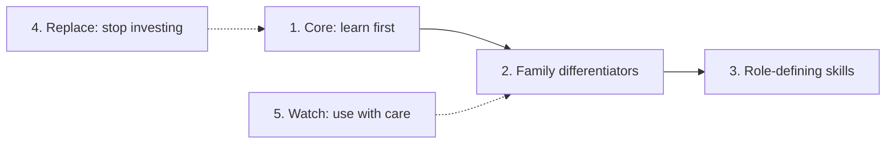

<!-- Generated by scripts/build_skills_views.py from data/skills_ontology.json. Edit the data, not this page. -->

# GenAI Skills Radar: Learn First, Differentiate, Specialise, Replace

> Five rings computed from the skill tiers of the 24 individual-contributor roles: the skills to learn first, the skills that set each résumé family apart, the skills only one or two roles demand, what to stop investing in, and what to watch.

## How to read this radar

- **Every ring is computed** (Grade M) from the tiers in [data/skills_ontology.json](../../data/skills_ontology.json): Must, Important, Should, Optional and Avoid. A computed ring is only as strong as the links behind it, so each table shows the strongest evidence for the skill: a share of live postings [JD, Grade B], a share of the S09 corpus [S09, Grade B], a session citation [A–C] or practice curation [P, Grade D]. A skill backed only by [P] is a hypothesis to check against 10–20 live postings.
- **There is no "surging" ring.** The corpus has no dated series of skill demand, so nothing here measures momentum. Job-description mining is on the [roadmap](../../ROADMAP.md).
- **Leadership tracks are left out**: their inventories rest mostly on practice curation.
- **Résumé families** are the five skill-based groupings behind the résumé variants (A–E); see the [résumé skills matrix](../06-job-search/resume-skills-matrix.md).

## At a glance

| Ring | Rule (computed from the tiers) | Skills | What to do |
|---|---|:---:|---|
| **1. Core** | Must or Important in at least 6 of the 24 roles | 11 | Learn first: they transfer across families |
| **2. Family differentiators** | Must or Important in at least half of a family's roles, and at least 25 percentage points more often than in the other roles | 30 | Choose a family, then learn these |
| **3. Role-defining** | Must in only one or two roles | 72 across 21 roles | Learn when you commit to the role |
| **4. Replace** | Devalued in the research, or archived, dormant or retired | 10 | Stop investing; learn the replacement |
| **5. Watch** | Acquired, renamed, beta or in development, or carrying a security or licence notice | 8 | Use with care; re-check by 2027-01-21 |

## 1. Core: learn first

Skills at Must or Important in at least 6 of the 24 roles, most widely required first.

**Technical:**

| Skill | Type | Must in | Important in | Families | Strongest evidence |
|---|---|:---:|:---:|---|---|
| **Python (production)** | Programming language | 17 | 2 | ABCDE | JD 78.4% of AI Engineer postings [B] |
| **LLM APIs & tool calling** | Concept / knowledge area | 7 | 3 | ABC | JD 76.7% of AI Engineer postings [B] |
| **LLM evaluation (golden sets, calibrated judges, CI gates)** | Concept / knowledge area | 1 | 9 | ABCE | S09 19.0% [B] |
| **ML fundamentals** | Concept / knowledge area | 6 | 2 | ABCE | JD 98.6% of Machine Learning Engineer postings [B] |
| **AWS / Azure / GCP** | Platform / cloud service | 2 | 5 | AD | JD 53.6% of Solutions Architect postings [B] |
| **Git & CI/CD** | Method / practice | 1 | 5 | AD | JD 34.4% of AI Engineer postings [B] |

**Non-technical:**

| Skill | Type | Must in | Important in | Families | Strongest evidence |
|---|---|:---:|:---:|---|---|
| **Explaining probabilistic trade-offs (C2)** | Behavioural competency | 0 | 23 | ABCDE | Session citation [C] |
| **Ownership & incident response (C3)** | Behavioural competency | 0 | 23 | ABCDE | Session citation [C] |
| **Pragmatism under ambiguity (C1)** | Behavioural competency | 0 | 23 | ABCDE | Session citation [C] |
| **Responsible-AI judgement (C4)** | Behavioural competency | 0 | 23 | ABCDE | Session citation [C] |
| **Communication (written & verbal)** | Communication & collaboration | 2 | 11 | ABCE | JD 42.9% of Solutions Architect postings [B] |

The behavioural competencies C1–C4 are the four that GenAI behavioural rounds score ([behavioural calibration](../08-interviewing/behavioral-calibration.md)). The fuller cross-role tables, with every skill's count at any tier, are in [role skill inventories §2](role-skill-inventories.md#2-cross-role-views-what-recurs-for-universal-and-family-resumes).

## 2. What sets each résumé family apart

Skills that a family's roles require far more often than the other roles do. "In family" and "elsewhere" count the roles with the skill at Must or Important; "(core)" marks skills that are also in ring 1.

### A · Applied GenAI Engineering

Roles (8): [AI Engineer](../02-roles/hubs/ai-engineer.md), [Forward Deployed Engineer (AI)](../02-roles/hubs/forward-deployed-engineer.md), [Applied AI Engineer](../02-roles/hubs/applied-ai-engineer.md), [Agentic AI Engineer](../02-roles/hubs/agentic-ai-engineer.md), [AI Evaluation Engineer](../02-roles/hubs/ai-evaluation-engineer.md), [AI / GenAI Solutions Architect](../02-roles/hubs/ai-solutions-architect.md), [AI Enablement Engineer](../02-roles/hubs/ai-enablement-engineer.md), [AI Product Engineer (AI Frontend)](../02-roles/hubs/ai-product-engineer.md).

| Skill | Type | In family | Elsewhere | Strongest evidence |
|---|---|:---:|:---:|---|
| **LLM APIs & tool calling** (core) | Concept / knowledge area | 7 of 8 | 3 of 16 | JD 76.7% of AI Engineer postings [B] |
| **Agents & tool use** | Concept / knowledge area | 5 of 8 | 0 of 16 | JD 59.3% of AI Engineer postings [B] |
| **LLM evaluation (golden sets, calibrated judges, CI gates)** (core) | Concept / knowledge area | 6 of 8 | 4 of 16 | S09 19.0% [B] |
| **Retrieval quality (hybrid, reranking, recall@k)** | Concept / knowledge area | 4 of 8 | 0 of 16 | Session citation [B] |
| **Git & CI/CD** (core) | Method / practice | 4 of 8 | 2 of 16 | JD 34.4% of AI Engineer postings [B] |
| **Python (production)** (core) | Programming language | 8 of 8 | 11 of 16 | JD 78.4% of AI Engineer postings [B] |
| **AWS / Azure / GCP** (core) | Platform / cloud service | 4 of 8 | 3 of 16 | JD 53.6% of Solutions Architect postings [B] |

### B · ML & Applied Science

Roles (3): [Machine Learning Engineer (GenAI/LLM track)](../02-roles/hubs/ml-engineer.md), [Applied Scientist (GenAI/LLM teams)](../02-roles/hubs/applied-scientist.md), [Physical AI / Robotics AI Engineer](../02-roles/hubs/physical-ai-engineer.md).

| Skill | Type | In family | Elsewhere | Strongest evidence |
|---|---|:---:|:---:|---|
| **Fine-tuning (SFT, LoRA)** | Concept / knowledge area | 2 of 3 | 0 of 21 | S09 13.0% [B] |
| **Eval statistics (CIs, power, pass^k)** | Method / practice | 2 of 3 | 1 of 21 | Session citation [B] |
| **Experiment design & A/B testing** | Method / practice | 2 of 3 | 1 of 21 | JD 23.5% of Machine Learning Engineer postings [B] |
| **C++** | Programming language | 2 of 3 | 2 of 21 | JD 23.3% of Machine Learning Engineer postings [B] |
| **Data structures & algorithms** | Concept / knowledge area | 2 of 3 | 2 of 21 | JD 33.7% of Machine Learning Engineer postings [B] |
| **Deep learning & transformers** | Concept / knowledge area | 2 of 3 | 2 of 21 | JD 32.6% of Machine Learning Engineer postings [B] |
| **Communication (written & verbal)** (core) | Communication & collaboration | 3 of 3 | 10 of 21 | JD 30.3% of Machine Learning Engineer postings [B] |
| **PyTorch** | Framework / SDK | 2 of 3 | 3 of 21 | JD 48.2% of Machine Learning Engineer postings [B] |

### C · Frontier Research

Roles (3): [Research Engineer / Member of Technical Staff](../02-roles/hubs/research-engineer.md), [Research Scientist (LLM research)](../02-roles/hubs/research-scientist.md), [Frontier AI Safety / Alignment Researcher](../02-roles/hubs/ai-safety-researcher.md).

| Skill | Type | In family | Elsewhere | Strongest evidence |
|---|---|:---:|:---:|---|
| **Research taste & problem selection** | Research craft | 3 of 3 | 0 of 21 | Session citation [C] |
| **PyTorch** | Framework / SDK | 3 of 3 | 2 of 21 | JD 25.4% of Research Scientist postings [B] |
| **ML fundamentals** (core) | Concept / knowledge area | 3 of 3 | 5 of 21 | JD 39.2% of Research Scientist postings [B] |
| **Novel research & publications** | Research craft | 2 of 3 | 0 of 21 | Session citation [B] |
| **Post-training (SFT, preference, RL)** | Concept / knowledge area | 2 of 3 | 0 of 21 | [P] practice-curated |
| **Scientific writing** | Research craft | 2 of 3 | 0 of 21 | [P] practice-curated |
| **Research methods & re-implementation** | Method / practice | 2 of 3 | 1 of 21 | [P] practice-curated |
| **Data structures & algorithms** | Concept / knowledge area | 2 of 3 | 2 of 21 | JD 26.0% of Research Scientist postings [B] |

### D · AI Systems & Infrastructure

Roles (5): [AI Infrastructure / GPU Platform Engineer](../02-roles/hubs/ai-infrastructure-engineer.md), [Inference / LLM Serving Engineer](../02-roles/hubs/inference-engineer.md), [ML Platform / MLOps (LLMOps) Engineer](../02-roles/hubs/ml-platform-engineer.md), [GPU Kernel / ML Compiler Engineer](../02-roles/hubs/gpu-kernel-engineer.md), [AI Security Engineer / AI Red Teamer](../02-roles/hubs/ai-security-engineer.md).

| Skill | Type | In family | Elsewhere | Strongest evidence |
|---|---|:---:|:---:|---|
| **Kubernetes** | Infrastructure / DevOps tool | 3 of 5 | 0 of 19 | JD 69.4% of DevOps Engineer postings (feeder title) [B] |
| **AWS / Azure / GCP** (core) | Platform / cloud service | 3 of 5 | 4 of 19 | JD 52.9% of DevOps Engineer postings (feeder title) [B] |

Few skills pass the rule because this family's roles differ a lot from one another; their role-defining skills (§3) matter more than the shared ones.

### E · AI Product, Governance & Assurance

Roles (5): [AI Product Manager](../02-roles/hubs/ai-product-manager.md), [AI Governance Programme Lead / Manager](../02-roles/hubs/ai-governance-lead.md), [AI Risk, Audit & Compliance Specialist](../02-roles/hubs/ai-risk-assurance-specialist.md), [Responsible AI / AI Governance Engineer](../02-roles/hubs/responsible-ai-engineer.md), [Domain Evaluation Specialist / AI Trainer](../02-roles/hubs/domain-evaluation-specialist.md).

| Skill | Type | In family | Elsewhere | Strongest evidence |
|---|---|:---:|:---:|---|
| **EU AI Act** | Regulation / framework | 3 of 5 | 0 of 19 | Session citation [A] |
| **EU AI Act / NIST AI RMF / ISO 42001** | Concept / knowledge area | 3 of 5 | 0 of 19 | Session citation [A] |
| **ISO/IEC 42001** | Regulation / framework | 3 of 5 | 0 of 19 | Session citation [A] |
| **Risk & compliance docs (Annex IV, model cards)** | Method / practice | 3 of 5 | 0 of 19 | Session citation [B] |
| **GRC & risk assessment** | Method / practice | 3 of 5 | 2 of 19 | JD 26.1% of Product Manager postings (feeder title) [B] |

## 3. Role-defining skills

Skills at Must for a role and for at most one other: learn them when you commit to that role. Each role's full inventory is linked from its hub.

| Role | Variant | Role-defining skills |
|---|:---:|---|
| [AI Engineer](../02-roles/hubs/ai-engineer.md) | A1 | — (its Must skills are shared with three or more roles) |
| [Machine Learning Engineer (GenAI/LLM track)](../02-roles/hubs/ml-engineer.md) | B1 | — (its Must skills are shared with three or more roles) |
| [Research Engineer / Member of Technical Staff](../02-roles/hubs/research-engineer.md) | C1 | PyTorch internals (also Must for Inference / LLM Serving Engineer); Data structures & algorithms (also Must for Applied Scientist (GenAI/LLM teams)) |
| [Forward Deployed Engineer (AI)](../02-roles/hubs/forward-deployed-engineer.md) | A2 | APIs & integrations (also Must for AI Product Engineer (AI Frontend)); Customer scoping & demos |
| [Applied Scientist (GenAI/LLM teams)](../02-roles/hubs/applied-scientist.md) | B2 | Statistics (inference, hypothesis tests, regression) (also Must for AI Evaluation Engineer); Experiment design & A/B testing; Data structures & algorithms (also Must for Research Engineer / Member of Technical Staff) |
| [Applied AI Engineer](../02-roles/hubs/applied-ai-engineer.md) | A2 | — (its Must skills are shared with three or more roles) |
| [AI Infrastructure / GPU Platform Engineer](../02-roles/hubs/ai-infrastructure-engineer.md) | D2 | Linux; Networking; Terraform / IaC (also Must for ML Platform / MLOps (LLMOps) Engineer); SRE (SLOs, on-call, incidents); Observability (OpenTelemetry traces, metrics) (also Must for ML Platform / MLOps (LLMOps) Engineer) |
| [Research Scientist (LLM research)](../02-roles/hubs/research-scientist.md) | C2 | Research methods & re-implementation (also Must for Frontier AI Safety / Alignment Researcher); Linear algebra (also Must for GPU Kernel / ML Compiler Engineer) |
| [Inference / LLM Serving Engineer](../02-roles/hubs/inference-engineer.md) | D1 | GPU fundamentals (HBM, prefill vs decode) (also Must for GPU Kernel / ML Compiler Engineer); PyTorch internals (also Must for Research Engineer / Member of Technical Staff); System design; vLLM / SGLang / TensorRT-LLM |
| [Agentic AI Engineer](../02-roles/hubs/agentic-ai-engineer.md) | A1 | Prompt & context design; Tool and function calling |
| [ML Platform / MLOps (LLMOps) Engineer](../02-roles/hubs/ml-platform-engineer.md) | D2 | Terraform / IaC (also Must for AI Infrastructure / GPU Platform Engineer); Git & CI/CD; Docker; AWS / Azure / GCP (also Must for AI / GenAI Solutions Architect); Observability (OpenTelemetry traces, metrics) (also Must for AI Infrastructure / GPU Platform Engineer) |
| [AI Product Manager](../02-roles/hubs/ai-product-manager.md) | E1 | Product management; Communication (written & verbal) (also Must for AI / GenAI Solutions Architect); AI literacy (tokens, RAG vs fine-tune, cost) |
| [AI Evaluation Engineer](../02-roles/hubs/ai-evaluation-engineer.md) | A1 | LLM evaluation (golden sets, calibrated judges, CI gates); Testing (pytest); Statistics (inference, hypothesis tests, regression) (also Must for Applied Scientist (GenAI/LLM teams)) |
| [AI / GenAI Solutions Architect](../02-roles/hubs/ai-solutions-architect.md) | A2 | AWS / Azure / GCP (also Must for ML Platform / MLOps (LLMOps) Engineer); Amazon Web Services (AWS); GenAI reference architectures; Communication (written & verbal) (also Must for AI Product Manager) |
| [GPU Kernel / ML Compiler Engineer](../02-roles/hubs/gpu-kernel-engineer.md) | D1 | CUDA / Triton / CUTLASS; CUDA C++; GPU fundamentals (HBM, prefill vs decode) (also Must for Inference / LLM Serving Engineer); Linear algebra (also Must for Research Scientist (LLM research)); Profiling & roofline (Nsight) |
| [AI Security Engineer / AI Red Teamer](../02-roles/hubs/ai-security-engineer.md) | D3 | AppSec & threat modelling; OAuth/OIDC, RBAC, SSO (also Must for AI Enablement Engineer); Incident response & SIEM; LLM security (prompt injection, OWASP); Cybersecurity fundamentals; Threat modelling for AI systems |
| [AI Governance Programme Lead / Manager](../02-roles/hubs/ai-governance-lead.md) | E2 | GRC & risk assessment (also Must for AI Risk, Audit & Compliance Specialist); EU AI Act / NIST AI RMF / ISO 42001; AI inventory & risk register; EU AI Act; AI policy & standards writing |
| [Physical AI / Robotics AI Engineer](../02-roles/hubs/physical-ai-engineer.md) | B3 | Robotics fundamentals; Perception / computer vision; Simulation & sim-to-real; ROS |
| [Frontier AI Safety / Alignment Researcher](../02-roles/hubs/ai-safety-researcher.md) | C2 | Research methods & re-implementation (also Must for Research Scientist (LLM research)) |
| [AI Enablement Engineer](../02-roles/hubs/ai-enablement-engineer.md) | A1 | Internal tooling & DevEx; OAuth/OIDC, RBAC, SSO (also Must for AI Security Engineer / AI Red Teamer) |
| [AI Product Engineer (AI Frontend)](../02-roles/hubs/ai-product-engineer.md) | A1 | React; TypeScript / JavaScript; APIs & integrations (also Must for Forward Deployed Engineer (AI)); Frontend engineering |
| [AI Risk, Audit & Compliance Specialist](../02-roles/hubs/ai-risk-assurance-specialist.md) | E2 | Audit methodology; GRC & risk assessment (also Must for AI Governance Programme Lead / Manager); Model validation; Privacy law & DPO duties; Model risk management |
| [Responsible AI / AI Governance Engineer](../02-roles/hubs/responsible-ai-engineer.md) | E2 | Risk & compliance docs (Annex IV, model cards) |
| [Domain Evaluation Specialist / AI Trainer](../02-roles/hubs/domain-evaluation-specialist.md) | E3 | Domain expertise; Clear writing & presenting; Rubrics & inter-rater agreement; Attention to detail |

## 4. Replace: what to stop investing in

The research names these as devalued, or their projects are archived or dormant. Each row says what still has value and what to learn instead. Facts as of October 2026 ([T0-03](../../research/sessions/T0-03-skills-compute-infra-eval-stack.md) §4.3 and §6.8.2).

| Stop investing in | Evidence | Still useful | Do instead | Learn instead | Grade · source |
|---|---|---|---|---|---|
| **Standalone prompt writing and the Prompt Engineer title** (Devalued as a title; baseline as a skill) | The Prompt Engineer title is 72 of 20,662 LinkedIn AI postings (0.35%); prompts written without regression tests, eval harnesses or cost accounting are commoditised | Prompt engineering is still named as a sub-skill in 29.1% of 895 job descriptions | Keep it as a baseline skill and pair it with regression tests, evals and cost accounting | LLM evaluation (golden sets, calibrated judges, CI gates), Eval regression gates in CI, Cost & latency engineering | B · T0-03 L152, T0-03 L419 |
| **Framework-specific syntax as a differentiator (LangChain, CrewAI)** (Devalued as a differentiator) | LangChain is named in 3.6% of postings and in 0 of 10 top-lab job descriptions; in a study of 20 deployed systems, 85% of production teams built custom loops | Framework adoption doubled to 18% of organisations | Learn portable state-machine concepts: state checkpoints, retries, idempotent tool execution, human interrupts and token budgets | Durable execution & workflow state, Agents & tool use | B · T0-03 L149, T0-03 L420 |
| **Demo RAG pipelines (naive vector search)** (Commoditised) | RAG is named in 10.0% of broad postings and treated as table stakes; naive vector search carries no hiring signal | Retrieval-quality engineering (hybrid search, cross-encoders) keeps its value | Show retrieval quality with measured recall and reranking, not a working demo | Retrieval quality (hybrid, reranking, recall@k), Hybrid search (BM25 + dense), Reranking, Retrieval metrics (recall@k, MRR, nDCG) | B · T0-03 L421 |
| **Vendor-specific vector-database fluency** (Commoditised by brand) | Pinecone is named in 0.7% of postings, against 9.8% for vector databases in general | Vector databases are widely deployed in enterprise stacks | Learn the concepts; the session reports that PostgreSQL (pgvector) and Redis dominate | Embeddings & vector search, pgvector | B · T0-03 L422 |
| **Loyalty to one eval-platform brand** (Methodology over brand) | Named eval platforms appear in under 3% of postings and in 0 of 10 top-lab postings, and the vendors are consolidating (OpenAI bought Promptfoo; ClickHouse bought Langfuse) | Evaluation as a practice appears at 68.2% of companies | Master the methodology: chance-corrected inter-annotator agreement (Cohen's kappa), position-bias elimination and synthetic adversarial test generation | Rubrics & inter-rater agreement, Eval statistics (CIs, power, pass^k) | B · T0-03 L59, T0-03 L150 |
| **Hugging Face TGI skills** (Deprecated) | Hugging Face archived the TGI repository on 2026-03-21 | Legacy installations remain in maintenance | Move self-hosted serving to vLLM or SGLang | vLLM, SGLang | A · T0-03 L377, T0-03 L423 |
| **AutoGen-specific skills** (Stalled) | No PyPI release in 365 days; superseded by Microsoft Agent Framework | A large historical installed base (61.5K GitHub stars) | Move to Microsoft Agent Framework or LangGraph | Microsoft Agent Framework, LangGraph | A · T0-03 L424 |
| **RAGAS-based evaluation pipelines** (High risk) | No release since 2026-01-13 and no commit on main since 2026-02-24 | Its metric definitions remain conceptually useful | Move to DeepEval or a custom eval harness | DeepEval, LLM evaluation (golden sets, calibrated judges, CI gates) | A · T0-03 L375, T0-03 L425 |
| **Static TensorRT-LLM engine compilation (trtllm-build)** (Deprecated) | TensorRT-LLM 1.3 removed trtllm-build; PyTorch is its only backend | — | Drop static engine-compilation workflows; use TensorRT-LLM's PyTorch backend | TensorRT-LLM | A · T0-03 L99, T0-03 L151 |
| **Single-provider chat wrappers** (Devalued) | OpenAI's share of traced traffic fell from 75% to 63%, and more than 70% of organisations use three or more models | OpenAI remains the largest single provider | Design for several models: routing, fallbacks and a gateway | LLM gateways | A · T0-03 L426 |

Roles whose inventories tier these items Avoid: AutoGen (AI Engineer, Agentic AI Engineer); RAGAS (AI Engineer, Agentic AI Engineer, AI Evaluation Engineer); Hugging Face TGI (Inference / LLM Serving Engineer).

## 5. Watch: use with care

Tools and standards whose status changed or that carry a notice. Statuses are class V2 facts: re-verify by 2027-01-21.

| Item | Status | As of | What it means |
|---|---|---|---|
| **Langfuse** | acquired | 2026-01-16 | acquired by ClickHouse; MIT core, still viable |
| **NVIDIA Dynamo Triton** | renamed | 2026-10-23 | formerly Triton Inference Server |
| **OTel GenAI semantic conventions** | development | 2026-10-23 | still in Development — isolate behind adapters |
| **Promptfoo** | acquired | 2026-03-09 | acquired by OpenAI — watch roadmap alignment |
| **Arize Phoenix** | active, with a security or licence notice | 2026-10-23 | Elastic License 2.0 (source-available, not OSI) — check licence fit |
| **Braintrust** | active, with a security or licence notice | 2026-05-04 | breach on 2026-05-04 forced provider-key rotation — keep master keys out of SaaS eval tools |
| **SGLang** | active, with a security or licence notice | 2026-10-16 | 0.5.22; three critical CVEs in H1 2026 — sandbox template parsing |
| **vLLM** | active, with a security or licence notice | 2026-10-18 | 0.32.0, pre-1.0; CVE-2026-22778 and CVE-2026-27893 — pin and patch |

Every tool with a status record, including those that are simply active, is in the [skills vocabulary watch list](skills-vocabulary.md#5-watch-list-tools-with-a-notable-status). Credential statuses are in [credentials by role](../04-certifications/credentials-by-role.md).

## Evidence and limits

- Rings are computed from 1529 tiered links in the ontology (as of 2026-11-04); their evidence mix is in [role skill inventories §4](role-skill-inventories.md#4-verification). The rules and thresholds (at least 6 roles for the core; half the family and 25 points of lift for differentiators; at most two roles for role-defining skills) are judgement (Grade D).
- Posting shares come from JobsPipe (retrieved 2026-11-02). Several roles borrow a feeder or adjacent title's shares; the evidence column names the title.
- The replace ring reproduces the research's verdicts with their grades; it does not add new ones.
- Nothing here measures change over time. Treat a ring as a snapshot, and re-check tools and statuses by 2027-01-21.

## Next steps

- [Learning roadmaps](learning-roadmaps.md): the order to learn in, by family and background.
- [Role skill inventories](role-skill-inventories.md) and the [role hubs](../02-roles/hubs/README.md): every skill for one role.
- [Project archetypes](../05-portfolio/project-archetypes.md): projects that prove the core and family skills.
- [Agentic protocols](agentic-protocols.md): MCP, A2A and AG-UI in depth.
