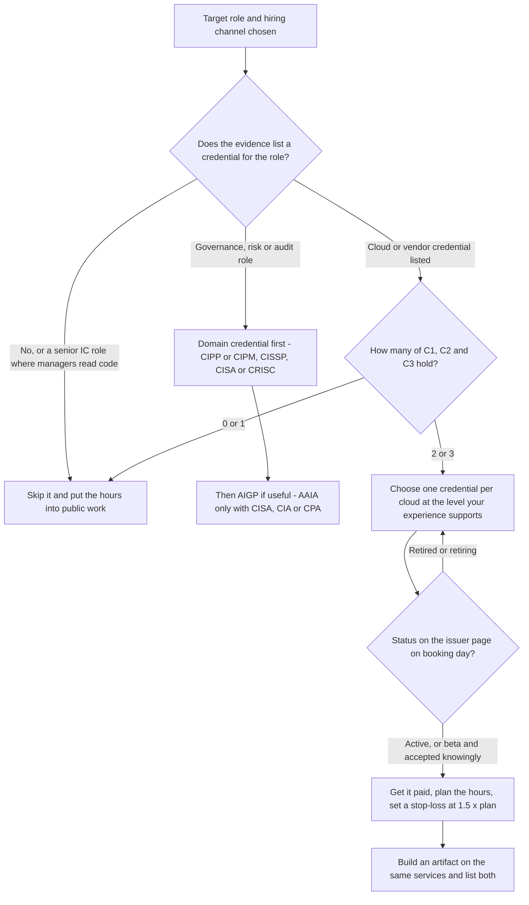

# Credential ROI: Whether a Certificate Is Worth It

> Whether a certificate is worth it for your target role and hiring channel, which one to take, how to show it on a résumé and LinkedIn, and when to stop, with a dated register of current, retired and renamed credentials.

**Dates.** Statuses, fees and formats are as retrieved by [T0-11](../../research/sessions/T0-11-certification-cloud-credential-roi.md) on 2026-10-21 and by [T0-15](../../research/sessions/T0-15-regulatory-ai-governance-career-families.md) on 2026-10-21 to 2026-10-23; the skills ontology records them as of 2026-10-23. Re-verify them by 2027-01-21. **Grades** (EGP-1.0): A primary or measured; B transparent secondary; C vendor, practitioner or single source; D judgement; M model output; P practice-curated and unmeasured.

## The short answer

1. **A certificate is a tie-breaker, and the hiring channel sets its value.** It counts most where hiring runs through IT services, staffing agencies, hyperscaler partners and GCC volume programmes, especially when the employer pays. It counts little at product companies and close to nothing at frontier labs and AI-first startups that publish credential-agnostic criteria [B/C · T0-11.F8]. No single certification was verified in more than 10% of GenAI job descriptions [B/C · T0-11.F4].
2. **Take one only if most of three conditions hold:** your target channel rewards it (C1), someone else pays or the hours fit your plan (C2), and your résumé lacks stronger verifiable signals (C3). Otherwise spend the same hours on public artifacts. This is T0-11's decision rule, held with medium confidence and resting on B/C findings [T0-11 L107].
3. **One per cloud, at your level, never a retired exam.** Match the cloud your target postings name. Associate level after 6–12 months hands-on; professional level (AIP-C01, PMLE) only with 2–3 years hands-on or employer sponsorship [P · T0-11 L124–125]. AWS Machine Learning – Specialty (last exam 31 March 2026) and Azure AI-102 (retired 30 June 2026) are gone. The AWS options are MLA-C01 and AIP-C01; Microsoft's successor is AI-103 [A/B · T0-11.F1].
4. **For governance, risk and audit roles, a domain credential comes first.** CIPP or CIPM, or CISSP, CISA or CRISC; then AIGP, which is optional; AAIA only if you already hold CISA, CIA or CPA. AIGP is named in 8.9% of US AI-governance postings and in none of 13 sampled job descriptions, and no pay premium is established [C · T0-15.F9].
5. **Show it as a fact, after your work.** Give the full name, exam code, issue and expiry dates and a public verification link. Put the services you used in project bullets: published recruiter search strings for AI/ML roles key on titles, languages and frameworks, not certification names [C · T0-11.F3].
6. **Set a stop-loss.** If preparation passes 1.5 times the planned hours, pause and ship an artifact [P · T0-11 L139]. Never use exam dumps [P · T0-11 L128].

## At a glance



C1 is the channel, C2 the payer or hours, C3 the signal gap; all three are defined in the next section. Which roles list which credentials: [credentials by role](credentials-by-role.md).

## The decision rule: three conditions and one cap

T0-11's rule: take a vendor AI certification only if most of these hold, cap it at one per cloud, and otherwise spend the hours on public artifacts [T0-11 L107]. The rule is most sensitive to two quantities nobody has measured: how much weight services-channel screeners give certifications, and how long AIP-C01 (standard registration since 31 March 2026) and AI-103 (replaced AI-102 on 30 June 2026) stay recognised [T0-11 L107, F1].

| # | Condition | It holds when | Why it matters | Grade · source |
|---|---|---|---|---|
| C1 | Channel | Your target employers hire through IT services, staffing agencies, hyperscaler partners or GCC volume programmes, or run on one cloud you can name | Certification lines cluster in intermediary and client-driven requisitions; product and frontier employers rarely ask | B/C · T0-11.F4, F8 |
| C2 | Payer or hours | An employer or programme pays, or you can finish inside your planned hours | Fees are $99–$300; time is the main cost, about 51–90% of AIP-C01's all-in cost | M · T0-11.F12, L322 |
| C3 | Signal gap | Your résumé lacks a deployed system, shipped work or a recognisable prior employer | Certificates raised résumé scores for weak résumés and barely moved strong ones | B · T0-11.F6 |
| Cap | One per cloud | Always | No evidence supports stacking; a second AWS exam is cheaper, not more valuable | B/C · T0-11 L151, L230 |

### Why the channel decides

- **Screening.** No source documents certification keywords as automatic ATS rejections. The hard gate is an employer-configured yes/no knockout question on the application form, which you see when you apply [C · T0-11.F2]. In seven public recruiter guides and libraries, AI/ML search strings contain no certification acronyms; certification phrases appear only as optional boosters for cloud-architect roles [C · T0-11.F3, L252].
- **Postings.** The one systematic posting study found any AI-related certification in 2.5% or less of AI-occupation postings, and 1.5% at FAANG plus Microsoft (CSET, 2010–2020, before GenAI) [B · T0-11.F4]. In a small 2026 sample, certification lines appeared only in the two staffing-agency postings; three services-firm postings and AWS's own GenAI specialist posting listed none [C · T0-11 L282–290].
- **Partner programmes.** Partner tiers need few certified people: AWS Premier asks for 25 technical certified individuals, Microsoft's partner-skilling points cap out at 10 people, and Google's GenAI specialisation needs four [A · T0-11.F7]. That explains why services firms sponsor certification, not why your marginal certificate changes their hiring decision. The value may arrive after hire, through staffing, billing and appraisal [B/C · T0-11.F8].
- **Pay.** Foote Partners' index (Q1 2026, 5,112 North American employers) puts the average AI-certification premium at 8.5% of base against 14% for non-certified AI skills. The gap is narrowing, and pay is rising most for skill-plus-certification combinations. This is selection, not a causal effect [B · T0-11.F5].
- **Who it helps.** The one randomized study (more than 800,000 Coursera certificate earners without college degrees, in developing countries) found an 11-point employment effect for learners induced to share a certificate. Résumé scores rose 15–20 points (on 1–100) for weak résumés and about zero for strong ones. It concerns MOOC certificates, not cloud badges [B · T0-11.F6].
- **What a pass proves.** Every verified in-scope AI exam is multiple-choice or multiple-response. None is a proctored hands-on lab exam, and Google says PMLE does not directly assess coding. The hands-on work is the part an employer can inspect [A · T0-11.F9].

### Signal by channel, credential by credential

T0-11's synthesis as of 2026-10-21. The ratings are judgement (Grade D) anchored on the evidence above. Tier 1: worth it when employer-paid or clearly in-segment. Tier 2: situational. Tier 3: skip, or treat as learning only [T0-11 L211–224].

| Credential | Services, staffing, GCC volume | Enterprise product and AI teams | AI-first startups and frontier labs | T0-11 verdict |
|---|---|---|---|---|
| AWS AIF-C01 | Some | Low | Low | Tier 2 for non-engineers and freshers; Tier 3 for engineers |
| AWS MLA-C01 | High to some | Low to some | Low | Tier 1 in AWS-centric, employer-paid settings |
| AWS AIP-C01 | High to some | Low to some | Low | Tier 1 for AWS-practice consultants with 2+ years; otherwise Tier 2; signal still forming |
| Google PMLE | Some, in GCP shops | Low to some | Low | Tier 2; the exam does not test coding |
| Google Generative AI Leader | Low to some (non-technical roles) | Low | Low | Tier 3 for engineers; Tier 2 for PM and pre-sales |
| Microsoft AI-103 | High to some; partner eligibility unverified | Low to some | Low | Tier 1 to 2 in Microsoft-aligned SIs and GCCs |
| Databricks GenAI Engineer Associate | Some, in platform shops | Some, in Databricks-centric teams | Low | Tier 2 |
| NVIDIA NCA-GENL | Low to some; no market evidence found | Low | Low | Tier 3; a cheap structured syllabus |
| NVIDIA NCP-GENL | Low | Low | Low | Tier 3 unless the role is LLM training or inference infrastructure |
| DeepLearning.AI course certificate | Low | Low | Low | Tier 3 as a credential; Tier 2 as learning for weak-résumé candidates |

## Which one: persona × channel

Find your row. "Do" assumes the decision rule passed; the channel column is the market you are applying into. Rows A–H restate T0-11's persona table [T0-11 L109–120]; the evidence column names the findings each row rests on.

| Persona (T0-11) | Channel | Do | Skip | Evidence (T0-11) |
|---|---|---|---|---|
| **A.** Fresher or new grad, 0–2 years | IT services, GCC volume hiring, staffing | Ship one or two deployed GenAI projects first. Then one credential for the cloud your target postings name: AIF-C01 with no AWS experience; MLA-C01 or AI-103 if you can show 6–12 months hands-on. Cap prep at about 40–60 hours. Accept campus or employer-paid programmes | Stacked foundational certificates; paid bundles; PMLE, AIP-C01 or NCP-GENL at this stage | F4 B/C, F6 B, F7 A, F8 B/C |
| **B.** New grad or early career | Product companies, AI startups, frontier labs | Public artifacts: pull requests to LLM tooling or evaluation libraries, a reproducible benchmark or write-up, a deployed app with an evaluation harness. Free NVIDIA and DeepLearning.AI course content is fine as learning, without paying for the certificate | All paid certifications, unless an employer pays | F8 B/C, F11 B |
| **C.** Career switcher with a thin AI résumé (QA, support, analyst, operations) | Your current employer's cloud | One associate-level credential for your employer's cloud, plus a bridge project on the same services | Several certificates; professional-level exams | F6 B |
| **D.** Mid-career engineer, 3–8 years, at an AWS, Azure or GCP enterprise or GCC | Internal mobility into GenAI | The one credential for the employer's primary cloud (MLA-C01 or AIP-C01, AI-103, or PMLE), only if reimbursed or tied to mobility or pay. Use AWS's 50% next-exam discount after a first AWS exam (verify at checkout). Keep a deployed system as the main evidence | Paying yourself for a second cloud with no target employer | F5 B, F7 A |
| **E.** Consultant, pre-sales or solution architect at an SI or hyperscaler partner | Services staffing | A professional-level credential (AIP-C01, PMLE) as staffing table stakes, paid by the employer; prefer ones that count toward partner designations | Foundational credentials | F7 A, F8 B/C |
| **F.** Senior or staff ML engineer or researcher | Teams where managers read code | None. Maintain public work, systems write-ups and papers | All | F4 B/C, F8 B/C |
| **G.** Non-engineer: PM, BA, executive, sales | Any | Optional low-cost literacy credential: Google Generative AI Leader or AWS AIF-C01 | Engineering-level exams | Issuer audience statements only (A); no hiring evidence for this lane |
| **H.** Stack specialist: Databricks, NVIDIA GPU or LLM stack | Teams on that stack | Databricks GenAI Associate only if the target team runs Databricks. NCA-GENL only as a cheap structured syllabus. NCP-GENL only for LLM training or inference-infrastructure roles | Everything else | F4 B/C, F10 C/D |

Two cautions on the rows. Whether AIF-C01, AIP-C01 and AI-103 count toward current AWS and Microsoft partner designations was not verified; only 2022-era AWS counts were [A · T0-11 L272, L435]. T0-06 found no evidence either way on whether certificates carry signal for non-technical candidates (row G) [T0-06 L856].

### Governance, risk and audit

T0-15 gives a credential order for each entry route [T0-15 L162–169]:

| Starting point | Target role | Credential order | Grade · source |
|---|---|---|---|
| GRC, privacy, audit or security, about 5 years | [AI Governance Programme Lead](../02-roles/hubs/ai-governance-lead.md) | 1. CIPP or CIPM, or CISSP, CISA or CRISC. 2. AIGP, optional: $649 for IAPP members, $799 otherwise, no prerequisites | C · T0-15 L169; A · T0-15 L391 |
| ML, MLOps, platform or security engineering | [Responsible AI / AI Governance Engineer](../02-roles/hubs/responsible-ai-engineer.md) | A portfolio mapped to the EU AI Act's deliverables comes first; none of the 4 technical-governance job descriptions sampled named a certificate; AIGP optional | C · T0-15 L163, L304–307 |
| IT or financial audit, model risk, validation | [AI Risk, Audit & Compliance Specialist](../02-roles/hubs/ai-risk-assurance-specialist.md) | AAIA only if you hold CISA, CIA or CPA; an ISO/IEC 42001 auditor or implementer course only for certification-body work (no hiring-weight data) | B · T0-15 L164, L169 |

- **Mention rates** in Axial's 2026 US AI-governance postings: CISSP 10.4%, AIGP 8.9%, CIPP 8.2%, CISM 8.1%, CIPM 6.8%, CRISC 6.4%, CISA 5.9%. A mention is not a requirement [C · T0-15.F9].
- **Job descriptions:** 1 of 13 sampled named any certificate (Eaton, Pune: CISSP, CIPP or CISA), and none named AIGP [C · T0-15 L322].
- **Pay:** IAPP's salary survey reports higher medians for certified respondents, but IAPP calls this "not proof of cause and effect", and IAPP owns AIGP [B · T0-15 L392]. No AIGP-specific premium has been published [C · T0-15 L391].

### India, IT services and GCCs

- **Price.** Exam fees are set in USD; Pearson VUE converts them and 18% GST is added. At about ₹98 per USD including GST, $99–$300 exams cost about ₹9,700–₹29,400 [C · T0-11 L175, L229, F12].
- **Demand signal.** The Nasscom–Indeed report (21 May 2026) ranks AWS, then Azure, first among certifications required across tech roles. The list is ordinal, gives no shares and covers all tech roles, not GenAI [B · T0-11 L293, L451].
- **Sponsorship.** Large services firms run mass programmes: TCS announced a target of certifying more than 25,000 employees on AWS generative AI, and Wipro and Google Cloud announced 10,000 AI-certified specialists [B/C · T0-11 L276]. Certification there is largely company-sponsored, so take the employer-paid seat. Blog claims that certification is mandatory for appraisal or tied to bonuses are unverified [D · T0-11 L276].
- **Hiring style.** GCC commentary reports a shift to portfolio reviews and take-homes [C · T0-11 L98]; Reuters (25 May 2026) reports GCC hiring becoming more selective [B · T0-11 L295].

## What it costs and what it must return

List prices and hours as of 2026-10-21 [T0-11 L181–207; T0-15 L391]. Prep hours mostly come from training vendors and aggregators with commercial incentives, and four of the ranges are T0-11's planning assumptions (Grade D) [T0-11 L232].

| Credential | Level | List fee (grade) | ≈ ₹ incl. GST (M) | Prep hours (grade) | Recommended experience | Validity |
|---|---|---|---|---|---|---|
| AWS AIF-C01 | Foundational | $100 (A) | 9,800 | 15–60 (C) | No prerequisite stated | 3 years (A) |
| AWS MLA-C01 | Associate | $150 (C) | 14,700 | 60–100 (C) | About 6–12 months hands-on (C) | 3 years (C) |
| AWS AIP-C01 | Professional | $300 (C) | 29,400 | 80–150 (C) | 2+ years building production apps, plus 1 year hands-on GenAI (A) | AWS standard 3 years; not confirmed on the exam page |
| Google PMLE | Professional | $200 (A) | 19,600 | 60–150 (C) | 3+ years in industry including 1+ year on Google Cloud; recommended, not required (A) | 2 years (C) |
| Google Generative AI Leader | Foundational, non-technical | $99 (A) | 9,700 | 10–30 (D) | None | Renewable; one training-partner page says 3 years (C) |
| Microsoft AI-103 | Associate | $165 US list; varies by country (C) | 16,200 | 40–90 (D) | Not verified | 1 year, free online renewal (C) |
| Databricks GenAI Engineer Associate | Associate | $200 (B) | 19,600 | 30–80 (D) | 6+ months hands-on (A) | 2 years; recertify on the current exam (A) |
| NVIDIA NCA-GENL | Associate | $125 (A) | 12,300 | 18–50 (C/D) | Not stated | 2 years (B) |
| NVIDIA NCP-GENL | Professional | $200 (A) | 19,600 | 60–120 (D) | Not stated | 2 years (C) |
| DeepLearning.AI course certificate | Course completion | Pro membership about $30–50 a month; sources conflict (C) | About 3,900 for one month at $40 | 13–25 (B/D) | None | None |
| IAPP AIGP | Professional | $649 members, $799 others; retake $475 or $625 (A) | Not computed | Not measured | No prerequisites (A) | 2-year term with 20 CPE credits; $250 maintenance for non-members (A) |

**What the money and hours must return** (T0-11 D6: model outputs with illustrative salaries of $12K, $30K and $100K a year):

- **Cash is not the constraint.** With prep time valued at half the hourly wage over a two-year useful life, break-even is 0.3–2.8% of salary a year on central values (0.2–3.4% across ranges). That is below the 8.1–8.5% average AI-certification premium, which is not causal and is paid only by some employers [M · T0-11.F12, L320–324].
- **Time is the cost.** Prep is about 51%, 72% and 90% of AIP-C01's all-in cost at the three salaries. If the employer pays the fee, only the time cost is left [M · T0-11 L322].
- **Through hiring, the bar rises with level.** Assuming a 10% pay uplift, entry-level credentials must raise your odds of the better job by 2.6–10.1 percentage points, associate 8.0–17.5 and professional 12.4–28.1. The measured effect is 11 points, for weak-résumé Coursera learners. Professional exams clear the bar for no salary persona unless the employer pays, the uplift is nearer 20%, or the effect is larger than measured [M · T0-11 L358].
- **Against a portfolio.** If an hour of skill-building earned the skills premium as reliably as an hour of prep earns the certification premium (a strong assumption), a portfolio path matches when it takes at most 1.65 times the certification's hours [M · T0-11 L326].

## Status register: current, retired and renamed

Statuses as retrieved on 2026-10-21 unless a row says otherwise. Re-verify by 2027-01-21, and check the issuer's page before booking, because two credential families were retired within months in 2026 [A/B · T0-11 L126].

| Credential | Status | Dated event | Successor or note | Grade · source |
|---|---|---|---|---|
| AWS Certified Machine Learning – Specialty | **Retired** | Last exam 2026-03-31 | Holders stay certified to their original expiry. Successors: MLA-C01 (associate); AIP-C01 for GenAI at professional level | A · T0-11 L166, L216 |
| AWS Certified Generative AI Developer – Professional (AIP-C01) | Active | Beta ended 2026-03-31; standard registration since | Distinct from AIF-C01 and MLA-C01 | A · T0-11 L165 |
| AWS Certified AI Practitioner (AIF-C01) | Active | Official page updated 2026-10-15 | Foundational | A · T0-11 L165 |
| AWS Certified Machine Learning Engineer – Associate (MLA-C01) | Active | — | Successor to the retired ML – Specialty | A/C · T0-11 L165, L216 |
| AWS AI Business Strategist | Mentioned on the AIF-C01 page | — | Not researched | A · T0-11 L165 |
| Microsoft Azure AI Engineer Associate (AI-102) | **Retired** | 2026-06-30 | Successor: Azure AI Apps and Agents Developer Associate (AI-103). Whether existing holders can still renew was not checked | B · T0-11.F1, L167 |
| Microsoft AI-103 | **Beta** label on the exam page in the retrieved text | — | Confirm status before booking | A · T0-11 L167 |
| Microsoft DP-100 and AZ-204 | **Replaced** in 2026 | — | DP-100 by AI-300 (MLOps Engineer Associate); AZ-204 by AI-200 (Azure AI Cloud Developer Associate) | B/C · T0-11.F1, L167 |
| Google Cloud Professional Machine Learning Engineer (PMLE) | Active; **refreshed** | — | Exam refreshed for generative AI, with renamed products | A · T0-11 L168 |
| Google Cloud Generative AI Leader | Active | — | Non-technical | A · T0-11 L168 |
| Databricks Certified Generative AI Engineer Associate | Active | Exam guide dated March 2026 | No professional-level GenAI credential was verified | A · T0-11 L169, S24 |
| NVIDIA NCA-GENL and NCP-GENL | Active proctored exams | — | Separate from DLI workshop certificates, whose catalogs date from 2019–2021 (price and format unverified) | A/C · T0-11 L170 |
| DeepLearning.AI certificates | Course completion, not an exam | — | Certificate access needs a paid Pro membership | B/C · T0-11 L171 |
| IAPP AIGP | Active | Candidate handbook effective 2024-04-02, read 2026-10-21 | No holder count published | A · T0-15 L391, L730 |
| ISACA Advanced in AI Audit (AAIA) | Active | Launched 2025-05-19 | Requires CISA, CIA or CPA | B · T0-15 L373 |
| IAPP CIPP, CIPM, CIPT; ISC2 CISSP; ISACA CISA, CRISC, CISM | Named in 2026 postings | — | Exam status not checked separately; the skills ontology lists them active as of 2026-10-23 | C · T0-15 L392–393 |
| ISO/IEC 42001 auditor or implementer courses | Offered by various providers | — | No hiring-weight data; accreditation of certification bodies under way in 2025–26 | n/a · T0-15 L396, L372 |
| Certified Kubernetes Administrator (CKA) | Not assessed in the corpus | — | Listed as practice-curated in the role × credential view | P |

The full credential list, with the roles that name each one, is in the [skills vocabulary §4](../03-skills-and-tech/skills-vocabulary.md#4-credentials).

### Names that are credentials, not roles

Some certification names get read as job titles. Use the canonical role title on your résumé and list the credential separately ([role catalog §6.2](../02-roles/role-catalog.md#62-certifications-frequently-misclassified-as-roles)):

| Name read as a role | What it is | Status (T0-11) |
|---|---|---|
| Azure AI Engineer | Azure AI Engineer Associate (AI-102) | Retired 2026-06-30; successor AI-103 |
| Databricks Generative AI Engineer | Databricks Certified Generative AI Engineer Associate | Active |
| Google Cloud Professional ML Engineer | Professional Machine Learning Engineer (PMLE) | Active; refreshed for GenAI |
| AWS AI Solutions Architect | Neither a title nor a certification in T0-11 | Nearest: MLA-C01 (successor to the retired ML – Specialty) and AIP-C01 |

**Correction applied (ERRATA U13).** An earlier playbook (T2-01 L246) advised backend engineers to "consider the ML specialty cert". That exam is retired. The AWS option is AIP-C01, or MLA-C01 at associate level, and Google's is PMLE ([ERRATA](../../research/ERRATA.md); T0-11 L165–166, L216).

## How to do it

1. **Fix the role and the channel.** Choose one target role ([targeting workbook](../00-start/targeting-workbook.md)) and sort your target employers into three channels: services, staffing, partner or GCC volume; enterprise product and AI teams; AI-first startups and frontier labs. *Done when* every employer on your list has a channel.
2. **Read the postings and the forms.** For each posting, record the cloud it names and whether a certification is required, preferred or absent. Record any certification yes/no question on the application form separately: that question, not your résumé, is the hard gate [C · T0-11.F2]. This is the coding T0-11 proposes for a market audit [T0-11 L394]. *Done when* every posting on your list is coded.
3. **Run the rule.** Mark C1, C2 and C3 true or false, with one line of evidence each. *Done when* you have a count: 0–1 means skip, 2–3 means take one.
4. **Pick one credential.** Use your persona row, the level rule and the cloud your postings name. Open the issuer's exam page and record the status, any retirement notice and the date [P · T0-11 L126]. For an issuer you do not know, check who issues it and whether the exam is proctored [P · T0-10 L352]. *Done when* you have the exam page, its status and the date you checked.
5. **Get it paid and cap the hours.** Ask for employer sponsorship or a campus or partner programme. After a first AWS exam, AWS offers 50% off the next one (verify at checkout) [A · T0-11 L230]. Take your planned hours from the cost table and set the stop-loss at 1.5 times [P · T0-11 L139]. *Done when* the payer, planned hours and stop-loss date are written down.
6. **Build the paired artifact.** Build on the services you study, so study hours double as portfolio hours [P · T0-11 L127]. See [proof-of-work standards](../05-portfolio/proof-of-work-standards.md). *Done when* the artifact is public, with deployment notes and an evaluation.
7. **Sit it honestly and show it.** No dumps. Add the résumé line and LinkedIn entries from the templates below. *Done when* the résumé line has all five fields and the credential sits in both LinkedIn sections.
8. **Keep it current.** Put the expiry date, the status re-check date (2027-01-21) and the revisit triggers (Evidence and limits) in your calendar. *Done when* the reminders exist.

## Templates and examples

### Credential decision card [P]

```text
Target role: [role]          Channel: [services/staffing/partner/GCC | enterprise product | startup/frontier]
Postings coded: [n]   Named cloud: [AWS / Azure / Google Cloud / none]
Certification lines: required [n] · preferred [n] · absent [n]   Certification knockout questions: [n]
C1 channel rewards it:            [yes/no] because [evidence]
C2 someone pays or hours fit:     [yes/no] because [evidence]
C3 résumé lacks stronger signals: [yes/no] because [evidence]
Count: [0-3]  ->  Decision: [skip / take one]
Credential: [full name, exam code]   Level fits my hands-on time: [yes/no]
Issuer page checked on [YYYY-MM-DD]: [active / beta / retiring / retired]
Paid by: [employer / programme / me]   Planned hours: [h]   Stop-loss: [1.5 x h], on [YYYY-MM-DD]
Paired artifact on the same services: [project and link]
```

### Résumé line [P]

The fields come from T0-11's résumé rules [T0-11 L132–135]; the layout is practice.

```text
[Full credential name] ([exam code]) · [Issuer] · Issued [Mon YYYY] · Valid to [Mon YYYY] · [public verification link]
```

For a retired exam that you still hold:

```text
[Full credential name] · [Issuer] · Issued [Mon YYYY] · Valid to [Mon YYYY] (exam retired [D Mon YYYY]) · [public verification link]
```

The project bullet that carries the search terms:

```text
Built [system] on [service] and [service] for [users or use case]: [measured outcome against a baseline]; [link to code, evaluation or deployment notes]
```

AWS and Google issue badges through Credly, with public links that show active or expired status [A · T0-11 L95, L405]. For AI/ML engineering roles, list certifications after projects [P · T0-11 L135]; the [résumé strategy](../06-job-search/resume-strategy.md) places them in the facts block.

### LinkedIn [P]

- **Licenses and Certifications:** the full name with the exam code, the issuer, issue and expiry dates, and the verification link.
- **Skills:** the services and skills the credential covers, for example Bedrock and SageMaker.

Use both sections. Secondary sources disagree on whether LinkedIn Recruiter searches the certifications section, and no primary documentation was found [D · T0-11 L254].

### Weak and strong

| Element | Weak | Strong | Why |
|---|---|---|---|
| A retired credential | "AWS ML Specialty", no dates, listed as current | "AWS Certified Machine Learning – Specialty · AWS · Issued [Mon YYYY] · Valid to [Mon YYYY] (exam retired 31 Mar 2026) · [link]" | AWS keeps holders certified to their original expiry; do not present a retired exam as current [A · T0-11 L134, L166] |
| Search terms | "Certifications: AIP-C01", and the services appear nowhere else | A project bullet naming Bedrock and SageMaker with a measured outcome, plus the certification line | Recruiter strings key on titles, languages and frameworks [C · T0-11.F3] |
| Order, engineering roles | Certifications at the top | Projects with measured outcomes first, certifications after | [P · T0-11 L135]; Anthropic asks applicants to put research, writing or open-source work at the top of the résumé [A · T0-11 L98] |
| Count | Six badges across three clouds | One per cloud, matched to target postings | No evidence supports stacking [B/C · T0-11 L151] |
| Governance headline | "AIGP" as the only credential | "[CIPP (region) or CISA] · AIGP", next to a governance artifact | CISSP is named more often than AIGP (10.4% against 8.9%), and CIPP and CISM about as often [C · T0-15.F9] |
| Role title | "Azure AI Engineer" as your job title | Your actual title; "Azure AI Engineer Associate (AI-102), retired 30 June 2026" under certifications | A credential is not a role ([role catalog §6.2](../02-roles/role-catalog.md#62-certifications-frequently-misclassified-as-roles)) |

## Checklist

- [ ] I named one target role and the channel of every target employer.
- [ ] I coded my target postings (cloud named; certification required, preferred or absent) and looked for certification knockout questions on the forms.
- [ ] At least two of C1, C2 and C3 hold; if not, the hours go to public artifacts.
- [ ] One credential per cloud, at a level my hands-on time supports.
- [ ] I checked the issuer's page for status and retirement notices, and wrote down the date.
- [ ] Someone else pays, or the hours fit my plan; the stop-loss is set at 1.5 times the planned hours.
- [ ] The artifact I am building uses the same services as the exam.
- [ ] No exam dumps.
- [ ] My résumé line has the full name, exam code, issue and expiry dates and a verification link, after my projects.
- [ ] LinkedIn has the credential under Licenses and Certifications and its services under Skills.
- [ ] Governance targets: a domain credential before AIGP; AAIA only with CISA, CIA or CPA.
- [ ] A reminder to re-check status by 2027-01-21.

## Pitfalls

| Red flag | Why it hurts | Fix |
|---|---|---|
| Buying exam dumps | It destroys the only thing a credential signals. MLA-C01 dumps were sold openly in 2026; no independent cheating-rate measurement was found [C · T0-11 L128, L382] | Study from the exam guide and build on the services |
| Stacking certificates | No evidence supports stacking; per-certification premiums are small [B/C · T0-11 L151]. In Huntr's data the certification effect is flat by count (vendor-run, correlational) [C · T0-10 L95] | One per cloud, matched to target postings |
| Booking or listing a retired exam | ML – Specialty (last exam 31 March 2026) and AI-102 (retired 30 June 2026) read as legacy credentials [A/B · T0-11.F1] | Check the issuer page; list held credentials with "valid to [date]" |
| A professional exam too early | Recommended experience is 2–3+ years; through hiring alone, professional exams pay back for no salary persona unless employer-paid or the uplift is nearer 20% [M · T0-11 L358] | Associate first, or get the employer to pay |
| The wrong cloud | A credential for the wrong cloud has near-zero value [D · T0-11 L450] | Match the cloud your target postings name |
| Unaccredited "AI certification" badges | T0-10 found no credible employer signal for them [D · T0-10 L547] | Check the issuer and whether the exam is proctored [T0-10 L352] |
| Certificates instead of artifacts | T0-06 found no source showing course certificates carry hiring signal [D · T0-06 L624]; the causal effect is near zero for strong résumés [B · T0-11.F6] | Pair every credential with a deployed artifact |
| Reading "certification required" as an ATS auto-reject | No source documents certification-keyword auto-rejects; the gate is a knockout question [C · T0-11.F2] | Answer knockouts truthfully; if you lack it, a referral routes around form rules (documented for Ashby; inference elsewhere) [A/D · T0-04 R5 L129] |
| AIGP first for governance | AIGP is named less often than CISSP and in none of 13 sampled job descriptions; no premium is shown [C · T0-15.F9, L208] | Domain credential first; AIGP as an optional extra |
| Paying for a course certificate as a signal | DeepLearning.AI certificates need a paid Pro membership, and no study separates how hiring managers read them from cloud badges [C/D · T0-11.F10] | Learn from the free content; certify only if the rule passes |

## Evidence and limits

- **Measured or primary:** exam formats, fees and statuses from issuer pages (A, T0-11 D1–D3, as of 2026-10-21); partner-programme thresholds (A, T0-11.F7); the AIGP handbook (A, T0-15 L391). The Foote Partners pay index (B) covers North American employers and shows selection, not causation (T0-11.F5). The randomized study (B) covers Coursera certificates for learners without degrees in developing countries, not cloud badges, degree-holders or GenAI roles (T0-11.F6). CSET's posting shares (B) cover 2010–2020, before GenAI (T0-11.F4).
- **Thin or practitioner evidence:** ATS and Boolean mechanics rest on about seven public guides, many from sourcing-tool vendors (C). The 2026 JD sample has six postings plus one partial (indicative). AIGP mention rates come from one recruiter-analytics source (C). IAPP's pay medians come from an owner-sponsored survey (B, not causal). Prep hours come from affiliate sites (C/D). Channel ratings and verdict tiers are judgement (D).
- **Model outputs (M):** the break-even and hiring-channel figures use illustrative salaries and an assumed 10% uplift. They show the shape of the decision (affordable, time-dominated, channel-dependent), not a benefit estimate [T0-11 L369].
- **Not measured anywhere in the corpus:** a 2025–26 per-certification share of GenAI postings; the weight services-channel screeners give certifications; how long AIP-C01 and AI-103 stay recognised; whether LinkedIn Recruiter searches the certifications section; client RFP or SOW "certified resource" clauses; vendor pass rates; exam cheating rates; hours to a credible open-source contribution; market signal for NVIDIA and Databricks credentials; Stanford Online and other university certificates [T0-11 L425, L434–442].
- **Conflicts of interest:** T0-11 was written by an Anthropic model and uses Anthropic's careers page as one data point [T0-11 L471]. Pearson delivers exams and owns Credly. IAPP owns AIGP and ISACA sells AAIA [T0-15 L515].
- **Dates:** T0-11 is as of 2026-10-21; T0-15 ran 2026-10-21 to 2026-10-23; Foote's Q1 2026 data run to 1 April 2026. Re-verify statuses and fees by 2027-01-21.
- **What would change this advice** [T0-11 L140]: (a) a reproducible 2026–27 audit showing a GenAI-specific certification in more than 10% of postings for your target segment; (b) ATS or knockout-question evidence for certifications; (c) a causal study of hyperscaler certifications; (d) another reorganisation by AWS, Microsoft or Google (T0-11 named AWS re:Invent in December 2026 as the next likely point). For governance: evidence that AIGP is required in postings or lifts pay [T0-15 L208].

## Next steps

- **Build the evidence that outweighs a badge:** [proof-of-work standards](../05-portfolio/proof-of-work-standards.md) and [project archetypes](../05-portfolio/project-archetypes.md).
- **See each role's credentials:** [credentials by role](credentials-by-role.md) and the [credentials table](../03-skills-and-tech/skills-vocabulary.md#4-credentials).
- **Show it:** [résumé strategy](../06-job-search/resume-strategy.md), the [résumé skills matrix](../06-job-search/resume-skills-matrix.md) (for example [AI Engineer](../06-job-search/resume-skills-matrix.md#resume-ai-engineer) or [AI Governance Lead](../06-job-search/resume-skills-matrix.md#resume-ai-governance-lead)), [ATS mechanics](../06-job-search/ats-mechanics.md) for knockout questions and [online presence](../07-networking/online-presence.md) for LinkedIn.
- **Choose the channel:** [channels and boards](../06-job-search/channels-and-boards.md) and the job-search strategy's [binding constraints](../06-job-search/job-search-strategy.md#26-the-constraints-that-bind-first) and [expanding rings](../06-job-search/job-search-strategy.md#27-recommended-sequencing-expanding-rings).
- **Your track:** [career transitions](../11-tracks/career-transitions.md), [PhD to industry](../11-tracks/phd-to-industry.md), [governance careers](../11-tracks/governance-careers.md), [India remote playbook](../11-tracks/india-remote-playbook.md) and [learning roadmaps](../03-skills-and-tech/learning-roadmaps.md).
- **Role hubs by persona** (mapping is practice-curated [P]):
  - Services-channel engineers (personas A, C, D, E): [AI Engineer](../02-roles/hubs/ai-engineer.md), [Applied AI Engineer](../02-roles/hubs/applied-ai-engineer.md), [Forward Deployed Engineer](../02-roles/hubs/forward-deployed-engineer.md), [AI Solutions Architect](../02-roles/hubs/ai-solutions-architect.md).
  - Senior and research roles (persona F): [Research Engineer](../02-roles/hubs/research-engineer.md), [Research Scientist](../02-roles/hubs/research-scientist.md), [Applied Scientist](../02-roles/hubs/applied-scientist.md), [AI Safety Researcher](../02-roles/hubs/ai-safety-researcher.md).
  - Non-engineers (persona G): [AI Product Manager](../02-roles/hubs/ai-product-manager.md).
  - Stack specialists (persona H): [ML Engineer](../02-roles/hubs/ml-engineer.md), [Inference Engineer](../02-roles/hubs/inference-engineer.md), [AI Infrastructure Engineer](../02-roles/hubs/ai-infrastructure-engineer.md), [ML Platform Engineer](../02-roles/hubs/ml-platform-engineer.md).
  - Governance, risk and security: [AI Governance Lead](../02-roles/hubs/ai-governance-lead.md), [AI Risk & Assurance Specialist](../02-roles/hubs/ai-risk-assurance-specialist.md), [Responsible AI Engineer](../02-roles/hubs/responsible-ai-engineer.md), [AI Security Engineer](../02-roles/hubs/ai-security-engineer.md).
- **Evidence:** the [stage 04 findings](../../research/findings.md#stage-04), [T0-11](../../research/sessions/T0-11-certification-cloud-credential-roi.md), [T0-15](../../research/sessions/T0-15-regulatory-ai-governance-career-families.md) and the [errata](../../research/ERRATA.md).

[← Stage 04: Certifications](README.md) · [Start Here](../README.md)
