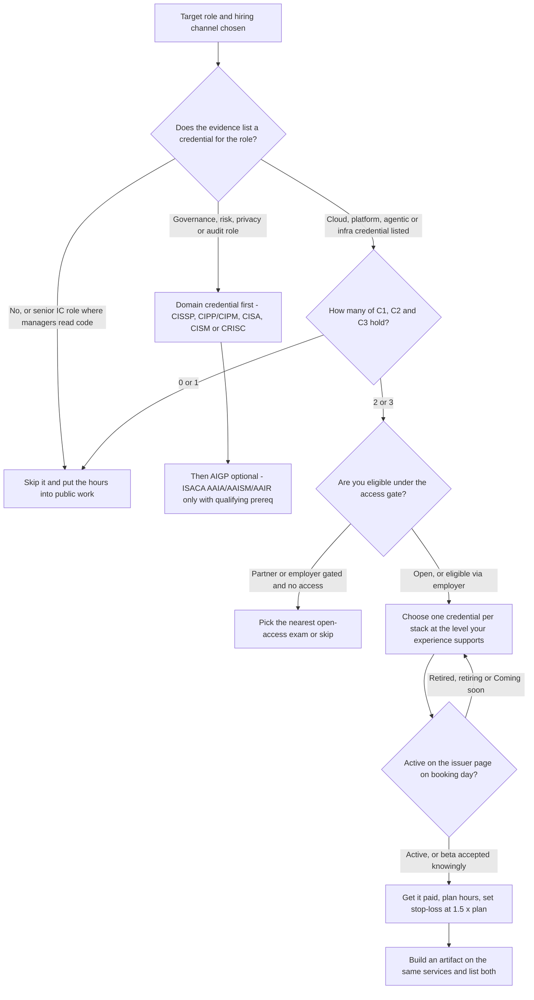

# Credential ROI: Whether a Certificate Is Worth It

> Whether a certificate is worth it for your target role and hiring channel, which credentials are open versus partner-gated, how knowledge overlap shapes sequencing, what each issuer ecosystem actually delivers, and when to stop.

**Dates and scope.** This guide reconciles [T0-11](../../research/sessions/T0-11-certification-cloud-credential-roi.md) (2026-10-21) and [T0-15](../../research/sessions/T0-15-regulatory-ai-governance-career-families.md) (2026-10-23) with Research Pipeline 2 sessions [T0-29](../../research/sessions/T0-29-certifications-frontier-labs-ai-native-vendors.md) (frontier labs & AI-native), [T0-30](../../research/sessions/T0-30-certifications-courses-universities-india-programmes.md) (courses, universities & India programmes), [T0-31](../../research/sessions/T0-31-certifications-data-enterprise-ai-platforms.md) (data & enterprise platforms), [T0-32](../../research/sessions/T0-32-certifications-gpu-infrastructure-open-source.md) (GPU, infra & open-source), [T0-34](../../research/sessions/T0-34-certifications-governance-security-privacy-audit.md) (governance, security, privacy & audit), and sequencing studies [T3-01](../../research/sessions/T3-01-genai-certification-stack-ranking-sequencing.md) and [T3-02](../../research/sessions/T3-02-genai-certification-stack-ranking-sequencing.md), plus live primary verification on 2026-11-19. Hyperscaler (**T0-28**) and developer-tool (**T0-33**) RP2 audits are deferred past 2026-12-05; their entries in the [certification catalog](credential-catalog.md) carry provisional flags. **Grades** (EGP-1.0): A primary or measured; B transparent secondary; C vendor, practitioner or single source; D judgement; M model output; P practice-curated and unmeasured.

## The short answer

1. **A certificate is a tie-breaker, and the hiring channel sets its value.** It counts most where hiring runs through IT services, staffing agencies, hyperscaler or SaaS partners, and GCC volume programmes — especially when the employer pays. It counts little at product companies and close to nothing at frontier labs and AI-first startups that publish credential-agnostic criteria [B/C · T0-11.F8; A/B · T0-32 L380–L381]. No single GenAI certification was verified in more than 10% of general GenAI job descriptions [B/C · T0-11.F4; T3-01 L129].
2. **Take one only if most of three conditions hold:** your target channel rewards it (C1), someone else pays or the hours fit your plan (C2), and your résumé lacks stronger verifiable signals (C3). Otherwise spend the same hours on public artifacts [T0-11 L107].
3. **Check access before studying, cap at one per cloud, and never book a retired exam.** Access — not price — blocks 13 of 28 major credentials in late 2026 (Claude Partner Network, Gemini Enterprise partner badges, OpenAI Partner Network, Palantir employer-gated exams, FDE ladders) [A · T3-02 L55; T0-29 L70, L74–L75; T0-31 L57]. AWS ML – Specialty (retired 2026-03-31), Azure AI-102 (retired 2026-06-30), AWS MLA-C01 (retired in English 2026-09-28) and Salesforce AI Associate (retired 2026-02-02) are gone; check the [certification catalog](credential-catalog.md) and issuer page before booking [A/B · T0-11.F1; T3-01 L115; T0-31 L54].
4. **If you sit more than one exam, selection and validity windows beat clever ordering.** Across 24 credentials, blueprint overlap alone saves ~40–45% of standalone study hours while ordering adds only ~4–7% over random order [M · T3-01 L133–L135; T3-02 L73]. Short validity windows (6–12 months) and 6–14 month exam churn dominate long-term effort [A · T3-01 L137; T3-02 L67].
5. **For governance, risk and audit roles, a domain credential comes first.** CISSP (10.4% in Axial US AI-governance postings), CIPP (8.5%), CISM, CIPM, CRISC or CISA come before AI add-ons [C · T0-34 L51]. IAPP AIGP (8.7–8.9% Axial; 28–30% on GRC Careers; BoK v2.1 Feb 2026) is the leading optional AI-specific governance credential; ISACA AAIA/AAISM/AAIR require qualifying domain credentials and mandatory PSI test centres in India, mainland China and Hong Kong [A/B · T0-34 L50–L56, L384].
6. **Skip ₹1.3–2.3 lakh ed-tech participation certificates and unverified private bodies, show real badges after projects, and set a stop-loss.** Zero of 29 US and India postings in T0-30 named any MOOC, university executive programme, Indian institute CEP bundle or private AI body (ARTiBA, GSDC, Blockchain Council, IABAC) [A · T0-30 L71, L74, L78]. List earned credentials with full name, exam code, dates and verification link after shipped projects, pause at 1.5 times planned hours [P · T0-11 L139], and never use exam dumps [P · T0-11 L128].

## At a glance



C1 is the channel, C2 the payer or hours, C3 the signal gap; all three are defined below. For ranked tables across 150 vetted credentials (three channel lenses, eight role families and a cost/hour collector's list), see the [certification catalog](credential-catalog.md). For the role × ontology credential mapping, see [credentials by role](credentials-by-role.md).

## The decision rule: three conditions and one cap

T0-11's rule still holds across all five RP2 certification sessions: take a vendor AI certification only if most of these conditions hold, cap it at one per cloud or platform stack, and otherwise spend the hours on inspectable artifacts [T0-11 L107; T0-30 L71; T0-32 L380].

| # | Condition | It holds when | Why it matters | Grade · source |
|---|---|---|---|---|
| C1 | Channel | Target employers hire through IT services, staffing agencies, hyperscaler/SaaS partners or GCC volume programmes, or standardise on one stack you can name | Certification requirements cluster in SI, partner and platform-locked postings (for example Deloitte AWS lists, Salesforce Agentforce, Palantir Foundry); product and frontier teams rarely ask | A/B/C · T0-11.F4, F8; T0-31 L55, L57; T3-02 L75 |
| C2 | Payer or hours | An employer or partner programme pays, or you can finish inside your planned hours | List exam fees are $0–$500 for technical credentials ($550–$1,749 for governance/offensive security); prep time is 51–90% of all-in cost for professional exams | M · T0-11.F12, L322; T0-32 L85; T0-34 L56 |
| C3 | Signal gap | Your résumé lacks a deployed system, shipped work or a recognisable prior employer | Experimental evidence shows narrow employment gains concentrated on thin résumés and near-zero lift for strong résumés | A/B · T0-30 L72; T3-01 L131 |
| Cap | One per stack | Always (unless a partner FDE ladder explicitly mandates a set) | No evidence supports badge stacking; renewal cycles (6–24 months) turn stacked badges into recurring maintenance debt | B/C · T0-11 L151; T3-01 L137 |

### Why the channel decides

- **Screening.** No source documents certification keywords as automatic ATS rejections. The hard gate is an employer-configured yes/no knockout question on the application form, which you see when applying [C · T0-11.F2]. In seven public recruiter guides, AI/ML Boolean strings contain no certification acronyms; certification terms appear only as optional boosters for cloud-architect roles [C · T0-11.F3, L252].
- **Postings.** CSET's pre-GenAI study (2010–2020) found any AI-related certification in 2.5% or less of AI-occupation postings and 1.5% at FAANG plus Microsoft [B · T0-11.F4]. RP2 audits in November 2026 confirm sharp channel separation: in T0-32's 47-posting AI-infrastructure sample, 0 of 40 product/infrastructure postings named an in-scope GPU or Kubernetes certification versus 2 of 7 channel-employer postings [A/B · T0-32 L380–L381]; in T0-30's 29-posting US/India sample, 0 of 29 named any course, university, Indian institute or private-body certificate [A · T0-30 L71]. Hard requirements do appear in SI and platform-locked postings: Deloitte US FDE-AWS postings require "3 of 6" named AWS certs (including already-retired MLA-C01) [A · T3-02 L75], while convenience samples in T0-31 found high match rates inside platform-specific queries for Palantir Foundry (8 of 14 US, 4 required) and Salesforce Agentforce (7 of 17 US, 12 of 17 India) [B/C · T0-31 L55, L57].
- **Partner programmes.** Partner tiers require small headcounts relative to large SI workforces: AWS Premier asked for 25 technical certified individuals in 2022 documentation, Microsoft partner-skilling points cap at about 10 individuals, and Google's GenAI specialisation requires 4 [A · T0-11.F7]. RP2 verified several 2026 partner rules: Microsoft's Solutions Partner for Data & AI page (updated 2026-10-23) counts vendor exams (including AI-103 and transitioning AI-102) and zero Coursera certificates [A · T0-30 L75]; Anthropic's Claude Partner Network counts CCDV-F, CCAR-F and CCAR-P toward tiers (excluding CCAO-F) [A · T0-29 L71]; CNCF's KCSP programme requires 3 or more CKA holders (CKAD does not count) [A · T0-32 L83]; Snowflake, SAP and ServiceNow also tie partner standing to vendor credentials [A/B · T0-31 L58, L62]. Value in services firms therefore arrives mostly after hire through staffing, billing and partner audits rather than marginal hiring scarcity [B/C · T0-11.F8].
- **Pay.** Foote Partners' index (Q1 2026, 5,112 North American employers) puts the average AI-certification premium at 8.5% of base versus 14% for non-certified AI skills — a narrowing gap, with the strongest growth in skill-plus-certification combinations. These are cross-sectional employer pay figures, not causal estimates [B · T0-11.F5].
- **Who it helps (causal evidence corrected).** The one large randomised experiment (Athey & Palikot, `arXiv 2405.00247`, >800,000 Coursera certificate earners without degrees in developing countries; Coursera collaboration, COI) measured an **intent-to-treat (ITT) effect of +1.0 percentage point (+6% relative) on new employment** and **+1.2 pp (+9%) on certificate-related jobs**; the **+11 percentage point figure quoted in T0-11.F6 is the complier (LATE) effect** for learners induced to share their certificate on LinkedIn [A/B · T0-30 L72; T3-01 L131]. Counterfactual résumé scores rose +8.5 points on average and 15–20 points for weak résumés, versus near zero for strong résumés, with zero direct interview-callback measurement [A/B · T3-01 L131].
- **What a pass proves (T0-11.F9 superseded).** In October 2026, T0-11 found no verified proctored hands-on AI lab exam [A · T0-11.F9]. By November 2026 that claim is superseded: verified hands-on and hybrid credentials include Google Professional Agentic Architect (proctored MCQ + 2 Google Skills labs; lab proctoring unverified), free AWS Demonstrated live-sandbox microcredentials, AWS FDE sandboxes, NVIDIA NCP-AIO (30 MCQ + 3 live VM labs), CNCF CKA/CKAD/CKS (live command line), Red Hat EX267 (OpenShift AI), SAP C_AIG/C_JSD (practical scenario-based assessments), Palantir Specialist (3h live Zoom-proctored build), Elastic Certified Engineer (3h live cluster), GIAC CyberLive, OffSec OSAI (24h proctored practical), HTB COAE (7-day practical + report) and CAISP (6h practical) [A/B · T3-01 L111–L113; T0-31 L59, L65; T0-32 L75–L76, L80; T0-34 L57]. MCQ-only exams remain structurally exposed to brain-dumps and LLM cheating [C · T0-11 L382; T3-02 L87].

## Access gating, FDE ladders and knowledge-overlap sequencing

### Access is the primary filter

Before budgeting study time, check whether you are even eligible to register [A · T3-02 L55]:

| Access gate | Examples | Who can sit | Practical implication | Grade · source |
|---|---|---|---|---|
| **Partner-gated** | Anthropic Claude (`CCAO-F`, `CCDV-F`, `CCAR-F`, `CCAR-P`); Google Gemini Enterprise Partner Specialist (`GEM-DEP`, `GEM-AGT`); OpenAI Partner Network (10 practitioner certs); ServiceNow delivery accreditations | Staff of enrolled partner organisations using an approved corporate domain | Individuals and direct customers cannot register; do not build a self-funded study plan around them | A/B/C · T0-29 L70, L75; T3-01 L105, L119; T0-31 L58 |
| **Employer-gated** | Palantir Associate & Specialist (`Data`, `App`, `AI Engineer`); OpenAI AI Foundations pilot | Employees of active enterprise customers or partners (Specialist booked via Ontologize) | High value inside Foundry/pilot shops; inaccessible from outside | A/B · T0-31 L57, L586–L589; T0-29 L74 |
| **Nomination / invite-only** | Anthropic Claude Frontier Academy (Resident / Frontier Deployed Engineer); Google Developer Experts (GDE); Microsoft MVP; AWS Community Builders (~10% acceptance) | Nominated partner engineers or sustained community contributors | Cannot be purchased; treat as long-horizon community/partner outputs, not exams | A/B · T0-29 L495–L496; T0-30 L81 |
| **Prerequisite-gated** | ISACA AAIA (CISA or qualifying audit/accounting credential), AAISM (CISM or CISSP), AAIR (27 qualifying designations); CNCF CKS (active CKA); SnowPro Advanced (SnowPro Core) | Holders of an active baseline domain credential | Sequence the baseline domain credential first; check country-specific eligibility (notably AAIA excludes Indian CA) | A/B · T0-34 L55, L384; T0-32 L852; T0-31 L567 |

### Forward Deployed Engineer (FDE) ladders are vendor-closed

T3-01 and T3-02 audited all major hyperscaler and lab FDE enablement programmes and found **zero cross-vendor equivalence**: an AWS Professional or Anthropic Architect credential will not satisfy Google's "one Google Cloud Professional certification" rule [A/B · T3-01 L117; T3-02 L63]:

- **AWS FDE Validated / Advanced:** Free hands-on validation in AWS-provisioned sandboxes via Skill Builder (~6–26h); requires an active AWS Associate/Professional cert for Validated and **AIP-C01** specifically for Advanced (partner-linked) [A/C · T3-01 L429–L430; T3-02 L61].
- **Google Gemini Enterprise FDE enablement:** Requires one Google Cloud Professional cert (**PAA** or **PMLE**), **two** partner-only 6-month Gemini Enterprise badges (`GEM-DEP` + `GEM-AGT`), and an active customer project assignment [B · T3-01 L431; T3-02 L63].
- **Microsoft FTE LevelUp:** Requires **GH-300** + **AI-103** (transitioning AI-102 reported accepted) + **AB-100**, plus three milestones (~86h) [B · T3-01 L432; T3-02 L63].
- **Minimum multi-vendor FDE set:** Qualifying across all three hyperscaler FDE ladders requires at least **7 credentials** (~$929 exam fees, ~250h optimised vs ~359h naive) [A/B/M · T3-02 L65]. Vendor-employed FDE roles still screen primarily on unassisted coding interviews; partner-employed FDE capacity is where certification gates bite [A/B · T3-02 L77].

### Overlap saves ~45% of hours; ordering adds only ~4–7%

If your employer or SI practice requires multiple credentials, two modelling results from T3-01 and T3-02 simplify planning [M · T3-01 L133–L135; T3-02 L69–L73]:

1. **Selection dominates order.** Across 24 credentials, pairwise blueprint overlap cuts total study hours by **~40–45%** (917h naive → 498h in T3-01; 815h naive → 489h practical order in T3-02), whereas smart ordering improves over the mean of 3,000 random orderings by only **~4–7%** [M · T3-01 L133–L135; T3-02 L73, L81]. Cutting your target list from six badges to two saves far more hours than optimising the order of six.
2. **The agentic core is converging; ML and GenAI are separate clusters.** Agentic exams (`PAA`, `AIP-C01`, `CCAR-F`, `GH-600`, `NCP-AAI`, Databricks `Context Engineer`) share a ~57% mean pairwise overlap around agent loops, tool use/MCP, memory, evaluation and guardrails [M · T3-02 L71]. One deep pass over this core amortises across follow-on exams, whereas classical ML exams (`PMLE`, `Databricks ML Prof`) overlap weakly with GenAI/agentic exams [M · T3-01 L133]. On Databricks, `GenAI Engineer Associate` and `Context Engineer Associate` share ~60% content and save ~35–42% study hours (neither the 80% vendor-blog rumour nor 20%) [M · T3-01 L121; T3-02 L69].
3. **Expiry and churn dictate sequence.** Put 36-month credentials (`AIP-C01`, `AIF-C01`, `MLA-C02`, `CISSP`, `SecAI+`) earlier and leave 6-month (`Gemini Enterprise`) or 12-month (`PAA`, `Claude`, `GH-600`, `AI-103`) exams until immediately before you need them [A/B · T3-01 L137]. Practical half-life of GenAI exam study material in 2026 is **6–14 months** [A · T3-02 L67; T0-31 L63].

## Per-issuer deep dives (RP2 reconciliation)

For full fees, exam codes, validity and Monte Carlo channel rankings of all 150 credentials, open the [certification catalog](credential-catalog.md).

### 1. Hyperscalers & GitHub (provisional pending T0-28 and T0-33)

- **AWS:** `AIP-C01` ($300, 180 min, 3-yr validity, AWS FDE Advanced gate) is the flagship open-access GenAI exam; `MLA-C01` retired in English on 2026-09-28 and is replaced by `MLA-C02` (beta $75, GA 2027-01-14, adds GenAI/agentic workloads); `AIB-C01` (beta $50 / std $100) targets non-technical business roles; free **AWS Demonstrated** microcredentials test live AWS sandboxes with no MCQ [A/B · T3-01 L113–L115, L382–L387].
- **Google Cloud:** `PAA` ($200 GA mid-November 2026, 1-yr validity) combines a 2h proctored MCQ with two Google Skills labs and covers both MCP and A2A; `PMLE` ($200, refreshed June 2026) remains the ML anchor; `GEM-DEP` and `GEM-AGT` are partner-only 6-month lab badges for FDE [A/B · T3-01 L111, L119, L393–L397; T3-02 L59, L67].
- **Microsoft & GitHub:** `AI-102` retired 2026-06-30, replaced by `AI-103` ($165, beta label as of T0-11; counted on Microsoft Solutions Partner Data & AI skilling updated 2026-10-23) [A/B · T0-11 L487, L512; T0-30 L75]. GitHub `GH-300` ($99) is a Microsoft FTE gate; `GH-600` ($165, GA July 2026) tests MCP at configuration depth without A2A (confirm India GA availability since beta excluded India); `GH-700` is a business-audience beta [A/B · T3-01 L123, L412–L414].

### 2. Frontier labs & AI-native vendors (T0-29)

- **Anthropic Claude (COI disclosure & V0 defence risk):** T0-29 carried model-issuer COI; key logistics were independently live-verified on 2026-11-19 via Pearson VUE and third-party sources. Four proctored Pearson VUE exams (`CCAO-F` $99, `CCDV-F` $125, `CCAR-F` $125, `CCAR-P` $175; 120 min; pass 720/1000; 12-mo validity with free on-time renewal; Select/Preferred 50% off, Global Premier free through 2026-12-31) are **strictly restricted to Claude Partner Network staff** [A · T0-29 L69–L70; T3-01 L105–L107]. Only `CCDV-F`, `CCAR-F` and `CCAR-P` count toward partner tiers — **`CCAO-F` does NOT count** (correcting T3-02 L116) [A · T0-29 L71; T3-01 L109]. Expect heavy churn: five programme changes occurred in eight months, with content refreshes for `CCAO-F`, `CCDV-F` and `CCAR-P` on 2026-12-07 [A · T0-29 L73; T3-01 L371–L374]. **V0 geopolitical risk for US public-sector / defence contractors:** Following a contract dispute over autonomous-weapons and domestic-surveillance guardrails, a 2–1 D.C. Circuit panel (*Anthropic PBC v. Department of War*, 2026-09-25) upheld the Pentagon's FASCSA supply-chain risk designation (diverging from an N.D. Cal ruling of 2026-08-27 under 10 U.S.C. § 3252); Anthropic petitioned for rehearing *en banc* on 2026-10-13 with the mandate withheld as of 2026-11-19 [A · T0-29 L83]. Candidates targeting US defence primes should account for that exclusion before investing in Claude credentials.
- **OpenAI:** No public proctored individual exam or public exam price exists as of 2026-11-19. `OpenAI AI Foundations` runs through employer pilots (Walmart, BCG, Accenture, John Deere; ETS/Credly), `OpenAI Academy` awards free unproctored completion badges, and ten partner-gated practitioner credentials sit inside the OpenAI Partner Network / Frontier Alliances (Accenture, BCG, Capgemini, McKinsey) with non-public formats [B/C · T0-29 L74–L75, L504–L507].
- **LangChain, Neo4j, Weaviate, Hugging Face & DeepLearning.AI:** **LangChain Certified Agent Engineer (LCAE)** is the sole open-enrolment paid proctored exam in T0-29 ($99, 1 free resit, 40 MCQ in 120 min, Talview dual-camera proctoring, semi-open-book with official docs plus a live LangSmith trace workspace, 24-mo validity) — strong value-to-cost for agentic stacks despite unmeasured posting signal [A · T0-29 L76, L497]. **Neo4j** offers free online-proctored open-book exams (including `Neo4j & Generative AI`, ~60 min, unlimited retakes after 24h), useful only for GraphRAG stacks [A/B · T0-29 L77, L498–L500]. **Weaviate** certification issuance remains in development [A · T0-29 L78]. **Hugging Face** (free Agents/MCP/Context courses) and **DeepLearning.AI** ($25–$49/mo paid certificate gate) are unproctored learning artifacts [A/B · T0-29 L80, L511–L517].

### 3. Data & enterprise AI platforms (T0-31)

Nine of eleven enterprise-platform issuers added, renamed, recoded, retired or reformatted AI credentials after 2025-01-01 [A · T0-31 L63]. Certify here **only** if your target employer or SI practice runs that specific platform:

- **Salesforce:** `Certified Agentforce Specialist` (`AI-201`, $200, renamed from AI Specialist on 2025-03-03; `AI Associate` retired 2026-02-02) showed the strongest matching-posting signal in T0-31 (7/17 US and 12/17 India Agentforce-targeted postings, convenience sample) [B/C · T0-31 L54–L55, L572–L573].
- **Databricks:** Four catalogue changes between March and October 2026; `Generative AI Engineer Associate` ($200, refreshed Mar 2026 for Agent Bricks/MCP) and `Context Engineer Associate` ($200, GA 2026-07-29; dual-camera online proctoring rule from 2026-12-01) pair cleanly (~35–42% study-hour overlap) for Databricks shops [A/B · T0-31 L51–L53, L558–L561; T3-01 L399].
- **Snowflake:** `SnowPro Specialty: Gen AI` (`GES-C02`, $225, recoded from GES-C01 on 2026-05-19) appeared in 0/32 Snowflake-AI postings versus **SnowPro Core (`COF-C03`, $175)** in 14/15 US and 7/17 India postings — earn Core first if targeting Snowflake roles [B/C · T0-31 L56, L566–L569].
- **Palantir:** Employer-gated Associates (launched 2026-08-03) and 3-hour live Zoom-proctored **Specialists** ($350 via Ontologize, launched 2026-09-30) represent the highest-rigour enterprise exam format in T0-31, with 8/14 US Foundry postings naming a Palantir certification (4 required, convenience sample) [A · T0-31 L57, L65, L584–L589].
- **SAP, ServiceNow, UiPath & Search/DB vendors:** SAP moved its entire portfolio to practical scenario-based assessments in Q2 2026 (`C_AIG` 3h SBA; `C_JSD` 2h practical, one free attempt through 2026-12-31) [A/B · T0-31 L59, L581–L582]. ServiceNow has no standalone proctored AI exam — only micro-certs and partner delivery accreditations [B/C · T0-31 L58]. UiPath launched three agentic exams in 14 months (`AAAv1`, `AAPv1`, `AABPv1`) [B · T0-31 L60]. MongoDB, Elastic, Dataiku and DataRobot offer free unproctored AI badges; **Elastic Certified Engineer** ($500, 3h live cluster) is the real proctored search/retrieval credential [B · T0-31 L61, L65, L595–L605].

### 4. GPU, infrastructure & open-source (T0-32)

- **Kubernetes (`CKA`, `CKAD`, `CKS`):** T0-32 K3 confirms `CKA` is active at **Intermediate** level (updating the ontology's older "professional" label), $445, 120-min live CLI performance exam (K8s v1.37, 1 retake + Killer.sh simulator), 24-mo validity [A · T0-32 L75, L632, L850]. Kubernetes appeared as a skill in 64% (30/47) of T0-32's AI-infra postings; `CKA` and `CKAD` each appeared in 27/1,675 (1.6%) LinuxCareers postings [B · T0-32 L363, L395]. CNCF's KCSP partner programme counts 3+ `CKA` holders and excludes `CKAD` [A · T0-32 L83].
- **NVIDIA (13 exam codes & K2 reconciliation):** Five associate exams ($125, 60 min; `NCA-GENL` confirmed active [A · T0-32 L73]) and eight professional exams ($200–$500, 24-mo validity). **Only `NCP-AIO` ($500: 30 MCQ + 3 live VM labs) is verified as hands-on** [A · T0-32 L76, L845]. **Reconciling T0-32 K2 (`NCP-GENL` and `NCP-AAI`):** T0-32 opened NVIDIA's exam pages on 2026-10-30 and found `(Coming soon)` beside Register on both exams while the hub still listed $200 [A · T0-32 L74, L631, L841–L842]; T3-01 L125 independently flagged `NCP-AAI` registration ambiguity (plus blueprint weights summing to 98%), and a live 2026-11-19 web check confirmed mixed `(Coming soon)` portal indicators alongside rolling Certiverse availability. Both are held as `announced` (V0) in the catalog — confirm live Certiverse booking before buying prep.
- **Linux Foundation AI (`MCPA`, `PTCA`), AMD ROCm, Cisco, Red Hat & Anyscale:** The Linux Foundation added **PTCA** (PyTorch Certified Associate, June 2026, $250, 120 min) and **MCPA** (Model Context Protocol Associate, Sept 2026, $250, 90 min, 24% security/governance) — vendor-neutral and current, though 0/47 posting hits so far [A · T0-32 L77, L475–L476, L855–L856]. **AMD ROCm Associate** is free (24-mo, Credly badge), but ROCm appeared in 0/47 postings (AMD-ecosystem-only) [A · T0-32 L78, L371]. **Red Hat EX267** (hands-on OpenShift AI, published 2026-09-17) and **Cisco 300-640 DCAI / 810-110 AITECH** serve enterprise data-centre accounts; **Anyscale Ray Foundations Certification** is in beta [A · T0-32 L79–L80, L863–L866].

### 5. Governance, security, privacy & audit (T0-34)

- **Domain credentials still lead hiring signal.** Axial Search's 1,997-posting US AI-governance dataset (Jan–Aug 2026; unstable across snapshots — AIGP moved from 6.5% to 8.7–8.9% [C · T0-34 L51, L61]) ranks **CISSP (10.4%)**, **AIGP (8.9%)**, **CIPP (8.5%)**, **CISM (4.0%)**, **CIPM (3.2%)**, **CRISC (3.1%)** and **CISA (2.3%)** [C · T0-34 L51]. On the specialised GRC Careers AI Governance board (n = 67 deduplicated listings on 2026-11-12), AIGP appeared in 28–30% and CIPP in 24% [C · T0-34 L52]. By contrast, targeted searches found **zero public postings** naming 11 newer AI governance/security exams (including SecAI+, AAIA, AAIR, TAISE, GAIPS, OSAI and HTB COAE) [A/B · T0-34 L53].
- **IAPP AIGP:** $649 member / $799 non-member (+$250/2yr maintenance for non-members; 20 CPE); Body of Knowledge v2.1 (effective Feb 2026) adds agentic AI governance [A · T0-34 L50, L377; T3-01 L440]. Pair with CIPP/CIPM/CIPT rather than holding AIGP alone.
- **ISACA AI Suite (`AAIA`, `AAISM`, `AAIR`, `AAIG`) & India constraints:** All active exams cost $459 member / $599 non-member plus $50 application fee [A/B · T0-34 L56]. T0-34 K10 corrects the older eligibility summary: **AAIA** accepts CISA or (with an IT-audit/advisory role) CIA, US/AU/CA/JP/HK CPA, ACCA/FCCA, ICAEW, CA ANZ or Nigerian CNA — **notably excluding Indian CA** [A · T0-34 L55, L384]. **AAISM** requires CISM or CISSP; **AAIR** (launched 2026-04-15) accepts 27 qualifying designations (maintenance-fee figures conflict: $45/$85 vs $20/$35); **AAIG** is in beta [A/B · T0-34 L49, L55, L549–L552]. **Mandatory test centre rule:** residents of **India, mainland China and Hong Kong** must sit ISACA's advanced AI exams in-person at PSI test centres (no remote proctoring) [A · T0-34 L549–L551].
- **ISO/IEC 42001 & regional privacy/regulatory credentials:** **PECB** ISO/IEC 42001 Lead Auditor and Lead Implementer hold ISO/IEC 17024 accreditation (IAS, UKAS, COFRAC, KAB; bundled 5-day partner courses ~USD 2,000–3,000); **BSI** Lead Auditor (£2,585 UK list; regional India pricing lower) carries registrar prestige via unproctored continuous assessment [B · T0-34 L58, L572–L576]. In India, **DSCI DCPP** (₹15,000) and **DCPLA** (₹32,000) anchor DPDP compliance [B · T0-34 L585–L586]. Note the EU AI Act Digital Omnibus (Regulation (EU) 2026/1744, published 2026-07-24) shifted compliance timelines [A · T0-34 L59].
- **Hands-on offensive & technical AI security:** For [AI Security Engineer](../02-roles/hubs/ai-security-engineer.md) roles, practical exams outperform MCQ theory: **OffSec OSAI** (AI-300, 24h proctored practical, $1,749 bundle), **HTB COAE** (7-day practical + report, ~$210 voucher / $550 Silver Annual), **GIAC GAIPS / GASAE** (CyberLive labs, $999 exam-only), **CompTIA SecAI+** (CY0-001, Feb 2026, $359) and **CAISP** (6h practical, $1,099) [B/C · T0-34 L57, L563, L588–L598].

### 6. Courses, universities, Indian programmes & recognition (T0-30)

T0-30 separates four distinct categories that marketing pages routinely conflate — and found **0 of 15 US and 0 of 14 India GenAI postings** naming any credential from this entire group [A · T0-30 L70–L71]:

- **MOOCs (Coursera, Udacity, DataCamp):** Treat as cheap structured learning, not hiring credentials. Microsoft's Coursera professional certificates count zero toward Microsoft partner standing [A · T0-30 L75], and Coursera pricing/hour pages show internal inconsistencies ($399 vs $239 Plus promos; conflicting course hours) [A · T0-30 L79].
- **US university & executive certificates:** Credit-bearing options like CMU's Online Graduate Certificate in GenAI & LLMs ($25,452) carry academic rigour at university tuition; non-degree executive certificates (Stanford Online $2,045/course, Berkeley ExecEd $7,975, CMU INI $8,975) carry zero verified GenAI posting pull [A · T0-30 L73, L696–L699].
- **Indian institute CEP / ed-tech programmes (high buyer-beware risk):** Programmes co-branded with IIT/IISc/IIIT through ed-tech partners — IIT Delhi CEP (₹2,30,100 incl. GST + ₹1,000 non-refundable application fee), IITM Pravartak / Jaro (₹1,30,000 + GST), IISc / TalentSprint and IIIT-H / TalentSprint — issue **non-refundable certificates of participation** (not degrees, no placement guarantee) and had **0 of 14 India posting hits** [A · T0-30 L71, L78, L701–L704]. UGC's 2023-12-12 public notice prohibits franchised online foreign degrees, and Indian consumer commissions have ruled against Eduonix (Chandigarh State Commission, 2025-07-10) and Simplilearn over misleading claims [A · T0-30 L77]. By contrast, **NPTEL** delivers IIT/IISc faculty lectures with a mandatory **in-person proctored exam for ₹1,000** (~200× cheaper) [A · T0-30 L73, L705].
- **Unverified private AI bodies — avoid:** ARTiBA ($750–$1,450), GSDC ($200; displays "ISO/IEC 17024 Accredited · PCB-168" without naming an accreditation body), Blockchain Council ($249), IABAC and USAII (exam-dump listings found in 2026) had **zero verified accreditation** and **0/29 posting hits** [A · T0-30 L71, L74, L82].
- **Community recognition programmes:** **Google Developer Experts (GDE)**, **Microsoft MVP (AI)** and **AWS Community Builders** (~10% acceptance; $500 AWS credits + exam voucher) cannot be bought; they reward sustained public teaching and engineering output [A · T0-30 L81, L716–L718].

## Which one: persona × channel

Find your row. "Do" assumes the decision rule passed and you verified eligibility under the access gate.

| Persona | Channel | Do | Skip | Evidence |
|---|---|---|---|---|
| **A.** Fresher or new grad, 0–2 years | IT services, GCC volume hiring, staffing | Ship one or two deployed GenAI projects first. Then one open credential for the cloud your target postings name: `AIF-C01` with no AWS experience; `MLA-C02` (GA 2027-01-14) or `AI-103` with 6–12 months hands-on; or `LCAE` ($99) / `NPTEL` (₹1,000) for budget signal. Cap prep at 40–60h | ₹1.3–2.3L ed-tech CEP bundles; ARTiBA/GSDC/Blockchain Council; stacked foundational badges; `AIP-C01`/`PMLE` too early | T0-11.F4–F8; T0-30 L71, L78; T0-29 L76 |
| **B.** New grad or early career | Product companies, AI startups, frontier labs | Public artifacts: PRs to LLM tooling/eval libraries, reproducible benchmarks, deployed apps with evals. Use free Hugging Face, NPTEL or AWS Demonstrated sandboxes for learning | All paid certifications unless an employer pays; all MOOC certificates as résumé proof | T0-11.F8, F11; T0-30 L71; T0-32 L380 |
| **C.** Career switcher with thin AI résumé (QA, support, analyst, ops) | Current employer's cloud or enterprise platform | One associate exam matching your employer's stack (`MLA-C02`, `AI-103`, `Salesforce Agentforce Specialist`, `Databricks GenAI`, `SnowPro Core`), paired with a bridge project | Multiple certificates; ₹2L bootcamps; professional exams | T0-30 L72; T0-31 L55–L56 |
| **D.** Mid-career engineer, 3–8 years, enterprise or GCC | Internal mobility into GenAI | One stack-matched exam (`AIP-C01`, `PAA`, `AI-103`, `PMLE`, `Databricks Context/GenAI`, or `CKA` for platform roles) only if reimbursed or tied to mobility/pay. Use AWS's 50% next-exam discount where eligible | Self-funding a second cloud with no target employer; partner-gated exams you cannot sit | T0-11.F5, F7; T0-31 L51–L52; T0-32 L75 |
| **E.** Consultant, FDE or solutions architect at an SI / partner | Services staffing & partner tiers | Employer-paid partner/FDE credentials: `AIP-C01` (AWS FDE Advanced), `PAA` + Gemini partner badges (Google FDE), `CCAR-F`/`CCAR-P`/`CCDV-F` (Claude Partner Network — skip `CCAO-F`), or `Palantir Specialist` / `SAP C_AIG` / `Agentforce` | `CCAO-F` (excluded from Claude tiers); cross-vendor assumptions on FDE ladders; non-partner MOOCs | T0-29 L70–L71; T3-01 L117; T3-02 L63–L65; T0-31 L57–L59 |
| **F.** Senior or staff ML engineer or researcher | Teams where managers read code | None. Maintain public systems work, benchmarks, OSS and papers | All | T0-11.F4, F8; T0-32 L380 |
| **G.** Non-engineer: PM, BA, executive, sales | Any | Optional low-cost literacy exam (`Google GenAI Leader` $99, `AWS AIF-C01` $100, or `AIB-C01` beta $50) — note zero hiring-signal proof for non-technical badges | Engineering exams; $8K–$25K executive certificates for job-search ROI | T0-11 L99; T0-06 L856; T0-30 L73 |
| **H.** Infrastructure, GPU or data-platform specialist | Teams on that stack | `CKA` (or `CKS`) first for K8s/AI-infra; `NVIDIA NCP-AIO` / `NCP-AII` for GPU cluster ops (verify Certiverse booking for `NCP-GENL`/`NCP-AAI`); `Databricks Context/GenAI` or `SnowPro Core` or `Elastic Certified Engineer` only on matching stacks | `AMD ROCm` outside AMD shops; `NCP-GENL`/`NCP-AAI` prep without confirming booking status | T0-31 L51–L56, L65; T0-32 L74–L78, L83 |
| **I.** Governance, risk, privacy, audit or AI security | Enterprise GRC, assurance & security | Domain credential first (`CISSP`, `CIPP`/`CIPM`, `CISA`, `CISM`, `CRISC`; in India add `DSCI DCPP`/`DCPLA`), then `IAPP AIGP` optional; `ISACA AAIA`/`AAISM`/`AAIR` only with qualifying prereq (mind India PSI test-centre rule); `PECB/BSI ISO 42001 LA` for AIMS audit; `HTB COAE` / `OffSec OSAI` / `GIAC GAIPS` for hands-on AI security | `AIGP` alone without domain credentials; unverified private AI-governance badges | T0-15 L162–L169; T0-34 L50–L58 |

**Partner-credit caution (ROADMAP §7 update).** In October 2026, T0-11 verified only 2022 AWS partner counts and older Microsoft lists [A · T0-11 L272, L435]. RP2 has since verified 2026 partner rules for Microsoft Solutions Partner Data & AI (updated 2026-10-23, vendor exams including `AI-103` only [A · T0-30 L75]), Claude Partner Network (`CCDV-F`/`CCAR-F`/`CCAR-P` only [A · T0-29 L71]), CNCF KCSP (`CKA` only [A · T0-32 L83]), Snowflake and SAP [A/B · T0-31 L62]. AWS's 2026 foundational/competency slot rules for `AIF-C01` and `AIP-C01` remain pending deferred session T0-28. T0-06 found no evidence either way on whether certificates carry signal for non-technical candidates (row G) [T0-06 L856].

### India, IT services and GCCs

- **Exam fees in INR:** Most technical exams bill in USD plus 18% GST on Indian cards (~₹94.5–₹98 per USD including GST across T0-11, T3-01 and T3-02, so $99–$300 equals ~₹9,700–₹29,400) [C/M · T0-11 L175; T3-01 L139; T3-02 L81]. Exceptions with local INR pricing: **NPTEL** (₹1,000), **DSCI DCPP** (₹15,000) and **DSCI DCPLA** (₹32,000) [A/B · T0-30 L705; T0-34 L585–L586].
- **Mass SI sponsorship:** TCS (25,000+ AWS GenAI target; 350,000+ general AI training claim) and Wipro (10,000 Google Cloud AI; 10,000 Claude delivery experts target) sponsor credentials internally — take the employer-paid seat rather than self-funding [B/C · T0-11 L276; T0-29 L72; T0-30 L76]. Blog claims of appraisal mandates or guaranteed bonuses remain unverified [D · T0-11 L276].
- **Regional gotchas:** ISACA `AAIA`/`AAISM`/`AAIR` mandate in-person PSI test centres in India (and AAIA omits Indian CA from qualifying designations) [A · T0-34 L55, L384, L549–L551]; confirm India GA scheduling for GitHub `GH-600` (beta excluded India) [B · T3-01 L413]; GCC hiring is growing more selective with portfolio and take-home reviews [B/C · T0-11 L98, L295].

## What it costs and what it must return

See the [certification catalog](credential-catalog.md#cost--and-hour-ordered-collectors-list) for fees, prep hours and cumulative totals across all active open-access exams. T0-11's opportunity-cost model (illustrative annual salaries of $12K, $30K and $100K) still governs the economics:

- **Cash is not the constraint for standard exams ($99–$300); time is.** With off-hours prep valued at half the hourly wage over a two-year useful life, break-even is 0.3–2.8% of salary a year on central values (below Foote's non-causal 8.5% average certification premium), and prep time accounts for 51–90% of `AIP-C01`'s all-in cost [M · T0-11.F12, L320–L324]. By contrast, ₹1.3–2.3L Indian institute CEP programmes or $8K–$25K US executive certificates add massive cash drag on top of zero verified posting signal [A · T0-30 L71, L73, L78].
- **Through hiring alone, the bar rises with exam level.** Assuming a 10% pay uplift, entry credentials need +2.6–10.1 pp higher job-landing odds, associate +8.0–17.5 pp and professional +12.4–28.1 pp [M · T0-11 L358]. Against Athey & Palikot's corrected RCT (+1.0 pp ITT, +11 pp LATE only for thin-résumé non-degree learners in developing markets [A/B · T0-30 L72; T3-01 L131]), self-funded professional exams do not clear the bar through hiring alone unless employer-paid or unlocking a hard partner/SI gate.
- **Against a portfolio.** Given Foote's 1.65× ratio of non-certified AI-skill premiums (14%) to certification premiums (8.5%), a portfolio path matches per-hour return when it takes at most 1.65× the certification's hours [M · T0-11 L326].

## Status: current, retired and renamed credentials

The complete status table for all 150 vetted credentials lives in the [certification catalog](credential-catalog.md#full-deduplicated-census-by-issuer-group), and the role × ontology table lives in [credentials by role](credentials-by-role.md#by-credential). Always verify the issuer page on booking day because GenAI exam churn is constant [A · T3-02 L67; T0-31 L63].

**Major 2026 lifecycle events and status reconciliations (as of 2026-11-19):**

| Credential | Dated event or reconciled status | Grade · source |
|---|---|---|
| AWS `MLS-C01` (ML – Specialty) | Retired 2026-03-31; holders stay certified to original expiry. Replaced by `MLA-C02` (associate) and `AIP-C01` (professional GenAI) | A · T0-11 L166, L500 |
| AWS `MLA-C01` → `MLA-C02` | `MLA-C01` retired in English 2026-09-28; `MLA-C02` beta live ($75, adds GenAI/agentic), GA 2027-01-14 | A/B · T3-01 L115, L384 |
| AWS `AIP-C01` & `AIB-C01` | `AIP-C01` GA since 2026-03-31 ($300, 3-yr); `AIB-C01` beta ($50; standard $100; business category) | A/B · T0-11 L165; T3-01 L383, L385 |
| Google Cloud `PAA` & `PMLE` | `PAA` hybrid (MCQ + 2 labs, 1-yr) GA mid-November 2026 ($200); `PMLE` guide rewritten 2026-06-01 | A/B · T3-01 L394–L395; T3-02 L67 |
| Microsoft `AI-102` → `AI-103` | `AI-102` retired 2026-06-30; `AI-103` marked beta in T0-11 (re-verify in deferred T0-28); DP-100 → AI-300, AZ-204 → AI-200 | A/B · T0-11.F1, L167; T0-30 L75 |
| Anthropic `CCAO-F` / `CCDV-F` / `CCAR-F` / `CCAR-P` | Partner-gated; `CCAR-F` rose $99 → $125 on 2026-06-30; content refresh 2026-12-07 for `CCAO-F`, `CCDV-F`, `CCAR-P`; `CCAO-F` does NOT count for partner tiers | A · T0-29 L71, L73; T3-01 L371–L374 |
| Salesforce `AI Associate` & `Agentforce Specialist` | `AI Associate` retired 2026-02-02 (replaced by free Agentblazer); `AI Specialist` renamed `Agentforce Specialist` (`AI-201`) on 2025-03-03 | B/C · T0-31 L54, L572–L574 |
| Snowflake `GES-C01` → `GES-C02` | Recoded `GES-C02` on 2026-05-19 ($225); `SnowPro Core` is `COF-C03` ($175) | B/C · T0-31 L56, L566, L569 |
| Databricks `Context Engineer Associate` | GA 2026-07-29 ($200, 45 scored Qs, 90 min); dual-camera online proctoring rule effective 2026-12-01 for Context & ML exams | A/B · T0-31 L52; T3-01 L399, L404 |
| NVIDIA `NCP-GENL` & `NCP-AAI` (K2 reconciled) | T0-32 found `(Coming soon)` beside Register on 2026-10-30 while hub lists $200; live 2026-11-19 check shows mixed portal indicators alongside rolling Certiverse availability; held as `announced` (V0) | A · T0-32 L74, L631, L841–L842; T3-01 L125 |
| CNCF `CKA` (K3 updated) | Active, level **Intermediate** (not professional), $445, 120-min live CLI (K8s v1.37), KCSP requires 3+ CKA | A · T0-32 L75, L632, L850 |
| Linux Foundation `PTCA` & `MCPA` | `PTCA` launched 2026-06-18 ($250); `MCPA` launched Sept 2026 ($250) | A · T0-32 L77, L855–L856 |
| ISACA `AAIA`, `AAISM`, `AAIR`, `AAIG` | `AAIA` wider eligibility (excl. Indian CA); `AAIR` launched 2026-04-15; `AAIG` beta closed 2026-11-13; India/China/HK PSI test-centre only | A/B · T0-34 L49, L55, L384, L549–L552 |
| IAPP `AIGP` & CompTIA `SecAI+` | `AIGP` BoK v2.1 effective Feb 2026 ($649/$799); `SecAI+` (`CY0-001`) launched Feb 2026 ($359) | A/B · T0-34 L49–L50, L545, L563 |

### Names that are credentials, not roles

Use canonical role titles on your résumé and list credentials separately ([role catalog §6.2](../02-roles/role-catalog.md#62-certifications-frequently-misclassified-as-roles)):

| Name read as a role | What it is | Status (as of 2026-11-19) |
|---|---|---|
| Azure AI Engineer | Azure AI Engineer Associate (`AI-102`) | Retired 2026-06-30; successor `AI-103` (beta) |
| Databricks Generative AI Engineer | Databricks Certified Generative AI Engineer Associate | Active (refreshed 2026-03-18) |
| Google Cloud Professional ML Engineer | Professional Machine Learning Engineer (`PMLE`) | Active (refreshed 2026-06-01) |
| AWS AI Solutions Architect | Neither a canonical title nor an AWS exam | Nearest: `MLA-C02` (beta/GA Jan 2027) and `AIP-C01` |

**Correction applied (ERRATA U13).** An earlier playbook (T2-01 L246) advised backend engineers to "consider the ML specialty cert". That exam retired on 2026-03-31; the AWS options are `AIP-C01` or `MLA-C02`, and Google's are `PAA` or `PMLE` ([ERRATA](../../research/ERRATA.md); T0-11 L165–L166; T3-01 L115).

## How to do it

1. **Fix the role and the channel.** Choose one target role ([targeting workbook](../00-start/targeting-workbook.md)) and classify every target employer into product/frontier, services/partner/GCC or governance/assurance. *Done when* every target employer has a channel.
2. **Audit postings and application forms.** Record the primary stack, whether a certification is required, preferred or absent, and whether a yes/no knockout question appears on the application form [C · T0-11.F2; T0-11 L394]. *Done when* your target list is coded.
3. **Run the three-condition filter and access check.** Score C1, C2 and C3 with one line of evidence each, then check the [certification catalog](credential-catalog.md) for access gates (open vs partner/employer-gated) and prerequisites. *Done when* you have a binary go/skip verdict and verified eligibility.
4. **Pick one credential at your experience level.** Open the issuer's exam page on booking day to verify active status (beware `(Coming soon)` portal tags like NVIDIA `NCP-GENL`/`NCP-AAI` and regional test-centre mandates like ISACA in India) [P · T0-11 L126; T0-32 L74; T0-34 L549]. *Done when* you have the live exam page, status and check date saved.
5. **Secure sponsorship and cap hours.** Ask for employer or partner funding first (for AWS holders, check the 50% next-exam voucher; for Claude partners, check tier discounts) [A · T0-11 L230; T0-29 L489]. Set a hard stop-loss at 1.5× planned hours [P · T0-11 L139]. *Done when* payer, planned hours and stop-loss date are written down.
6. **Build a paired artifact on the same stack.** Turn study hours into inspectable proof of work ([proof-of-work standards](../05-portfolio/proof-of-work-standards.md)) [P · T0-11 L127]. *Done when* the artifact is public with deployment notes and an evaluation.
7. **Sit honestly and list cleanly.** Zero exam dumps. Format your résumé and LinkedIn entries using the templates below. *Done when* all five verification fields appear on the résumé and services appear under LinkedIn Skills.
8. **Track renewal and churn.** Calendar the expiry date (especially 6–12 month credentials) and re-check status before renewal [A · T3-01 L137]. *Done when* calendar reminders exist.

## Templates and examples

### Credential decision card [P]

```text
Target role: [role]          Channel: [services/partner/GCC | enterprise product | startup/frontier | governance/assurance]
Postings coded: [n]          Named stack: [AWS / Azure / GCP / Databricks / Snowflake / Salesforce / K8s / Governance / none]
Certification lines: required [n] · preferred [n] · absent [n]   Knockout questions: [n]
C1 channel rewards it:            [yes/no] because [evidence]
C2 someone pays or hours fit:     [yes/no] because [evidence]
C3 résumé lacks stronger signals: [yes/no] because [evidence]
Count: [0-3]  ->  Decision: [skip / take one]
Access & prereq check: [open | partner-gated | employer-gated | prereq-gated] — eligible? [yes/no]
Credential: [full name, exam code]   Level fits hands-on time: [yes/no]   Format: [hands-on / hybrid / MCQ]
Issuer page checked on [YYYY-MM-DD]: [active / beta / announced / retired]   Test-centre rule: [online / in-person]
Paid by: [employer / programme / me]   Planned hours: [h]   Stop-loss: [1.5 x h], on [YYYY-MM-DD]
Paired artifact on the same services: [project and link]
```

### Résumé line [P]

Fields follow T0-11's résumé rules [T0-11 L132–L135]; list after projects for engineering roles ([résumé strategy](../06-job-search/resume-strategy.md)):

```text
[Full credential name] ([exam code]) · [Issuer] · Issued [Mon YYYY] · Valid to [Mon YYYY] · [public verification link]
```

For a retired exam you still validly hold:

```text
[Full credential name] · [Issuer] · Issued [Mon YYYY] · Valid to [Mon YYYY] (exam retired [D Mon YYYY]) · [public verification link]
```

The project bullet carrying recruiter search terms:

```text
Built [system] on [service] and [service] for [users or use case]: [measured outcome against a baseline]; [link to code, evaluation or deployment notes]
```

AWS, Google, Anthropic, SAP, AMD and Cisco issue public badges via Credly; LangChain, OpenAI partners and Snowflake issue via Accredible [A/B · T0-11 L405; T0-29 L497; T0-31 L566, L581; T0-32 L857].

### LinkedIn [P]

- **Licenses and Certifications:** full name with exam code, issuer, issue and expiry dates, and public verification URL.
- **Skills:** the services, protocols and frameworks tested (for example Bedrock, MCP, Kubernetes, Unity Catalog, ISO/IEC 42001).

Use both sections: secondary sources conflict on whether LinkedIn Recruiter indexes the certifications field directly [D · T0-11 L254].

### Weak and strong

| Element | Weak | Strong | Why |
|---|---|---|---|
| A retired credential | "AWS MLA-C01", no dates | "AWS Certified Machine Learning Engineer – Associate (`MLA-C01`) · AWS · Issued [Mon YYYY] · Valid to [Mon YYYY] (retired in English 28 Sep 2026) · [link]" | Do not present retired exams as active [A · T0-11 L134; T3-01 L115] |
| Partner-gated planning | Paying a prep course for `CCAR-F` as an independent freelancer | Confirming Claude Partner Network employment first, or taking open-access `PAA`, `AIP-C01` or `LCAE` | Claude exams reject non-partner registrations [A · T0-29 L70] |
| India upskilling spend | Paying ₹2.30 lakh for an ed-tech IIT CEP participation certificate | Spending ₹1,000 on a proctored NPTEL exam or ₹10–20K on one stack-matched cloud exam plus deployed GitHub work | 0/14 India postings named institute CEP bundles; strict no-refund policies [A · T0-30 L71, L78, L705] |
| Search terms | "Certifications: `AIP-C01`" with no services in experience | Project bullets naming Bedrock, AgentCore/evals and measured outcomes, plus the certification line | Recruiter strings key on skills and outcomes [C · T0-11.F3] |
| Governance headline | "`AIGP`" as the only credential | "`CISSP` (or `CIPP/E` / `CISA`) · `AIGP`", beside a governance artifact | Domain credentials remain the primary hiring anchor [C · T0-34 L51] |
| Order, engineering roles | Five badges above experience | Deployed projects with evaluations first; one stack-matched badge in the facts block | No evidence supports stacking; strong teams read work first [B/C · T0-11 L98, L151] |

## Checklist

- [ ] I named one target role and classified the hiring channel of every target employer.
- [ ] I coded my target postings (stack named; certification required, preferred or absent) and checked application forms for knockout questions.
- [ ] At least two of C1, C2 and C3 hold; if not, the hours go to public artifacts.
- [ ] I verified access eligibility (open vs partner/employer/prerequisite-gated) and regional test-centre rules before buying study materials.
- [ ] One credential per stack, matched to hands-on experience level (or a verified partner FDE minimum set).
- [ ] I checked the issuer page on booking day for active status, retirements and `(Coming soon)` notices.
- [ ] I avoided unverified private bodies (ARTiBA, GSDC, Blockchain Council, IABAC) and non-refundable ₹1.3–2.3L ed-tech participation bundles.
- [ ] Someone else pays, or the hours fit my plan; the stop-loss is set at 1.5× planned hours.
- [ ] My paired artifact uses the same stack as the exam.
- [ ] Zero exam dumps.
- [ ] My résumé line lists full name, exam code, issue/expiry dates and verification URL after projects; LinkedIn lists both the badge and its underlying skills.
- [ ] Governance targets: domain credential first, then AIGP optional; ISACA AI add-ons only with a verified qualifying prerequisite.

## Pitfalls

| Red flag | Why it hurts | Fix |
|---|---|---|
| Buying exam dumps | Destroys signal and risks revocation/legal referral (Anthropic misconduct policy); dumps already circulate for `MLA-C01`, pre-GA `PAA`, NVIDIA and `USAII` [A/C · T0-11 L382; T0-29 L82; T0-30 L82; T3-02 L87] | Study from official blueprints and favour hands-on/hybrid exams where available |
| Ignoring exam churn & short expiry | 6–14 month study half-life; 9 of 11 enterprise issuers altered AI credentials after Jan 2025; Anthropic changed 5 times in 8 months; Gemini badges expire in 6 months [A · T0-29 L73; T0-31 L63; T3-01 L137] | Sit short-validity exams right before you need them; verify blueprint dates |
| Buying ₹1.3–2.3L Indian institute ed-tech bundles for hiring signal | Non-refundable participation certificates (not degrees), zero placement guarantees, 0/14 India posting hits, consumer-commission rulings against Eduonix and Simplilearn [A · T0-30 L71, L77–L78] | Use NPTEL (₹1,000 proctored) or free docs plus deployed projects; pay ₹2L only if an employer funds structured instruction |
| Paying unverified private AI bodies | ARTiBA ($750–$1,450), GSDC ($200 unverified ISO 17024 PCB-168 claim), Blockchain Council ($249) and IABAC have zero verified accreditation and 0/29 posting hits [A · T0-30 L71, L74] | Stick to verifiable hyperscaler, platform, Linux Foundation, IAPP, ISACA, ISC2 or ISO 17024-accredited (PECB) bodies |
| Preparing for partner-gated certs without partner access | Non-partners cannot sit Anthropic Claude or Gemini Enterprise specialist exams [A · T0-29 L70; T3-01 L119] | Confirm partner portal login before studying, or select an open-access exam from the [catalog](credential-catalog.md) |
| Relying on `CCAO-F` for Claude partner tiers | `CCAO-F` does not count toward Claude Partner Network tiers (correcting T3-02 L116) [A · T0-29 L71; T3-01 L109] | Partners needing tier headcount must use `CCDV-F`, `CCAR-F` or `CCAR-P` |
| Assuming `NCP-GENL` or `NCP-AAI` is open for instant booking | Exam pages showed `(Coming soon)` on 2026-10-30 and mixed portal status on 2026-11-19 [A · T0-32 L74, L631] | Check live Certiverse registration before committing prep hours |
| Stacking badges across clouds | No evidence supports stacking; Huntr's correlational data show flat returns by count [B/C · T0-11 L151; T0-10 L95] | One credential per stack, matched to target postings |
| Overlooking India ISACA restrictions | Indian CA does not qualify for `AAIA`, and India/China/HK require in-person PSI test centres [A · T0-34 L55, L384, L549] | Verify qualifying credentials and local PSI seat availability before paying |
| Reading "certification required" as an ATS auto-reject | No ATS keyword auto-reject is documented; the gate is a form knockout question [C · T0-11.F2] | Answer truthfully; a referral can route around rigid form filters [A/D · T0-04 L129] |

## Evidence and limits

- **Measured or primary (A/B):** Exam formats, fees, access gates and partner rules from issuer pages across T0-11 (2026-10-21), T0-29..T0-32 and T0-34 (2026-11-13), T3-01/T3-02 (2026-11-08), plus live verification on 2026-11-19. Systematic posting rates exist only for CSET (2010–2020, pre-GenAI [B · T0-11.F4]), LinuxCareers (`CKA`/`CKAD` 1.6% of 1,675 Linux postings [B · T0-32 L395]), and Axial Search (1,997 US AI-governance postings, snapshots shifted across 2026 [C · T0-34 L51, L61]). The Athey & Palikot RCT (A/B) measures MOOC certificates for non-degree learners in developing markets (ITT +1.0 pp, LATE +11 pp [T0-30 L72; T3-01 L131]). Foote Partners' Q1 2026 pay index (B) shows North American cross-sectional selection, not causation [T0-11.F5].
- **Pending RP2 gaps:** Hyperscaler (**T0-28**: AWS, Google Cloud, Microsoft) and developer-tool (**T0-33**: GitHub, agentic suites) deep audits are deferred past 2026-12-05; their catalog rows carry `provisional_pending_rp2: true`.
- **Thin or unmeasured everywhere:** No reproducible 2026 audit measures per-certification GenAI JD shares above 10% across random samples; T0-31 and T0-32 posting audits are small convenience or search-led samples (n = 14 to 47); no vendor publishes pass rates or independent cheating rates; LinkedIn Recruiter certification-field indexing and private SI RFP/SOW clauses remain unverified [T0-11 L425, L434–L442; T0-31 L64; T0-32 L403].
- **Model outputs (M):** T0-11 break-even thresholds, T3-01/T3-02 overlap savings (~40–45% overlap vs ~4–7% order) and the Monte Carlo rankings in [credential-catalog.md](credential-catalog.md) show decision structure, not causal ROI predictions.
- **Conflicts of interest (COI):** T0-11 and T0-29 were authored by Anthropic models (Anthropic's Claude exams and the US Department of War FASCSA litigation were independently live-verified on 2026-11-19). Pearson delivers exams and owns Credly; IAPP owns AIGP and runs the IAPP salary survey; ISACA, NVIDIA, Databricks, Coursera and ed-tech partners have direct commercial stakes in their claims [T0-11 L471; T0-29 L69; T0-30 L72; T0-34 L378].
- **What would change this advice:** (a) completion of deferred sessions T0-28 and T0-33 after 2026-12-05; (b) a D.C. Circuit *en banc* ruling on Anthropic's FASCSA exclusion; (c) NVIDIA resolving `(Coming soon)` on `NCP-GENL`/`NCP-AAI`; (d) a reproducible 2026–27 audit showing a single GenAI certification in >10% of random target-segment postings; (e) AWS re:Invent December 2026 or Q1 2027 exam launches (`MLA-C02` GA 2027-01-14, ISACA `AAIG` GA, ISC2 AI Security launch).

## Next steps

- **Compare all 150 vetted credentials by channel, role family and cost:** [GenAI Certification Catalog and Value Order](credential-catalog.md).
- **See each role's ontology credential mapping:** [credentials by role](credentials-by-role.md).
- **Build the evidence that outweighs a badge:** [proof-of-work standards](../05-portfolio/proof-of-work-standards.md) and [project archetypes](../05-portfolio/project-archetypes.md).
- **Learn without ₹2 lakh certificate traps:** [learning roadmaps](../03-skills-and-tech/learning-roadmaps.md).
- **Show earned credentials cleanly:** [résumé strategy](../06-job-search/resume-strategy.md), [ATS mechanics](../06-job-search/ats-mechanics.md) and [online presence](../07-networking/online-presence.md).
- **Role-specific tracks:** [governance careers](../11-tracks/governance-careers.md), [career transitions](../11-tracks/career-transitions.md), [India remote playbook](../11-tracks/india-remote-playbook.md).
- **Evidence:** [stage 04 findings](../../research/findings.md#stage-04), [T0-29](../../research/sessions/T0-29-certifications-frontier-labs-ai-native-vendors.md), [T0-30](../../research/sessions/T0-30-certifications-courses-universities-india-programmes.md), [T0-31](../../research/sessions/T0-31-certifications-data-enterprise-ai-platforms.md), [T0-32](../../research/sessions/T0-32-certifications-gpu-infrastructure-open-source.md), [T0-34](../../research/sessions/T0-34-certifications-governance-security-privacy-audit.md), [T3-01](../../research/sessions/T3-01-genai-certification-stack-ranking-sequencing.md), [T3-02](../../research/sessions/T3-02-genai-certification-stack-ranking-sequencing.md) and [ERRATA](../../research/ERRATA.md).

[← Stage 04: Certifications](README.md) · [Start Here](../README.md)
