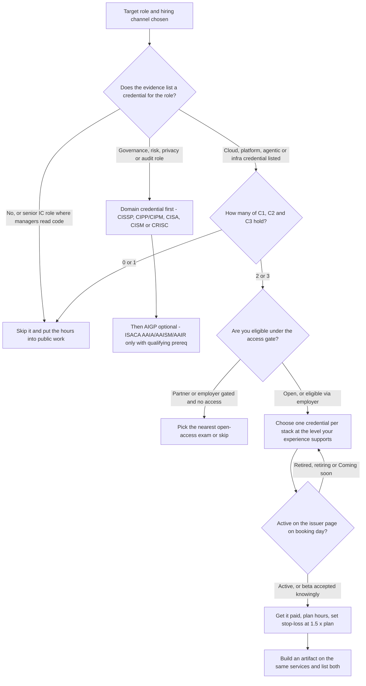

# Credential ROI: Whether a Certificate Is Worth It

> Whether a certificate is worth it for your target role and hiring channel, which credentials are open versus partner-gated, how knowledge overlap, voucher arbitrage and Decision Gates G0–G4 shape sequencing, what each issuer ecosystem actually delivers, and when to stop.

**Dates and scope.** This guide reconciles [T0-11](../../research/sessions/T0-11-certification-cloud-credential-roi.md) (2026-10-21) and [T0-15](../../research/sessions/T0-15-regulatory-ai-governance-career-families.md) (2026-10-23) with Research Pipeline 2 sessions [T0-29](../../research/sessions/T0-29-certifications-frontier-labs-ai-native-vendors.md) (frontier labs & AI-native), [T0-30](../../research/sessions/T0-30-certifications-courses-universities-india-programmes.md) (courses, universities & India programmes), [T0-31](../../research/sessions/T0-31-certifications-data-enterprise-ai-platforms.md) (data & enterprise platforms), [T0-32](../../research/sessions/T0-32-certifications-gpu-infrastructure-open-source.md) (GPU, infra & open-source), [T0-34](../../research/sessions/T0-34-certifications-governance-security-privacy-audit.md) (governance, security, privacy & audit), [T0-58](../../research/sessions/T0-58-role-dossier-ml-platform-engineer.md) (AWS `MLA-C02`/`ME1-C02`), and sequencing studies [T3-01](../../research/sessions/T3-01-genai-certification-stack-ranking-sequencing.md) and [T3-02](../../research/sessions/T3-02-genai-certification-stack-ranking-sequencing.md), plus live primary verification on 2026-11-19. Hyperscaler (**T0-28**) and developer-tool (**T0-33**) RP2 audits are deferred past 2026-12-05; their entries in the [certification catalog](credential-catalog.md) carry provisional flags. **Grades** (EGP-1.0): A primary or measured; B transparent secondary; C vendor, practitioner or single source; D judgement; M model output; P practice-curated and unmeasured.

## The short answer

1. **A certificate is a tie-breaker, and the hiring channel sets its value.** It counts most where hiring runs through IT services, staffing agencies, hyperscaler or SaaS partners, and GCC volume programmes — especially when the employer pays. It counts little at product companies and close to nothing at frontier labs and AI-first startups that publish credential-agnostic criteria [B/C · T0-11.F8; A/B · T0-32 L380–L381]. Across Axial Search's US segments, every engineering family sits at 3% or below for its top-listed credential (AI engineering n = 43,480: CCSP 0.6%, AWS SA 0.5%, CISM 0.5%; ML engineering n = 13,800: ≤0.2%) [C · T0-34 L51, L239–L243].
2. **Take one only if most of three conditions hold:** your target channel rewards it (C1), someone else pays or the hours fit your plan (C2), and your résumé lacks stronger verifiable signals (C3). In open-market roles where target postings name no certification, cap credential prep at ≤10–15% of job-search study time and put the rest into public artifacts [B/P · T0-11 L107, L113–L128].
3. **Check access before studying, cap at one per stack, and never book a retired exam.** Access — not price — blocks 13 of 28 major credentials in late 2026 (Claude Partner Network, Gemini Enterprise partner badges, OpenAI Partner Network, Palantir employer-gated exams, FDE ladders) [A · T3-02 L55; T0-29 L70, L74–L75; T0-31 L57]. AWS ML – Specialty (retired 2026-03-31), Azure AI-102 (retired 2026-06-30), AWS MLA-C01 (retired in English 2026-09-28) and Salesforce AI Associate (retired 2026-02-02) are gone; check the [certification catalog](credential-catalog.md) and issuer page before booking [A/B · T0-11.F1; T3-01 L115; T0-31 L54].
4. **If you sit more than one exam, selection, validity windows and voucher timing beat clever ordering.** Across 24 credentials, blueprint overlap alone saves ~40–45% of standalone study hours while ordering adds only ~4–7% over random order [M · T3-01 L133–L135; T3-02 L73]. Short validity windows (6–12 months), 6–14 month exam churn and voucher arbitrage (such as taking AWS `AIF-C01` first to save $100 across a 4-exam AWS stack) dominate real effort and cash [A/M · T3-01 L137, L690–L691; T3-02 L67].
5. **For governance, risk and audit roles, a domain credential comes first.** In Axial Search's US AI-governance sample (n = 1,997), **CISSP (10.4%)**, **AIGP (8.9%)**, **CIPP (8.2%)**, **CISM (8.1%)**, **CIPM (6.8%)**, **CRISC (6.4%)** and **CISA (5.9%)** lead; on the GRC Careers AI Governance board (n = 76; 67 merged), **CISA leads at 17.1%** (19.4% merged), followed by **CISM (13.2%)**, **CRISC (11.8%)**, **CIPP (9.2%)**, **CISSP (7.9%)**, **AIGP (6.6%; 7.5% merged)** and **CIPM (6.6%)** [C · T0-34 L51, L238; B COI · T0-34 L52, L620–L628]. Neither the EU AI Act nor India's DPDP Rules mandates any individual certification [B · T0-34 L59, L73, L321–L323].
6. **Skip ₹1.3–2.3 lakh ed-tech participation certificates and unverified private bodies, show real badges after projects, and set a stop-loss.** Zero of 29 US and India postings in T0-30 named any MOOC, university executive programme, Indian institute CEP bundle or private AI body (ARTiBA, GSDC, Blockchain Council, IABAC) [A · T0-30 L71, L74, L78]. List earned credentials with full name, exam code, dates and verification link after shipped projects, pause at 1.5× planned hours [P · T0-11 L139], and never use exam dumps [P · T0-11 L128].

## At a glance



C1 is the channel, C2 the payer or hours, C3 the signal gap; all three are defined below. For ranked tables across **194 vetted credentials** (three channel lenses, eight role families and a cost/hour collector's list, using the calibrated `[2.5, 4.0, 5.5]` conservative prior for unmeasured `hiring_signal` under decision D-026), see the [certification catalog](credential-catalog.md). For the role × ontology credential mapping, see [credentials by role](credentials-by-role.md).

## The decision rule: three conditions and one cap

T0-11's rule holds across all five RP2 certification sessions: take a vendor AI certification only if most of these conditions hold, cap it at one per cloud or platform stack, and otherwise spend the hours on inspectable artifacts [T0-11 L107; T0-30 L71; T0-32 L380].

| # | Condition | It holds when | Why it matters | Grade · source |
|---|---|---|---|---|
| C1 | Channel | Target employers hire through IT services, staffing agencies, hyperscaler/SaaS partners or GCC volume programmes, or standardise on one stack you can name | Certification requirements cluster in SI, partner and platform-locked postings (for example Deloitte AWS lists, Salesforce Agentforce, Palantir Foundry); product and frontier teams rarely ask | A/B/C · T0-11.F4, F8; T0-31 L55, L57; T3-02 L75 |
| C2 | Payer or hours | An employer or partner programme pays, or you can finish inside your planned hours | List exam fees are $0–$500 for technical credentials ($550–$1,749 for governance/offensive security); prep time is 51–90% of all-in cost for professional exams (time dominates fees ~6:1 across multi-exam plans) | M · T0-11.F12, L322; T3-01 L697; T0-32 L85; T0-34 L56 |
| C3 | Signal gap | Your résumé lacks a deployed system, shipped work or a recognisable prior employer | Experimental evidence shows narrow employment gains concentrated on thin résumés (+12% in the lowest employability tercile) and near-zero lift for strong résumés | A/B · T0-30 L72, L434; T3-01 L131 |
| Cap | One per stack | Always (unless a partner FDE ladder explicitly mandates a set) | No evidence supports badge stacking; renewal cycles (6–24 months) turn stacked badges into recurring maintenance debt | B/C · T0-11 L151; T3-01 L137 |

### Why the channel decides

- **Screening.** No source documents certification keywords as automatic ATS rejections. The hard gate is an employer-configured yes/no knockout question on the application form, which you see when applying [C · T0-11.F2]. In seven public recruiter guides, AI/ML Boolean strings contain no certification acronyms; certification terms appear only as optional boosters for cloud-architect roles [C · T0-11.F3, L252].
- **Postings across market segments.** CSET's pre-GenAI study (2010–2020) found any AI-related certification in 2.5% or less of AI-occupation postings and 1.5% at FAANG plus Microsoft [B · T0-11.F4]. Axial Search's 2026 US segment analysis confirms that governance is the sole AI family near 10% (CISSP 10.4%, AIGP 8.9%), while every technical segment sits at **3% or below** for its top credential (AI engineering n = 43,480: CCSP 0.6%, AWS SA 0.5%, CISM 0.5%; ML engineering n = 13,800: ≤0.2%; MLOps: CKA <1%; AI architecture n = 16,927: CSM 2.9%, AWS SA 1.7%; AI product n = 12,400: PMP 1.7%; AI implementation n = 3,159: 21% naming *any* certification) [C · T0-34 L51, L236–L245]. RP2 audits corroborate this sharp channel split: in T0-32's 47-posting AI-infrastructure sample, **0 of 40** product/infrastructure postings named an in-scope GPU or Kubernetes certification versus **2 of 7 (28.6%)** channel-employer postings [A/B · T0-32 L380–L381]; in T0-30's 29-posting US/India sample, **0 of 29** named any course, university, Indian institute or private-body certificate [A · T0-30 L71]. Hard requirements cluster in SI and platform-locked postings: Deloitte US FDE-AWS postings require "at least 3 of 6" named AWS certs (including already-retired `MLA-C01` — proving JDs lag exam retirements by 12–24 months) [A · T3-02 L75, L373], while T0-31 convenience samples found high platform-specific rates for Palantir Foundry (8 of 14 US, 4 required) and Salesforce Agentforce (7 of 17 US, 12 of 17 India) [B/C · T0-31 L55, L57].
- **Partner programmes and SI headcount targets.** Partner tiers require certified headcounts that drive post-hire employer sponsorship rather than open-market hiring scarcity [B/C · T0-11.F7–F8]. Verified 2026 rules include Microsoft Solutions Partner for Data & AI (updated 2026-10-23: vendor exams including `AI-103` and transitioning `AI-102`; zero Coursera certificates) [A · T0-30 L75], Anthropic's Claude Partner Network (`CCDV-F`, `CCAR-F`, `CCAR-P` only; **90-day active Claude usage required**; Services Track thresholds Select ≥10, Preferred ≥100, Global Premier ≥1,000; `CCAO-F` excluded) [A · T0-29 L71, L240–L241], CNCF KCSP (3+ `CKA` holders; `CKAD` excluded) [A · T0-32 L83], Cisco 360 Partner Value Index (`300-640 DCAI`) [A · T0-32 L412], Databricks Brickbuilder Partner Network (launched 2026-02-11) [A · T0-31 L221], Snowflake (`CoCo Foundational Accreditation` mandatory for Data Cloud Services partners effective 2026-11-02) [A · T0-31 L115, L222], Salesforce (March 2026 overhaul to Summit/Select tiers and 28 competencies) [B · T0-31 L223] and SAP PartnerEdge [B · T0-31 L225]. Named SI certification commitments underscore how institutional this channel is: Wipro targets **10,000** Claude front-line delivery experts in 18 months [A · T0-29 L245], Cognizant targets **5,000** Frontier Certified Engineers + **10,000** Business Operators [A · T0-29 L245], EPAM targets **>10,000** certified Claude architects [A · T3-02 L278], Accenture targets **~1,000** Gemini Enterprise FDEs [B · T3-02 L77] and **50,000** Claude practitioners alongside TCS (Global Premier, 50,000 licences), Infosys (10,000), UST (20,000), Capgemini (20,000), Persistent (3,000+) and Fractal (2,000) [C COI · T0-29 L245].
- **Pay.** Foote Partners' index (Q1 2026, 5,112 North American employers) puts the average AI-certification premium at 8.5% of base versus 14% for non-certified AI skills — cross-sectional employer pay figures, not causal estimates [B · T0-11.F5].
- **Who it helps (causal and experimental evidence).** Athey & Palikot (`arXiv 2405.00247`, >800,000 Coursera certificate earners without degrees in developing countries; 40,000 tracked; Coursera collaboration, COI) measured an **intent-to-treat (ITT) effect of +1.0 pp (+6% relative)** on new employment and **+1.2 pp (+9%)** on certificate-related jobs; LinkedIn sharing rose **+2.9 pp**, and the **+11 pp figure quoted in T0-11.F6 is the complier (LATE) effect** [A/B · T0-30 L72, L431; T3-01 L131]. Heterogeneity is decisive: the **lowest employability tercile gained +12% while the top tercile effect was negligible**, and counterfactual résumé scores rose +8.5 points on average (+15–20 for weak résumés vs near zero for strong ones), with zero direct callback measurement [A/B · T0-30 L431; T3-01 L131]. Two additional 2025–2026 experiments reinforce caution: an **Ithaka S+R choice experiment** (May 2026, n = 543 US hiring professionals) found an online bachelor's degree **lowered** candidate selection by **−2.5 pp (−4.9% relative)** relative to job-relevant software skills and experience [B · T0-30 L436], while **AEA RCT Registry trial 17143** (China résumé experiment, n = 1,500; working paper pending) reported **+42% callbacks** for advanced over basic occupational certificates [C · T0-30 L435].
- **What a pass proves (T0-11.F9 superseded) and dump exposure.** Verified hands-on and hybrid exams as of November 2026 include Google `PAA` (proctored MCQ + 2 Google Skills labs; lab proctoring unverified), free AWS Demonstrated live-sandbox microcredentials, AWS FDE sandboxes, NVIDIA `NCP-AIO` (30 MCQ + 3 live VM labs) plus `NCP-AII` and `NCP-AIN` ("hands-on lab included", split unstated), CNCF `CKA`/`CKAD`/`CKS` (live CLI), Red Hat `EX267` (OpenShift AI), SAP `C_AIG`/`C_JSD` (practical scenario assessments), Palantir Specialist (3h live Zoom-proctored build), Elastic Certified Engineer (3h live cluster), GIAC CyberLive (`GAIPS`, `GASAE`, `GOAA`, `GAIPT`, `GMLE`), OffSec `OSAI` (24h proctored practical), HTB `COAE` (7-day practical + report), TryHackMe `AI1` and `CAISP` (6h practical) [A/B/C · T3-01 L111–L113; T0-31 L59, L65; T0-32 L75–L76, L80, L844–L846; T0-34 L57, L590–L599]. MCQ-only exams face rapid signal decay from commercial dumps within weeks of GA (`MLA-C01`, pre-GA `PAA`, NVIDIA, `CCAR-F`/`CCAR-P`, `GES-C02`, `USAII`) [C · T0-11 L382; T0-29 L257; T0-30 L320; T0-31 L252; T3-02 L87], and even live CLI exams face leak circulation (17/17 search links for `CKA` dumps on Zenodo/HackMD/Substack/GitLab [D · T0-32 L435]).

## Access gating, FDE ladders, Waves 1–6 sequencing and Decision Gates

### Access is the primary filter

Before budgeting study time, check whether you are even eligible to register [A · T3-02 L55]:

| Access gate | Examples | Who can sit | Practical implication | Grade · source |
|---|---|---|---|---|
| **Partner-gated** | Anthropic Claude (`CCAO-F`, `CCDV-F`, `CCAR-F`, `CCAR-P`); Google Gemini Enterprise Partner Specialist (`GEM-DEP`, `GEM-AGT`); OpenAI Partner Network (10 practitioner certs); Snowflake `CoCo Foundational`; MongoDB `Application Delivery`; ServiceNow delivery accreditations | Staff of enrolled partner organisations using an approved corporate domain | Individuals and solo consultants cannot register (Claude Registered tier requires committing to **10 certified practitioners**, blocking solo consultants [A/D · T0-29 L240, L274]) | A/B/C · T0-29 L70, L75, L240; T3-01 L105, L119; T0-31 L58, L115, L228 |
| **Employer-gated** | Palantir Associate & Specialist (`Data`, `App`, `AI Engineer`); OpenAI AI Foundations pilot | Employees of active enterprise customers or partners (Palantir Specialist booked monthly via Ontologize) | High value inside Foundry/pilot shops; inaccessible from outside | A/B · T0-31 L57, L584–L589; T0-29 L74 |
| **Nomination / invite-only** | Anthropic Claude Frontier Academy (Resident / Frontier Deployed Engineer); Google Developer Experts (GDE); Microsoft MVP; AWS Community Builders (~10% acceptance, annual Jan ~2-week window) | Nominated partner engineers or sustained public community contributors | Cannot be purchased; treat as long-horizon community/partner outputs, not exams | A/B · T0-29 L495–L496; T0-30 L81, L256–L258 |
| **Prerequisite-gated** | ISACA `AAIA` (CISA or qualifying audit/accounting credential), `AAISM` (CISM or CISSP), `AAIR` (27 qualifying designations), `AAIG` beta (`CGEIT` or 6 yrs governance incl. 1 yr AI); CNCF `CKS` (prior `CKA`); Palantir Specialist (matching Associate); SnowPro Advanced (Core recommended) | Holders of an active baseline domain credential | Sequence the baseline domain credential first; check country-specific eligibility (notably `AAIA`/`AAIR` exclude Indian CA) | A/B · T0-34 L55, L117, L384; T0-31 L131; T0-32 L852; T0-31 L567 |

### Forward Deployed Engineer (FDE) ladders are vendor-closed

T3-01 and T3-02 audited all major hyperscaler and lab FDE enablement programmes and found **zero cross-vendor equivalence**: an AWS Professional or Anthropic Architect credential will not satisfy Google's "one Google Cloud Professional certification" rule [A/B · T3-01 L117, L341; T3-02 L63]:

- **AWS FDE Validated / Advanced:** Free hands-on validation in AWS-provisioned sandboxes via Skill Builder (~6–8h Validated / ~12–26h Advanced); requires an active AWS Associate/Professional cert for Validated and **`AIP-C01`** specifically for Advanced (partner-linked) [A/C · T3-01 L165, L429–L430; T3-02 L61, L328–L329].
- **Google Gemini Enterprise FDE enablement:** Requires one Google Cloud Professional cert (**`PAA`** or **`PMLE`**), **two** partner-only 6-month Gemini Enterprise badges (`GEM-DEP` + `GEM-AGT`), and an active customer project assignment [B · T3-01 L338, L431; T3-02 L63]. **Interview bar warning:** vendor-employed Google Cloud Partner FDE roles still screen with a **Python coding interview without IDE or AI assistance** [A · T3-02 L77, L371].
- **Microsoft FTE LevelUp:** Requires **`GH-300`** + **`AI-103`** (transitioning `AI-102` reported accepted) + **`AB-100`**, plus three milestones (~86h); partner staff earn **free exam vouchers on ≥80% practice assessment scores** [A/B · T3-01 L339, L432; T3-02 L63, L331].
- **Minimum multi-vendor FDE set:** Qualifying across all three hyperscaler FDE ladders requires at least **7 credentials** (~$929 exam fees, ~250–306h optimised vs ~359h naive) [A/B/M · T3-01 L341; T3-02 L65, L354].

### Overlap, Waves 1–6 sequencing, voucher arbitrage and Decision Gates G0–G4

If your employer or SI practice requires multiple credentials, T3-01's sequencing model (`L180–L342`, `L685–L698`) and T3-02's overlap simulation (`L69–L73`) give four concrete execution rules:

1. **Selection dominates order.** Across 24 credentials, pairwise blueprint overlap cuts standalone study hours by **~40–45%** (917h naive → 498h curated in T3-01; 815h naive → 489h practical in T3-02), whereas optimising order adds only **~4–7%** over random order [M · T3-01 L133–L135, L184–L192; T3-02 L73]. Cutting a target list from six exams to two beats any clever permutation of six.
2. **Directional study-overlap rules ("study X first, already know Y% of Z", ±15 pp [M · T3-01 L206–L218]):**
   - **`PAA` first** covers ~**82%** Gemini Agent Dev, **78%** `CCAR-P` / Gemini Deployment, **76%** `NCP-AAI`, **72%** `CCDV-F`, **68%** `GH-600`, **64%** `CCAR-F`, **62%** `AIP-C01`.
   - **`AIP-C01` first** covers ~**78%** `AIF-C01`, **70%** `CCDV-F`, **68%** `CCAR-P`, **65%** `NCP-AAI`, **58%** `PAA`.
   - **`PMLE` first** covers ~**75%** `AIF-C01`, **73%** `MLA`, **60%** Databricks ML Pro — whereas classical ML and agentic clusters share only **1–12%** (weak seeds: `AIF-C01` covers only **9%** of `AIP-C01`; `MLA` covers **3%** of `PAA`).
   - **Databricks pair:** `GenAI Engineer Associate` and `Context Engineer Associate` share ~60% content and save ~**35–42%** marginal study hours (neither the 80% vendor-blog rumour nor 20%) [M · T3-01 L121, L217; T3-02 L69].
3. **Waves 1–6 curated sequencing (expiry, access and voucher timing [P/M · T3-01 L197–L205]):**
   - **Wave 1 (open Tier 1 seeds):** `AIP-C01` (36-mo validity) then `PAA` (12-mo validity; remember the **2-month post-MCQ lab deadline**); AWS partners add free `AWS FDE Validated → Advanced` while skills are warm.
   - **Wave 2 (Claude block, partner-gated):** `CCAR-F` → `CCAR-P` → `CCDV-F` within one 12-month renewal window (wait until after `2026-12-07` for `CCAR-P`/`CCDV-F` refresh; Global Premier staff finish before `2026-12-31` waiver expiry).
   - **Wave 3 (stack branches, pick at most two):** Databricks (`GenAI` → `Context`), GitHub (`GH-300` → `GH-600`), or NVIDIA GPU/infra (`NCP-AIO`/`NCP-AII`; verify Certiverse before booking `NCP-AAI`/`NCP-GENL`).
   - **Wave 4 (classical ML cluster):** `PMLE` → `MLA-C02` (after GA `2027-01-14`).
   - **Wave 5 (cheap tail, named JD requirement only):** `AIF-C01`, `AIB-C01`, `GenAI Leader`, `GH-700`, `CCAO-F`, `AMD ROCm`, `NCA-GENL`.
   - **Wave 6 (just-in-time 6-month badges):** `GEM-AGT` + `GEM-DEP` immediately before the Google FDE bootcamp so 6-month badges do not expire first.
4. **AWS `$100` repeat-voucher arbitrage [A/M · T0-11 L230; T3-01 L139, L690–L691]:** Passing any AWS certification unlocks a **50% discount voucher** for the next AWS exam (verify at checkout). For a 4-exam AWS stack (`AIF-C01` $100 + `AIP-C01` $300 + `MLA-C02` $150 GA + `AIB-C01` $100), taking `AIP-C01` first costs **$475** (`$300 + $75 + $50 + $50`), whereas taking **`AIF-C01` first** drops the total to **$375** (`$100 + $150 + $75 + $50`) — saving **$100 net** for ~6–9 extra early study hours (and `Plan B` drops from `$1,249` to `$1,024`).

**Decision Gates G0–G4 and portfolio parity [P/M · T3-01 L321–L331]:**

| Gate | Trigger | Stop rule |
|---|---|---|
| **G0** | Before spending any fee | Strong signal + product/frontier target → skip or cap at 1 flagship (`AIP-C01` or `PAA`) and ship code. Weak signal or SI/partner target → proceed after verifying partner/employer access. |
| **G1** | After first 1–2 flagship exams | If the next exam adds **<30% unique blueprint share** over what you hold and no named JD, partner tier or contract calls for it, **stop buying and ship a ≥40h public project**. |
| **G2** | After core cloud / partner block | Pick **at most two** platform branches matching target employers; skip all other stacks. |
| **G3** | Before any Tier 3–4 or foundational purchase | No written JD line, partner rule or client contract → treat as free learning-only (skip the exam fee). |
| **G4** | 60 days before any 12-month expiry | Renew only if counted for an active partner tier, prerequisite or job search (Claude on-time renewal is free open-book; lapsing triggers a full-fee retake). |
| **Portfolio parity** | Continuous (career switchers: T3-01 Plan B′ splits **14h cert + 6h portfolio/wk**) | For every **40h** of exam study, ship at least **15h** of public proof of work (deployed agent/system with evals, traces and README) [M · T3-01 L268, L330]. |

### Time-boxed 2026–2027 commercial deadlines and wait triggers

| Date | Event / Deadline | Actionable rule | Grade · source |
|---|---|---|---|
| **2026-11-22** | UiPath `AABPv1` 50% launch discount ends | Book only if on a UiPath delivery team | A/C · T0-31 L60, L263 |
| **2026-11-30 – 12-04** | AWS re:Invent 2026 | Wait trigger before locking Q1 2027 AWS exam bookings (watch for Bedrock/agentic launches or `MLA-C02` shifts) | P · T0-11 L140; T3-01 L140 |
| **2026-12-01** | Databricks dual-camera online proctoring rule | Takes effect on Kryterion Webassessor for Context & ML exams; verify webcam setup or book a test centre | A · T3-01 L399, L404 |
| **2026-12-07** | Anthropic content refresh (`CCAO-F`, `CCDV-F`, `CCAR-P`) | Study against the updated guides (due 2026-11-17) or sit before refresh; `CCAR-F` not listed in refresh | A · T0-29 L300–L301 |
| **2026-12-31** | Three simultaneous promotional cliffs | (1) Anthropic Global Premier fee waiver ends; (2) SAP `C_JSD` free attempt & TechEd 25% 2-attempt bundle end; (3) Red Hat `AI267LS` 50% course+exam promo ends | A/B · T0-29 L242; T0-31 L261; T0-32 L511 |
| **2027-01-14** | AWS `MLA-C02` GA | Wait for GA unless wanting the `$75` beta (note live AWS page inconsistently prints `ME1-C02`) | A/C · T3-01 L384; T0-58 L655 |
| **2027-02-15** | AWS `AIB-C01` beta ($50) / Early Adopter window closes | Business-audience only; pull forward only if required | C · T3-01 L319; T3-02 L85 |
| **2027-05-13** | India DPDP Rules SDF DPO & auditor duties commence | Skills driver for India privacy roles (no individual cert mandated by law) | B · T0-34 L59, L323 |
| **Q2 2027+ watchlist** | CompTIA `AgentOps+` (reported Q2 2027, C); ISC2 AI security beta (hoped early 2027, B); EU AI Act Annex III (`2027-12-02`) | Track before committing to multi-year renewal ladders | B/C · T3-02 L85; T0-34 L59, L392 |

## Per-issuer deep dives (RP2 reconciliation)

For full fees, exam codes, validity and Monte Carlo channel rankings of all **194 credentials** (evaluated with the calibrated `[2.5, 4.0, 5.5]` conservative prior where `hiring_signal` is unmeasured so empirically measured credentials are never penalised against zero-posting peers — D-026 calibration, 2026-11-19), open the [certification catalog](credential-catalog.md).

### 1. Hyperscalers & GitHub (provisional pending T0-28 and T0-33)

- **AWS:** `AIP-C01` ($300, 180 min, 3-yr validity, AWS FDE Advanced gate) is the flagship open-access GenAI exam; `MLA-C01` retired in English on 2026-09-28 and is replaced by `MLA-C02` (beta $75, GA 2027-01-14, adds GenAI/agentic workloads; note AWS's live page inconsistently prints `ME1-C02` [A · T0-58 L256, L655]); `AIB-C01` (beta $50 / std $100) targets non-technical business roles; free **AWS Demonstrated** microcredentials test live AWS sandboxes with no MCQ [A/B · T3-01 L113–L115, L382–L387]. Use the 50% repeat-exam voucher rule when sitting >1 AWS exam [A · T0-11 L230; T3-01 L690–L691].
- **Google Cloud:** `PAA` ($200 GA mid-November 2026, 1-yr validity) combines a 2h proctored MCQ with two Google Skills labs (<5h total) covering both MCP and A2A — **the two labs must be completed within 2 months of passing the MCQ or the pass lapses** [A · T3-01 L111, L394; T3-02 L59]. `PMLE` ($200, guide rewritten 2026-06-01; 2-vs-3-yr validity ambiguity pending T0-28 [C/D · T3-01 L137]) remains the ML anchor; `GEM-DEP` and `GEM-AGT` are partner-only 6-month lab badges for FDE [A/B · T3-01 L119, L395–L397].
- **Microsoft & GitHub:** `AI-102` retired 2026-06-30, replaced by `AI-103` ($165, beta label as of T0-11; counted on Microsoft Solutions Partner Data & AI skilling updated 2026-10-23) [A/B · T0-11 L487, L512; T0-30 L75]. GitHub `GH-300` ($99) is a Microsoft FTE gate; `GH-600` ($165, GA July 2026) tests MCP at configuration depth without A2A (confirm India GA availability since beta excluded India); `GH-700` is a business-audience beta [A/B · T3-01 L123, L412–L414].

### 2. Frontier labs & AI-native vendors (T0-29)

- **Anthropic Claude (COI disclosure & V0 defence risk):** T0-29 carried model-issuer COI; fees, access and litigation status were independently live-verified on 2026-11-19. Four proctored Pearson VUE exams (`CCAO-F` $99, `CCDV-F` $125, `CCAR-F` $125, `CCAR-P` $175; 120 min; pass 720/1000; 12-mo validity with free on-time open-book renewal; **item counts and domain weights remain Grade C** from mock-exam vendors because PDF guides were fetch-blocked [A/C · T0-29 L69–L73, L489–L492]) are **strictly restricted to Claude Partner Network staff** (Registered tier requires committing to **10 certified practitioners**, blocking solo consultants [A/D · T0-29 L240, L274]). Only `CCDV-F`, `CCAR-F` and `CCAR-P` count toward partner tiers — **`CCAO-F` does NOT count** (correcting T3-02 L116) — and counted holders must maintain **active Claude usage within the prior 90 days** [A · T0-29 L71, L240]. **Operational rules & traps:** Select/Preferred get **50% off first attempts AND retakes** (Global Premier free through 2026-12-31); retake waits are **14 / 30 / 90 days** (max 4 attempts/12mo; resets on new version); Pearson checkout migration landed `2026-11-12` (earlier registrations valid 5 yrs); free reschedule up to 1h online / 48h test centre; official practice exam retired `2026-06-30`; **substantial exam updates may force existing holders to re-pass**; **exam results and status may be shared with the partner employer** (though the credential itself moves with the individual); India is NOT barred from online proctoring (Iran suspended `2026-09-08`); and signed-out Partner Academy pages display a misleading **`"Register FREE"`** button on paid `$99–$175` exams [A · T0-29 L73, L241–L242, L256–L257, L277, L297, L347–L349, L393]. `CCAR-F` was the sole frontier-lab credential found in live partner postings (LatentBridge, ApTask, Unisys India, EXL in India; Caylent `$150k–$167.5k` in US) [B · T0-29 L208–L216]. **V0 geopolitical risk for US defence primes:** a 2–1 D.C. Circuit panel (*Anthropic PBC v. Department of War*, 2026-09-25) upheld the Pentagon's FASCSA supply-chain exclusion (diverging from an N.D. Cal ruling of 2026-08-27 under 10 U.S.C. § 3252); rehearing *en banc* petition filed 2026-10-13 with mandate withheld as of 2026-11-19 (civilian agencies obtained FedRAMP High in July 2026) [A/B · T0-29 L83, L391].
- **OpenAI:** No public proctored individual exam or public exam price exists as of 2026-11-19. Beware the **`"OpenAI AI Foundations"` naming collision** (both an employer-pilot beta cert via Walmart/BCG/Accenture/John Deere and a free non-cert OpenAI Academy course) [A/B · T0-29 L74, L387]. The **OpenAI Partner Network** (launched `2026-06-14`, Select/Advanced/Elite tiers, target **300,000** certified consultants by end-2026) runs **10 named practitioner credentials** issued via Accredible (12-mo validity, partner-gated, non-public formats) [B/C · T0-29 L75, L248, L507].
- **LangChain, Neo4j, Weaviate, Hugging Face, DeepLearning.AI & vendor absences:** **LangChain Certified Agent Engineer (LCAE)** is the sole open-enrolment paid proctored exam in T0-29: **40 MCQ, 120 min, pass 28/40**, online proctored via **Talview** (ID & room checks), 4 equal domains × 25% (Building, Testing, Deploying, Monitoring), **$99 including 1 free resit**, 24-mo validity, Accredible certificate and results within 72h — strong cost-to-value despite unmeasured hiring signal (0 postings found) [A · T0-29 L76, L258, L271, L497]. **Neo4j & Generative AI** is free, online-proctored, open-book with hands-on Cypher (**50 Qs, 60 min, 80% pass**, 30% GraphRAG/Vectors + 12% MCP, 72% first-attempt pass rate [C], unlimited retakes after 24h) [A/C · T0-29 L77, L259, L272, L500]. **Weaviate** certification issuance remains in development (Coursera Weaviate courses are third-party, not issuer-run) [A · T0-29 L78, L394]. **Hugging Face** (free Agents Fundamentals & Completion, MCP, Context) issues plain image files on a public dataset repo (weak anti-forgery verification; LLM Course awards chapter-level certs only) [A · T0-29 L80, L261, L511–L515]. **DeepLearning.AI** Pro is `$25/mo` annual / `$30/mo` monthly (or `$49/mo` Coursera), and short courses award `"Accomplishments"`, not official certificates [A/B · T0-29 L281, L516–L517]. **Explicit vendor absences (avoid third-party look-alike resellers):** **Pinecone, LlamaIndex, Cohere, Mistral, Weights & Biases, Qdrant and Zilliz have ZERO issuer-run certifications** — third-party Credly "LlamaIndex" badges and trade-press stories claiming a "Cohere credentialing programme" or "Anthropic API Developer Certificate" are not official [A/B · T0-29 L363–L365, L392–L394].

### 3. Data & enterprise AI platforms (T0-31)

Nine of eleven enterprise-platform issuers added, renamed, recoded, retired or reformatted AI credentials after 2025-01-01 [A · T0-31 L63]. Certify here **only** if your target employer or SI practice runs that specific platform:

- **Salesforce:** `Certified Agentforce Specialist` (`AI-201`, $200, retake **`$100`**, 60 scored + up to 5 unscored, 105 min, Spring '26 pass **72%** vs 73% older, annual Trailhead maintenance; name Grade A, exam specs **Grade C**; renamed from AI Specialist 2025-03-03; `AI Associate` retired 2026-02-02) showed the strongest matching-posting signal in T0-31 (**7/17 US, 12/17 India**, incl. Cognizant & Mercedes-Benz R&D India) [A/B/C · T0-31 L54–L55, L116, L212, L572]. **`Data 360 Consultant`** (formerly Data Cloud Consultant) is frequently paired beside it [C · T0-31 L72, L119]. **Verification erasure trap:** retired Salesforce credentials **leave Trailhead's public verification page** — holders of legacy `AI Associate` lose active verification URLs [A · T0-31 L243, L419].
- **Databricks:** Four catalogue changes in 2026; `GenAI Engineer Associate` ($200, refreshed 2026-03-18 for Agent Bricks/MCP) and `Context Engineer Associate` ($200, GA 2026-07-29; dual-camera proctoring from 2026-12-01; first major *data-platform* context exam — qualifying the "industry first" claim because unaccredited commercial body AI CERTs already sells an "AI+ Context Engineering" cert [A/C · T3-02 L83]) share ~35–42% study-hour overlap [A/B/M · T0-31 L51–L53; T3-01 L121, L399]. **India & billing traps:** Databricks accepts **foreign currency only** (no INR billing), and in India **`Data Engineer Assoc/Prof` led at 5/17 postings** (incl. Chubb GCC mandatory; separate 25-item `$200` online-only renewal exam) versus only **1/17** for `GenAI Associate` (`3/3` non-US DE/SG/ZA vs `0/9` US) [A/B · T0-31 L106, L190–L192, L212, L235].
- **Snowflake:** `SnowPro Specialty: Gen AI` (`GES-C02`, recoded from `GES-C01` 2026-05-19; `GES-C01` retired 2026-07-20; **Grade C** due to conflicting third-party specs: 55 Q / 85 min / $225 vs 65 Q / 115 min / $275) appeared in **0/32** Snowflake-AI postings versus **`SnowPro Core` (`COF-C03`, $175)** in **14/15 US and 7/17 India** (incl. Accenture must-have) — earn Core first [B/C · T0-31 L56, L158, L212, L566–L569]. Cost savers: **20% India regional discount (`$180` vs `$225` on `GES-C02`, C)** and **50%-off recertification exams (`$88` Core, `$188` Advanced, A)**; 7-day retake wait, max 4/12mo [A/C · T0-31 L111–L113, L235, L259]. Partners must track **`Snowflake CoCo Foundational Accreditation`** (mandatory for Data Cloud Services partners effective 2026-11-02) [A · T0-31 L115, L571].
- **Palantir:** Employer-gated Associates (refreshed 2026-08-03: Data Engineer, App Developer, AI Engineer; earlier vouchers invalidated) gate 3-hour live Zoom-proctored **Specialists** ($350 via Ontologize, launched 2026-09-30: Plan 20 / Build 120 / Modify 40 min, open internet, 30-day cooldown) — **monthly sessions through a single partner create capacity bottlenecks for India candidates** [A · T0-31 L57, L65, L131, L262, L421, L584–L589]. Highest rigour in T0-31; 8/14 US Foundry postings named a Palantir cert (4 required).
- **SAP, ServiceNow, UiPath, MongoDB, Elastic & Dataiku:** SAP moved to practical scenario assessments in Q2 2026 (**pre-Q2-2026 MCQ guides are obsolete**; no standalone fee — requires **SAP Learning Hub** subscription; **4 failed attempts = 1-year lockout**; results take up to **20 business days**; `C_JSD` free attempt and TechEd 25% 2-attempt bundle run through 2026-12-31; Deloitte India required SAP Business AI or Joule cert) [A/B · T0-31 L59, L212, L244, L261, L420, L581–L583]. ServiceNow has no standalone proctored AI exam — mainline `CSA`/`CAD`/`CIS` appeared in **9/10** AI postings vs **3/10** AI accreditations (Partner Finder exposes per-partner holder counts, e.g. IBM Consulting 97) [B/C · T0-31 L58, L197–L198, L224]. UiPath launched three agentic exams in 14 months (`AAAv1`, `AAPv1`, `AABPv1` — **50% discount ends 2026-11-22**, up to **14-business-day** cert issue lag; Cognizant India made UiPath Academy agentic courses mandatory) [A/B/C · T0-31 L60, L212, L246, L263]. MongoDB offers **50% off `Associate Developer (C100DEV, $150)`** after completing its learning path plus partner-only **`Application Delivery Certification`** (RAG + Atlas Vector Search) alongside 6 free badges [A/C · T0-31 L145–L146, L264, L601–L602]. **Elastic Certified Engineer** ($500, 3h live cluster) upgraded **v8.15 → v9.3 on 2026-09-01** and appeared in **5/15** consulting postings vs **0/15** for Elastic GenAI Associate [B/C · T0-31 L61, L148, L203–L204]. Dataiku `ML`/`MLOps Practitioner` are **not available on the free edition** and `GenAI Practitioner` requires connecting your own LLM API [B · T0-31 L149, L607].

### 4. GPU, infrastructure & open-source (T0-32)

- **The AI-infrastructure skills-vs-certs chasm:** In T0-32's AI-infra/inference posting stratum (Frame S2, n = 20), **85%** named Kubernetes and GPU, **35%** CUDA and vLLM, **30%** Triton and **20%** NCCL — yet **0 of 20 named any GPU or Kubernetes certification**, **no NVIDIA, Linux Foundation or AMD exam blueprint even names vLLM, Triton, NCCL or CUDA**, and a probe posting from **NVIDIA Ltd.** itself required `CKA`, `CKAD` and `CKS` while naming **zero NVIDIA certifications** [A/B · T0-32 L361–L371, L399, L421, L479]. Both in-scope NVIDIA cert hits came from OEM/channel partners (ePlus US, Submer India: 2/7 = 28.6%), and neither cited current exam codes [A · T0-32 L357, L381].
- **Kubernetes (`CKA`, `CKAD`, `CKS`):** T0-32 K3 confirms `CKA` is active at **Intermediate** level, $445 (bundles: `$625` THRIVE-ONE, `$645` LFS258), 120-min live CLI exam (K8s v1.37, 1 retake + Killer.sh 2×36h), 24-mo validity [A · T0-32 L75, L512, L632, L850]. `CKA` and `CKAD` each appeared in 27/1,675 (1.6%) LinuxCareers postings [B · T0-32 L395]. CNCF's KCSP programme requires 3+ `CKA` holders and excludes `CKAD` (note the KCSP page quotes a stale `$395` fee vs `$445` on the exam page) [A · T0-32 L83, L717].
- **NVIDIA (13 exam codes, hands-on fix & K2 reconciliation):** Five associate exams ($125, 60 min; `NCA-GENL` active; `NCA-AMAD` launched Oct 2026 covering 17% Agentic AI / 17% Data Flywheel / 15% Inference / 6% Physical AI) and eight professional exams ($200–$500, 24-mo validity; including **`NCP-OUSD`** $200, sole weak-link Embodied/Physical AI mapping [A/D · T0-32 L605, L848]). **Hands-on correction:** only **`NCP-AIO`** ($500) publishes the exact **30 MCQ (50%) + 3 live VM labs (50%)** split (Slurm/K8s/BCM), while NVIDIA's own pages for **`NCP-AII`** ($400) and **`NCP-AIN`** ($500) also state **"hands-on lab included"** (question-vs-lab split unstated) [A · T0-32 L76, L844–L846]. **K2 reconciliation (`NCP-GENL` and `NCP-AAI`):** Both exam pages displayed `(Coming soon)` beside Register on 2026-10-30 while the hub listed $200 (and `NCP-AAI` weights sum to 98% [A · T0-32 L74, L631, L715]); live 2026-11-19 checks confirmed mixed portal status alongside rolling Certiverse availability, so both stay `announced` (V0) — confirm Certiverse checkout before paying for prep. Watch for NVIDIA's **19 November End-of-Year Webinar 50% exam discount** (India eligibility unstated [A · T0-32 L507]).
- **Linux Foundation AI (`MCPA`, `PTCA`), AMD ROCm, Cisco, Red Hat, Intel & Anyscale:** **`PTCA`** (PyTorch, June 2026, $250 exam-only; **`$299` pathway bundle with LFD2000–2003** is only +$49!) and **`MCPA`** (Sept 2026, $250, 24% security/governance, 20% conference discount; duration conflicts **90 min** exam page vs **120 min** press release/CSA note; CSA calls it a *"floor, not a ceiling"* with no higher tier) are vendor-neutral with 0/47 posting hits [A/C · T0-32 L77, L436, L512–L513, L855–L856]. **AMD ROCm Associate** is free (5 modules + Docker GPU labs + exam, Credly, 24-mo; ROCm in 0/47 postings; Pro/Expert announced with conflicting timelines; separate older **`ROCm Star`** awards **$50/$100 AMD Developer Cloud credits**) [A · T0-32 L78, L371, L722, L857–L860]. **Red Hat `EX267`** was retitled *Red Hat Certified Developer in AI* (2026-09-17; OpenShift AI 3.3 / OCP 4.20; prereqs `DO288 + AI267`; validity unpublished; `AI267LS` 50% off through 2026-12-31; Global Knowledge €530 excl. VAT, C) [A/C · T0-32 L80, L511, L657, L723, L865]. **Cisco `300-640 DCAI`** (CCNP Data Center, earns **Cisco 360 Partner Value Index points**; fee/validity unpublished) and **`810-110 AITECH`** ($150 or Cisco Learning Credits, 36-mo) serve Cisco data-centre accounts [A · T0-32 L79, L412, L659, L863–L864]. **Intel** offers `MLOps Professional` ($199) and `Edge AI Developer` ($99, OpenVINO; undated pages) [A · T0-32 L725, L861–L862]; **Anyscale Ray Foundations Certification** remains in beta/post-pilot ambiguity [A · T0-32 L724, L866].

### 5. Governance, security, privacy & audit (T0-34)

- **Domain credentials lead hiring signal (corrected `T0-34` data):** Axial Search's 1,997-posting US AI-governance dataset (Jan–Aug 2026; treat as **±3 pp** due to snapshot drift — AIGP moved from 6.5% to 8.7–8.9% [C · T0-34 L51, L61]) ranks **`CISSP` (10.4% table / 10.7% prose — sole figure >10%)**, **`AIGP` (8.9%)**, **`CIPP` (8.2%)**, **`CISM` (8.1%)**, **`CIPM` (6.8%)**, **`CRISC` (6.4%)**, **`CISA` (5.9%)** and `CAIGP` (2.4%) [C · T0-34 L51, L238, L607–L614]. On the specialised GRC Careers AI Governance board (n = 76 listings on 2026-11-12; 67 after merging 10 identical KPMG listings; board sells AIGP prep, COI), domain anchors dominate even more starkly: **`CISA` #1 at 17.1%** (13/76; 19.4% merged), **`CISM` 13.2%** (10/76; 14.9% merged), **`CRISC` 11.8%** (9/76; 13.4% merged), **`CIPP` 9.2%** (7/76; 10.4% merged), **`CISSP` 7.9%** (6/76; 9.0% merged), **`AIGP` 6.6%** (5/76; 7.5% merged; 10.0% of 30 AI-Gov-tagged) and **`CIPM` 6.6%** (5/76; 7.5% merged) [B COI · T0-34 L52, L620–L628]. Seniority skew: 36% of VP AI-governance postings named a cert vs 14% of Directors [C · T0-34 L353]. By contrast, targeted searches found **zero public postings** naming 11 newer AI governance/security exams (`SecAI+`, `AAIA`, `AAIR`, `TAISE`, `GAIPS`, `GASAE`, `GOAA`, `GAIPT`, `OSAI`, `HTB COAE`, `EXIN AICP`) [B/C · T0-34 L53].
- **IAPP `AIGP` Year-1 cost crossover & accreditation gap:** List fees are $649 member / $799 non-member (retake $475 / $625; 100 items, 85 scored, ~30% case studies, 3h incl. optional 15-min break, pass 300/500; BoK v2.1 effective Feb 2026, 4 domains) [A/B · T0-34 L50, L110, L545]. **Year-1 arithmetic trap:** non-member (**$799**, Year-1 maintenance fee included) beats member (**$649 + $295 = $944**) by **$145** if sitting only AIGP — IAPP membership only wins when holding **≥2 IAPP credentials** (one maintenance fee covers all IAPP certs) [M · T0-34 L300–L302, L647]. Event attendees can also check IAPP's **$450 conference exam add-on** [B · T0-34 L440]. Unlike `CIPP/E`, `CIPP/US`, `CIPM` and `CIPT` (which vendors list as ANAB ISO/IEC 17024 accredited), **no ISO/IEC 17024 listing was found for AIGP** [B/C · T0-34 L50, L269].
- **ISACA AI Suite (`AAIA`, `AAISM`, `AAIR`, `AAIG`) & India constraints:** Active exams cost **$459 member / $599 non-member + $50 application fee** ($509 / $649 total) and have **no fixed expiry** (maintained via annual fee + 30 CPE/3yr + keeping the prerequisite active) [A/M · T0-34 L56, L303, L549–L551]. T0-34 K10 widens **`AAIA`** eligibility to CISA or (with IT-audit/advisory role) CIA, US/AU/CA/JP/HK CPA, ACCA/FCCA, ICAEW, CA ANZ or Nigerian CNA — **excluding Indian CA** — with a 5-year post-pass application window, 4 languages and domain weights AI Operations 46%, Governance & Risk 33%, Auditing Tools 21% [A · T0-34 L55, L114, L384]. **`AAISM`** requires active CISM or CISSP; **`AAIR`** (launched 2026-04-15) accepts 27 designations (incl. `CISA`, `CISM`, `CRISC`, `CGEIT`, `CDPSE`, `CISSP`); **`AAIG`** beta (closed 2026-11-13) requires active **`CGEIT`** or 6 yrs enterprise governance incl. 1 yr AI [A · T0-34 L55, L115–L117, L552]. **Two traps:** (1) ISACA's own pages conflict on `AAIR` annual maintenance (**$45/$85** on AAIR page vs **$20/$35** covering all Advanced certs on AAIA/AAISM pages) [A/B · T0-34 L436]; (2) third-party prep sites mistakenly paste `AAIR`'s launch date and domains onto `AAIA` [B/C · T0-34 L437]. **Mandatory PSI test centre rule:** residents of **India, mainland China and Hong Kong** must sit ISACA's advanced AI exams in-person [A · T0-34 L55, L549–L551].
- **ISO/IEC 42001, India governance shift & regulatory "no individual cert required" rule:** In T0-34's India purposive sample (n = 9), **`ISO/IEC 42001` Lead Implementer/Auditor appeared in 5/9** (ANSR, FICO, HCLTech, Brillio, Hiring Mavericks) beside `CISA` (6/9), `CISSP` (5/9), `CRISC` (5/9), `ISO 27001` (4/9), `AIGP` (3/9) and **`DSCI DCPP/DCPLA` (0/9)**; HCLTech, Infosys, Cognizant, Mphasis and Presidio hold **org-level ISO/IEC 42001** [B/C · T0-34 L54, L221, L258, L634]. **PECB** offers both bundled partner training (~AU$3,535+GST / ~$2,300) and a **$599–$659 self-study reseller route** (C), with experience-hour tiers (Provisional 0 → Implementer/Auditor 2y+200h → Lead 5y [2 AI]+300h → Senior Lead 10y [7 AI]+1,000h); **accreditation caveat:** PECB distinguishes ISO/IEC 17024 `"certified"` (IAS/UKAS/COFRAC/KAB) from ANAB ASTM E2659 `"certificate holder"`, and ISO/IEC 42001 accreditation scope was not opened [B/C · T0-34 L58, L139–L140, L274, L310, L441]. **BSI** Lead Auditor/Implementer (£2,585 UK list; lower India fee) and **TÜV Rheinland India** (course page claims CQI/IRCA, unverified) award training-academy completion certificates [B · T0-34 L58, L143–L144]. In India, **`DSCI DCPP`** costs **`₹17,700`** (`₹15,000 + 18% GST`) and **`DCPLA`** costs **`₹37,760`** (`₹32,000 + 18% GST`), alongside **`DCDPO`** [B/M · T0-34 L56, L311, L587, L649]. **Regulatory reality check:** neither the **EU AI Act** (Digital Omnibus Regulation (EU) 2026/1744: Annex III `2027-12-02`, Annex I `2028-08-02`) nor **India's DPDP Rules** (notified `2025-11-13`, SDF DPO/auditor duties `2027-05-13`) requires any individual certification; `ISO/IEC 42001` does **not** by itself confer EU AI Act presumption of conformity, and `ISO/IEC 42006:2025` governs *organisational* certifiers, not individuals — do not pay `$1,844` (Learning Tree `1289`) or `€690` (Austrian Standards `P85`) believing law mandates it [B/C · T0-34 L58–L59, L73, L321–L323, L600–L602].
- **Hands-on offensive & technical AI security:** CyberSN tracked **2,409** US AI Security Engineer postings from Jan–Sep 2026 (**+268.3% YoY**) while overall cybersecurity postings fell **26.4%** [B · T0-34 L248, L644]. For [AI Security Engineer](../02-roles/hubs/ai-security-engineer.md) roles, practical exams outperform MCQ theory: **OffSec `OSAI`** (`AI-300`, 23h45m proctored practical + 24h report, pass 75 pts, **$1,749** bundle, **OSAI does not expire** / `OSAI+` 3 yrs), **HTB `COAE`** (7-day practical + report, requires Google-built SAIF-aligned AI Red Teamer path, ~$210 voucher / $550 Silver Annual), **TryHackMe `AI1`** ($399 incl. 1 retake + 3mo Premium, C), **GIAC CyberLive** (`GAIPS`, `GASAE`, `GOAA`, `GAIPT`, `GMLE` — ~$999 exam-only vs **>$9,000** full SANS course bundle; renewal ~$479–$499/4yr; ANAB ISO/IEC 17024), **CompTIA `SecAI+`** (`CY0-001`, Feb 2026, $298–$359 resellers; **NOT confirmed DoD 8140-approved**; DoD 8140 Data/AI work roles list qualifications "coming soon" [B/C · T0-34 L60, L256, L439]) and **`CAISP`** (6h practical, $1,099, COI) [A/B/C · T0-34 L57, L163–L178, L306, L588–L599]. Hold off on EC-Council's Feb 2026 AI suite (`AI|E`, `C|AIPM`, `C|OASP`, `C|RAGE`) until formats, fees and hiring signal are verified [B · T0-34 L97, L565–L568].

### 6. Courses, universities, Indian programmes & recognition (T0-30)

T0-30 separates four categories that marketing pages routinely conflate — and found **0 of 15 US and 0 of 14 India GenAI postings** naming any credential from this entire group [A · T0-30 L70–L71]:

- **MOOCs (Coursera, Udacity, DataCamp):** Treat as cheap structured learning (T0-30 R2 recommends `IBM RAG & Agentic AI` or `IBM GenAI Engineering` [up to 17 ACE credits] for Applied AI, and `Machine Learning Specialization` → `Deep Learning Specialization` for ML), not hiring credentials [A · T0-30 L91, L172–L184]. **Platform traps & merger:** **Coursera and Udemy merged on 2026-05-11** (SEC Form 10-Q, A) followed by a workforce reduction on 2026-07-06 [A · T0-30 L80, L349–L351]; Microsoft's Coursera `AI & ML Engineering` page was **still advertising 50% off retired `AI-102`** on 2026-11-13 despite zero Microsoft partner credit [A · T0-30 L75, L80, L541]; **naming traps** include Coursera's *"Enterprise AI and Data Engineering with Databricks"* (issued by **Pragmatic AI Labs**, NOT Databricks) and Coursera's *"Google Cloud Generative AI Leader Professional Certificate"* (NOT Google Cloud's proctored `GAIL` exam) [A · T0-30 L181, L187, L542]; Coursera Plus shows unresolved `$399` vs `$239/yr` promo conflicts (India Sept 2025 press release quoted `₹2,099/mo` or `₹13,999/yr` Plus, C; affiliate `₹7,499–7,999/yr` unverified Grade E) [A/C · T0-30 L327–L329]; `Google AI Professional Certificate` excludes its 3-month Google AI Pro bundle for financial-aid recipients; `Vanderbilt GenAI SE` requires paid Claude Code + API keys; `IBM RAG & Agentic AI` lists 101h inside vs 24h in the header; and **DataCamp certifications must be completed within 30 days of registration** inside a Premium subscription [A · T0-30 L174–L186, L203].
- **US university & executive certificates:** Credit-bearing CMU Online Graduate Certificate in GenAI & LLMs ($25,452, 36 units) carries academic rigour at university tuition; non-degree executive certificates (Stanford Online $2,045/course = $6,135 for 3, Berkeley ExecEd $7,975, CMU INI $8,975, MIT ProLearn) carry zero verified GenAI posting pull [A · T0-30 L73, L218–L222].
- **Indian institute CEP / ed-tech programmes (high buyer-beware risk):** Programmes co-branded with IIT/IISc/IIIT via ed-tech partners — IIT Delhi CEP (₹2,30,100 incl. GST + ₹1,000 non-refundable app fee; requires ≥60% marks + ≥80% attendance), IITM Pravartak / Jaro (₹1,30,000 + GST + ₹1,500+GST non-refundable app fee; **does not state legal certificate issuer**), IISc CCE / TalentSprint (proctored online assessments, 105h, non-refundable) and IIIT-H / TalentSprint (78h, non-refundable) — issue **certificates of participation** (not degrees, no placement guarantee) and had **0 of 14 India posting hits** [A · T0-30 L71, L78, L228–L231]. **Consumer-court & UGC warnings:** Chandigarh SCDRC (Appeal 192/2025, `2025-07-10`, Grade A court record) rejected **Eduonix**'s plea that ed-tech isn't a consumer service and ordered the **Eduvanz** loan cleared + refund + compensation; Hyderabad DCDRC-I (reported `2026-02-06`, C) awarded ₹50k comp + ₹10k costs against **Simplilearn** on a ₹1,30,500 fee, **with NO full refund because the student received the certificate**; and UGC's `2023-12-12` public notice bars foreign-franchised online degrees in India (flagging Udacity's Woolf-accredited `$5,000 AI PM MBA`) [A/C · T0-30 L77, L212, L419–L421, L545]. **3-point pre-payment buyer checklist [P · T0-30 L95]:** get in writing (1) exact legal certificate issuer, (2) refund/withdrawal terms, and (3) degree credit applicability; disregard "placement assistance". By contrast, **NPTEL** delivers IIT/IISc faculty courses with a mandatory **in-person proctored exam for ₹1,000** (~200× cheaper) [A · T0-30 L73, L232].
- **Unverified private AI bodies — avoid:** **ARTiBA** ($750 `AiE` / $1,250 `CAiEP` / $1,450 `CAiBP` = **$3,450** 3-exam ladder; **no legal entity or HQ disclosed**, third-party invoicing via "Academik America", **$80 refund charge within 24h and ZERO refund after 24h**, renewals $200/$250/$300), **GSDC** ($200 single / $400 3-bundle, 1 free retake; Global Skillup Certification Pte Ltd, Singapore; displays `ISO/IEC 17024 · PCB-168` without naming an accreditor while IAS lists no holder and omits GSDC in Feb 2026), **IABAC** (lists fee as `"100/-"` with **no currency** and conflicting lifetime-vs-3yr validity; cites EDISON/EQF, not ISO 17024), **Blockchain Council** ($249), **AI CERTs** ($150 exam / $300 bundle / $100 recert, zero ISO 17024 claim) and **USAII** (site blocked; June 2026 dump listings advertised) had **zero verified accreditation** and **0/29 posting hits** [A/B · T0-30 L71, L74, L82, L239–L249, L404–L413].
- **Community recognition programmes:** **AWS Community Builders** opens **once per year in January (~2-week window)** (~10% acceptance; gives **$500 AWS credits + 1 free exam voucher annually**; ML category, no dedicated GenAI category named yet); **Microsoft MVP** requires ≥12 months public contributions + annual re-evaluation + MVP/MS FTE nomination; **Google Developer Experts (GDE)** is nomination-only by an active GDE or Google employee [A · T0-30 L81, L256–L258].

## Which one: persona × channel

Find your row. "Do" assumes the decision rule passed and you verified eligibility under the access gate.

| Persona | Channel | Do | Skip | Evidence |
|---|---|---|---|---|
| **A.** Fresher or new grad, 0–2 years | IT services, GCC volume hiring, staffing | Ship one or two deployed GenAI projects first. Then one open credential for the cloud your target postings name: `AIF-C01` with no AWS experience (unlocks 50% next-exam voucher); `MLA-C02` (GA 2027-01-14) or `AI-103` with 6–12 months hands-on; or `LCAE` ($99) / `NPTEL` (₹1,000) for budget signal. Cap prep at 40–60h | ₹1.3–2.3L ed-tech CEP bundles; ARTiBA/GSDC/Blockchain Council/IABAC; stacked foundational badges; `AIP-C01`/`PMLE` too early | T0-11.F4–F8; T0-30 L71, L78; T0-29 L76; T3-01 L691 |
| **B.** New grad or early career | Product companies, AI startups, frontier labs | Public artifacts: PRs to LLM tooling/eval libraries, reproducible benchmarks, deployed apps with evals. Use free Hugging Face, NPTEL or AWS Demonstrated sandboxes for learning | All paid certifications unless an employer pays; all MOOC certificates as résumé proof | T0-11.F8, F11; T0-30 L71; T0-32 L380 |
| **C.** Career switcher with thin AI résumé (QA, support, analyst, ops) | Current employer's cloud or enterprise platform | One associate exam matching your employer's stack (`MLA-C02`, `AI-103`, `Salesforce Agentforce Specialist`, `Databricks DE/GenAI`, `SnowPro Core`), paired with a bridge project (Plan B′: 14h cert + 6h portfolio/wk) | Multiple certificates; ₹2L bootcamps; professional exams | T0-30 L72, L434; T0-31 L55–L56; T3-01 L268 |
| **D.** Mid-career engineer, 3–8 years, enterprise or GCC | Internal mobility into GenAI | One stack-matched exam (`AIP-C01`, `PAA`, `AI-103`, `PMLE`, `Databricks Context/GenAI`, or `CKA` for platform roles) only if reimbursed or tied to mobility/pay. Use AWS's 50% next-exam voucher where eligible | Self-funding a second cloud with no target employer; partner-gated exams you cannot sit | T0-11.F5, F7, L230; T0-31 L51–L52; T0-32 L75 |
| **E.** Consultant, FDE or solutions architect at an SI / partner | Services staffing & partner tiers | Employer-paid partner/FDE credentials: `AIP-C01` (AWS FDE Advanced), `PAA` + Gemini partner badges (Google FDE — prep unassisted Python coding too), `CCAR-F`/`CCAR-P`/`CCDV-F` (Claude Partner Network — skip `CCAO-F`; watch 90-day active use), or `Palantir Specialist` / `SAP C_AIG` / `Agentforce` + `Data 360` | `CCAO-F` (excluded from Claude tiers); cross-vendor assumptions on FDE ladders; non-partner MOOCs | T0-29 L70–L71, L240; T3-01 L117; T3-02 L63–L65, L77; T0-31 L57–L59 |
| **F.** Senior or staff ML engineer or researcher | Teams where managers read code | None. Maintain public systems work, benchmarks, OSS and papers | All | T0-11.F4, F8; T0-32 L380 |
| **G.** Non-engineer: PM, BA, executive, sales | Any | Optional low-cost literacy exam (`Google GenAI Leader` $99, `AWS AIF-C01` $100, or `AIB-C01` beta $50) — note zero hiring-signal proof for non-technical badges | Engineering exams; $8K–$25K executive certificates for job-search ROI | T0-11 L99; T0-06 L856; T0-30 L73 |
| **H.** Infrastructure, GPU or data-platform specialist | Teams on that stack | `CKA` (or `CKS`) first for K8s/AI-infra; `NVIDIA NCP-AIO` / `NCP-AII` for GPU cluster ops (verify Certiverse booking for `NCP-GENL`/`NCP-AAI`); `NCP-OUSD` only for Physical AI / OpenUSD pipelines; `Databricks DE/Context/GenAI`, `SnowPro Core` or `Elastic Certified Engineer` (v9.3) only on matching stacks | `AMD ROCm` outside AMD shops; `NCP-GENL`/`NCP-AAI` prep without confirming booking status; assuming certs substitute for CUDA/vLLM/Triton/NCCL proof | T0-31 L51–L56, L65; T0-32 L74–L78, L83, L361–L371, L848 |
| **I.** Governance, risk, privacy, audit or AI security | Enterprise GRC, assurance & security | Domain credential first (`CISSP`, `CISA`, `CISM`, `CRISC`, `CIPP`/`CIPM`, `CGEIT`/`CDPSE`; in India add `DSCI DCPP`/`DCPLA`/`DCDPO` for DPDP roles), then `IAPP AIGP` optional (non-member $799 beats member $944 in Yr 1); `ISACA AAIA`/`AAISM`/`AAIR` only with qualifying prereq (mind India PSI centre rule); `PECB`/`BSI`/`TÜV` ISO 42001 LA/LI for AIMS/India consulting (5/9 India hits); `OffSec OSAI` / `HTB COAE` / `TryHackMe AI1` / `GIAC` for hands-on AI security | `AIGP` alone without domain credentials; overpriced EU AI Act training bundles sold as legally mandatory; unverified private AI-governance badges | T0-15 L162–L169; T0-34 L50–L59, L300–L303 |

**Partner-credit caution (ROADMAP §7 update).** RP2 verified 2026 partner rules for Microsoft Solutions Partner Data & AI (updated 2026-10-23, vendor exams including `AI-103` only [A · T0-30 L75]), Claude Partner Network (`CCDV-F`/`CCAR-F`/`CCAR-P` + 90-day active Claude usage [A · T0-29 L71, L240]), CNCF KCSP (`CKA` only [A · T0-32 L83]), Cisco 360 (`DCAI` [A · T0-32 L412]), Databricks Brickbuilder [A · T0-31 L221], Snowflake (`CoCo Foundational` effective 2026-11-02 [A · T0-31 L115]), Salesforce [B · T0-31 L223] and SAP [B · T0-31 L225]. AWS's 2026 foundational/competency slot rules for `AIF-C01` and `AIP-C01` remain pending deferred session T0-28. T0-06 found no evidence either way on whether certificates carry signal for non-technical candidates (row G) [T0-06 L856].

### India, IT services and GCCs

- **Exam fees in INR and regional discounts:** Most technical exams bill in USD plus 18% GST on Indian cards (~₹94.5–₹98 per USD including GST across T0-11, T3-01 and T3-02, so $99–$300 equals ~₹9,700–₹29,400; Databricks accepts foreign currency only [A · T0-31 L235]) [C/M · T0-11 L175; T3-01 L139; T3-02 L81]. Local INR / regional pricing exceptions: **NPTEL** (`₹1,000` in-person proctored [A · T0-30 L705]), **DSCI DCPP** (`₹17,700` = ₹15,000 + 18% GST), **DSCI DCPLA** (`₹37,760` = ₹32,000 + 18% GST) [B/M · T0-34 L311, L649], **Snowflake `GES-C02`** 20% India discount (`$180` vs `$225`, C [T0-31 L235]) and lower regional **BSI** India fees [B · T0-34 L143].
- **Employer tuition / SI sponsorship triggers:** TCS, Wipro, Cognizant, Infosys, Accenture, Capgemini, EPAM, UST, Persistent and Fractal run large partner certification programmes — ask for employer sponsorship or partner vouchers (including Microsoft LevelUp ≥80% free vouchers, Claude 50%/100% partner waivers, and AWS 50% repeat vouchers) before self-funding [A/B/C · T0-11 L230, L276; T0-29 L242, L245; T3-02 L331]. Blog claims of automatic appraisal bonuses remain unverified (only one phData employee anecdote of a $5k Snowflake bonus exists [D · T0-31 L233]) [D · T0-11 L276].
- **India-specific gotchas:** (1) ISACA `AAIA`/`AAISM`/`AAIR` mandate **in-person PSI test centres** in India and `AAIA`/`AAIR` omit Indian CA [A · T0-34 L55, L384, L549–L551]; (2) confirm India GA scheduling for GitHub `GH-600` (beta excluded India) [B · T3-01 L413]; (3) Palantir Specialist runs **monthly via Ontologize**, creating India scheduling bottlenecks [A · T0-31 L421]; (4) India AI-governance postings favour **ISO/IEC 42001 LI/LA (5/9)** and `CISA`/`CISSP`/`CRISC` over `DSCI` (0/9) [B · T0-34 L54, L221]; (5) India GCC hiring increasingly screens with portfolio and take-home reviews [B/C · T0-11 L98, L295].

## What it costs and what it must return

See the [certification catalog](credential-catalog.md#cost--and-hour-ordered-collectors-list) for fees, prep hours and cumulative totals across all active open-access exams. T0-11's opportunity-cost model (illustrative annual salaries of $12K, $30K and $100K) and T3-01's multi-exam costing govern the economics:

- **Cash is not the constraint for standard exams ($99–$300); time is.** With off-hours prep valued at half the hourly wage over a two-year useful life, break-even is 0.3–2.8% of salary a year on central values (below Foote's non-causal 8.5% average certification premium), and prep time accounts for 51–90% of `AIP-C01`'s all-in cost (and roughly **6:1** over cash fees across T3-01's 24-exam stack: 498h at $40/h ≈ $19,900 vs $3,427 in fees) [M · T0-11.F12, L320–L324; T3-01 L697]. By contrast, ₹1.3–2.3L Indian institute CEP programmes or $8K–$25K US executive certificates add massive cash drag on top of zero verified posting signal [A · T0-30 L71, L73, L78].
- **Through hiring alone, the bar rises with exam level.** Assuming a 10% pay uplift, entry credentials need +2.6–10.1 pp higher job-landing odds, associate +8.0–17.5 pp and professional +12.4–28.1 pp [M · T0-11 L358]. Against Athey & Palikot's corrected RCT (+1.0 pp ITT, +11 pp LATE only for thin-résumé non-degree learners in developing markets [A/B · T0-30 L72, L431; T3-01 L131]), self-funded professional exams do not clear the bar through hiring alone unless employer-paid or unlocking a hard partner/SI gate.
- **Against a portfolio.** Given Foote's 1.65× ratio of non-certified AI-skill premiums (14%) to certification premiums (8.5%), a portfolio path matches per-hour return when it takes at most 1.65× the certification's hours [M · T0-11 L326].

## Status: current, retired and renamed credentials

The complete status table for all **194 vetted credentials** lives in the [certification catalog](credential-catalog.md#full-deduplicated-census-by-issuer-group), and the role × ontology table lives in [credentials by role](credentials-by-role.md#by-credential). Always verify the issuer page on booking day because GenAI exam churn is constant [A · T3-02 L67; T0-31 L63].

**Major 2026 lifecycle events and status reconciliations (as of 2026-11-19):**

| Credential | Dated event or reconciled status | Grade · source |
|---|---|---|
| AWS `MLS-C01` (ML – Specialty) | Retired 2026-03-31; holders stay certified to original expiry. Replaced by `MLA-C02` (associate) and `AIP-C01` (professional GenAI) | A · T0-11 L166, L500 |
| AWS `MLA-C01` → `MLA-C02` | `MLA-C01` retired in English 2026-09-28; `MLA-C02` beta live ($75, adds GenAI/agentic), GA 2027-01-14 (note live AWS page inconsistently prints `ME1-C02`) | A/B · T3-01 L115, L384; T0-58 L655 |
| AWS `AIP-C01` & `AIB-C01` | `AIP-C01` GA since 2026-03-31 ($300, 3-yr); `AIB-C01` beta ($50 until ~2027-02-15; standard $100; business category) | A/B/C · T0-11 L165; T3-01 L319, L383, L385 |
| Google Cloud `PAA` & `PMLE` | `PAA` hybrid (MCQ + 2 labs due within 2 mo, 1-yr) GA mid-November 2026 ($200); `PMLE` guide rewritten 2026-06-01 (2-vs-3-yr validity pending T0-28) | A/B · T3-01 L137, L394–L395; T3-02 L59, L67 |
| Microsoft `AI-102` → `AI-103` | `AI-102` retired 2026-06-30 (Coursera Microsoft page still promoted 50% off `AI-102` on 2026-11-13); `AI-103` beta in T0-11 (re-verify in T0-28); DP-100 → AI-300, AZ-204 → AI-200 | A/B · T0-11.F1, L167; T0-30 L75, L80 |
| Anthropic `CCAO-F` / `CCDV-F` / `CCAR-F` / `CCAR-P` | Partner-gated (90-day active use required); `CCAR-F` rose $99 → $125 on 2026-06-30; Pearson checkout 2026-11-12; content refresh 2026-12-07 for `CCAO-F`, `CCDV-F`, `CCAR-P`; `CCAO-F` does NOT count for partner tiers | A · T0-29 L71, L73, L240, L299–L301; T3-01 L371–L374 |
| Salesforce `AI Associate`, `Agentforce Specialist` & `Data 360` | `AI Associate` retired 2026-02-02 (leaves Trailhead public verification!); `AI Specialist` renamed `Agentforce Specialist` (`AI-201`) on 2025-03-03; `Data Cloud Consultant` renamed `Data 360 Consultant` | A/B/C · T0-31 L54, L119, L243, L572–L575 |
| Snowflake `GES-C01` → `GES-C02` & `CoCo` | Recoded `GES-C02` 2026-05-19 (`GES-C01` retired 2026-07-20; Grade C conflicting specs); `SnowPro Core` `COF-C03` ($175, $88 recert); partner-mandatory `CoCo Foundational` effective 2026-11-02 | A/B/C · T0-31 L56, L115, L158, L259, L566–L571 |
| Databricks `Context Engineer Associate` | GA 2026-07-29 ($200, 45 scored Qs, 90 min); dual-camera online proctoring rule effective 2026-12-01 for Context & ML exams | A/B · T0-31 L52; T3-01 L399, L404 |
| NVIDIA `NCP-GENL`, `NCP-AAI` & `NCP-AII`/`AIN`/`OUSD` | `NCP-GENL` and `NCP-AAI` held `announced` (V0: `(Coming soon)` on 2026-10-30 alongside rolling Certiverse availability); `NCP-AII` and `NCP-AIN` reclassified `hybrid-exam` ("hands-on lab included"); `NCP-OUSD` active ($200) | A · T0-32 L74, L76, L631, L841–L848; T3-01 L125 |
| CNCF `CKA` & Red Hat `EX267` | `CKA` active, level **Intermediate**, $445 (KCSP page stale $395), K8s v1.37; `EX267` retitled *Red Hat Certified Developer in AI* (2026-09-17; OpenShift AI 3.3; validity unpublished) | A · T0-32 L75, L80, L632, L657, L717, L723, L850, L865 |
| Linux Foundation `PTCA` & `MCPA` | `PTCA` launched 2026-06-18 ($250; $299 with courses); `MCPA` launched Sept 2026 ($250; 90 vs 120 min conflict) | A · T0-32 L77, L436, L512, L855–L856 |
| ISACA `AAIA`, `AAISM`, `AAIR`, `AAIG` | `AAIA` wider eligibility (excl. Indian CA); `AAIR` launched 2026-04-15 ($45/$85 vs $20/$35 renewal conflict); `AAIG` beta closed 2026-11-13 (requires `CGEIT` or 6 yrs gov); no fixed expiry (annual fee + 30 CPE/3yr + active prereq); India/China/HK PSI centres only | A/B · T0-34 L49, L55, L117, L384, L436, L549–L552 |
| IAPP `AIGP`, CompTIA `SecAI+` & GIAC AI Suite | `AIGP` BoK v2.1 effective Feb 2026 ($649/$799); `SecAI+` (`CY0-001`) launched 2026-02-17 ($298–$359); GIAC `GAIPS` general purchase 2026-07-28 + `GASAE`, `GOAA`, `GAIPT`, `GMLE` | A/B/C · T0-34 L49–L50, L545, L563, L588–L592 |

### Names that are credentials, not roles

Use canonical role titles on your résumé and list credentials separately ([role catalog §6.2](../02-roles/role-catalog.md#62-certifications-frequently-misclassified-as-roles)):

| Name read as a role | What it is | Status (as of 2026-11-19) |
|---|---|---|
| Azure AI Engineer | Azure AI Engineer Associate (`AI-102`) | Retired 2026-06-30; successor `AI-103` (beta) |
| Databricks Generative AI Engineer | Databricks Certified Generative AI Engineer Associate | Active (refreshed 2026-03-18) |
| Google Cloud Professional ML Engineer | Professional Machine Learning Engineer (`PMLE`) | Active (refreshed 2026-06-01) |
| AWS AI Solutions Architect | Neither a canonical title nor an AWS exam | Nearest: `MLA-C02` (beta/GA 2027-01-14) and `AIP-C01` |

**Correction applied (ERRATA U13).** An earlier playbook (T2-01 L246) advised backend engineers to "consider the ML specialty cert". That exam retired on 2026-03-31; the AWS options are `AIP-C01` or `MLA-C02`, and Google's are `PAA` or `PMLE` ([ERRATA](../../research/ERRATA.md); T0-11 L165–L166; T3-01 L115).

## How to do it

1. **Fix the role and the channel.** Choose one target role ([targeting workbook](../00-start/targeting-workbook.md)) and classify every target employer into product/frontier, services/partner/GCC or governance/assurance. *Done when* every target employer has a channel.
2. **Audit postings and application forms.** Record the primary stack, whether a certification is required, preferred or absent, and whether a yes/no knockout question appears on the application form [C · T0-11.F2; T0-11 L394]. Note any retired exam codes in JDs (for example `MLA-C01` or `AI-102`) so you can map them to their live replacements [A · T3-02 L75, L373]. *Done when* your target list is coded.
3. **Run the three-condition filter, Gate G0 and access check.** Score C1, C2 and C3 with one line of evidence each, then check the [certification catalog](credential-catalog.md) for access gates (open vs partner/employer/prerequisite-gated) and regional test-centre rules. *Done when* you have a binary go/skip verdict and verified eligibility.
4. **Pick one credential at your experience level.** Open the issuer's exam page on booking day to verify active status (beware `(Coming soon)` portal tags like NVIDIA `NCP-GENL`/`NCP-AAI`, signed-out `"Register FREE"` traps on Anthropic Partner Academy, and regional PSI test-centre mandates for ISACA in India) [P · T0-11 L126; T0-29 L393; T0-32 L74; T0-34 L549]. *Done when* you have the live exam page, status and check date saved.
5. **Secure sponsorship, check vouchers and cap hours.** Ask for employer tuition or partner funding first (check AWS 50% repeat-exam vouchers, Claude 50%/100% tier discounts, Microsoft LevelUp ≥80% vouchers, Snowflake 20% India discount / 50% recert exams, IAPP $799 non-member vs $944 member Year-1 crossover, or PECB self-study vs bundled routes) [A/B/M · T0-11 L230; T0-29 L242; T0-31 L235, L259; T0-34 L300–L301, L310; T3-02 L331]. Set a hard stop-loss at 1.5× planned hours [P · T0-11 L139]. *Done when* payer, planned hours and stop-loss date are written down.
6. **Build a paired artifact on the same stack.** Turn study hours into inspectable proof of work ([proof-of-work standards](../05-portfolio/proof-of-work-standards.md)), targeting at least 15h of public build for every 40h of exam study [P/M · T0-11 L127; T3-01 L330]. *Done when* the artifact is public with deployment notes and an evaluation.
7. **Sit honestly and list cleanly.** Zero exam dumps. Format your résumé and LinkedIn entries using the templates below. *Done when* all five verification fields appear on the résumé and services appear under LinkedIn Skills.
8. **Track renewal, lab deadlines and Gate G4.** Calendar expiry dates (especially 6–12 month credentials, `GCP PAA`'s 2-month post-MCQ lab window, and Salesforce annual Trailhead maintenance) and apply Gate G4 60 days before renewal [A/P · T3-01 L111, L137, L329; T0-31 L116]. *Done when* calendar reminders exist.

## Templates and examples

### Credential decision card [P]

```text
Target role: [role]          Channel: [services/partner/GCC | enterprise product | startup/frontier | governance/assurance]
Postings coded: [n]          Named stack: [AWS / Azure / GCP / Databricks / Snowflake / Salesforce / K8s / Governance / none]
Certification lines: required [n] · preferred [n] · absent [n]   Knockout questions: [n]
C1 channel rewards it:            [yes/no] because [evidence]
C2 someone pays or hours fit:     [yes/no] because [evidence]
C3 résumé lacks stronger signals: [yes/no] because [evidence]
Count: [0-3]  ->  Decision: [skip / take one]
Access & prereq check: [open | partner-gated | employer-gated | prereq-gated] — eligible? [yes/no]
Credential: [full name, exam code]   Level fits hands-on time: [yes/no]   Format: [hands-on / hybrid / MCQ]
Issuer page checked on [YYYY-MM-DD]: [active / beta / announced / retired]   Test-centre rule: [online / in-person]
Paid by: [employer / programme / me]   Voucher/route checked: [yes/no]   Planned hours: [h]   Stop-loss: [1.5 x h], on [YYYY-MM-DD]
Paired artifact on the same services: [project and link]
```

### Résumé line [P]

Fields follow T0-11's résumé rules [T0-11 L132–L135]; list after projects for engineering roles ([résumé strategy](../06-job-search/resume-strategy.md)):

```text
[Full credential name] ([exam code]) · [Issuer] · Issued [Mon YYYY] · Valid to [Mon YYYY] · [public verification link]
```

For a retired exam you still validly hold (note: retired Salesforce certs disappear from Trailhead's public verification page [A · T0-31 L243]):

```text
[Full credential name] · [Issuer] · Issued [Mon YYYY] · Valid to [Mon YYYY] (exam retired [D Mon YYYY]) · [public verification link]
```

The project bullet carrying recruiter search terms:

```text
Built [system] on [service] and [service] for [users or use case]: [measured outcome against a baseline]; [link to code, evaluation or deployment notes]
```

AWS, Google, Anthropic, SAP, AMD and Cisco issue public badges via Credly; IAPP, LangChain, OpenAI partners and Snowflake issue via Accredible [A/B · T0-11 L405; T0-29 L497; T0-31 L566, L581; T0-32 L857; T0-34 L269].

### LinkedIn [P]

- **Licenses and Certifications:** full name with exam code, issuer, issue and expiry dates, and public verification URL.
- **Skills:** the services, protocols and frameworks tested (for example Bedrock, MCP, Kubernetes, Unity Catalog, ISO/IEC 42001).

Use both sections: secondary sources conflict on whether LinkedIn Recruiter indexes the certifications field directly [D · T0-11 L254].

### Weak and strong

| Element | Weak | Strong | Why |
|---|---|---|---|
| A retired credential | "AWS MLA-C01", no dates | "AWS Certified Machine Learning Engineer – Associate (`MLA-C01`) · AWS · Issued [Mon YYYY] · Valid to [Mon YYYY] (retired in English 28 Sep 2026) · [link]" | Do not present retired exams as active [A · T0-11 L134; T3-01 L115] |
| Partner-gated planning | Paying a prep course for `CCAR-F` as an independent freelancer | Confirming Claude Partner Network employment (≥10-practitioner Registered minimum) first, or taking open-access `PAA`, `AIP-C01` or `LCAE` | Claude exams reject non-partner registrations [A · T0-29 L70, L240, L274] |
| India upskilling spend | Paying ₹2.30 lakh for an ed-tech IIT CEP participation certificate | Spending ₹1,000 on a proctored NPTEL exam or ₹10–20K on one stack-matched cloud exam plus deployed GitHub work | 0/14 India postings named institute CEP bundles; non-refundable fees; Simplilearn ruling gave no full refund once cert received [A/C · T0-30 L71, L78, L420, L705] |
| Search terms | "Certifications: `AIP-C01`" with no services in experience | Project bullets naming Bedrock, AgentCore/evals and measured outcomes, plus the certification line | Recruiter strings key on skills and outcomes [C · T0-11.F3] |
| Governance headline | "`AIGP`" as the only credential | "`CISSP` (or `CISA` / `CISM` / `CIPP/E`) · `AIGP`", beside a governance artifact | Domain credentials lead both Axial (CISSP 10.4%) and GRC Careers (CISA 17.1%, CISM 13.2%, CRISC 11.8%) [B/C · T0-34 L51–L52] |
| Order, engineering roles | Five badges above experience | Deployed projects with evaluations first; one stack-matched badge in the facts block | No evidence supports stacking; strong teams read work first [B/C · T0-11 L98, L151] |

## Checklist

- [ ] I named one target role and classified the hiring channel of every target employer.
- [ ] I coded my target postings (stack named; certification required, preferred or absent; retired codes mapped) and checked application forms for knockout questions.
- [ ] At least two of C1, C2 and C3 hold; if not, the hours go to public artifacts (and in open-market roles, credential prep stays ≤10–15% of total prep time).
- [ ] I verified access eligibility (open vs partner/employer/prerequisite-gated) and regional test-centre rules before buying study materials.
- [ ] One credential per stack, matched to hands-on experience level (or a verified partner FDE minimum set), with Decision Gate G1 (<30% unique-share stop rule) enforced before adding a second exam.
- [ ] I checked the issuer page on booking day for active status, retirements, `(Coming soon)` notices and misleading UI labels (`"Register FREE"`, stale Coursera `AI-102` promos, Pragmatic AI Labs look-alikes).
- [ ] I avoided unverified private bodies (ARTiBA, GSDC, Blockchain Council, IABAC) and non-refundable ₹1.3–2.3L ed-tech participation bundles (and applied T0-30's 3-point written buyer checklist before any Indian institute fee).
- [ ] Someone else pays, or I checked applicable vouchers/discounts (AWS 50% repeat voucher, IAPP $799 non-member Yr-1 crossover, Snowflake India/recert discounts) and set the stop-loss at 1.5× planned hours.
- [ ] My paired artifact uses the same stack as the exam (targeting ≥15h shipped work per 40h study).
- [ ] Zero exam dumps.
- [ ] My résumé line lists full name, exam code, issue/expiry dates and verification URL after projects; LinkedIn lists both the badge and its underlying skills.
- [ ] Governance targets: domain credential first, then AIGP optional; ISACA AI add-ons only with a verified qualifying prerequisite; no exam bought on false claims of EU AI Act or DPDP statutory mandates.

## Pitfalls

| Red flag | Why it hurts | Fix |
|---|---|---|
| Buying exam dumps | Destroys signal and risks revocation/legal referral (Anthropic misconduct policy); dumps already circulate for `MLA-C01`, pre-GA `PAA`, `CCAR-F`/`P`, `GES-C02`, NVIDIA, `USAII` and even live-CLI `CKA` [A/C/D · T0-11 L382; T0-29 L257; T0-30 L320; T0-31 L252; T0-32 L435; T3-02 L87] | Study from official blueprints and pair any exam with an inspectable deployed project |
| Ignoring exam churn, short expiry & lab windows | 6–14 month study half-life; 9 of 11 enterprise issuers altered AI certs after Jan 2025; Anthropic changed 5 times in 8 months; Gemini badges expire in 6 months; `GCP PAA` labs lapse after 2 months [A · T0-29 L73; T0-31 L63; T3-01 L111, L137] | Sit short-validity exams right before you need them; calendar `PAA`'s 2-month lab window immediately |
| Buying ₹1.3–2.3L Indian institute ed-tech bundles for hiring signal | Non-refundable participation certificates (not degrees), zero placement guarantees, 0/14 India posting hits, consumer-court rulings (Eduonix/Eduvanz; Simplilearn gave **no full refund once certificate received**) and UGC foreign-franchise notice [A/C · T0-30 L71, L77–L78, L419–L421] | Use NPTEL (₹1,000 proctored) or free docs plus deployed projects; get legal issuer, refund terms and credit status in writing before paying |
| Paying unverified private AI bodies | ARTiBA ($3,450 ladder, no legal entity/HQ, $80/24h then zero refund), GSDC ($200 unverified ISO 17024 `PCB-168`), Blockchain Council ($249), IABAC (`"100/-"` no currency, validity conflict) and AI CERTs had zero verified accreditation and 0/29 posting hits [A · T0-30 L71, L74, L239–L249, L404–L413] | Stick to verifiable hyperscaler, platform, Linux Foundation, IAPP, ISACA, ISC2 or accredited registrar bodies |
| Falling for look-alike names & UI traps | Signed-out Anthropic pages print `"Register FREE"` on $99–$175 exams; Coursera's Microsoft page still promoted retired `AI-102`; Coursera's Databricks course is by Pragmatic AI Labs; Pinecone, LlamaIndex, Cohere, Mistral, W&B, Qdrant and Zilliz issue **zero** official certifications [A · T0-29 L363–L365, L392–L394; T0-30 L541–L542] | Verify the issuer's own primary certification page and legal issuer name before paying |
| Buying an EU AI Act / DPDP cert believing law requires it | Neither EU AI Act (Regulation (EU) 2026/1744) nor India DPDP Rules requires any individual certification; ISO/IEC 42001 does not confer EU AI Act presumption of conformity [B · T0-34 L59, L73, L321–L323] | Skip $1,844 / €690 compliance-fear courses; build domain credentials + ISO 42001/AIGP only where postings ask |
| Preparing for partner-gated certs without partner access | Non-partners cannot sit Anthropic Claude (Registered requires 10 practitioners), Gemini Enterprise or Snowflake `CoCo` exams; Anthropic may share exam results with partner employers [A · T0-29 L70, L240, L256; T3-01 L119; T0-31 L115] | Confirm partner portal login before studying, or select an open-access exam from the [catalog](credential-catalog.md) |
| Relying on `CCAO-F` for Claude partner tiers | `CCAO-F` does not count toward Claude Partner Network tiers (correcting T3-02 L116), and counted certs require 90-day active Claude usage [A · T0-29 L71, L240] | Partners needing tier headcount must use `CCDV-F`, `CCAR-F` or `CCAR-P` |
| Overlooking regional & operational traps | ISACA `AAIA`/`AAISM`/`AAIR` require in-person PSI centres in India/China/HK and exclude Indian CA; ISACA prep sites mix `AAIR` onto `AAIA`; SAP enforces a 4-attempt 1-year lockout and 20-day scoring; Palantir Specialist runs monthly via Ontologize; retired Salesforce certs vanish from Trailhead verification [A/B · T0-31 L243–L244, L421; T0-34 L55, L437, L549] | Verify regional exam rules, retake lockouts and verification retention before registering |
| Assuming `NCP-GENL` or `NCP-AAI` is open for instant booking | Exam pages showed `(Coming soon)` on 2026-10-30 and mixed portal status on 2026-11-19 [A · T0-32 L74, L631] | Check live Certiverse registration before committing prep hours |
| Stacking badges across clouds | No evidence supports stacking; Huntr's correlational data show flat returns by count [B/C · T0-11 L151; T0-10 L95] | Apply Gate G1 (<30% unique-share stop rule) and cap at one credential per stack |
| Reading "certification required" as an ATS auto-reject | No ATS keyword auto-reject is documented; the gate is a form knockout question [C · T0-11.F2] | Answer truthfully; a referral can route around rigid form filters [A/D · T0-04 L129] |

## Evidence and limits

- **Measured or primary (A/B):** Exam formats, fees, access gates and partner rules from issuer pages across T0-11 (2026-10-21), T0-29..T0-32, T0-34 and T0-58 (2026-11-13), T3-01/T3-02 (2026-11-08), plus live verification on 2026-11-19. Systematic posting rates exist only for CSET (2010–2020, pre-GenAI [B · T0-11.F4]), LinuxCareers (`CKA`/`CKAD` 1.6% of 1,675 Linux postings [B · T0-32 L395]), Axial Search (1,997 US AI-governance postings plus technical segments n = 12,400–43,480; snapshots shifted ±3 pp across 2026 [C · T0-34 L51, L61, L238–L245]), and GRC Careers AI Governance board (n = 76 / 67 merged [B COI · T0-34 L52, L620–L628]). Experimental studies cover Athey & Palikot (Coursera non-degree learners in developing markets: ITT +1.0 pp, LATE +11 pp, lowest tercile +12% [A/B · T0-30 L72, L431]), Ithaka S+R (online bachelor's −2.5 pp [B · T0-30 L436]) and AEA RCT 17143 (+42% advanced vs basic occupational certs, working paper pending [C · T0-30 L435]). Foote Partners' Q1 2026 pay index (B) shows North American cross-sectional selection, not causation [T0-11.F5].
- **Pending RP2 gaps:** Hyperscaler (**T0-28**: AWS, Google Cloud, Microsoft) and developer-tool (**T0-33**: GitHub, agentic suites) deep audits are deferred past 2026-12-05; their catalog rows carry `provisional_pending_rp2: true`.
- **Thin or unmeasured everywhere:** No reproducible 2026 audit measures per-certification GenAI JD shares above 10% across random samples (Axial's CISSP 10.4% in AI governance is proprietary and non-reproducible [C · T0-34 L51, L250]); T0-31, T0-32 and T0-34 India posting audits are small convenience or search-led samples (n = 9 to 47); no vendor publishes pass rates or independent cheating rates; LinkedIn Recruiter certification-field indexing and private SI RFP/SOW clauses remain unverified [T0-11 L425, L434–L442; T0-31 L64; T0-32 L403; T0-34 L398–L402].
- **Model outputs (M) and D-026 scoring calibration (2026-11-19):** T0-11 break-even thresholds, T3-01/T3-02 overlap savings (~40–45% overlap vs ~4–7% order), and the Monte Carlo rankings in [credential-catalog.md](credential-catalog.md) show decision structure, not causal ROI predictions. As of 2026-11-19, `scripts/rank_credentials.py` replaces five-criterion weight re-normalisation with an explicit conservative triangular prior **`[2.5, 4.0, 5.5]`** for unmeasured (`null`) `hiring_signal` on the full 100% weight vector so empirically measured credentials (such as `CKA`, `CISA`, `CISM`, `CRISC`) are never penalised relative to zero-posting unmeasured peers.
- **Conflicts of interest (COI):** T0-11 and T0-29 were authored by Anthropic models (Anthropic's Claude exams and the US Department of War FASCSA litigation were independently live-verified on 2026-11-19). Pearson delivers exams and owns Credly; IAPP owns AIGP and runs the IAPP salary survey; GRC Careers sells AIGP prep; ISACA, NVIDIA, Databricks, Coursera, private credential bodies and ed-tech partners have direct commercial stakes in their value claims [T0-11 L471; T0-29 L69; T0-30 L72; T0-34 L378, L417].
- **What would change this advice:** (a) completion of deferred sessions T0-28 and T0-33 after 2026-12-05; (b) a D.C. Circuit *en banc* ruling on Anthropic's FASCSA exclusion; (c) NVIDIA resolving `(Coming soon)` on `NCP-GENL`/`NCP-AAI`; (d) a reproducible 2026–27 audit showing a single GenAI certification in >10% of random target-segment postings; (e) AWS re:Invent December 2026, Q1 2027 launches (`MLA-C02` GA 2027-01-14, ISACA `AAIG` GA, ISC2 AI Security beta, CompTIA `AgentOps+`), or DoD 8140 Data/AI qualification-matrix publication.

## Next steps

- **Compare all 194 vetted credentials by channel, role family and cost:** [GenAI Certification Catalog and Value Order](credential-catalog.md).
- **See each role's ontology credential mapping:** [credentials by role](credentials-by-role.md).
- **Build the evidence that outweighs a badge:** [proof-of-work standards](../05-portfolio/proof-of-work-standards.md) and [project archetypes](../05-portfolio/project-archetypes.md).
- **Learn without ₹2 lakh certificate traps:** [learning roadmaps](../03-skills-and-tech/learning-roadmaps.md).
- **Show earned credentials cleanly:** [résumé strategy](../06-job-search/resume-strategy.md), [ATS mechanics](../06-job-search/ats-mechanics.md) and [online presence](../07-networking/online-presence.md).
- **Role-specific tracks:** [governance careers](../11-tracks/governance-careers.md), [career transitions](../11-tracks/career-transitions.md), [India remote playbook](../11-tracks/india-remote-playbook.md).
- **Evidence:** [stage 04 findings](../../research/findings.md#stage-04), [T0-29](../../research/sessions/T0-29-certifications-frontier-labs-ai-native-vendors.md), [T0-30](../../research/sessions/T0-30-certifications-courses-universities-india-programmes.md), [T0-31](../../research/sessions/T0-31-certifications-data-enterprise-ai-platforms.md), [T0-32](../../research/sessions/T0-32-certifications-gpu-infrastructure-open-source.md), [T0-34](../../research/sessions/T0-34-certifications-governance-security-privacy-audit.md), [T0-58](../../research/sessions/T0-58-role-dossier-ml-platform-engineer.md), [T3-01](../../research/sessions/T3-01-genai-certification-stack-ranking-sequencing.md), [T3-02](../../research/sessions/T3-02-genai-certification-stack-ranking-sequencing.md) and [ERRATA](../../research/ERRATA.md).

[← Stage 04: Certifications](README.md) · [Start Here](../README.md)
