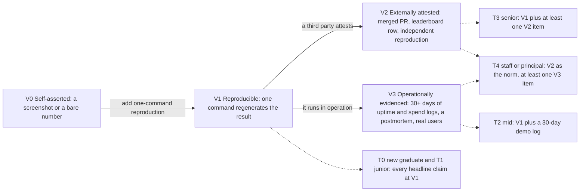
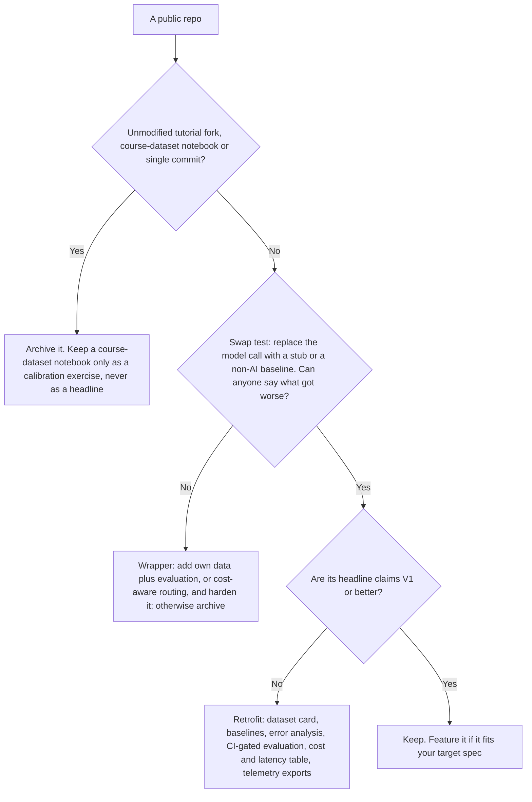

# Proof-of-Work Standards: What a GenAI Portfolio Must Show to Be Believed

> What a GenAI portfolio must show to be believed at your target level: the verifiability ladder (V0–V3), the 15 artefacts by tier, the nine anti-portfolio patterns and their fixes, how many projects to keep, and how to harden a public demo.

**Dates.** Tool, platform and price facts are as retrieved by [T0-13](../../research/sessions/T0-13-production-portfolio-proof-of-work-standards.md) on 2026-10-21; re-verify them by 2027-01-19. **Grades** (EGP-1.0): A primary or measured; B transparent secondary; C vendor, practitioner or single source; D judgement or synthesis; E searched, not found; M model output; P practice-curated and unmeasured. **Confidence.** T0-13 rates its hiring-effect claims low to medium (practitioner testimony, no controlled study) and its tool facts medium to high. Its level model, artefact list, rubric and hardening checklist are its own synthesis, and the rubric is untested [T0-13 L24, L246, L260, L510].

## The short answer

1. **Lower the reviewer's cost of checking you.** READMEs and dashboards are cheap to generate, so authorship verification is the live problem of 2026 [B/C · T0-13.F8], and every channel is raising its guard against low-effort volume [B/C · T0-05.F12]. Every headline claim must be V1 or better: one command regenerates it from committed data [D · T0-13 L134, L138].
2. **Calibrate to the level you target.** New graduate to junior: one measured system, every claim at V1. Mid: evaluation-gated releases and a 30-day operating log. Senior: at least one externally attested (V2) item, such as a merged upstream PR. Staff or principal: V2 as the norm, plus adoption by others [D · T0-13 L138, L272–277].
3. **Fix the failure modes; keep the topic.** No project type is universally flagged. What reads as tutorial-grade is no measurement, no baseline, no deployment hygiene, a one-shot commit history and unexplained choices [C · T0-13.F2]. RAG appears in roughly a third to 40% of AI-engineer postings [B · T0-13 L91], so retrofit a RAG repo with evaluation rather than delete it [D · T0-13 L140].
4. **Make evaluation the core.** It is the most consistently cited separator [B · T0-13.F3]. The evidence has a specific shape: 20 to 50 tasks drawn from real failures, code graders first, model graders calibrated against human labels, several trials [A · T0-13.F4]; about 100 traces read and coded, and each judge checked on about 50 pass and 50 fail human labels [B · T0-13 L97].
5. **Go deep, not wide.** Keep 2 to 3 deep repos rather than many small demos [C · T0-13 L161]. T2-01 asks for one evaluated end-to-end system at Tier 0–1, and two systems with different failure surfaces plus CI-gated evaluation at Tier 2–3 [B/C/D · T2-01.F9].
6. **Treat a live demo as optional, replay-first, capped and dated.** Its risks are documented: unbounded spend, leaked keys and free-tier changes [A · T0-13.F6, L506], and dead links [C · T0-13.F6]. Its weight against a repository is unmeasured [D · T0-13 L506].

**Scope.** These rules raise the signal of a portfolio that someone opens. Many reviewers never open GitHub, and keyword screens reward "RAG" [C · T0-13.F1], so keep the keywords on your résumé and add evidence [D · T0-13 L160]. A portfolio does not replace coding skill, system design or referrals [D · T0-13 L646].

## At a glance

The portfolio's job is to lower a reviewer's cost of verifying competence [D · T0-13 L127]. Every claim sits on one rung of this ladder, and each target level has a minimum rung:



Four tools sit around the ladder: the anti-portfolio (what to fix or archive), the 15 artefacts (what to ship), the reviewer's five minutes (how a repo is read) and demo hardening (how not to create a liability). T0–T4 on this page are T0-13's experience levels, not the compensation tiers used elsewhere in this repository; see "Two tier scales" below.

## The verifiability ladder and the level model

### The ladder

| Level | Name | Example | Reviewer cost |
|---|---|---|---|
| V0 | Self-asserted | A screenshot; "achieves 95% accuracy" | Cannot verify |
| V1 | Reproducible | One command regenerates `results.json` and the README table; raw data and pinned versions committed; CI run linked | Minutes |
| V2 | Externally attested | Merged upstream PR; leaderboard row with commit hash; independent reproduction; third-party users | Minutes, trusting a third party |
| V3 | Operationally evidenced | 30+ days of uptime and spend logs; an incident postmortem; real users | Minutes to hours |

Source: [D · T0-13 L131–136]. The rules: every headline README claim is V1 or higher; T3 portfolios need at least one V2 item; T4 portfolios need V2 as the norm [D · T0-13 L138]. Once evidence-block formats spread, they can be faked; V2 and V3 cost more to fake, which is why they carry the weight at senior levels [D · T0-13 L644].

### What each level must prove

| Level (T0-13) | Must prove | Archetype that carries signal | Verification target | Reference spec | D9 advance mark |
|---|---|---|---|---|---|
| T0 new graduate or switcher, 0–1 years | You can finish, measure and explain a small system | Measured retrieval or extraction over a non-generic corpus, with baselines and error analysis | V1 | R1: about US$25–30 API spend, no GPU, 4–6 weeks part-time | 60 |
| T1 junior, 1–2 years | You can ship and maintain a small service with tests and CI | The T0 system plus CI-gated evaluation, a capped deployment and one docs or test PR upstream | V1, ceiling V2 | R1 | 60 |
| T2 mid, 3–5 years | Production judgement: reliability, cost, evaluation-gated releases | Evaluation-gated agent or service with a router, tracing, load tests and an incident postmortem | V1 plus V3-lite: a 30+ day demo log | R2: about US$100 for API and hosting, 8–10 weeks | 65 |
| T3 senior, 6–9 years | Depth and trade-off command at system or kernel level | Serving, quantisation or kernel study with rigorous method and an upstream contribution | V1 plus at least one V2 item | R3: about US$300 of rented GPU hours, 6–10 weeks | 70 |
| T4 staff or principal, 10+ years | Leverage: standards, reference implementations, adoption | Methodology or benchmark programme with external adopters and design docs | V2 as the norm, at least one V3 item | R4: about US$500 own spend, the rest via collaborators, 3–6 months | 70 |

Source: [D · T0-13 L262–277], calibrated by T0-13 against an interview framework and employer postings. Spec numbers (question counts, trial counts, budgets) are starting points; change them with a stated reason [D · T0-13 L270].

**Two tier scales.** T2-01's portfolio rule uses compensation tiers (Tier 0 to Tier 5, defined by pay bands), not these experience levels. The band figures differ between sources and none is measured ([errata U7 and U14](../../research/ERRATA.md)), so this page quotes T2-01's rule only in its own terms. Both scales point the same way: depth and outside verification rise together.

**Track and background.** R3 and R4 suit infrastructure and performance roles; applied-AI roles may value R2 more [D · T0-13 L647]. Senior and staff postings from NVIDIA, Inferact (the vLLM creators), Together AI, AMD and River AI ask for upstream PRs, shipped performance features, maintainer relationships and technical writing [B · T0-13.F9]. Evaluation is the gate for every background in T2-01, and each brings a different advantage to it [B · T2-01.F3]; for data scientists the "can't ship" trope is half right, with real gaps in big-company loops and a real advantage in evaluation [C/D · T0-06.F5].

### How many projects

T0-13 rejected breadth: unmeasured small demos read as tool assembly, and extra mildly positive items risk diluting an impression when a profile is judged alone. It recommends 2 to 3 deep repos instead [C · T0-13 L161]. The dilution mechanism is contested: a student thesis reports a failed replication [C/D · T0-13 L605]. T2-01 sets the minimum by target tier [B/C/D · T2-01.F9], and T0-06's milestone spine shows one way to build it, at 15–20 hours a week [M · T0-06 L261, L393–397]; the gates' full criteria are in [career transitions](../11-tracks/career-transitions.md#the-shared-spine-four-gates-and-an-hours-budget):

| Target (T2-01 tier) | Minimum portfolio | How the T0-06 spine builds it |
|---|---|---|
| Tier 0–1 | One evaluated end-to-end system | G1 by month 3: a running application over a real corpus or task from your domain; at least 50 labelled evaluation cases (at least 30 hand-written from real work); at least 2 baselines; an error taxonomy from at least 100 reviewed traces; a "what broke" memo of 500+ words |
| Tier 2–3 | Two systems with different failure surfaces, plus CI-gated evaluation | G2 by month 6: evaluation in CI with a regression threshold; any LLM judge validated on at least 100 human labels; one real user other than you; one regression postmortem. G3 by month 9: a second system (a tool-using agent with approvals and budgets, an on-device or browser module, a domain benchmark or a serving lab), one public write-up with numbers and one external contribution |
| Tier 4–5 | Published research, industry-visible contributions and evidence meeting O-1A or equivalent standards | Beyond the spine: see spec R4 and [visa and relocation](../11-tracks/visa-and-relocation.md) |

**Reconciling them** (this page's judgement, D): one finished, evaluated system is the entry floor; a second with a different failure surface is the mid and senior step; a third repo earns its place only if it adds a new failure surface or a V2 item. Open-source work complements personal repos from T1 and becomes the primary evidence from T3 [D · T0-13 L164]. Competitions count where the target role matches [D · T0-13 L165]. Writing counts when paired with V1 artefacts [D · T0-13 L166]. A training or fine-tuning headline suits only small, scoped, fully evaluated runs [D · T0-13 L163].

## The anti-portfolio: nine patterns and how to redeem them

Each pattern is "disqualifying as presented": a reviewer who sees only it learns nothing they can trust, yet most can be retrofitted [C · T0-13 L175]. The sources support a failure-mode list, not a ban list [C · T0-13.F2], and most red-flag lists are SEO or vendor content that echo one another [C · T0-13 L606, L643].

**Swap test** [D · T0-13 L177]: replace the model call with a stub or a non-AI baseline. If the project looks the same, cannot be tested, or nobody can say what got worse, the model is decoration and the repo is a wrapper.

| # | Pattern | 30-second signal | Why it fails | Redemption |
|---|---|---|---|---|
| AP-1 | "Chat with your PDF": LangChain or LlamaIndex, a vector store, Streamlit (C) | Default chunking; unpinned requirements; screenshot-only README; no tests; one or two commits; no evaluation folder | Library assembly, not judgement: no retrieval baseline, question set or error analysis, and nearly every candidate has one. In the one narrated postmortem, a hiring manager reduced five such demos to "tool assembly" | Rebuild to spec R1: measured retrieval over a non-generic corpus |
| AP-2 | A Streamlit or Gradio wrapper over a hosted LLM API (C; platform facts A) | Under about 150 lines; one chat input and one API call; keys in a committed `.env`; a deployed URL that errors | The system prompt is the whole product. It also carries liabilities: key handling, no rate limit or spend cap, sleeping demos, hosting-policy changes | Add a measurable differentiator (own data plus evaluation, or cost-aware routing) and harden it (H1–H14), or archive |
| AP-3 | Course datasets: MNIST, Titanic, Iris, house prices, tweet sentiment (C) | Tutorial dataset; notebook only; accuracy on a clean split; no baseline discussion | Identical across candidates, so it discriminates nothing; no problem framing or constraint-driven decision | Archive. If kept, reframe it as a calibration exercise, such as a model judge against human labels, never a headline |
| AP-4 | Metric-free multi-agent demos: "AI research team", "autonomous X agent" (B) | Several agent frameworks; role names such as researcher, writer, critic; no tasks file; demo video only; no cost per task | Agent failures compound. Without outcome-based graders, multiple trials and failure-mode discussion, nothing is reproducible | Rebuild to spec R2: state-check graders, pass@1 and pass^k, cost per task |
| AP-5 | Benchmark-number theatre: "98% accuracy", "100% deflection" (B) | A number with no link to a script; labels produced by the model being evaluated; test data used for prompt tuning | No defined test set, split, grader or interval: it shows evaluation illiteracy | PA-01 evidence block, PA-03 dataset card, PA-04 evaluation harness |
| AP-6 | Single-commit, tutorial-fork or AI-one-shot repos (B/C) | One large commit; boilerplate README with emoji headers; no iteration; unchanged tutorial structure and names | Authorship cannot be assumed. The harm is the raised verification cost, not the content | Iterative history; `docs/PROCESS.md` disclosing AI help; the ability to explain any file in an interview |
| AP-7 | Training or fine-tuning claims without baselines, held-out evaluation or cost (C) | No base-model comparison; evaluation on training data; no cost or seed; no loss curves | "Trained an LLM" often means a small LoRA run judged by feel; confusing fine-tuning with pretraining costs credibility | Base versus tuned on a held-out set with intervals, a cost table and an ablation; or a scaled-down run against a public metric |
| AP-8 | Framework-only fluency (C) | Deep chain or agent abstractions; no raw request logs; no trace of the prompt actually sent | The reviewer cannot see what you understood. Using a framework is fine; not knowing what it sends over the wire is not | Show raw requests and responses in traces; implement one component, a retriever or a tool loop, directly and with tests |
| AP-9 | Unsafe or dead public demos (A for the risk; C for the hiring effect) | Keys in history; no rate limit or cap; an error page; a stale last-updated date | Unbounded consumption is an OWASP risk class; GitHub scans public repos for provider keys, so a leaked key is revoked yet stays in history; practitioner content calls a broken link worse than none | A replay-first demo and the H1–H14 checklist |

All rows: T0-13 D1 [T0-13 L179–222], with T0-13's grades in brackets.

## The fifteen artefacts

**Required set by level** [D · T0-13 L142]:

| Level | Required |
|---|---|
| T0–T1 | PA-01 to PA-04 (PA-04 small), PA-07, PA-10 to PA-12; basic PA-05 (a smoke evaluation in CI), PA-06 (a basic latency table) and PA-08 (basic telemetry); PA-09 if any endpoint is live |
| T2 | Full PA-04, PA-05, PA-06, PA-08 and PA-09; adds PA-13 |
| T3 | Adds PA-14 |
| T4 | Adds PA-15 |

**The artefacts** [D · T0-13 L228–244]. Pass criteria are written so a reviewer can check them in minutes; the numeric defaults are starting points, not standards [T0-13 L226].

| ID | Artefact | Where | Pass criteria | From |
|---|---|---|---|---|
| PA-01 | Evidence block | `README.md`, first screen | Claim, metric, method, command, date, commit SHA and hardware for each headline number; each number links to a file in `bench/` or `eval_harness/` | T0 |
| PA-02 | One-command reproduction | `Makefile`, lockfile, `Dockerfile` | `make repro` regenerates tables from raw data; dependencies pinned; model IDs and price-table date recorded; seeds fixed where applicable; run cost stated | T0 |
| PA-03 | Dataset card | `docs/dataset-card.md` | Source, licence, size, splits, labelling protocol and labeller, known gaps, PII handling, checksum; dev and test strictly separated | T0 |
| PA-04 | Evaluation harness | `eval_harness/` | Tasks as data; code graders first; versioned judge prompts; 3+ trials for stochastic tasks; capability and regression suites apart; judge TPR and TNR on about 50 pass and 50 fail human labels; error-analysis notes from about 100 coded traces | T0 small, T2 full |
| PA-05 | CI gates | `.github/workflows/` | Each PR runs tests and a cached or capped smoke evaluation; a scheduled full run; fails on regression; uploads artefacts; per-run spend cap; badge fed by CI JSON and linked to the run | T1 smoke, T2 full |
| PA-06 | Latency and throughput benchmark | `bench/`, `benchmarks.md` | p50, p95, p99; TTFT; ITL or TPOT; tokens per second; error rate; a concurrency or rate sweep; warm and cold apart; hardware, client and engine versions; raw files and plot script; client-saturation check; 3+ repeats with spread | T0 basic, T2 full |
| PA-07 | Cost accounting | `benchmarks.md` or `cost/` | Tokens times a dated price table (URL and date) gives dollars per request and per successful task; infrastructure dollars per hour become dollars per 1k requests; monthly burn of any live demo; budget cap stated | T0 |
| PA-08 | Telemetry | `src/…/telemetry`, `docs/traces/` | Spans carry model ID, tokens in and out, latency, finish reason, retrieval IDs, tool names, error type and cost; sanitised, dated exports committed; at least one failing trace promoted to an evaluation case; content capture off on the public demo; semantic-convention version pinned | T1 basic, T2 full |
| PA-09 | Abuse resistance | `docs/SECURITY.md`, code | Per-IP and per-key rate limits; input and output token caps; timeouts; hard spend cap on a dedicated key; no side-effecting tools on a public demo; secrets only in the platform store; injection tests, including tool-output injection | T1 if live, T2 |
| PA-10 | Architecture and decisions | `docs/architecture.md`, `architecture.svg`, `docs/decisions/` | Data and control flow diagram; at least 3 ADRs, each naming a rejected alternative; a non-AI baseline comparison | T0 |
| PA-11 | Failure analysis | `docs/failure-analysis.md` | Failure taxonomy with counts; negative results; threats to validity; explicit non-claims | T0 |
| PA-12 | Authorship and AI-use disclosure | `docs/PROCESS.md` | What was AI-assisted; what was verified by hand; iterative commit history; licence | T0 |
| PA-13 | Operational evidence | `docs/ops/` | SLOs with thresholds; uptime and spend log of 30+ days; at least one incident postmortem, real or staged; runbook and rollback; a model-swap report | T2 |
| PA-14 | Profiling and systems analysis | `latency_profiling/` | Profiler timelines; roofline or bandwidth analysis; ablation table; correctness tests against a reference for every custom kernel; hardware fingerprint | T3 |
| PA-15 | Design docs and adoption trail | `docs/rfcs/` | RFC with alternatives and threats to validity; external review trail; versioned spec and changelog; independent reproductions; upstream merges | T4 |

**Six cross-cutting rules** [D · T0-13 L246–252]: charts come from committed raw data by a script (hand-edited images are V0); every number has a command that regenerates it; include negative results and non-claims; pin versions and date every benchmark and price table; never commit secrets, and assume history is public; a badge is evidence only if it links to the run or result file that produced it.

## How a reviewer reads a repo

One hiring manager reporting 500+ candidate interviews says a GitHub review takes about 30 seconds and includes spotting AI-generated slop [B/C · T0-13.F8]. T0-13 found no GitHub-profile scoring rubric published by a major lab or employer [E · T0-13 L619]. Its own protocol and rubric are a synthesis with no inter-rater reliability data [D · T0-13 L563]: use them to see your repo as a reviewer might, not as a pass mark.

**The five-minute protocol** [D · T0-13 L591–596]:
1. Minute 1, README first screen: quantified, dated claims with an evidence block?
2. Minute 2, CI: does the badge link to the run that produced it, how old is that run, and does the workflow gate evaluation?
3. Minute 3, `eval_harness/`: dataset card, graders, calibration report, error analysis.
4. Minute 4, `benchmarks.md` and `bench/results/`: hardware, percentiles, repeats, raw data.
5. Minute 5: commit history, `docs/PROCESS.md`, a quick search for key patterns; then advance, probe or pass.

**Hard fails.** Any one caps the outcome at "do not advance on portfolio evidence" [D · T0-13 L584–589]: HF-1, a live secret in the repo or its history; HF-2, a headline metric contradicted by the repo's own raw data, or not reproducible; HF-3, a copied or forked tutorial presented as original; HF-4, a public endpoint with unbounded spend or unauthenticated side-effecting tools; HF-5 (interview stage), you cannot explain core files, or you contradict your own AI-use disclosure.

**Where the weight shifts by level.** Ten dimensions are rated 0 to 3; the score is the sum of weight times rating, divided by 3 [D · T0-13 L565–580]:

| Dimension | T0–T1 | T2 | T3 | T4 |
|---|---|---|---|---|
| D-1 Problem reality; the model is load-bearing | 15 | 10 | 8 | 5 |
| D-2 Evaluation rigour | 20 | 20 | 15 | 15 |
| D-3 Reproducibility and CI | 15 | 12 | 12 | 10 |
| D-4 Performance and cost accounting | 8 | 12 | 20 | 15 |
| D-5 Observability | 5 | 10 | 8 | 5 |
| D-6 Reliability, safety, abuse resistance | 5 | 10 | 7 | 5 |
| D-7 Engineering hygiene and authorship | 15 | 10 | 7 | 5 |
| D-8 Honesty and limitations | 10 | 8 | 8 | 10 |
| D-9 Third-party verifiability | 5 | 5 | 10 | 15 |
| D-10 Level-specific depth and influence | 2 | 3 | 5 | 15 |

The advance marks are arbitrary starting values: 60 for T0–T1, 65 for T2, 70 for T3 and T4. From 50 up to the mark means "advance with verification probes"; below 50 the portfolio is not relied on [D · T0-13 L582]. Evaluation rigour weighs most at T0–T2; performance and cost accounting peaks at T3; at T4, third-party verifiability and influence rise to match evaluation and performance.

**Probes to rehearse** [D · T0-13 L598, L310, L347, L381, L409]:
- Any level: regenerate one README number live; show a failing trace and the case it became; say what changes at 10 times the load; alter a grader and predict the effect.
- R1: a query where dense lost to hybrid, and why; your judge's TPR and TNR and what you did about the misses; what breaks at 100 times the corpus.
- R2: pass^5 against pass@1 and what the gap tells you; which regression case came from a trace; what the router cost in success rate.
- R3: why throughput plateaued, and how you know the client was not the bottleneck; what quantisation cost in quality, with what interval; what changes at tensor-parallel 8.
- R4: who outside your organisation depends on it, and how you know; what a reproduction found you got wrong; what is out of scope, and why.

## Live demos: replay-first, capped, dated

**Rule.** Replay-first, capped and dated; a live path is an optional extra, never the only proof [D · T0-13 L508]. Employers inspect activity traces that are cheap to verify, and a working demo is one [A · T0-13.F6], but that mechanism comes from a 2013, pre-GenAI interview study [T0-13 L605], no source measures a demo's effect on callbacks or offers [E · T0-13 L621], and a demo with no repo leaves the method uninspectable [D · T0-13 L162].

**Hosting by budget, as of 2026-10-21.** Re-verify prices before spending; tool verdicts are in the [tool catalog](../00-start/tool-catalog.md).

| Budget | Option | Grade · source |
|---|---|---|
| None | A static Space or static site serving replays, plus a recorded walkthrough | A · T0-13 L527 |
| Up to about US$10 a month | Railway Hobby (US$5 a month, including US$5 of usage) or a Hugging Face Docker Space on PRO (US$9 a month) | A · T0-13 L478, L528 |
| Intermittent GPU | Modal Starter (US$0 a month with US$30 monthly credit, per-second billing; read from a non-canonical mirror), or ZeroGPU after checking quotas, which sources disagree on | B · T0-13 L477, L529 |
| Persistent GPU | Rarely justified for a portfolio; if used, set auto-shutdown | D · T0-13 L530 |

**Stale advice is itself a tell** [A/B · T0-13.F11]:
- Older tutorials say Gradio and Docker Spaces are free. As of 2026-10-21, those running on compute need PRO; free accounts in good standing can host up to 2 Gradio Spaces on ZeroGPU; free CPU hardware sleeps after about 48 hours idle [A · T0-13 L476]. A paid T4 small Space left on for 30 days costs about US$288 (derived) [D · T0-13 L476].
- An OpenAI monthly limit without the "Enforce a hard limit" toggle only sends alerts, and enforcement is not instantaneous. Anthropic sets no limits on the Default Workspace, so create a named workspace per demo [A · T0-13 L497–498].
- Free tracing tiers expire data: Langfuse Hobby keeps 30 days (50k units a month); LangSmith's free plan caps at 5,000 base traces a month with 14-day base retention. Commit sanitised, dated trace exports and the script that recomputes p95 and cost from them [B · T0-13.F7].
- All OpenTelemetry `gen_ai.*` attributes were at Development status in mid-September 2026; pin the semantic-convention version [B · T0-13.F7].

## Systems depth on a modest budget

Buy verifiability, not hardware: measured small-scale results with disclosed hardware, external leaderboards or open challenges, and upstream PRs, with simulated or modelled results labelled as such [D · T0-13 L146]. This works if scoped honestly; educational engines and simulators do not support production or hardware claims [B · T0-13.F10]. Most GenAI application work needs no GPU [A/B · T0-06.F12].

| # | Strategy | How, on a modest budget | Ceiling | Does not prove |
|---|---|---|---|---|
| M1 | Validated memory and throughput model | Predict per-GPU memory and throughput with the Ultra-Scale Playbook's parallelism arithmetic; check it against 1-GPU measurements | V1 | Cluster operations |
| M2 | CPU/gloo smoke tests | Launch several CPU processes to verify DDP or FSDP2 sharding, checkpoint and resume | V1 | Performance, NCCL, topology |
| M3 | Scaled-down single-GPU runs | nanochat's roughly 5-minute small-model scale and scaling-law scripts; report MFU and tokens per second | V1 | Multi-node scaling |
| M4 | Leaderboards and open challenges | AMD x GPU MODE kernel competitions on organiser hardware; Anthropic's public take-home, which runs in a Python simulator with no GPU | V2 | Ability beyond the task |
| M5 | Compact reimplementation | A nano-vLLM-style engine (continuous batching, paged KV, prefix caching) in 1k to 2k lines, benchmarked against vLLM on the same hardware and configuration | V1 | Production readiness or general superiority |
| M6 | Simulation and harness engineering | Validate load harnesses against the llm-d inference simulator; label any scheduling simulator and calibrate it on small real runs | V1 | Hardware performance |
| M7 | Upstream contributions | Tests, benchmarks, bug fixes or docs to vLLM, SGLang, Triton or similar | V2 | Authorship of core design |
| M8 | One short rented multi-GPU session | A single measured 2- to 4-GPU tensor-parallel experiment with a cost log: 4 GPUs for 3 hours at about US$3.95 an hour is about US$47 (derived) | V1 | Sustained operations |

Source: [T0-13 L545–554]. **GPU arithmetic for spec R3**, derived from Modal's list rates as of 2026-10-21 [D · T0-13 L379]: an H100 at US$0.001097 a second is about US$3.95 an hour, so 40 GPU-hours cost about US$158; an A100 80 GB at US$0.000694 a second is about US$2.50 an hour, so 60 GPU-hours cost about US$150.

**Claim language** [D · T0-13 L556–559]:
- "Measured on 1x [GPU] ([VRAM]): [metric]. Modelled for 8x [GPU] under assumptions A, B, C: [metric] (not measured)."
- "Simulated with the llm-d inference simulator: validates the load harness only."
- "Educational reimplementation; one configuration; not a production claim."

## How to do it

1. **Fix the target.** Name your level (T0–T4), your track (application or infrastructure) and the matching spec (R1–R4). Use the [targeting workbook](../00-start/targeting-workbook.md) and your role's hub. *Done when* you can state the spec, its verification target and its time box.
2. **Audit what is public.** Put every public repo through this flow [D · T0-13 L140, L177, L187, L192]. *Done when* each repo is labelled archive, retrofit or keep.



3. **Build the evaluation core first.** Start small, from real failures [A · T0-13.F4]. Spec R1 asks for at least 50 author-written questions with gold answer spans and source IDs, at least 10 unanswerable ones, and a dev and test split fixed before tuning [D · T0-13 L298]. *Done when* a reviewer can find, in order: the failure taxonomy behind the cases; the cases; the graders, marked code-based or model-based; the judge prompt, its version and its TPR and TNR against human labels; trial counts and the pass@k versus pass^k choice; the regression suite in CI; and a note on one evaluation bug you found and fixed [D · T0-13 L254].
4. **Measure speed and cost, and show the method.** Spec R1 reports p50 and p95 for three configurations at concurrency 1, 4 and 8, cold and warm apart, with hardware and client stated [D · T0-13 L303]. Keep them apart because first runs distort: one tool report shows 2,484 ms first-run against about 73 ms steady-state TTFT. Check that k6 thresholds (exit code 99) fail when they should [B · T0-13.F5]. *Done when* PA-06 (basic) and PA-07 pass.
5. **Instrument and close the loop.** Log latency, tokens and document IDs; commit five sanitised traces; link one failing trace to an evaluation case [D · T0-13 L304]. *Done when* a reviewer can open a trace and find its case (T0–T1), recompute p95 and cost from exported traces and match the README (T2), or read a client-versus-server timing reconciliation (T3) [D · T0-13 L536–538].
6. **Write it up honestly.** Fill in the evidence block, the failure analysis and `PROCESS.md` below. *Done when* every headline number is V1 or better and links to the file that produced it [D · T0-13 L230].
7. **Decide on a demo.** Default to replay. *Done when* you ship replay-only, or all of H1–H14 pass.
8. **Add outside proof from T1 up.** *Done when* one V2 item (a merged PR with maintainer review, a leaderboard row with a commit hash, an independent reproduction) is linked from your evidence block [D · T0-13 L135].
9. **Run the stranger test.** *Done when* someone else reproduces your headline evaluation numbers from the README in under 30 minutes [M · T0-06 L395] and the five-minute protocol finds no hard fail.
10. **Keep it fresh.** *Done when* tool and model versions are pinned, every benchmark and price table is dated, the smoke evaluation re-runs on a schedule and the README shows a "last verified" date [D · T0-13 L150, L520].

**If it is not working** [D · T0-06 L401–404]: G1 not met by month 4 at 15–20 hours a week means checking adherence first, then scope creep and a missing evaluation set, and extending the timeline before adding hours. No screens after 15 targeted applications points to positioning or résumé signal, not skill: get a practitioner to review the artefacts and the résumé. Three failed take-homes call for work on evaluation design and error analysis. The other slip rules are in [career transitions](../11-tracks/career-transitions.md#the-shared-spine-four-gates-and-an-hours-budget).

## Templates and examples

### README evidence block

T0-13's template, with every value a placeholder [D · T0-13 L458–468]. Put it on the first screen. The closing line follows T0-13's README layout and H10 [D · T0-13 L421, L520].

```markdown
## Evidence (generated [YYYY-MM-DD] from commit [sha])
| Claim | Metric | Method | Reproduce | Hardware / env | Level |
|---|---|---|---|---|---|
| [Hybrid retrieval beats dense on my test split] | recall@5 [x] vs [y] (95% CI [a–b]) | [N]-question test split, author-labelled | `make eval-full` (about [N] min, about $[N]) | API only | V1 |
| [p95 latency at 8 concurrent] | [N] ms (cold [N] ms) | k6, 5 min, 3 repeats | `make bench` | client [spec]; server [spec] | V1 |
| Cost per successful task | $[N] | price table dated [YYYY-MM-DD] ([URL]) | `make cost` | n/a | V1 |
| [Upstream fix merged] | [PR link] | maintainer review | [link] | n/a | V2 |

Limitations and non-claims: docs/failure-analysis.md. AI use: docs/PROCESS.md. Demo last verified: [YYYY-MM-DD].
```

### Weak and strong claims

The wording is [P]; the criteria come from T0-13 [T0-13 L133, L212, L230, L235–236, L334, L557].

| Claim | Weak: V0 | Strong: V1 or better |
|---|---|---|
| Quality | "Achieves 95% accuracy." | "Hybrid retrieval: recall@5 [x] vs [y] for dense (95% CI [a–b]) on a [N]-question test split fixed before tuning; `make eval-full`; commit [sha], [date]." |
| Latency | "Fast and production-ready." | "p95 [N] ms at 8 concurrent, warm; cold [N] ms; k6, 5 min, 3 repeats; client [spec], server [spec]." |
| Cost | "Cheap to run." | "$[N] per successful task from a price table dated [date] ([URL]); demo capped at $[N] a month." |
| Agent | "Autonomous research agent", with a demo video | "pass@1 [x] and pass^5 [y] over [N] tasks × 5 trials, end state checked in code; $[N] per task; failure modes in docs/failure-analysis.md." |
| Fine-tuning | "Fine-tuned an LLM; answers are much better." | "Base vs tuned on [N] held-out examples: [metric] [x] vs [y] (CI [a–b]); cost $[N]; seed [s]; ablation in [file]." |
| Scale | "Scales to 8 GPUs." | "Measured on 1x [GPU] ([VRAM]): [metric]. Modelled for 8x [GPU] under assumptions A, B, C: [metric] (not measured)." |
| Open source | "vLLM contributor." | "Merged PR [link] adding [a benchmark script, test or fix], reviewed by maintainers (V2)." |

### Failure post-mortem

Assembled here [P] from PA-11 and PA-13 [D · T0-13 L240, L242], T0-06's G1 "what broke" memo and G2 regression postmortem [M · T0-06 L395–396], and T0-13's eval-bug note [D · T0-13 L254]. Save it as `docs/failure-analysis.md`; keep incident postmortems in `docs/ops/`.

```markdown
# Failure analysis: [system] (as of [YYYY-MM-DD], commit [sha])

## 1. Failure taxonomy (PA-11)
Traces read and coded: [N] (G1 asks for at least 100).
| Failure class | Count | Example trace | Evaluation case it became |
|---|---|---|---|
| [class] | [n] | docs/traces/[file] | eval_harness/tasks/regression/[id] |

## 2. What broke: three specific failures (G1 memo, 500+ words in all)
### [Failure 1, in one line]
- Input, expected, observed: [...]
- Root cause, and the evidence for it: [...]
- Fix and effect, on dev and on the untouched test split: [before] → [after]
- Regression case that catches a repeat: [case id]

## 3. Incident postmortem: [title] (PA-13; say whether real or staged)
- Detected by: [alert, monitor or user report] at [time]
- Impact: [requests, users, spend, SLO breached]
- Timeline: [detection] → [mitigation] → [resolution]
- Root cause: [...]
- Rollback and runbook step used: [link]
- Test that prevents a repeat (G2): [case id], [CI run link]

## 4. An evaluation bug I found
- [grader or judge bug]; headline score [before] → [after]

## 5. Negative results
- [what did not help, with numbers]

## 6. Threats to validity
- [test-set size; author as labeller; one model version; price-table date]

## 7. Non-claims
- This does not show [scale / production readiness / multi-node behaviour].
```

### AI-use disclosure

PA-12 asks what was AI-assisted, what was verified by hand, an iterative history and a licence [D · T0-13 L241]. Anthropic's candidate guidance asks for own first drafts and AI-free take-homes unless stated [B/C · T0-13.F8], so follow each employer's rules for application work. Template [P]:

```markdown
# Process and AI use: [repo] (as of [YYYY-MM-DD])
- AI-assisted: [files or tasks], with [tool and model version]
- Written without AI: [files or tasks, for example evaluation labels and failure analysis]
- Verified by hand: [what you checked and how: tests run, traces read, labels audited]
- History: iterative commits; decisions in docs/decisions/
- Licence: [licence]
```

## Checklist

**Before you share a repo link**
- [ ] Every headline number is V1 or better: a command regenerates it and it links to a file in `bench/` or `eval_harness/` (PA-01, PA-02).
- [ ] The dataset card names source, licence, splits and labeller, and dev and test never mix (PA-03).
- [ ] The evaluation harness has code graders first, a judge with TPR and TNR on human labels, and at least 3 trials where outputs vary (PA-04).
- [ ] A smoke evaluation runs in CI under a spend cap, and the badge links to the run that produced it (PA-05).
- [ ] Latency shows p50 and p95, warm and cold apart, with hardware and client stated; cost comes from a dated price table (PA-06, PA-07).
- [ ] At least one failing trace became an evaluation case; sanitised, dated exports are committed (PA-08).
- [ ] An architecture diagram, at least 3 ADRs naming a rejected alternative, and a non-AI baseline (PA-10).
- [ ] A failure analysis with counts, negative results, threats to validity and non-claims (PA-11).
- [ ] `docs/PROCESS.md` discloses AI use; the history is iterative; you can explain every core file (PA-12, HF-5).
- [ ] The swap test shows the model is load-bearing.
- [ ] No hard fail: no secret in history, no headline number contradicted by raw data, no tutorial passed off as original, no unbounded public endpoint (HF-1 to HF-4).
- [ ] A stranger reproduces the headline evaluation numbers in under 30 minutes (G1).
- [ ] Versions pinned, results dated, a "last verified" date on the README.
- [ ] Level extras: PA-13 at T2; PA-14 and a V2 item at T3; PA-15 and V2 as the norm at T4.

**Public demo hardening (H1–H14)** [D · T0-13 L511–524]
- [ ] H1. Replay mode by default, serving pre-computed outputs from the evaluation set; live calls only through a rate-limited or bring-your-own-key path.
- [ ] H2. A dedicated provider project or workspace with a hard monthly cap and alert thresholds: OpenAI's hard-limit toggle on; an Anthropic workspace limit below the organisation limit.
- [ ] H3. Per-IP and global rate limits, plus an application-level daily budget counter, because provider caps are not instantaneous.
- [ ] H4. Caps on input length and output tokens; timeouts; a concurrency limit.
- [ ] H5. No side-effecting tools in public mode; read-only sandbox data.
- [ ] H6. Secrets only in the platform secret store; secret scanning on; any exposed key rotated; history assumed public.
- [ ] H7. Telemetry content capture off in public mode; inputs redacted.
- [ ] H8. Direct and indirect (tool-output or document) injection tests in CI.
- [ ] H9. A kill switch that forces replay-only.
- [ ] H10. An uptime monitor and a "last verified" date in the README.
- [ ] H11. A visible budget meter: "demo spend this month: $[x] of $[y]".
- [ ] H12. An abuse contact and takedown path in `SECURITY.md`.
- [ ] H13. Cold-start and sleep behaviour documented.
- [ ] H14. A retirement plan: "demo retired on [date]; replay and traces remain".

## Pitfalls

| Red flag | Why it hurts | Fix |
|---|---|---|
| Five shallow demos instead of one measured system | Unmeasured breadth reads as tool assembly [C · T0-13 L161] | Keep 2 to 3 deep repos; archive the rest |
| Tuning prompts or retrieval on the test split | It contaminates every headline number [D · T0-13 L312] | Fix the dev and test split before tuning; report on the untouched test split |
| An uncalibrated LLM judge grading its own generator | Judges show position, verbosity, self-enhancement and anchoring bias [A · T0-13.F4] | Code graders first; check the judge against human labels; report TPR and TNR |
| Reporting pass@1 or means only | It hides inconsistency across trials and tail latency [D · T0-13 L349, L383] | Report pass^k with intervals, and percentiles with spread over repeats |
| A single-process load client at high concurrency | It can inflate TTFT and TPOT, so the plateau may be the client's [B · T0-13.F5] | Use a multi-process client; record client CPU headroom |
| Educational engines or simulator runs shown as production evidence | They do not support production or hardware claims [B · T0-13.F10] | Use the claim language above and state each result's ceiling |
| A trivial upstream PR made for the résumé | One merged contribution is the modal outcome, so it is weak alone [A · T0-05.F3]; the bar is rising and cheap contributions are risky [A · T0-05.F4] | Contribute a test, benchmark or fix tied to your own evidence; link the maintainers' review |
| Stale instructions ("deploy a free Gradio Space") or undated results | A visible tell [D · T0-13 L150; A/B · T0-13.F11] | Pin versions; date benchmarks and price tables; re-run the smoke evaluation on a schedule |
| Committed traces or datasets with personal data or restrictive licences | They can leak data [D · T0-13 L648] | Review before publishing; keep content capture off; record licence and PII handling in the dataset card |
| Treating the portfolio as the whole search | Hiring also turns on coding skill, system design and referrals [D · T0-13 L646] | Pair the build with interview preparation and referrals |

## Evidence and limits

- **Measured.** Demand for evaluation skills is common, not universal: 59.7% of AI-first roles in a 6,964-posting analysis and 68% of 198 companies in another, but 12 of a 100-posting sample; definitions and samples differ [B · T0-13.F3]. RAG appears in roughly a third to 40% of AI-engineer postings [B · T0-13 L91]. The platform, licence and price facts quoted on this page are graded A or B as of 2026-10-21 [T0-13 L476–498].
- **Searched, not found.** No controlled study or résumé audit shows that generic repos hurt more than no GitHub, so that premise stays unverified [E · T0-13 L617; C · T0-13.F1]. No measured effect of a live demo on callbacks or offers [E · T0-13 L621]. No published GitHub-profile rubric from a major lab or employer [E · T0-13 L619]. No source links portfolio quality to hiring outcomes [D · T0-13 L604], and no longitudinal outcome data exists for any transition corridor, so every timeline here is a model [D · T2-01.F10].
- **Judgement.** The level model, specs R1–R4, artefact list, rubric weights and marks, swap test and hardening checklist are T0-13's synthesis [D · T0-13 L24, L260, L563]. T0-06's milestones are author-designed [M · T0-06 L391]. T0-13 advises that three reviewers score the same ten public repos before anyone adopts the rubric [D · T0-13 L600].
- **Source quality.** Negative-signal content is mostly SEO or vendor material that echoes itself [C · T0-13 L606, L643], and gotcha screens decay fast: a May 2026 hiring guide told reviewers to treat "Sonnet 5" experience as fabricated, and Claude Sonnet 5 shipped on 2026-06-30 [B · T0-13.F12]. T0-13 discloses that three of its primary sources are Anthropic's and that an Anthropic model wrote it; independent sources corroborate the same evaluation practices [T0-13 L649, L663].
- **Scope.** The advice applies when a reviewer opens the repo. T0-13 did not filter its sources by region, so there are no geography-specific findings [T0-13 L638]. Unpaid build time is a barrier, which is why R1 is sized for part-time work [D · T0-13 L650]; hours, not compute, are the binding constraint [A · T0-06.F10].
- **What would change the advice.** A blinded reviewer experiment or matched-résumé audit on generic repos [T0-13 L632]; data on how often hiring managers open GitHub, by company size, role and region [T0-13 L633]; a measure of a demo's weight against a repo [T0-13 L634]; a validated rubric [T0-13 L635]; stable OpenTelemetry GenAI conventions [T0-13 L637].

## Next steps

- **Choose what to build:** [project archetypes](project-archetypes.md), the [skills radar](../03-skills-and-tech/skills-radar.md) and the [learning roadmaps](../03-skills-and-tech/learning-roadmaps.md).
- **Put the evidence where screens see it:** [résumé strategy](../06-job-search/resume-strategy.md), [résumé skills matrix](../06-job-search/resume-skills-matrix.md), [ATS mechanics](../06-job-search/ats-mechanics.md), and the job-search strategy's [constraints that bind first](../06-job-search/job-search-strategy.md#the-constraints-that-bind-first).
- **Make it visible:** [online presence](../07-networking/online-presence.md) and [referrals and outreach](../07-networking/referrals-and-outreach.md).
- **Defend it in interviews:** [interview loops](../08-interviewing/interview-loops.md), [system-design archetypes](../08-interviewing/system-design-archetypes.md), and the prep packs for [evaluation design](../08-interviewing/prep-packs.md#evaluation-design-pack), [applications](../08-interviewing/prep-packs.md#application-pack) and [infrastructure](../08-interviewing/prep-packs.md#infrastructure-pack).
- **Certificate or artefact:** [credential ROI](../04-certifications/credential-roi.md).
- **By path:** [career transitions](../11-tracks/career-transitions.md), [PhD to industry](../11-tracks/phd-to-industry.md), and [visa and relocation](../11-tracks/visa-and-relocation.md) for O-1A evidence.
- **Role hubs:** [AI Engineer](../02-roles/hubs/ai-engineer.md), [AI Evaluation Engineer](../02-roles/hubs/ai-evaluation-engineer.md), [Agentic AI Engineer](../02-roles/hubs/agentic-ai-engineer.md), [Inference Engineer](../02-roles/hubs/inference-engineer.md), [AI Infrastructure Engineer](../02-roles/hubs/ai-infrastructure-engineer.md), [GPU Kernel Engineer](../02-roles/hubs/gpu-kernel-engineer.md).
- **Evidence:** [stage 5 findings](../../research/findings.md#stage-05); sessions [T0-13](../../research/sessions/T0-13-production-portfolio-proof-of-work-standards.md), [T2-01](../../research/sessions/T2-01-tier-calibrated-execution-playbooks.md), [T0-06](../../research/sessions/T0-06-career-transition-timelines-5-backgrounds.md) and [T0-05](../../research/sessions/T0-05-unconventional-hiring-tactics-oss-audits.md); [errata](../../research/ERRATA.md).
