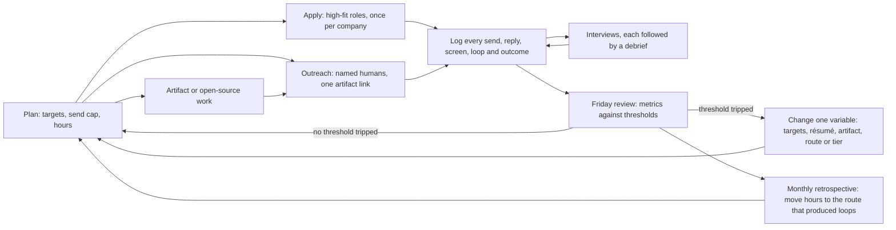

# Application Operating System

> A weekly operating system for running a job search: a fill-in tracker, a weekly rhythm, funnel metrics with graded benchmarks and thresholds, and rules for when to change targets, résumé, channel or hours.

**Dates.** Funnel benchmarks come from Gem, Ashby and Greenhouse datasets covering 2021 to Q1 2026, as compiled by [T0-04](../../research/sessions/T0-04-ats-filtering-funnel-conversion-math.md) (dated 2026-10-23). The hour split, outreach cadence and stop tables come from [T0-05](../../research/sessions/T0-05-unconventional-hiring-tactics-oss-audits.md); hours tiers and gate rules from [T0-06](../../research/sessions/T0-06-career-transition-timelines-5-backgrounds.md); application caps from [T0-10](../../research/sessions/T0-10-career-tooling-ecosystem-12-stage-funnel.md); the debrief from [T1-03](../../research/sessions/T1-03-interview-execution-offer-negotiation.md). Benchmarks move: across all functions, Gem's application-to-pre-onsite rate fell from 13% to 8% between 2021 and 2025 [B · T0-04.F9]. Re-check them by 2027-01-21. **Grades** (EGP-1.0): A primary or measured; B transparent secondary or large vendor dataset; C single source or vendor claim; D judgement; M model output; P practice-curated and unmeasured.

## The short answer

1. **Log everything, or no rule below works.** T0-05 puts about 10 of every 100 search hours into a log of every send, reply, loop and outcome; without it, none of the stop rules can run [D · T0-05 L81].
2. **Budget hours by channel, not by volume.** Cold inbound converts about 0.2% application-to-hire for engineering, or about 340–380 applications per offer at population-average odds. Referrals yield 11–36x more per application, and sourced candidates about 8x [B · T0-04.F9, T0-04.F10]. T0-05's split of 100 search hours: about 25 on applications, 45 on artifact-carrying outreach, 20 on open source if you can sustain it, and 10 on the log [D · T0-05 L74–81].
3. **Target and cap.** Apply once per company per cycle unless the roles are genuinely distinct, and tailor each application [T0-10 R3]. In Huntr's correlational data, the interview rate was 6.07% for one application at a company against 1.91% for eight or more, and 9.25% for users sending 11–20 applications against 2.58% for 100+ [B/C · T0-10.F4]. Send at most 30 outreach notes a week [D · T0-05 L87].
4. **Review weekly, retrospect monthly, change one thing at a time.** Record applications, screens, take-homes, onsite loops and offers every month [D · T0-06 L285]. At 30 sends a week you cannot A/B test, so change one variable per 30-send batch and judge by the quality of loops [M · T0-05 L408].
5. **Act on thresholds, not mood.** No screen after 15 targeted applications points to positioning or résumé signal, not skill [D · T0-06 L403]. Zero replies after 60 targeted sends means changing the artifact or the targeting, not the volume [M · T0-05 L401]. Logged hours below 70% of plan for three weeks in a row means a longer plan, not more pushing [D · T0-06 L251].
6. **Plan for months, and protect live loops.** Job-search friction adds roughly 2–4 months, with a fat right tail [C · T0-06.F11]. Getting into interview loops is the binding constraint, not passing them [B/C · T1-03.F1], so a live loop outranks new applications [P].

## At a glance: the weekly loop



| Component | Cadence | Output | Basis |
|---|---|---|---|
| Tracker | Every action | One row per application, message, interview round and week | D · T0-05 L81 |
| Weekly rhythm | Every week | Applications, outreach, artifact work and logging in fixed shares | D · T0-05 L74–81; P for the days |
| Weekly review | Fridays | Counts, running counters, at most one change | P |
| Monthly retrospective | Monthly | Funnel by route, threshold checks, hours moved | D · T0-06 L285 |
| Checkpoints | Weeks 8 and 12 | Open-source stop-loss; whole-portfolio review | D · T0-05 L89 |

## The funnel you are running

### Cold inbound, per 1,000 applications

| Stage | Gem engineering chain | Ashby technical, Q1 2026 |
|---|---|---|
| Reach a first human stage | 60 (6%) | 36 (3.6%) |
| Reach onsite | 10.2 (17% of the previous stage) | Not reported |
| Offers | 2.96 (29% of onsite) | 2.63 (7.3% of interviews) |
| Hires, at 73% acceptance | 2.16 | 1.92 |
| Applications per offer | About 338 | About 380 |
| Application-to-hire | 0.22% | 0.19% |

Stage rates are vendor data; the per-1,000 rows are T0-04's arithmetic on them [B inputs, derived · T0-04 L397–405]. Gem prints 0.2% for engineering and 0.1% for data science [B · T0-04 L407]. Two independent datasets thus converge on about 0.2% for engineering; the Ashby Q1 2026 rates reached T0-04 through secondary restatements [C · T0-04 L636]. Gem also reports 35–36 interviews per engineering hire [B · T0-04.F11]. Across all functions, 8% of Gem's 165M+ applications pass the initial screen, and about 0.5% end in a hire, one per 200 applications [A/B · T0-05.F2].

**Cold inbound got more crowded.** Gem's application-to-pre-onsite rate fell from 13% to 8% across all functions between 2021 and 2025. Greenhouse reports applications per job up about 110% (116 to 244) and applications per recruiter up 204% (1,610 to 4,890 a year) from 2022 to 2025 [B · T0-04.F9]. In a Robert Half survey of 2,000+ US hiring managers (March 2026, reported second-hand), 67% said AI-generated applications slowed hiring and 65% said skills were harder to verify [C · T0-10 L71].

### By channel

How each entry route converts is in [channels and boards](channels-and-boards.md#entry-routes-how-your-application-arrives), which owns route conversion. In Ashby's 38M applications (all roles, January 2021 to December 2024), 3% of inbound applications reached an interview against 25% of sourced and 40% of referred ones, and interview-to-offer ran 6% for inbound against 16% for referrals [B · T0-04 L413–421]. Gem's independent figures put referrals at 11x and sourced candidates at about 8x inbound, in hires per application [B · T0-04.F10]. These are selection effects, not proof that a channel causes the hire [B · T0-04 L426]. The metrics table below uses these route rates as benchmarks.

### What the odds look like

| Cold applications sent | Chance of at least one offer, Gem rate / Ashby rate |
|---|---|
| 50 | 13.8% / 12.3% |
| 100 | 25.6% / 23.1% |
| 200 | 44.7% / 40.9% |
| 500 | 77.3% / 73.2% |

The table assumes independent applications at population-average offer rates of 0.296% (Gem) and 0.263% (Ashby) per application [M · T0-04 L441–448]. At the Ashby-derived referral rate of 6.4% per referred application, three referred applications give about 18% and ten give about 48% [M · T0-04 L450]. The averages include low-fit and fraudulent applications, so they are planning floors, not forecasts. In one Greenhouse pilot for an ML role, more than 35% of applicants carried high-risk fraud signals [B · T0-04.F11].

> [!NOTE]
> **T1-03's stage rates are a known error ([erratum U24](../../research/ERRATA.md)).** T1-03 credits Ashby and Gem with application → recruiter screen ≈ 12–18%, screen → loop ≈ 20–30% and offer → accept ≈ 50–70% [T1-03 L158–161]. T0-04 reports the same sources as 3.6–6% to a first human stage, 17% to onsite, 29% onsite → offer and 73% acceptance [B · T0-04.F9]. Both sessions agree on about 0.2% from application to hire [B/C · T1-03 L162]. U24 keeps T0-04's chain for planning, and this page uses it throughout.

## How to use it

1. **Pick an hours tier and block it in your calendar.** *Done when* the tier is chosen, the search blocks are booked, and the Hours tab has a planned figure for the week.
2. **Set up the tracker.** *Done when* the four tabs below exist and every live application, message and interview has a row.
3. **Split the hours.** *Done when* the week's plan follows the 100-hour split, or you have written down why it does not.
4. **Run the week.** *Done when* every send, reply, screen, take-home, loop and outcome is logged on the day it happens.
5. **Review on Friday.** *Done when* the weekly template is filled in and you have chosen one change, or decided on none.
6. **Retrospect monthly.** *Done when* funnel numbers by route are recorded, the decision table is checked, and hours have moved toward the route that produced loops.

## The tracker: fill-in schema

One spreadsheet, four tabs. The column set is practice-curated [P]; what it must capture comes from T0-05's instrumentation rule [D · T0-05 L81], T0-06's monthly funnel numbers [D · T0-06 L285] and T1-03's pattern tracking [D · T1-03 L250–257].

**Tab 1: Opportunities.** One row per role you pursue.

| Column | Definition | Format or values |
|---|---|---|
| `id` | Unique key for the row | [company]-[role]-[YYYYMM] |
| `company` | Employer | text |
| `segment` | Employer segment from your [targeting workbook](../00-start/targeting-workbook.md) | [your segment labels] |
| `role_title` | Title exactly as posted | text |
| `target_role` | The repository role it maps to | a role id, for example `ai-engineer` |
| `posting_url` | The posting; also keep a copy of its text | URL |
| `date_found` | When you found it | YYYY-MM-DD |
| `basic_met` | Basic qualifications you can evidence, out of those listed | [n]/[n] |
| `route` | How the application reaches the employer | inbound · referral · sourced · outreach · agency · internal |
| `named_human` | The person who vouched for you or routed you, and their role | text, or `none` |
| `resume_variant` | The résumé version you sent | [variant name] |
| `date_applied` | Submission date | YYYY-MM-DD |
| `knockout_flags` | Any form answer that might fail a rule | text, or `none` |
| `parsed_checked` | Parsed fields read and fixed after submitting | yes · no |
| `stage` | Furthest stage reached | applied · screen · take-home · loop · offer · accepted · declined · rejected · withdrawn · no response |
| `stage_date` | Date of the last stage change | YYYY-MM-DD |
| `next_action` | One concrete next step, with its date | text + YYYY-MM-DD |
| `outcome_reason` | The reason, if one was given | text |

Route definitions: *inbound*, you applied cold through a board or careers page; *referral*, an employee put you forward; *sourced*, a recruiter contacted you first; *outreach*, you reached a named human first, who then routed you; *agency*; *internal*, you already work there. Every label except outreach follows Ashby's channels [B · T0-04 L413]; outreach is T0-05's route [D · T0-05 L72]. Employers log channels their own way, so these labels serve your diagnosis, not theirs [P]. Set the *no response* cut-off before you start, as [n] weeks after applying [P].

**Tab 2: Outreach.** One row per message.

| Column | Definition | Format or values |
|---|---|---|
| `date_sent` | Send date | YYYY-MM-DD |
| `person`, `person_role`, `company` | A named engineering director, hiring manager or founder, not a generic inbox [D · T0-05 L87] | text |
| `medium` | Email from an authenticated domain (SPF, DKIM, DMARC), or a LinkedIn message sent by hand [D · T0-05 L87] | email · LinkedIn |
| `batch` | The 30-send batch the message belongs to | 1, 2, 3 … |
| `template_version` | The note's version; change one thing per batch [M · T0-05 L408] | v1, v2 … |
| `artifact_link` | The single artifact linked | URL |
| `follow_up_due` | Day 5–7 after the first touch; one follow-up only [D · T0-05 L87] | YYYY-MM-DD |
| `reply_date` | Date of any reply | YYYY-MM-DD or blank |
| `result` | What the reply led to | call · referral · intro · declined · none |

**Tab 3: Interviews.** One row per round, filled from the debrief [D · T1-03 L250–257].

| Column | Definition |
|---|---|
| `date`, `firm` | Timing and process cadence |
| `round_type` | Coding · system design · behavioural · domain deep dive · take-home |
| `questions` | The exact questions, captured in the debrief |
| `self_score` | 1–5 per scored dimension |
| `gaps` | Tagged [formula], [concept], [tool] or [trade-off] |
| `outcome` | If known; it calibrates your self-scores |

**Tab 4: Hours.** One row per week.

| Column | Definition |
|---|---|
| `week` | Week start date |
| `tier` | A, B or C (see below) |
| `planned_h`, `logged_h` | Hours planned and hours logged |
| `adherence` | `logged_h` ÷ `planned_h` |
| `weeks_below_70` | Consecutive weeks below 70% of plan [D · T0-06 L251] |
| `apply_h`, `outreach_h`, `artifact_h`, `log_h` | Where the hours went |

Header rows to paste [P]:

```csv
id,company,segment,role_title,target_role,posting_url,date_found,basic_met,route,named_human,resume_variant,date_applied,knockout_flags,parsed_checked,stage,stage_date,next_action,next_action_date,outcome_reason
date_sent,person,person_role,company,medium,batch,template_version,artifact_link,follow_up_due,reply_date,result
date,firm,round_type,questions,self_score,gaps,outcome
week,tier,planned_h,logged_h,adherence,weeks_below_70,apply_h,outreach_h,artifact_h,log_h
```

## Hours: tiers and the 100-hour split

T0-06 plans transitions in three tiers [T0-06 KF-10]. Its model spends the tier hours on the build and adds the search as a lag in weeks, so the search's share of the hours is not modelled [M · T0-06 L331–337].

| Tier | Hours a week | When it fits | What it costs |
|---|---|---|---|
| A | 8–10 | Can suffice when an internal transfer is possible [M · T0-06 L301] | Roughly 4–6 months longer than Tier B for most archetypes [M · T0-06 L274] |
| B | 15–20 | The central planning case [M · T0-06 L274] | A 17.5-hour week takes about 56–74% of average leisure for employed adults [M · T0-06 L213] |
| C | 35–40 | Needs a sabbatical, notice period or reduced work hours | Removes about half the time [M · T0-06 L274] |

**Parents.** Employed adults without children under 18 averaged 4.5 hours of leisure a day, more than an hour above employed adults with a child under 18 [A · T0-06 L211]. About 24 hours a week is an upper bound for employed parents [M · T0-06 L213]. Pick the tier from your logged hours, not from the plan [D · T0-06 L251].

The 100-hour split, per 100 search hours in a quarter [D · T0-05 L74–81]:

| Share | Activity | Rule |
|---|---|---|
| About 25 h | Standard applications to an assumed pool of about 300 relevant GenAI openings, each tied to a named-human route where one exists | The pool is finite, so extra hours here add nothing: do it first, then stop |
| About 45 h | Artifact-carrying outreach: one category-level artifact (about 10–15 h, reusable across about 20 targets) plus about 8–12 h of company-specific tailoring for the top 5 targets | At most 30 sends a week |
| About 20 h | Open source in one repo whose steward or major contributing employer is on your target list | Only if you can sustain about 8–10 h a week for 8–12 weeks; otherwise move these hours to outreach |
| About 10 h | Instrumentation: the tracker | Without it, no stop rule works |

T0-05 found no tactic with a 10x per-hour advantage, and the ranking among tactics changes with the assumptions, so treat the split as modelled judgement [D · T0-05 L66].

## The weekly rhythm [P]

The days and their order are practice suggestions [P]. The shares, caps and cadences carry their own grades.

| Day | Block | Activity | Basis |
|---|---|---|---|
| Monday | Plan | Read the previous review. Pick the week's targets; the top 5 get company-specific tailoring. Set the week's send number on the ramp: 10, 15, 20, then at most 30 over the first four weeks | P; D · T0-05 L79, L87 |
| Monday to Tuesday | Discover and apply, about 25% of search hours | Add new openings to the tracker. Apply to high-fit roles only, once per company per cycle, with a named-human route where one exists. Check the parsed fields after each submission | D · T0-05 L78; T0-10 R3; A · T0-04 R3 |
| Tuesday to Thursday | Outreach, about 45% | Artifact-carrying notes to named leaders; one follow-up at day 5–7 | D · T0-05 L79, L87 |
| Thursday to weekend | Artifact or open source, about 20% | Build or refresh the category-level artifact; tailor for the top 5; open source only if you can sustain it | D · T0-05 L79–80 |
| Every working session | Log, about 10% | A row for every send, reply, screen, take-home, loop and outcome | D · T0-05 L81 |
| Day of each interview | Debrief | The 30-minute debrief, immediately after each round | D · T1-03 L238 |
| Friday | Weekly review | Fill in the weekly template; compare logged hours with plan; check the decision table | P; D · T0-06 L251 |
| Last week of the month | Monthly retrospective | Record applications, screens, take-homes, onsite loops and offers by route; move hours | D · T0-06 L285 |
| Weeks 8 and 12 | Checkpoints | Week 8: judge open source against its stop-loss. Week 12: review the whole portfolio and move hours to whichever route produced loops | D · T0-05 L89 |

When loops are live, prepare for them before adding applications [P]; the [prep packs](../08-interviewing/prep-packs.md) are organised by interview track.

## Funnel metrics: benchmarks and thresholds

No session measures a healthy rate for an individual. The benchmarks are employer-side population averages, diluted by low-fit and fraudulent applications, so a targeted search should beat them by a margin nobody has published [B · T0-04.F11]. Compute every rate by route, because routes differ by an order of magnitude [B · T0-04.F10].

| Metric | Formula | Benchmark to compare against | Threshold and action |
|---|---|---|---|
| Screen rate, cold inbound | screens ÷ inbound applications | 3.6% (Ashby technical, Q1 2026) to 6% (Gem engineering) reach a first human stage [B · T0-04.F9] | No threshold: budget inbound as a 0.2% application-to-hire channel, for high-fit roles only [B · T0-04 R1] |
| Screen rate, referral | screens ÷ referred applications | 40% application → interview, against 3% for inbound (Ashby, all roles) [B · T0-04 L415–417] | Not measured |
| Screen rate, all targeted applications | screens ÷ targeted applications | No GenAI-only benchmark [B · T0-04.F11] | No screen after 15 targeted applications → positioning or résumé signal, not skill [D · T0-06 L403] |
| Outreach reply rate | replies ÷ sends, per batch | Planning range 3–8% for artifact-carrying notes to named leaders; 10%+ is a stretch [D · T0-05 L395] | At 60 sends: 0 → change the artifact or targeting; 1 → tighten and continue; 2–5 → continue, cap stays at 30 a week; 8 → above plan, check whether warm contacts inflated it [M · T0-05 L399–406] |
| Screen → loop | loops ÷ screens | Gem engineering: 17% from the pre-onsite stage to onsite [B · T0-04 L91] | Not measured; compare screen notes across companies [P] |
| Take-home pass rate | passed ÷ take-homes | Not measured | 3 failed take-homes → invest in eval design and error analysis [D · T0-06 L404] |
| Loop → offer | offers ÷ loops | Gem engineering: 29% onsite → offer [B · T0-04 L91]; from the first interview, 16% for referrals against 6% inbound [B · T0-04 L415–417] | Not measured; look for the same gap across debriefs [C/D · T1-03.F12] |
| Hours adherence | logged ÷ planned hours | None | Below 70% for three weeks in a row → move to the tier with fewer hours and a longer timeline [D · T0-06 L251] |
| Open-source progress | merged PRs; substantive maintainer exchanges | Use it as a headline only after 3 or more merged or in-review PRs plus 5 or more reviews or triage actions in one area [D · T0-05 L83] | No merged PR and no substantive maintainer exchange after 8 weeks → reallocate [D · T0-05 L83] |

**Small samples mislead.** After 30 sends, zero replies is consistent with a true reply rate anywhere from 0 to 11.6%. At a true rate of 5%, 20 sends produce at least one reply only 64.2% of the time, and 60 sends 95.4% of the time [M · T0-05 L408]. Judge outreach at 60 sends and applications at the thresholds above, not after one bad week.

## When to change course: decision table

| If you see | Likely cause | What to change | Grade and source |
|---|---|---|---|
| No screen after 15 targeted applications | Positioning or résumé signal, not skill | Get a practitioner review of your artifacts and résumé; rerun the [ATS self-test](ats-mechanics.md); rebuild the evidence map for your best-fit posting | D · T0-06 L403 |
| Inbound screens near 3.6–6% while referrals convert far better | The channel effect, as expected | Move hours from inbound to referral and outreach; keep inbound for high-fit roles | B · T0-04 R1, T0-04.F10 |
| 0 replies after 60 targeted sends | The artifact or the targeting, not the volume | Change the artifact or the target list before sending more | M · T0-05 L401; D · T0-05 L89 |
| 1 reply after 60 sends | Message or targets too loose | Tighten both, then continue | M · T0-05 L402 |
| 8 or more replies after 60 sends | Warm contacts may be inflating the rate | Check before you scale; the cap stays at 30 a week | M · T0-05 L405–406 |
| Screens, but few loops | Not measured. Possibly a track or level mismatch, or a constraint such as location, visa or pay surfacing in the screen | Compare screen notes across companies; recheck the role target and your knockout answers | P |
| Loops, but no offers | Preparing for the wrong interview track is the most avoidable failure; or one gap repeats across loops | Debrief every round, find the repeated gap, and switch to the matching prep pack | B/C · T1-03.F2; C/D · T1-03.F12 |
| 3 failed take-homes | Weak eval design and error analysis | Invest in eval design and error analysis | D · T0-06 L404 |
| Logged hours below 70% of plan for three weeks in a row | The plan is bigger than your hours | Move to the tier with fewer hours and a longer timeline; do not push harder | D · T0-06 L251 |
| No merged PR and no substantive maintainer exchange after 8 weeks of open source | Wrong repo, or not enough sustained time | Move the hours to outreach | D · T0-05 L83 |
| Several applications at one company and no response | Same-company conversion falls, and repeat-application limits exist | Once per company per cycle, unless the roles are genuinely distinct | B/C · T0-10.F4; A · T0-10 L251 |
| "Flagged as possible spam" on an Ashby form | Automation, a VPN or proxy, or browser extensions | Stop, pause extensions, use a clean browser profile without VPN or proxy, retry once by hand, and email the recruiter if it persists | B/C · T0-10.F3; T0-10 R6 |
| End of the plan with no offer | Unknown until diagnosed | Write a funnel diagnosis (where you lose between screen, take-home, onsite and offer), have one practitioner review it, and re-plan the loop type, level or tier | D · T0-06 L398 |

## Templates

### Weekly review [P]

The scam and ghost-job check behind the "Dropped" line is in the [channels and boards checklist](channels-and-boards.md#checklist).

```text
WEEKLY REVIEW [P]               week of [YYYY-MM-DD] · tier [A/B/C]

Hours      planned [h] · logged [h] · adherence [logged ÷ planned] · weeks below 70% in a row [n]
Split      applications [h] · outreach [h] · artifact or open source [h] · log [h]

Counts this week
  Applications     [n]   inbound [n] · referral [n] · outreach-routed [n] · sourced [n]
  Outreach sends   [n]   of a cap of [10/15/20/30] · follow-ups sent [n]
  Replies          [n]
  Screens          [n]   inbound [n] · referral [n] · outreach-routed [n] · sourced [n]
  Take-homes       [n]   passed [n]
  Loops            [n]
  Offers           [n]
  Dropped          [n]   at the scam and ghost-job check · why: [scam signal / ghost signal / duplicate]

Running counters (thresholds in brackets)
  Targeted applications since the last screen    [n]        (review at 15)
  Sends in the current batch / replies           [n] / [n]  (judge at 60)
  Failed take-homes                              [n]        (review at 3)

What produced a conversation:  [named human / artifact / route]
Threshold tripped:             [none / decision-table row]
One change for next week:      [one variable only]
Top 5 targets for next week:   [1] [2] [3] [4] [5]
```

### Monthly retrospective [P]

The funnel numbers follow T0-06's monthly review [D · T0-06 L285]; the diagnosis question follows its G4 gate [D · T0-06 L398].

```text
MONTHLY RETROSPECTIVE [P]       [YYYY-MM]

1. Funnel by route
   Route      Applied/sent  Screens  Take-homes  Loops  Offers  Screen rate  Loop rate
   Inbound    [n]           [n]      [n]         [n]    [n]     [%]          [%]
   Referral   [n]           [n]      [n]         [n]    [n]     [%]          [%]
   Outreach   [n]           [n]      [n]         [n]    [n]     [%]          [%]
   Sourced    [n]           [n]      [n]         [n]    [n]     [%]          [%]
2. Against benchmarks:  inbound screen rate [%] vs 3.6–6%; reply rate [%] vs 3–8%
3. Where you lose:      [screen / take-home / onsite / offer], the stage with the largest drop
4. Debrief patterns:    repeated question types [..]; repeated gaps [..]; study plan [..]
5. Hours:               adherence by week [..]; tier decision [keep / longer plan]
6. Hours move:          route that produced loops [..]; hours shifted from [..] to [..]
7. Targets:             added [..]; dropped [..]; role target still right? [yes/no, why]
8. Decision:            [keep] / [change one variable: ..] / [re-plan loop type, level or tier]
```

### Interview debrief

Run T1-03's 30-minute, five-step debrief immediately after each round, with the template in [interview loops](../08-interviewing/interview-loops.md#debrief-within-30-minutes-of-each-round), which owns it. No controlled study shows that it raises pass rates; it is synthesised from coaching advice [D · T1-03 L236–246]. Its exact questions, self-scores and tagged gaps fill Tab 3 of the tracker.

## Checklist

Set-up, once:

- [ ] Hours tier chosen from your real availability; search blocks booked in the calendar
- [ ] Tracker created with the four tabs and header rows
- [ ] Target list built in the [targeting workbook](../00-start/targeting-workbook.md), with segments and named humans
- [ ] Portal résumé passes the [ATS self-test](ats-mechanics.md)
- [ ] One category-level artifact planned or shipped
- [ ] Outreach ramp scheduled: 10, 15, 20, then at most 30 sends a week

Every week:

- [ ] Applications only to high-fit roles, once per company per cycle
- [ ] Every send, reply, screen, take-home, loop and outcome logged
- [ ] Follow-ups sent at day 5–7
- [ ] A debrief after every interview round
- [ ] Weekly review filled in; at most one change chosen

Every month:

- [ ] Funnel numbers by route recorded: applications, screens, take-homes, onsite loops, offers
- [ ] Decision table checked
- [ ] Hours moved toward the route that produced loops

## Pitfalls

| Red flag | Why it hurts | Fix |
|---|---|---|
| Tracking totals only | Routes differ by 8–36x per application, so a blended rate hides where you lose [B · T0-04.F10] | Split every metric by route |
| Changing the résumé, targets and message in the same week | You cannot tell which change worked; at 30 sends a week, A/B tests are not possible [M · T0-05 L408] | One variable per 30-send batch |
| Judging outreach after 20 or 30 sends | After 30 sends, zero replies is still consistent with a true rate up to 11.6% [M · T0-05 L408] | Judge at 60 sends |
| Fixing a weak funnel with volume | In Huntr's correlational data, the interview rate fell from 9.25% at 11–20 applications to 2.58% at 100+ [B/C · T0-10.F4] | Fix positioning first (decision table) |
| Repeat applications to one company | 6.07% for one application against 1.91% for eight or more; repeat-application limits exist [B/C · T0-10.F4; A · T0-10 L251] | Once per company per cycle |
| No log | Without it, none of the stop rules work [D · T0-05 L81] | About 10% of search hours on logging |
| Pushing harder when hours slip | A 17.5-hour Tier B week is 56–74% of average leisure, a burnout risk [M · T0-06 L213, L792] | The 70% rule: move to a longer plan |
| Reading 0.2% as your personal odds | It is a population floor diluted by spam and fraud [B · T0-04 L502] | Use it for budgeting; track your own rates |
| Skipping debriefs | Question patterns and gaps are lost; coaching sources recommend debriefs universally, though no controlled evidence exists [C/D · T1-03.F12] | A 30-minute debrief after each round |
| Automating submissions | LinkedIn names account restriction for automation; Ashby rejected automated-browser submissions in one reproducible report [B/C · T0-10.F3, T0-10.F4] | Autofill with review; click Submit yourself |

## Evidence and limits

**Measured (B).** Stage and channel rates come from Gem, Ashby and Greenhouse. They are engineering averages from tech-forward customer bases, with stage definitions that differ between vendors [B · T0-04 L501]. No GenAI-only funnel is published, and the startup-versus-enterprise comparison is unresolved [B · T0-04.F11; T0-04 L469]. T1-03's stage rates are a known error, so this page uses T0-04's ([erratum U24](../../research/ERRATA.md); see the note in the funnel section).

**Model outputs (M).** The cumulative odds and the reply-rate intervals assume independent attempts at fixed rates [T0-04 L439; T0-05 L397].

**Judgement (D).** The 100-hour split, the 3–8% reply planning range (no verified candidate-side reply measurement exists), T0-06's thresholds (heuristics) and the debrief protocol (no controlled study) are judgement [D · T0-05 L66, L395; T0-06 L400; T1-03 L236].

**Correlational (B/C).** Huntr's volume, same-company and tailoring figures are vendor-run, self-tracked and correlational [B/C · T0-10.F4].

**Timelines.** No longitudinal timeline data exist. Self-reports cluster at 4–9 months part-time for experienced engineers, and all are survivor-biased [D · T0-06.F9].

**Trend.** Ashby's inbound offer rate fell about 70%, from 7 to 2 per 1,000 applications, between 2021 and 2024 [B · T0-04 L421]. T0-04 rates further decline as a high-likelihood risk and advises tracking your own funnel [T0-04 L541].

**What would change this advice.** A published GenAI-only funnel with inbound conversion materially above 1% would raise the inbound share [T0-04 L138]. A verified candidate-side measurement of outreach reply rates would replace the 3–8% planning range [T0-05 L395].

## Next steps

- **Where openings are:** [channels and boards](channels-and-boards.md).
- **The outreach block:** [referrals and outreach](../07-networking/referrals-and-outreach.md) for earning a named-human route, and [communities](../07-networking/communities-guide.md) for finding the people.
- **The application itself:** [ATS mechanics](ats-mechanics.md) for the portal résumé, the self-test and knockout answers; [résumé strategy](resume-strategy.md) and the [résumé skills matrix](resume-skills-matrix.md) for content.
- **Sequencing:** the [job-search strategy](job-search-strategy.md#27-recommended-sequencing-expanding-rings) and [the constraints that bind first](job-search-strategy.md#26-the-constraints-that-bind-first).
- **The artifact you link:** [proof-of-work standards](../05-portfolio/proof-of-work-standards.md) and [project archetypes](../05-portfolio/project-archetypes.md).
- **Converting loops:** [interview loops](../08-interviewing/interview-loops.md) and the [prep packs](../08-interviewing/prep-packs.md).
- **Hours tiers and gates for career changers:** [career transitions](../11-tracks/career-transitions.md).
- **When offers arrive:** [offer evaluation](../09-compensation/offer-evaluation.md).
- **Evidence:** [stage 6 findings](../../research/findings.md#stage-06), [T0-04](../../research/sessions/T0-04-ats-filtering-funnel-conversion-math.md), [T0-05](../../research/sessions/T0-05-unconventional-hiring-tactics-oss-audits.md), [T0-06](../../research/sessions/T0-06-career-transition-timelines-5-backgrounds.md), [T0-10](../../research/sessions/T0-10-career-tooling-ecosystem-12-stage-funnel.md), [T1-03](../../research/sessions/T1-03-interview-execution-offer-negotiation.md).
