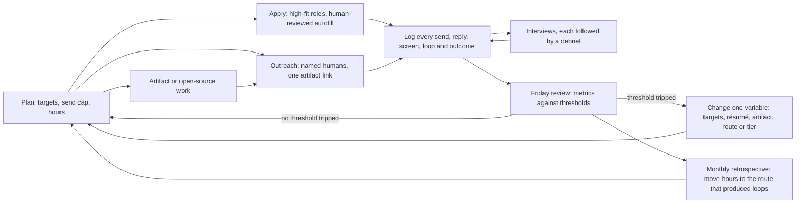

# Application Operating System

> A weekly operating system for running a job search: tracker fields (D-022 generic scope), weekly rhythm, graded funnel metrics and thresholds, plus a T0-26 security and terms-of-service guide to trackers, autofill, auto-apply agents, open-source tools and MCP servers.

**Dates.** Funnel benchmarks come from Gem, Ashby and Greenhouse datasets covering 2021 to Q1 2026, compiled by [T0-04](../../research/sessions/T0-04-ats-filtering-funnel-conversion-math.md) (dated 2026-10-23) and refreshed through Q3 2026 by [T0-24](../../research/sessions/T0-24-job-boards-global-ai-startup-remote.md) (2026-11-11). The hour split, outreach cadence and stop tables come from [T0-05](../../research/sessions/T0-05-unconventional-hiring-tactics-oss-audits.md); hours tiers and gate rules from [T0-06](../../research/sessions/T0-06-career-transition-timelines-5-backgrounds.md); the debrief from [T1-03](../../research/sessions/T1-03-interview-execution-offer-negotiation.md). Tooling, API, MCP, open-source and platform-terms evidence comes from [T0-10](../../research/sessions/T0-10-career-tooling-ecosystem-12-stage-funnel.md) (2026-10-21) and [T0-26](../../research/sessions/T0-26-job-search-tools-agents-oss-mcp.md) (2026-11-13), with key agent and MCP statuses re-verified on 2026-11-19. Benchmarks move: across all functions, Gem's application-to-pre-onsite rate fell from 13% to 8% between 2021 and 2025 [B · T0-04.F9]. Because this page retains T0-10 tool facts verified on 2026-10-21 (class V2, 90 days), `review_by` is set to 2027-01-19 (T0-26 tool facts expire 2027-02-11). **Grades** (EGP-1.0): A primary source opened directly; B transparent secondary source or sizeable vendor dataset; C single source or vendor claim; D judgement; M model output; P practice-curated and unmeasured.

## The short answer

1. **Log everything, or no rule below works.** T0-05 puts about 10 of every 100 search hours into a log of every send, reply, loop and outcome; without it, none of the stop rules can run [D · T0-05 L81]. Keep the tracker in your own personal career repository or spreadsheet, never in this public repository (decision D-022).
2. **Budget hours by channel, not by volume.** Cold inbound converts about 0.2% application-to-hire for engineering, or about 340–380 applications per offer at population-average odds. Referrals yield 11–36× more per application, and sourced candidates about 8× [B · T0-04.F9, T0-04.F10]. T0-05's split of 100 search hours: about 25 on applications, 45 on artifact-carrying outreach, 20 on open source if you can sustain it, and 10 on the log [D · T0-05 L74–81].
3. **Keep automation strictly human-in-the-loop, and respect platform terms.** LinkedIn and Indeed explicitly prohibit third-party bots and scraping extensions [B · T0-26 L49]. Even Indeed paused the automatic mode of its own "Apply For Me" test on 2026-08-04, keeping review-all-drafts [A · T0-26 L50]. Autofill on employer-hosted ATS forms only, verify every field, and click Submit yourself [B · T0-26 L69].
4. **Target cleanly and understand volume trade-offs.** In Huntr's Q3 2026 data, per-application interview rates fell from 8.0% at 11–20 applications to 2.4% at 100+ applications (yet 72.0% of heavy appliers reached at least one interview against 47.8%) [B · T0-26 L51, L190], and at one company per-application rates fell from 5.9% (1 app) to 2.4% (8+ apps) while the chance of at least one interview at that company rose from 5.9% to 17.7% [B · T0-24 L70]. Apply only where you genuinely fit, respect Ashby and Lever repeat-application throttles [A · T0-10.F1; A · T0-26 L52], and cap cold outreach at 30 notes a week [D · T0-05 L87].
5. **Review weekly, retrospect monthly, change one thing at a time.** Act on thresholds, not mood: no screen after 15 targeted applications points to positioning or résumé signal [D · T0-06 L403]; zero replies after 60 targeted sends means changing the artifact or targets [M · T0-05 L401]; logged hours below 70% of plan for three straight weeks means moving to a slower tier [D · T0-06 L251].
6. **Keep a lean, free-first tool stack and protect your data.** Free tiers cover tracking, autofill and gap checks (paying monthly list prices for Jobscan Premium + Teal+ + Huntr Pro costs $118.95/month with no proven lift [M · T0-26 L87]). Keep your CV locally as structured data, never hand LinkedIn cookies to an MCP server or browser agent, and never embed hidden prompt-injection text in a résumé [A/B · T0-26 L52, L57, L73–L74].

## At a glance: the weekly loop



| Component | Cadence | Output | Basis |
|---|---|---|---|
| Tracker | Every action | One row per application, message, interview round and week | D · T0-05 L81 |
| Weekly rhythm | Every week | Applications, outreach, artifact work and logging in fixed shares | D · T0-05 L74–81; P for the days |
| Weekly review | Fridays | Counts, running counters, at most one change | P |
| Monthly retrospective | Monthly | Funnel by route, threshold checks, hours moved | D · T0-06 L285 |
| Checkpoints | Weeks 8 and 12 | Open-source stop-loss; whole-portfolio review | D · T0-05 L89 |

## The funnel you are running

### Cold inbound, per 1,000 applications

| Stage | Gem engineering chain | Ashby technical, Q1 2026 |
|---|---|---|
| Reach a first human stage | 60 (6%) | 36 (3.6%) |
| Reach onsite | 10.2 (17% of the previous stage) | Not reported |
| Offers | 2.65 (26% of onsite, corrected from T0-04's 29%; [B · T0-46 L85, L385]) | 2.63 (7.3% of interviews) |
| Hires, at 73–76% acceptance | 1.94–2.01 (76% eng accept in Gem 2025 [B · T0-46 L385]) | 1.92 (at 73%) |
| Applications per offer | About 377 (was 338 before the 26% correction) | About 380 |
| Application-to-hire | 0.19%–0.20% | 0.19% |

Stage rates are vendor data; the per-1,000 rows are derived from them [B inputs, derived · T0-04 L397–405; T0-46 L385–389]. Gem prints 0.2% for engineering and 0.1% for data science [B · T0-04 L407], and Gem's 2025 Recruiting Benchmarks Report (live-verified 2026-11-19) places engineering onsite-to-offer at **26%** (PM 23%; overall platform range **14%–26%** across Gem enterprise 14%, Gem startup 22%, Ashby ~24% and Gem engineering 26% [B · T0-46 L85, L385–L389]). Two independent datasets thus converge tightly on ~0.2% application-to-hire (~380 cold applications per offer) for engineering; the Ashby Q1 2026 rates reached T0-04 through secondary restatements [C · T0-04 L636]. Gem also reports 35–36 interviews per engineering hire and 120+ days to fill AI-category requisitions versus 53 days for general engineering [B · T0-04.F11; T0-46 L379]. Across all functions, Greenhouse's 2025 North America benchmark reports 203 applications per hire (up 157.7% since 2022) and 56.7 days to fill [B · T0-24 L584, L586], while secondary reports cite 291 applications per hire across all Ashby roles in Q1 2026 [C · T0-24 L591].

**Cold inbound got more crowded.** Gem's application-to-pre-onsite rate fell from 13% to 8% across all functions between 2021 and 2025. Greenhouse reports applications per job up about 110% (116 to 244) and applications per recruiter up 204% (1,610 to 4,890 a year) from 2022 to 2025 [B · T0-04.F9]. In a Robert Half survey of 2,000+ US hiring managers (March 2026, reported second-hand), 67% said AI-generated applications slowed hiring and 65% said skills were harder to verify [C · T0-10 L71].

### By channel

How each entry route converts is owned by [channels and boards](channels-and-boards.md#entry-routes-how-your-application-arrives). In Ashby's 38M applications (all roles, January 2021 to December 2024), 3% of inbound applications reached an interview against 25% of sourced and 40% of referred ones, and interview-to-offer ran 6% for inbound against 16% for referrals [B · T0-04 L413–421]. Gem's independent figures put referrals at 11×, sourced candidates at ~8× and internal mobility at 32× inbound [B · T0-04.F10; T0-24 L223]. In Greenhouse's 2025 North America dataset (640M applications), company job boards yielded roughly 3.2× external job boards [B/M · T0-24 L58, L583]. These are selection effects, not proof of causation [B · T0-04 L426].

### What the odds look like

| Cold applications sent | Chance of at least one offer, Gem corrected rate / Ashby rate |
|---|---|
| 50 | 12.4% / 12.3% |
| 100 | 23.3% / 23.1% |
| 200 | 41.2% / 40.9% |
| 500 | 73.5% / 73.2% |

The table assumes independent applications at population-average offer rates of 0.265% (Gem, corrected to 26% onsite → offer [B · T0-46 L85, L385]) and 0.263% (Ashby) per application [M · T0-04 L441–448; T0-46 L385]. At the Ashby-derived referral rate of 6.4% per referred application, three referred applications give about 18% and ten give about 48% [M · T0-04 L450]. In Huntr's Q3 2026 cohort, median time from search start to first offer was 102 days (52 days to first interview) [B · T0-24 L563]. The averages include low-fit and fraudulent applications, so they are planning floors, not forecasts.

> [!NOTE]
> **Stage-rate corrections ([erratum U24](../../research/ERRATA.md) and `T0-46 K6`).** T1-03 credited Ashby and Gem with application → recruiter screen ≈ 12–18%, screen → loop ≈ 20–30% and offer → accept ≈ 50–70% [T1-03 L158–161]. T0-04 corrected those to 3.6–6% to a first human stage and 17% to onsite, and `T0-46` (live-verified 2026-11-19 against Gem's 2025 Recruiting Benchmarks Report) further corrected Gem's engineering onsite → offer rate from T0-04's **29%** (which matched 2021 inbound all-roles pre-onsite → onsite) to **26%** (14%–26% across Gem and Ashby cohorts [B · T0-46 L85, L385–L389]). This page uses the corrected chain throughout.

## The job-search tooling stack: trackers, autofill, agents, open source and MCP

Per-tool verdicts, prices and check dates live in the central [tool catalog](../00-start/tool-catalog.md#stage-06-job-search-and-applications). This section synthesises [T0-26](../../research/sessions/T0-26-job-search-tools-agents-oss-mcp.md) (retrieved 2026-11-13) into a minimal operating stack and a security / Terms-of-Service boundary.

### Minimal safe stack (free-first) [A/B/C · T0-26 L167–L179]

| Job | Free default | Paid option (only for short sprints) | Key failure mode & control |
|---|---|---|---|
| **CV source of truth** (personal repo, D-022) | **RenderCV** (YAML → PDF, MIT, 17,949 stars, last commit 2026-03-25) or **Reactive Resume** (MIT, 45,680 stars, self-hostable) or **JSON Resume** [A · T0-26 L129–L133] | None needed | Slower maintenance on RenderCV; hosted retention unverified on Reactive Resume (self-host and keep local files); OpenResume has had no commit since 2024-10-29 (`watch`) [A · T0-26 L59, L129–L132] |
| **Application tracker** | Spreadsheet / personal career repo ([pramedha-template](https://github.com/bhaskarjha-dev/pramedha-template)), **Huntr** free (100 jobs per third party), **Teal** free, or **MyGreenhouse** (Greenhouse roles) [A/B/C · T0-26 L102–L104] | **Teal+** ($29/mo or $79/qtr; avoid $13/wk weekly auto-renew) or **Huntr Pro** ($40/mo, $90/qtr, $160/6 mo) [A/B · T0-26 L55] | Weekly auto-renew traps (Teal+ rose from $9/wk to $13/wk [A · T0-26 L196]); MyGreenhouse can recommend your profile to hiring teams unless you opt out [A · T0-26 L104] |
| **Form autofill** | **Simplify Copilot** (free; ~500k Chrome users) or **MyGreenhouse Quick Apply** (free) [A/B · T0-26 L104–L105] | Avoid **Simplify Autopilot** (bundled in Simplify+ ~$19.99/wk third-party) [A/C · T0-26 L53, L106] | Simplify Copilot asks for all-sites data access on Firefox and shares an account with Autopilot — leave Autopilot **off**, use only on employer ATS forms, read every field, and click Submit yourself [A/B · T0-26 L53, L69, L105] |
| **Drafting & gap checks** | General LLM for structure/rehearsal + **Jobscan** (5 free scans/mo) or local **Resume-Matcher** (Apache-2.0, 29,270 stars) [A/B/C · T0-26 L113, L115, L131] | Jobscan quarterly ($89.95/qtr vs $49.95/mo) only if actively benchmarking | Checkers diverge wildly (21%–80% for one résumé in a vendor test) with zero outcome link — treat as gap lists only [C · T0-26 L62]. Verify every LLM line against your record (Huntr reports most surveyed AI users saw invented details) and **never** use LLMs for salary targets (persona bias persists in 2026-era models) [B/C · T0-26 L63, L415] |
| **Official job-data feeds & APIs** | Public **Greenhouse, Lever, Ashby** GET board endpoints; **Adzuna API** (free key, personal use allowed; India appears in third-party country lists); **USAJOBS API**; **Reed API** (UK); **Jooble**, **Remotive** (24h delay, ≤4 calls/day), **Arbeitnow**; **BLS API v2** (500 queries/day), **O*NET Web Services**, **Indeed Hiring Lab** (`CC-BY-4.0`, no India series) [A/B/C · T0-26 L58, L150–L157] | None | Careerjet API requires real visitor IPs (publisher-oriented, unsuitable for personal scripts); Naukri has no public API (commercial source, C) — avoid unofficial scrapers [B/C · T0-26 L75, L156] |
| **Human-in-the-loop evaluator (technical)** | **santifer/career-ops** (MIT, 82,242 stars as of 2026-11-13; local scan, score and tailor; never submits) [A · T0-26 L59, L124] | Own LLM API cost | Board scanning modules may breach site terms; use against permitted ATS endpoints only and ignore automated contact harvesting [A · T0-26 L124, L177] |

### Auto-apply agents, browser agents and MCP servers

| Tool or class | Mode & status (as of 2026-11-19) | Evidence & risk | Verdict |
|---|---|---|---|
| **Indeed MCP (official)** | Beta, read-only remote MCP server (`mcp.indeed.com/claude/mcp`), **Claude connector only** — job search, details, résumé read and company data (live-verified 2026-11-19; **COI**: Anthropic/Claude ecosystem) [A/C · T0-26 L56, L142] | Official and permitted by Indeed; reads your Indeed profile; docs list 4 tools while a directory lists 2 | **Use with care** [A · T0-26 L393] |
| **Greenhouse MCP; Workable MCP; Get on Board MCP** | Official employer-side MCP servers (Greenhouse open beta Jul 2026; Workable expanded to 94 tools Jul 2026; Get on Board talent database Oct 2026; live-verified 2026-11-19) [B · T0-26 L56, L143–L145] | Built for recruiters and admins with employer OAuth scopes, not job seekers | **Watch** [B · T0-26 L394–L396] |
| **adzuna-mcp (community)** | Community wrapper using your own Adzuna API keys [C · T0-26 L149] | Within Adzuna personal-use API terms; subject to free-tier rate limits | **Use with care** [C · T0-26 L399] |
| **Indeed Apply For Me** | First-party US test launched 2026-07-07; **automatic mode paused 2026-08-04** (trade press attributes pause to employer pushback), keeping review-all-drafts (live-verified 2026-11-19) [A/C · T0-26 L50] | Demonstrates even first-party boards hit employer resistance on unattended submissions | **Watch** [A · T0-26 L373] |
| **Jobscan Auto Apply** | Verified live: drafts on Lever and Workable at launch, **review by default** with optional auto-submit; bundled in Premium ($49.95/mo) [B/C · T0-26 L54, L364] | No independent outcome evidence; never turn on opt-in auto-submit | **Watch** [B · T0-26 L364] |
| **Simplify Autopilot** | Live (homepage says "early access"); 20 credits/wk; submits with **no review step**, stopping only if it cannot determine an answer [A · T0-26 L53, L106] | Unreviewed screening answers; no outcome evidence | **Avoid** [A · T0-26 L363] |
| **LazyApply; FastApply; LoopCV; JobCopilot; AIApply; Massive; Sonara; Scoutify** | Third-party extension and hosted cloud auto-appliers [B/C · T0-26 L108–L111] | LinkedIn/Indeed terms prohibit third-party bots; FastApply's own test claimed only 3 of 8 bots even click Submit; Sonara's 2024 shutdown locked users out before BOLD relaunch; weekly/layered billing complaints | **Avoid** [B/C · T0-26 L365–L372] |
| **Open-source bots & scrapers (`AIHawk`, `Auto_job_applier_linkedIn`, `JobSpy`)** | Active GitHub repos (AIHawk 32,498 stars; JobSpy 4,709; Auto_job_applier 3,031 as of 2026-11-13) [A · T0-26 L59, L125–L127] | MIT licence does not override platform terms; core function breaches LinkedIn/Indeed terms and risks account restriction | **Avoid** [A · T0-26 L387–L389] |
| **Session-cookie & scraper MCP servers (`stickerdaniel/linkedin-mcp-server`, HasData/Apify MCP)** | Unofficial LinkedIn/Indeed MCP servers (4,202 stars for `stickerdaniel` as of 2026-11-13; no official LinkedIn job-search MCP found) [A/C · T0-26 L56–L57, L146–L148] | Imports logged-in browser session cookies and can message/connect on your behalf; high account-restriction and credential-exposure risk | **Avoid** [A/C · T0-26 L397–L398] |
| **General browser agents (Comet, Claude in Chrome, Gemini in Chrome, `browser-use`; ChatGPT Atlas discontinued)** | ChatGPT Atlas was **discontinued on 2026-08-09** (live-verified 2026-11-19). Others appear in HUMAN Security's May 2026 agent traffic (COI noted for Claude in Chrome) [B/C · T0-26 L60, L377–L378] | No board checked permits browser agents for applying; agent blocking rates are rising; researchers demonstrated cross-site data extraction via prompt injection | **Avoid** for unattended applying (`watch` for `browser-use`) [A/B/C · T0-26 L377–L378, L392] |

### Security, privacy and Terms-of-Service risk matrix [A/B/C · T0-26 L49–L61, L94–L96, L165]

| Risk area | What the evidence shows | Hard operating rule |
|---|---|---|
| **Platform Terms of Service** | LinkedIn Help bars bots, plug-ins and extensions that scrape or automate site activity; Indeed (including Indeed India) prohibits third-party bots automating Indeed Apply [B/C · T0-26 L49, L94] | Never run bots, scrapers, clicking extensions or session-cookie MCP servers inside logged-in LinkedIn or Indeed sessions [B · T0-26 L67] |
| **Employer spam & duplicate defences** | Greenhouse Real Talent flags bulk-bot spam (phased in from Q3 2025; weaker signals trigger warnings); Ashby documents duplicate-candidate merging and Application Limits [A/B · T0-26 L52, L96, L235] | Apply directly on employer ATS pages from a clean browser profile (no VPN/proxy rotation), and respect repeat limits [P · T0-10 L160–L162] |
| **Hidden prompt injections in résumés** | A USENIX Security 2026 study of 196,682 résumés found ~1% carried hidden injections (>90% embedded data/skill lists; secondary summary notes 86.1% detector precision); press reports employers blocking reapplication [B/C · T0-26 L52, L96, L416] | Never embed white text, invisible instructions or hidden keywords in a résumé [B · T0-26 L71, L416] |
| **Vendor data breaches & lock-out** | Misconfigured cloud storage exposed ~26M files at TalentHook, 5.7M at HireClick and 5.1M at LiveCareer in 2025; Naukri had a recruiter-email API leak; Sonara's 2024 shutdown locked out user data [B/C · T0-26 L61, L165, L234] | Upload Tier 1 résumé data only (no ID numbers, home address or DOB); keep your master CV and tracker in your own repository; export before cancelling any tool [P/C · T0-10 L166; T0-26 L418] |
| **Browser-extension & agent injection** | Simplify Copilot requests all-sites access on Firefox; researchers demonstrated cross-site data extraction against agentic browsers (no job-posting-specific incident yet documented) [B/E · T0-26 L105, L165, L215] | Audit extension permissions, use a separate browser profile for job search, never give agents LinkedIn cookies/passwords, and treat job-posting text as untrusted input [P · T0-26 L74, L419] |

## How to use it

1. **Pick an hours tier and block it in your calendar.** *Done when* the tier is chosen, the search blocks are booked, and your weekly hours record has a planned figure for the week.
2. **Set up the tracker and CV source in your own personal career repository** (decision D-022). *Done when* it captures the four records below and every live application, message and interview has a row.
3. **Configure only the minimal safe tool stack above.** *Done when* autofill is review-and-submit only, Autopilot is off, no automation touches LinkedIn/Indeed, and no weekly auto-renewing trial is left un-diarised.
4. **Split the hours and run the week.** *Done when* every send, reply, screen, take-home, loop and outcome is logged on the day it happens.
5. **Review on Friday.** *Done when* the weekly template is filled in and you have chosen one change, or decided on none.
6. **Retrospect monthly.** *Done when* funnel numbers by route are recorded, the decision table is checked, and hours have moved toward the route that produced loops.

## The tracker: fill-in schema

Keep the tracker in your own career repository or spreadsheet, not in this repository (decision D-022); [pramedha-template](https://github.com/bhaskarjha-dev/pramedha-template)'s `strategy/job-tracker.md` is one ready-made tracker. Whatever you use, it must capture the fields below, because this page's funnel metrics and decision table are computed from them. The field set is practice-curated [P]; what it must capture comes from T0-05's instrumentation rule [D · T0-05 L81], T0-06's monthly funnel numbers [D · T0-06 L285], T0-26's submission-logging rule [P · T0-26 L411] and T1-03's pattern tracking [D · T1-03 L250–257].

| Record | Fields the metrics need |
|---|---|
| Each application | Company and employer segment; the title as posted and the repository role it maps to (a role id such as `ai-engineer`); ATS platform and discovery source; the dates found and applied; the basic qualifications you can evidence, out of those listed; entry route; the named human who vouched for or routed you; the résumé variant/version sent; knockout flags; whether you checked the parsed fields; the furthest stage and its date; the next action with its date; the outcome reason |
| Each outreach message | Date; the person, their role and company (a named engineering director, hiring manager or founder, not a generic inbox [D · T0-05 L87]); medium (email from an authenticated domain, or a LinkedIn message sent by hand); the 30-send batch; the note's version, changing one thing per batch [M · T0-05 L408]; the single artifact linked; the follow-up date, day 5–7 and once only [D · T0-05 L87]; the reply date and result |
| Each interview round | Date and firm; round type; the exact questions, captured in the debrief; a 1–5 self-score per scored dimension; gaps tagged formula, concept, tool or trade-off; the outcome, which calibrates your self-scores [D · T1-03 L250–257] |
| Each week | Hours tier; hours planned and logged; adherence (logged ÷ planned); consecutive weeks below 70% of plan [D · T0-06 L251]; where the hours went (applications, outreach, artifacts, logging) |

Route definitions: *inbound*, you applied cold through a board or careers page; *referral*, an employee put you forward; *sourced*, a recruiter contacted you first; *outreach*, you reached a named human first, who then routed you; *agency*; *internal*, you already work there. Every label except outreach follows Ashby's channels [B · T0-04 L413]; outreach is T0-05's route [D · T0-05 L72]. Employers log channels their own way, so these labels serve your diagnosis, not theirs [P]. Set the *no response* cut-off before you start, as a number of weeks after applying [P].

## Hours: tiers and the 100-hour split

T0-06 plans transitions in three tiers [T0-06 KF-10]. Its model spends the tier hours on the build and adds the search as a lag in weeks, so the search's share of the hours is not modelled [M · T0-06 L331–337].

| Tier | Hours a week | When it fits | What it costs |
|---|---|---|---|
| A | 8–10 | Can suffice when an internal transfer is possible [M · T0-06 L301] | Roughly 4–6 months longer than Tier B for most archetypes [M · T0-06 L274] |
| B | 15–20 | The central planning case [M · T0-06 L274] | A 17.5-hour week takes about 56–74% of average leisure for employed adults [M · T0-06 L213] |
| C | 35–40 | Needs a sabbatical, notice period or reduced work hours | Removes about half the time [M · T0-06 L274] |

**Parents.** Employed adults without children under 18 averaged 4.5 hours of leisure a day, more than an hour above employed adults with a child under 18 [A · T0-06 L211]. About 24 hours a week is an upper bound for employed parents [M · T0-06 L213]. Pick the tier from your logged hours, not from the plan [D · T0-06 L251].

The 100-hour split, per 100 search hours in a quarter [D · T0-05 L74–81]:

| Share | Activity | Rule |
|---|---|---|
| About 25 h | Standard applications to an assumed pool of about 300 relevant GenAI openings, each tied to a named-human route where one exists | The pool is finite, so extra hours here add nothing: do it first, then stop |
| About 45 h | Artifact-carrying outreach: one category-level artifact (about 10–15 h, reusable across about 20 targets) plus about 8–12 h of company-specific tailoring for the top 5 targets | At most 30 sends a week |
| About 20 h | Open source in one repo whose steward or major contributing employer is on your target list | Only if you can sustain about 8–10 h a week for 8–12 weeks; otherwise move these hours to outreach |
| About 10 h | Instrumentation: the tracker | Without it, no stop rule works |

T0-05 found no tactic with a 10× per-hour advantage, and the ranking among tactics changes with the assumptions, so treat the split as modelled judgement [D · T0-05 L66].

## The weekly rhythm [P]

The days and their order are practice suggestions [P]. The shares, caps and cadences carry their own grades.

| Day | Block | Activity | Basis |
|---|---|---|---|
| Monday | Plan | Read the previous review. Pick the week's targets; the top 5 get company-specific tailoring. Set the week's send number on the ramp: 10, 15, 20, then at most 30 over the first four weeks | P; D · T0-05 L79, L87 |
| Monday to Tuesday | Discover and apply, about 25% of search hours | Add new openings to the tracker. Apply to high-fit roles on the employer's ATS page with a named-human route where one exists; review every autofilled and parsed field before clicking Submit | D · T0-05 L78; B · T0-26 L69; A · T0-04 R3 |
| Tuesday to Thursday | Outreach, about 45% | Artifact-carrying notes to named leaders; one follow-up at day 5–7 | D · T0-05 L79, L87 |
| Thursday to weekend | Artifact or open source, about 20% | Build or refresh the category-level artifact; tailor for the top 5; open source only if you can sustain it | D · T0-05 L79–80 |
| Every working session | Log, about 10% | A row for every send, reply, screen, take-home, loop and outcome | D · T0-05 L81; P · T0-26 L411 |
| Day of each interview | Debrief | The 30-minute debrief, immediately after each round | D · T1-03 L238 |
| Friday | Weekly review | Fill in the weekly template; compare logged hours with plan; check the decision table | P; D · T0-06 L251 |
| Last week of the month | Monthly retrospective | Record applications, screens, take-homes, onsite loops and offers by route; move hours | D · T0-06 L285 |
| Weeks 8 and 12 | Checkpoints | Week 8: judge open source against its stop-loss. Week 12: review the whole portfolio and move hours to whichever route produced loops | D · T0-05 L89 |

When loops are live, prepare for them before adding applications [P]; the [prep packs](../08-interviewing/prep-packs.md) are organised by interview track.

## Funnel metrics: benchmarks and thresholds

No session measures a healthy rate for an individual. The benchmarks are employer-side population averages, diluted by low-fit and fraudulent applications, so a targeted search should beat them by a margin nobody has published [B · T0-04.F11]. Compute every rate by route, because routes differ by an order of magnitude [B · T0-04.F10].

| Metric | Formula | Benchmark to compare against | Threshold and action |
|---|---|---|---|
| Screen rate, cold inbound | screens ÷ inbound applications | 3.6% (Ashby technical, Q1 2026) to 6% (Gem engineering) reach a first human stage [B · T0-04.F9] | No threshold: budget inbound as a 0.2% application-to-hire channel, for high-fit roles only [B · T0-04 R1] |
| Screen rate, referral | screens ÷ referred applications | 40% application → interview, against 3% for inbound (Ashby, all roles) [B · T0-04 L415–417] | Not measured |
| Screen rate, all targeted applications | screens ÷ targeted applications | No GenAI-only benchmark [B · T0-04.F11] | No screen after 15 targeted applications → positioning or résumé signal, not skill [D · T0-06 L403] |
| Outreach reply rate | replies ÷ sends, per batch | Planning range 3–8% for artifact-carrying notes to named leaders; 10%+ is a stretch [D · T0-05 L395] | At 60 sends: 0 → change the artifact or targeting; 1 → tighten and continue; 2–5 → continue, cap stays at 30 a week; 8 → above plan, check whether warm contacts inflated it [M · T0-05 L399–406] |
| Screen → loop | loops ÷ screens | Gem engineering: 17% from the pre-onsite stage to onsite [B · T0-04 L91] | Not measured; compare screen notes across companies [P] |
| Take-home pass rate | passed ÷ take-homes | Not measured | 3 failed take-homes → invest in eval design and error analysis [D · T0-06 L404] |
| Loop → offer | offers ÷ loops | 14%–26% across Gem (14% enterprise, 22% startup, 26% engineering onsite → offer) and Ashby (~24% onsite pass-through) [B · T0-46 L85, L385–L389]; from the first interview, 16% for referrals against 6% inbound [B · T0-04 L415–417] | Not measured; look for the same gap across debriefs [C/D · T1-03.F12] |
| Hours adherence | logged ÷ planned hours | None | Below 70% for three weeks in a row → move to the tier with fewer hours and a longer timeline [D · T0-06 L251] |
| Open-source progress | merged PRs; substantive maintainer exchanges | Use it as a headline only after 3 or more merged or in-review PRs plus 5 or more reviews or triage actions in one area [D · T0-05 L83] | No merged PR and no substantive maintainer exchange after 8 weeks → reallocate [D · T0-05 L83] |

**Small samples mislead.** After 30 sends, zero replies is consistent with a true reply rate anywhere from 0 to 11.6%. At a true rate of 5%, 20 sends produce at least one reply only 64.2% of the time, and 60 sends 95.4% of the time [M · T0-05 L408]. Judge outreach at 60 sends and applications at the thresholds above, not after one bad week.

## When to change course: decision table

| If you see | Likely cause | What to change | Grade and source |
|---|---|---|---|
| No screen after 15 targeted applications | Positioning or résumé signal, not skill | Get a practitioner review of your artifacts and résumé; rerun the [ATS self-test](ats-mechanics.md); rebuild the evidence map for your best-fit posting | D · T0-06 L403 |
| Inbound screens near 3.6–6% while referrals convert far better | The channel effect, as expected | Move hours from inbound to referral and outreach; keep inbound for high-fit roles | B · T0-04 R1, T0-04.F10 |
| 0 replies after 60 targeted sends | The artifact or the targeting, not the volume | Change the artifact or the target list before sending more | M · T0-05 L401; D · T0-05 L89 |
| 1 reply after 60 sends | Message or targets too loose | Tighten both, then continue | M · T0-05 L402 |
| 8 or more replies after 60 sends | Warm contacts may be inflating the rate | Check before you scale; the cap stays at 30 a week | M · T0-05 L405–406 |
| Screens, but few loops | Not measured. Possibly a track or level mismatch, or a constraint such as location, visa or pay surfacing in the screen | Compare screen notes across companies; recheck the role target and your knockout answers | P |
| Loops, but no offers | Preparing for the wrong interview track is the most avoidable failure; or one gap repeats across loops | Debrief every round, find the repeated gap, and switch to the matching prep pack | B/C · T1-03.F2; C/D · T1-03.F12 |
| 3 failed take-homes | Weak eval design and error analysis | Invest in eval design and error analysis | D · T0-06 L404 |
| Logged hours below 70% of plan for three weeks in a row | The plan is bigger than your hours | Move to the tier with fewer hours and a longer timeline; do not push harder | D · T0-06 L251 |
| No merged PR and no substantive maintainer exchange after 8 weeks of open source | Wrong repo, or not enough sustained time | Move the hours to outreach | D · T0-05 L83 |
| Several applications at one company and declining response | Per-application rate falls (5.9% → 2.4% in Q3 2026) and Ashby/Lever repeat-application limits exist | Apply only to genuinely distinct fits; check company repeat policies before reapplying | B · T0-24 L70; A · T0-26 L52 |
| "Flagged as possible spam" on an Ashby form | Automation, a VPN or proxy, or browser extensions | Stop, pause extensions, use a clean browser profile without VPN or proxy, retry once by hand, and email the recruiter if it persists | B/C · T0-10.F3; T0-10 R6 |
| End of the plan with no offer | Unknown until diagnosed | Write a funnel diagnosis (where you lose between screen, take-home, onsite and offer), have one practitioner review it, and re-plan the loop type, level or tier | D · T0-06 L398 |

## Templates

### Weekly review [P]

The scam and ghost-job check behind the "Dropped" line is in the [channels and boards checklist](channels-and-boards.md#checklist).

```text
WEEKLY REVIEW [P]               week of [YYYY-MM-DD] · tier [A/B/C]

Hours      planned [h] · logged [h] · adherence [logged ÷ planned] · weeks below 70% in a row [n]
Split      applications [h] · outreach [h] · artifact or open source [h] · log [h]

Counts this week
  Applications     [n]   inbound [n] · referral [n] · outreach-routed [n] · sourced [n]
  Outreach sends   [n]   of a cap of [10/15/20/30] · follow-ups sent [n]
  Replies          [n]
  Screens          [n]   inbound [n] · referral [n] · outreach-routed [n] · sourced [n]
  Take-homes       [n]   passed [n]
  Loops            [n]
  Offers           [n]
  Dropped          [n]   at the scam and ghost-job check · why: [scam signal / ghost signal / duplicate]

Running counters (thresholds in brackets)
  Targeted applications since the last screen    [n]        (review at 15)
  Sends in the current batch / replies           [n] / [n]  (judge at 60)
  Failed take-homes                              [n]        (review at 3)

What produced a conversation:  [named human / artifact / route]
Threshold tripped:             [none / decision-table row]
One change for next week:      [one variable only]
Top 5 targets for next week:   [1] [2] [3] [4] [5]
```

### Monthly retrospective [P]

The funnel numbers follow T0-06's monthly review [D · T0-06 L285]; the diagnosis question follows its G4 gate [D · T0-06 L398].

```text
MONTHLY RETROSPECTIVE [P]       [YYYY-MM]

1. Funnel by route
   Route      Applied/sent  Screens  Take-homes  Loops  Offers  Screen rate  Loop rate
   Inbound    [n]           [n]      [n]         [n]    [n]     [%]          [%]
   Referral   [n]           [n]      [n]         [n]    [n]     [%]          [%]
   Outreach   [n]           [n]      [n]         [n]    [n]     [%]          [%]
   Sourced    [n]           [n]      [n]         [n]    [n]     [%]          [%]
2. Against benchmarks:  inbound screen rate [%] vs 3.6–6%; reply rate [%] vs 3–8%
3. Where you lose:      [screen / take-home / onsite / offer], the stage with the largest drop
4. Debrief patterns:    repeated question types [..]; repeated gaps [..]; study plan [..]
5. Hours:               adherence by week [..]; tier decision [keep / longer plan]
6. Hours move:          route that produced loops [..]; hours shifted from [..] to [..]
7. Targets:             added [..]; dropped [..]; role target still right? [yes/no, why]
8. Decision:            [keep] / [change one variable: ..] / [re-plan loop type, level or tier]
```

### Interview debrief

Run T1-03's 30-minute, five-step debrief immediately after each round, with the template in [interview loops](../08-interviewing/interview-loops.md#debrief-within-30-minutes-of-each-round), which owns it. No controlled study shows that it raises pass rates; it is synthesised from coaching advice [D · T1-03 L236–246]. Its exact questions, self-scores and tagged gaps fill the interview tab of your personal tracker.

## Checklist

Set-up, once:

- [ ] Hours tier chosen from your real availability; search blocks booked in the calendar
- [ ] Tracker and master CV source set up in your own personal career repository (D-022), capturing all four records
- [ ] Target list built in the [targeting workbook](../00-start/targeting-workbook.md) using the [target employers directory](../01-landscape/target-employers.md)
- [ ] Portal résumé passes the [ATS self-test](ats-mechanics.md) with zero hidden text or prompt injections [B · T0-26 L416]
- [ ] Minimal safe tooling configured: free tracker, review-and-submit autofill on employer forms only, Simplify Autopilot off, zero automation/scraping/cookie-MCP on LinkedIn or Indeed [A/B · T0-26 L67–L74]
- [ ] One category-level artifact planned or shipped
- [ ] Outreach ramp scheduled: 10, 15, 20, then at most 30 sends a week

Every week:

- [ ] Applications only to high-fit roles on employer ATS pages, reviewed before Submit
- [ ] Every send, reply, screen, take-home, loop and outcome logged
- [ ] Follow-ups sent at day 5–7
- [ ] A debrief after every interview round
- [ ] Weekly review filled in; at most one change chosen

Every month:

- [ ] Funnel numbers by route recorded: applications, screens, take-homes, onsite loops, offers
- [ ] Decision table checked and any paid subscription renewal diarised or cancelled [B · T0-26 L420]
- [ ] Hours moved toward the route that produced loops

## Pitfalls

| Red flag | Why it hurts | Fix |
|---|---|---|
| Tracking totals only | Routes differ by 8–36× per application, so a blended rate hides where you lose [B · T0-04.F10] | Split every metric by route |
| Changing the résumé, targets and message in the same week | You cannot tell which change worked; at 30 sends a week, A/B tests are not possible [M · T0-05 L408] | One variable per 30-send batch |
| Judging outreach after 20 or 30 sends | After 30 sends, zero replies is still consistent with a true rate up to 11.6% [M · T0-05 L408] | Judge at 60 sends |
| Running auto-apply bots or session-cookie LinkedIn MCP servers | LinkedIn and Indeed explicitly bar bots; per-application yield drops from 8.0% to 2.4% at 100+ apps; cookie-importing MCPs expose credentials and risk restriction [A/B · T0-26 L49, L51, L57] | Review-and-submit autofill on employer ATS pages only; use official APIs/Indeed MCP for read-only search |
| Assuming open-source bots (`AIHawk`, `JobSpy`) are safe because they are MIT-licensed | Stars measure attention, not terms compliance or safety [A · T0-26 L22, L86] | Restrict open-source tooling to local CV builders (`RenderCV`, `Reactive Resume`) and non-submitting evaluators (`career-ops` on permitted endpoints) |
| Hiding prompt instructions or invisible keywords in a résumé | Measurable (~1% of 196,682 résumés in a USENIX Security 2026 paper); press reports employers blocking reapplication [B/C · T0-26 L52, L96] | Never include hidden text; match real qualifications plainly |
| Paying for weekly auto-renewing tool plans or full paid stacks | Teal+ is $13/wk ($29/mo), Simplify+ ~$19.99/wk, Scoutify weekly; stacked monthly list prices reach $118.95/mo with no outcome evidence [A/C/M · T0-26 L55, L87, L111] | Start on free tiers; if paying for a sprint, pick monthly/quarterly and diarise cancellation |
| Relying on an LLM for salary targets | Persona-shaped salary bias persists even in 2026-era models [B/C · T0-26 L63] | Use LLMs for drafting/rehearsal only; take pay anchors from [pay benchmarks](../09-compensation/pay-benchmarks.md) |
| No log or no local CV backup | Without logs, stop rules fail; vendor shutdowns (Sonara 2024) lock users out [C/D · T0-05 L81; T0-26 L234] | Keep master CV and tracker in your own personal repository |
| Pushing harder when hours slip | A 17.5-hour Tier B week is 56–74% of average leisure, a burnout risk [M · T0-06 L213, L792] | The 70% rule: move to a longer plan |

## Evidence and limits

**Measured and primary (A/B).** Stage and channel rates come from Gem, Ashby and Greenhouse (tech-forward customer bases; definitions vary across vendors) [B · T0-04 L501; T0-24 L58]. T1-03's stage rates are a known error, so this page uses T0-04's ([erratum U24](../../research/ERRATA.md)). Primary pages read in full in T0-26 (26% Read ratio) verify Simplify Autopilot's no-review behaviour, Teal+ pricing ($13/wk, $29/mo, $79/qtr), MyGreenhouse, Ashby's duplicate merging and Application Limits, Indeed's 2026-08-04 pause of automatic Apply For Me, Indeed's beta MCP documentation, Adzuna API terms and GitHub repository metadata (stars and commit dates as of 2026-11-13) [A · T0-26 L43, L255–L337].

**Conflicts of interest disclosed.** T0-26 was authored by Claude Sonnet 5.5 (Anthropic); rows involving Anthropic's ecosystem (`Indeed MCP` as a Claude connector, `Claude in Chrome` in browser agents, and LLM salary-bias audits) carry explicit COI tags [T0-26 L13, L225]. `Indeed MCP` and `Indeed Apply For Me` pause were independently verified via live web search on 2026-11-19 alongside `ChatGPT Atlas` discontinuation (2026-08-09), `career-ops`, `Workable MCP` and `Greenhouse MCP`.

**Correlational and vendor-sourced (B/C).** Huntr's volume, same-company and send-for-you survey figures are vendor-run, self-tracked and correlational; Huntr cannot observe whether a tracked application used an auto-apply tool [B/C · T0-26 L51, L161]. Most competitor tool reviews come from rival vendors and are used only for status and pricing [C · T0-26 L22].

**Model outputs and judgement (M/D).** Cumulative offer odds and reply-rate intervals assume independent trials [M · T0-04 L439; T0-05 L397]. The 100-hour split, 3–8% reply range, T0-06 stop thresholds and debrief protocol are judgement [D · T0-05 L66, L395; T0-06 L400; T1-03 L236].

**Not measured or absent (E).** No independent controlled outcome study exists for any auto-apply category [E · T0-26 L208]; no official LinkedIn job-search MCP or individual job-search API was found [E · T0-26 L209]; Workday, Lever and Ashby terms on automated applications and Teal/Huntr/Jobscan extension retention terms were not retrieved [E · T0-26 L210, L213]; no job-posting-specific prompt-injection incident against applicant agents was found [E · T0-26 L215]; Indeed Hiring Lab's dataset carries no India series [E · T0-26 L218].

**What would change this advice.** An independent outcome study of auto-apply; an official LinkedIn MCP or Indeed resuming automatic Apply For Me; a major security breach at a recommended free tool; or a published GenAI-only funnel with cold inbound conversion materially above 1% [T0-04 L138; T0-26 L77].

## Next steps

- **Where openings are and board verdicts:** [channels and boards](channels-and-boards.md) and the [tool catalog](../00-start/tool-catalog.md).
- **Target companies and live ATS URLs:** [target employers directory](../01-landscape/target-employers.md).
- **The outreach block:** [referrals and outreach](../07-networking/referrals-and-outreach.md) and [communities](../07-networking/communities-guide.md).
- **The application itself:** [ATS mechanics](ats-mechanics.md), [résumé strategy](resume-strategy.md) and the [résumé skills matrix](resume-skills-matrix.md).
- **Sequencing and employer tiers:** [job-search strategy](job-search-strategy.md#27-recommended-sequencing-expanding-rings).
- **The artifact you link:** [proof-of-work standards](../05-portfolio/proof-of-work-standards.md) and [project archetypes](../05-portfolio/project-archetypes.md).
- **Converting loops:** [interview loops](../08-interviewing/interview-loops.md) and [prep packs](../08-interviewing/prep-packs.md).
- **Hours tiers and gates for career changers:** [career transitions](../11-tracks/career-transitions.md).
- **When offers arrive:** [offer evaluation](../09-compensation/offer-evaluation.md).
- **Evidence:** [stage 6 findings](../../research/findings.md#stage-06), [T0-26](../../research/sessions/T0-26-job-search-tools-agents-oss-mcp.md), [T0-24](../../research/sessions/T0-24-job-boards-global-ai-startup-remote.md), [T0-04](../../research/sessions/T0-04-ats-filtering-funnel-conversion-math.md), [T0-05](../../research/sessions/T0-05-unconventional-hiring-tactics-oss-audits.md), [T0-06](../../research/sessions/T0-06-career-transition-timelines-5-backgrounds.md), [T0-10](../../research/sessions/T0-10-career-tooling-ecosystem-12-stage-funnel.md) and [T1-03](../../research/sessions/T1-03-interview-execution-offer-negotiation.md).
