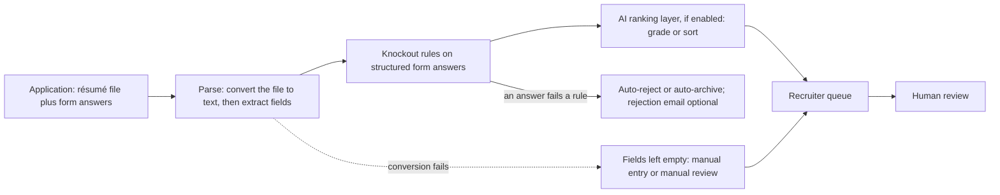

# ATS Mechanics and AI-Mediated Hiring: Screening, AI Interviewers and Legal Pointers

> How applicant tracking systems, AI screening layers, employer-run AI interviewers and proctoring or identity checks work, plus rules for parse-safe résumés, knockout answers, fraud defence and dated legal pointers.

**Dates.** Vendor parsing and screening rules combine [T0-04](../../research/sessions/T0-04-ats-filtering-funnel-conversion-math.md) (dated 2026-10-23), [T0-10](../../research/sessions/T0-10-career-tooling-ecosystem-12-stage-funnel.md) and [T0-23](../../research/sessions/T0-23-resume-format-content-screening-2026.md) (retrieved 2026-11-13 to 2026-11-14). AI-mediated hiring — Kula AI auto-reject, employer AI interviewers, proctoring, identity verification, FBI/Microsoft fraud advisories, AI-in-hiring laws and active litigation — comes from [T0-47](../../research/sessions/T0-47-ai-mediated-hiring-screening-interviews-fraud.md) (retrieved 2026-11-13; load-bearing laws, litigation dockets and advisories re-verified on 2026-11-19). **Freshness:** `review_by` is set to **2026-12-03** (14 days, freshness class V0) because the legal and litigation status table can change within weeks; ATS parsing and screening mechanics should be re-verified quarterly (by 2027-01-21) [T0-04 R9]. **Grades** (EGP-1.0): A primary or measured; B transparent secondary or large vendor dataset; C single source, vendor claim or local experiment; D judgement; E searched, nothing found; M model output; P practice-curated and unmeasured. The page applies [erratum U16](../../research/ERRATA.md): write parse-safe documents and answer knockout questions; do not try to game parsers.

## The short answer

1. **Rule-based knockouts are the main documented auto-rejection, though "AI never rejects" is no longer safe to assume.** Greenhouse, Lever, Ashby, Taleo and Oracle document auto-reject only on form answers (Workday adds condition rules on profile, eligibility, questionnaire or background-check data plus bulk declines when a job closes — none on résumé prose or parse failure) [A · T0-04.F1; A · T0-23 L77, L286; B · T0-47 L49]. However, Kula AI Scoring (updated 2026-08-19) documents an opt-in AI-score auto-reject threshold and a fraud-flag auto-reject (both off by default), and the *Mobley v. Workday* certification order left open whether Workday's AI features can auto-reject [A/B · T0-47 L51, L113, L219]. Answer every form question truthfully from a prepared bank.
2. **A failed parse is not a rejection, but it still costs you.** Parsers convert the file to plain text, then extract fields, and most failures happen in the conversion step [A · T0-04.F2]. A failure leaves fields empty for manual entry [A · T0-23 L78]. Where an AI layer is switched on, it reads the extracted facts — and Ashby marks criteria "skipped" on unreadable files — so a poor conversion can change who is read first [A mechanics, D effect · T0-04.F3; A · T0-23 L269]. Submit a single-column file with a real text layer, and test it across two different extractor families [M · T0-23 L351].
3. **Write for criteria, not keyword counts.** AI layers compare recruiter-defined requirements with extracted titles, skills, years, dates and employers (Greenhouse sends extracted fields to OpenAI under a data processing agreement, excluding names and contact details, caches parsed files for 30 days, and offers a per-application candidate opt-out where the employer enables it) [A · T0-04.F8; A · T0-23 L79, L268; B · T0-47 L50]. Give each requirement in the posting one verifiable evidence line in a recent role [D · T0-04 R4].
4. **An "ATS score" is not a gate.** Neither T0-04 nor T0-23 found any study validating checker scores against real ATS outputs or interview rates; Rezi explicitly notes that real ATS systems issue no official score, Jobscan calls Match Rate its own visualisation, and eight scanners scored the same 612-word PDF from 54 to 91 [A vendor statements, C test · T0-04.F12; T0-23 L80, L275–277; erratum U16]. Use a checker only as a list of gaps against the posting.
5. **Expect AI interviewers, proctoring and identity checks — and defend against hiring scams.** Assessment vendors (HireVue, HackerRank Chakra, CodeSignal, micro1 Zara, Greenhouse) run AI-mediated screening interviews [B · T0-47 L57, L148–152]; platforms run code replay and typing-linearity telemetry, and Amazon and Google state disqualification for undisclosed live copilots [B · T0-47 L161–162, L177]; employers layer CLEAR ID checks and background verification against organised fraud while fake AI coding tests deliver malware ("Contagious Interview") [A/B · T0-47 L60–62, L183–186].
6. **Formatting gets you read; the channel gets you hired — and statutory rights are narrow.** Cold inbound converts about 0.2% application-to-hire for engineering against ~254 applicants per Greenhouse job, while referrals yield 11–36x more per application (selection effects) [B · T0-04.F9, T0-04.F10; B · T0-47 L71]. AI-in-hiring laws (NYC LL144, Illinois AIVIA/HB 3773, California FEHA, Ontario, EU emotion-recognition ban) mostly grant notice and complaint routes rather than guaranteed human review, and as of 2026-11-19 no court has found an AI screening vendor liable [B · T0-47 L54–56].

## At a glance: the screening pipeline



The diagram is a composite of documented stages, not one vendor's architecture [T0-04 L216]. Knockout rules read form answers, not résumé prose, and fraud and spam checks run alongside [A · T0-04 L181–183].

| Stage | What happens | Can it reject you on its own? | What you control |
|---|---|---|---|
| Parse | Converts the file to text, then extracts name, contact details, titles, employers, dates and skills [A · T0-04.F2] | No. Greenhouse attaches the file and leaves fields empty; Talent Matching sends unprocessable résumés to manual review [A · T0-04 L170] | Layout, text layer, headings, file size |
| Knockout rules | Employer-configured rules on structured answers, run when the form is submitted [A · T0-04 L391] | Yes: the only documented deterministic rejection [A · T0-04.F1] | Exact, complete, truthful answers |
| AI ranking layer | Grades or sorts against recruiter criteria where the employer enabled it; adoption is unknown [A · T0-04.F3] | Vendors say no, but grades and sorted lists set the reading order [A · T0-04.F8] | One evidence line per criterion; consistent skills and dates |
| Fraud and spam checks | Phone, email, IP and location signals; admin blocklists; repeat-application limits [A · T0-04 L183; A · T0-10.F1] | Employer-level blocks exist and can be silent [A/B · T0-10.F2] | A stable identity; no automation, VPN or alias emails |
| Recruiter capacity | 4,890 applications per recruiter per year in Greenhouse's 2025 data [B · T0-04 L184] | In effect: many applications are skimmed or never opened [B · T0-04 L184] | The channel: referral, sourced, outreach |

## The four screening mechanisms

T0-04 found four ways an application is excluded or pushed down before a person reads it closely. Parsing is not one of them; it shapes what the other four see [T0-04 L180–184].

| # | Mechanism | Where documented | Grade |
|---|---|---|---|
| 1 | Knockout and auto-reject rules on form answers, configured per job | Greenhouse, Ashby, Lever, Workday, Taleo/Oracle | A · T0-04 L181 |
| 2 | AI grades or rankings where the employer enables them; the effect on who is opened depends on queue volume and recruiter practice | HiredScore, Talent Matching, Ashby AI review, Eightfold, Phenom | A mechanics, D effect · T0-04 L182 |
| 3 | Fraud and spam flags from phone, email, IP and location signals | Greenhouse Real Talent; Ashby's spam check | A · T0-04 L183; B/C · T0-10.F3 |
| 4 | Capacity: applications per recruiter rose from 1,610 to 4,890 a year between 2022 and 2025 | Greenhouse, 6,000+ companies | B · T0-04 L454 |

### What each ATS documents

| ATS | Parsing: documented triggers and what happens | Knockout mechanism | AI layer, where enabled |
|---|---|---|---|
| Greenhouse | Files over 2.5 MB, letter-spaced text, graphics, photos or word-art, image uploads, complex tables, contact data in headers, footers or text boxes, column layouts, placeholder data, unclear sections, incomplete titles, company names without identifiers (updated 2026-03-02 [A · T0-23 L78, L439]). The file is attached with an error message and fields are left for manual entry | Auto-Reject on yes/no, single-select and multi-select questions (Plus and Pro tiers), with an optional rejection email; people subscribed to new-application alerts are not notified of auto-rejected applicants [A · T0-23 L283] | Talent Matching (Real Talent add-on; FAQ updated 2026-02-02): sends extracted skills, titles, years, dates, employers and industry (excluding names and contact details) to OpenAI under a DPA; caches parsed files 30 days; labels Strong, Good, Partial, Limited or Needs manual review; assistive only [A · T0-23 L268] |
| Lever | Image files (JPG, PNG) are not parsed; parsing does not run on some import paths (email, Chrome extension, API) | Rules run on submission in question order on multiple-choice, checkbox, dropdown and file-upload questions (Professional and Enterprise tiers), tagging or archiving with optional delayed rejection email [A · T0-23 L284] | Talent Fit documentation returned an error notice in both T0-04 and T0-23 (gap) [E · T0-23 L271] |
| Ashby | No parsing documentation found; AI review marks criteria "skipped" for unreadable résumés [A · T0-23 L285] | Auto-Reject runs only at submission on application-form questions (Foundations, Plus and Enterprise tiers); applications sent through an application-request link skip auto-reject and application limits [A · T0-23 L285] | AI-Assisted Application Review: Meets, Does not meet, unknown or skipped per criterion, with citations; personal identifiers redacted before model calls; a sortable "criteria met %"; blank or unrelated long-form answers marked not met [A · T0-04 L192; A · T0-23 L269] |
| Workday | Results vary with format and word order; résumés without images work best; Skills and Languages are never auto-filled; a template can hide parsing from external candidates | Condition rules can decline at application or later stages using application, profile, requisition, questionnaire and assessment data via calculated fields, plus status-based declines for purged candidates and at Ready for Hire (administrator-configured; none on résumé prose) [A · T0-23 L286] | HiredScore: A–D grades from the parsed profile (no grade for campus/graduate requisitions or missing résumé; opt-in LLM mode since 2026-08-05); basic qualifications decide A/B versus C/D [A · T0-04 L367; A · T0-23 L270] |
| Taleo / Oracle | Parsing is a third-party partner service, delivered as-is; a mobile path parses pasted plain text | Administrator-configured single- or multiple-answer disqualification questions set minimum eligibility; recruiters cannot edit them in Oracle Recruiting (doc dated 2026-08-31) [A · T0-23 L287–288] | ACE top-candidate flagging on Required and Asset criteria in Taleo Enterprise [A · T0-23 L273] |

Sources: vendor documentation as summarised in T0-04 D2 and D6 [A · T0-04 L190–194, L385–389]. Lever's evidence is a search-engine extract, because the page body could not be fetched. No vendor confirmed which parsing engine it uses [A · T0-04.F4].

### What the AI layers score

| Layer | What it reads and scores (the vendor's own description) | Output | Grade |
|---|---|---|---|
| Greenhouse Talent Matching | Résumé text only, not form answers, names or contact details: titles, skills, years of experience, dates and companies, extracted by fine-tuned LLMs; recruiter-weighted criteria; per-application candidate opt-out where employer enables it (deletes AI score and routes to manual review); NYC LL144 audit dated 2026-07-30 | Strong, Good, Partial, Limited or Needs manual review; hidden after initial review; no auto-reject | A · T0-04 L365; B · T0-47 L50, L107 |
| Ashby AI-Assisted Application Review | Résumé, form answers and profile against recruiter-written criteria; personal data redacted before model calls; FairNow Criteria Evaluation audit (Aug 2024, vendor-commissioned) | Meets, does not meet or undecided per criterion, with citations; a sortable "criteria met %" | A · T0-04 L366; B · T0-47 L109 |
| Workday HiredScore | The parsed profile: experience, education, skills, languages, certifications, summary; opt-in LLM fit-and-gap mode (release note 2026-08-05, preview/production **2026-08-07**); Secretariat bias audit (2025-09-01 to 2026-02-28) summarised by Thomson Reuters | A–D; basic qualifications decide A/B versus C/D; vendor says advisory only (*Mobley* court left auto-reject open for Workday AI features) | A · T0-04 L367; A · T0-47 L103, L105, L220 |
| Eightfold Match Score | Résumé and job description as embeddings, plus hundreds of features (T0-04); BLDS audit of Morgan Stanley's use covered **1,332,869 applicant records** (2025-06-01 to 2026-05-31; ~31–32% scored above job median; impact ratios 0.864–1.000 — measures median split, not recruiter reading order) | 0–5 in half-point steps with explanations; ranked lists (advisory per vendor and Morgan Stanley) | A · T0-04 L368; A/B · T0-47 L106, L117 |
| Phenom Fit Score | Recruiter-set skills, experience, title and location; must-have versus preferred skills; third-party 2024 audit published (unread) | A grade used to prioritise review | B · T0-04 L369; B · T0-47 L112 |
| Kula AI Scoring | Numeric score against recruiter criteria; "Failed" when unreadable; paired with fraud detector ("Suspicious") (doc updated 2026-08-19) | Sortable numeric score; **documents opt-in minimum-score auto-reject and fraud auto-reject (both off by default)** | B · T0-47 L51, L113 |
| LinkedIn Hiring Assistant | Sources, reviews and shortlists candidates for recruiters (launch reported Sep 2025); vendor claims 81% fewer profiles reviewed (COI) | Recruiter shortlist; vendor states no autonomous decisions | B/C · T0-47 L52, L114 |
| SeekOut | A recruiter scorecard: Yes, Partial or No per criterion | Ranked shortlist; vendor states no one is auto-rejected | B · T0-04 L370 |

What they have in common, and what it means for you:

- **Extraction quality reaches the ranking.** Every layer compares an explicit requirement list with extracted facts, usually adding embedding similarity [A · T0-04 L374]. A clean parse is the entry ticket.
- **Basic qualifications come first.** HiredScore's split between A/B and C/D turns on basic qualifications [A · T0-04 L367]. Cover every basic qualification with evidence before any preferred one [D].
- **Recency counts.** Eightfold scores skill overlap in recent roles separately [A · T0-04 L375]. Put the strongest evidence for each requirement in your most recent relevant role [D · T0-04 R4].
- **History counts.** Greenhouse, Phenom and Eightfold validate or train against past recruiter decisions, so scores partly encode historical preferences [D, inference · T0-04 L377]. No independent validation of weights or outcomes was found, only vendor-commissioned bias audits [T0-04 L378].
- **Adoption and auto-rejection prevalence remain unpublished, and surveys conflict sharply.** No vendor publishes what share of customers enable AI ranking or how far down sorted lists recruiters read [C · T0-47 L52, L221]. Proxies: SHRM (December 2025, n=1,908) found 27% of organisations use AI in recruiting (39% in HR); HBS/Accenture (September 2021, n=2,275) found >90% of RMS-using employers filtered or ranked first (not a 2026 figure and not auto-rejection); and two résumé-builder surveys conflict (MyPerfectResume March 2026 reports 65% vs Resume Genius 2026 reporting 19% screening out and 6% limited human review, both C, COI) [B/C · T0-47 L52, L119, L209, L222].
- **"No auto-reject" is not "no effect".** Ashby's AI page says the AI never ranks, while its documentation describes a "criteria met %" column sortable from best to worst fit [A · T0-04 L379], Kula offers an opt-in score auto-reject [B · T0-47 L113], and Greenhouse reports ~254 applicants per live job alongside ~11,000 applications a minute on LinkedIn [B · T0-47 L71, L119]. T0-04 and T0-47's net verdict: assume prioritisation risk [D · T0-04 L504; P · T0-47 L71].
- **Opt-out choices are untested.** Where Greenhouse Talent Matching enables a candidate opt-out, opting out deletes any AI score and routes to "Needs manual review" — but no evidence shows whether manual queues are read faster or slower; record your choice if you opt out [B / untested · T0-47 L72, L107].
- **A parsed profile outlives the application.** Gem reports that 46% of sourced engineering hires were already in the employer's ATS [B · T0-04 R1], so a clean parse can pay off long after the first application [D].
- **LLM screening biases cut in unexpected directions.** Controlled preprints report that LLM evaluators preferred LLM-written résumés over human-written ones in 67–82% of comparisons (same-model candidates 23–60% more likely to be shortlisted) [B · T0-23 L84, L306], and across 22 LLMs chose female-named candidates in 56.9% of name-swapped pairs and the first-listed candidate in 63.5% [B · T0-23 L87, L307]. Separate research on one game-based assessment vendor found homogeneous rejection (4% rejected across all 10 applications, above independent rates) [B · T0-23 L323].
- **Regulatory audits and candidate rights.** The UK Information Commissioner's Office (ICO) November 2024 audit of AI recruitment tools (296 recommendations, 97% accepted) uncovered tools filtering on protected characteristics, inferring gender and ethnicity from names, and scraping networking profiles [A · T0-23 L323]. ICO guidance (2026-03-31) notes that UK jobseekers must be told when automated decisions are used and may ask how a decision was reached and request human review [A · T0-23 L323] (*pointer, not legal advice*).
- **Data leaves the ATS.** Greenhouse's Talent Matching sends extracted résumé fields (excluding names and contact info) to OpenAI under a DPA and caches parsed files 30 days; Ashby redacts personal identifiers before model calls [A · T0-23 L268–269, L525]. Avoid putting sensitive personal identifiers (government IDs, full home address, date of birth) inside portal uploads.

## Myths to ignore

| Myth | What the evidence says | What to do |
|---|---|---|
| "Over 75% of résumés are auto-rejected before a human sees them." | It traces to a 2012 sales claim by a résumé-optimisation start-up that closed in 2013. Vendors document auto-reject only on form answers [B origin, A mechanisms · T0-04 L169]. Screening is still heavily automated: in a vendor survey, 53% of US recruiters said they had handed most screening to AI or an ATS (self-reported) [B · T0-04.F1]. | Put effort into knockout answers, evidence lines and the channel, not into beating a phantom filter. |
| "An ATS rejects résumés it cannot parse." | Greenhouse attaches the file and leaves fields empty; Talent Matching routes unprocessable résumés to manual review; Workday and Lever describe unpopulated fields. Ashby and Taleo behaviour is undocumented [A · T0-04 L170]. | Still make the file parse-safe: empty fields mean manual re-entry and a thinner profile for any AI layer. |
| "Two-column layouts are garbled." | Partly true and extractor-dependent. Greenhouse lists column layouts as a trigger [A · T0-23 L78]; in T0-23's M1 test across six open-source extractors, four read a two-column PDF row-by-row while two read column-by-column [M · T0-23 L342, L351]; one vendor test argues text-stream order rather than columns is the failure mode (COI) [C · T0-23 L144]. | Use a single column for portals; test any layout across two different extractor families. |
| "Canva templates parse as garbage." | Nuanced. Canva's help pages specify tagged PDFs require PDF Standard with flattening off, but stay silent on selectable text [A · T0-23 L146, L437]; an October 2026 vendor test kept the text layer on one Canva-style PDF but read a sidebar before work history and turned icons into stray characters (earlier 20-template claim withdrawn) [C · T0-23 L317, L437]. | Keep Canva for human-read copies; self-test any export before uploading to a portal. |
| "LaTeX breaks parsing because of ligatures." | Conditional. Default pdfLaTeX ligatures extracted intact in all five extractors; failures came from Type 3 fonts, split accents, a ligature code point and bullet glyphs [C · T0-04 L173]. | Use the LaTeX settings in the toolchain notes and run `pdffonts`. |
| "White-font keywords boost your ranking." | All six extractors in T0-04 and T0-23 M1 returned the hidden marker [M · T0-23 L344, L350]. About 1% of 196,682 production résumés (1.19% and 0.91% across two datasets; >90% concealed skills rather than instructions; sevenfold rise Jul 2024–Nov 2025) carried hidden injections, detectors report 86.1–92.7% precision, and production ranking outcomes are unmeasured [B · T0-23 L81, L526]. (Greenhouse's 41% candidate-survey figure uses undisclosed wording and COI framing [C · T0-23 L81, L526].) | Never use hidden text — and run text extraction on downloaded templates to ensure they do not ship hidden strings. |
| "You need an ATS score of 80% or more." | No vendor document T0-04 retrieved describes a keyword-match percentage computed on the résumé; the score-bearing features are AI layers that work differently [C · T0-04 L175]. | Use checkers as a gap list only [erratum U16]. |
| "PDF is always safer than DOCX", or the reverse. | Unresolved. Only Textkernel takes a position: avoid PDF where possible to minimise conversion problems, while most failure reports involve corrupt PDFs. Greenhouse, Workday and Lever do not rank formats [B + C · T0-04 L176]. | Keep a verified PDF and a clean DOCX; upload what the portal asks for. |
| "98% of Fortune 500 companies use an ATS, so filtering is universal." | Adoption is not auto-filtering [C · T0-04 L177]. | As for the first myth. |
| "The Workday black hole" as one mechanism. | A composite of re-entry friction, rule-based declines, grade-based queues, volume and no feedback loop; T0-04 found no measured Workday response-rate dataset [A/D · T0-04 L196–201]. | Answer condition-rule questions exactly, type in Skills and Languages, and use a referral route where you can. |
| "Auto-apply bots trigger IP blacklists and a cross-ATS shadow-ban." | Partly right, mostly wrong. Bot heuristics and employer-level silent blocks exist; Greenhouse's blocklists are admin-curated; no evidence of a persistent ban across employers was found [A/B · T0-10.F2]. | Avoid automation anyway: the blocks are real per employer, and the results are weak (see Pitfalls). |
| "A missing certification acronym gets you auto-rejected." | No source documents certification keywords as automatic rejection; the realistic hard filter is an employer-configured knockout question [C · T0-11.F2]. | List credentials as facts; answer credential questions exactly. |
| "Referred candidates are 10x more likely to be hired." | Supported, not causal: 11x (Gem, hires per application) to 36x (Ashby, offers per application, derived); selection effects apply [B · T0-04 L178]. | Build referral routes: see [referrals and outreach](../07-networking/referrals-and-outreach.md). |

## How to do it

1. **Build a portal résumé.** Apply the twelve rules below to your existing content, and keep your designed version for people and referral emails [T0-04 R2]. *Done when* the file has one column, plain headings, contact details in the body and each role on one line, and is under 2.5 MB.
2. **Run the self-test.** *Done when* `pdffonts` shows no Type 3 rows and a Unicode map on every **embedded** font (standard non-embedded Type 1 fonts such as Helvetica may show `no` and still extract cleanly [M · T0-23 L352]), two extractors from different families (`pdftotext` and `PyMuPDF`) give the same reading order, URLs appear as visible text (only `PyMuPDF` recovered hyperlink targets [M · T0-23 L346]), the code-point check is empty, and a copy-paste reads top to bottom.
3. **Map each posting before you apply.** Copy its requirements, mark them basic or preferred, and give each one an evidence line. *Done when* every basic qualification has an evidence line in a dated role and every skill in your skills line appears in a bullet.
4. **Fill the knockout bank once, then reuse it.** *Done when* every recurring question has a truthful prepared answer with its basis: dates, documents or IDs.
5. **Submit through the employer's form yourself.** Use your own browser, your usual email and phone, and no VPN or proxy; autofill is fine if you read every answer and click Submit yourself [D · T0-04 R7; T0-10 R2]. *Done when* you have read every answer before submitting.
6. **Read the parsed fields and fix them.** *Done when* name, contact details, titles, employers and dates match your résumé, and in Workday you have typed in Skills and Languages [A · T0-04 R3].
7. **Log it.** *Done when* the application has a row in your [application tracker](application-operating-system.md).
8. **Re-test quarterly, and after any template or toolchain change** [T0-04 R9]. *Done when* the new file passes the self-test.

## Portal résumé rules

T0-04's achievable standard is: no documented trigger present, the file passes at least two extractors, and you verify the parsed fields after submitting. No source supports 100% parse accuracy across ATS products; Workday itself says results vary [A · T0-04 R8].

| # | Rule | Why | Grade |
|---|---|---|---|
| 1 | One column in reading order. No sidebars, text boxes or layout tables for core content | A PDF stores positioned text, not a reading order, so extractors infer it and columns interleave or scramble; Greenhouse lists column layouts and complex tables | A + C · T0-04 L332 |
| 2 | Contact block as plain body text at the top: full email, phone, city or region, URLs spelled out | Header, footer, text-box and link content sits outside the body text; link-only contact leaves just the anchor words, such as "GitHub" | A + C · T0-04 L333 |
| 3 | Plain headings: Experience, Education, Skills, Projects, Publications | Letter-spaced headings came out as "E X P E R I E N C E" in five of six extraction modes; Greenhouse lists missing section structure | A + C · T0-04 L334 |
| 4 | A real text layer with embedded fonts and a Unicode map. No image-only or flattened text, photos or graphics | An image-only PDF yielded 0 characters to `pdftotext`; OCR is an optional add-on with limits; Lever does not parse JPG or PNG | A + C · T0-04 L335 |
| 5 | Each role on one line: full title, employer, and "Mon YYYY – Mon YYYY" or "Present" | Fields are associated by adjacency; Greenhouse lists incomplete titles | A trigger, D format · T0-04 L337 |
| 6 | Bullets and symbols that extract as real Unicode, with no control characters | Default pdfLaTeX bullets extracted as the control character U+0088 | C · T0-04 L338 |
| 7 | Under 2.5 MB, one file, no password, no embedded media; never fake or test data in a live portal | Greenhouse's size trigger; Greenhouse flags fake résumés | A · T0-04 L339 |
| 8 | A name with diacritics extracts exactly as you type it in the form | Default pdfLaTeX split accented letters into separate marks in four of five extractors | C · T0-04 L340 |
| 9 | Skills by canonical name, each proven in a dated bullet | Layers extract titles, skills and dates, and evaluate per criterion with citations | A mechanics, D advice · T0-04 L342 |
| 10 | No hidden text and no keyword blocks | Every extractor returns white text; detectors exist | A/B + C · T0-04 L343 |
| 11 | Two files: a portal résumé and a designed one for people | Parsers and people read differently | D · T0-04 L344 |
| 12 | After upload, correct the parsed fields; in Workday, type Skills and Languages yourself | Workday does not populate them | A · T0-04 L341 |

### Toolchain notes

- **LaTeX** [C · T0-04.F6, T0-04 L336]. Default pdfLaTeX output kept every ligature intact in all five extractors, but split accented letters and turned bullets into a control character. Use XeLaTeX with an OpenType font and set `Ligatures=NoCommon` on the font itself (`\setmainfont{...}[Ligatures=NoCommon]`); a document-wide `\defaultfontfeatures` setting did not work in the test. Or use pdfLaTeX with `\usepackage{cmap}` loaded before `fontenc` and scalable fonts installed. Type 3 rows in `pdffonts` mean bitmap fonts, which lost "fi", "fl" and "ffi" in the test.
- **DOCX** [C · T0-04 L319–324; A · T0-04.F2]. Word files keep header, table-cell and text-box content apart from body paragraphs. With contact details in the header and experience in a table, a body-only reader found 1 of 5 test tokens. Keep everything in body paragraphs and check with the DOCX test below.
- **Design tools, including Canva** [A/C · T0-23 L317, L437]. Canva documents that tagged PDFs require PDF Standard with flattening off, but stays silent on selectable text [A · T0-23 L146]. An October 2026 single-file vendor test found a Canva-style export kept its text layer but read a sidebar before work history and turned icons into stray characters [C · T0-23 L317]. Keep the designed file for people; self-test any export before uploading to a portal.
- **Commercial builders vs open-source generators** [A/C · T0-23 L91, L331, L522–523]. Several online builders convert cheap trials into recurring four-week billing (Zety: $1.95/14 days → $25.95/4 weeks; Resume.io: $2.95/7 days → $29.95/4 weeks, currency unlabelled), Kickresume's privacy policy (2026-08-03) permits using anonymised user documents and states it cannot fully rely on anonymisation, and a single news brief reports >5.1M LiveCareer files exposed [A policies/prices, C exposure · T0-23 L91, L522–523]. Text-first word processors or open-source local generators (RenderCV, OpenResume, Reactive Resume — not independently parse-tested in T0-23 [A · T0-23 L331]) avoid subscription traps and third-party uploads; see the [tool catalog](../00-start/tool-catalog.md).
- **PDF or DOCX** [B + C · T0-04 L176; A · T0-23 L146]. The evidence does not pick one. Keep a verified text-layer PDF and a clean single-column DOCX ready, and upload the format the portal asks for [T0-04 R2; T0-23 L123].

### When your profile is unusual

- **Career changers.** Eightfold's features include predicted next title, company similarity and "hireability", so an unusual path can score lower even when skills match [D, inference · T0-04 L376]. Use the posting's terms where they truthfully describe your work, and lean on routes where a person vouches for you [B · T0-04.F10].
- **Thresholds you cannot meet honestly.** A years-of-experience cut-off on a technology that is only a few years old is a common example. Answer truthfully and route around the form: Ashby documents that applications submitted through an application-request link skip its auto-reject and application-limit rules; for other systems this is inference [A/D · T0-04 R5].
- **Names with diacritics.** Check that the extracted name matches what you type in the form, and switch toolchain if accents split (rule 8) [C · T0-04 L340].

## The self-test

About five minutes per template [C · T0-04 L346]. Run it on every new template or toolchain, and quarterly [T0-04 R3, R9]. `pdffonts` and `pdftotext` ship with the Poppler utilities.

```bash
# 1. Fonts: every embedded font (emb "yes") should show uni "yes"; no row of type "Type 3"
# (Non-embedded standard Type 1 fonts like Helvetica can show uni "no" and still extract cleanly: T0-23 L352)
pdffonts resume.pdf

# 2. Engine one (Poppler): the first screen, in default reading order
pdftotext resume.pdf - | head -60

# 3. Engine two (PyMuPDF — a different extractor family from Poppler), plus code-point & link checks
python3 - <<'PY'
import unicodedata
import pymupdf  # pip install pymupdf
doc = pymupdf.open("resume.pdf")
text = "\n".join(page.get_text() for page in doc)
print(text[:1500])
print("NFKC-changing characters:", sorted({hex(ord(c)) for c in text if unicodedata.normalize("NFKC", c) != c}))
print("C1 control characters:", sorted({hex(ord(c)) for c in text if 0x80 <= ord(c) <= 0x9F}))
print("Hyperlink targets:", [l.get("uri") for p in doc for l in p.get_links() if l.get("uri")])
PY

# 4. DOCX: a body-only reader; anything missing here sits in a header, footer, table or text box
python3 - <<'PY'
from docx import Document  # pip install python-docx
print("\n".join(p.text for p in Document("resume.docx").paragraphs))
PY
```

Pass when:

- `pdffonts` shows no Type 3 rows and a Unicode map (`uni: yes`) on every **embedded** font [M · T0-23 L352, L438].
- Both cross-family engines (`pdftotext` and `PyMuPDF`) start with your contact block, keep the headings in order, and print each role's title, employer and dates together, before its bullets. Testing two extractors from different families matters: in T0-23 M1, four extractors read a two-column PDF row-by-row while two (`PyMuPDF`, `pypdf`) read column-by-column [M · T0-23 L342, L351].
- Your key URLs (GitHub, portfolio, LinkedIn) appear as visible text in `pdftotext`, not just hyperlink targets (`pdftotext` returned only the visible anchor label in T0-23 M1; only `PyMuPDF` recovered the URI [M · T0-23 L346, L353]).
- No sidebar, contact or unexpected hidden-text lines appear inside the extracted text. In T0-04's tests, geometry-based extractors interleaved sidebar lines [C · T0-04.F5], and in T0-23 M1 all six extractors returned hidden white text [M · T0-23 L344].
- Both code-point lists are empty. Ligature characters such as U+FB00 break exact keyword matches unless the parser normalises the text; controls such as U+0088 are bullets that failed to extract [C · T0-04.F6].
- Your name appears exactly as you will type it into the form.
- Select all, copy, and paste into a plain-text editor: the text reads top to bottom.
- For DOCX: the body-only output contains your contact block and every title, employer and date.

These are open-source extractors, not vendor parsers. Passing them shows that no documented trigger is present, not that a given ATS will parse the file perfectly [C · T0-04 L227]. After each real submission, read the parsed fields on the review page and fix them by hand [A · T0-04 R3].

## Templates and examples

### Knockout answer bank [P]

Knockout rules are the only documented automatic rejection [A · T0-04.F1]. Complaints about auto-apply tools show where answers go wrong most often: work authorisation, EEO and salary [C · T0-10 R5]. Fill this in once, keep it dated, and copy from it.

```text
KNOCKOUT ANSWER BANK [P]                                last checked: [YYYY-MM-DD]

Work authorisation
  Authorised to work in [country]?                      [Yes/No]   basis: [status, document, expiry]
  Need visa sponsorship for [country]?                  [Yes/No]   basis: [status, document, expiry]
Location and working model
  Can work [on-site / hybrid, n days] in [city]?        [Yes/No]   basis: [home city; move date if relocating]
  Willing to relocate to [city]?                        [Yes/No]   conditions: [timing, support needed]
Experience thresholds (count from dated roles, not memory)
  Years of professional experience                      [n]        basis: [first role Mon YYYY] to [Mon YYYY]
  Years with [skill or technology]                      [n]        basis: [role, Mon YYYY–Mon YYYY]; [role, ...]
  Years in [domain]                                     [n]        basis: [roles and dates]
Education and credentials
  Highest degree and field                              [degree, field, year]
  Hold [credential]?                                    [Yes/No]   basis: [ID, expiry, verification link]
Logistics
  Earliest start date or notice period                  [date / n weeks]
  Expected compensation, only if mandatory              [range]    basis: [benchmark and its date]
Long-form questions: never blank, never "see résumé"
  Experience with [criterion]                           [2–3 sentences: what, where, when, scale, result]
  Why this role or company                              [one reason tied to the posting + one evidence line]
```

- **Never leave a long-form answer blank.** Ashby's AI review marks a blank or unrelated answer as not meeting its criterion [A · T0-04 L192].
- **Answer truthfully, even when it costs you.** A stretched answer can pass the form but contradicts your résumé, profiles and documents later [P]. Where a threshold is out of reach, use a referral or direct outreach instead (see "When your profile is unusual").
- **Keep one identity.** The same email, phone and name across résumé, LinkedIn and GitHub reduces false fraud flags [D · T0-04 R7]. For work-authorisation facts, see [visa and relocation](../11-tracks/visa-and-relocation.md).
- **Compensation.** Do not volunteer your current salary: the most-cited negotiation method starts there [B/C · T1-03.F9]. For a mandatory expected-pay field, use a dated benchmark from [pay benchmarks](../09-compensation/pay-benchmarks.md) and the [negotiation playbook](../09-compensation/negotiation-playbook.md).

### One evidence line per requirement [P]

T0-04's rule: for each requirement in the posting, one verifiable evidence line in a recent role (what, where, when, scale, tools), a skills list consistent with those bullets, and explicit dates [A mechanics, D advice · T0-04 R4].

```text
EVIDENCE MAP [P]     [Company] · [Role title] · [posting URL] · [YYYY-MM-DD]

#  Requirement, verbatim from the posting   Basic/preferred   Evidence line · role, dates          Proof link
1  "[requirement]"                          [basic]           [evidence line] · [role, dates]      [URL or none]
2  "[requirement]"                          [preferred]       [evidence line] · [role, dates]      [URL or none]

Role line:      [Job Title], [Employer], [City] · [Mon YYYY] – [Mon YYYY or Present]
Evidence line:  [Verb] [what you built or changed] for [product, team or client], [scale: users,
                requests a day, documents, data size], using [canonical tool names]; [result with
                a number], measured by [method].
Skills line:    only skills that appear in an evidence line, by canonical name: [skill], [skill], [skill]
Optional [P]:   the X-Y-Z pattern, "Accomplished [X] as measured by [Y], by doing [Z]".
```

- Cover basic qualifications before preferred ones; HiredScore's grade bands split on them [A · T0-04 L367].
- Use the posting's own terms where they truthfully describe your work. In a 2021 survey of 2,275 executives, 88% agreed that qualified high-skill candidates are vetted out for not matching exact criteria [B · T0-04.F1].
- For role-specific skill lists, start from the [résumé skills matrix](resume-skills-matrix.md), for example [AI Engineer](resume-skills-matrix.md#resume-ai-engineer).

### Weak and strong

| Element | Weak | Strong |
|---|---|---|
| Contact | Icons in the page header, linked as "Email · GitHub · LinkedIn" | Body text at the top: [Full Name] · [name@domain] · [+country code phone] · [City, Region] · github.com/[handle] · linkedin.com/in/[handle] |
| Heading | "M Y J O U R N E Y" or "What I've Built" | "Experience", "Projects" |
| Role line | Title on the left, dates in a right-hand column or table cell | [Job Title], [Employer], [City] · [Mon YYYY] – [Mon YYYY], on one line |
| Evidence | "Worked on LLM and RAG projects using various tools." | "Built a retrieval-augmented support assistant for [product] serving [n] queries a day, using [tools]; raised answer accuracy on a [n]-case eval set from [x]% to [y]%." |
| Skills | A long keyword block, or terms in white text | Canonical names, each proven in a bullet above |
| Long-form answer | Blank, or "See résumé" | Two or three sentences that name the criterion and give one evidence line |

### Writing with AI help

Clarity help works, while generic AI prose creates a genuine conflict between machine and human reviewers. In a randomised field experiment (480,948 allocated, 194,700 analysed) on an online freelance marketplace, non-generative algorithmic writing help raised 28-day hires by about 8% (+0.247 percentage points on ~3.1%) and hourly wages of those hired by about 10% (borderline, conditional on hire) without hurting client satisfaction [A · T0-23 L83, L298]. After LLMs arrived on Freelancer.com, the hiring premium for customised applications disappeared [B · T0-23 L83, L299]. Meanwhile, LLM evaluators preferred LLM-written résumés in 67–82% of comparisons (23–60% higher shortlist odds for same-model outputs) [B · T0-23 L84, L306], whereas 19.6% of 600 US hiring managers in a vendor-sponsored survey said they would reject AI-generated résumés or cover letters (and recruiter claims of spotting AI — 73% self-reported, 33.5% vs 25% chance — are weakly sourced [C · T0-23 L84, L325]). In an AI-led interview audit, 21% of 720 candidates claimed proficiency in a required technology that the interview rated "not familiar" [B · T0-23 L84, L309]. In Huntr's observational tracker data (COI), applications run through Huntr's AI tailor showed 4.23% vs 2.07% interview rates in Q1 2026 and 5.71% vs 3.09% across October 2024 to June 2026 (hand-tailored files counted as untailored) [C · T0-23 L82, L425]. Write the first draft, numbers and links yourself; use AI to tighten and check clarity; follow each employer's stated AI policy (for example Anthropic's 2025-07-10 guidance allows refining a human first draft and bars invented experience [A, COI · T0-23 L108, L325]).

## AI-mediated hiring: interviewers, integrity checks and legal pointers

Beyond résumé parsing and ranking, T0-47 documents three fast-moving layers candidates encounter between applying and signing an offer: **employer-run AI interviewers**, **proctoring, identity verification and fraud defences**, and **statutory / litigation developments** [A/B/C · T0-47 L54–62].

### Employer-run AI interviewers

Major assessment vendors that engineers already meet in technical screens deploy conversational voice, text or repository-based AI interviewers [B · T0-47 L57, L146–152]. Every vendor states humans make the hiring decision; **no independent study validates accuracy, fairness or engineering-role adoption**, so every outcome metric below is vendor-reported (C, COI) [E · T0-47 L57, L236]. Mercor and Eightfold AI Interviewer documentation were not opened in T0-47 [E · T0-47 L237].

| Product | Mode | What it scores | Adoption and audit notes | Candidate rights or opt-out | Grade and source |
|---|---|---|---|---|---|
| **HireVue AI Interviewer** | Conversational voice or text interview | Behaviourally anchored rubrics; vendor says it analyses transcript content only — not face, appearance or tone | Company statements date launch to June 2026; explainability statement dated 2025-06-16 | AI consent, opt-out and accommodation paths documented; recruiters decide | B (mechanics) / C (COI) · T0-47 L148 |
| **HackerRank Chakra** | Autonomous interview in a real repository with a built-in AI assistant | Problem-solving and how the candidate collaborates with AI | Generally available **2026-10-05**; vendor claims >500,000 beta interviews (Snowflake, Snorkel, Capgemini cited as testers) | Not stated in extracts; ask the employer in writing | B (GA) / C (COI) · T0-47 L149 |
| **CodeSignal AI Interviewer** | Phone or browser voice interview | 1–5 scale mapped from the job description and calibrated against employer reviewers in a pilot | Vendor-reported; no customer counts seen; vendor cites pilot adverse-impact study | Transcripts, audit logs and human-in-the-loop documented | B (mechanics) / C (COI) · T0-47 L150 |
| **micro1 Zara** | Structured voice interview | Skills report including a proctoring score | Vendor-run randomised field test of ~37,000 applicants (arXiv paper, July 2025, COI); 4,820 interviews in 3 days | Candidate feedback report (requested by 10.7% in paper) | C (COI) · T0-47 L151 |
| **Greenhouse AI Interviewer** | Voice interview | Not read in T0-47; vendor lists audit results | Secondary summary reports **38% candidate drop-off** from required AI interviews (C) | Employers toggle AI features on or off per organisation | B/C · T0-47 L152 |

**How to handle an AI interviewer** [B/P · T0-47 L74, L154]: treat it as a recorded, rubric-scored structured interview; read the consent notice carefully; request an accommodation or human alternative *before* starting if you need one (refusing outright as a default may exit the process [T0-47 L93]); test your microphone in a quiet room to minimise transcription errors from noise or accent; answer with specific, checkable evidence; and request human review if a transcript error distorts a score. Where an AI coding assistant is embedded (such as HackerRank Chakra), narrate how you steer and verify it (see [coding rounds](../08-interviewing/coding-rounds.md)).

### Proctoring, live copilot risk, identity checks and hiring fraud

- **Assessment proctoring and live copilot detection risk.** HackerRank runs plagiarism detection with full code replay (audited under NYC LL144 by BABL AI, 2024-12-12); CodeSignal pairs rubric scores with a separate multi-signal **Suspicion Score** and typing-linearity telemetry; Amazon trains interviewers on reading/typing cues; Google and McKinsey restored in-person rounds [B · T0-46 L222–223; B · T0-47 L161, L177]. Amazon and Google state **disqualification** for unauthorised live AI, and Anthropic's 2025-07-10 guidance bars live AI unless permitted [A, COI · T0-46 L201, L231; B · T0-47 L161–162]. Live overlay copilots (**Final Round AI Interview Copilot** — 2.8/5 on 280 Trustpilot reviews, privacy policy 2026-10-08 allowing audio and screen captures for AI training with human review; **Cluely** — repositioned as a meeting assistant in late 2025 after its CEO retracted a false $7M ARR claim on 2026-03-05; Parakeet AI; LeetCode Wizard) carry disqualification and data-exposure risks with unverified undetectability claims and remain **avoid** in assessed settings [A, COI / B / C · T0-46 L418, L516; T0-47 L59, L173–177].
- **Identity verification (CLEAR) and India background verification (BGV).** Employers increasingly layer identity checks: **CLEAR via Greenhouse** (Plus/Pro tiers) uses a free MyGreenhouse account, government ID, liveness selfie and device/network signals within a 14-day window; CLEAR stores the ID and selfie while Greenhouse receives pass/fail and basic fields; candidates may decline, though the employer decides what follows [B · T0-47 L61, L226]. Complete ID checks only through links reached from a verified employer channel, match name/email/phone to your ID and avoid VPNs [B · T0-47 L77]. In **India**, BGV typically verifies Aadhaar/PAN, EPFO/UAN and relieving/experience letters, DigiLocker degrees, criminal records and address in ~3–10 working days; AuthBridge reported a **4.33%** white-collar discrepancy rate in H1 FY26, led by employment history at **11.15%** (a discrepancy is a mismatch with records, not proof of fraud) [C · T0-47 L61, L190]. Assemble letters, payslips and UAN records pre-offer and match résumé titles and dates to those documents [C · T0-47 L78].
- **Organised remote-hiring fraud and candidate-side malware defence.** On **2026-10-13**, the FBI (**IC3 Alert I-101326-PSA**) and DOJ documented North Korean remote IT workers using stolen identities and >40 Texas "laptop farms" (14 charged, ~187 devices seized, >70 US companies, ~$3M), warning that workers cannot be identified by a single indicator — and explicitly warning that freelancers in **India, Pakistan and Nigeria** are targeted with illegal paid gigs to interview on camera, verify identities or host laptops [A · T0-47 L60, L62, L183]. Never accept any paid request to interview, verify identity, host hardware or share logins for another person; report approaches to your local FBI field office and `ic3.gov` [A · T0-47 L80]. Separately, Microsoft (2026-03-11) and Unit 42 document the **"Contagious Interview"** malware campaign (active since at least December 2022; a September 2026 alert cited 30,000 compromised devices and $10.71M stolen), which lures AI-sector jobseekers with fake coding tests and weaponised VS Code project files — verify the recruiter's company domain and ATS link, and execute any unknown repo strictly inside a disposable VM or container [A/B · T0-47 L62, L79, L186].

### AI-in-hiring laws and active litigation (as of 2026-11-19)

> **Pointers, not legal advice.** The tables below record public legal and litigation statuses as of **2026-11-19** (freshness class V0 — re-verify within 14 days, by **2026-12-03**). Statutes, rules and court dockets change rapidly and enforcement varies widely; consult a qualified employment lawyer in your jurisdiction before relying on any statutory right or filing a claim.

| Jurisdiction / Law | Scope and candidate rights | Status (as of 2026-11-19) | Remedy route | Grade and source |
|---|---|---|---|---|
| **NYC Local Law 144** | Annual independent AEDT bias audit + public summary; advance notice; candidate may request alternative/accommodation (employer not obliged to provide one) and data/retention details | **In force** since 2023-07-05; Dec 2025 NY State Comptroller audit found weak enforcement | Written request to employer; complaint to NYC DCWP (via 311) | A (DCWP) / B · T0-47 L129, L196 |
| **Illinois AIVIA** (820 ILCS 42) | AI analysis of video interviews: advance notice, explanation, consent, sharing limits, deletion within 30 days on request | **In force** since 2020-01-01 | Written request to employer | B · T0-47 L130, L197 |
| **Illinois HB 3773** (P.A. 103-0804) | Bars discriminatory AI use in employment decisions; notice duty | **In force** since **2026-01-01**; IDHR proposed notice rules temporarily withdrawn **2026-06-02** (statute active) | Charge with Illinois Department of Human Rights (IDHR) | B · T0-47 L131, L198 |
| **Colorado SB 26-189** (*xAI v. Weiser*) | Repealed and replaced SB 24-205; notice and post-decision disclosure for ADMT in employment | Enacted **2026-05-14**, effective **2027-01-01**; AG enforcement **paused** by 2026-04-27 stipulated order in *xAI v. Weiser* (DOJ intervened 2026-04-24) | Colorado Attorney General (paused; no private right of action reported, C) | B · T0-47 L128, L132, L199 |
| **California FEHA ADS, CCPA ADMT, AB 1883 / SB 947** | FEHA anti-discrimination rules apply to automated-decision systems; CCPA ADMT adds notice/access/opt-out/appeal where ADMT substantially replaces human decisions; AB 1883/SB 947 target workplace surveillance and AEDTs (details unverified) | FEHA ADS **in force** since **2025-10-01**; CCPA ADMT duties effective **2027-01-01**; AB 1883/SB 947 enacted 2026-09-30 for 2027 | Civil Rights Department (FEHA); CPPA (CCPA ADMT) | B · T0-47 L133–135, L200 |
| **Connecticut PA 26-15** (CART Act) | Pre-use notice and duties for automated employment decision tools (details unverified) | Enacted **2026-05-27**; sources differ on staged dates from 2026-10-01 | Statutory enforcement (secondary summaries) | B/C · T0-47 L136 |
| **Ontario ESA s. 8.4** (O. Reg. 476/24) | Employers with ≥25 staff must disclose in public job postings if AI screens, assesses or selects applicants | **In force** since **2026-01-01** | Complaint to Ontario Ministry of Labour | B · T0-47 L137, L201 |
| **EU AI Act & GDPR** | **Art. 5(1)(f)** bans workplace emotion recognition (Commission guidelines cover recruitment); **Annex III** high-risk recruitment duties; **GDPR Art. 22** restricts solely automated significant decisions | Art. 5(1)(f) **in force** since **2025-02-02**; **Regulation (EU) 2026/1744** postponed Annex III employment duties to **2027-12-02**; GDPR Art. 22 in force | National data-protection / AI supervisory authority | B (AI Act) / C (GDPR) · T0-47 L138–140, L202 |
| **UK ICO guidance** | UK jobseekers must be told when automated decisions are used and may ask how a decision was reached and request human review | Guidance dated **2026-03-31** (following Nov 2024 ICO audit) | Request to employer; ICO complaint | A · T0-23 L323 |
| **India DPDP Act 2023 & Rules 2025** | Notice/consent or Section 7(i) employment legitimate use; Data Principal access/correction/erasure and grievance rights; **no India AI-in-hiring rule found** | Rules notified **2025-11-13**; consent-manager rule 2026-11-13; core duties and rights effective **2027-05-13** | Grievance to data fiduciary first, then Data Protection Board (from May 2027) | B/D · T0-47 L141, L203 |
| **US federal policy** | No federal preemption statute; EO 14365 (2025-12-11) and DOJ AI Litigation Task Force (2026-01-09) target state AI laws | Pending / active policy | EEOC charge (Title VII, ADEA, ADA) or court | B · T0-47 L142, L204 |

**Active US litigation — no vendor found liable as of 2026-11-19** [A/B · T0-47 L54, L125–127]:
- ***Mobley v. Workday*** (N.D. Cal. 3:23-cv-00770-RFL): alleges disparate impact (including ADEA over-40) by Workday AI tools (Workday disputes liability). ADEA collective preliminarily certified **2025-05-16** (>15,000 opt-ins); Rule 23 class-certification motion filed **2026-09-14**; Workday filed opposition and decertification motion **2026-11-10**; hearing set for **2027-03-09** [A (2025 order) / B (2026 docket reports) · T0-47 L125].
- ***Kistler v. Eightfold AI*** (N.D. Cal. 4:26-cv-01768-YGR): alleges Eightfold match scores and profiles are FCRA / California consumer reports (Eightfold disputes this). Motion to dismiss briefed **2026-07-09**, hearing vacated **2026-07-24**, ruling pending [B · T0-47 L126].
- ***Harper v. Sirius XM Radio*** (E.D. Mich., iCIMS screening): alleged racial disparate impact; **judgment for the defendant on 2026-09-30** [B · T0-47 L127].

## Checklist

Once per template, again after any template or toolchain change, and quarterly:

- [ ] One column in reading order; no sidebars, text boxes or layout tables for core content
- [ ] Contact block in the body: email, phone, city or region, URLs spelled out
- [ ] Plain headings: Experience, Education, Skills, Projects, Publications
- [ ] Each role's title, employer and dates on one line
- [ ] `pdffonts`: no Type 3 rows; Unicode maps present (`uni: yes`) on every embedded font [M · T0-23 L352]
- [ ] Two cross-family extractors (`pdftotext` and `PyMuPDF`) read in the same order; visible URLs present in `pdftotext`; code-point check empty; copy-paste reads top to bottom
- [ ] Under 2.5 MB, one file, no password, no images or embedded media
- [ ] Portal PDF, clean DOCX and designed version saved and clearly named

For every application:

- [ ] Every basic qualification has an evidence line in a dated role
- [ ] Every skill in the skills line appears in a bullet
- [ ] Knockout answers taken from the bank and checked against this form's wording
- [ ] No long-form answer left blank or answered "see résumé"
- [ ] Submitted in your own browser, with your usual email and phone, no VPN or proxy, and you clicked Submit
- [ ] Parsed fields read and corrected; Workday Skills and Languages typed in
- [ ] Logged in the tracker
- [ ] For any employer AI interviewer: consent text read, audio tested, accommodation/human alternative requested *before* starting if needed [B/P · T0-47 L74]
- [ ] For any identity check (CLEAR / BGV): completed only via verified employer channel with matching ID details and no VPN; India BGV letters and EPFO/UAN matched to résumé dates [B/C · T0-47 L77–78]
- [ ] For any take-home code: recruiter domain verified and code run only inside a disposable VM or browser IDE [B · T0-47 L79]

## Pitfalls

| Red flag | Why it hurts | Fix |
|---|---|---|
| Uploading the designed two-column or Canva file to a portal | Greenhouse lists columns, graphics and text boxes as parse triggers; extractors interleave or scramble columns [A · T0-04.F2; C · T0-04.F5] | Upload the portal file; keep the designed one for people |
| Contact details only in the header, in icons or in link text | They sit outside the body text; link-only contact leaves just "Email" or "GitHub" in the text layer [A + C · T0-04 L333] | Spell everything out in the body |
| A keyword block, or white text | Extracted by every tool, detectable, and a fraud-flag risk, with no measured gain in production [A/B · T0-04.F7] | Prove each skill in a bullet |
| Chasing an "ATS score" of 80% or more | No vendor document describes a keyword-match percentage on the résumé [C · T0-04 L175] | Read the checker's missing-term list, then use only the terms that are true for you |
| Stretching a years-of-experience answer | Knockouts are the only documented automatic rejection [A · T0-04.F1], and the answer must survive later checks [P] | Answer truthfully; route through a referral or outreach |
| A long-form answer left blank or "see résumé" | Ashby's AI review marks blank or unrelated answers as not met [A · T0-04 L192] | Two or three sentences with one evidence line |
| Mass auto-apply, or a bot in a logged-in LinkedIn session | LinkedIn names account restriction as the consequence; Ashby rejected automated-browser submissions in one reproducible report; Huntr's interview-rate metric fell from 9.25% at 11–20 applications to 2.58% at 100+ (correlational) [B/C · T0-10.F3, T0-10.F4] | Autofill with review; click Submit yourself |
| VPN, proxy rotation or alias emails | Fraud signals use phone, email, IP and location [A · T0-04 L183]; Ashby identifies repeat applicants by email, and evasion can turn a soft block into a fraud flag [A/D · T0-10 R4] | A stable real email and phone, no VPN while applying [D · T0-04 R7] |
| Never opening the parsed fields | Workday never auto-fills Skills or Languages; failed parses leave fields empty [A · T0-04 R3] | Read and fix every field |
| Reusing a template without re-testing | A toolchain change can introduce Type 3 fonts, ligature code points or a scrambled order [C · T0-04.F6] | Self-test after every change, and quarterly |
| Generic AI-written text | After an AI cover-letter tool launched, cover letters lost their link to hiring outcomes [A/B · T0-10.F5] | Use AI for clarity; write the specifics yourself |

## Evidence and limits

**What is documented (A / B).** Parse triggers, knockout mechanisms and AI-layer descriptions come from vendor documentation retrieved for T0-04 (2026-10-23), re-verified for T0-23 (2026-11-13 to 2026-11-14) and extended in T0-47 (2026-11-13): Greenhouse's parse article (2026-03-02), Talent Matching FAQ (2026-02-02) and NYC LL144 audit (2026-07-30), Oracle Recruiting (2026-08-31), Ashby AI review (2024-09-10), Workday HiredScore opt-in LLM mode (preview/production 2026-08-07) and Thomson Reuters audit disclosure, Morgan Stanley's BLDS Eightfold audit (1.33M records), Kula AI Scoring (2026-08-19), the *Mobley* 2025-05-16 certification order, NYC DCWP AEDT guidance, FBI IC3 Alert I-101326-PSA (2026-10-13) and UK ICO guidance (2026-03-31) [A · T0-04 L505; A · T0-23 L268–288, L323; A/B · T0-47 L43, L103–114, L125–142]. Vendors describe their own layers; nobody has independently validated ranking weights or AI-interviewer validity [A/E · T0-04.F8; T0-47 L236].

**What is secondary, extract-only or single-source (B / C / M).** T0-47 read six primary documents in full (*Mobley* 2025 order, NYC DCWP, HiredScore release note, Thomson Reuters audit disclosure, Morgan Stanley Eightfold audit, FBI alert); its other 63 sources were retrieved as search extracts (properly capped at Grade B/C), and the key 2026 statutes, litigation statuses, AI-interviewer launches and malware advisories used above were live-verified via web search on 2026-11-19 [T0-47 L43, L238–239]. The layout, font and DOCX tests (T0-04 and T0-23 M1, n = 1 file per layout) ran open-source extractors in a sandbox; no vendor parser or demo was run [C · T0-04 L227; M · T0-23 L335]. Checker-tool claims, ResumeGo's simulation, Huntr's tracker rates, résumé-builder auto-rejection surveys (65% vs 19%/6%) and AI-interviewer outcome claims are vendor COI data [C · T0-23 L80, L82, L85; C · T0-47 L52, L57, L209]. Note also that T0-47 downgraded T0-04's spam-dilution claim on cold-inbound averages from Grade B to Grade C (direction supported by volume, dilution unmeasured) [C · T0-47 L224].

**What is judgement (D).** The evidence-line rule (R4), fraud-flag hygiene (R7) and the effect of a low grade on whether a résumé is opened are inferences from documented mechanics [T0-04 R4, R7; T0-04.F3].

**What nobody has published.**

- Which parsing engine each ATS uses [A · T0-04.F4].
- Whether the candidate-facing autofill path parses like the recruiter-side upload path Greenhouse documents [T0-04 L64].
- How many employers switch on Talent Matching, Ashby AI review, HiredScore or Kula AI auto-reject, and how often recruiters open candidates below the top of a sorted list [T0-04 L529; T0-47 L235].
- Independent validity, fairness or engineering adoption data for employer AI interviewers; documentation for Mercor, Eightfold AI Interviewer, iCIMS, SmartRecruiters and SAP SuccessFactors screening was not retrieved in T0-47 [E · T0-47 L236–240].
- False-positive or failure rates for CLEAR identity checks, or any blacklist data for copilot disqualification [E · T0-47 L241, L243].
- Ashby's and Taleo's behaviour on a failed parse, Lever's AI features, Canva selectable-text guarantees, and any validated link between checker scores and real ATS outcomes [T0-04 L170, L515, L523; T0-23 L146].

**Counterweight.** Screening is heavily automated even without universal AI auto-rejection. In a 2021 Harvard Business School and Accenture survey of 2,275 executives in the US, UK and Germany, >90% of RMS-using employers used it for a first cut or ranking (94% middle-skills, 92% high-skills; not a 2026 figure and not auto-rejection) [B · T0-04.F1; T0-47 L222], while SHRM (December 2025, n=1,908) found 27% of organisations use AI in recruiting [C · T0-47 L52]. Active litigation (*Mobley*, *Kistler*) alleges de-facto exclusion or FCRA coverage, while *Harper v. Sirius XM* entered judgment for the defendant on 2026-09-30; none establishes vendor liability as of 2026-11-19 [B · T0-47 L54, L125–127].

**Confidence by area (T0-04 L108–115; T0-47 L43–62).**

| Area | Confidence |
|---|---|
| Vendor-documented parse triggers, auto-reject mechanisms and FBI/Microsoft advisories | High |
| Layout and encoding failure mechanics | Medium: reproducible, open-source extractors only |
| AI-layer ranking criteria, AI-interviewer mechanics and 2026 legal/litigation snapshot | Medium for documented mechanics and dated statuses; low for weights, outcomes and future court rulings |
| Parser engine per ATS and independent AI-interviewer validity | Low: unpublished |

**What would change this advice** [T0-04 L135–139; T0-47 L83]:

- Rulings on the FCRA motion to dismiss in *Kistler* or the 2027-03-09 class-certification and decertification hearing in *Mobley*.
- Colorado *xAI v. Weiser* injunction rulings, Illinois IDHR re-filing HB 3773 notice rules, any further EU Annex III delay, or India DPDP commencement on 2027-05-13.
- Major ATS vendors making AI-score auto-rejection a default rather than opt-in.
- Evidence that Workday, Taleo or Ashby reject on parse failure, or vendor-parser tests showing multi-column PDFs parse reliably.

**Geography.** Vendor screening docs are global with mostly US surveys; legal pointers cover NYC, Illinois, Colorado, California, Connecticut, US federal, Ontario, the EU, the UK and India (plus India BGV practice), searched in English only [T0-47 L213].

## Next steps

- **What to say:** [résumé strategy](resume-strategy.md) for positioning, and the [résumé skills matrix](resume-skills-matrix.md) for the skills each role expects.
- **Running the search:** the [application operating system](application-operating-system.md) for the tracker, weekly rhythm and stop rules.
- **Better channels than cold inbound:** [channels and boards](channels-and-boards.md), [referrals and outreach](../07-networking/referrals-and-outreach.md), and the [job-search strategy](job-search-strategy.md#27-recommended-sequencing-expanding-rings) for sequencing.
- **What your evidence lines link to:** [proof-of-work standards](../05-portfolio/proof-of-work-standards.md) and [project archetypes](../05-portfolio/project-archetypes.md).
- **Certificates on the résumé:** [credential ROI](../04-certifications/credential-roi.md).
- **Tool verdicts** for autofill, trackers, checkers, AI interviewers and copilots: the [tool catalog](../00-start/tool-catalog.md).
- **After the screen:** [interview loops](../08-interviewing/interview-loops.md), [employer interview loops](../08-interviewing/employer-interview-loops.md), [coding rounds](../08-interviewing/coding-rounds.md) and the [prep packs](../08-interviewing/prep-packs.md).
- **Role hubs:** [AI Engineer](../02-roles/hubs/ai-engineer.md), [ML Engineer](../02-roles/hubs/ml-engineer.md), [Forward-Deployed Engineer](../02-roles/hubs/forward-deployed-engineer.md), [AI Product Manager](../02-roles/hubs/ai-product-manager.md).
- **Evidence:** [stage 6 findings](../../research/findings.md#stage-06), [T0-47](../../research/sessions/T0-47-ai-mediated-hiring-screening-interviews-fraud.md), [T0-23](../../research/sessions/T0-23-resume-format-content-screening-2026.md), [T0-04](../../research/sessions/T0-04-ats-filtering-funnel-conversion-math.md), [T0-10](../../research/sessions/T0-10-career-tooling-ecosystem-12-stage-funnel.md), [T0-11](../../research/sessions/T0-11-certification-cloud-credential-roi.md), [errata](../../research/ERRATA.md).
