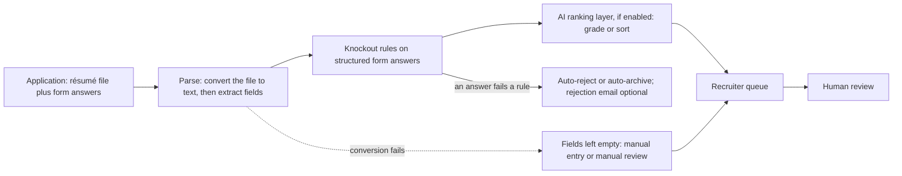

# ATS Mechanics: How Applicant Tracking and AI Screening Work

> How applicant tracking systems and AI screening layers handle an application, which myths to ignore, and the exact rules for a portal résumé and knockout answers that parse cleanly and pass.

**Dates.** Vendor behaviour on this page is as documented in pages retrieved for [T0-04](../../research/sessions/T0-04-ats-filtering-funnel-conversion-math.md) (dated 2026-10-23) and [T0-10](../../research/sessions/T0-10-career-tooling-ecosystem-12-stage-funnel.md). Vendors change behaviour often, and T0-04 recommends re-testing quarterly [T0-04 R9]. Re-verify this page by 2027-01-21. **Grades** (EGP-1.0): A primary or measured; B transparent secondary or large vendor dataset; C single source, vendor claim or local experiment; D judgement; M model output; P practice-curated and unmeasured. The page applies [erratum U16](../../research/ERRATA.md): write parse-safe documents and answer knockout questions; do not try to game parsers.

## The short answer

1. **Knockout questions are the only documented automatic rejection.** Greenhouse, Lever, Ashby, Workday and Taleo/Oracle document auto-reject only as rules the employer configures on application-form answers. None of the vendor documents T0-04 retrieved describes rejection for résumé wording or for a failed parse [A · T0-04.F1]. Answer every question exactly, completely and truthfully, from a prepared bank.
2. **A failed parse is not a rejection, but it still costs you.** Parsers convert the file to plain text, then extract fields, and most failures happen in the conversion step [A · T0-04.F2]. A failure leaves fields empty for manual entry. Where an AI layer is switched on, it reads the extracted facts, so a poor conversion can change who is read first [A mechanics, D effect · T0-04.F3]. Submit a single-column file with a real text layer, and test it.
3. **Write for criteria, not keyword counts.** AI layers compare the recruiter's requirement list with extracted titles, skills, years, dates and employers, plus learned similarity [A · T0-04.F8]. Give each requirement in the posting one verifiable evidence line in a recent role [D · T0-04 R4].
4. **An "ATS score" is not a gate.** T0-04 found no study linking checker scores to real ATS outputs or to interview rates. Use a checker only as a list of gaps against the posting [C · T0-04.F12; erratum U16].
5. **Do not game the system.** No hidden text, no keyword blocks, no mass auto-apply. Every extractor tested returned white text, detectors exist, and the effect on ranking in production is unmeasured [A/B · T0-04.F7]. Use autofill only where you review the answers and click Submit yourself [B/C · T0-10.F4; T0-10 R2].
6. **Formatting gets you read; the channel gets you hired.** Cold inbound converts about 0.2% application-to-hire for engineering, while referrals yield 11–36x more per application [B · T0-04.F9, T0-04.F10]. Those multipliers are selection effects: someone vouched for you, or a recruiter chose you. No formatting reproduces them [B · T0-04 L426].

## At a glance: the screening pipeline



The diagram is a composite of documented stages, not one vendor's architecture [T0-04 L216]. Knockout rules read form answers, not résumé prose, and fraud and spam checks run alongside [A · T0-04 L181–183].

| Stage | What happens | Can it reject you on its own? | What you control |
|---|---|---|---|
| Parse | Converts the file to text, then extracts name, contact details, titles, employers, dates and skills [A · T0-04.F2] | No. Greenhouse attaches the file and leaves fields empty; Talent Matching sends unprocessable résumés to manual review [A · T0-04 L170] | Layout, text layer, headings, file size |
| Knockout rules | Employer-configured rules on structured answers, run when the form is submitted [A · T0-04 L391] | Yes: the only documented deterministic rejection [A · T0-04.F1] | Exact, complete, truthful answers |
| AI ranking layer | Grades or sorts against recruiter criteria where the employer enabled it; adoption is unknown [A · T0-04.F3] | Vendors say no, but grades and sorted lists set the reading order [A · T0-04.F8] | One evidence line per criterion; consistent skills and dates |
| Fraud and spam checks | Phone, email, IP and location signals; admin blocklists; repeat-application limits [A · T0-04 L183; A · T0-10.F1] | Employer-level blocks exist and can be silent [A/B · T0-10.F2] | A stable identity; no automation, VPN or alias emails |
| Recruiter capacity | 4,890 applications per recruiter per year in Greenhouse's 2025 data [B · T0-04 L184] | In effect: many applications are skimmed or never opened [B · T0-04 L184] | The channel: referral, sourced, outreach |

## The four screening mechanisms

T0-04 found four ways an application is excluded or pushed down before a person reads it closely. Parsing is not one of them; it shapes what the other four see [T0-04 L180–184].

| # | Mechanism | Where documented | Grade |
|---|---|---|---|
| 1 | Knockout and auto-reject rules on form answers, configured per job | Greenhouse, Ashby, Lever, Workday, Taleo/Oracle | A · T0-04 L181 |
| 2 | AI grades or rankings where the employer enables them; the effect on who is opened depends on queue volume and recruiter practice | HiredScore, Talent Matching, Ashby AI review, Eightfold, Phenom | A mechanics, D effect · T0-04 L182 |
| 3 | Fraud and spam flags from phone, email, IP and location signals | Greenhouse Real Talent; Ashby's spam check | A · T0-04 L183; B/C · T0-10.F3 |
| 4 | Capacity: applications per recruiter rose from 1,610 to 4,890 a year between 2022 and 2025 | Greenhouse, 6,000+ companies | B · T0-04 L454 |

### What each ATS documents

| ATS | Parsing: documented triggers and what happens | Knockout mechanism | AI layer, where enabled |
|---|---|---|---|
| Greenhouse | Files over 2.5 MB, letter-spaced text, graphics, photos or word-art, image uploads, complex tables, contact data in headers, footers or text boxes, column layouts, no clear sections, incomplete titles. The file is attached and fields are left for manual entry | Auto-Reject on yes/no, single-select and multi-select questions (Plus and Pro tiers), with an optional rejection email; people subscribed to new-application alerts are not notified of auto-rejected applicants | Talent Matching (Real Talent add-on): Strong, Good, Partial or Limited; never advances or rejects; unprocessable résumés go to manual review |
| Lever | Image files (JPG, PNG) are not parsed; parsing does not run on some import paths (email, Chrome extension, API) | Automation workflows (LeverTRM for Enterprise or the Advanced Automation add-on) auto-archive on form submission; a knock-out recipe covers questions such as right to work or years of experience | Not retrieved (gap) |
| Ashby | No parsing documentation found | Auto-Reject on form answers (Foundations, Plus and Enterprise tiers), run when the application is submitted; applications sent through an application-request link skip auto-reject and application limits | AI-Assisted Application Review: meets, does not meet or undecided per criterion, with citations; a sortable "criteria met %"; a blank or unrelated long-form answer is marked not met |
| Workday | Results vary with format and word order; résumés without images work best; Skills and Languages are never auto-filled; a template can hide parsing from external candidates | Condition rules auto-advance or auto-decline, evaluated in order, for example on an ineligible-to-work answer | HiredScore: A–D grades from the parsed profile; opt-in LLM mode since 5 August 2026; basic qualifications decide A/B versus C/D |
| Taleo / Oracle | Parsing is a third-party partner service, delivered as-is; a mobile path parses pasted plain text | Scored disqualification questions; in Oracle Recruiting one negative-scored answer disqualifies automatically | Not researched |

Sources: vendor documentation as summarised in T0-04 D2 and D6 [A · T0-04 L190–194, L385–389]. Lever's evidence is a search-engine extract, because the page body could not be fetched. No vendor confirmed which parsing engine it uses [A · T0-04.F4].

### What the AI layers score

| Layer | What it reads and scores (the vendor's own description) | Output | Grade |
|---|---|---|---|
| Greenhouse Talent Matching | Résumé text only, not form answers, names or contact details: titles, skills, years of experience, dates and companies, extracted by fine-tuned LLMs; recruiter-weighted criteria; validated against past advance decisions | Strong, Good, Partial or Limited; hidden after the initial review stage | A · T0-04 L365 |
| Ashby AI-Assisted Application Review | Résumé, form answers and profile against recruiter-written criteria; personal data redacted before model calls | Meets, does not meet or undecided per criterion, with citations; a sortable "criteria met %" | A · T0-04 L366 |
| Workday HiredScore | The parsed profile: experience, education, skills, languages, certifications, summary | A–D; basic qualifications decide A/B versus C/D, preferred ones separate A from B and C from D | A · T0-04 L367 |
| Eightfold | Résumé and job description as embeddings, plus hundreds of features: skill overlap over the full history and over recent roles, title similarity and predicted next title, company and industry similarity, "hireability" | 0–5 in half-point steps; ranked lists | A · T0-04 L368 |
| Phenom Fit Score | Recruiter-set skills, experience, title and location; must-have versus preferred skills | A grade used to prioritise review | B · T0-04 L369 |
| SeekOut | A recruiter scorecard: Yes, Partial or No per criterion | Ranked shortlist; the vendor states no one is auto-rejected | B · T0-04 L370 |

What they have in common, and what it means for you:

- **Extraction quality reaches the ranking.** Every layer compares an explicit requirement list with extracted facts, usually adding embedding similarity [A · T0-04 L374]. A clean parse is the entry ticket.
- **Basic qualifications come first.** HiredScore's split between A/B and C/D turns on basic qualifications [A · T0-04 L367]. Cover every basic qualification with evidence before any preferred one [D].
- **Recency counts.** Eightfold scores skill overlap in recent roles separately [A · T0-04 L375]. Put the strongest evidence for each requirement in your most recent relevant role [D · T0-04 R4].
- **History counts.** Greenhouse, Phenom and Eightfold validate or train against past recruiter decisions, so scores partly encode historical preferences [D, inference · T0-04 L377]. No independent validation of weights or outcomes was found, only vendor-commissioned bias audits [T0-04 L378].
- **"No auto-reject" is not "no effect".** Ashby's AI page says the AI never ranks, while its documentation describes a "criteria met %" column sortable from best to worst fit [A · T0-04 L379]. T0-04's net verdict: assume prioritisation risk [D · T0-04 L504].
- **A parsed profile outlives the application.** Gem reports that 46% of sourced engineering hires were already in the employer's ATS [B · T0-04 R1], so a clean parse can pay off long after the first application [D].

## Myths to ignore

| Myth | What the evidence says | What to do |
|---|---|---|
| "Over 75% of résumés are auto-rejected before a human sees them." | It traces to a 2012 sales claim by a résumé-optimisation start-up that closed in 2013. Vendors document auto-reject only on form answers [B origin, A mechanisms · T0-04 L169]. Screening is still heavily automated: in a vendor survey, 53% of US recruiters said they had handed most screening to AI or an ATS (self-reported) [B · T0-04.F1]. | Put effort into knockout answers, evidence lines and the channel, not into beating a phantom filter. |
| "An ATS rejects résumés it cannot parse." | Greenhouse attaches the file and leaves fields empty; Talent Matching routes unprocessable résumés to manual review; Workday and Lever describe unpopulated fields. Ashby and Taleo behaviour is undocumented [A · T0-04 L170]. | Still make the file parse-safe: empty fields mean manual re-entry and a thinner profile for any AI layer. |
| "Two-column layouts are garbled." | Partly true and extractor-dependent. Greenhouse lists column layouts as a trigger; Textkernel claims multi-column support [C + A · T0-04 L171]. | Use a single column for portals. |
| "Canva templates parse as garbage." | Unverified, not refuted. Canva's help pages do not say whether exports keep a text layer, and third-party guides conflict [D/C · T0-04 L172]. | Test the exported file with the self-test below. |
| "LaTeX breaks parsing because of ligatures." | Conditional. Default pdfLaTeX ligatures extracted intact in all five extractors; failures came from Type 3 fonts, split accents, a ligature code point and bullet glyphs [C · T0-04 L173]. | Use the LaTeX settings in the toolchain notes and run `pdffonts`. |
| "White-font keywords boost your ranking." | All six extraction modes returned the hidden text. About 1% of 196,682 production résumés carried hidden injections, detectors reported roughly 86–93% precision, and the effect on outcomes was not measured; a small lab gain collapsed when most candidates injected [A/B + C · T0-04.F7]. | Never use hidden text. |
| "You need an ATS score of 80% or more." | No vendor document T0-04 retrieved describes a keyword-match percentage computed on the résumé; the score-bearing features are AI layers that work differently [C · T0-04 L175]. | Use checkers as a gap list only [erratum U16]. |
| "PDF is always safer than DOCX", or the reverse. | Unresolved. Only Textkernel takes a position: avoid PDF where possible to minimise conversion problems, while most failure reports involve corrupt PDFs. Greenhouse, Workday and Lever do not rank formats [B + C · T0-04 L176]. | Keep a verified PDF and a clean DOCX; upload what the portal asks for. |
| "98% of Fortune 500 companies use an ATS, so filtering is universal." | Adoption is not auto-filtering [C · T0-04 L177]. | As for the first myth. |
| "The Workday black hole" as one mechanism. | A composite of re-entry friction, rule-based declines, grade-based queues, volume and no feedback loop; T0-04 found no measured Workday response-rate dataset [A/D · T0-04 L196–201]. | Answer condition-rule questions exactly, type in Skills and Languages, and use a referral route where you can. |
| "Auto-apply bots trigger IP blacklists and a cross-ATS shadow-ban." | Partly right, mostly wrong. Bot heuristics and employer-level silent blocks exist; Greenhouse's blocklists are admin-curated; no evidence of a persistent ban across employers was found [A/B · T0-10.F2]. | Avoid automation anyway: the blocks are real per employer, and the results are weak (see Pitfalls). |
| "A missing certification acronym gets you auto-rejected." | No source documents certification keywords as automatic rejection; the realistic hard filter is an employer-configured knockout question [C · T0-11.F2]. | List credentials as facts; answer credential questions exactly. |
| "Referred candidates are 10x more likely to be hired." | Supported, not causal: 11x (Gem, hires per application) to 36x (Ashby, offers per application, derived); selection effects apply [B · T0-04 L178]. | Build referral routes: see [referrals and outreach](../07-networking/referrals-and-outreach.md). |

## How to do it

1. **Build a portal résumé.** Apply the twelve rules below to your existing content, and keep your designed version for people and referral emails [T0-04 R2]. *Done when* the file has one column, plain headings, contact details in the body and each role on one line, and is under 2.5 MB.
2. **Run the self-test.** *Done when* `pdffonts` shows no Type 3 rows and a Unicode map on every row, two extractors give the same reading order, the code-point check is empty, and a copy-paste reads top to bottom.
3. **Map each posting before you apply.** Copy its requirements, mark them basic or preferred, and give each one an evidence line. *Done when* every basic qualification has an evidence line in a dated role and every skill in your skills line appears in a bullet.
4. **Fill the knockout bank once, then reuse it.** *Done when* every recurring question has a truthful prepared answer with its basis: dates, documents or IDs.
5. **Submit through the employer's form yourself.** Use your own browser, your usual email and phone, and no VPN or proxy; autofill is fine if you read every answer and click Submit yourself [D · T0-04 R7; T0-10 R2]. *Done when* you have read every answer before submitting.
6. **Read the parsed fields and fix them.** *Done when* name, contact details, titles, employers and dates match your résumé, and in Workday you have typed in Skills and Languages [A · T0-04 R3].
7. **Log it.** *Done when* the application has a row in your [application tracker](application-operating-system.md).
8. **Re-test quarterly, and after any template or toolchain change** [T0-04 R9]. *Done when* the new file passes the self-test.

## Portal résumé rules

T0-04's achievable standard is: no documented trigger present, the file passes at least two extractors, and you verify the parsed fields after submitting. No source supports 100% parse accuracy across ATS products; Workday itself says results vary [A · T0-04 R8].

| # | Rule | Why | Grade |
|---|---|---|---|
| 1 | One column in reading order. No sidebars, text boxes or layout tables for core content | A PDF stores positioned text, not a reading order, so extractors infer it and columns interleave or scramble; Greenhouse lists column layouts and complex tables | A + C · T0-04 L332 |
| 2 | Contact block as plain body text at the top: full email, phone, city or region, URLs spelled out | Header, footer, text-box and link content sits outside the body text; link-only contact leaves just the anchor words, such as "GitHub" | A + C · T0-04 L333 |
| 3 | Plain headings: Experience, Education, Skills, Projects, Publications | Letter-spaced headings came out as "E X P E R I E N C E" in five of six extraction modes; Greenhouse lists missing section structure | A + C · T0-04 L334 |
| 4 | A real text layer with embedded fonts and a Unicode map. No image-only or flattened text, photos or graphics | An image-only PDF yielded 0 characters to `pdftotext`; OCR is an optional add-on with limits; Lever does not parse JPG or PNG | A + C · T0-04 L335 |
| 5 | Each role on one line: full title, employer, and "Mon YYYY – Mon YYYY" or "Present" | Fields are associated by adjacency; Greenhouse lists incomplete titles | A trigger, D format · T0-04 L337 |
| 6 | Bullets and symbols that extract as real Unicode, with no control characters | Default pdfLaTeX bullets extracted as the control character U+0088 | C · T0-04 L338 |
| 7 | Under 2.5 MB, one file, no password, no embedded media; never fake or test data in a live portal | Greenhouse's size trigger; Greenhouse flags fake résumés | A · T0-04 L339 |
| 8 | A name with diacritics extracts exactly as you type it in the form | Default pdfLaTeX split accented letters into separate marks in four of five extractors | C · T0-04 L340 |
| 9 | Skills by canonical name, each proven in a dated bullet | Layers extract titles, skills and dates, and evaluate per criterion with citations | A mechanics, D advice · T0-04 L342 |
| 10 | No hidden text and no keyword blocks | Every extractor returns white text; detectors exist | A/B + C · T0-04 L343 |
| 11 | Two files: a portal résumé and a designed one for people | Parsers and people read differently | D · T0-04 L344 |
| 12 | After upload, correct the parsed fields; in Workday, type Skills and Languages yourself | Workday does not populate them | A · T0-04 L341 |

### Toolchain notes

- **LaTeX** [C · T0-04.F6, T0-04 L336]. Default pdfLaTeX output kept every ligature intact in all five extractors, but split accented letters and turned bullets into a control character. Use XeLaTeX with an OpenType font and set `Ligatures=NoCommon` on the font itself (`\setmainfont{...}[Ligatures=NoCommon]`); a document-wide `\defaultfontfeatures` setting did not work in the test. Or use pdfLaTeX with `\usepackage{cmap}` loaded before `fontenc` and scalable fonts installed. Type 3 rows in `pdffonts` mean bitmap fonts, which lost "fi", "fl" and "ffi" in the test.
- **DOCX** [C · T0-04 L319–324; A · T0-04.F2]. Word files keep header, table-cell and text-box content apart from body paragraphs. With contact details in the header and experience in a table, a body-only reader found 1 of 5 test tokens. Keep everything in body paragraphs and check with the DOCX test below.
- **Design tools, including Canva** [D/C · T0-04 L172; C · T0-04 L305]. Whether exports keep a text layer is unverified. In an emulated design export, text written in arbitrary order scrambled the stream-order extractors. Keep the designed file for people; test any export before it goes near a portal.
- **PDF or DOCX** [B + C · T0-04 L176]. The evidence does not pick one. Keep a verified text-layer PDF and a clean single-column DOCX ready, and upload the format the portal asks for [T0-04 R2].

### When your profile is unusual

- **Career changers.** Eightfold's features include predicted next title, company similarity and "hireability", so an unusual path can score lower even when skills match [D, inference · T0-04 L376]. Use the posting's terms where they truthfully describe your work, and lean on routes where a person vouches for you [B · T0-04.F10].
- **Thresholds you cannot meet honestly.** A years-of-experience cut-off on a technology that is only a few years old is a common example. Answer truthfully and route around the form: Ashby documents that applications submitted through an application-request link skip its auto-reject and application-limit rules; for other systems this is inference [A/D · T0-04 R5].
- **Names with diacritics.** Check that the extracted name matches what you type in the form, and switch toolchain if accents split (rule 8) [C · T0-04 L340].

## The self-test

About five minutes per template [C · T0-04 L346]. Run it on every new template or toolchain, and quarterly [T0-04 R3, R9]. `pdffonts` and `pdftotext` ship with the Poppler utilities.

```bash
# 1. Fonts: every row should show emb "yes" and uni "yes"; no row of type "Type 3"
pdffonts resume.pdf

# 2. Engine one (Poppler): the first screen, in default reading order
pdftotext resume.pdf - | head -60

# 3. Engine two (PyMuPDF), plus code-point checks
python3 - <<'PY'
import unicodedata
import pymupdf  # pip install pymupdf
text = "\n".join(page.get_text() for page in pymupdf.open("resume.pdf"))
print(text[:1500])
print("NFKC-changing characters:", sorted({hex(ord(c)) for c in text if unicodedata.normalize("NFKC", c) != c}))
print("C1 control characters:", sorted({hex(ord(c)) for c in text if 0x80 <= ord(c) <= 0x9F}))
PY

# 4. DOCX: a body-only reader; anything missing here sits in a header, footer, table or text box
python3 - <<'PY'
from docx import Document  # pip install python-docx
print("\n".join(p.text for p in Document("resume.docx").paragraphs))
PY
```

Pass when:

- `pdffonts` shows embedded fonts with Unicode maps on every row, and no Type 3 rows.
- Both engines start with your contact block, keep the headings in order, and print each role's title, employer and dates together, before its bullets.
- No sidebar or contact lines appear inside the Experience block. In T0-04's tests, geometry-based extractors put sidebar lines there [C · T0-04.F5].
- Both code-point lists are empty. Ligature characters such as U+FB00 break exact keyword matches unless the parser normalises the text; controls such as U+0088 are bullets that failed to extract [C · T0-04.F6].
- Your name appears exactly as you will type it into the form.
- Select all, copy, and paste into a plain-text editor: the text reads top to bottom.
- For DOCX: the body-only output contains your contact block and every title, employer and date.

These are open-source extractors, not vendor parsers. Passing them shows that no documented trigger is present, not that a given ATS will parse the file perfectly [C · T0-04 L227]. After each real submission, read the parsed fields on the review page and fix them by hand [A · T0-04 R3].

## Templates and examples

### Knockout answer bank [P]

Knockout rules are the only documented automatic rejection [A · T0-04.F1]. Complaints about auto-apply tools show where answers go wrong most often: work authorisation, EEO and salary [C · T0-10 R5]. Fill this in once, keep it dated, and copy from it.

```text
KNOCKOUT ANSWER BANK [P]                                last checked: [YYYY-MM-DD]

Work authorisation
  Authorised to work in [country]?                      [Yes/No]   basis: [status, document, expiry]
  Need visa sponsorship for [country]?                  [Yes/No]   basis: [status, document, expiry]
Location and working model
  Can work [on-site / hybrid, n days] in [city]?        [Yes/No]   basis: [home city; move date if relocating]
  Willing to relocate to [city]?                        [Yes/No]   conditions: [timing, support needed]
Experience thresholds (count from dated roles, not memory)
  Years of professional experience                      [n]        basis: [first role Mon YYYY] to [Mon YYYY]
  Years with [skill or technology]                      [n]        basis: [role, Mon YYYY–Mon YYYY]; [role, ...]
  Years in [domain]                                     [n]        basis: [roles and dates]
Education and credentials
  Highest degree and field                              [degree, field, year]
  Hold [credential]?                                    [Yes/No]   basis: [ID, expiry, verification link]
Logistics
  Earliest start date or notice period                  [date / n weeks]
  Expected compensation, only if mandatory              [range]    basis: [benchmark and its date]
Long-form questions: never blank, never "see résumé"
  Experience with [criterion]                           [2–3 sentences: what, where, when, scale, result]
  Why this role or company                              [one reason tied to the posting + one evidence line]
```

- **Never leave a long-form answer blank.** Ashby's AI review marks a blank or unrelated answer as not meeting its criterion [A · T0-04 L192].
- **Answer truthfully, even when it costs you.** A stretched answer can pass the form but contradicts your résumé, profiles and documents later [P]. Where a threshold is out of reach, use a referral or direct outreach instead (see "When your profile is unusual").
- **Keep one identity.** The same email, phone and name across résumé, LinkedIn and GitHub reduces false fraud flags [D · T0-04 R7]. For work-authorisation facts, see [visa and relocation](../11-tracks/visa-and-relocation.md).
- **Compensation.** Do not volunteer your current salary: the most-cited negotiation method starts there [B/C · T1-03.F9]. For a mandatory expected-pay field, use a dated benchmark from [pay benchmarks](../09-compensation/pay-benchmarks.md) and the [negotiation playbook](../09-compensation/negotiation-playbook.md).

### One evidence line per requirement [P]

T0-04's rule: for each requirement in the posting, one verifiable evidence line in a recent role (what, where, when, scale, tools), a skills list consistent with those bullets, and explicit dates [A mechanics, D advice · T0-04 R4].

```text
EVIDENCE MAP [P]     [Company] · [Role title] · [posting URL] · [YYYY-MM-DD]

#  Requirement, verbatim from the posting   Basic/preferred   Evidence line · role, dates          Proof link
1  "[requirement]"                          [basic]           [evidence line] · [role, dates]      [URL or none]
2  "[requirement]"                          [preferred]       [evidence line] · [role, dates]      [URL or none]

Role line:      [Job Title], [Employer], [City] · [Mon YYYY] – [Mon YYYY or Present]
Evidence line:  [Verb] [what you built or changed] for [product, team or client], [scale: users,
                requests a day, documents, data size], using [canonical tool names]; [result with
                a number], measured by [method].
Skills line:    only skills that appear in an evidence line, by canonical name: [skill], [skill], [skill]
Optional [P]:   the X-Y-Z pattern, "Accomplished [X] as measured by [Y], by doing [Z]".
```

- Cover basic qualifications before preferred ones; HiredScore's grade bands split on them [A · T0-04 L367].
- Use the posting's own terms where they truthfully describe your work. In a 2021 survey of 2,275 executives, 88% agreed that qualified high-skill candidates are vetted out for not matching exact criteria [B · T0-04.F1].
- For role-specific skill lists, start from the [résumé skills matrix](resume-skills-matrix.md), for example [AI Engineer](resume-skills-matrix.md#resume-ai-engineer).

### Weak and strong

| Element | Weak | Strong |
|---|---|---|
| Contact | Icons in the page header, linked as "Email · GitHub · LinkedIn" | Body text at the top: [Full Name] · [name@domain] · [+country code phone] · [City, Region] · github.com/[handle] · linkedin.com/in/[handle] |
| Heading | "M Y J O U R N E Y" or "What I've Built" | "Experience", "Projects" |
| Role line | Title on the left, dates in a right-hand column or table cell | [Job Title], [Employer], [City] · [Mon YYYY] – [Mon YYYY], on one line |
| Evidence | "Worked on LLM and RAG projects using various tools." | "Built a retrieval-augmented support assistant for [product] serving [n] queries a day, using [tools]; raised answer accuracy on a [n]-case eval set from [x]% to [y]%." |
| Skills | A long keyword block, or terms in white text | Canonical names, each proven in a bullet above |
| Long-form answer | Blank, or "See résumé" | Two or three sentences that name the criterion and give one evidence line |

### Writing with AI help

Clarity help works; generic text is discounted. In a field experiment with roughly half a million jobseekers on an online labour market, non-generative algorithmic writing help on résumés raised hiring by 8% and wages by 10% (Management Science 2025). After Freelancer.com introduced an AI cover-letter tool, cover letters became less correlated with hiring outcomes, while job-specific tailoring still predicted callbacks [A/B · T0-10.F5]. External validity to corporate ATS hiring is unproven [T0-10.F5]. In Huntr's correlational data, tailored applications scored 4.23% against 2.07% for untailored ones [B/C · T0-10 R3]. Use AI tools to tighten and check; write the specifics, numbers and links yourself [D].

## Checklist

Once per template, again after any template or toolchain change, and quarterly:

- [ ] One column in reading order; no sidebars, text boxes or layout tables for core content
- [ ] Contact block in the body: email, phone, city or region, URLs spelled out
- [ ] Plain headings: Experience, Education, Skills, Projects, Publications
- [ ] Each role's title, employer and dates on one line
- [ ] `pdffonts`: fonts embedded, Unicode maps present, no Type 3 rows
- [ ] Two extractors read in the same order; code-point check empty; copy-paste reads top to bottom
- [ ] Under 2.5 MB, one file, no password, no images or embedded media
- [ ] Portal PDF, clean DOCX and designed version saved and clearly named

For every application:

- [ ] Every basic qualification has an evidence line in a dated role
- [ ] Every skill in the skills line appears in a bullet
- [ ] Knockout answers taken from the bank and checked against this form's wording
- [ ] No long-form answer left blank or answered "see résumé"
- [ ] Submitted in your own browser, with your usual email and phone, no VPN or proxy, and you clicked Submit
- [ ] Parsed fields read and corrected; Workday Skills and Languages typed in
- [ ] Logged in the tracker

## Pitfalls

| Red flag | Why it hurts | Fix |
|---|---|---|
| Uploading the designed two-column or Canva file to a portal | Greenhouse lists columns, graphics and text boxes as parse triggers; extractors interleave or scramble columns [A · T0-04.F2; C · T0-04.F5] | Upload the portal file; keep the designed one for people |
| Contact details only in the header, in icons or in link text | They sit outside the body text; link-only contact leaves just "Email" or "GitHub" in the text layer [A + C · T0-04 L333] | Spell everything out in the body |
| A keyword block, or white text | Extracted by every tool, detectable, and a fraud-flag risk, with no measured gain in production [A/B · T0-04.F7] | Prove each skill in a bullet |
| Chasing an "ATS score" of 80% or more | No vendor document describes a keyword-match percentage on the résumé [C · T0-04 L175] | Read the checker's missing-term list, then use only the terms that are true for you |
| Stretching a years-of-experience answer | Knockouts are the only documented automatic rejection [A · T0-04.F1], and the answer must survive later checks [P] | Answer truthfully; route through a referral or outreach |
| A long-form answer left blank or "see résumé" | Ashby's AI review marks blank or unrelated answers as not met [A · T0-04 L192] | Two or three sentences with one evidence line |
| Mass auto-apply, or a bot in a logged-in LinkedIn session | LinkedIn names account restriction as the consequence; Ashby rejected automated-browser submissions in one reproducible report; Huntr's interview-rate metric fell from 9.25% at 11–20 applications to 2.58% at 100+ (correlational) [B/C · T0-10.F3, T0-10.F4] | Autofill with review; click Submit yourself |
| VPN, proxy rotation or alias emails | Fraud signals use phone, email, IP and location [A · T0-04 L183]; Ashby identifies repeat applicants by email, and evasion can turn a soft block into a fraud flag [A/D · T0-10 R4] | A stable real email and phone, no VPN while applying [D · T0-04 R7] |
| Never opening the parsed fields | Workday never auto-fills Skills or Languages; failed parses leave fields empty [A · T0-04 R3] | Read and fix every field |
| Reusing a template without re-testing | A toolchain change can introduce Type 3 fonts, ligature code points or a scrambled order [C · T0-04.F6] | Self-test after every change, and quarterly |
| Generic AI-written text | After an AI cover-letter tool launched, cover letters lost their link to hiring outcomes [A/B · T0-10.F5] | Use AI for clarity; write the specifics yourself |

## Evidence and limits

**What is documented (A).** Parse triggers, knockout mechanisms and AI-layer descriptions come from vendor documentation retrieved for T0-04 (dated 2026-10-23). Greenhouse's parse article was updated in March 2026, Workday's parsing concept page is dated 2023, and HiredScore's LLM mode is an opt-in from 5 August 2026 [T0-04 L505]. Vendors describe their own layers; nobody has independently validated the weights [A · T0-04.F8].

**What is local or single-source (C).** The layout, font and DOCX tests ran open-source extractors in a sandbox; no vendor parser or demo was run [C · T0-04 L227, L522]. Checker-tool claims are vendor or third-party statements [C · T0-04.F12].

**What is judgement (D).** The evidence-line rule (R4), fraud-flag hygiene (R7) and the effect of a low grade on whether a résumé is opened are inferences from documented mechanics [T0-04 R4, R7; T0-04.F3].

**What nobody has published.**

- Which parsing engine each ATS uses [A · T0-04.F4].
- Whether the candidate-facing autofill path parses like the recruiter-side upload path Greenhouse documents [T0-04 L64].
- How many employers switch on Talent Matching, Ashby AI review or HiredScore, and how often recruiters open candidates below the top of a sorted list [T0-04 L529].
- Ashby's and Taleo's behaviour on a failed parse, and Lever's AI features [T0-04 L170, L515].
- Whether Canva exports keep a text layer, and the production effect of hidden text [T0-04 L516, L519].
- Any validated link between checker scores and real ATS outcomes [T0-04 L523].

**Counterweight.** Screening is heavily automated even without auto-reject. In a 2021 Harvard Business School and Accenture survey of 2,275 executives in the US, UK and Germany, more than 90% of employers using recruiting-management systems relied on them for a first cut or ranking [B · T0-04.F1]. Two US lawsuits, *Kistler v. Eightfold* and *Mobley v. Workday*, allege de-facto exclusion by ranking; T0-04 records them as allegations, not findings [B · T0-04.F8].

**Confidence by area (T0-04 L108–115).**

| Area | Confidence |
|---|---|
| Vendor-documented parse triggers and auto-reject mechanisms | High |
| Layout and encoding failure mechanics | Medium: reproducible, open-source extractors only |
| AI-layer ranking criteria | Medium for what is scored; low for weights and effect |
| Parser engine per ATS | Low: not vendor-confirmed |

**What would change this advice** [T0-04 L135–139]:

- A vendor-parser test showing that multi-column files parse correctly would relax the layout rule for those employers, but not the other documented triggers.
- Evidence that Workday, Taleo or Ashby reject on parse failure would raise the priority of the self-test.
- Rulings or disclosures in *Kistler* or *Mobley* that expose ranking criteria or automated exclusion rates.

**Geography.** The evidence is vendor documentation and mostly US surveys. No session measured ATS behaviour by country.

## Next steps

- **What to say:** [résumé strategy](resume-strategy.md) for positioning, and the [résumé skills matrix](resume-skills-matrix.md) for the skills each role expects.
- **Running the search:** the [application operating system](application-operating-system.md) for the tracker, weekly rhythm and stop rules.
- **Better channels than cold inbound:** [channels and boards](channels-and-boards.md), [referrals and outreach](../07-networking/referrals-and-outreach.md), and the [job-search strategy](job-search-strategy.md#27-recommended-sequencing-expanding-rings) for sequencing.
- **What your evidence lines link to:** [proof-of-work standards](../05-portfolio/proof-of-work-standards.md) and [project archetypes](../05-portfolio/project-archetypes.md).
- **Certificates on the résumé:** [credential ROI](../04-certifications/credential-roi.md).
- **Tool verdicts** for autofill, trackers and checkers: the [tool catalog](../00-start/tool-catalog.md).
- **After the screen:** [interview loops](../08-interviewing/interview-loops.md) and the [prep packs](../08-interviewing/prep-packs.md).
- **Role hubs:** [AI Engineer](../02-roles/hubs/ai-engineer.md), [ML Engineer](../02-roles/hubs/ml-engineer.md), [Forward-Deployed Engineer](../02-roles/hubs/forward-deployed-engineer.md), [AI Product Manager](../02-roles/hubs/ai-product-manager.md).
- **Evidence:** [stage 6 findings](../../research/findings.md#stage-06), [T0-04](../../research/sessions/T0-04-ats-filtering-funnel-conversion-math.md), [T0-10](../../research/sessions/T0-10-career-tooling-ecosystem-12-stage-funnel.md), [T0-11](../../research/sessions/T0-11-certification-cloud-credential-roi.md), [errata](../../research/ERRATA.md).
