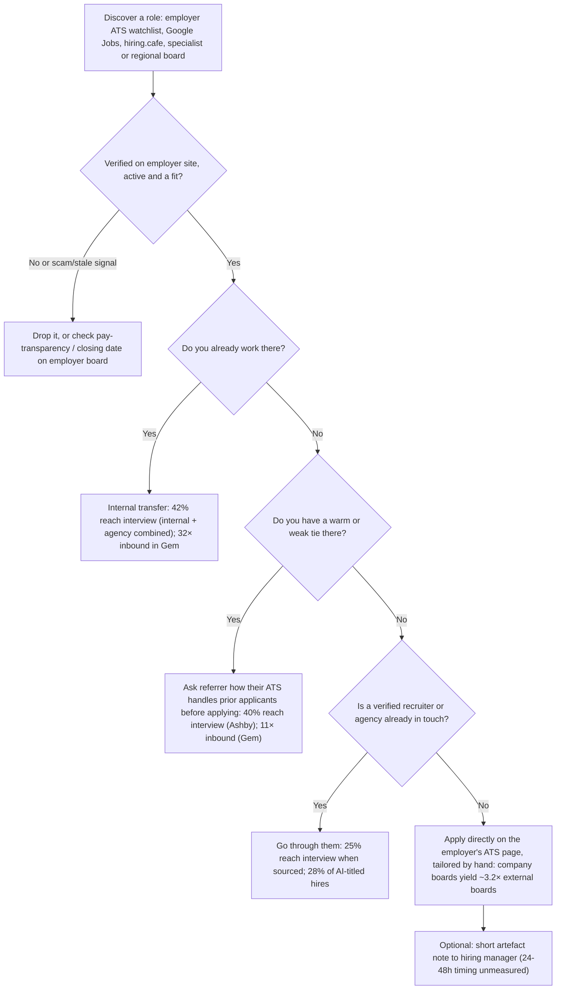

# Channels and Boards: Where GenAI Postings Are and Which Channels Convert

> Where GenAI postings appear globally, in India and across regional markets, which entry channels convert, how to search employer ATS boards, pay-transparency and ghost-job law status, and scam and malware checks.

**Dates.** Channel and funnel benchmarks come from Ashby, Gem, Greenhouse and Huntr datasets spanning 2021 to Q3 2026, compiled by [T0-04](../../research/sessions/T0-04-ats-filtering-funnel-conversion-math.md), [T0-12](../../research/sessions/T0-12-high-signal-communities-technical-visibility.md), [T0-24](../../research/sessions/T0-24-job-boards-global-ai-startup-remote.md) (retrieved 2026-11-11) and [T0-26](../../research/sessions/T0-26-job-search-tools-agents-oss-mcp.md) (retrieved 2026-11-13). India and regional board coverage comes from [T0-25](../../research/sessions/T0-25-job-boards-regional-india-in-depth.md) (retrieved 2026-11-11). Live legal, regulatory and platform-merger statuses were re-verified on 2026-11-19. Contested V0 items (EU Pay Transparency Directive national transposition, New York S8877 signature status, the Texas Attorney General investigation of LinkedIn and OpenAI's unlaunched jobs platform) expire 14 days from 2026-11-19, setting `review_by: 2026-12-03`; V1 posting counts dated 2026-11-11 expire on 2026-12-12. **Grades** (EGP-1.0): A primary source opened directly; B transparent secondary source, sizeable vendor dataset or platform display (including Extract-only primary pages downgraded from A during verification); C vendor, practitioner or single source; D judgement or anecdote; M model output; P practice-curated and unmeasured.

## The short answer

1. **Discover from the employer outward; get in through people.** Across 640M North American applications at 6,000+ Greenhouse customers in 2025, company job boards took 23.8% of applications and produced 34.4% of hires, against 49.9% and 22.6% for external boards — roughly a 3.2× yield advantage [B/M · T0-24 L58, L577–L583]. Per application, referrals convert 11–36× better than cold inbound and recruiter-sourced candidates about 8× better (Gem; Ashby), though these are selection effects [B · T0-04.F10; T0-24 L58, L273]. Across Huntr's Q1–Q3 2026 editions, Google-sourced applications (routing to employer forms) converted at 7.12% → 7.91% → 9.9% against LinkedIn's 2.94% → 3.36% → 3.6%, and in a Q3 within-person test of 189 users who used both, 9.0% via Google against 2.7% via LinkedIn [B · T0-24 L57, L560].
2. **Keep applying directly anyway.** Cold inbound turns roughly 0.2% of engineering applications into hires (~460–520 applications per hire) [B · T0-04.F9], with all-role averages of 203 applications per hire at Greenhouse (2025) [B · T0-24 L584] and 291 at Ashby (Q1 2026, second-hand) [C · T0-24 L591]. Yet inbound remains the largest single source of hires: 43–52% at Ashby customers (2021 to mid-2025) and 37.1% for AI-titled technical roles in Ashby's July 2026 data (alongside 28.0% sourced and 9.2% agency) [B · T0-24 L58, L220–L221].
3. **Referrals are about one hire in six, not most hires.** Referrals produced roughly 17–18% of hires in Ashby's data and 11.6% in Greenhouse's 2025 North America benchmark [B · T0-12.F4; T0-24 L581]. The circulating "70–85% hidden job market" has no traceable measurement [B · T0-12 L87]. Run referrals and direct applications in parallel.
4. **Tailor by hand, and understand the same-company trade-off.** Tailoring went with higher interview rates in Huntr's correlational data: 4.23% vs 2.07% (Q1 2026) and 5.71% vs 3.09% (Q2 2026) [B · T0-24 L216–L217]. At one company, Q3 2026 per-application interview rates fell from 5.9% (1 application) to 2.4% (8+ applications), yet the chance of at least one interview at that company rose from 5.9% to 17.7% [B · T0-24 L70, L561–L562]. Apply only to roles you genuinely fit, and respect employer-configured repeat limits on Lever and Ashby [A · T0-10.F1; A · T0-26 L52]. Never use unattended auto-apply [B · T0-26 L51, L67].
5. **Filter ghost jobs and scams before investing effort.** Greenhouse classified 18–22% of postings per quarter as ghost jobs in 2024 (~19% Q2 2026, second-hand) and 30.2% of closed jobs closed without a hire in 2025 — outcome ceilings rather than proven fake intent [B/C · T0-24 L63, L575, L585]. US FTC job-scam losses reached $501M in 2024 (with $150.4M in Q4 2025 per one secondary report, C), FBI IC3 employment fraud was $362.9M in 2025, and the WaterPlum / Contagious Interview fake-interview malware campaign infected 30,000+ devices in 100+ countries between December 2025 and July 2026 [B/C · T0-24 L66–L67]. Verify every posting on the employer's own site and run take-home code only in a disposable VM or container [P · T0-24 L79].
6. **In India and non-English markets, employer type dictates the board.** India's mass boards are heavily tilted toward IT services and staffing (foundit sample n=36: 67% services, 17% staffing, 1 of 20 showing pay; Hirist n=18: 72% services), whereas Cutshort (53% startups, 50% numeric pay) and Wellfound serve startups, and GCCs hire mainly via internal talent acquisition, RPO, LinkedIn and peer-GCC moves [B/M/C · T0-25 L54–L58]. Logged-in GenAI counts on Naukri, LinkedIn India and Instahyre remain unmeasured without login [E · T0-25 L269–L271]. Outside Anglophone markets, search national boards in the local language and use curated or government portals for explicit visa-sponsorship filters [B · T0-25 L61–L66].

## At a glance



Ashby interview rates cover 38M applications (2021–2024) [B · T0-04.F10]; Gem's 11× referral and 32× internal multipliers cover 165M+ applicants (June 2021–May 2025) [B · T0-24 L58, L223]; Greenhouse's ~3.2× company-board yield covers 640M North American applications (2025) [B/M · T0-24 L58, L583]. Prior-applicant handling is employer- and ATS-specific (for example, GitLab downgrades a progressed application to a non-bonus endorsement and Lever can block duplicate referrals), so ask the referrer how their process treats existing applicants before applying [A/B · T0-22 L77, L93, L161–L164, L555]. Without a referral, apply directly first; sending a note within 24–48 hours is unmeasured practice [P/E · T0-22 L194, L556].

## The two-layer model: discovery sources and entry routes

Channel advice often confuses **discovery** (where you find a posting) with **entry** (how your application reaches a reviewer). The largest measured conversion gaps belong to entry routes [B · T0-04.F10; T0-24 L58]. Board-level differences rest mainly on Huntr's self-tracked correlational data, strengthened in Q3 2026 by a within-person check [B · T0-24 L57, L308].

### Entry routes: how your application arrives

| Route | Conversion and share evidence (grade) | Effort [P] | Best for [P] |
|---|---|---|---|
| **Internal transfer** | 42% application-to-interview (internal + agency combined) and 32% interview-to-offer (Ashby, 2021–2024) [B · T0-04.F10]; 32× inbound conversion in Gem's 165M-applicant benchmark [B · T0-24 L223] | Low once inside | Practitioners already inside an employer with an active AI team |
| **Referral** | 40% application-to-interview and 16% interview-to-offer (Ashby; ~64 offers per 1,000 apps vs ~1.8 inbound); 11× inbound hires per application (Gem); 18.7% of engineering hires from ~2% of apps (Gem); 11.6% of all North America hires (Greenhouse 2025) [B · T0-04.F10; T0-24 L58, L223, L581] | Medium to high per contact | Targets where you hold a weak tie (former colleague, classmate, OSS reviewer) [A/C · T0-12.F12] |
| **Recruiter-sourced** | ~8× inbound overall (Gem: 11% of hires from 2.6% of apps, implied ~7.6× vs boards/marketing [B/M · T0-24 L58, L588]; in Gem's 2025 engineering cut, direct sourcing produced **17.2% of hires from ~4% of apps, 4.3×** [B/M · T0-04 L432]); Greenhouse 2025 yield 3.3× (9.7% hires from 2.9% apps) [B/M · T0-24 L583]; 28.0% of hires for AI-titled technical roles in Ashby's July 2026 data [B · T0-24 L58] | Indirect (requires findability) | Candidates with searchable profiles and public proof of work [B/C · T0-05.F12] |
| **Agency or staffing firm** | 42% application-to-interview (combined with internal) and 8% interview-to-offer (Ashby) [B · T0-04.F10]; 9.2% of AI-titled technical hires (Ashby July 2026) [B · T0-24 L58] | Low to medium | Markets with heavy agency share (UK permanent/contract, India GCC RPO). Legitimate agencies never charge candidates [B · T0-25 L57, L62] |
| **Employer careers page (direct inbound)** | Greenhouse 2025: 34.4% of hires from 23.8% of apps (yield 1.45, ~3.2× external boards' 0.45) [B/M · T0-24 L58, L583]; Gem 2025 engineering company marketing: **31.6% of hires from ~38% of apps (0.83×)** [B/M · T0-04 L434]. Google-sourced apps routing to employer forms converted at 7.12% (Q1), 7.91% (Q2), 9.9% (Q3) in Huntr, and 9.0% vs 2.7% LinkedIn within-person (n=189) [B · T0-24 L57, L560] | Low to medium | Every named target where no referral exists |
| **External job boards (cold inbound)** | Greenhouse 2025: 49.9% of apps, 22.6% of hires (yield 0.45) [B/M · T0-24 L583]. Gem engineering: ~40% of apps, 21.9% of hires [B · T0-04.F10]. Engineering cold inbound overall ~0.2% app-to-hire [B · T0-04.F9]. Huntr Q3 2026: LinkedIn 3.6%, Indeed 3.6%, Wellfound 4.5%, Welcome to the Jungle 6.2% [B · T0-24 L57] | Low per click; high noise | Broad discovery — then verify and apply on the employer's own page |
| **Direct outreach** | No verified candidate-to-hiring-manager reply rate; T0-05 planning range 3–8% reply, 10%+ stretch [D · T0-05.F9]. Acts as a bridge into a referral or recruiter pull [A/B · T0-05.F2] | Medium per note | Top-tier startups and labs where inbound queues are saturated |
| **Communities and conferences** | No measured conversion rate across studied communities; conference hiring signals are mainly sponsor marketing [A/B · T0-12.F3, F6] | High; slow payback | Building the weak ties that later produce referrals |
| **Unattended auto-apply bots** | No independent outcome study shows a lift; Huntr per-application interview rate falls from 8.0% (11–20 apps) to 2.4% (100+ apps), though total users getting ≥1 interview rises (47.8% vs 72.0%); among 68 send-for-you users, 40 stopped and only 9% reported more interviews [B/C · T0-26 L51, L161]. LinkedIn and Indeed prohibit third-party bots [B · T0-26 L49] | Low effort; high account & quality risk | Avoid. Use review-and-submit autofill on employer forms only (see [application operating system](application-operating-system.md)) |

**Context effects on conversion and startup size gradient [B/C · T0-24 L70, L77, L217–L225; T0-21 L265].** In Huntr Q1 2026 (correlational), remote-only postings converted at 3.63% against 5.76% for onsite-only roles, and salary-disclosed postings converted at 4.47% against 6.42% for undisclosed postings — likely reflecting larger applicant pools rather than worse roles. In Huntr Q3 2026, **38%** of respondents who got interviews received them through referral, recruiter outreach or networking [B · T0-24 L77], and median time from search start to first offer rose from **82 days in Q2 (restated to 91 days in Q3)** to **102 days** (52 days to first interview) [B · T0-24 L217–L218, L563; T0-27 L525]. Across ~32K hires at 1,200+ venture-backed startups (<300 staff, mostly 2025), Ashby found **direct sourcing starts at 30% at the smallest startups and falls to 20%** as **referrals climb from 12% to 19%** (inbound stays ~42%) — making public discoverability disproportionately valuable at seed/Series A [B · T0-21 L265]. In Ashby's July 2026 posting cut, **51.6%** of engineering job descriptions mentioned AI [B · T0-24 L220]. Outside US-skewed ATSs, SmartRecruiters reported a global baseline of **73 applicants per role** across 89M applications and 1.5M jobs in 95 countries (Sep 2023–Aug 2024, via HireGen) [C · T0-24 L225]. Full funnel stage rates and weekly review thresholds are owned by the [application operating system](application-operating-system.md#the-funnel-you-are-running).

**Why cold averages understate strong candidates.** Recruiter capacity contracted sharply: in Greenhouse's 6,000+-company dataset, average **recruiters per organisation fell from 10.4 to 4.6** between 2022 and 2025 while applications per recruiter tripled (`1,610 → 4,890`) [B · T0-04 L454]. In a Greenhouse pilot for a Machine Learning role, more than 35% of applicants carried high-risk fraud signals, and 91% of reviewed high-risk candidates were confirmed fraudulent [B · T0-04.F11]. Greenhouse's 2025 benchmark also notes spam and fraud push employers to run more interviews per hire [B · T0-24 L328]. Genuine, role-matched applicants face better odds than raw averages, by an unpublished margin [D · T0-04.F11].

## Global, AI-specific, startup, remote, research and ATS boards

No cross-board GenAI volume ranking is possible without login: LinkedIn, Indeed/Glassdoor, ZipRecruiter, Wellfound, YC Work at a Startup, Built In, Dice and Welcome to the Jungle block automated counting via login walls, script rendering or HTTP 403 responses [B/C · T0-24 L59, L162]. Operator-advertised totals are also not comparable: `hiring.cafe` is quoted anywhere from 2.8M to 5.7M jobs across reviews, `aijobs.net` shows 113 listings on a skill page against a "50,000+" scraper claim, and AI Dev Jobs displays both 6,100+ and 9,000+ on the same directory entry [B/C · T0-24 L60]. Treat board verdicts below alongside the central [tool catalog](../00-start/tool-catalog.md#stage-06-job-search-and-applications), which owns per-tool statuses and checks.

### Employer ATS boards and lawful direct search

Employer-hosted ATS boards are the canonical posting source that most aggregators and AI-only boards scrape [B/C · T0-24 L62]. Among ATS-routed Huntr applications in Q3 2026, shares were Greenhouse 21.8% (down from 27.4% a year earlier), Workday 19.9%, Ashby 19.1% (up from 14.1%) and Lever 5.3% (down from 10.6%) [B · T0-24 L62, L564].

| ATS platform | Public search domains (`site:` queries) | Public endpoint & alert behaviour | Evidence & caveats |
|---|---|---|---|
| **Greenhouse** | `job-boards.greenhouse.io`, `job-boards.eu.greenhouse.io` | Per-board "Create alert" email form; vendor states GET endpoints of Job Board API need no authentication (quoted by operators; docs not opened) [B/C · T0-24 L62, L231, L518] | Largest ATS share in Huntr Q3 2026 (21.8%); company boards yield ~3.2× external boards [B/M · T0-24 L58, L564] |
| **Ashby** | `jobs.ashbyhq.com` | Documented public job-posting API with optional compensation field [C · T0-24 L231, L520] | Fast-growing among AI labs and startups (19.1% Huntr share; OpenAI, ElevenLabs, LangChain); one tool author saw 401 on API host `robots.txt` on 2026-11-02 [B/C · T0-27 L58, L229] |
| **Lever** | `jobs.lever.co`, `jobs.eu.lever.co` | Public postings API; README says published postings are publicly viewable and may be scraped, though one operator flags an unresolved service-bureau terms clause for third parties [C · T0-24 L62, L233, L519] | Shrinking share (5.3% in Huntr Q3); personal low-rate use only, do not republish [P · T0-24 L82] |
| **Workday** | `myworkdayjobs.com` | No vendor-documented public API found [B · T0-24 L62, L234, L521] | Major enterprise and university ATS (19.9% Huntr share; NVIDIA, Capital One, ELLIS Finland) |
| **Workable** | `apply.workable.com` | Public account widget feed documented by third-party tools (e.g. Hugging Face); vendor terms not opened [C · T0-27 L58, L514] | Check employer page directly |

See the [target employers directory](../01-landscape/target-employers.md) for 47 vetted companies mapped to their live ATS platforms and board URLs.

### Global aggregators, AI-only, startup, remote, research and public-sector boards

| Category | Board | Apply path & sourcing | Measured conversion or observed evidence (dated) | Key limits & verdict |
|---|---|---|---|---|
| **Search aggregator** | **Google Jobs** | Routes to employer's own form [B · T0-24 L501] | Huntr Google-sourced interview rate: 7.12% (Q1), 7.91% (Q2), 9.9% (Q3); within-person 9.0% vs 2.7% LinkedIn (n=189) [B · T0-24 L57, L560] | Coverage varies; correlational vendor data. **Use** as primary daily alert [B · T0-24 L501] |
| **Search engine** | **hiring.cafe** | Redirects to employer ATS; crawls 14,000+ career pages / 46 ATS (scraper listings) [C · T0-24 L115] | 7,759 Huntr saves (12 months to July 2026, #3 saved), no published interview rate; claimed 2.8M–5.7M jobs not comparable [C · T0-24 L60, L504] | No public API; ghost-filtering is an operator claim. **Use with care** [C · T0-24 L504] |
| **Major aggregator** | **LinkedIn Jobs** (free, manual) | Native or redirect; login required for counts [B · T0-24 L110] | Huntr: 2.94% (Q1), 3.36% (Q2), 3.6% (Q3) while holding >75% of saves [B · T0-24 L57, L499] | Texas AG civil investigative demand (2026-07-14, allegations); badges do not predict hiring; never run automation. **Use with care** [B · T0-24 L64, L499] |
| **Major aggregator** | **Indeed + Glassdoor** | Merged legally on 2026-07-01 — one shared inventory [B · T0-24 L68, L500] | Indeed 3.14% (Q1) and 3.6% (Q3); Glassdoor 3.18% (Q1) and 2.1% (July 2026 ranking) [B · T0-24 L57, L500] | Automated fetches return 403; treat as one board, not two. **Use with care** [B · T0-24 L500] |
| **US general / tech** | **ZipRecruiter; Dice; Handshake; Built In** | Native or redirect [B/C · T0-24 L502–L503, L508–L509] | Huntr: Handshake 3.35% (Q1), ZipRecruiter 1.8% and Dice 0.3% (July 2026, lowest ranked; Dice contract-heavy, 1,709 undated AI Engineer hits) [B · T0-24 L57, L502–L503; T0-25 L208] | Low measured conversion on Dice and ZipRecruiter. **Use with care** [B · T0-24 L502–L503] |
| **Startup boards** | **Wellfound; Welcome to the Jungle; YC Work at a Startup** | Wellfound native; WTTJ (absorbed Otta) sends to employer ATS; YC WaaS native YC account [B · T0-24 L505–L507] | Huntr Q1–Q3: Wellfound 5.02% → 5.20% → 4.5%; WTTJ 3.63% → 4.70% → 6.2%. YC restricts posting to YC companies (free) [B · T0-24 L57, L506–L507] | Correlational; verify visa/location flags on YC WaaS. **Use with care** [B · T0-24 L505–L507] |
| **AI-only indexes** | **Fast AI Jobs; JobsPipe; aijobs.net** | Index employer ATS pages; JobsPipe also re-lists Indeed/LinkedIn items [B/C · T0-24 L61, L511–L513] | JobsPipe: 3,944 live "AI Engineer" globally on 2026-11-11 (1,377 Senior, 275 Entry); its Oct 2026 top "Generative AI"-titled posters were Cactus Communications (76), Deloitte (30) and Google (22) — showing one poster can distort raw keyword feeds [B · T0-24 L153–L155]. Market context: ~490 new US ML engineering postings/week in H1 2026 (13,776 Jan–Jul 13, recruiting-firm dataset [C · T0-24 L59, L161]). Fast AI Jobs: 600+ AI startups, H-1B filter (operator claim); aijobs.net: 113 on skill page (do not confuse with aijobs.ai) [B/C · T0-24 L511–L513] | Self-declared freshness; no independent completeness test. Use as indexes, verify on employer ATS. **Use with care** [B/C · T0-24 L61, L76] |
| **Small AI boards & agents** | **AI Dev Jobs; TopGenAIJobs; Artificial Intelligence Jobs; Jobright.ai; OpenAI Jobs Platform** | Aggregated or unlaunched [C · T0-24 L514–L516, L532–L533] | OpenAI Jobs Platform announced for mid-2026 was not live as of 2026-11-11; Jobright official pricing page returned 404 (2026-10-09 per review) and agent claims come only from competitors/reviews [C · T0-24 L68, L283, L532–L533] | Unverified or unlaunched. **Watch** [C · T0-24 L514–L516, L532–L533] |
| **Community & curated** | **HN "Who is hiring?"; SimplifyJobs GitHub; VC boards (`a16z`, Sequoia, Accel, Lightspeed, YC); 80,000 Hours; r/MachineLearning** | HN: company staff only (monthly); SimplifyJobs: US/Canada + hourly scrape with visa flags; VC boards: Consider/Getro portfolio filters; 80,000 Hours: AI-risk focus from July 2026 [B · T0-24 L69, L510, L517, L522–L523] | TrueUp undated portfolio counts: Sequoia 14,971, Lightspeed 9,138, Accel 8,090; 80,000 Hours operator survey credits ~20.8% of top hires at 45 orgs (COI, C) [B/C · T0-24 L69, L517, L522] | Avoid bot-fed `r/MLjobs` and `r/MachineLearningJobs` (watch); VC boards duplicate portfolio ATS pages. **Use** HN, SimplifyJobs (US early career) and 80,000 Hours (safety/policy) [B/C · T0-24 L69, L531] |
| **Remote boards & directories** | **We Work Remotely; Remote OK; FlexJobs; Working Nomads; Remotive; `remoteintech/remote-jobs`** | Redirect; WWR charges employers $299/30d (free to seekers); FlexJobs, Working Nomads and Remotive paywall parts of access; `remoteintech/remote-jobs` is a community directory of remote-friendly tech companies rather than a posting feed [C · T0-24 L251, L524–L529] | No GenAI counts observed; reviewer sources only [C · T0-24 L251, L524] | "Worldwide" tags can still require local work authorisation; verify EOR/country eligibility. **Use with care** [C · T0-24 L251, L524] |
| **Research & public sector** | **EURAXESS; jobs.ac.uk; ELLIS jobs; AcademicJobsOnline; UK AISI (Greenhouse); US Tech Force / USAJOBS** | Institutional or ATS apply; EURAXESS covers 43+ countries; UK AISI & i.AI post on Greenhouse [A/B · T0-24 L69, L256–L258, L534–L540] | jobs.ac.uk: 316 AI studentships (undated); USAJobs: 6.2% Huntr Q3 (GovernmentJobs 7.9%); UK AISI posting read in full: GBP 65–145K, any nationality, BPSS vetting [A/B · T0-24 L256–L258, L534–L537] | Confirm closing dates on the employer site (AISI form remained open past its 2026-10-11 deadline; jobRxiv conflicted with employer deadline); US federal roles generally require US citizenship [A/C/D · T0-24 L62, L257–L259] |

## India job platforms in depth

[T0-25](../../research/sessions/T0-25-job-boards-regional-india-in-depth.md) closes the repository's prior India blind spot (FAD OQ2) for public, logged-out observations, while leaving logged-in counts on Naukri, LinkedIn India and Instahyre as an explicit personal-verification gap [E · T0-25 L269–L271].

### India platform census (as of 2026-11-11)

| Platform | Ownership & focus | Observed GenAI / AI volume (dated) | Employer mix (non-random public samples) | Pay shown | Paid seeker tiers & safety | Verdict (grade) |
|---|---|---|---|---|---|---|
| **Naukri** | Info Edge flagship; 118M résumés, 697,000 listings (Jun 2026); **Naukri 360** is the recruiter product [B · T0-25 L52, L101] | Logged-out page blocked. Third-party: 10,953 "generative ai" (2026-10-24; Bengaluru 4,007, Hyderabad 2,258, Pune 1,596, remote 456); 55,203 "AI jobs" (2026-11-01); CBRE 64,500 AI-tagged (Dec 2025: Bengaluru 25.4%, Delhi-NCR 24.8%, Mumbai 19.2%). Naukri found AI in **~15% of tech JDs in 2026 vs 0.9% in 2020**; growth is uneven (IT-sector AI/ML +11% vs GCC −4% in Apr 2026) [B/C · T0-25 L52, L92, L101, L125, L131] | Direct sample blocked; 6 Naukri-sourced AmbitionBox listings included 2 captive-type employers alongside services and recruiter campaigns [B/D · T0-25 L54, L123] | 1 of 10 mirrored listings showed a band [M · T0-25 L56] | FastForward / Priority Applicant (₹495/mo undated receipt): **no independent outcome evidence**; test a free keyword-tuned profile for 4 weeks first [C/D · T0-25 L57, L74]. Security: Naukri had a **May 2025 API bug exposing recruiter email addresses** [B · T0-26 L61, L320], and Naukri Security Centre warns of fee scams and spoofed domains [B · T0-25 L358–L359] | **Use** free tier; **use with care** paid tiers [B/C · T0-25 L101] |
| **LinkedIn India** | MNC, product and GCC recruiters | Page title "11000+ Open Roles" for Generative AI Engineer (2026-10-24 third-party / title); automated access blocked [B/C · T0-25 L102] | Small snippet sample (n≈16): IT services, startups and 1 pharma GCC (Eli Lilly) [B · T0-25 L122] | Rare in snippets | 74% of India recruiters report difficulty finding qualified candidates; 53% of those citing harder hiring blame AI-generated apps (LinkedIn global n=6,554, Feb 2026) [B · T0-25 L262] | **Use** manually [B/C · T0-25 L102] |
| **foundit** | General board; matches keywords across full job text | 23,720 results for "Generative Ai" on 2026-11-11 (24,919 on 2026-10-14, −4.8%); foundit data cited via a training provider put GenAI/LLM skills in **22% of AI postings in 2025 (+58% YoY)** [B/C/M · T0-25 L53, L125] | Sample n=36: 67% IT services/consulting/BPM, 17% staffing, 3% big tech, 11% small unclassified, 3% non-AI false positive ("Must Write Content Without Generative AI"); 0 identifiable GCC; 12/15 ranges start ≥5 years [B/M · T0-25 L54, L119, L299] | 1 of 20 first-page listings [M · T0-25 L56] | Keyword matching inflates counts with non-AI roles [B · T0-25 L53] | **Use with care** [B/M · T0-25 L103] |
| **Hirist** | Info Edge tech board (separate user base from Naukri) [B · T0-25 L104] | National count script-rendered; Sep 2026 indexed city titles: Pune 335 (~**21% subset** of Naukri's 1,596 Pune count on 2026-10-24 [M · T0-25 L135]), Kolkata 29, Jaipur 19, Vadodara 17 [B/M · T0-25 L104, L135] | Sample n=18 employers: 72% services/analytics, 17% product, 11% AI startups, 0 identifiable GCC [M · T0-25 L54, L120] | Unverified | Services-heavy, not a pure startup board [M · T0-25 L315] | **Use** for services & analytics [B/M · T0-25 L104] |
| **Cutshort** | Independent startup/tech board | Third-party claim "over 50 active AI jobs" (undated) [C · T0-25 L107] | Sample n=17 employers: 53% startups/small product, 47% services, 0 identifiable GCC [M · T0-25 L55, L121] | Numeric band in 9 of 18 postings (50%) [M · T0-25 L55] | Spot-check quality: one "Generative AI Intern" asked for 2–4 years and ₹8–20L [B · T0-25 L125, L303] | **Use** for startups [B/M · T0-25 L107] |
| **Wellfound India** | Global startup board, India filter | 707 "AI Engineer" results in India (4,986–5,270 tech/startup total; undated snapshots) [B · T0-25 L55, L108] | Early-stage startups; founders often listed as hiring contacts [B · T0-25 L108] | Pay and equity on most listings [B · T0-25 L55] | Includes very low (₹10,000–70,000/mo) and non-India bands; stale listings appear in search indexes [B · T0-25 L108, L252] | **Use with care** [B · T0-25 L108] |
| **Instahyre** | Independent employer-initiated tech matching | Requires login (no public count) [E · T0-25 L271] | Unmeasured | Unverified | Employer-page claim of "40% more premium profiles than Naukri" is promotional/unverifiable [E · T0-25 L132] | **Use with care** [C · T0-25 L106] |
| **iimjobs; AmbitionBox** | Info Edge properties (senior management; reviews & mirror) | iimjobs: no GenAI count found. AmbitionBox mirrors only ~2–4% of Naukri city counts (Bengaluru 87 vs 4,007) [B/M/E · T0-25 L56, L105, L113] | Overlap with Naukri | Rare | Do not use AmbitionBox as a Naukri count proxy [M · T0-25 L136] | **Watch** iimjobs; **use with care** AmbitionBox [B/C · T0-25 L105, L457] |
| **Internshala; Unstop** | Campus, hackathons and fresher internships | Single GenAI postings seen; no counts [B/C/E · T0-25 L110–L111, L275] | Early-stage firms, studios, campus drives | Stipend field shown on Internshala (e.g. ₹8,000–11,000/mo seen) [B · T0-25 L111] | Internshala's policy bars **unpaid internships** except named exceptions (terms mirror, C); check stipends before applying and never pay to apply [B/C · T0-25 L75, L111] | **Use with care** Internshala; **watch** Unstop [B/C · T0-25 L110–L111] |

*Note on Info Edge ownership (live-verified 2026-11-19):* Info Edge owns Naukri, Hirist, iimjobs, AmbitionBox, Naukrigulf, FirstNaukri and Job Hai, so cross-property duplicates are common [B · T0-25 L113]. Instahyre and Cutshort are independent competitors; chat-hiring app **Hirect** is described only by a commercial third party with no verified GenAI count [C · T0-25 L113, L145]. No GenAI evidence was found for Apna [E · T0-25 L109]. The government's National Career Service (`ncs.gov.in`) charges zero fees; the Ministry of Labour repeated a fake-NCS scam warning on 2026-11-09 [B · T0-26 L75, L351–L352].

**Do not use JobsPipe to size the India market.** JobsPipe's 398 India vs 1,697 US "AI Engineer" counts reproduced on 2026-11-11, but its India sample is consulting-heavy (PwC 19, Deloitte 11) and misses domestic boards displaying 10,953–55,203 keyword results; the earlier claim that India is 13.6% of AI Engineer postings was unverifiable (398 of 3,944 = 10.1% [M]) [B/M · T0-25 L260–L261].

**India employer-channel split [B/C · T0-25 L58–L59, L140–L145]:**
- **GCCs (2,117 centres, ~200,000 net FY26 hires vs ~110,000 for IT services; AI/data/cyber 30.3% of Q2 FY27 tech demand):** recruit through internal TA, RPO/agency partners, LinkedIn sourcing and peer-GCC hiring (**78:22 "buy" over "build"** talent split and >50% GCC-to-GCC per staffing/platform surveys; COI) [B/C · T0-25 L58, L142; T0-27 L62]. Parent-company career portals (often Workday or custom) sit above mass boards [D · T0-27 L163]. Note: GCCs often post under parent legal names, so 0% identifiable GCC on foundit is a lower bound, not zero [M · T0-25 L46, L250]. For India pay anchors, see [pay benchmarks](../09-compensation/pay-benchmarks.md).
- **IT services:** campus tests (TCS NQT, Infosys InfyTQ, Wipro NTH), portals and mass boards. Fresher intake shrank and tilted toward AI-skilled hires in FY26–FY27 (TCS 25,000 FY27 offers, 60% of FY26 freshers AI-skilled; Infosys 20,000+; Wipro paused fresher guidance; big five net headcount fell 7,389 in FY26) [B/C · T0-25 L59, L143].
- **Startups & product firms:** Cutshort, Wellfound, LinkedIn, founder outreach and referrals [B/C · T0-25 L144–L145].

## Regional boards outside the US and India

National boards in non-English-speaking markets operate mainly in the local language; English-friendly and relocation-open GenAI postings cluster on curated international boards and selected public portals [B · T0-25 L61–L66]. All Extract-only Grade A rows from T0-25 below have been downgraded to Grade B during verification.

| Region | Recommended boards (verdict, grade) | Language & visa / pay signals | Observed demand context |
|---|---|---|---|
| **Germany & Austria** | **StepStone DE** (use, B); **Make it in Germany** (use-with-care, B); **karriere.at** (use, B); **AMS Austria** (use, B); **devjobs.at** (use, B) | German UI (StepStone has an English filter per third party; Make it in Germany accepts applications from abroad but requires German job titles). Austrian ads routinely show statutory minimum pay floors (devjobs.at, karriere.at) [B/C · T0-25 L151–L152, L169–L171] | StepStone: GenAI reached 17% of AI-relevant ads in H1 2026 (3.6% in 2023); *Computerwoche* reports new AI job titles at 4.2% of advertised occupations with **64% outside the tech sector** [B · T0-25 L151]. Make it in Germany IT feed held 566 jobs on 2026-11-11 with zero GenAI titles on page 1. Austria: karriere.at 5% AI-flagged H1 2026; AMS ~3,200 AI ads (Jul 2026) [B · T0-25 L61, L66, L169–L170] |
| **UK & Ireland** | **ITJobsWatch** & **Reed** (use-with-care, B/C); **IrishJobs** & **JobsIreland** (use-with-care, B); plus UK AISI on Greenhouse (use, A) | English. UK boards are agency-heavy (Harnham, Caspian One, Reed). JobsIreland states non-EEA nationals need a valid employment permit [B · T0-25 L62, L163, L166] | UK ITJobsWatch: 896 permanent GenAI ads (6 mo to 2025-05-16, 1.61%; 1,022 / 1.86% undated). Indeed end-2025 AI-term share: Ireland 11.2%, UK 6.1%. Almost half of surveyed Irish employers cut entry/graduate roles (H1 2026) [B · T0-25 L62, L66, L165] |
| **France, Benelux & Switzerland** | **Welcome to the Jungle FR** (use, B/C); **France Travail** (use-with-care, C); **jobs.ch / jobup.ch** (use, B) & **JobScout24** (watch, C); **StepStone NL** (use-with-care, B) & **Magnet.me** (watch, B [downgraded from A per U49]) | French (WTTJ/France Travail), EN/DE/FR (Switzerland; salary estimates login-gated), Dutch UI with English ads (NL; Magnet.me is a student and early-career network where a 2–6y AI Engineer posting was seen) [B/C · T0-25 L154–L157, L167, L479] | France aggregator: 1,602 "Ingénieur IA" ads (Oct 2026); young CDI hires (21–29) fell 28.3% in GenAI-exposed roles since Nov 2022 vs 7.5% least exposed [B/C · T0-25 L154, L302]. Indeed Benelux: Dutch AI-term share only 2.5% (end 2025); Indeed Q1 2026 EU AI-tagged job-title counts: **DE 288, UK 160, FR 138, NL 84, ES 81** [B · T0-25 L167] |
| **Nordics, Poland, Iberia & Baltics** | **FINN & NAV arbeidsplassen** NO (use, B); **Platsbanken** SE (use, B/C); **Just Join IT & No Fluff Jobs** (use, B) & **Pracuj.pl** (use-with-care, B) PL; **InfoJobs** ES (use, B/C); **CV.ee & TalTech careers** EE (use, B); **ITJobs.pt** PT (use-with-care, B) | NAV, CV.ee and TalTech show explicit working-language fields; No Fluff Jobs mandates salary ranges (Just Join IT shows B2B/employment pay; Pracuj.pl shows ranges in 32% of ads); ITJobs.pt states relocation/visa support in posting text [B · T0-25 L158–L162, L172–L173, L473] | Poland Just Join IT AI/ML tripled in Q1 2026 (432 → 1,326); Pracuj.pl held **387,000 offers** in H1 2026 (no AI split) [B · T0-25 L161–L162, L473]. Sweden Platsbanken logged **>23,000** AI-keyword ads (2016–2025) [B · T0-25 L159]. Spain InfoJobs: 85 GenAI offers (post-Jul 2026), AI-skill offers +64% Q1 2026, no-experience tech vacancies −41% in 2025 [B/C · T0-25 L61, L168, L302] |
| **Gulf & Israel** | **LinkedIn** first for senior roles; **GulfTalent** (use, B); **Bayt** & **Naukrigulf** (use-with-care, B/D); **AllJobs** (use-with-care, B) & **Drushim** (watch, C) in Israel | Gulf: English/Arabic; Bayt carries "Saudi only" ads excluding foreigners; watch for paid-placement fee scams (e.g. a Naukrigulf complaint citing a **US$472 "refundable" service fee** [D · T0-25 L63, L301]). Israel: Hebrew UI with English job text; check AllJobs' "no longer relevant" date flag; confidential-company ads common [B/C/D · T0-25 L63, L180–L185] | GulfTalent (118,000 vacancies, Jan 2022–Jun 2026): AI in 3.4% of professional vacancies H1 2026 (~1 in 3 tech vacancies) [B · T0-25 L63, L180] |
| **Asia-Pacific** | **MyCareersFuture** (use, B/C) & **NodeFlair** / **JobStreet** SG (use-with-care, B/C); **Japan Dev** & **TokyoDev** JP (use, B); **SEEK** AU/NZ (use, B); **JobsDB** HK (use-with-care, B/C); **Wanted** (use-with-care, B) & **Saramin / JobKorea** (watch, B) KR; **104** TW & **BOSS Zhipin** CN (use-with-care, B) | Japan Dev and TokyoDev carry explicit "Apply from abroad" / visa-sponsor and "Japan residents only" filters (live-verified 2026-11-19). MyCareersFuture requires salary fields (third-party statement). Korea, Taiwan and mainland China require local language (Korea Q1 2026 MAU: JobKorea 5.54M, Saramin 4.87M, Remember 2.39M vs Wanted 0.22M) [B/C · T0-25 L64, L191–L200, L492] | JobStreet SG: AI in 5.1% of ads (Aug 2026). SEEK AU: AI references +75.2% YoY (Mar 2026). Wanted KR: ~2 in 3 postings mention an AI keyword (Jul 2026). Taiwan 104: **99,000** AI openings (Nov 2025, headcount-based, vs 71,000 prior year). BOSS Zhipin CN: AI postings +74.1% (2025); Maimai AI roles up **8.7×** Jan–Apr 2026. JobsDB HK: posted bands HK$30,000–95,000/mo (HKU uses its own portal; caution on HK$400–900/hr "paid trial task under NDA" ads) [B/C · T0-25 L64–L66, L192–L200, L305] |
| **Canada** | **Job Bank** (use-with-care, B) alongside global boards | Free, NOC-coded, international-candidate filter; mirrors Indeed/Monster/CareerBeacon so de-duplicate [B/C · T0-25 L65, L207] | Global Talent Stream covers AI occupations (referral partners trimmed Sep 2026 [C · T0-27 L176]); Job Bank counts undated (95 ML specialist snapshot) [B/C · T0-25 L207, L541] |

## Ghost jobs, pay-transparency laws and scams

### Ghost-job evidence and detection

No regulator measures deliberate "ghost-job" intent; available figures measure either **no-hire outcomes** (ceilings that include budget freezes and failed searches) or **applicant suspicion** [B/C · T0-24 L63, L183–L191]:
- **Outcome measures:** Greenhouse classified 18–22% of postings per quarter as ghost jobs in 2024 (~19% for Q2 2026, second-hand) [B/C · T0-24 L185]; across Greenhouse's 2025 North American dataset, 69.8% of closed jobs closed with a hire, leaving ~30.2% closing without one [B/M · T0-24 L186]. Revelio Labs' US hires-to-postings ratio fell from 0.75 (2018) to below 0.5 (2023) [C · T0-24 L187].
- **Applicant surveys:** Huntr 93% (520 of 559 self-selected respondents, Apr–May 2026) [B · T0-24 L188]; ResumeBuilder 86% suspected and 58% interviewed for a suspected ghost job (n=1,011, Aug 2026) [C · T0-24 L189]; Employment Hero UK 24% and Canada 56% [C · T0-24 L190]. A 2025 Congressional Research Service note cautions that most ghost-job numbers come from hiring-service vendors [C · T0-24 L191].
- **Practical staleness signals [P · T0-24 L193–L200]:** old posting date or repeated reposts on the employer's ATS; "Expression of Interest" or evergreen pipeline text; identical role cloned across many cities; visible on an aggregator but missing from the employer's site; passed closing date with an apply form still active (observed directly on a UK AISI Greenhouse page 31 days past its 2026-10-11 deadline [A · T0-24 L198]); recent layoffs or hiring freezes; absent response-time label on LinkedIn (LinkedIn states verification badges do not predict hiring [B · T0-24 L110]).

### Pay-transparency and ghost-job law status (as of 2026-11-19)

*Legal material below is pointers, not legal advice.*

| Jurisdiction | Instrument & core candidate rights | Effective / status (as of 2026-11-19) | TTL & source |
|---|---|---|---|
| **Ontario (Canada)** | ESA ss. 8.2, 8.3, 8.5 & O. Reg. 476/24 (employers with ≥25 staff): pay or range in public postings (spread ≤CAD 50,000; exempt if expected pay or range top >CAD 200,000); existing-vacancy statement; mandatory AI-screening disclosure; no Canadian-experience requirement; notice to interviewed applicants within 45 days; 3-year record keeping; platforms must publish a fraud-posting policy | **In force** since 2026-01-01 (live-verified 2026-11-19) | V4 · B · T0-24 L64, L170, L614–L615 |
| **US states (range in posting)** | 16 states + DC statewide as of Aug 2026: CO (2021-01-01), NYC (2022-11-01), CA & WA (2023-01-01), NY (2023-09-17), HI (2024-01-01), DC (2024-06-30), MD (2024-10-01), IL & MN (2025-01-01), NJ (2025-06-01), VT (2025-07-01), MA (2025-10-29), VA (2026-07-01), ME (2026-07-28 in T0-24 vs 2026-07-29 in law-firm updates verified 2026-11-19); DE enacted for 2027-09-26 | **In force** (except DE 2027). Compliance lags: a JobsPipe index saw salary shown in only ~58–62% of postings in posting-law states (C) | V4 · B/C · T0-24 L65, L175, L600 |
| **US states (on request / pre-offer)** | CT & NV (2021-10-01), RI (2023-01-01): pay range on request or prior to offer, not mandatory in the advert | **In force** | V4 · B · T0-24 L176, L656 |
| **Other Canadian provinces** | British Columbia and Prince Edward Island require pay ranges; Newfoundland & Labrador enacted, in-force status unverified | **In force** (BC, PEI) / **unverified** (NL) | V4/V0 · C/D · T0-24 L177, L657–L659 |
| **European Union** | Directive (EU) 2023/970 Art. 5: initial pay or range before the interview (in the vacancy notice or otherwise); pay-history ban; gender-neutral adverts. Transposition deadline passed 2026-06-07 | **Mixed (V0, live-verified 2026-11-19):** **5 of 27** fully transposed (Slovakia, Italy, Lithuania, Malta, Greece — Greece effective 2026-11-01); partial in Poland, Estonia, Belgium, Czechia; Netherlands, Denmark, Czechia, Finland slipped to 2027; Sweden paused; Germany, France, Spain missed deadline. No Commission infringement notices evidenced to 2026-10-01. Ask before interview, but do not treat as directly enforceable against private employers where national law is missing [P] | V0/V4 · B/C · T0-24 L65, L178–L179, L621–L639, L676 |
| **New York State (ghost jobs)** | S8877 (100+ employees & platforms): disclose in bold caps whether vacancy is to be filled ≤90 days, >90 days or pipeline-only; remove filled ads within 2 weeks; $2,500 fine doubling every 30 days | **Pending (V0, live-verified 2026-11-19):** passed both houses 2026-06-02; awaiting Governor Hochul's signature or veto | V0 · B · T0-24 L64, L171, L616 |
| **Other US ghost-job bills & probes** | NJ S2136 (in committee); PA & CA bills proposed; no federal bill (per CRS). Texas AG civil investigative demand to LinkedIn (2026-07-14) under consumer-protection law | **Proposed / Investigation (V0):** Texas probe is allegations only, no lawsuit filed as of 2026-11-19 | V0 · B · T0-24 L64, L172–L174, L617–L620 |

### Scams and fake-interview malware

- **Scale:** FTC job and employment-agency scam losses rose from $90M (2020) to $501M (2024); no 2025 annual subcategory total was found, though a TV report of FTC quarterly data cites $150.4M in Q4 2025 (C), FTC 2025 all-fraud losses hit $15.9B (about one third of job/business-opportunity loss reports began on social media), and FBI IC3 2025 employment fraud was $362.9M [B/C · T0-24 L66, L601–L604]. In India, MHA reported ₹22,845.73 crore cyber-fraud losses in 2024, ~₹22,495 crore in 2025 (>75% investment scams), and 12.71 lakh complaints / ₹10,178.97 crore in H1 2026; I4C flagged 100+ task-scam websites and Indian agencies identified 45 scam centres in Cambodia, 5 in Laos and 1 in Myanmar (MEA warning on fake overseas jobs) [B/C · T0-24 L66, L208–L209].
- **Malware via fake interviews:** The WaterPlum / Contagious Interview campaign infected 30,000+ devices in 100+ countries (December 2025–July 2026, per a September 2026 joint advisory summarised by CSA), using fake AI/Web3 recruiters, malicious repositories, npm packages and "fix your camera" / "install this to continue" lures [B/C · T0-24 L67, L206–L207].
- **Hard rules:** never pay for interviews, training, equipment or placement; ignore unsolicited WhatsApp/Telegram offers [B · T0-24 L204]; verify recruiter email domains against the employer's site (official Naukri mail uses `@naukri.com` [B · T0-25 L358–L359, live-verified]); run any recruiter-supplied code strictly inside a disposable VM or container [P · T0-24 L207]; in India report fraud to `cybercrime.gov.in` or the `1930` helpline [B/C · T0-24 L208].

### Where to look by employer type

The six employer types follow [employer landscape](../01-landscape/employer-landscape.md) and the vetted [target employers directory](../01-landscape/target-employers.md).

| Employer type | Primary discovery stack [P] | What the evidence shows |
|---|---|---|
| **Frontier labs** | Employer ATS board (Anthropic Greenhouse, OpenAI Ashby, DeepMind Greenhouse, Mistral Lever) + alerts on Research Engineer, MTS, Applied AI and FDE aliases | Post-training runs under Research Engineer or MTS [C · T0-01.F9]; Anthropic Bengaluru and OpenAI Delhi opened sales/applied-AI first [B/C · T0-27 L62, L112–L113] |
| **Big Tech & hyperscalers** | Company custom careers site (or Workday for NVIDIA) + Google Jobs + referrals | Highest US AI-job counts sit at Google, Amazon, Apple, NVIDIA and Meta [B · T0-27 L56]; ML Engineer is their primary family [B · T0-01.F2] |
| **AI-native startups & scale-ups** | Company ATS (Ashby/Greenhouse/Lever/Workable), hiring.cafe, Wellfound, Welcome to the Jungle, YC WaaS, Fast AI Jobs, VC boards; in India, Cutshort and Wellfound | Ashby and Greenhouse host most sampled AI startups [B · T0-27 L58]; Cutshort shows numeric pay on 50% of sampled India listings [M · T0-25 L55] |
| **Enterprises & GCCs** | Employer careers portal (often Workday or custom), Google Jobs, LinkedIn; in India add 20–30 named GCC portals + referrals | India has 2,117 GCCs; >50% of GCC hiring is peer-GCC or direct/RPO, under-represented on mass boards [B/C · T0-25 L58; T0-27 L62] |
| **IT services & consultancies** | Firm careers site, Naukri (free), Hirist, LinkedIn, campus drives | Dominate India mass boards (67% foundit, 72% Hirist) and US AI Engineer top posters [B/M · T0-01.F2; T0-25 L54] |
| **Government & public sector** | UK AISI / i.AI Greenhouse boards, TechForce.gov / USAJOBS, EURAXESS, national public portals (Make it in Germany, NAV, AMS, MyCareersFuture, Job Bank) | UK AISI posts salary bands and allows any nationality with BPSS vetting [A · T0-24 L256]; US federal roles generally require US citizenship [D · T0-24 L257] |

## How to do it

1. **Write your title set and local-language queries.** Start from the [role map](../02-roles/role-map.md) and your role hub; for non-English markets pair English titles with the 10-language local-query table under Templates [P · T0-25 L230–L243]. *Done when:* each query returns matching duties, not keyword noise.
2. **Build a 30–50 employer watchlist with live ATS URLs.** Seed from the [target employers directory](../01-landscape/target-employers.md) and the [targeting workbook](../00-start/targeting-workbook.md). *Done when:* every target has an employer type, a verified board URL and a named-human note.
3. **Set up three-layer alerts.** (a) Built-in per-board email alerts (e.g. Greenhouse "Create alert") or weekly watchlist checks; (b) daily Google Jobs + `hiring.cafe` alerts (or Naukri free + LinkedIn + one specialist board in India); (c) monthly community threads (HN "Who is hiring?", `r/MachineLearning`) or regional/research boards where relevant [P · T0-24 L74, L263–L267; T0-25 L72]. *Done when:* new target roles arrive without daily manual browsing.
4. **Pick the entry route before submitting.** Internal → referral → verified recruiter/agency → direct on the employer's ATS page. Before submitting cold where you have a contact, **ask the referrer how their ATS treats prior applicants** (for example, GitLab downgrades progressed applications to non-bonus endorsements; Lever can block duplicate referrals) [A/B · T0-22 L77, L93, L161–L164, L555]. Without a referral, apply directly first; sending a short follow-up note within 24–48 hours is unmeasured practice [P/E · T0-22 L194, L556]. *Done when:* every tracker row logs both discovery source and entry route.
5. **Run the scam, ghost-job and pay-transparency checks, then apply by hand.** Confirm the role on the employer's site, verify the closing date, check pay-range rights for the jurisdiction, and verify basic qualifications cleanly (see [ATS mechanics](ats-mechanics.md)). *Done when:* every submitted role is verified live and logged.
6. **Review weekly in your tracker.** Follow the [weekly review](application-operating-system.md#weekly-review-p) to track first human contacts by route and board, plus postings dropped for scam or ghost signals. In India, sample the top 30 results per board weekly by employer type and discard duplicate staffing re-posts [P · T0-25 L73]. *Done when:* each week produces one concrete adjustment.

## Templates and examples

### Direct ATS search queries (`site:` syntax) [P · T0-24 L232]

```text
# Greenhouse (US + EU boards)
(site:job-boards.greenhouse.io OR site:job-boards.eu.greenhouse.io) ("AI Engineer" OR "Applied AI" OR "Forward Deployed") ("RAG" OR "evals" OR "agents")

# Ashby (AI-native startups & frontier labs)
site:jobs.ashbyhq.com ("AI Engineer" OR "Research Engineer" OR "Inference") ("London" OR "Bengaluru" OR "Remote")

# Lever (US + EU boards)
(site:jobs.lever.co OR site:jobs.eu.lever.co) ("Machine Learning Engineer" OR "GenAI") -intern

# Workday (enterprises & GCCs)
site:myworkdayjobs.com ("Generative AI" OR "LLM" OR "AI Platform") ("Bengaluru" OR "Hyderabad" OR "New York")
```

### Local-language search queries (10 languages) [B/P · T0-25 L230–L243]

| Language | Query terms | Gloss |
|---|---|---|
| **English** | `generative ai`; `genai engineer`; `llm`; `rag`; `agentic ai`; `ai engineer`; `machine learning engineer`; `forward deployed engineer`; `agent engineer`; `ai platform engineer`; `ai solution architect`; `ai automation engineer` | Core title aliases |
| **German** | `KI Engineer`; `KI Entwickler`; `generative KI`; `KI-Jobs` | AI engineer / developer / generative AI / AI jobs |
| **French** | `ingénieur IA`; `développeur IA`; `IA générative` | AI engineer / developer / generative AI |
| **Dutch** | `vacatures AI engineer generatieve AI` | AI engineer vacancies, generative AI |
| **Norwegian / Swedish** | `KI-ingeniør`; `AI-ingeniør`; `AI-ingenjör` | AI engineer |
| **Spanish / Portuguese** | `ingeniero IA generativa`; `inteligencia artificial generativa`; `engenheiro de IA` | Generative AI engineer / generative AI / AI engineer |
| **Hebrew** | `מהנדס בינה מלאכותית`; `דרושים` | AI engineer; vacancies ("wanted") |
| **Korean** | `생성형 AI 개발자 채용 공고` | Generative AI developer job postings |
| **Traditional Chinese (TW / HK)** | `生成式AI 工程師 職缺` | Generative AI engineer vacancies |
| **Simplified Chinese (CN)** | `大模型 算法工程师` | Large-model algorithm engineer |

### Discovery routines by target profile [P · T0-24 L263–L267; T0-25 L220–L228]

| Profile | Daily (~10 min) | Weekly | Monthly | Key filter |
|---|---|---|---|---|
| **Global / remote** | Google Jobs + `hiring.cafe` alerts | Watchlist ATS boards, VC boards, Wellfound, Welcome to the Jungle | HN "Who is hiring?", `r/MachineLearning` | Country eligibility, time zone, EOR policy |
| **India (3+ years)** | Naukri (free) + LinkedIn alerts | Sample top 30 by employer type; check Hirist (services/analytics) or Cutshort/Wellfound (startups) + 20–30 GCC/product career pages | Re-run fixed query set; review personal response rates by board | Discard duplicate staffing re-posts; verify parent-company portal |
| **Relocation** | Google Jobs per target country + LinkedIn country alerts | Target-country watchlists + curated visa boards (Japan Dev, TokyoDev, Make it in Germany, Job Bank NOC) | HN, SimplifyJobs (US/Canada no-sponsorship flags), sponsor-register refresh | Explicit sponsorship/permit line; pay range where mandated |
| **Research / safety / public sector** | Lab & university career alerts | 80,000 Hours, EURAXESS, jobs.ac.uk, ELLIS jobs, UK AISI Greenhouse | Conference & lab hiring pages | Confirm employer closing date; verify nationality/vetting rules |

### Weak and strong alert queries

| Weak | Why it fails | Strong |
|---|---|---|
| Keyword "Generative AI" on foundit or Indeed without filtering | Matches full job text, returning non-AI roles ("Must Write Content Without Generative AI") and unrelated architects [B · T0-01.F6; T0-25 L299] | Exact title strings (`"AI Engineer" OR "Applied AI Engineer" OR "GenAI Engineer"`) plus one core skill word, first 20–30 results audited before saving [P · T0-25 L73] |
| Searching only English terms on German, French or Spanish boards | Misses local-employer postings on StepStone, Make it in Germany, WTTJ FR or InfoJobs [B · T0-25 L76, L152] | Pair English titles with local equivalents (`KI Engineer`, `ingénieur IA`, `inteligencia artificial generativa`) and working-language filters [P · T0-25 L230–L243] |
| Relying on Naukri FastForward or LinkedIn Premium to stand out | No independent evidence either paid tier raises interview rates [C/D · T0-10 L553; T0-25 L57] | Free tiers + direct employer ATS applications + referral asks [B/P · T0-24 L74; T0-25 L74] |

## Checklist

**Set-up**

- [ ] Title set written (primary title + aliases + local-language equivalents where relevant), checked against live postings.
- [ ] Watchlist of 30–50 targets built by employer type with live ATS URLs from the [target employers directory](../01-landscape/target-employers.md).
- [ ] Three-layer alerts active: employer ATS boards, daily Google Jobs / `hiring.cafe` (or India stack), plus specialist/regional boards.
- [ ] Separate email address and phone number used for job-search portals (compartmentalisation, not evasion) [P · T0-10 L170].
- [ ] No automation extensions, scrapers or cookie-importing MCP servers running in logged-in LinkedIn or Indeed sessions [B · T0-26 L67].
- [ ] Tracker ready in your personal career repository (decision D-022) logging discovery source and entry route.

**Scam, ghost-job and pay check (before applying or taking a recruiter call)**

- [ ] Posting confirmed live on the employer's own careers page and closing date has not passed [A/P · T0-24 L198].
- [ ] Recruiter email domain verified against the employer's official site (for Naukri, `@naukri.com` only) [B · T0-25 L358–L359].
- [ ] Zero requests for payment, crypto, equipment fees, "refundable deposits" or remote-control software [B · T0-24 L204; T0-25 L63].
- [ ] No ID, selfie, PAN/Aadhaar or bank details shared before a verified offer [P · T0-10 L168].
- [ ] Any recruiter-supplied repository or take-home runs strictly in a disposable VM or container with no credentials; reject "fix your camera" installs [B/P · T0-24 L206–L207].
- [ ] Checked pay-transparency range (US posting-law states, Ontario, BC) or noted to request the range before interview (EU Art. 5) [B/P · T0-24 L80].
- [ ] Checked repeat-application status at that company so every submission is a genuine role fit [B · T0-24 L81; A · T0-26 L52].

**Every week**

- [ ] First human contacts counted by entry route and discovery board in the [weekly review](application-operating-system.md#weekly-review-p), plus dropped ghost/scam leads.

## Pitfalls

| Red flag | Why it hurts | Fix |
|---|---|---|
| Treating LinkedIn or Indeed as your main apply button | Huntr Q3 2026 shows 3.6% interview rate for both against 9.9% Google-sourced (within-person 2.7% vs 9.0%); Greenhouse 2025 puts external boards at 0.45 yield vs 1.45 for company boards [B/M · T0-24 L57–L58] | Discover on boards; confirm and apply on the employer's ATS page with a referral where possible |
| Assuming Glassdoor and Indeed are two independent job inventories | Glassdoor legally merged into Indeed, Inc. on 2026-07-01 and shares Indeed postings [B · T0-24 L68] | Treat them as one inventory |
| Taking board totals or JobsPipe India counts as market size | Keyword text matching (foundit 23,720 including non-AI roles), conflicting scraper claims (hiring.cafe 2.8M–5.7M) and consulting-skewed samples (JobsPipe India 398) distort totals [B/C · T0-24 L60; T0-25 L53, L260] | Audit the top 30 postings per board by employer type and count distinct employers [P · T0-25 L73] |
| Buying Naukri FastForward or LinkedIn Premium without baseline testing | Zero independent outcome evidence for either tier; LinkedIn Premium marketing sits under Texas AG inquiry (allegations) [B/C/D · T0-24 L64; T0-25 L57] | Run free tiers and employer watchlists for 4 weeks first [P · T0-25 L74] |
| Using AmbitionBox counts to track Naukri demand | AmbitionBox mirrors only ~2–4% of Naukri city listings (Bengaluru 87 vs 4,007) [B/M · T0-25 L56, L113] | Use AmbitionBox for reviews only, never as a volume proxy |
| Using unattended auto-apply or scraping inside LinkedIn/Indeed | LinkedIn and Indeed explicitly bar third-party bots; per-application interview rate drops sharply at high volume [B · T0-26 L49, L51] | Use manual or human-review autofill on employer forms only |
| Cloning a recruiter's coding test on your primary laptop | Contagious Interview / WaterPlum infected 30,000+ devices via fake coding tests and malicious npm packages [B/C · T0-24 L67] | Disposable VM/container with zero credentials, or official assessment platform [P · T0-24 L79] |
| Assuming EU Directive 2023/970 forces private employers everywhere in the EU to post pay | Only 5 of 27 EU member states had fully transposed by November 2026, and Art. 5 allows disclosure before interview rather than in the advert [B/C · T0-24 L65, L676] | Ask before the first interview; treat as enforceable only where national law is in force |
| Applying to "worldwide remote" or "Saudi only" / "residents only" roles blindly | Remote tags frequently hide country/EOR restrictions, and regional boards contain nationality- or residency-locked ads [B/C · T0-24 L251; T0-25 L218] | Confirm work authorisation and location rules before tailoring |

## Evidence and limits

- **Measured and large-dataset evidence (B, unless marked A):** Greenhouse March 2026 benchmark (640M North American applications, 6,000+ organisations; note an internal conflict in Greenhouse's own report where prose says internal + external boards are under 50% of hires while its chart sums to 57.0% — this page uses the chart values) [B · T0-24 L58, L314]; Gem 2026 Recruiting Benchmarks (165M+ applicants, June 2021–May 2025) [B · T0-24 L58]; Ashby AI job postings (July 2026) and inbound analyses [B · T0-24 L58, L220–L221]; Huntr Q1–Q3 2026 reports including the Q3 within-person Google-vs-LinkedIn test (n=189; vendor-run, self-tracked, correlational, COI) [B · T0-24 L57, L216–L218]; UK AISI Greenhouse posting read in full [A · T0-24 L62, L256]; live foundit observation (2026-11-11) and non-random India employer-type samples [B/M · T0-25 L44, L53–L56].
- **Epistemic downgrades applied during R6 verification (2026-11-19):** T0-24 and T0-25 read only 5% and 8% of ledger sources in full. All 23 Extract-only Grade A ledger rows (15 JSONL records) in T0-25 — including Naukri Security Centre, Japan Dev, TokyoDev, Job Bank Canada, AMS Austria, NAV Norway, ITJobs.pt, JobsIreland, AllJobs Israel, CV.ee and Bayt — were downgraded from A to B in this guide even where core portal facts were corroborated via live web search on 2026-11-19. Undated snapshots in T0-25 (MyCareersFuture 150–181, Job Bank 95, Dice 1,709) are flagged as undated. Maine's pay-transparency effective date shows a one-day discrepancy between T0-24 (2026-07-28) and law-firm trackers live-checked on 2026-11-19 (2026-07-29).
- **What remains unmeasured or absent (E):** logged-in GenAI counts on LinkedIn, Indeed, Naukri, Instahyre, Wellfound, YC WaaS and Welcome to the Jungle (personal logged-in checks planned under INS-5) [E · T0-24 L289; T0-25 L269–L271]; independent freshness or completeness tests of AI-only boards [E · T0-24 L291]; FTC annual 2025 job-scam subcategory total and India task-scam losses separated from overall cyber-fraud [E · T0-24 L292–L293]; AI-specific cuts of Greenhouse, Lever or Workday source-of-hire data [E · T0-24 L294]; Blind, EU AI Office/EPSO, Italy national boards, XING, Denmark Jobindex and Malaysia JobStreet GenAI counts [E · T0-24 L298; T0-25 L277–L284].
- **What would change this advice:** logged-in fixed-query counts on Naukri, LinkedIn India and Instahyre; signature or veto of New York S8877; additional EU Pay Transparency Directive transpositions or Commission infringement notices; outcome of the Texas AG LinkedIn inquiry; launch of OpenAI's Jobs Platform; or an independent cross-board conversion study.

## Next steps

- **Pick target employers and live ATS boards:** [Target employers directory](../01-landscape/target-employers.md) and [employer landscape](../01-landscape/employer-landscape.md).
- **Choose your job-search tool stack safely:** [Application operating system](application-operating-system.md) (tracker, autofill, MCP servers, open-source tools and security rules) and [tool catalog](../00-start/tool-catalog.md).
- **Sequence your targets and roles:** [Job-search strategy](job-search-strategy.md#27-recommended-sequencing-expanding-rings), starting with [the constraints that bind first](job-search-strategy.md#26-the-constraints-that-bind-first).
- **Earn referrals and pass screening:** [Referrals and outreach](../07-networking/referrals-and-outreach.md), [ATS mechanics](ats-mechanics.md), [résumé strategy](resume-strategy.md) and [online presence](../07-networking/online-presence.md).
- **Geography playbooks:** [India remote playbook](../11-tracks/india-remote-playbook.md) and [visa and relocation](../11-tracks/visa-and-relocation.md).
- **Role hubs:** [AI Engineer](../02-roles/hubs/ai-engineer.md), [Applied AI Engineer](../02-roles/hubs/applied-ai-engineer.md), [Forward Deployed Engineer](../02-roles/hubs/forward-deployed-engineer.md) and [Research Engineer](../02-roles/hubs/research-engineer.md).
- **Evidence:** [stage 6 findings](../../research/findings.md#stage-06); sessions [T0-24](../../research/sessions/T0-24-job-boards-global-ai-startup-remote.md), [T0-25](../../research/sessions/T0-25-job-boards-regional-india-in-depth.md), [T0-26](../../research/sessions/T0-26-job-search-tools-agents-oss-mcp.md), [T0-27](../../research/sessions/T0-27-target-employers-sponsor-registers-data.md), [T0-22](../../research/sessions/T0-22-referrals-warm-intros-cold-outreach-law.md), [T0-21](../../research/sessions/T0-21-x-frontier-communities-fellowships-events.md), [T0-04](../../research/sessions/T0-04-ats-filtering-funnel-conversion-math.md), [T0-10](../../research/sessions/T0-10-career-tooling-ecosystem-12-stage-funnel.md) and [T0-12](../../research/sessions/T0-12-high-signal-communities-technical-visibility.md).
