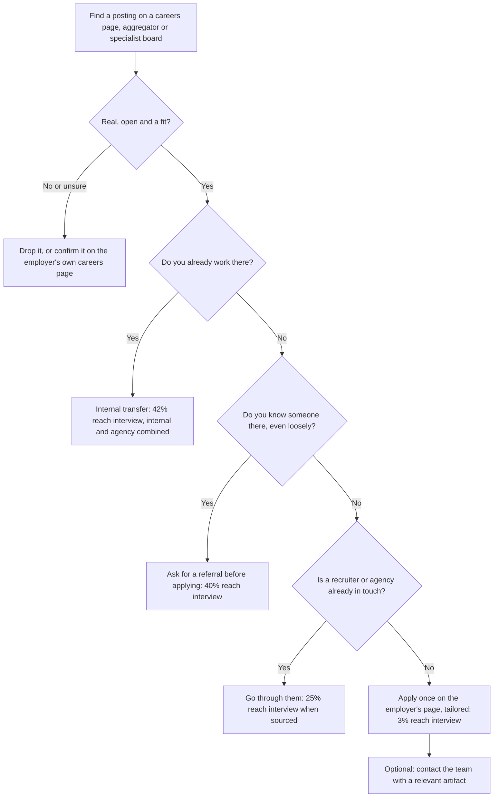

# Channels and Boards: Where GenAI Postings Are and Which Channels Convert

> Where GenAI postings are listed and which channels turn applications into offers: referrals, sourcing, cold inbound, ATS-hosted boards, aggregators, specialist boards and India platforms, with alert setup and a scam and ghost-job check.

**Dates.** Channel and funnel figures come from Ashby, Gem and Greenhouse datasets spanning 2021 to July 2026, compiled by [T0-04](../../research/sessions/T0-04-ats-filtering-funnel-conversion-math.md) and [T0-12](../../research/sessions/T0-12-high-signal-communities-technical-visibility.md). Platform statuses come from the [T0-10](../../research/sessions/T0-10-career-tooling-ecosystem-12-stage-funnel.md) tooling audit dated 2026-10-21; re-verify them by 2027-01-19. Posting counts come from [T0-01](../../research/sessions/T0-01-genai-role-taxonomy-market-volume.md) (session dated 2026-10-21) and hold as of the dates given with each figure; as a monthly series (EGP-1.0 class V1) they expire 31 days after their 19 October 2026 count, on 2026-11-19, which sets this page's `review_by`. **Grades** (EGP-1.0): A primary or measured; B transparent secondary or sizeable vendor dataset; C vendor, practitioner or single source; D judgement; M model output; P practice-curated and unmeasured.

## The short answer

1. **Find postings on boards; get in through people.** Per application, a referral converts about 11 to 36 times better than cold inbound, depending on the metric, and a recruiter-sourced candidate about 8 times better (Gem; Ashby, 2021–2024). These are selection effects: someone vouched for the candidate, or a recruiter screened them first [B · T0-04.F10]. A board only shows you the posting; the route your application takes is what these data measure [D].
2. **Keep applying directly anyway.** Cold inbound turns about 0.2% of engineering applications into hires, roughly 460–520 applications per hire [B · T0-04.F9]. But it is the largest single source of hires: 43–52% at Ashby customers from January 2021 to June 2025 [A · T0-12.F4], and 37.1% for technical roles with "AI" in the title in Ashby's July 2026 data [B · T0-04.F11].
3. **Referrals are about one hire in six, not most hires.** Referrals were about 18% of hires in Ashby's data, near 17% whatever the inbound volume [A · T0-12.F4]. The often-quoted 70–85% "hidden job market" has no evidence base: three independent write-ups could not trace the figure, which circulates at anywhere from 70% to 90%, to any measurement [B · T0-12 L87]. Run both routes in parallel.
4. **Apply once per company per cycle, by hand, tailored.** In Huntr's Q1 2026 data, interview rates fell from 6.07% for one application at a company to 1.91% for eight or more, and tailored applications converted at 4.23% against 2.07% untailored. The data are vendor-run and correlational [C · T0-10 L159]. Auto-apply at volume has weak and mostly adverse evidence [B/C · T0-10.F4].
5. **Verify before you invest time.** Job and employment-agency scam losses reported to the FTC rose from $90M in 2020 to $501M in 2024 [A · T0-10 L92], and fake recruiters use coding tests to deliver malware [B · T0-10 L92]. Confirm every posting and recruiter on the employer's own careers page, and run take-home code only in a disposable sandbox [P · T0-10 L175–176].
6. **India platforms are a blind spot.** No session has measured Indian job platforms; [FAD](../../research/FAD.md) lists data collection from Naukri and Instahyre as Phase 1 work under open question OQ2 [FAD L758]. Treat India-platform advice, including this page's, as unmeasured.

## At a glance



Interview rates are Ashby's application-to-interview averages for 38M applications, 2021–2024 [B · T0-04.F10]. They include selection effects. Asking for the referral before applying is practice [P].

## The two-layer model: four places to look, eight routes in

Channel advice often mixes two different things. **Discovery** is where you see a posting: a careers page, an aggregator or a specialist board. **Entry** is how your application reaches a person: an internal move, a referral, a recruiter, an agency or a cold application. The large measured differences belong to entry routes [B · T0-04.F10]. Board-level differences in the corpus are smaller and come from one vendor's self-tracked, correlational data [C · T0-10 L92]. Find on boards; get in through people [D].

### Entry routes: how your application arrives

| Route | Conversion evidence (grade) | Effort [P] | Best for [P] |
|---|---|---|---|
| **Internal transfer** | 42% application-to-interview for internal and agency candidates combined, and 32% interview-to-offer for internal candidates, against 3% and 6% for inbound (Ashby, 38M applications, 2021–2024) [B · T0-04.F10] | Low, once you are inside | Anyone already employed where AI teams hire |
| **Referral**: an employee vouches for you | 40% application-to-interview and 16% interview-to-offer; about 64 offers per 1,000 applications against about 1.8 for inbound. Gem: 11× inbound hires per application. Ashby's quoted offer rates: 7.3% against 0.2%, about 36×. In Gem's engineering data, referrals were about 2% of applications and 18.7% of hires [B · T0-04.F10] | Medium to high per contact; low per application | Employers where you have a moderately weak tie, such as a former colleague or classmate [A/C · T0-12.F12] |
| **Sourced**: a recruiter contacts you first | About 8× inbound hires per application (Gem), matching 8.3× derived from Ashby's stage rates; 25% application-to-interview; about 15 offers per 1,000 applications [B · T0-04.F10]. About 16% of all hires [A · T0-12.F4]; 28.0% of hires for "AI"-titled technical roles in July 2026 [B · T0-04.F11] | High and indirect: you cannot apply for it | People with searchable profiles and public, verifiable work [B/C · T0-05.F12] |
| **Agency or staffing firm** | 42% application-to-interview, combined with internal candidates (Ashby, 2021–2024) [B · T0-04.F10]; 9.2% of hires for "AI"-titled technical roles in July 2026 [B · T0-04.F11] | Low to medium | Employers that fill roles through agencies. A legitimate process does not ask you for payment [A · T0-10 L176] |
| **Cold inbound**: you apply on a careers page or through a board | About 0.2% application-to-hire in engineering; roughly 340–380 applications per offer and 460–520 per hire; 3.6–6% reach a first human stage [B · T0-04.F9]. Still the largest single source of hires (rule 2 above) | Low per application. Tailoring costs time and went with higher conversion in Huntr's data, 4.23% against 2.07% [C · T0-10 L159] | Every posting where you meet the basic qualifications and have no faster route |
| **Direct outreach** to an engineer or hiring manager | No verified candidate-to-hiring-manager reply rate exists. T0-05's planning range is 3–8% reply, 10%+ as a stretch; claims of 25–50% are unverified [D · T0-05.F9] | Medium per message | Turning a target into a referral or a recruiter's pull: the measurable lever is who initiates [A/B · T0-05.F2] |
| **Communities, meetups and conferences** | No conversion rate exists for any community studied; conversion is documented in a handful of cases and quantified in one [A · T0-12.F3]. At conferences and meetups the hiring signal is mostly sponsor marketing, or explicitly disclaimed by organisers [B · T0-12.F6] | High; pays back slowly | Building the ties that later make referrals possible |
| **Auto-apply and bulk-apply tools** | Weak and mostly adverse. Huntr's interview rate was 9.25% for users sending 11–20 applications and 2.58% for users sending 100+ (correlational) [C · T0-10 L71]. LinkedIn prohibits bots and extensions that automate activity and says accounts risk restriction [A · T0-10 L71] | Low effort; account and reputation risk | Nothing. Use autofill and click Submit yourself |

**Being sourced is the one high-converting route you cannot apply for.** You can only be findable. A recruiting-vendor guide (HeroHunt) treats X as a sourcing channel [C · T0-12 L75], and LinkedIn's documented problem is application-volume saturation [B · T0-12.F2]. Technical writing as an inbound channel is supported only by anecdote [C · T0-12.F11]. In open source, hiring pipelines live in employer postings, and no named contributor-to-hire case could be verified for the projects T0-05 examined [A/B · T0-05.F5]. See [online presence](../07-networking/online-presence.md) and [proof-of-work standards](../05-portfolio/proof-of-work-standards.md).

**Direct outreach is a bridge, not a channel of its own [D].** Its value is to turn you into a referral or a recruiter's pull. T0-05's model finds no tactic with a 10× per-hour advantage. Artifact-led outreach beats tailored applications per hour only where a tier's inbound application-to-offer rate is below about 0.09%, and the ranking of tactics changes across scenarios [D · T0-05.F11]. See [referrals and outreach](../07-networking/referrals-and-outreach.md).

### Discovery sources: where GenAI postings are listed

| Source | Conversion evidence (grade) | Effort [P] | Best for [P] |
|---|---|---|---|
| **Employer careers pages** hosted on an ATS such as Greenhouse, Lever, Ashby, Workday or Workable | The employer's own copy of the posting. Bot and spam defences are configured by each employer and scoped to that employer [A · T0-10.F1]. Greenhouse says fraud signals are specific to the organisation and candidate information is not shared across employers [A/B · T0-10.F2]. Huntr's "Google" source, an aggregator that leads to direct applications, had the highest conversion, 7.12% (correlational) [C · T0-10 L551] | Medium: one alert or bookmark per target | Named targets; confirming any posting seen elsewhere |
| **Aggregators and general boards**: JobsPipe, Google Jobs, LinkedIn Jobs, Indeed, Glassdoor, Handshake | Job boards were about 40% of engineering applications but 21.9% of hires in Gem's data [B · T0-04.F10]. Huntr conversion: LinkedIn 2.94%, Indeed about 3.1–3.4%, correlational and dependent on user mix [C · T0-10 L552, L555]. Raw counts for fuzzy titles are false positives [B · T0-01.F6] | Low | Breadth and alerts; confirm on the employer's page before applying |
| **Specialist AI and startup boards**: Fast AI Jobs, Wellfound; small keyword aggregators such as Rise, devjobsscanner and Weekday | Wellfound: 5.02% in Huntr's data (correlational) [C · T0-10 L554]. Fast AI Jobs' conversion is not measured. T0-01 used the small aggregators only as corroboration | Low | AI-startup roles, FDE and other new families [B · T0-01.F3] |
| **India platforms**: Naukri, Instahyre and others | Not researched. No session measured their volume, conversion, ghost-job or scam rates; FAD plans Phase 1 data collection from Naukri and Instahyre (OQ2) [FAD L758] | Unknown | India roles not listed elsewhere; log your own results (see the India notes below) |

### What the posting sources are

| Source | What it is | What T0-01 measured with it |
|---|---|---|
| JobsPipe | Job aggregator. It states 11.5M active postings from 30+ sources, including LinkedIn, Indeed, Workday, Greenhouse, Lever and Ashby [C · T0-01 L44]. It also publishes job-description skill shares [B · T0-01.F4] | 1,697 live US "AI Engineer" roles against 1,084 "Machine Learning Engineer"; the AI Engineer figure is a family, not a GenAI-only count [B · T0-01.F1] |
| Fast AI Jobs | AI-startup job board. It states 38,517 postings pulled from company ATS pages such as Ashby, Greenhouse and Lever [C · T0-01 L44]. Its role pages show counts by startup and funding stage | 933 open FDE-cluster roles at 343 AI startups on 2026-10-20, up about 20% from 779 at 288 startups in early August 2026; 38% early-stage [B · T0-01.F3] |
| Rise (joinrise.co), devjobsscanner, Weekday | Small keyword aggregators | Corroboration only; Rise's keyword counts come from a small corpus with an undated cache [C · T0-01.F9] |

T0-01 could not query LinkedIn, Indeed, Wellfound, Otta or Ashby directly, so its confidence in any exact count for those platforms is low [T0-01 L13].

### Platform statuses as of 2026-10-21

T0-10 scored each tool from 0 to 12 on six criteria. The statuses are analyst judgements, not measurements; treat plus or minus 1 as noise [D · T0-10 L112]. "Viable" means usable with the stated controls on thin evidence, not validated [T0-10 L135]. No discovery tool reached Recommended [D · T0-10 L146]. The [tool catalog](../00-start/tool-catalog.md) carries the full register.

| Platform | What it is | Status (score of 12) | Main reason |
|---|---|---|---|
| Google Jobs and direct employer career pages | Aggregator to direct apply | Viable (8) | Highest source conversion in Huntr's data, 7.12%, correlational [C · T0-10 L551] |
| LinkedIn Jobs, free tier, manual use | Job board and social network | Viable (8) | Large reach; 2.94% conversion in Huntr's data; Texas AG probe reported [C · T0-10 L552] |
| LinkedIn Premium Career | Paid subscription add-on | Caution (7) | State AG investigation concerning Premium marketing (an allegation); no independent evidence of benefit found [C · T0-10 L553] |
| Wellfound | Startup job board | Viable (8) | 5.02% conversion in Huntr's data [C · T0-10 L554] |
| Indeed, Glassdoor, Handshake | General and campus boards | Viable (7) | About 3.1–3.4% conversion in Huntr's data [C · T0-10 L555] |
| Jobright.ai | AI job matching and agent | Caution (5) | Evidence from competitor posts only [D · T0-10 L556] |
| Scoutify | Alerts plus career-site auto-apply | Caution (5) | Thin evidence; T0-10 discloses that it relied on Scoutify's blog for other tools [D · T0-10 L557] |
| Simplify Copilot | Autofill extension | Viable (8) | Autofill with a human clicking Submit [C · T0-10 L558] |
| Simplify Autopilot (beta) | Auto-submit agent | Caution (5) | Beta; no review step, per a competitor; no outcome evidence [D · T0-10 L559] |
| LazyApply-class bulk apply | Bulk auto-apply | Avoid | About 2.4/5 on Trustpilot, with wrong-answer and refund complaints [B/C · T0-10.F4] |
| JobsPipe, Fast AI Jobs, Rise | Aggregator and boards | Not audited | Used by T0-01 to count postings, not rated as job-search tools |
| Naukri, Instahyre | India job platforms | Not researched | Planned for Phase 1 data collection (FAD OQ2) |

### What the multipliers mean, and what they do not

- **They measure selection.** Referred and sourced candidates were vouched for or screened before they applied, so the lifts are correlational [B · T0-04.F10; A/B · T0-05.F2]. A referral into a role you do not fit is unlikely to carry the average lift [D].
- **Quote the range with its metric.** 11× is Gem's ratio of hires per application; 36× is the ratio of Ashby's quoted offer rates [B · T0-04.F10].
- **Cold-inbound averages include fraud and spam.** In a Greenhouse pilot for a Machine Learning role, more than 35% of applicants carried high-risk fraud signals, and 91% of the high-risk candidates reviewed were confirmed fraudulent [B · T0-04.F11]. A genuine, well-matched applicant's odds are better than the average, by an amount nobody has published [D · T0-04.F11].
- **No GenAI-only funnel is published.** The nearest proxy is Ashby's July 2026 split for technical roles with "AI" in the title: 37.1% of hires from inbound, 28.0% from sourcing, 9.2% from agencies and about 26% from referral, internal and other routes, by subtraction [B · T0-04.F11].
- **The data skew to tech.** Ashby's customers skew to tech and startups, and community-sourced hires may be filed as "sourced" or "inbound" [D · T0-12 L87].

### Funnel maths for cold inbound

| Dataset | Stage rates | Application to hire |
|---|---|---|
| Gem, engineering | 6% to pre-onsite, 17% to onsite, 29% to offer, 73% accept | 0.22%, derived; Gem prints 0.2% [B · T0-04.F9] |
| Ashby, technical roles, Q1 2026 | 3.6% to interview, 7.3% interview to offer, 73% accept | 0.19%, derived [B · T0-04.F9] |
| Gem, all functions, 165M+ applications | 8% pass the initial screen | About 0.5%: one hire per 200 applications [A/B · T0-05.F2] |
| Gem, data science | Not given | 0.1% [B · T0-04.F11] |

Two independent datasets converge on about 0.2% for engineering. The Ashby Q1 2026 rates reached T0-04 through secondary restatements [C · T0-04 L636]. Gem also reports 35–36 interviews per engineering hire [B · T0-04.F11].

**Cold inbound got more crowded.** Gem's application-to-pre-onsite rate fell from 13% to 8% across all functions between 2021 and 2025. Greenhouse reports applications per job up about 110% (116 to 244) and applications per recruiter up 204% (1,610 to 4,890 a year) from 2022 to 2025 [B · T0-04.F9]. In a Robert Half survey of 2,000+ US hiring managers (March 2026, reported second-hand), 67% said AI-generated applications slowed hiring and 65% said skills were harder to verify [C · T0-10 L71].

**The decision it supports [D].** The arithmetic rewards a short list of well-matched, tailored applications, plus a referral or recruiter route wherever one exists. It does not reward volume: Huntr's rates fall as volume rises [C · T0-10.F4].

### Where to look by employer type

The six types follow the [employer landscape](../01-landscape/employer-landscape.md). Channel mix by employer type is not measured in the corpus, so the table shows where postings appear and what they look like.

| Employer type | Where to look first [P] | What the corpus shows | Not measured |
|---|---|---|---|
| Frontier labs | The lab's careers page; alerts on Research Engineer, Member of Technical Staff and FDE aliases as well as AI titles | Post-training work is mostly posted as Research Engineer or Member of Technical Staff, not under a "post-training" title [C · T0-01.F9]. FDE aliases such as "AI Deployment Engineer" and "Deployment Strategist" appear at OpenAI and others, and some labs use "Applied AI Engineer" [B · T0-01.F3] | Channel mix; referral share |
| Big Tech and hyperscalers | The company's careers site; aggregators for breadth | ML Engineer, the Big Tech, recsys and AV-heavy family, is led in JobsPipe's US sample by TikTok (74), Adobe (21), Apple (20) and Capital One (20) [B · T0-01.F2] | Channel mix |
| AI-native startups and private scale-ups | The startup's ATS page; Fast AI Jobs; Wellfound | Fast AI Jobs listed 933 open FDE-cluster roles at 343 AI startups on 2026-10-20 [B · T0-01.F3]. Wellfound converted at 5.02% in Huntr's correlational data [C · T0-10 L554]. Referrals are about 15% of hires at venture-backed startups [B/C · T0-12 L87] | A startup-versus-enterprise funnel: Gem's company-size table conflicts with its own headline, so T0-04 does not use it [B · T0-04.F9] |
| Enterprises and GCCs | The employer's careers page; aggregators; for India GCCs, Indian platforms too (unresearched) | AI Engineer, the enterprise and services-heavy family, is led in JobsPipe's US sample by Capital One (33), TCS (22), American Express (16), Deloitte (13) and Infosys (12) [B · T0-01.F2]. India has 2,100+ GCCs, with AI and data the fastest-growing function (+38% YoY) [C · T0-01.F10] | Channel mix; India platforms |
| IT services and consultancies | The firm's careers site; aggregators; agencies | TCS, Deloitte and Infosys are three of the five leading AI Engineer posters in that sample [B · T0-01.F2]. EY posted exact-title Context Engineer roles in March and July 2026 [B/C · T0-01.F5]; Cognizant was among the employers posting agentic AI architect titles [B/C · T0-01.F7] | Channel mix. For when a certificate helps in this segment, see [credential ROI](../04-certifications/credential-roi.md) |
| Government and public sector | Start from the employer landscape page | No posting or channel evidence in the sessions behind this page | All of it |

### India: what is known and what is not

The evidence differs for India, so it gets its own notes.

- **Unknown.** Volume, conversion, ghost-job and scam rates on Indian job platforms. No session measured them; FAD lists data collection from Naukri and Instahyre as Phase 1 work under OQ2 [FAD L758].
- **Counts are partial.** JobsPipe counted 398 live "AI Engineer" roles in India against 1,697 in the US, and its two India figures disagree [B · T0-01.F10]. The sources JobsPipe names do not include an India-specific platform, so its India count may miss roles posted only there [D]. The one India-platform sighting in this page's evidence is a Bengaluru Context Engineer posting mirrored on apna.co [B/C · T0-01.F5].
- **Saturation is reported.** In a 2026 LinkedIn report, 74% of India recruiters said they struggle to find qualified candidates, applicants per job had more than doubled since 2022, and about 80% planned more AI use in screening and sourcing (vendor survey) [B · T0-12 L291].
- **Where the employers are.** India has 2,100+ GCCs [C · T0-01.F10]. Bengaluru is the densest hub in the evidence, and its best-evidenced high-signal offline venues are screened or approval-gated [B/C · T0-12.F7]. Geography gates the top global pathways; remote-friendly routes are the accessible ones from India [A/B · T0-12.F8].
- **Decision rule [P].** For GCC and multinational roles, start from the employer's careers page and the global aggregators. Use Indian platforms for discovery, log the source of every lead, and judge each platform by your own first-human-contact rate. For remote roles abroad, see the [India remote playbook](../11-tracks/india-remote-playbook.md).

## How to do it

1. **Write your title set.** Take one primary title and the aliases your targets use from the [role map](../02-roles/role-map.md) and your role's hub, for example the [Forward Deployed Engineer hub](../02-roles/hubs/forward-deployed-engineer.md). *Done when:* each alias returns postings whose duties match your target, not only its words.
2. **Build the target list by employer type.** Use the [targeting workbook](../00-start/targeting-workbook.md) and the employer-type table above. *Done when:* every target has a type, a careers-page URL and a note on whether you know anyone there.
3. **Set up alerts in three layers** (see Alert setup below). *Done when:* postings from your targets reach you without manual searching, and you know which alerts overlap.
4. **Choose the entry route before you apply**: internal first, then referral, then recruiter or agency, then a direct application. Ask for a referral before you submit a cold application [P]; no session measured what happens when a referral follows one. *Done when:* every tracker row names a route.
5. **Check, then apply once.** Run the scam and ghost-job check in the Checklist. Answer screening questions accurately: deterministic rejection is employer-configured and keyed to form answers, not résumé prose [A · T0-04.F1]. Address each basic qualification in plain words: since August 2026, Workday HiredScore's opt-in LLM mode evaluates each screenable qualification separately, and basic qualifications decide A/B against C/D grades [A · T0-04.F3]. *Done when:* the posting is confirmed on the employer's page and each basic qualification is visibly met in your application.
6. **Review every week** [P]. Count first human contacts by route and by source. If your direct applications reach a human well below the 3.6–6% average for cold inbound [B · T0-04.F9], fix fit and tailoring before adding volume [P]. *Done when:* each week ends with one change to sources, routes or targets.

### Alert setup

1. **Start at the source.** Follow the careers page of every named target. Fast AI Jobs builds its listings from company ATS pages such as Ashby, Greenhouse and Lever [C · T0-01 L44], so the employer page is the original.
2. **Add one broad aggregator** for employers you have not listed: Google Jobs, LinkedIn's free tier or Indeed, all rated Viable [D · T0-10 L146]. One is enough to start [P].
3. **Add one specialist board** if AI startups are in scope: Fast AI Jobs (not audited as a tool) or Wellfound (Viable) [D · T0-10 L554].
4. **Filter on exact titles and aliases, not keywords.** Fuzzy matching inflates counts: Indeed showed 921 "cognitive architect" jobs whose visible results were solutions, PLM, network and digital architects [B · T0-01.F6].
5. **For thin titles, search the work inside a broad title.** Agentic AI is named in 59.3% of AI Engineer postings and RAG in 54.0% (JobsPipe, counted 2026-09-10) [B · T0-01.F4], while exact "Agent Architect" titles number about two [B/C · T0-01.F7]. Post-training work is posted mostly as Research Engineer or Member of Technical Staff [C · T0-01.F9].
6. **Read before you count.** An "AI Engineer" alert returns a mixed bucket. In a 50-row sample from the 19 October 2026 Fast AI Jobs page, 16 were Applied AI Engineer variants, 8 were Figure AI robotics roles, 5 were agent-titled, 4 were FDE-flavoured and 2 were GTM roles [B · T0-01.F2]. In the FDE cluster, about 48% of a 50-row sample were engineer-titled [B · T0-01.F3].
7. **Keep alerts free and manual.** Scoutify, Jobright.ai and LinkedIn Premium Career are rated Caution [D · T0-10 L146]. Never run automation inside a logged-in LinkedIn or Indeed session [P · T0-10 L157].

## Templates and examples

### Alert query [P]

```text
Title (exact):  "[primary title]" OR "[alias 1]" OR "[alias 2]"
Work words:     [skill 1] OR [skill 2]    <- for thin titles, search these inside a broad title
Exclude:        [unrelated senses of the title]
Location:       [city or region] OR remote ([country or time-zone rule])
Level:          [level words your targets use]
Sources:        [target careers pages] + [one aggregator] + [one specialist board]
Delivery:       [daily or weekly digest]
```

### Weak and strong alert queries

| Weak | Why it fails | Strong |
|---|---|---|
| Keyword "AI architect" on a general board | Fuzzy matching returns unrelated architect roles [B · T0-01.F6] | Exact titles "Agentic AI Architect" OR "AI Architect", with the first page of results read before saving [B/C · T0-01.F7] |
| "Forward Deployed Engineer" only | Misses the aliases | "Forward Deployed Engineer" OR "AI Deployment Engineer" OR "AI Engineer - FDE", adding "Deployment Strategist" only if you want the non-engineering side of the cluster [B · T0-01.F3] |
| "LLM post-training engineer" | The title string barely exists [C · T0-01.F9] | "Research Engineer" OR "Member of Technical Staff", with RLHF or SFT as work words |
| "Context Engineer" | Roughly 10–25 live postings globally by T0-01's estimate, and three different jobs under one title [B/C · T0-01.F5] | The work you want (knowledge graphs, RAG and vector stores, agent memory) searched inside AI Engineer postings |

### Weak and strong: one company in one cycle

**Weak.** Five roles at [company] appear on a board. You send all five the same evening with one résumé, through an auto-apply extension.

**Why it fails.** Huntr's interview rate fell from 6.07% to 1.91% at eight or more applications to one company [C · T0-10 L159]. Wrong screening answers are the most frequent failure in auto-apply complaints [C · T0-10 L161]. Repeat-application limits are keyed to your email [A · T0-10.F1].

**Strong.** You confirm the best-fit role on [company]'s careers page, ask [former colleague] for a referral, apply once by hand with each basic qualification addressed, and log the route.

### Weak and strong: an unexpected recruiter message

**Weak.** A recruiter you cannot find on the company's site sends a repository. You clone it and install its packages on your own laptop to "check the setup".

**Strong.** You find the role on the company's careers page and reply through an address on the company's domain [P]. You run any code in a disposable VM or container with no credentials [A · T0-10 L591]. You decline any request for payment, crypto or remote-control software [A · T0-10 L176].

### Channel plan for one target [P]

```text
Employer: [name] · type: [employer type] · role: [title and requisition ID]
Canonical posting: [URL on the employer's careers page] · first seen: [date] on [source]
Checks: on careers page [yes/no] · recruiter verified [yes/no/none] · basic qualifications met [all/most/few]
Entry route: [internal | referral via NAME | recruiter or agency NAME | direct]
Referral asked: [date] · answer: [date or none]
Applied: [date] · tailored to: [the requirements you matched]
First human contact: [date or none] · next action: [action, date]
```

### Weekly review [P]

```text
Week of [date]
Applications by route:     internal [n] · referral [n] · recruiter or agency [n] · direct [n]
First human contacts:      internal [n] · referral [n] · recruiter or agency [n] · direct [n]
Direct-application rate:   [first human contacts / direct applications] against the 3.6-6% cold-inbound average
Dropped at the check:      [n] · why: [scam signal, ghost signal, duplicate]
One change for next week:  [source, route or target]
```

## Checklist

**Set-up**

- [ ] Title set written: a primary title plus aliases, each checked against real postings.
- [ ] Target list built by employer type, with each employer's careers-page URL.
- [ ] Alerts on every target's careers page, plus one aggregator and, if startups are in scope, one specialist board.
- [ ] Exact-title filters and exclusions set; no decision rests on a raw keyword count.
- [ ] A separate email address and phone number for job-search tools, for compartmentalisation, not evasion [P · T0-10 L170].
- [ ] Browser extensions reviewed: verified publishers only, permissions checked [P · T0-10 L163].
- [ ] No automation inside a logged-in LinkedIn or Indeed session [P · T0-10 L157].
- [ ] A tracker that records the source and the entry route of every application.

**Scam and ghost-job check, before each application or recruiter call**

- [ ] The posting appears on the employer's own careers page, not only on a board.
- [ ] The recruiter checks out against the company's official careers page [P · T0-10 L176].
- [ ] Nobody has asked for payment, crypto or remote-control software [A · T0-10 L176].
- [ ] No ID, selfie, bank or tax details requested before an offer; when they are requested, the link was reached through a known channel [P · T0-10 L168, L360].
- [ ] Any code, repository or take-home will run only in a disposable VM or container with no credentials [A · T0-10 L591].
- [ ] No "AI assistant" or job-search extension with broad permissions installed at someone's request [A/B · T0-10.F12].
- [ ] The posting is not a duplicate of one you already applied to, and has not been reposted for months without movement [P].
- [ ] You have not applied to this company in this cycle, or the role is genuinely distinct [P · T0-10 L159].

**Every week**

- [ ] First human contacts counted by route and by source, and one change made for the next week.

## Pitfalls

| Red flag | Why it hurts | Fix |
|---|---|---|
| Several applications to one company in one cycle | Huntr's interview rate fell from 6.07% for one application to 1.91% for eight or more [C · T0-10 L159]. Lever blocks repeat applications by email plus source tag [A · T0-10.F1], and Ashby identifies repeat applicants by email [A · T0-10 L160] | Once per company per cycle, unless the roles are genuinely distinct [P · T0-10 L159] |
| An auto-apply tool or hosted agent submits for you | Rates fall as volume rises [C · T0-10 L71]. Ashby rejected automated-browser submissions as possible spam in a reproducible report [B/C · T0-10.F3]. Wrong screening answers top the complaints [C · T0-10 L161] | Autofill, read every answer and click Submit yourself [P · T0-10 L158] |
| VPN hopping, proxy rotation or alias emails to get past limits | Greenhouse treats a data-centre IP as a high-risk signal [A · T0-10.F1]. Evasion can turn a soft block into a fraud flag [D · T0-10 L160] | One identity. On an Ashby spam error: pause extensions, use a clean browser profile without VPN or proxy, retry once by hand, then email the recruiter [P · T0-10 L162] |
| Believing one block follows you to every employer | Silent blocks are real but local to one employer; a tool-triggered, persistent, cross-ATS shadow-ban has no supporting evidence [A/B · T0-10.F2] | Treat a block as one employer's decision, and do not evade it |
| Planning around a "hidden job market" | Referrals are about 18% of hires and inbound 43–52% [A · T0-12.F4] | Run referrals and direct applications in parallel |
| Trusting a board's headline count | Fuzzy matching passes unrelated titles [B · T0-01.F6]; multi-location duplicates and ghost postings inflate live counts [D · T0-01 L42] | Exact-title filters; read the results; count distinct employers [P] |
| Paying for a premium job-search subscription to stand out | No independent evidence of benefit for LinkedIn Premium Career, which is rated Caution [C · T0-10 L553] | Use the free tier, manually |
| Mass-messaging your CV in communities | Communities treat mass-DMed CVs as spam and confine job-seeking to designated channels [A · T0-12.F9] | Use the jobs channels; build ties through repeated, low-cost interaction [A/C · T0-12.F12] |
| Harvesting email addresses from GitHub for outreach | GitHub's Acceptable Use Policy bars using its information to send unsolicited emails to users [B/C · T0-05.F10] | Use the contact route the person publishes [P] |
| Counting on one merged pull request | A single merged contribution is the modal outcome in every repository T0-05 examined [A · T0-05.F3]; the "10× per merged PR" claim has no measurement behind it [C · T0-05.F1] | Sustained, discussion-first contribution, the documented norm [B · T0-12.F10]; see [proof-of-work standards](../05-portfolio/proof-of-work-standards.md) |
| Running a recruiter's code on your own machine | Fake-recruiter campaigns deliver malware through coding tests; Socket reported 338 malicious npm packages with 50,000+ downloads [B · T0-10 L92] | A disposable VM or container with no credentials [A · T0-10 L591] |

## Evidence and limits

- **What is measured (B).** Entry-route conversion comes from vendor datasets: Ashby's referrals report (16 May 2025; 38M applications, January 2021 to December 2024), Ashby's source-of-hire analysis (nearly 250K hires, January 2021 to June 2025), Ashby's AI job postings report (9 July 2026), Gem's 2026 Recruiting Benchmarks (blog dated 1 December 2025), Gem's undated engineering hiring page and Greenhouse's benchmarks page (March 2026) [T0-04 L620–624; T0-12 L87]. Two datasets converge on about 0.2% cold application-to-hire for engineering [B · T0-04.F9].
- **What is weaker (C).** The Ashby Q1 2026 stage rates reached T0-04 through secondary restatements [C · T0-04 L625, L636]. Per-board conversion rests on Huntr's vendor-run, self-tracked data (139,927 applications from 25,635 users; report published 19 October 2026), which depends on user mix [C · T0-10 L71, L485]. Vendor customer bases are tech-forward [D · T0-04 L113].
- **What is judgement (D, P).** T0-10's statuses are rubric scores [D · T0-10 L112]. The reply-rate planning range [D · T0-05.F9] and the time-versus-yield model [D · T0-05.F11] are judgement. The effort and best-for columns on this page are practice [P].
- **What is not measured.** A GenAI-only funnel [B · T0-04.F11]; startup against enterprise funnels [B · T0-04.F9]; conversion for any community [A · T0-12.F3]; exact counts on LinkedIn, Indeed, Wellfound, Otta or Ashby [T0-01 L13]; Fast AI Jobs and JobsPipe as job-search tools; Indian platforms [FAD L758]; ghost-job prevalence beyond a self-selected survey in which 93% of about 593 respondents had applied to or suspected ghost jobs [C · T0-10 L92].
- **A dated event, not a status.** The Texas Attorney General was reported in July 2026 to have opened an investigation into LinkedIn; trade-press headlines tie it to ghost-job listings and Premium subscriptions. These are allegations, and their status after July 2026 was not checked [B · T0-10 L515].
- **Errata.** None of the errata (U1–U26) changes the evidence used here; see [ERRATA](../../research/ERRATA.md).
- **What would change this advice.** A published GenAI-only source-of-hire dataset; Phase 1 data on Indian platforms (FAD OQ2); outcome evidence that auto-apply helps; an ATS documenting bot flags that travel between employers; independent, non-vendor conversion data per board. T0-10 sets its own re-audit triggers and a 90-day cycle [T0-10 L185].

## Next steps

- **Get the referral:** [Referrals and outreach](../07-networking/referrals-and-outreach.md).
- **Run the pipeline:** [Application operating system](application-operating-system.md) for tracking; [ATS mechanics](ats-mechanics.md) for parsing and knockout questions.
- **Sequence the search:** [Job-search strategy](job-search-strategy.md#27-recommended-sequencing-expanding-rings), starting with [the constraints that bind first](job-search-strategy.md#26-the-constraints-that-bind-first).
- **Prepare the documents:** [Résumé strategy](resume-strategy.md) and the [résumé skills matrix](resume-skills-matrix.md).
- **Become findable for sourcing:** [Online presence](../07-networking/online-presence.md), the [communities guide](../07-networking/communities-guide.md) and [proof-of-work standards](../05-portfolio/proof-of-work-standards.md).
- **Check a tool before you use it:** [Tool catalog](../00-start/tool-catalog.md).
- **Know the employers and roles:** [Employer landscape](../01-landscape/employer-landscape.md), [market overview](../01-landscape/market-overview.md), [role map](../02-roles/role-map.md); hubs for [AI Engineer](../02-roles/hubs/ai-engineer.md), [Applied AI Engineer](../02-roles/hubs/applied-ai-engineer.md), [Forward Deployed Engineer](../02-roles/hubs/forward-deployed-engineer.md) and [Research Engineer](../02-roles/hubs/research-engineer.md).
- **India:** [India remote playbook](../11-tracks/india-remote-playbook.md).
- **Evidence:** findings for [stage 6](../../research/findings.md#stage-06) and [stage 8](../../research/findings.md#stage-08); sessions [T0-04](../../research/sessions/T0-04-ats-filtering-funnel-conversion-math.md), [T0-10](../../research/sessions/T0-10-career-tooling-ecosystem-12-stage-funnel.md), [T0-12](../../research/sessions/T0-12-high-signal-communities-technical-visibility.md), [T0-01](../../research/sessions/T0-01-genai-role-taxonomy-market-volume.md) and [T0-05](../../research/sessions/T0-05-unconventional-hiring-tactics-oss-audits.md).
