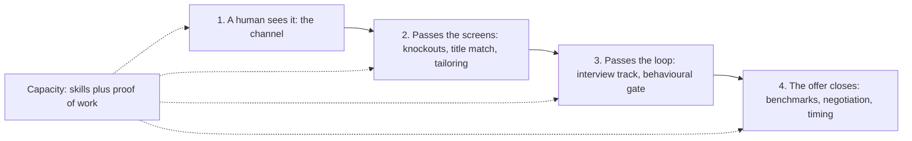

# GenAI Job-Search Strategy: Hiring Levers, Binding Constraints, Sequencing and Target-Employer Routing

> First-principles job-search strategy: the four levers that turn an application into an offer, the constraints that bind first, expanding-ring role sequencing, and the T0-27 target-employer methodology (50–100 company tiering, ATS detection, sponsor-register screening and scraping hygiene).

**Dates and grades.** Evidence comes from Phase 0 sessions dated October 2026 ([T0-04](../../research/sessions/T0-04-ats-filtering-funnel-conversion-math.md), [T0-10](../../research/sessions/T0-10-career-tooling-ecosystem-12-stage-funnel.md), [T1-03](../../research/sessions/T1-03-interview-execution-offer-negotiation.md), [T0-14](../../research/sessions/T0-14-ai-system-design-interview-patterns.md), [T0-13](../../research/sessions/T0-13-production-portfolio-proof-of-work-standards.md), [T0-06](../../research/sessions/T0-06-career-transition-timelines-5-backgrounds.md), [T0-02](../../research/sessions/T0-02-global-regional-compensation-benchmarks.md), [T0-17](../../research/sessions/T0-17-compensation-progression-plateaus-equity.md)) plus Research Pipeline 2 sessions [T0-24](../../research/sessions/T0-24-job-boards-global-ai-startup-remote.md) (2026-11-11), [T0-26](../../research/sessions/T0-26-job-search-tools-agents-oss-mcp.md) (2026-11-13) and [T0-27](../../research/sessions/T0-27-target-employers-sponsor-registers-data.md) (2026-11-13), with key US sponsorship statuses re-verified on 2026-11-19 (`review_by: 2026-12-03`, 14 days for V0 US sponsorship rules). The proof-of-work sets are generated by [scripts/resume_layers.py](../../scripts/resume_layers.py) from [data/skills_ontology.json](../../data/skills_ontology.json) and [data/project_archetypes.json](../../data/project_archetypes.json); run `python3 -B scripts/resume_layers.py --update` after changing either. **Grades** (EGP-1.0): A primary source opened directly; B transparent secondary source or sizeable vendor dataset; C vendor, practitioner or single source; D judgement; M model output; P practice-curated and unmeasured. The résumé model lives in [résumé strategy](resume-strategy.md); the vetted 47-company directory lives in [target employers](../01-landscape/target-employers.md).

## The short answer

1. **Work the channel first: it is the largest multiplier.** Referrals convert at 11–36× the per-application rate of cold applications and recruiter-sourced candidates at about 8×, while about 0.2% of cold engineering applications end in a hire [B · T0-04.F9, T0-04.F10]. In Greenhouse's 2025 North America benchmark (640M applications), company job boards yielded ~3.2× external job boards [B/M · T0-24 L58, L583].
2. **The résumé moves only the first two levers.** A complete search needs as much effort on referrals and outreach, projects and interview preparation as on résumés [D]. One person needs one universal résumé plus two or three variants ([résumé strategy](resume-strategy.md)).
3. **Proof of work binds before the number of résumés does.** A résumé can only point at evidence, and evidencing many roles takes many projects: see the computed sets below [M].
4. **Prepare the interview track your targets use, and treat the behavioural round as a gate.** A behavioural "No Hire" is usually an automatic veto at Anthropic; at Google it sinks the packet at the target level, though the hiring committee may downlevel when technical scores are exceptional [B/C · T1-03 L210–211].
5. **Apply selectively per company — never spray.** In Huntr Q3 2026, per-application interview rates fell from 5.9% (1 application) to 2.4% (8+ applications at one company), while the chance of at least one interview at that company rose from 5.9% to 17.7% [B · T0-24 L70, L561–L562]. Apply only to roles you genuinely fit, and respect employer-configured repeat limits on Lever and Ashby [A · T0-10.F1; A · T0-26 L52].
6. **Sequence role families in expanding rings and route employers in three tiers [D/P].** Open one primary role family first, then build a 50–100 company target list split into Tier 1 (≤15, checked weekly), Tier 2 (≤35, fortnightly) and Tier 3 (≤50 watchlist, monthly), using each employer's own board as the system of record and official sponsor registers as a screen [A/B/P · T0-27 L71–L76, L250].

## At a glance



The four levers multiply, so the weakest one caps the result. Capacity sits behind all four. "Where each lever is worked on", under How to do it, maps each lever to its guide.

## The four hiring levers

For a single application:

```text
P(offer) = P(a human sees it) × P(passes the screens) × P(passes the interview loop) × P(the offer closes)
```

Across a search, the result is the sum over applications, limited by the hours available each week.

| Lever | What moves it | Evidence |
|---|---|---|
| **A human sees it** | **Channel.**<br>• Referrals convert at 11–36× the per-application rate of cold applications; candidates sourced by recruiters at about 8×.<br>• Cold applications: about 3.6–6% reach a first human stage, and about 0.2% end in a hire.<br>• Gem reports that 46% of sourced engineering hires were already in the employer's ATS, so your stored résumé and profiles get re-discovered | B · [T0-04](../../research/sessions/T0-04-ats-filtering-funnel-conversion-math.md) |
| **Passes the screens** | • Knockout answers.<br>• Title match plus recent, evidenced skills.<br>• Tailoring: 4.23% vs 2.07% (Q1 2026) and 5.71% vs 3.09% (Q2 2026) interview rate (correlational).<br>• Selective company targeting: per-application rate falls 5.9% → 2.4% at 8+ apps, while ≥1 interview chance rises 5.9% → 17.7% (Q3 2026); respect Ashby/Lever repeat throttles | A · T0-04, [T0-26](../../research/sessions/T0-26-job-search-tools-agents-oss-mcp.md) L52; B · [T0-24](../../research/sessions/T0-24-job-boards-global-ai-startup-remote.md) L70, L216–L217 |
| **Passes the loop** | • Depth in the role's interview track: application, infrastructure, ML design, research, product or governance.<br>• Coding and behavioural answers. A behavioural "No Hire" is usually an automatic veto at Anthropic; at Google it sinks the packet at the target level, though the hiring committee may downlevel when technical scores are exceptional | B/C · [T1-03](../../research/sessions/T1-03-interview-execution-offer-negotiation.md) L210–211; [T0-14](../../research/sessions/T0-14-ai-system-design-interview-patterns.md) |
| **Offer closes** | Pay benchmarks, equity risk adjustment, negotiation, timing several offers together | B · [T0-02](../../research/sessions/T0-02-global-regional-compensation-benchmarks.md), [T0-17](../../research/sessions/T0-17-compensation-progression-plateaus-equity.md); C · T1-03 |
| **Capacity behind all four** | Skills, plus **proof of work**: verifiable projects at V1–V3 on the [verifiability ladder](../05-portfolio/proof-of-work-standards.md#the-ladder) | [T0-13](../../research/sessions/T0-13-production-portfolio-proof-of-work-standards.md); [T0-06](../../research/sessions/T0-06-career-transition-timelines-5-backgrounds.md) |

**What this implies for the system** [D]:
- The résumé mainly moves the first two levers.
- The biggest multipliers are channel, proof of work and interview depth.
- So a complete system needs as much on referrals and outreach, projects and interview preparation as on résumés.

<a id="21-the-layers-and-their-jobs"></a>
<a id="23-selection-rule-choose-by-content-then-tailor"></a>
<a id="25-which-roles-need-their-own-resume-computed"></a>
### Where the résumé fits

The résumé works on the first two levers, and its whole model is in [résumé strategy](resume-strategy.md): the [five layers](resume-strategy.md#the-five-layers-and-their-jobs) from the master inventory to the posting-tailored résumé, the [selection rule](resume-strategy.md#for-each-posting-choose-by-content-then-tailor) (choose by content, then tailor) and the computed decisions on [which roles need a résumé of their own](resume-strategy.md#which-roles-need-their-own-résumé-computed). One person needs one universal résumé plus two or three variants.

<a id="26-the-constraints-that-bind-first"></a>
## The constraints that bind first

Four constraints bind before the number of résumés does.

1. **Proof of work.** A résumé can only point at evidence. Each of the 20 [project archetypes](../05-portfolio/project-archetypes.md) is scored against each role's Must and Important skills (Must weighted 3, Important 2):

<!-- BEGIN GENERATED: scripts/resume_layers.py (proof-of-work sets) -->
**Every individual-contributor role at ≥60%: 13 projects, chosen greedily:**

1. Evaluated RAG system over a real corpus (P1)
2. Prompt vs RAG vs fine-tune comparison (P4)
3. AI governance packet: inventory, risk register, framework mapping (P13)
4. Customer pilot / reference architecture with a cost model (P11)
5. Custom Triton kernel with benchmarks and correctness tests (P9)
6. Self-hosted LLM platform on Kubernetes (P6)
7. Safety / interpretability research project (P18)
8. Reliable agent: approvals, sandboxed tools, replay, failure injection (P2)
9. AI PM case: PRD, eval rubric, pilot metrics (P12)
10. Sim-to-real robotics project (P16)
11. Internal AI-enablement pilot (MCP servers, adoption metrics) (P15)
12. Full-stack AI app with streaming agent UX and UX metrics (P14)
13. Small-scale distributed training / post-training study (P7)

**The top 8 targets at ≥60%: 6 projects:**

1. Prompt vs RAG vs fine-tune comparison (P4)
2. Evaluated RAG system over a real corpus (P1)
3. Customer pilot / reference architecture with a cost model (P11)
4. Small-scale distributed training / post-training study (P7)
5. Self-hosted LLM platform on Kubernetes (P6)
6. Paper re-implementation with rigorous evals and a write-up (P8)

Coverage of the top 8 with that set: Research Engineer / Member of Technical Staff 90%, Applied AI Engineer 85%, Machine Learning Engineer 82%, Forward Deployed Engineer 81%, AI Engineer 79%, Research Scientist 74%, Applied Scientist 69%, AI Infrastructure / GPU Platform Engineer 65%.
<!-- END GENERATED -->

The build cards for each project, with the same minimal sets, are in [project archetypes](../05-portfolio/project-archetypes.md#minimal-project-sets).

2. **Maintenance.** Hand-edited résumés drift out of sync. They stay consistent only if every version is assembled from one tagged master inventory by a script [D]. Run that in your own career repository, not in this one (decision D-022): [pramedha-template](https://github.com/bhaskarjha-dev/pramedha-template)'s `tools/resume` assembles variants from one bullet pool and renders them. Tag each bullet with skill IDs from the [skills ontology](../../data/skills_ontology.json) so that your variants follow the [résumé skills matrix](resume-skills-matrix.md); the tagging rule is in [résumé strategy](resume-strategy.md#master-inventory-schema-p).
3. **Interview tracks.** Covering every role means preparing six distinct tracks (application, infrastructure, ML design, research, product, governance), plus coding and behavioural rounds. The [role map](../02-roles/role-map.md) gives each role's track, and [interview loops](../08-interviewing/interview-loops.md) covers the loops themselves.
4. **Selective same-company targeting and ATS repeat limits.** Per-application interview yield drops sharply when sending many applications to one employer (5.9% → 2.4% at 8+ apps in Huntr Q3 2026, though company-level odds of at least one interview rise from 5.9% to 17.7%) [B · T0-24 L70, L561–L562], while Lever blocks repeats by email plus source tag [A · T0-10.F1] and Ashby documents duplicate merging and Application Limits [A · T0-26 L52]. Pick your strongest-fit role per employer first, and apply to a second role only when it is a distinct, genuine match.

<a id="27-recommended-sequencing-expanding-rings"></a>
## Recommended sequencing: expanding rings

The system should **support** every role; that is the coverage test. Each person should **sequence** their targets in rings [D]:

| Ring | What it adds | Example (target-all person) |
|---|---|---|
| **1. Primary family** | Universal résumé, one family résumé, one or two flagship projects, one interview track | Applied GenAI: AI Engineer and Agentic |
| **2. Adjacent families** | Their family and role résumés, plus one project each | FDE / Applied AI; ML Engineer / Applied Scientist |
| **3. Stretch families** | Only once the proof of work exists | Research, infrastructure, product, governance |

The [targeting workbook](../00-start/targeting-workbook.md) turns your own scores into rings.

## Target-employer methodology and employer-tier routing

Role rings decide **what** you apply for; target-employer routing decides **where** you invest hours. Build a 50–100 company list using T0-27's eight-step method [A/B/P · T0-27 L71–L76, L243–L252] and seed it from the vetted [target employers directory](../01-landscape/target-employers.md).

### The eight-step target-list method (50–100 employers)

1. **Frame** your matrix: role family × target geography × visa need [P · T0-27 L245].
2. **Seed** from four distinct universes rather than one list [A/B · T0-27 L246]:
   - *Own-board volume leaders* (Big Tech, frontier labs and large AI-native scale-ups in the [target employers directory](../01-landscape/target-employers.md));
   - *Curated discovery lists* (Forbes AI 50, CB Insights AI 100, YC batches — useful for discovery only; no study validates overlap with hiring volume, and they exclude Big Tech, GCCs and IT services [B · T0-27 L63, L90]);
   - *Official sponsor registers* (US DOL LCA files, UK CSV, NL IND, Canada positive LMIA, Denmark SIRI — see the [sponsor registers table](../01-landscape/target-employers.md#official-sponsor-registers));
   - *Regional employers* (India GCCs, domestic AI startups such as Sarvam AI, and local IT/product leaders [B · T0-27 L62, L74]).
3. **Resolve each live ATS.** Detect the ATS from the employer's careers URL (Greenhouse, Ashby, Lever and Workable expose public feeds; Workday and custom portals require manual checks) and re-verify monthly — tracker attributions conflict (for example Cohere, Perplexity and Cursor appear under both Ashby and Lever across trackers) and vendor shares shift fast [B · T0-27 L58, L72].
4. **Use the employer's own board as the system of record.** Third-party counts disagree by 10–40% or more and suffer sudden definition drift (Chopping Block's AI-job total dropped ~80% from 37,286 to 7,555 between late October and 2026-11-11; Anthropic readings ranged from 400 to 682 across sources) [A/B · T0-27 L55–L56, L71]. Always store the snapshot date and filter alongside any count [P · T0-27 L248].
5. **Screen visa sponsorship and layoff risk before investing effort.** A register entry or historical LCA proves past sponsorship capacity, not an open sponsored role [A · T0-27 L73]. For US targets, filter FY2025/FY2026 DOL LCA filings by SOC codes `15-1221` / `15-2051` and AI/ML titles (merging fragmented legal entities such as Amazon.com Services LLC and AWS), and re-check V0 US policy rules before acting: weighted selection (`90 FR 60864`) took effect 2026-02-27; the $100,000 H-1B fee (`Proclamation 10973`) was vacated/blocked by federal courts and not collected as of 2026-11-19 (appeals pending); and a 2026-09-18 executive order directs agencies to weigh employer layoffs in H-1B decisions, linking layoff trackers (`Layoffs.fyi`: 135,446 tech layoffs in 2026 to November; Meta 10% cut and 6,000-role freeze; Cognizant 12,000–15,000 planned cuts) directly to sponsorship risk [A/B/C · T0-27 L61, L64, L196, L315; live-verified 2026-11-19].
6. **Sort employers into three operating tiers [P · T0-27 L250]:**

| Tier | Cap | Inclusion bar | Review cadence | Effort allocation [P] |
|---|---|---|---|---|
| **Tier 1** | ≤15 employers | ≥10 matching open roles on own board (or ≥1 in your city) **plus** confirmed eligibility / register evidence | **Weekly** | Company-specific artifact tailoring, warm referrals and direct ATS tracking |
| **Tier 2** | ≤35 employers | Matching roles on own board with weaker register, remote or hiring-signal evidence | **Fortnightly** | Reusable category artifact, tailored résumé variant and weak-tie outreach |
| **Tier 3 (watchlist)** | ≤50 employers | Leading signals (office launch, funding round, e.g. Anthropic Bengaluru or Sarvam AI) — noting no study validates funding or launches as hiring predictors [E · T0-27 L64, L214] | **Monthly** | Alert monitoring only; promote when live matching roles appear |

7. **Maintain on a fixed calendar:** refresh official sponsor registers monthly (the UK CSV updates most working days), DOL LCA datasets quarterly when published, and tier promotions quarterly [P · T0-27 L76, L251].
8. **Respect legal and data-scraping boundaries.** Store company-level public role URLs only, never scraped personal profiles or contact databases: LinkedIn enforces by contract (Proxycurl shut in July 2025; consent judgment against ProAPIs and Netswift on 2026-09-16) and France's CNIL fined KASPR €240,000 under GDPR for LinkedIn contact scraping [B · T0-27 L65, L91–L94, L574]. For manual funding lookups, Crunchbase Pro ($49–99/mo) suffices without bulk extraction (its Basic API is retired); institutional platforms (Dealroom ~€12,500/yr, PitchBook ~$31,750/yr typical contract) are unnecessary for individual job seekers [B/C · T0-27 L92–L93, L230–L233].

### Routing by geography and employer type [B/C/P · T0-27 L74, L161–L166]

- **Global / US / Europe:** pair your Ring 1 role family with 1–2 employer types whose interview loop matches your preparation ([employer landscape](../01-landscape/employer-landscape.md)). Do not mix classic Big Tech SWE loops, frontier-lab infrastructure loops and startup applied-AI take-homes in the same sprint without separate prep blocks [B/C · T0-14 L118–L121].
- **India-based candidates targeting India:** place large bank and global-tech GCCs (JPMorgan, Goldman Sachs and peers), funded domestic AI startups (such as Sarvam AI, 46 roles on 2026-11-02) and Bengaluru/New Delhi frontier-lab offices (Anthropic Bengaluru, OpenAI Delhi — targeting applied AI, FDE and engineering roles as they follow the initial sales-first wave) in Tier 1. Use IT services for volume only after verifying genuine GenAI role duties, and add NL, UK, Denmark and Canada sponsor registers only when relocation is an active goal [B/C/P · T0-27 L62, L74, L161–L166].

## How to do it

1. **Choose your role rings and build your tiered 50–100 employer list.** Start from [GenAI target roles](../02-roles/genai-target-roles.md), the [targeting workbook](../00-start/targeting-workbook.md) and the [target employers directory](../01-landscape/target-employers.md). *Done when* ring 1 is one role family and every employer sits in Tier 1 (≤15), Tier 2 (≤35) or Tier 3 (≤50) with a verified live board URL and eligibility check.
2. **Build the résumé set for ring 1.** One universal résumé and one family résumé, both from one tagged master inventory ([résumé strategy](resume-strategy.md)). *Done when* both exist, share one set of facts, and their portal files pass the [ATS self-test](ats-mechanics.md#the-self-test).
3. **Build one or two flagship projects for ring 1.** Choose them from the computed sets above and the [project archetypes](../05-portfolio/project-archetypes.md), and build them to the [proof-of-work standards](../05-portfolio/proof-of-work-standards.md). *Done when* every headline claim is V1 or higher.
4. **Choose an entry route for every Tier 1–2 target.** Internal, referral, recruiter or direct on the employer's ATS page, from [channels and boards](channels-and-boards.md); earn named-human routes with [referrals and outreach](../07-networking/referrals-and-outreach.md). *Done when* every target has a route, and where you know someone, the referral ask comes before the application.
5. **Apply selectively, cleanly and by hand.** Match genuine role fits per company, respect Ashby/Lever repeat limits, and follow the portal-résumé and knockout rules in [ATS mechanics](ats-mechanics.md). *Done when* every basic qualification in each application has an evidence line and parsed fields are verified.
6. **Run the search as a weekly system.** The tracker, safe tooling stack, hours split, weekly review and stop thresholds are in the [application operating system](application-operating-system.md). *Done when* every send, reply, screen, loop and outcome is logged, Tier 1 boards are checked weekly, and each week ends with at most one change.
7. **Prepare the interview track your targets use.** Classify each loop with [interview loops](../08-interviewing/interview-loops.md) and prepare the behavioural round as a gate with [behavioural calibration](../08-interviewing/behavioral-calibration.md). *Done when* each live loop has a preparation plan for its track and four behavioural stories.
8. **Close the offer.** Use [offer evaluation](../09-compensation/offer-evaluation.md) and the [negotiation playbook](../09-compensation/negotiation-playbook.md). *Done when* every offer has been evaluated with those guides before you answer it.
9. **Widen one ring at a time.** Add ring 2 once ring 1's proof and track are in place, and ring 3 only once its proof exists [D]. *Done when* each new ring has its résumé, project and track ready before its first application.

### Where each lever is worked on

| Need | Where |
|---|---|
| Which roles to target, in what order | [GenAI target roles](../02-roles/genai-target-roles.md), [targeting workbook](../00-start/targeting-workbook.md), [02-roles](../02-roles/README.md) |
| Which employers to target, ATS boards and sponsor registers | [Target employers directory](../01-landscape/target-employers.md), [employer landscape](../01-landscape/employer-landscape.md) |
| What to learn, and the skills and keywords per role | [Learning roadmaps](../03-skills-and-tech/learning-roadmaps.md), [role skill inventories](../03-skills-and-tech/role-skill-inventories.md), [03-skills-and-tech](../03-skills-and-tech/README.md) |
| Résumés | [Résumé strategy](resume-strategy.md), [résumé skills matrix](resume-skills-matrix.md) |
| Screening, parsing and knockout questions | [ATS mechanics](ats-mechanics.md) |
| What to build to prove it | [Proof-of-work standards](../05-portfolio/proof-of-work-standards.md), [project archetypes](../05-portfolio/project-archetypes.md), [05-portfolio](../05-portfolio/README.md) |
| Where postings are, and which entry routes convert | [Channels and boards](channels-and-boards.md) |
| Referrals and outreach | [Referrals and outreach](../07-networking/referrals-and-outreach.md), [communities guide](../07-networking/communities-guide.md), [online presence](../07-networking/online-presence.md) |
| Running the search week by week and choosing safe tools | [Application operating system](application-operating-system.md), [tool catalog](../00-start/tool-catalog.md) |
| Interview preparation | [Interview loops](../08-interviewing/interview-loops.md), [prep packs](../08-interviewing/prep-packs.md), [08-interviewing](../08-interviewing/README.md) |
| Offers and negotiation | [Offer evaluation](../09-compensation/offer-evaluation.md), [negotiation playbook](../09-compensation/negotiation-playbook.md), [09-compensation](../09-compensation/README.md) |

What is written and what is still planned is tracked in [ROADMAP.md](../../ROADMAP.md).

## Templates and examples

### Ring plan [P]

```text
RING PLAN [P]                                             date: [YYYY-MM-DD]

Ring 1   family: [family, e.g. Applied GenAI]     roles: [role], [role]
         résumés: universal + [variant]           projects: [P#], [P#]    track: [interview track]
Ring 2   families: [family], [family]             add when: ring 1 proof and track are in place
         résumés: [variant or role résumé]        projects: [P#]          track: [interview track]
Ring 3   families: [family]                       add when: its proof of work exists
Parked   roles: [role] · why: [missing proof, track or eligibility]
Rule     genuine role fit only; verify repeat-application limits per employer
```

### Target-employer tier card (keep in your personal repo, D-022) [P]

```text
EMPLOYER TIER CARD [P]                                    checked: [YYYY-MM-DD]

Employer:   [name] · type: [lab | big-tech | startup | enterprise/GCC | services | public]
Tier:       [1 (weekly) | 2 (fortnightly) | 3 watchlist (monthly)]
Live board: [ATS vendor] · [URL] · matching roles on own board: [n] (filter: [keywords])
Eligibility:[sponsor register hit / LCA history / local entity / citizenship rule]
Signals:    [layoffs or freeze? yes/no · office launch / funding date]
Human tie:  [referral contact or hiring-manager target, or none]
```

### Weak and strong: a search plan [P]

| Weak | Why it fails | Strong |
|---|---|---|
| Apply to every GenAI title at once, with one résumé, through job boards only | The résumé moves only the first two levers, and each family needs its own proof and interview track [D] | Ring 1 only: one family, its résumé, one or two flagship projects, Tier 1 employer ATS watchlists, a referral route where one exists, and one interview track |
| Seed your target list exclusively from Forbes AI 50 or aggregator totals | Curated lists omit Big Tech, GCCs and IT services and lack hiring-volume validation; aggregator totals drift up to ~80% [B · T0-27 L56, L63] | Seed from own-board leaders + sponsor registers + regional lists; verify open roles directly on each employer's ATS |
| Spray ten unrelated roles at one company using a scraped LinkedIn contact list | Per-application yield collapses (5.9% → 2.4%), ATS repeat limits trigger, and LinkedIn contact scraping carries contract and GDPR risk [A/B · T0-24 L70; T0-26 L52; T0-27 L65] | Apply only to genuinely distinct fits on the employer's own ATS, backed by warm ties or public non-scraped outreach |

## Checklist

- [ ] Role targets sorted into rings; ring 1 is one family
- [ ] Target list of 50–100 employers tiered into Tier 1 (≤15), Tier 2 (≤35) and Tier 3 (≤50) with verified own-board URLs
- [ ] Visa/location eligibility screened against official sponsor registers (and V0 rules checked before acting)
- [ ] Universal résumé and ring 1 family résumé built from one master inventory in your personal repo (D-022)
- [ ] One or two flagship projects for ring 1, every headline claim at V1 or higher
- [ ] An entry route for every Tier 1–2 target; referral asks before direct applications where you know someone
- [ ] Selective same-company applications only; ATS repeat limits respected
- [ ] Tracker, weekly Tier 1 check, fortnightly Tier 2 check and monthly register/watchlist refresh running
- [ ] Interview track and behavioural stories prepared for each live loop
- [ ] Ring 2 opened only after ring 1's proof and track exist; ring 3 only once its proof exists

## Pitfalls

| Red flag | Why it hurts | Fix |
|---|---|---|
| Most search hours go into résumés | The résumé moves only the first two levers; the biggest multipliers are channel, proof of work and interview depth [B · T0-04.F10; D] | Split the hours: see the [application operating system](application-operating-system.md#hours-tiers-and-the-100-hour-split) |
| Every role family at once | Each family needs its own proof of work and interview track [D] | Expanding rings, starting with one family |
| Building a target list only from Forbes AI 50, CB Insights AI 100 or YC | Excludes Big Tech, GCCs and IT services; no validated hiring-volume overlap [B · T0-27 L63, L90] | Combine own-board volume leaders, sponsor registers and regional employers |
| Relying on aggregator counts without checking the employer's ATS | Counts disagree 10–40%+ and suffer sudden definition shifts (Chopping Block −80% between two snapshots) [B · T0-27 L56, L71] | Use the employer's own board as the system of record |
| Treating a sponsor-register listing as a guarantee of sponsorship | A licence or past LCA shows prior sponsorship capacity, not an open sponsored vacancy; US layoffs can also draw H-1B scrutiny [A/B · T0-27 L73, L315] | Screen with registers, then confirm role-level sponsorship directly |
| Using LinkedIn scrapers or contact-harvesting extensions | Proxycurl shut (Jul 2025), ProAPIs/Netswift consent judgment (Sep 2026) and CNIL €240K fine on KASPR show active enforcement [B · T0-27 L65] | Keep company-level public URLs only; use official public ATS endpoints at low rates |
| Spraying unrelated roles at one company | Per-application rate drops from 5.9% to 2.4% at 8+ apps, and Ashby/Lever repeat throttles exist [B · T0-24 L70; A · T0-26 L52] | Apply only to genuinely matching roles |
| Treating the behavioural round as a formality | A behavioural "No Hire" is usually an automatic veto at Anthropic, and sinks the packet at the target level at Google unless the hiring committee downlevels [B/C · T1-03 L210–211] | Prepare it like a technical round: [behavioural calibration](../08-interviewing/behavioral-calibration.md) |
| Preparing for the wrong interview track | The most avoidable failure in loops [B/C · T1-03.F2] | Classify each loop first: [interview loops](../08-interviewing/interview-loops.md) |
| Hand-edited résumés for many roles | They drift out of sync [D] | Generate them from one tagged master inventory in your personal repo |

## Evidence and limits

- **What is measured (A/B).** Channel multipliers, cold-inbound rates and company-board yields come from Ashby, Gem and Greenhouse datasets compiled by T0-04 and T0-24 [B · T0-04.F9, T0-04.F10; T0-24 L58]. Employer ATS endpoints, DOL FY2026 Q3 LCA positions, UK sponsor-register updates and Anthropic's Greenhouse board count (COI disclosed) were opened directly in T0-27; Extract-only government registers (NL IND, Canada LMIA, Denmark SIRI) and CNIL's KASPR decision were downgraded from A to B during R6 verification (2026-11-19) [A/B · T0-27 L55–L65].
- **What is correlational (B/C).** Huntr's Q1–Q3 2026 tailoring and same-company figures are vendor-run and self-tracked [B · T0-24 L70, L216–L218].
- **What is coaching evidence (B/C).** Behavioural-veto signals come from coaching guides and web research [B/C · T1-03 L206–212]. T1-03's summary groups Google with Anthropic as a near-automatic veto [T1-03 L73]; its firm table adds Google's downlevel route [T1-03 L211], which this page follows.
- **What is computed (M).** The proof-of-work sets and coverage figures come from judgement-graded skill tiers and archetype lists through a greedy search; they change whenever either data file changes.
- **What is judgement or unmeasured (D/P/E).** Ring sequencing, the 50–100 employer tier thresholds and review cadences are practice/judgement [D/P · T0-27 L243–L252]. No study validates funding rounds, headcount growth or product launches as predictors of GenAI hiring [E · T0-27 L64, L214].
- **Errata.** [Erratum U24](../../research/ERRATA.md) corrects T1-03's funnel stage rates; this page uses T0-04 and T0-24 figures only.
- **What would change this advice.** A published GenAI-only funnel with inbound conversion materially above 1% [T0-04 L138]; appellate rulings changing US H-1B $100,000 fee enforcement; an ATS vendor closing its public board endpoint; or empirical validation of hiring-intent signals.

## Next steps

- **Start your target list:** [target employers directory](../01-landscape/target-employers.md) and [employer landscape](../01-landscape/employer-landscape.md).
- **Next stage:** get referred with [referrals and outreach](../07-networking/referrals-and-outreach.md).
- **The résumé set:** [résumé strategy](resume-strategy.md) and the [résumé skills matrix](resume-skills-matrix.md).
- **This stage's guides:** [channels and boards](channels-and-boards.md), [ATS mechanics](ats-mechanics.md) and the [application operating system](application-operating-system.md).
- **Interviews, offers and visas:** [interview loops](../08-interviewing/interview-loops.md), [offer evaluation](../09-compensation/offer-evaluation.md) and [visa and relocation](../11-tracks/visa-and-relocation.md).
- **Changing careers:** [career transitions](../11-tracks/career-transitions.md) for timelines and gates.
- **Role hubs:** [AI Engineer](../02-roles/hubs/ai-engineer.md), [ML Engineer](../02-roles/hubs/ml-engineer.md), [Forward Deployed Engineer](../02-roles/hubs/forward-deployed-engineer.md) and [Research Engineer](../02-roles/hubs/research-engineer.md); every hub is listed in the [hub index](../02-roles/hubs/README.md).
- **Evidence:** [stage 6 findings](../../research/findings.md#stage-06), [T0-27](../../research/sessions/T0-27-target-employers-sponsor-registers-data.md), [T0-24](../../research/sessions/T0-24-job-boards-global-ai-startup-remote.md), [T0-26](../../research/sessions/T0-26-job-search-tools-agents-oss-mcp.md), [T0-04](../../research/sessions/T0-04-ats-filtering-funnel-conversion-math.md), [T0-10](../../research/sessions/T0-10-career-tooling-ecosystem-12-stage-funnel.md), [T1-03](../../research/sessions/T1-03-interview-execution-offer-negotiation.md), [errata](../../research/ERRATA.md).
