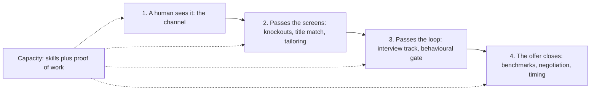

# GenAI Job-Search Strategy: Hiring Levers, Binding Constraints and Sequencing

> First-principles job-search strategy: the four levers that turn an application into an offer, the constraints that bind before the number of résumés does (proof of work, maintenance, interview tracks, one application per company), and how to sequence targets in expanding rings.

**Dates and grades.** Evidence comes from research sessions dated October 2026: [T0-04](../../research/sessions/T0-04-ats-filtering-funnel-conversion-math.md) (screening and channel conversion), [T0-10](../../research/sessions/T0-10-career-tooling-ecosystem-12-stage-funnel.md) (application behaviour), [T1-03](../../research/sessions/T1-03-interview-execution-offer-negotiation.md) and [T0-14](../../research/sessions/T0-14-ai-system-design-interview-patterns.md) (interview loops), [T0-13](../../research/sessions/T0-13-production-portfolio-proof-of-work-standards.md) and [T0-06](../../research/sessions/T0-06-career-transition-timelines-5-backgrounds.md) (proof of work and transitions), [T0-02](../../research/sessions/T0-02-global-regional-compensation-benchmarks.md) and [T0-17](../../research/sessions/T0-17-compensation-progression-plateaus-equity.md) (pay). The proof-of-work sets are generated by [scripts/resume_layers.py](../../scripts/resume_layers.py) from the headline layer of [data/skills_ontology.json](../../data/skills_ontology.json) and from [data/project_archetypes.json](../../data/project_archetypes.json); run `python3 -B scripts/resume_layers.py --update` after changing either. **Grades** (EGP-1.0): A primary or measured; B transparent secondary or sizeable vendor dataset; C vendor, practitioner or single source; D judgement; M model output; P practice-curated and unmeasured. Coverage percentages are model outputs (M). The résumé model (layers, variants and which roles need a résumé of their own) is in [résumé strategy](resume-strategy.md).

## The short answer

1. **Work the channel first: it is the largest multiplier.** Referrals convert at 11–36× the per-application rate of cold applications and recruiter-sourced candidates at about 8×, while about 0.2% of cold engineering applications end in a hire. These are selection effects, not proof that a channel causes the hire [B · T0-04.F9, T0-04.F10].
2. **The résumé moves only the first two levers.** A complete search needs as much effort on referrals and outreach, projects and interview preparation as on résumés [D]. One person needs one universal résumé plus two or three variants ([résumé strategy](resume-strategy.md)).
3. **Proof of work binds before the number of résumés does.** A résumé can only point at evidence, and evidencing many roles takes many projects: see the computed sets below [M].
4. **Prepare the interview track your targets use, and treat the behavioural round as a gate.** A behavioural "No Hire" is usually an automatic veto at Anthropic; at Google it sinks the packet at the target level, though the hiring committee may downlevel when technical scores are exceptional [B/C · T1-03 L210–211].
5. **One company, one application per cycle** [C · T0-10]. Even a person targeting every role must choose the single best-fit role at each company.
6. **Sequence your targets in expanding rings** [D]: your primary family first, adjacent families next, and stretch families only once their proof of work exists.

## At a glance



The four levers multiply, so the weakest one caps the result. Capacity sits behind all four. "Where each lever is worked on", under How to do it, maps each lever to its guide.

## The four hiring levers

For a single application:

```text
P(offer) = P(a human sees it) × P(passes the screens) × P(passes the interview loop) × P(the offer closes)
```

Across a search, the result is the sum over applications, limited by the hours available each week.

| Lever | What moves it | Evidence |
|---|---|---|
| **A human sees it** | **Channel.**<br>• Referrals convert at 11–36× the per-application rate of cold applications; candidates sourced by recruiters at about 8×.<br>• Cold applications: about 3.6–6% reach a first human stage, and about 0.2% end in a hire.<br>• Gem reports that 46% of sourced engineering hires were already in the employer's ATS, so your stored résumé and profiles get re-discovered | B · [T0-04](../../research/sessions/T0-04-ats-filtering-funnel-conversion-math.md) |
| **Passes the screens** | • Knockout answers.<br>• Title match plus recent, evidenced skills.<br>• Tailoring: 4.23% vs 2.07% interview rate (correlational).<br>• Not spraying one company: 6.07% → 1.91% | A · T0-04; C · [T0-10](../../research/sessions/T0-10-career-tooling-ecosystem-12-stage-funnel.md) |
| **Passes the loop** | • Depth in the role's interview track: application, infrastructure, ML design, research, product or governance.<br>• Coding and behavioural answers. A behavioural "No Hire" is usually an automatic veto at Anthropic; at Google it sinks the packet at the target level, though the hiring committee may downlevel when technical scores are exceptional | B/C · [T1-03](../../research/sessions/T1-03-interview-execution-offer-negotiation.md) L210–211; [T0-14](../../research/sessions/T0-14-ai-system-design-interview-patterns.md) |
| **Offer closes** | Pay benchmarks, equity risk adjustment, negotiation, timing several offers together | B · [T0-02](../../research/sessions/T0-02-global-regional-compensation-benchmarks.md), [T0-17](../../research/sessions/T0-17-compensation-progression-plateaus-equity.md); C · T1-03 |
| **Capacity behind all four** | Skills, plus **proof of work**: verifiable projects at V1–V3 on the [verifiability ladder](../05-portfolio/proof-of-work-standards.md#the-ladder) | [T0-13](../../research/sessions/T0-13-production-portfolio-proof-of-work-standards.md); [T0-06](../../research/sessions/T0-06-career-transition-timelines-5-backgrounds.md) |

**What this implies for the system** [D]:
- The résumé mainly moves the first two levers.
- The biggest multipliers are channel, proof of work and interview depth.
- So a complete system needs as much on referrals and outreach, projects and interview preparation as on résumés.

<a id="21-the-layers-and-their-jobs"></a>
<a id="23-selection-rule-choose-by-content-then-tailor"></a>
<a id="25-which-roles-need-their-own-resume-computed"></a>
### Where the résumé fits

The résumé works on the first two levers, and its whole model is in [résumé strategy](resume-strategy.md): the [five layers](resume-strategy.md#the-five-layers-and-their-jobs) from the master inventory to the posting-tailored résumé, the [selection rule](resume-strategy.md#for-each-posting-choose-by-content-then-tailor) (choose by content, then tailor) and the computed decisions on [which roles need a résumé of their own](resume-strategy.md#which-roles-need-their-own-résumé-computed). One person needs one universal résumé plus two or three variants.

<a id="26-the-constraints-that-bind-first"></a>
## The constraints that bind first

Four constraints bind before the number of résumés does.

1. **Proof of work.** A résumé can only point at evidence. Each of the 20 [project archetypes](../05-portfolio/project-archetypes.md) is scored against each role's Must and Important skills (Must weighted 3, Important 2):

<!-- BEGIN GENERATED: scripts/resume_layers.py (proof-of-work sets) -->
**Every individual-contributor role at ≥60%: 11 projects, chosen greedily:**

1. Evaluated RAG system over a real corpus (P1)
2. Prompt vs RAG vs fine-tune comparison (P4)
3. AI governance packet: inventory, risk register, framework mapping (P13)
4. Customer pilot / reference architecture with a cost model (P11)
5. Self-hosted LLM platform on Kubernetes (P6)
6. Custom Triton kernel with benchmarks and correctness tests (P9)
7. Sim-to-real robotics project (P16)
8. Safety / interpretability research project (P18)
9. Reliable agent: approvals, sandboxed tools, replay, failure injection (P2)
10. AI PM case: PRD, eval rubric, pilot metrics (P12)
11. Full-stack AI app with streaming agent UX and UX metrics (P14)

**The top 8 targets at ≥60%: 5 projects:**

1. Prompt vs RAG vs fine-tune comparison (P4)
2. Evaluated RAG system over a real corpus (P1)
3. Small-scale distributed training / post-training study (P7)
4. Customer pilot / reference architecture with a cost model (P11)
5. Self-hosted LLM platform on Kubernetes (P6)

Coverage of the top 8 with that set: Research Engineer / Member of Technical Staff 90%, Applied AI Engineer 84%, Machine Learning Engineer 82%, Forward Deployed Engineer 81%, AI Engineer 79%, AI Infrastructure / GPU Platform Engineer 67%, Applied Scientist 65%, Research Scientist 62%.
<!-- END GENERATED -->

The build cards for each project, with the same minimal sets, are in [project archetypes](../05-portfolio/project-archetypes.md#minimal-project-sets).

2. **Maintenance.** Hand-edited résumés drift out of sync. They stay consistent only if every version is assembled from one tagged master inventory by a script [D]. Run that in your own career repository, not in this one (decision D-022): [pramedha-template](https://github.com/bhaskarjha-dev/pramedha-template)'s `tools/resume` assembles variants from one bullet pool and renders them. Tag each bullet with skill IDs from the [skills ontology](../../data/skills_ontology.json) so that your variants follow the [résumé skills matrix](resume-skills-matrix.md); the tagging rule is in [résumé strategy](resume-strategy.md#master-inventory-schema-p).
3. **Interview tracks.** Covering every role means preparing six distinct tracks (application, infrastructure, ML design, research, product, governance), plus coding and behavioural rounds. The [role map](../02-roles/role-map.md) gives each role's track, and [interview loops](../08-interviewing/interview-loops.md) covers the loops themselves.
4. **One company, one application per cycle** [C · T0-10]. A target-everything person must still choose the single best-fit role at each company.

<a id="27-recommended-sequencing-expanding-rings"></a>
## Recommended sequencing: expanding rings

The system should **support** every role; that is the coverage test. Each person should **sequence** their targets in rings [D]:

| Ring | What it adds | Example (target-all person) |
|---|---|---|
| **1. Primary family** | Universal résumé, one family résumé, one or two flagship projects, one interview track | Applied GenAI: AI Engineer and Agentic |
| **2. Adjacent families** | Their family and role résumés, plus one project each | FDE / Applied AI; ML Engineer / Applied Scientist |
| **3. Stretch families** | Only once the proof of work exists | Research, infrastructure, product, governance |

The [targeting workbook](../00-start/targeting-workbook.md) turns your own scores into rings.

## How to do it

1. **Choose your targets and your primary family.** Start from the [GenAI target roles](../02-roles/genai-target-roles.md) and the [targeting workbook](../00-start/targeting-workbook.md). *Done when* every target role sits in ring 1, 2 or 3, and ring 1 is one family.
2. **Build the résumé set for ring 1.** One universal résumé and one family résumé, both from one tagged master inventory ([résumé strategy](resume-strategy.md)). *Done when* both exist, share one set of facts, and their portal files pass the [ATS self-test](ats-mechanics.md#the-self-test).
3. **Build one or two flagship projects for ring 1.** Choose them from the computed sets above and the [project archetypes](../05-portfolio/project-archetypes.md), and build them to the [proof-of-work standards](../05-portfolio/proof-of-work-standards.md). *Done when* every headline claim is V1 or higher.
4. **Choose an entry route for every target.** Internal, referral, recruiter or direct, from [channels and boards](channels-and-boards.md); earn named-human routes with [referrals and outreach](../07-networking/referrals-and-outreach.md). *Done when* every target has a route, and where you know someone, the referral ask comes before the application.
5. **Apply once per company, cleanly.** One best-fit role per company per cycle [C · T0-10], with the portal-résumé and knockout rules in [ATS mechanics](ats-mechanics.md). *Done when* every basic qualification in each application has an evidence line and the parsed fields are checked.
6. **Run the search as a weekly system.** The tracker, the hours split, the weekly review and the thresholds are in the [application operating system](application-operating-system.md). *Done when* every send, reply, screen, loop and outcome is logged, and each week ends with at most one change.
7. **Prepare the interview track your targets use.** Classify each loop with [interview loops](../08-interviewing/interview-loops.md) and prepare the behavioural round as a gate with [behavioural calibration](../08-interviewing/behavioral-calibration.md). *Done when* each live loop has a preparation plan for its track and four behavioural stories.
8. **Close the offer.** Use [offer evaluation](../09-compensation/offer-evaluation.md) and the [negotiation playbook](../09-compensation/negotiation-playbook.md). *Done when* every offer has been evaluated with those guides before you answer it.
9. **Widen one ring at a time.** Add ring 2 once ring 1's proof and track are in place, and ring 3 only once its proof exists [D]. *Done when* each new ring has its résumé, project and track ready before its first application.

### Where each lever is worked on

| Need | Where |
|---|---|
| Which roles to target, in what order | [GenAI target roles](../02-roles/genai-target-roles.md), [targeting workbook](../00-start/targeting-workbook.md), [02-roles](../02-roles/README.md) |
| What to learn, and the skills and keywords per role | [Learning roadmaps](../03-skills-and-tech/learning-roadmaps.md), [role skill inventories](../03-skills-and-tech/role-skill-inventories.md), [03-skills-and-tech](../03-skills-and-tech/README.md) |
| Résumés | [Résumé strategy](resume-strategy.md), [résumé skills matrix](resume-skills-matrix.md) |
| Screening, parsing and knockout questions | [ATS mechanics](ats-mechanics.md) |
| What to build to prove it | [Proof-of-work standards](../05-portfolio/proof-of-work-standards.md), [project archetypes](../05-portfolio/project-archetypes.md), [05-portfolio](../05-portfolio/README.md) |
| Where postings are, and which entry routes convert | [Channels and boards](channels-and-boards.md) |
| Referrals and outreach | [Referrals and outreach](../07-networking/referrals-and-outreach.md), [communities guide](../07-networking/communities-guide.md), [online presence](../07-networking/online-presence.md) |
| Running the search week by week | [Application operating system](application-operating-system.md) |
| Interview preparation | [Interview loops](../08-interviewing/interview-loops.md), [prep packs](../08-interviewing/prep-packs.md), [08-interviewing](../08-interviewing/README.md) |
| Offers and negotiation | [Offer evaluation](../09-compensation/offer-evaluation.md), [negotiation playbook](../09-compensation/negotiation-playbook.md), [09-compensation](../09-compensation/README.md) |

What is written and what is still planned is tracked in [ROADMAP.md](../../ROADMAP.md).

## Templates and examples

### Ring plan [P]

```text
RING PLAN [P]                                             date: [YYYY-MM-DD]

Ring 1   family: [family, e.g. Applied GenAI]     roles: [role], [role]
         résumés: universal + [variant]           projects: [P#], [P#]    track: [interview track]
Ring 2   families: [family], [family]             add when: ring 1 proof and track are in place
         résumés: [variant or role résumé]        projects: [P#]          track: [interview track]
Ring 3   families: [family]                       add when: its proof of work exists
Parked   roles: [role] · why: [missing proof, track or eligibility]
Rule     one best-fit role per company per cycle
```

### Weak and strong: a search plan [P]

| Weak | Why it fails | Strong |
|---|---|---|
| Apply to every GenAI title at once, with one résumé, through job boards only | The résumé moves only the first two levers, and each family needs its own proof and interview track [D] | Ring 1 only: one family, its résumé, one or two flagship projects, a referral route where one exists, and one interview track |
| Apply to several roles at one company in the same week | Huntr's interview rate fell from 6.07% for one application at a company to 1.91% for eight or more (correlational) [C · T0-10] | Apply to the single best-fit role, after a referral ask where you know someone |

## Checklist

- [ ] Targets sorted into rings; ring 1 is one family
- [ ] Universal résumé and ring 1 family résumé built from one master inventory
- [ ] One or two flagship projects for ring 1, every headline claim at V1 or higher
- [ ] An entry route for every target; referral asks before applications where you know someone
- [ ] One application per company per cycle
- [ ] Tracker and weekly review running
- [ ] Interview track and behavioural stories prepared for each live loop
- [ ] Ring 2 opened only after ring 1's proof and track exist; ring 3 only once its proof exists

## Pitfalls

| Red flag | Why it hurts | Fix |
|---|---|---|
| Most search hours go into résumés | The résumé moves only the first two levers; the biggest multipliers are channel, proof of work and interview depth [B · T0-04.F10; D] | Split the hours: see the [application operating system](application-operating-system.md#hours-tiers-and-the-100-hour-split) |
| Every family at once | Each family needs its own proof of work and interview track [D] | Expanding rings, starting with one family |
| Several applications to one company in one cycle | Interview rates fall from 6.07% for one application at a company to 1.91% for eight or more (Huntr, correlational) [C · T0-10] | One best-fit role per company per cycle |
| Stretch roles before their proof exists | A résumé can only point at evidence [D] | Open ring 3 only once its proof of work exists |
| Treating the behavioural round as a formality | A behavioural "No Hire" is usually an automatic veto at Anthropic, and sinks the packet at the target level at Google unless the hiring committee downlevels [B/C · T1-03 L210–211] | Prepare it like a technical round: [behavioural calibration](../08-interviewing/behavioral-calibration.md) |
| Preparing for the wrong interview track | The most avoidable failure in loops [B/C · T1-03.F2] | Classify each loop first: [interview loops](../08-interviewing/interview-loops.md) |
| Hand-edited résumés for many roles | They drift out of sync [D] | Generate them from one tagged master inventory |

## Evidence and limits

- **What is measured (B).** Channel multipliers and cold-inbound rates come from Ashby and Gem datasets compiled by T0-04. They are selection effects, from tech-forward customer bases [B · T0-04.F9, T0-04.F10]. Gem's 46% re-discovery figure is a vendor figure [B · T0-04 R1].
- **What is correlational (C).** Huntr's tailoring and same-company figures are vendor-run and self-tracked [C · T0-10].
- **What is coaching evidence (B/C).** The behavioural-veto signals come from coaching guides and web research [B/C · T1-03 L206–212]. T1-03's summary finding groups Google with Anthropic as a near-automatic veto [T1-03 L73]; its firm table adds the downlevel route at Google [T1-03 L211], and this page follows the table.
- **What is computed (M).** The proof-of-work sets and coverage figures come from judgement-graded skill tiers and archetype skill lists, through a greedy search; they change whenever either data file changes.
- **What is judgement (D).** The implications of the lever model, the maintenance constraint and the ring sequencing.
- **Errata.** [Erratum U24](../../research/ERRATA.md) corrects T1-03's funnel stage rates; this page takes channel and funnel figures from T0-04 only.
- **What would change this advice.** A published GenAI-only funnel with inbound conversion materially above 1% would raise the share of effort on cold applications [T0-04 L138]. A change to the skill tiers or the archetypes changes the computed sets.

## Next steps

- **Next stage:** get referred with [referrals and outreach](../07-networking/referrals-and-outreach.md).
- **The résumé set:** [résumé strategy](resume-strategy.md) and the [résumé skills matrix](resume-skills-matrix.md).
- **This stage's guides:** [channels and boards](channels-and-boards.md), [ATS mechanics](ats-mechanics.md) and the [application operating system](application-operating-system.md).
- **Interviews and offers:** [interview loops](../08-interviewing/interview-loops.md) and [offer evaluation](../09-compensation/offer-evaluation.md).
- **Changing careers:** [career transitions](../11-tracks/career-transitions.md) for timelines and gates.
- **Role hubs:** [AI Engineer](../02-roles/hubs/ai-engineer.md), [ML Engineer](../02-roles/hubs/ml-engineer.md), [Forward Deployed Engineer](../02-roles/hubs/forward-deployed-engineer.md) and [Research Engineer](../02-roles/hubs/research-engineer.md); every hub is listed in the [hub index](../02-roles/hubs/README.md).
- **Evidence:** [stage 6 findings](../../research/findings.md#stage-06), [T0-04](../../research/sessions/T0-04-ats-filtering-funnel-conversion-math.md), [T0-10](../../research/sessions/T0-10-career-tooling-ecosystem-12-stage-funnel.md), [T1-03](../../research/sessions/T1-03-interview-execution-offer-negotiation.md), [errata](../../research/ERRATA.md).
