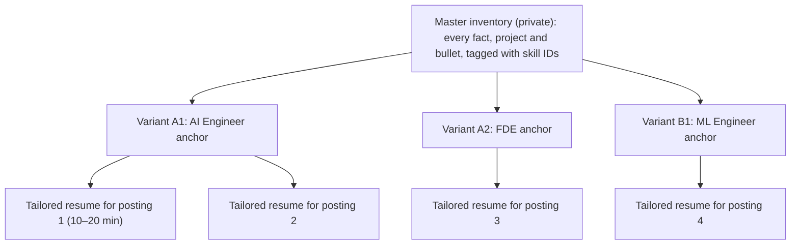

# GenAI Resume Strategy
## One Master Inventory, a Few Role-Family Variants, Light Per-Posting Tailoring

> **Updated:** 2026-11-04 · **Scope:** Layered resume model from master inventory to posting-tailored submissions.
> **Companions:**
> - [resume-skills-matrix.md](resume-skills-matrix.md): the concise Must / Important / Should / Optional skills for every role and a skills-section blueprint for every variant.
> - [role-skill-inventories.md](../03-skills-and-tech/role-skill-inventories.md): the complete typed inventory per role (concepts, methods, tools, frameworks, platforms, non-technical skills), with keywords and a self-assessment.
> - [skills-vocabulary.md](../03-skills-and-tech/skills-vocabulary.md): every skill ID, typed, with its posting wording.
> **Builds on:**
> - [genai-target-roles.md](../02-roles/genai-target-roles.md): which roles to target.
> - [role-skill-maps.md](../03-skills-and-tech/role-skill-maps.md): what each role needs.
> - [role-catalog.md](../02-roles/role-catalog.md): which roles exist.
>
> **Evidence:** EGP-1.0 grades: A/B measured; C small-sample, vendor or practitioner; D judgement. C and D items appear with their grade as attributed context. The recommendations rest on the A-grade screening mechanics and the B-grade channel data.

**Sources:**

| ID | Session |
|---|---|
| T0-04 | [ATS parsing, AI screening layers and funnel math](../../research/sessions/T0-04-ats-filtering-funnel-conversion-math.md) |
| T0-06 | [Career transitions, 5 backgrounds](../../research/sessions/T0-06-career-transition-timelines-5-backgrounds.md) |
| T0-10 | [Career tooling and application behaviour](../../research/sessions/T0-10-career-tooling-ecosystem-12-stage-funnel.md) |
| T0-11 | [Certifications and credentials](../../research/sessions/T0-11-certification-cloud-credential-roi.md) |
| T0-13 | [Portfolio and proof-of-work standards](../../research/sessions/T0-13-production-portfolio-proof-of-work-standards.md) |
| T1-03 | [Interview execution](../../research/sessions/T1-03-interview-execution-offer-negotiation.md) |

---

## 0. The answer

Applying to many GenAI roles works best with three layers:
1. A private **master inventory** of everything you have done.
2. **Two or three variant resumes**, each covering one role family.
3. **Light tailoring** for each posting.

Three design choices make this work. First, variants are defined by **role family** rather than by title. Second, each variant is anchored on your **highest-ranked target** in that family. Third, the skills list is a **match layer that must be backed by evidence**.

| Approach | Verdict | Why |
|---|---|---|
| One resume for all target roles | **Reject across role families; acceptable within one** | Screening layers score title similarity, skill overlap weighted towards recent roles, and must-have vs preferred criteria [A · T0-04]. Hiring managers in different families want different proof: eval suites, serving benchmarks, PRDs, papers. Within a family, roles share the anchor role's stack and differ by a handful of swap-in skills ([matrix §3](resume-skills-matrix.md#blueprints)) |
| A master resume with everything | **Adopt, as a private inventory you never send** | It keeps facts identical across every version: ATS systems keep your history, and Ashby identifies repeat applicants by email [A · T0-10]. Sending "everything" makes readers hunt for fit, and adding mildly relevant material can lower the impression (a contested "dilution" finding) [B/C · T0-13] |
| A separate resume for each of tens of roles | **Reject as the default** | Sibling roles would give you near-duplicate documents to maintain. You shouldn't send many applications to one company anyway: in Huntr's vendor data, interview rates fell from 6.07% (one application at a company) to 1.91% (eight or more), a correlational result [C · T0-10]. Apply once per company per cycle unless the roles are genuinely distinct [T0-10]. Exception: a bespoke version for a dream employer |
| A few variants, each covering several roles | **Adopt: this is the core design** | 15 variants cover all 24 individual-contributor roles and the three employed leadership tracks (§2.1). One person needs two or three |
| "Hard" elements vs positioned elements | **Adopt, as three layers** | **Facts** never change. The **match layer** (title line, skills, keywords) mirrors the posting but stays truthful. The **evidence layer** (summary, projects, bullets, metrics) carries the persuasion. Matching only works when evidence backs it: criteria-based AI review cites evidence for each requirement [A · T0-04] |
| Must / Important / Should / Optional per role | **Adopt, aligned with how screening works** | Postings and screening tools split basic from preferred qualifications. Workday HiredScore lets basic qualifications decide A/B vs C/D [A]; Phenom grades must-have vs preferred skills [B] (both T0-04). The [matrix](resume-skills-matrix.md) also adds Avoid and Prerequisites; prerequisites are facts, not skills |

**Two things matter more than the resume:**
- **Proof of work per family.** A variant can only point at evidence you have, so each needs its own flagship project. That is the real limit on how many variants you can run.
- **Channel.** Referrals convert at 11–36× the per-application rate of cold applications (an association, not a causal effect). Cold inbound converts at about 0.2% application-to-hire [B · T0-04]. A strong resume sent cold still faces those odds.

---

## 1. What the evidence says about screening

**How screening works:**
- **Automatic rejection** comes from employer-configured knockout questions on the application form: work authorisation, required yes/no items. It does not come from resume wording or parse failures [A · T0-04].
- **AI screening layers** extract titles, skills, years, dates and employers, then score them against recruiter-written criteria [A · T0-04]:
  - Eightfold weights skill overlap in recent roles and title similarity.
  - Workday HiredScore's LLM mode lets basic qualifications decide A/B vs C/D; preferred qualifications separate grades within those bands.
- **Recruiter searches** key on titles, languages, frameworks and LLM terms. Certification names are weak search hooks [C · T0-11].

**What helps:**
- **Tailoring:** tailored applications had a 4.23% interview rate vs 2.07% untailored in Huntr's vendor data (correlational) [C · T0-10].
- **Specific writing:**
  - After an AI cover-letter tool launched on one platform, cover letters stopped predicting hiring, while job-specific tailoring still predicted callbacks [B · T0-10].
  - In a field experiment, non-generative writing assistance on resumes raised hiring by 8% [A, narrow · T0-10].
  - Generic AI-written text is discounted.

**What doesn't help:**
- **"ATS score" checkers** (Jobscan, Teal, Rezi) are keyword simulations with no demonstrated link to real ATS ranking. Use them only to list gaps [C · T0-04].
- **Volume:** Huntr's interview rate falls from 9.25% for people sending 11–20 applications to 2.58% for those sending 100+ (correlational) [C · T0-10].

**Diagnostic:** if 15 targeted applications produce no screens, the problem is positioning or resume signal, not skill [D · T0-06].

> [!NOTE]
> No randomised study compares family-level variants with per-role resumes. This design rests on documented screening mechanics (A), correlational outcome data (C) and judgement (D).

---

## 2. The design: master → variants → per-posting tailoring



| Layer | What it is | How many | What changes | Effort |
|---|---|---|---|---|
| **Master inventory** | Private source of truth: all roles, dates, projects, metrics and links. Each bullet is written in 2–3 phrasings and tagged with skill IDs from [data/skills_ontology.json](../../data/skills_ontology.json) (§3) | 1 | It grows over time | Ongoing |
| **Variant resume** | A complete one- to two-page resume for one role family, anchored on that family's top target role | Two or three per person, from 15 possible | Headline, summary, skills section (from the [blueprint](resume-skills-matrix.md#blueprints)), project selection, bullet order | About half a day each; refresh monthly |
| **Tailored application** | The variant adjusted to one posting | One per application | Title line, first summary sentence, skills order and wording, one or two bullet or project swaps, knockout answers | 10–20 minutes, roughly 10–20% of the content |

Keep **two formats** of each variant [A/C · T0-04]:
- **Portal version:** single column, real text layer, standard headings, dates on the same line as title and employer.
- **Designed version:** for referrals and direct emails.

### 2.1 The variant catalogue

| Family | Variant | Roles it covers (GenAI target #) | Headline template | Flagship proof it must point to |
|---|---|---|---|---|
| **A. Applied GenAI** | **A1 Builder** (anchor: [AI Engineer](resume-skills-matrix.md#resume-ai-engineer)) | AI Engineer (1), Agentic AI (10), AI Evaluation (13), AI Enablement (20), AI Product Engineer (21) | "AI Engineer: LLM systems, RAG, agents, evaluation" | An evaluated RAG or agent system (metrics table, cost/latency budget, reproducible README), plus a reliability layer: CI-gated evals, traces, budgets |
| | **A2 Deployer** (anchor: [FDE](resume-skills-matrix.md#resume-forward-deployed-engineer)) | FDE (4), Applied AI Engineer (6), AI Solutions Architect (14) | "Forward Deployed / Applied AI Engineer: customer-facing LLM systems" | A customer pilot case study with numbers; a demo on real data shown to at least two users; a reference architecture with a cost model |
| **B. ML & Applied Science** | **B1 Engineer** ([ML Engineer](resume-skills-matrix.md#resume-ml-engineer)) | ML Engineer, GenAI track (2) | "Machine Learning Engineer: LLM fine-tuning, evaluation, serving" | A baseline-first model with measured lift; a prompt vs RAG vs fine-tune comparison; a serving benchmark; small-budget training evidence |
| | **B2 Scientist** ([Applied Scientist](resume-skills-matrix.md#resume-applied-scientist)) | Applied Scientist (5) | "Applied Scientist: LLM evaluation, experimentation, research to production" | Your own method shipped as a service; an eval-statistics write-up |
| | **B3 Robotics** ([Physical AI](resume-skills-matrix.md#resume-physical-ai-engineer)) | Physical AI (18) | For robotics backgrounds only | A sim-to-real or manipulation project with measured success rates |
| **C. Frontier Research** | **C1 Engineering** ([Research Engineer](resume-skills-matrix.md#resume-research-engineer)) | Research Engineer / MTS (3) | "Research Engineer: distributed training, post-training, evals at scale" | Paper re-implementations; a compact engine or training-stack reimplementation; OSS PRs |
| | **C2 Science** (anchor: [Research Scientist](resume-skills-matrix.md#resume-research-scientist)) | Research Scientist (8), AI Safety Researcher (19) | CV format with a Publications section | Papers, research code, talks; fellowship projects |
| **D. AI Systems** | **D1 Serving & kernels** (anchor: [Inference](resume-skills-matrix.md#resume-inference-engineer)) | Inference Engineer (9), GPU Kernel Engineer (15) | "Inference Engineer: LLM serving and GPU performance" | A serving study with a roofline analysis and $/M tokens at an SLO; a kernel or upstream PR (vLLM, SGLang, FlashInfer) |
| | **D2 Platform & infrastructure** (anchor: [AI Infrastructure](resume-skills-matrix.md#resume-ai-infrastructure-engineer)) | AI Infrastructure (7), ML Platform / MLOps (11) | "AI Infrastructure Engineer: GPUs, Kubernetes, model serving" | A self-hosted cluster with load tests, failover, autoscaling, dashboards and a postmortem |
| | **D3 Security** ([AI Security](resume-skills-matrix.md#resume-ai-security-engineer)) | AI Security / Red Teamer (16) | "AI Security Engineer: LLM and agent security" | A red-team suite in CI with attack-success rates before and after mitigation |
| **E. Product & Governance** | **E1 Product** ([AI PM](resume-skills-matrix.md#resume-ai-product-manager)) | AI Product Manager (12) | "AI Product Manager: LLM products, evaluation, pilots" | A PRD with an eval rubric and pilot metrics |
| | **E2 Governance & assurance** (anchor: [Governance Lead](resume-skills-matrix.md#resume-ai-governance-lead)) | AI Governance Lead (17), AI Risk/Audit (22), Responsible AI Engineer (23) | "AI Governance Lead: EU AI Act, NIST AI RMF, ISO 42001" | An AI inventory, risk register and playbook mapped to those frameworks. For Responsible AI Engineer: a compliance packet with guardrails and subgroup evals |
| | **E3 Domain evaluation** ([Domain Evaluation](resume-skills-matrix.md#resume-domain-evaluation-specialist)) | Domain Evaluation Specialist (24) | A bridge, not a destination | A domain gold standard with inter-rater agreement |
| **L. Leadership** | **L1** ([EM / Director](resume-skills-matrix.md#resume-ai-engineering-manager)) and **L2** ([VP / Head of AI / CAIO](resume-skills-matrix.md#resume-vp-head-of-ai)) | AI Engineering Manager / Director; VP / Head of AI; CAIO | Outcome-led | Delivery, adoption and cost results across teams |

Independent consulting and fractional work run on case studies and referrals rather than portal resumes, so they have no variant.

### 2.2 How many variants should you run?

**The rule:** one variant per role family you can back with a flagship project. That is usually two, and at most three.

| Your background | Primary variant | Second variant | Optional third | Basis (GenAI persona lens scores, [target roles §5](../02-roles/genai-target-roles.md)) |
|---|---|---|---|---|
| Backend / systems SWE | A1 (AI Engineer) | A2 (FDE / Applied AI) | D2 (AI Infrastructure), if you have infrastructure depth | AI Engineer 81, FDE 73, Applied AI 72, AI Infrastructure 68 |
| Data scientist / BI | A1, led by evals (AI Engineer / AI Evaluation) | B1 (ML Engineer) | B2 (Applied Scientist) | AI Engineer 75, ML Engineer 73, AI Evaluation 65 |
| Frontend / full-stack | A1 with the AI Product Engineer swap-ins | A2 (FDE) | — | AI Engineer 77, FDE 71, Applied AI 65 |
| Non-technical, 5+ years in a domain | E1 (AI PM) | E2, if you come from GRC, privacy or audit | E3, as a paid bridge | AI PM 64, Governance Lead 60 |
| PhD | B1 (ML Engineer) or B2 (Applied Scientist) | C1 (Research Engineer / MTS) | C2 (Research Scientist), if you publish | AI Engineer 74, ML Engineer 73, Research Engineer 73, Applied Scientist 71 |
| SRE / DevOps (not modelled in T0-06) | D2 | D1 later (~10–14 months of infrastructure depth for Staff-level inference) | A1 | Judgement [D] |
| Application security (not modelled) | D3 | A1 (agentic) | — | Judgement [D] |

**Why not more than three:**
- Each family needs different proof.
- You should send each company one application per cycle.
- Every extra variant takes time from the evidence that makes any of them credible.

### 2.3 What changes, and what never changes

| Resume part | Layer | Per variant? | Per posting? | Rules |
|---|---|---|---|---|
| Contact, location, work authorisation | Facts | Never | Never | Put them in plain body text at the top, not in a header or footer [A · T0-04]. Answer knockout questions exactly [A · T0-04] |
| Headline / target title line | Match | Yes (the anchor role) | Mirror the posting's title if it is a canonical title you can honestly claim | Never rename past job titles. Screening layers compare titles [A · T0-04] |
| Summary (2–3 lines) | Evidence | Yes | The first sentence mirrors the posting's top two needs | Formula: target role + years + domain + one flagship result with a metric [D] |
| Skills section | Match | The [blueprint](resume-skills-matrix.md#blueprints) | Reorder from basic to preferred qualifications, using the posting's exact wording ("LLM evaluation" vs "evals") | Use canonical names. Back every Must and Important skill with a bullet [A mechanics / D advice · T0-04]. Workday does not auto-fill Skills, so enter them by hand [A] |
| Experience | Facts + evidence | Bullet selection and order | Swap one or two bullets | Employers, titles and dates never change. Keep dates on the same line as title and employer [A]. Give one verifiable evidence line per posting requirement, in a recent role where possible: what, where, when, scale, tools [T0-04] |
| Projects | Evidence | Selection, with the variant's flagship first | Pick the closest project | Every headline claim should be reproducible: V1 or higher on the verifiability ladder [T0-13] |
| Education | Facts | Never | Never | 72% of AI-engineering postings state a degree requirement [C · T0-06] |
| Certifications | Facts | Order only | Only when the posting names one | For AI/ML roles, list them after projects, with full name, exam code, dates and Credly link [C · T0-11]. They matter mainly in IT-services, staffing and partner channels [B/C · T0-11] |
| Publications | Facts | Research variants only | — | C2 uses a CV format |

**Years-of-experience requirements:**
- State dates clearly; screeners compute years from them [A · T0-04].
- Most practitioners have only a few years of AI/ML experience: one survey's median is ~8 years writing code and ~3 in AI/ML [C · T0-06]. So present total engineering years plus GenAI years honestly.
- If a knockout demands more GenAI years than you have, seek a referral rather than applying cold.

### 2.4 Tailoring one application in about 15 minutes

1. **Classify the posting.** Match its title and basic qualifications to a variant blueprint. If none fits, skip it or plan heavier tailoring.
2. **Check knockouts:** work authorisation, location, years, degree. If you miss a hard requirement, seek a referral instead of applying cold [T0-04].
3. **Extract** the basic and preferred qualifications. Map each to a skill ID and mark the gaps.
4. **Title line:** use the posting's title if it is a canonical title you can honestly claim.
5. **Summary:** rewrite the first sentence around the posting's top two needs.
6. **Skills section:**
   - Reorder from basic to preferred qualifications, using the posting's wording.
   - Swap in the sibling-role skills from the blueprint, and drop skills the posting doesn't need.
7. **Evidence:** make sure every basic qualification has one evidence line. Swap one or two bullets, or a project, if needed.
8. **Gap check (optional):** a keyword checker can list missing terms. Never treat its score as a pass mark, and never add a skill you lack [C · T0-04].
9. **Format check:** single column with a text layer. After submitting, read the parsed fields on the ATS review page and fix them [A · T0-04].
10. **Log it:** variant, posting keywords, channel, outcome. Review monthly, and revise the variant if 15 targeted applications produce no screens [D · T0-06].

An illustrative A1 skills section (list only what you have actually used):

```text
LLM systems:   LLM APIs and tool calling (OpenAI, Anthropic), RAG, agents (LangGraph), prompt and context design
Evaluation:    golden sets, calibrated LLM judges, CI regression gates, error analysis
Production:    Python (asyncio, Pydantic), FastAPI, Docker, CI/CD, OpenTelemetry tracing, cost and latency budgets
Cloud & data:  AWS (Bedrock), PostgreSQL, vector search (pgvector)
```

### 2.5 Rules that protect you

- **Truth only.** List only what you can defend in a technical deep-dive. A behavioural "No Hire" is a near-automatic veto at Anthropic and Google [B/C · T1-03].
- **One set of facts.** Keep dates, titles and employers identical across all variants and LinkedIn. Inconsistent identity also risks fraud flags [D · T0-04].
- **No hidden text or keyword blocks.** Detectors exist, and their effect in production is unmeasured [A/B · T0-04].
- **No mass auto-apply.** Volume goes with lower interview rates [C · T0-10], and LinkedIn prohibits automation tools [A · T0-10].
- **Your own voice.** Use AI to structure your material and find gaps, not to write undifferentiated prose [A/B · T0-10].

---

## 3. Building the master inventory

Tag every bullet with skill IDs from [data/skills_ontology.json](../../data/skills_ontology.json) (look them up in [skills-vocabulary.md](../03-skills-and-tech/skills-vocabulary.md)) and with variant codes. A variant then becomes a filter.

```yaml
- id: exp-acme-2025-rag
  employer: Acme Corp
  title: Senior Software Engineer        # official title, never edited
  dates: Mar 2023 – Present
  bullets:
    - short: "Built a RAG assistant over 40K support docs; recall@5 0.62 → 0.81 with hybrid search and reranking"
      skills: [rag, retrieval_quality, evals, python]
      variants: [A1, A2]
      evidence: "V1: repo with metrics table"   # verifiability ladder level (T0-13)
    - short: "Cut LLM cost per ticket 38% with prompt caching and model routing; p95 latency held under 2.5 s"
      skills: [cost_latency, observability, llm_apis]
      variants: [A1, D1]
      evidence: "V3: 30-day cost dashboard"
```

Keep each metric with its source (dashboard, repo or report), because interviewers probe them. The example numbers above are placeholders.

---

## 4. Maintenance

| Item | Trigger | Action |
|---|---|---|
| Skill tiers and variants | A recount or a new JobsPipe measurement (next recount due by 2026-12-01) | Edit [data/skills_ontology.json](../../data/skills_ontology.json), then run `python3 scripts/build_skills.py --update` and `python3 scripts/build_resume_matrix.py --update`. Both validate the ontology; `--check` exits non-zero if an output is stale |
| GenAI target order | [genai-target-roles.md](../02-roles/genai-target-roles.md) changes | Update each role's `target` in the data file and re-run the generator. The script requires IC targets to run 1–24 without gaps |
| Screening evidence | T0-04 says to re-test quarterly | Re-check §1 and §2.3 against vendor documentation |
| Your variants | Monthly, or after 15 targeted applications without a screen | Revise the variant's headline, summary and flagship project |

*Not legal or immigration advice. Evidence grades follow EGP-1.0.*
