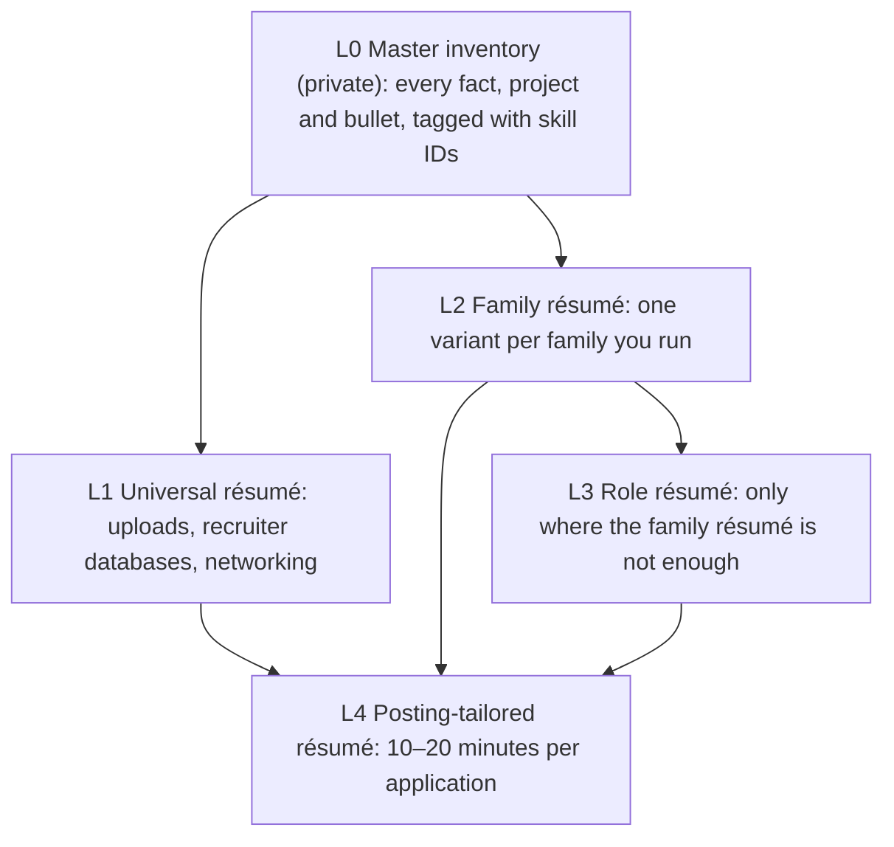

# GenAI Résumé Strategy: One Master Inventory, Layered Résumés, Light Tailoring

> How to run résumés for many GenAI roles: one private master inventory, one universal résumé, two or three variants from a catalogue of 15, light tailoring per posting, and the computed decisions on which roles need a résumé of their own.

**Dates and grades.** Evidence comes from research sessions dated October 2026: [T0-04](../../research/sessions/T0-04-ats-filtering-funnel-conversion-math.md) (screening mechanics, dated 2026-10-23), [T0-10](../../research/sessions/T0-10-career-tooling-ecosystem-12-stage-funnel.md) (tooling and application behaviour), [T0-13](../../research/sessions/T0-13-production-portfolio-proof-of-work-standards.md) (proof of work), [T0-11](../../research/sessions/T0-11-certification-cloud-credential-roi.md) (credentials), [T0-06](../../research/sessions/T0-06-career-transition-timelines-5-backgrounds.md) (transitions), [T0-01](../../research/sessions/T0-01-genai-role-taxonomy-market-volume.md) (titles) and [T1-03](../../research/sessions/T1-03-interview-execution-offer-negotiation.md) (interviews). The computed sections are generated by [scripts/resume_layers.py](../../scripts/resume_layers.py) from the headline layer of [data/skills_ontology.json](../../data/skills_ontology.json); run `python3 -B scripts/resume_layers.py --update` after changing it. The variant anchors and the target numbers follow the [GenAI target order](../02-roles/genai-target-roles.md), which draws in part on JobsPipe posting data retrieved on 2026-11-02 and may move at the JobsPipe recount planned by 2026-12-01. Posting data are EGP-1.0 class V1 (31 days), so this page counts from that dataset's own date, two days before its `last_verified`, and is due for review by 2026-12-03 (decision D-018). **Grades** (EGP-1.0): A primary or measured; B transparent secondary or sizeable vendor dataset; C vendor, practitioner or single source; D judgement; M model output; P practice-curated and unmeasured. Coverage percentages are model outputs (M) built from judgement-graded skill tiers.

<a id="0-the-answer"></a>
## The short answer

1. **Keep one private master inventory, and never send it.** Every fact, project and bullet lives there, tagged with skill IDs, so every version tells the same story: applicant tracking systems keep your history, and Ashby identifies repeat applicants by email [A · T0-10]. Sending "everything" makes readers hunt for fit, and adding mildly relevant material can lower the impression, a contested finding [B/C · T0-13].
2. **Anchor one universal résumé on one identity.** It is your generic profile for uploads, recruiter databases and the people you network with. Recruiter searches key on titles, and Eightfold scores title similarity [A · T0-04; C · T0-11], so it cannot hold "the best of all roles": anchored on AI Engineer with ML depth, it serves the applied-GenAI and ML families well and holds none of the Must skills of the product, governance and kernel roles [M].
3. **Run two or three variants: one per role family you can back with a flagship project** [D]. A variant is a family résumé, or a dedicated role résumé where the decisions table below says the family résumé is not enough. The résumé total in the [key numbers](#key-numbers-computed) is the size of the whole catalogue across every role [M]; one person needs one universal résumé plus two or three variants.
4. **Choose the résumé by what the posting asks for, not by its title.** An "AI Engineer" posting can be a robotics, Power Platform or MLOps job [B · T0-01], and screening tools grade the posting's listed requirements, not its title [A · T0-04].
5. **Tailor every application lightly and truthfully, in 10–20 minutes.** In Huntr's vendor data, tailored applications had a 4.23% interview rate against 2.07% untailored (correlational) [C · T0-10]. Change the match layer, never the facts, and never add a skill you lack.
6. **Proof of work, not the document count, limits how many variants you can run.** A variant can only point at evidence you have, so each needs its own flagship project [D]. The channel matters more than any résumé: referrals convert 11–36× better per application than cold applications, a selection effect [B · T0-04.F10]; see the [hiring levers](job-search-strategy.md#the-four-hiring-levers).

## At a glance



Content flows down from the master inventory, so no version invents a fact. One person runs the universal résumé plus two or three variants (L2 or L3), and tailors one of them for each posting.

## The layered résumé model: five layers

### The five layers and their jobs

| Layer | What it is | Who reads it | How many | Rule |
|---|---|---|---|---|
| **L0 Master inventory** | Every fact, project and bullet, each bullet in 2–3 phrasings, tagged with skill IDs, variant codes and metrics; never sent | Only you | 1; it grows over time | **Adopt.** It is the single source of every other layer (schema under Templates) |
| **L1 Universal résumé** | Your generic profile: job-board and platform uploads, recruiter databases, cold outreach, "send me your résumé" | Recruiter search, AI screening layers, people you network with | 1 | **Adopt, but anchor it hard on one identity** (the coverage table below). A résumé that claims research, infrastructure, product and governance at once reads as unfocused; dilution is a contested risk [B/C · T0-13] |
| **L2 Family résumé** | A complete one- to two-page résumé for one coherent family of roles: a variant from the catalogue, anchored on that family's highest-ranked target role | Hiring teams for any role in the family | Two or three per person, from the 15 in the catalogue | **Adopt, with families defined by skill overlap rather than by name.** Naming isn't enough: roles that sound alike can share little. About half a day each to build; refresh monthly [P] |
| **L3 Role résumé** | One per target role, where it changes the résumé | That role's hiring team | Only the roles the decisions table flags | **Adopt where it changes the résumé.** For a family's anchor role, the role résumé *is* the family résumé |
| **L4 Posting-tailored** | The closest layer, adjusted to one job description: title line, first summary sentence, skills order and wording, one or two bullet or project swaps, knockout answers | Screening tools and the hiring manager | One per application | **Adopt, with the selection rule** in How to do it. 10–20 minutes, roughly 10–20% of the content [P] |

**Build direction.** Design flows *up* and content flows *down*:
- **Design:** role needs (the [résumé skills matrix](resume-skills-matrix.md) and the [role skill inventories](../03-skills-and-tech/role-skill-inventories.md)) → family résumé (shared core plus the most common differentiators) → universal résumé (primary family plus the strongest cross-family evidence).
- **Content:** every layer draws its facts and bullets from L0, so nothing is invented or inconsistent.

**Two formats of each résumé** [A/C · T0-04]: a portal file that follows the [portal résumé rules](ats-mechanics.md#portal-résumé-rules) (single column, real text layer, standard headings, dates on the same line as title and employer), and a designed file for referrals and direct emails.

### Why layers, and not one résumé or one per role

| Approach | Verdict | Why |
|---|---|---|
| One résumé for all target roles | **Reject across role families; acceptable within one** | Screening layers score title similarity, skill overlap weighted towards recent roles, and must-have vs preferred criteria [A · T0-04]. Hiring managers in different families want different proof: eval suites, serving benchmarks, PRDs, papers. Within a family, roles share the anchor role's stack and differ by a handful of swap-in skills ([matrix blueprints](resume-skills-matrix.md#blueprints)) |
| A master résumé with everything | **Adopt, as a private inventory you never send** | It keeps facts identical across every version: ATS systems keep your history, and Ashby identifies repeat applicants by email [A · T0-10]. Sending "everything" makes readers hunt for fit, and adding mildly relevant material can lower the impression (a contested "dilution" finding) [B/C · T0-13] |
| A separate résumé for each of tens of roles | **Reject as the default** | Sibling roles would give you near-duplicate documents to maintain. You shouldn't send many applications to one company anyway: in Huntr's vendor data, interview rates fell from 6.07% (one application at a company) to 1.91% (eight or more), a correlational result [C · T0-10]. Apply once per company per cycle unless the roles are genuinely distinct [T0-10]. Exception: a bespoke version for a dream employer |
| A few variants, each covering several roles | **Adopt: this is the core design** | The catalogue's 15 variants cover all 24 individual-contributor roles and the three employed leadership tracks. One person runs two or three of them beside the universal résumé |
| "Hard" elements vs positioned elements | **Adopt, as three kinds of content** | **Facts** never change. The **match layer** (title line, skills, keywords) mirrors the posting but stays truthful. The **evidence layer** (summary, projects, bullets, metrics) carries the persuasion. Matching only works when evidence backs it: criteria-based AI review cites evidence for each requirement [A · T0-04] |
| Must / Important / Should / Optional per role | **Adopt, aligned with how screening works** | Postings and screening tools split basic from preferred qualifications. Workday HiredScore lets basic qualifications decide A/B vs C/D [A]; Phenom grades must-have vs preferred skills [B] (both T0-04). The [matrix](resume-skills-matrix.md) also adds Avoid and Prerequisites; prerequisites are facts, not skills |

<a id="1-what-the-evidence-says-about-screening"></a>
### What screening means for the résumé

Knockout questions on the application form are the only documented automatic rejection: none of the vendor documents T0-04 retrieved describes rejection for résumé wording or for a failed parse, and Ashby's and Taleo's behaviour on a failed parse is undocumented [A · T0-04.F1; T0-04 L170]. How parsing, AI ranking layers and knockout rules work, the myths to ignore and the portal-résumé rules are in [ATS mechanics](ats-mechanics.md), which owns the screening facts.

### Key numbers (computed)

Read the second number as the size of the whole catalogue across every role, not as one person's set: one person needs one universal résumé plus two or three variants.

<!-- BEGIN GENERATED: scripts/resume_layers.py (key numbers) -->
- **Universal résumé:** 19 headline skills. It holds at least 75% of the Must skills of 8 of the 24 roles and none of the Must skills of 5 roles ([coverage](#what-the-universal-résumé-can-and-cannot-cover-computed)).
- **The whole catalogue across every role:** 1 universal + 15 family + 9 dedicated role résumés = **25**; 2 roles are served by their family résumé plus tailoring ([decisions](#which-roles-need-their-own-résumé-computed)). One person needs one universal résumé plus two or three variants.
- **Proof of work:** 11 project archetypes bring 24 of the 24 roles to at least 60% coverage of their Must and Important skills; 5 cover the top 8 targets ([job-search strategy](job-search-strategy.md#the-constraints-that-bind-first)).
<!-- END GENERATED -->

### What the universal résumé can and cannot cover (computed)

The universal résumé holds AI Engineer's Must and Important skills, plus ML Engineer's Must skills and its top three Important skills. Coverage is the share of each role's Must skills it holds:

<!-- BEGIN GENERATED: scripts/resume_layers.py (universal coverage) -->
The universal resume holds these 19 headline skills: Python, LLM APIs & tool calling, Agents & tool use, RAG, LLM evaluation, Retrieval quality, Agent reliability, Cost & latency engineering, Observability, LLM security, Prompt & context design, ML fundamentals, AWS / Azure / GCP, Git & CI/CD, Embeddings & vector search, PyTorch, Deep learning & transformers, Data structures & algorithms, TensorFlow / JAX.

| Coverage | Roles (share of their Must skills the universal resume holds) |
|---|---|
| **Strong (≥75%)** | AI Engineer 100%, Machine Learning Engineer 100%, Applied AI Engineer 100%, Agentic AI Engineer 100%, Research Engineer / Member of Technical Staff 83%, Applied Scientist 80%, AI Evaluation Engineer 75%, Frontier AI Safety / Alignment Researcher 75% |
| **Partial (50–74%)** | Research Scientist 67%, Responsible AI / AI Governance Engineer 67%, Forward Deployed Engineer 60%, ML Platform / MLOps 57%, AI Enablement Engineer 50% |
| **Weak (<50%)** | AI Security Engineer / AI Red Teamer 40%, AI / GenAI Solutions Architect 33%, AI Infrastructure / GPU Platform Engineer 29%, AI Product Engineer 25%, Physical AI / Robotics AI Engineer 17%, Inference / LLM Serving Engineer 14%, AI Product Manager 0%, GPU Kernel / ML Compiler Engineer 0%, AI Governance Programme Lead / Manager 0%, AI Risk, Audit & Compliance Specialist 0%, Domain Evaluation Specialist / AI Trainer 0% |
<!-- END GENERATED -->

**Takeaway:**
- Anchor the universal résumé on your primary family. For a person targeting everything, the [GenAI target order](../02-roles/genai-target-roles.md) points to AI Engineer, with ML depth to cover ML Engineer.
- Reach the weak-coverage roles only through family and role résumés; don't stretch the universal one.
- Keep LinkedIn's headline, About section and skills consistent with the universal résumé, because identity mismatches risk fraud flags [D · T0-04]. The profile rules are in [online presence](../07-networking/online-presence.md).

### Which roles need their own résumé (computed)

**The rule:** a role needs a dedicated role résumé when its family résumé holds under 60% of its Must and Important skills (by count), or misses two or more of its Must skills. Each family is a variant from the [catalogue](#the-variant-catalogue); its anchor is the family's highest-ranked target role.

<!-- BEGIN GENERATED: scripts/resume_layers.py (role-resume decisions) -->
| Variant | Anchor (role resume = family resume) | Family resume + tailoring is enough | Needs a dedicated role resume (share of its Must + Important the family resume holds) |
|---|---|---|---|
| A1 | AI Engineer | Agentic AI Engineer (64%) | AI Evaluation Engineer (45%), AI Enablement Engineer (27%), AI Product Engineer (45%) |
| B1 | Machine Learning Engineer | — | — |
| C1 | Research Engineer / Member of Technical Staff | — | — |
| A2 | Forward Deployed Engineer | — | Applied AI Engineer (50%), AI / GenAI Solutions Architect (27%) |
| B2 | Applied Scientist | — | — |
| D2 | AI Infrastructure / GPU Platform Engineer | ML Platform / MLOps (60%) | — |
| C2 | Research Scientist | — | Frontier AI Safety / Alignment Researcher (56%) |
| D1 | Inference / LLM Serving Engineer | — | GPU Kernel / ML Compiler Engineer (40%) |
| E1 | AI Product Manager | — | — |
| D3 | AI Security Engineer / AI Red Teamer | — | — |
| E2 | AI Governance Programme Lead / Manager | — | AI Risk, Audit & Compliance Specialist (44%), Responsible AI / AI Governance Engineer (25%) |
| B3 | Physical AI / Robotics AI Engineer | — | — |
| E3 | Domain Evaluation Specialist / AI Trainer | — | — |
| L1 | AI Engineering Manager / Director | — | — |
| L2 | VP / Head of AI / CAIO | — | — |
<!-- END GENERATED -->

The similarity data agrees with these families. The most similar role pairs (weighted overlap of their tiered headline skills):

<!-- BEGIN GENERATED: scripts/resume_layers.py (similar roles) -->
| Pair | Similarity |
|---|:---:|
| AI Engineer – Applied AI Engineer | 0.65 |
| Machine Learning Engineer – Applied Scientist | 0.50 |
| AI Engineer – Agentic AI Engineer | 0.49 |
| AI Infrastructure / GPU Platform Engineer – ML Platform / MLOps | 0.46 |
| Research Engineer / Member of Technical Staff – Research Scientist | 0.45 |
| Forward Deployed Engineer – Applied AI Engineer | 0.42 |
| Research Scientist – Frontier AI Safety / Alignment Researcher | 0.42 |
| AI Engineer – Forward Deployed Engineer | 0.39 |

The most isolated role is Physical AI / Robotics AI Engineer: its closest neighbour scores 0.15.
<!-- END GENERATED -->

### The variant catalogue

| Family | Variant | Roles it covers (GenAI target #) | Headline template | Flagship proof it must point to |
|---|---|---|---|---|
| **A. Applied GenAI** | **A1 Builder** (anchor: [AI Engineer](resume-skills-matrix.md#resume-ai-engineer)) | AI Engineer (1), Agentic AI (10), AI Evaluation (13), AI Enablement (20), AI Product Engineer (21) | "AI Engineer: LLM systems, RAG, agents, evaluation" | An evaluated RAG or agent system (metrics table, cost/latency budget, reproducible README), plus a reliability layer: CI-gated evals, traces, budgets |
| | **A2 Deployer** (anchor: [FDE](resume-skills-matrix.md#resume-forward-deployed-engineer)) | FDE (4), Applied AI Engineer (6), AI Solutions Architect (14) | "Forward Deployed / Applied AI Engineer: customer-facing LLM systems" | A customer pilot case study with numbers; a demo on real data shown to at least two users; a reference architecture with a cost model |
| **B. ML & Applied Science** | **B1 Engineer** ([ML Engineer](resume-skills-matrix.md#resume-ml-engineer)) | ML Engineer, GenAI track (2) | "Machine Learning Engineer: LLM fine-tuning, evaluation, serving" | A baseline-first model with measured lift; a prompt vs RAG vs fine-tune comparison; a serving benchmark; small-budget training evidence |
| | **B2 Scientist** ([Applied Scientist](resume-skills-matrix.md#resume-applied-scientist)) | Applied Scientist (5) | "Applied Scientist: LLM evaluation, experimentation, research to production" | Your own method shipped as a service; an eval-statistics write-up |
| | **B3 Robotics** ([Physical AI](resume-skills-matrix.md#resume-physical-ai-engineer)) | Physical AI (18) | For robotics backgrounds only | A sim-to-real or manipulation project with measured success rates |
| **C. Frontier Research** | **C1 Engineering** ([Research Engineer](resume-skills-matrix.md#resume-research-engineer)) | Research Engineer / MTS (3) | "Research Engineer: distributed training, post-training, evals at scale" | Paper re-implementations; a compact engine or training-stack reimplementation; OSS PRs |
| | **C2 Science** (anchor: [Research Scientist](resume-skills-matrix.md#resume-research-scientist)) | Research Scientist (8), AI Safety Researcher (19) | CV format with a Publications section | Papers, research code, talks; fellowship projects |
| **D. AI Systems** | **D1 Serving & kernels** (anchor: [Inference](resume-skills-matrix.md#resume-inference-engineer)) | Inference Engineer (9), GPU Kernel Engineer (15) | "Inference Engineer: LLM serving and GPU performance" | A serving study with a roofline analysis and $/M tokens at an SLO; a kernel or upstream PR (vLLM, SGLang, FlashInfer) |
| | **D2 Platform & infrastructure** (anchor: [AI Infrastructure](resume-skills-matrix.md#resume-ai-infrastructure-engineer)) | AI Infrastructure (7), ML Platform / MLOps (11) | "AI Infrastructure Engineer: GPUs, Kubernetes, model serving" | A self-hosted cluster with load tests, failover, autoscaling, dashboards and a postmortem |
| | **D3 Security** ([AI Security](resume-skills-matrix.md#resume-ai-security-engineer)) | AI Security / Red Teamer (16) | "AI Security Engineer: LLM and agent security" | A red-team suite in CI with attack-success rates before and after mitigation |
| **E. Product & Governance** | **E1 Product** ([AI PM](resume-skills-matrix.md#resume-ai-product-manager)) | AI Product Manager (12) | "AI Product Manager: LLM products, evaluation, pilots" | A PRD with an eval rubric and pilot metrics |
| | **E2 Governance & assurance** (anchor: [Governance Lead](resume-skills-matrix.md#resume-ai-governance-lead)) | AI Governance Lead (17), AI Risk/Audit (22), Responsible AI Engineer (23) | "AI Governance Lead: EU AI Act, NIST AI RMF, ISO 42001" | An AI inventory, risk register and playbook mapped to those frameworks. For Responsible AI Engineer: a compliance packet with guardrails and subgroup evals |
| | **E3 Domain evaluation** ([Domain Evaluation](resume-skills-matrix.md#resume-domain-evaluation-specialist)) | Domain Evaluation Specialist (24) | A bridge, not a destination | A domain gold standard with inter-rater agreement |
| **L. Leadership** | **L1** ([EM / Director](resume-skills-matrix.md#resume-ai-engineering-manager)) and **L2** ([VP / Head of AI / CAIO](resume-skills-matrix.md#resume-vp-head-of-ai)) | AI Engineering Manager / Director; VP / Head of AI; CAIO | Outcome-led | Delivery, adoption and cost results across teams |

Target numbers are positions in the [GenAI target order](../02-roles/genai-target-roles.md) as of 2026-11-04; that page holds the computed order. Independent consulting and fractional work run on case studies and referrals rather than portal résumés, so they have no variant.

### How many variants to run

**The rule:** one variant per role family you can back with a flagship project. That is usually two, and at most three [D].

| Your background | Primary variant | Second variant | Optional third | Basis (GenAI persona lens scores, [target roles §5](../02-roles/genai-target-roles.md)) |
|---|---|---|---|---|
| Backend / systems SWE | A1 (AI Engineer) | A2 (FDE / Applied AI) | D2 (AI Infrastructure), if you have infrastructure depth | AI Engineer 81, FDE 73, Applied AI 72, AI Infrastructure 68 |
| Data scientist / BI | A1, led by evals (AI Engineer / AI Evaluation) | B1 (ML Engineer) | B2 (Applied Scientist) | AI Engineer 75, ML Engineer 73, AI Evaluation 65 |
| Frontend / full-stack | A1 with the AI Product Engineer swap-ins | A2 (FDE) | — | AI Engineer 77, FDE 71, Applied AI 65 |
| Non-technical, 5+ years in a domain | E1 (AI PM) | E2, if you come from GRC, privacy or audit | E3, as a paid bridge | AI PM 64, Governance Lead 60 |
| PhD | B1 (ML Engineer) or B2 (Applied Scientist) | C1 (Research Engineer / MTS) | C2 (Research Scientist), if you publish | AI Engineer 74, ML Engineer 73, Research Engineer 73, Applied Scientist 71 |
| SRE / DevOps (not modelled in T0-06) | D2 | D1 later (~10–14 months of infrastructure depth for Staff-level inference) | A1 | Judgement [D] |
| Application security (not modelled) | D3 | A1 (agentic) | — | Judgement [D] |

**Why not more than three:**
- Each family needs different proof.
- You should send each company one application per cycle [C · T0-10].
- Every extra variant takes time from the evidence that makes any of them credible.

<a id="23-what-changes-and-what-never-changes"></a>
### What changes, and what never changes

| Résumé part | Content | Per variant? | Per posting? | Rules |
|---|---|---|---|---|
| Contact, location, work authorisation | Facts | Never | Never | Put them in plain body text at the top, not in a header or footer [A · T0-04]. Answer knockout questions exactly [A · T0-04] |
| Headline / target title line | Match | Yes (the anchor role) | Mirror the posting's title if it is a canonical title you can honestly claim | Never rename past job titles. Screening layers compare titles [A · T0-04] |
| Summary (2–3 lines) | Evidence | Yes | The first sentence mirrors the posting's top two needs | Formula: target role + years + domain + one flagship result with a metric [D] |
| Skills section | Match | The [blueprint](resume-skills-matrix.md#blueprints) | Reorder from basic to preferred qualifications, using the posting's exact wording ("LLM evaluation" vs "evals") | Use canonical names. Back every Must and Important skill with a bullet [A mechanics / D advice · T0-04]. Workday does not auto-fill Skills, so enter them by hand [A] |
| Experience | Facts + evidence | Bullet selection and order | Swap one or two bullets | Employers, titles and dates never change. Keep dates on the same line as title and employer [A]. Give one verifiable evidence line per posting requirement, in a recent role where possible: what, where, when, scale, tools [T0-04] |
| Projects | Evidence | Selection, with the variant's flagship first | Pick the closest project | Every headline claim should be reproducible: V1 or higher on the verifiability ladder [T0-13] |
| Education | Facts | Never | Never | 72% of AI-engineering postings state a degree requirement [C · T0-06] |
| Certifications | Facts | Order only | Only when the posting names one | For AI/ML roles, list them after projects, with full name, exam code, dates and Credly link [C · T0-11]. They matter mainly in IT-services, staffing and partner channels [B/C · T0-11] |
| Publications | Facts | Research variants only | — | C2 uses a CV format |

**Years-of-experience requirements:**
- State dates clearly; screeners compute years from them [A · T0-04].
- Most practitioners have only a few years of AI/ML experience: one survey's median is ~8 years writing code and ~3 in AI/ML [C · T0-06]. So present total engineering years plus GenAI years honestly.
- If a knockout demands more GenAI years than you have, seek a referral rather than applying cold.

## How to do it

### Set up once

1. **Build the master inventory.** Enter every role, date, project, metric and link; write each bullet in two or three phrasings; tag it with skill IDs from the [skills vocabulary](../03-skills-and-tech/skills-vocabulary.md) and with variant codes (schema under Templates). *Done when* every bullet has skill IDs and variant codes, and every metric names its source: a dashboard, repository or report.
2. **Write the universal résumé.** Anchor it on your primary family and check it against the coverage table. *Done when* it holds your primary family's Must skills, each backed by a bullet, and LinkedIn shows the same titles, dates and numbers.
3. **Choose two or three variants.** Use "How many variants to run" and the decisions table: where a target role needs a dedicated role résumé, that role résumé is its variant. *Done when* each variant has a flagship project at V1 or higher on the [verifiability ladder](../05-portfolio/proof-of-work-standards.md#the-ladder).
4. **Build each variant.** Take the skills section from the [matrix blueprint](resume-skills-matrix.md#blueprints), the headline template and the flagship from the catalogue, and the bullets from the master inventory, in both formats. *Done when* every Must and Important skill listed is backed by a bullet, and the portal file passes the [ATS self-test](ats-mechanics.md#the-self-test).

### For each posting: choose by content, then tailor

About 15 minutes per application.

5. **Classify the posting by its content.** Map its basic qualifications to skill IDs (the [vocabulary](../03-skills-and-tech/skills-vocabulary.md) lists each skill's posting wording), then pick the résumé (role, family or universal) that already holds the most of them. For the posting's *true* role the order is: posting-tailored role résumé > role résumé > family résumé > universal résumé; for an anchor role, the role and family résumés are the same document. A tailored family résumé beats an untailored role résumé whenever the posting is unusual for its title. If none fits, skip the posting or plan heavier tailoring. *Done when* you have named the résumé and the basic qualifications it does not yet cover.
6. **Check the knockouts:** work authorisation, location, years, degree. If you miss a hard requirement, seek a referral instead of applying cold [T0-04]. *Done when* every knockout question has a truthful answer from your [answer bank](ats-mechanics.md#knockout-answer-bank-p).
7. **Map the requirements.** Extract the basic and preferred qualifications, map each to a skill ID and an evidence line, and mark the gaps. *Done when* every basic qualification has an evidence line or is marked as a gap.
8. **Adjust the match layer.** Title line: use the posting's title if it is a canonical title you can honestly claim. Summary: rewrite the first sentence around the posting's top two needs. Skills: reorder from basic to preferred qualifications, using the posting's wording; swap in the sibling-role skills from the blueprint, and drop skills the posting doesn't need. *Done when* the title line, first sentence and skills order mirror the posting and every word is still true.
9. **Close the evidence gaps.** Swap one or two bullets, or a project, so that every basic qualification has one evidence line. A keyword checker can list missing terms; never treat its score as a pass mark, and never add a skill you lack [C · T0-04]. *Done when* no basic qualification lacks evidence and no listed skill lacks a bullet.
10. **Check the file and the parsed fields.** Submit the single-column portal file with a text layer; after submitting, read the parsed fields on the ATS review page and fix them [A · T0-04]. *Done when* name, contact details, titles, employers and dates read correctly in the portal.
11. **Log it.** Record the variant, posting keywords, channel and outcome in the [tracker](application-operating-system.md#the-tracker-fill-in-schema). Review monthly, and revise the variant if 15 targeted applications produce no screens [D · T0-06]; the other thresholds are in the [decision table](application-operating-system.md#when-to-change-course-decision-table). *Done when* the application has a tracker row.

## Templates and examples

### Master inventory schema [P]

Keep the master inventory in your own career repository, not in this one (decision D-022). [pramedha-template](https://github.com/bhaskarjha-dev/pramedha-template) implements one: verified facts in its identity files, a bullet pool with phrasing variants in `tools/resume/master.yaml`, and variant files that select bullets and render the PDF. Whatever you use, add the one GenAI-specific rule: tag every bullet with skill IDs from [data/skills_ontology.json](../../data/skills_ontology.json) (look them up in the [skills vocabulary](../03-skills-and-tech/skills-vocabulary.md)) and with variant codes, so that a variant becomes a filter.

```yaml
- short: "Built a RAG assistant over 40K support docs; recall@5 0.62 → 0.81 with hybrid search and reranking"
  skills: [rag, retrieval_quality, evals, python]   # skill IDs from the ontology
  variants: [A1, A2]                                # résumé variant codes
  evidence: "V1: repo with metrics table"           # verifiability ladder level (T0-13)
```

Keep each metric with its source (dashboard, repo or report), because interviewers probe them. The example numbers are placeholders.

### Résumé set plan [P]

```text
RÉSUMÉ SET PLAN [P]                                       last updated: [YYYY-MM-DD]

Universal résumé      anchor family: [code, e.g. A1]   identity line: [target title · stack]
Variant 1             [code]   anchor role: [role]   flagship: [project · V-level · link]
Variant 2             [code]   anchor role: [role]   flagship: [project · V-level · link]
Variant 3 (optional)  [code]   anchor role: [role]   flagship: [project · V-level · link]
Role résumés needed   [target roles the decisions table flags, or none]
Formats               portal file [yes/no] · designed file [yes/no]
Next refresh          [YYYY-MM-DD]   or after 15 targeted applications without a screen
```

### Summary line: weak → strong [P]

The formula is judgement [D]: target role + years + domain + one flagship result with a metric.

| Weak | Strong |
|---|---|
| "Results-driven engineer with experience in AI, ML, LLMs, RAG, agents and cloud." | "[Target role] with [N] years in [domain]; built [flagship system] for [users or scale], [result with a metric]." |

### An illustrative A1 skills section [P]

List only what you have actually used.

```text
LLM systems:   LLM APIs and tool calling (OpenAI, Anthropic), RAG, agents (LangGraph), prompt and context design
Evaluation:    golden sets, calibrated LLM judges, CI regression gates, error analysis
Production:    Python (asyncio, Pydantic), FastAPI, Docker, CI/CD, OpenTelemetry tracing, cost and latency budgets
Cloud & data:  AWS (Bedrock), PostgreSQL, vector search (pgvector)
```

## Checklist

**Set-up**

- [ ] Master inventory built: every bullet tagged with skill IDs and variant codes, every metric with its source
- [ ] Universal résumé anchored on one identity; LinkedIn shows the same titles, dates and numbers
- [ ] Two or three variants chosen, each with a flagship project at V1 or higher
- [ ] Dedicated role résumés built only for target roles that the decisions table flags
- [ ] Each variant's skills section taken from its blueprint; every Must and Important skill backed by a bullet
- [ ] A portal file and a designed file for each résumé; the portal files pass the ATS self-test

**Every application**

- [ ] Résumé chosen by the posting's basic qualifications, not its title
- [ ] Knockout answers truthful and taken from the answer bank
- [ ] Title line, first summary sentence and skills order adjusted; no fact changed
- [ ] Every basic qualification has one evidence line; no unproven skill listed
- [ ] Parsed fields read and corrected after submitting
- [ ] Logged in the tracker, with the variant used

**Every month**

- [ ] Variants refreshed; any variant with 15 targeted applications and no screen revised

<a id="25-rules-that-protect-you"></a>
## Pitfalls

The first five rows are the rules that protect you.

| Red flag | Why it hurts | Fix |
|---|---|---|
| A skill or claim you cannot defend in a technical deep-dive | A behavioural "No Hire" is usually an automatic veto at Anthropic; at Google it sinks the packet at the target level, though the hiring committee may downlevel when technical scores are exceptional [B/C · T1-03 L210–211] | Truth only: list only what you can defend, and keep a keyword only when it is true and a bullet proves it |
| Dates, titles or employers that differ between variants or LinkedIn | Inconsistent identity risks fraud flags [D · T0-04] | One set of facts across all variants and LinkedIn, copied from the master inventory; never rename a past job title |
| Hidden text or keyword blocks | Detectors exist, and their effect in production is unmeasured [A/B · T0-04] | Prove each skill in a bullet ([ATS mechanics](ats-mechanics.md)) |
| Mass auto-apply | Volume goes with lower interview rates [C · T0-10], and LinkedIn prohibits automation tools [A · T0-10] | Apply by hand, once per company per cycle |
| Undifferentiated AI-written prose | Generic AI-written text is discounted [A/B · T0-10] | Use AI to structure your material and find gaps; write in your own voice |
| Stretching the universal résumé to cover every family | It holds none of the Must skills of the product, governance and kernel roles [M], and a résumé that claims everything reads as unfocused [B/C · T0-13] | Anchor it on your primary family; reach the others through family and role résumés |
| Choosing the résumé by the posting's title | Titles are noisy: an "AI Engineer" posting can be a robotics, Power Platform or MLOps job [B · T0-01] | Classify by basic qualifications (step 5) |
| More than three variants | Each family needs different proof, and every extra variant takes time from the evidence that makes any of them credible [D] | One variant per family you can back with a flagship project |
| Sending the master inventory, or a résumé with everything | Readers hunt for fit, and mildly relevant material can lower the impression [B/C · T0-13] | Keep the inventory private; send a variant |

## Evidence and limits

- **What is documented (A).** Screening mechanics come from vendor documentation retrieved for T0-04 (dated 2026-10-23); [ATS mechanics](ats-mechanics.md) owns them. Repeat-applicant identification and LinkedIn's automation ban come from T0-10's audit [A · T0-10].
- **What is correlational (C).** Huntr's tailoring, same-company and volume figures are vendor-run and self-tracked [C · T0-10].
- **What is computed (M).** The coverage percentages, the role-résumé decisions, the similarity scores and the catalogue counts are model outputs from judgement-graded skill tiers in the ontology; they change whenever the tiers change.
- **What is judgement (D, P).** The variant count, the summary formula, the effort figures and every template on this page.
- **What nobody has tested.** No randomised study compares family-level variants with per-role résumés. This design rests on documented screening mechanics (A), correlational outcome data (C) and judgement (D).
- **Errata and tensions.** [Erratum U16](../../research/ERRATA.md) applies: write parse-safe documents, do not game parsers, and use checker scores only as a gap list. T1-03's summary finding groups Google with Anthropic as a near-automatic behavioural veto [T1-03 L73], while its firm table adds that Google's hiring committee may downlevel instead [T1-03 L211]; this page follows the table.
- **Dates.** Screening and outcome evidence is as of October 2026; the target numbers are as of 2026-11-04 and may move at the JobsPipe recount planned by 2026-12-01.
- **What would change this advice.** A controlled comparison of family variants with per-role résumés; evidence that Workday, Taleo or Ashby reject on parse failure, which would raise the priority of the self-test [T0-04 L135–139]; a recount that moves the target order, which would move the variant anchors and the computed decisions.

### Keeping this page current

| Item | Trigger | Action |
|---|---|---|
| Skill tiers and variants | A recount or a new JobsPipe measurement (next recount due by 2026-12-01) | Edit [data/skills_ontology.json](../../data/skills_ontology.json), then run the generators listed for it in [AGENTS.md §2](../../AGENTS.md#2-sources-of-truth), starting with `python3 -B scripts/build_skills.py --update` and `python3 -B scripts/build_resume_matrix.py --update`. Both validate the ontology, and every generator's `--check` exits non-zero if its output is stale |
| GenAI target order | The role data change | Never edit a role's `target` by hand: [scripts/target_roles.py](../../scripts/target_roles.py) computes it from the lens inputs in [data/role_scores.json](../../data/role_scores.json). Change those inputs, then run `python3 -B scripts/target_roles.py --update` and the generators that read the ontology |
| Screening evidence | T0-04 says to re-test quarterly [T0-04 R9] | Re-check [ATS mechanics](ats-mechanics.md), which owns the screening facts, and the "What changes" table on this page |
| Your variants | Monthly, or after 15 targeted applications without a screen | Revise the variant's headline, summary and flagship project |

*Not legal or immigration advice.*

## Next steps

- **Pass the screens:** [ATS mechanics](ats-mechanics.md) for the portal file, the self-test and knockout answers.
- **The skills each role expects:** the [résumé skills matrix](resume-skills-matrix.md), the [role skill inventories](../03-skills-and-tech/role-skill-inventories.md) and the [skills vocabulary](../03-skills-and-tech/skills-vocabulary.md).
- **The flagship projects your variants point to:** [proof-of-work standards](../05-portfolio/proof-of-work-standards.md) and [project archetypes](../05-portfolio/project-archetypes.md).
- **Where the résumé fits in the search:** the [job-search strategy](job-search-strategy.md) for the hiring levers and sequencing; [channels and boards](channels-and-boards.md) and [referrals and outreach](../07-networking/referrals-and-outreach.md) for routes that beat cold inbound; the [application operating system](application-operating-system.md) for the tracker.
- **Profiles that match the universal résumé:** [online presence](../07-networking/online-presence.md).
- **Which roles to target:** [GenAI target roles](../02-roles/genai-target-roles.md), the [role catalog](../02-roles/role-catalog.md) and the role hubs, for example [AI Engineer](../02-roles/hubs/ai-engineer.md), [ML Engineer](../02-roles/hubs/ml-engineer.md), [Forward Deployed Engineer](../02-roles/hubs/forward-deployed-engineer.md) and [AI Product Manager](../02-roles/hubs/ai-product-manager.md).
- **Next stage:** [interview loops](../08-interviewing/interview-loops.md), once a résumé opens a loop.
- **Evidence:** [stage 6 findings](../../research/findings.md#stage-06), [T0-04](../../research/sessions/T0-04-ats-filtering-funnel-conversion-math.md), [T0-10](../../research/sessions/T0-10-career-tooling-ecosystem-12-stage-funnel.md), [T0-13](../../research/sessions/T0-13-production-portfolio-proof-of-work-standards.md), [errata](../../research/ERRATA.md).
