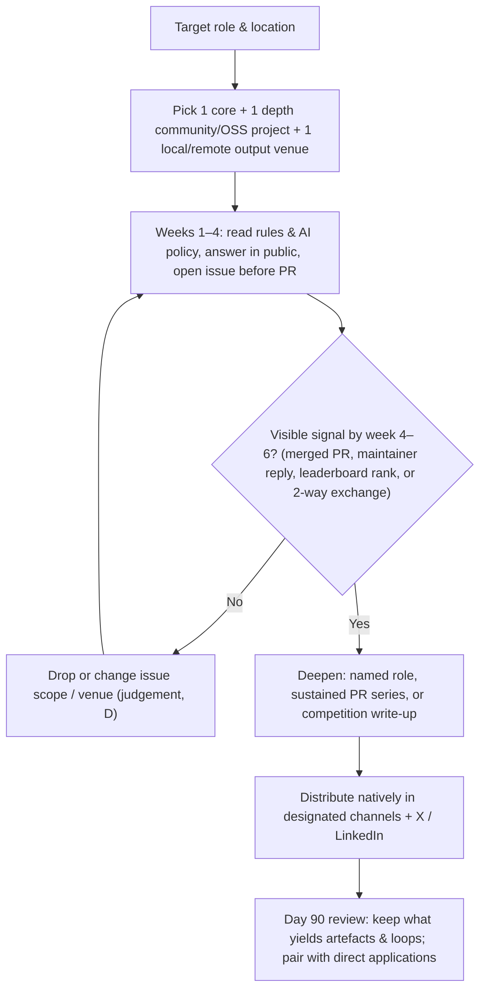

# Communities Guide: AI Communities, X Strategy, Events, Competitions and Safety

> Which AI communities, social platforms, events and competitions are worth weekly hours, how to participate without triggering spam or malware risks, and how India-based engineers gain global visibility.

**Dates, grades and caveats.** This guide synthesises [T0-21](../../research/sessions/T0-21-x-frontier-communities-fellowships-events.md) (retrieved 2026-11-13 to 2026-11-14 via fetch extracts for web pages and raw text for git repository policies [T0-21 L22, L378]) alongside non-overlapping community coverage from [T0-12](../../research/sessions/T0-12-high-signal-communities-technical-visibility.md) (2026-10-21) and [T0-05](../../research/sessions/T0-05-unconventional-hiring-tactics-oss-audits.md) (2026-10-21 to 2026-10-23). Fellowships and residencies moved to their own dedicated guide: [Fellowships and residencies](fellowships-and-residencies.md). **COI disclosure:** Anthropic built the model that authored T0-21; Anthropic's public performance take-home carries a `(COI)` flag and was independently live-verified on 2026-11-19. **Review trigger:** `review_by: 2027-01-19` reflects class V2 (90 days from the earliest unrefreshed T0-12 community rows dated 2026-10-21; T0-21 rows were checked 2026-11-13/14). **Grades** (EGP-1.0): A primary opened (policy text or issuer page); B transparent secondary or large dataset; C vendor, company claim (COI), practitioner or single source; D judgement; E untraceable (reported as absence); M calculation; P practice-curated.

## The short answer

1. **Communities build visibility and checkable proof; they are not a door to a "hidden job market".** In Ashby's dataset of nearly 250K hires (2021-01 to 2025-06), referrals accounted for ~18% of hires, inbound 43–52% and sourced ~16% (across ~32K hires at 1,200+ venture-backed startups under 300 staff, mostly 2025, inbound held ~42% while direct sourcing fell from 30% at the smallest startups to 20% as referrals rose from 12% to 19%), and referred applications reached interview at 40% versus 3% for inbound across 38M+ applications [B · T0-21 L78, L264–L266]. The "70–90% hidden job market" claim is untraceable [E · T0-21 L79, L244]. Keep public applications running beside community work [B · T0-21 L102].
2. **No community, event or competition publishes a conversion rate to hire.** The one evidenced product-community hiring account is Cursor's CEO stating in a June 2026 keynote (reported by *Fortune* and *eFinancialCareers*, with *Fortune* also naming Notion and Figma) that Cursor hired many members of its 37,000+ user Discord — a company claim with no hire count (**Grade C**, updating earlier Grade A text; Zed and Appwrite contribution files contain no hiring statement) [C · T0-21 L80, L321].
3. **Treat X, Bluesky and LinkedIn as distribution layers for artefacts, not as the work itself.** *Axios* (2026-09-10) describes X as the AI sector's group chat, but no verified first-person hire starting from posts or replies on X was found [B/E · T0-21 L84, L341]. A convenience survey of 813 general scientists (no ML breakdown) found 11% still active on X and >94% using Bluesky, while Similarweb put January 2026 all-user mobile DAU at 141.5M for Threads vs 125M for X [B · T0-21 L84, L262, L267]. Ship a verifiable artefact weekly, then distribute it [C/P · T0-21 L101].
4. **Follow strict open-source contribution rules or stay out.** Maintainers enforce high bars and anti-slop policies: vLLM's merit-based committership typically reflects ~30+ substantial PRs and ~10+ external reviews across releases; PyTorch requires an actionable issue before a PR; llama.cpp mandates AI disclosure (permanent ban risk) and bars AI-written communications; Zed and Ghostty reject agent code the author cannot explain [A · T0-21 L85, L242–L246, L300]. Outliers such as the OpenClaw creator joining OpenAI (February 2026) are not base rates [B · T0-21 L86, L245].
5. **Do not rely on conferences for recruiting, and treat fellowships by work-authorisation fit.** None of the NeurIPS 2026, AI Engineer World's Fair/NYC 2026 or PyTorch Conference North America 2026 pages read state a career fair (though silence on marketing pages is not proof of zero recruiting) [A · T0-21 L89, L362]. Among competitions, only Anthropic's public performance take-home (COI) states a direct recruiting threshold (<1,487 cycles) [A, COI · T0-21 L87, L247]. For structured research/safety programmes, see [Fellowships and residencies](fellowships-and-residencies.md) — Astra (>80% AI safety, C/COI) joins Anthropic Fellows (>40% offers / >35% joined, C/COI) in publishing owner-reported figures, and visa rules differ sharply [A/C · T0-21 L77, L81, L325].
6. **Never pay for referrals or run unknown recruiter coding tests bare-metal.** Paid cohorts (e.g. Maven AI Evals, US$4,200 in October 2026 → **US$4,500** for the 2027-01-30 to 2027-03-27 cohort, with ≥20% savings for teams of 2+) and mentoring marketplaces (MentorCruise US$120–$450/mo, ADPList free-to-start) have no independent job-outcome evidence [A (price), C/E (outcomes) · T0-21 L91, L191, L278, L349]. Worse, a US DC3 advisory (2026-09-18) documented fake-recruiter coding tests compromising **30,000+ devices** and stealing ~US$10.71M in crypto (Dec 2025–Jul 2026) [A · T0-21 L91, L240]. Sandbox every coding test from an unverified contact, and avoid fee-demanding Telegram/WhatsApp referral groups [A/C · T0-21 L104].

## At a glance



The ~6-hour weekly budget and 4–6 week stop-loss remain unmeasured heuristics [D · T0-21 L95, L320, L323], updated to tie stop decisions to visible signals (merged PR, maintainer reply, leaderboard rank or named two-way exchange) [D · T0-21 L101, L113].

## Social platforms: X, Bluesky and Threads

| Platform | Evidence as of November 2026 | Hiring signal | Verdict | Grade · source |
|---|---|---|---|---|
| **X (formerly Twitter)** | *Axios* (2026-09-10) calls X the AI community's group chat (*Il Foglio* secondary); Similarweb Jan 2026: 125M daily active mobile users (all users, not AI researchers) | Announcements and job moves spread on X; **zero verified first-person hires** initiated by posts or replies found; cold replies and DMs untested [E/D · T0-21 L250–L251, L341] | **Use-with-care** (distribute artefacts; do not chase follower count) | B (reporting), E (hiring) · T0-21 L84, L192 |
| **Bluesky** | Shiffman & Wester convenience survey of 813 scientists: >94% use Bluesky to stay informed, ~88% for networking, only 11% still active on X (~40% deleted X). **No ML-researcher breakdown** | None found | **Watch** | B (survey), E (ML split) · T0-21 L84, L193, L342 |
| **Threads** | Similarweb Jan 2026: 141.5M daily active mobile users (above X's 125M, all users) | None found for AI researchers or hiring | **Watch** | B · T0-21 L84, L194 |

For LinkedIn strategy, see the [LinkedIn guide](linkedin-guide.md).

## Communities, open-source hubs and mentorship directory

Member counts are self-published snapshots and are not comparable or predictive of hiring [T0-12 L204; T0-21 L177]; third-party aggregator counts in T0-12 were 4.5× to 33× off first-party numbers [B · T0-12 L240]. Rows audited in November 2026 (`T0-21`) reflect refreshed access and status; older rows (`T0-12`, 2026-10-21) were not re-audited in T0-21 and remain due for re-verification by 2027-01-19.

### Tier 1 & active technical depth hubs

| Community | Focus | Access | Activity & rules (dated) | Hiring evidence | Verdict | Grade · source |
|---|---|---|---|---|---|---|
| **vLLM** (GitHub, Slack, forum) | Inference serving | Open (`slack.vllm.ai`, `discuss.vllm.ai`); RFCs in `#contributors`; good first issues | Active (2026-11-14). Merit-based committership (~30+ substantial PRs, ~10+ external reviews across releases; no hard number; 2 of 4 accomplishment patterns) | None stated; committer status belongs to individuals | **Use** | A · T0-21 L185, L300 |
| **GPU MODE** (Discord & kernelbot) | GPU kernels & performance | Open; submit Python/CUDA kernels via Discord bot on **free cloud compute** (no personal GPU needed) | Active (2026-11-14); 29,352 members (T0-12 snapshot); 30,000+ submissions in one AMD contest [B · T0-12 L254] | Not stated in docs or AMD contest page | **Use** | A · T0-21 L189 |
| **llama.cpp** (`ggml-org`) | Edge / local inference | Open via GitHub; Collaborators (Triage) tier | Active (2026-11-14). Strict AI policy: disclose AI code (ban risk); AI-written issues/PRs/replies prohibited | `ggml.ai` joined Hugging Face (2026-02-20); no contributor-hire count | **Use** | A (policy), B (news) · T0-21 L186 |
| **EleutherAI** | Open AI research, eval & infra | General membership route unstated on page read; yearly 5-week online **SOAR** research internship (open to little prior research experience) | Undated page: 200+ monthly active, 150+ community researchers, 30+ countries, US$1M+ distributed [C · T0-21 L184] | Not stated | **Use** | A (page), C (counts) · T0-21 L184, L324 |
| **Cohere Labs Open Science Community** | Open research & member-led programmes (`ML Math`, `BIRDS` for beginners, `Research Connections`) | **Application-based** (reviewed weekly per page — not open to anyone) | 5,000+ researchers cited overall, 100+ countries; open as of 2026-11-13; active members can become staff-backed `Community Leads`, and member teams have co-authored CoLM 2025 and CVPR 2025 workshop papers [A · T0-12 L223, L383] | Output evidence only; no direct hire figures stated | **Use** | A · T0-21 L183, L324; T0-12 L223, L383 |
| **Latent Space Discord & LLM Paper Club** | AI-engineering conversation & weekly paper reading | Open invite; read Paper Club essay first; volunteer to facilitate (~45 min talk + 15 min discussion; volunteers choose their paper) | ~11.5k–12k members (T0-12 snapshot); Paper Club >450 active after cull (Nov 2024 post; Wed 12:00 PT = Thu 01:30 IST after Nov clock change); co-author notes facilitators are scarce and skipping the pre-read cuts session value by ~80% or more [C · T0-12 L363–L365] | None documented | **Use** | A/B/C (2026-10-21) · T0-12 L149, L158, L206, L363–L365 |

### Tier 2, local, vendor and mentorship platforms

| Community / platform | Focus | Access & cost | Activity & caveats | Hiring evidence | Verdict | Grade · source |
|---|---|---|---|---|---|---|
| **AI Tinkerers** (Bengaluru & 277 cities) | Screened demo-first builder meetups | RSVP + screened for hands-on AI work ("builder-only room"); bring a demo; no pitching/recruiting | 277 cities, 144,000+ members network-wide (self-published, 2026-11-14); Bengaluru cadence unstated (stretched to 184-day gap by late 2025 per T0-12 L330); named Bengaluru sponsors include **Cashfree, E2E Cloud, VersionOne, Lightspeed, Accel and ElevenLabs** [A · T0-21 L187] | Promotes talent hiring waitlist & jobs board; **no hires documented** | **Use** | A · T0-21 L187; T0-12 L167 |
| **MLOps Community** (Slack, chapters) | Production ML & agentic ops | Open Slack & local chapters; self-promo only in `#be-shameless` with native context [A · T0-12 L168] | Self-published: 31k Slack, 600+ events in 45 cities, 60k newsletter; named official user group of Agentic AI Foundation (Linux Foundation, 2026-05-13) | None stated on 2026-05-13 page; one marketing testimonial in T0-12 | **Use-with-care** | A (page), C (counts) · T0-21 L190; T0-12 L211 |
| **Cursor Discord** (example of product community) | Cursor users & builders | Open Discord (37,000+ users) | Active (2026-06-23 reporting) | CEO keynote: hired "many" Discord members (*Fortune* also names Notion, Figma); no hire count, company claim | **Use-with-care** | C · T0-21 L80, L241 |
| **DataTalks.Club Slack** | Data & ML learning; free zoomcamps | Public sign-up; `#jobs`, `#career-questions`, `#shameless-promotion`; mass CV DMs banned; code >5 lines belongs in threads (not screenshots) and product-feedback asks belong only in promo channels [A · T0-12 L349, L394] | "Almost 100,000" Slack members (Jul 2026 sponsor post, T0-12) | None documented | **Use-with-care** | A/B (2026-10-21) · T0-12 L163, L212, L349, L394 |
| **Open WebUI** (GitHub Discussions, Discord) | OSS product community | Discussion first before PR; zero tolerance for hostility | Active (2026-10-21 audit) | Team page banner "We're Actively Hiring!" (2026-10-21) | **Use-with-care** | A (2026-10-21) · T0-12 L225 |
| **The Fifth Elephant (HasGeek)** | India data/AI conference, meetups, paper club | Annual paid membership for priority; some meetups members-only | Bengaluru & Hyderabad; 2026 conf started 2026-07-17 (prices unretrieved) | None documented | **Use-with-care** | A/B (2026-10-21) · T0-12 L245 |
| **PyData** (Bangalore, Global) | Python data community | Open; PyData Global virtual (2026-12-08 to 10) | Bangalore cadence unestablished (T0-12) | None documented | **Use-with-care** | B (2026-10-21) · T0-12 L248 |
| **ADPList** | Free-to-start mentorship | Open; median session 30 min; **stop after 2 sessions** without a concrete next action [C/D · T0-21 L105] | Stats page (2026-11-12): 39K+ mentors, 593K+ members vs undated About page: 32K+ / 300K+ (counts conflict) | None published; State of Mentorship reports topics, not job outcomes | **Use-with-care** (feedback only) | C · T0-21 L105, L181, L328 |
| **MentorCruise** | Paid 1:1 mentorship | US$120–$450/mo plans (7-day trial), US$100–$500/call, US$100–$250/hr | Same undated page lists "6k+" and "6,700+" mentors; conflicting promo attributions | None independent (self-published 97% satisfaction, COI) | **Use-with-care** (learning only) | C · T0-21 L182, L329 |
| **AI Evals for Engineers & PMs** (Maven cohort) | Paid evaluation course + private Discord | US$4,200 (Oct 2026) → **US$4,500** for the 2027-01-30 to 2027-03-27 live cohort (33 sessions, 11 lessons, 3–5 h/wk; ≥20% team savings for 2+) | Cohorts 2026-10-10 to 2026-11-21 and 2027-01-30 to 2027-03-27; mentions job leads without placement claims | No independent job-outcome evidence | **Use-with-care** (pay only for learning) | A (price), E (outcomes) · T0-21 L191, L278, L349 |
| **Build Fast with AI** (India) | Paid AI workshops & training | Paid (e.g. Claude Mastery US$399) + occasional free webinars | Self-published 50,000+ learners, 400+ workshops (COI, 2026-11-14) | No placement claims on page read | **Use-with-care** | A (price), C (counts) · T0-21 L188 |

### Tier 3 & passive monitoring feeds (information only — do not budget networking hours)

- **Hugging Face Discord** (~226k members) and **r/LocalLLaMA** (~768k members, 2026-06-30; minimum 10 comment karma and 5 subreddit karma to post, 1/10th self-promo rule, LLM copy restricted — rules read via mirror): useful for news and troubleshooting; zero hiring evidence [B/C · T0-12 L156, L212, L233–L234].
- **Unsloth Discord** (~38.7k), **Nous Research Discord** (provisional), **ML Collective** (open reading group since 2018; activity unverified): monitor only [B/C · T0-12 L226–L229].
- **smol.ai AINews** (Discord summaries) and **Hacker News** monthly "Who is hiring?" / "Who wants to be hired?" threads: low-effort passive monitoring [B/C · T0-12 L155, L235–L236].

## Conferences, events and competitions

None of the event or competition pages read below state a career fair or hiring conversion rate — except Anthropic's public performance take-home [A · T0-21 L87–L89]. Silence on marketing pages does not prove zero sponsor recruiting, but travel and visa costs (especially from India) make paid conferences a poor default unless you are presenting or an employer pays [A/D · T0-21 L123, L165, L362].

| Event or competition | Dates, scale & prizes | Access & cost | Recruiting evidence & visa notes | Verdict | Grade · source |
|---|---|---|---|---|---|
| **Anthropic original performance take-home** **(COI)** | Simulated VLIW SIMD kernel (starts at 18,532 cycles; model scores 2,164 down to 1,363) | Public GitHub repo (`anthropics/original_performance_takehome`), free | **Only competition with a stated recruiting door:** beat **1,487 cycles** without editing tests and email performance recruiting with code and résumé; outcomes unpublished; AI-use rules for public submissions unstated | **Use-with-care** (systems/kernel roles) | A (COI) · T0-21 L87, L247, L284 |
| **GPU MODE kernelbot leaderboards** | Ongoing, split by device (Python & CUDA) | Free cloud compute via Discord bot | No hiring stated; verifiable V2 public benchmark artefact | **Use** (kernel/infra roles) | A · T0-21 L88, L189 |
| **ARC Prize 2026** | US$2M prize pool (ARC-AGI-2/3 + Paper Prize); submissions closed 2026-11-02, results 2026-12-04 | Open on Kaggle; no internet or commercial APIs; leaders must open-source | No hiring stated; open-sourcing yields a public artefact | **Use-with-care** (watch 2027) | A · T0-21 L227 |
| **AMD × GPU MODE E2E speedrun** | US$1.1M pool; qualifiers Mar–Apr 2026, finals Apr–May 2026 | Open (individuals or teams of up to 3) | No hiring stated; closed May 2026, next edition unannounced | **Watch** | A · T0-21 L228 |
| **NeurIPS 2026** | Main site Sydney 2026-12-06 to 12; satellites Atlanta & Paris 2026-12-09 to 13 (tutorials: 19/62 = 30.6% [M]) | Paid registration; financial aid/volunteers opened 2026-09-16 | No career fair stated on pages read. Invitation letters on site (Australia/US) or on request (France); apply 6–8 weeks early for Australian visas | **Use-with-care** (go to present) | A/M · T0-21 L225, L274 |
| **AI Engineer World's Fair & NYC** | World's Fair SF Jun–Jul 2026 (7,500 attendees); NYC Oct 2026 (Eng & Leadership sold out); Paris Sep 2026 (1,000+ engineers) | Paid tickets (discount codes shared in Latent Space Discord [A · T0-12 L230]); recorded talks on YouTube (260k+ subscribers) | No career fair or sponsor job board described on pages read; **badge scans are shared with sponsors** [A · T0-12 L240]; a Paris OSS side event required sharing a GitHub profile to reserve a spot [B · T0-12 L271] | **Use-with-care** (watch recordings unless presenting/sponsored) | A/B · T0-21 L226; T0-12 L230, L240, L271 |
| **PyTorch Conference North America 2026** | Passed (San Jose inferred); attendee US$499–$999, **academic US$249** with ID | Paid registration (closed as of 2026-11-14); no scholarship stated | No job fair stated on registration page | **Watch** (next edition) | A · T0-21 L230 |
| **KubeCon + CloudNativeCon India** | Listed for Bengaluru 2027-09-09 to 10 (2026 Mumbai edition unread) | Paid registration (prices unstated) | Not stated; mentions AGNTSummit and PyTorch Conference | **Watch** | A · T0-21 L229 |

## Fellowships and residencies (summary)

Structured research fellowships and residencies are the only route in scope that publishes hiring outcomes — though every figure is an uncorroborated programme-owner claim (Grade C, COI) without applicant denominators (Anthropic Fellows states >40% full-time offers on its posting vs >35% joined on its blog; Astra claims >80% of its first cohort work full-time in AI safety) [C · T0-21 L77, L325]. Work-authorisation gates vary sharply: Anthropic Fellows and Claude Corps require local work authorisation without sponsorship, RadixArk AI Infra Resident is a US$200,000/yr 1-year Palo Alto systems/SGLang residency (visa terms unstated [A/B · T0-05 L158]), whereas MATS (Berkeley J-1), ERA, ARENA, LASR Labs and Astra support visas and SPAR is fully virtual [A · T0-21 L81]. For the full 17-programme directory, stipends, deadlines and preparation rules, see **[Fellowships and residencies](fellowships-and-residencies.md)**.

### Geography note: India

- **Work authorisation is the binding constraint for global roles; communities do not remove it.** Prioritise global remote public-output hubs (vLLM Slack/forum, GPU MODE kernelbot on free cloud compute, EleutherAI SOAR, Cohere Labs Open Science by application) plus virtual or visa-sponsored fellowships ([Fellowships and residencies](fellowships-and-residencies.md)) [A · T0-21 L109, L113–L116, L291].
- **Bengaluru builder & practitioner venues (strongest local offline stack):**
  - *Core screened/practitioner hubs:* **AI Tinkerers Bengaluru** (screened, bring a demo; named sponsors include Cashfree, E2E Cloud, VersionOne, Lightspeed, Accel, ElevenLabs [A · T0-21 L187]) and **The Fifth Elephant** (HasGeek: annual conference, Open Source AI meetups, papers-reading group [A/B · T0-12 L310]).
  - *Topic-specific and vendor-adjacent rooms:* **vLLM Inference Meetup: Bangalore** (Red Hat/NxtGen/Harness.io, 178 attendees, free NVIDIA GPUs [B · T0-12 L314]), **Claude Community Bengaluru** (community-hosted monthly Luma cluster [B · T0-12 L315]), approval-gated **Anthropic** (Builder Summit / Accel Dev Day) and **OpenAI** (Engineers Day, Codex Meetup, DevDay Exchange) events — apply with a link to a shipped build [A/B/C · T0-12 L316–L317, L335] — plus **import_ bengaluru** (339+ registered, Sep 2026) and **FOSS United / Bengaluru Python** (13,000+ listed) [B · T0-12 L311, L313].
- **Hyderabad, Pune and Delhi NCR** *(T0-12 audit as of 2026-10-21; not re-audited in T0-21; ongoing cadence unestablished beyond listed events [B/C · T0-12 L324–L330; T0-21 L347]):*
  - *Hyderabad:* **AI Tinkerers Hyderabad** (screened), **Fifth Elephant Open Source AI** (at Thoughtworks), **eChai AI Builders** and **OpenSearch Search and AI** [B · T0-12 L326].
  - *Pune:* **AI Tinkerers Pune** (including a May 2026 event with `aigrants.in`), **OpenAI Build Week Community Meetup** (42 attendees) and **Oaisys AI Practitioners Meetup** (limited capacity, two 15-minute community demo slots) [B/C · T0-12 L327].
  - *Delhi NCR / Gurugram:* **AI Tinkerers Delhi** (screened) and **Indian Data Club AI Builders** — listings reviewed in T0-12 skewed more student- and hackathon-oriented overall (T0-12 reading, C) [C · T0-12 L328].
- **Skip large expo floors for networking:** Large India expos (**Cypher** 5,000+, **World AI Summit**, **Open Source India**, **Bengaluru Tech Summit** 50K+ visitors, **AIBoomi** ~1,350, and sponsor-"stage time + promo" events such as "Beyond Prompts") provide talk breadth rather than peer networking (T0-12 format judgement, C/D — untested in T0-21; attend targeted talks and skip the floor) [B/C/D · T0-12 L318, L320, L336].
- **Vendor training and pay gaps:** Build Fast with AI sells workshops (e.g. US$399) with no placement claims [A · T0-21 L289]. LFX Mentorship pays US$1,300 in India vs US$6,000 in the US (~22%) [A/M · T0-21 L292].
- **Scams on Indian chat groups:** Unsolicited Telegram or WhatsApp "referral" groups demanding registration, deposit or task fees (often with rotating UPI IDs and refusal of video calls) are scam signals; report to helpline **1930** or the National Cyber Crime Reporting Portal [C · T0-21 L104, L248, L309].
- **Services firms and GCCs:** Neither T0-12 nor T0-21 found community-hiring evidence for Indian IT-services firms or GCCs; rely on [Referrals and outreach](referrals-and-outreach.md) and the [LinkedIn guide](linkedin-guide.md).

## How to do it

1. **Pick a small, role-matched set (week 0).** Choose 1 conversational core (e.g. Latent Space), 1 depth hub matched to your target role (GPU MODE for kernels; vLLM/llama.cpp for inference; EleutherAI or Cohere Labs for research/evals; MLOps Community or a product community you actually use for applied AI), plus 1 local screened meetup if in a hub city [P; A · T0-21 L113–L115, L131]. *Done when:* 3–5 venues are logged with verified rules and AI policies [P].
2. **Adopt the seven operating rules from day one.**
   - Read pinned rules and `CONTRIBUTING.md` / `AGENTS.md` before posting [A · T0-12 L347; T0-21 L186].
   - Keep self-promotion strictly in designated channels (ratio ~9 helpful contributions per promo post; native summary, never bare link drops) [A/C · T0-12 L162, L168].
   - Never mass-DM CVs or job asks — use `#jobs` channels and let hiring teams initiate or wait until after visible contribution [A/D · T0-12 L163–L164].
   - Open an actionable issue or RFC before writing PR code; keep PRs small [A · T0-21 L103, L246].
   - Disclose AI-assisted code, review every line so you can explain it, and write issues/PR descriptions/replies in your own words [A · T0-21 L242–L243].
   - Bring a running demo to screened meetups; never pitch or recruit from the floor [A · T0-12 L167; T0-21 L187].
   - Sandbox every coding test from an unknown recruiter and verify identity via the employer's official site [A · T0-21 L104, L240].
   *Done when:* you have checked every target community's written rules [P].
3. **Ship one checkable public artefact per week (~6-hour heuristic [D · T0-21 L95]).** Split time across open-source/leaderboard work (2–3 h), one short results write-up or reproduction (1 h), active discussion in 1–2 communities (1 h) and direct applications/referrals (1 h) [D · T0-21 L111–L146]. Distribute each artefact natively in designated channels and on X/LinkedIn [B/C · T0-21 L101, L114]. *Done when:* a stranger can inspect a merged PR, leaderboard entry, facilitated Paper Club session or V1 write-up [P].
4. **Apply explicit stop rules and the day-90 review.** Apply three concrete thresholds: (a) **OSS review stop:** if **two pull requests receive no response in 4 weeks**, ask once in the project's designated channel, then move on [A/D · T0-21 L103]; (b) **community stop:** if a venue yields zero merged PRs, maintainer replies, leaderboard movement or two-way exchanges after **4–6 weeks**, shrink scope or drop it [D · T0-21 L101, L113, L115]; (c) **free-mentoring stop (ADPList):** after **two sessions without a concrete next action**, stop [C/D · T0-21 L105]. At day 90, audit artefacts, exchanges and resulting loops using the review template below [D · T0-12 L170–L175]. *Done when:* every venue is marked keep, pivot or drop [P].

## Templates and examples

All templates and contrast pairs are practice-curated [P], built on documented community norms [T0-12 L162–L168; T0-21 L101–L104, L242–L246].

### 90-day community & visibility review [P; D · T0-12 L170–L175; T0-21 L101]

```text
90-DAY COMMUNITY REVIEW                 Period: [start] to [end]
Weekly hours logged: [h]                (heuristic baseline: ~6 h)

Venue: [name]                           Type: [OSS / Discord / local / competition]
  Public artefacts shipped here:        [n] (merged PRs, leaderboard runs, demos, facilitated talks)
  First visible signal (week):          [n] (none by week 4–6 -> pivot or drop)
  Two-way practitioner exchanges:       [n]
  Inbound / interviews citing work:     [n] / [n]
  Decision:                             [keep / change scope / drop]

RULE: Output met but zero inbound -> change artefact type or direct outreach before adding servers.
```

### Weak → strong community participation [P]

| Scenario | Weak | Strong |
|---|---|---|
| **Sharing an artefact** | Bare link in `#general`: "Check out my new blog post! [URL]" | In `#be-shameless` / designated channel: "Measured [metric] on [engine/setup]: [1-line result]. Repro command and raw traces in the post; unsure about [specific trade-off] — feedback welcome. [URL]" |
| **Opening an OSS contribution** | Surprise 1,200-line AI-generated PR with boilerplate description and no prior issue | Issue/RFC first: "Reproduced [bug] on [commit]. Proposed minimal fix: [2 bullets]. Test plan: [1 line]. AI disclosure: [none / assisted on X, every line verified by me]. Is this in scope?" |
| **Approaching a hiring person** | Cold DM in week 1: "Hi, are you hiring AI engineers? CV attached." | Post in `#jobs` with one verifiable link, or build 4–6 weeks of visible technical exchanges first and keep project threads strictly technical [A/D · T0-12 L163–L164; T0-05 L468] |
| **Unknown recruiter take-home** | `git clone` and `npm install` / `python setup.py` on primary workstation | Verify recruiter through the official company domain/careers page; run any downloaded code only inside a disposable VM/container with no credentials or wallets [A · T0-21 L104, L240] |

## Checklist

- [ ] 3–5 venues chosen (core, role-matched depth/OSS hub, local or remote output channel) rather than 20+ idle servers [C/D · T0-12 L193; T0-21 L113–L115]
- [ ] Written rules, designated `#jobs`/`#promo` channels and AI-use policies read before posting [A · T0-12 L347; T0-21 L242]
- [ ] Public applications and referral outreach running in parallel — no reliance on "hidden job market" myths [B/E · T0-21 L78–L79, L102]
- [ ] Every PR preceded by an actionable issue/RFC, kept small, AI use disclosed and descriptions written in your own words [A · T0-21 L242–L246]
- [ ] X, Bluesky and LinkedIn used strictly to distribute artefacts already built [C/P · T0-21 L101, L192]
- [ ] Working demo prepared before RSVPing to screened builder meetups (e.g. AI Tinkerers) [A · T0-21 L187]
- [ ] Any coding test from an unverified recruiter run inside an isolated sandbox after confirming the role on official company channels [A · T0-21 L104, L240]
- [ ] Zero fees paid for "referrals" or job-group access; paid cohorts/mentors evaluated strictly on learning value [C · T0-21 L104–L105]
- [ ] Concrete stop rules calendared: 2 unanswered PRs in 4 weeks, 4–6 week venue stop-loss, 2-session ADPList limit, and day-90 review [A/C/D · T0-21 L101, L103, L105, L115]

## Pitfalls

| Red flag | Why it hurts | Fix |
|---|---|---|
| Running an unverified recruiter's take-home repo on your host machine | US DC3 advisory (2026-09-18) linked fake-recruiter coding tests ("Contagious Interview") to 30,000+ compromised devices and US$10.71M stolen [A · T0-21 L91, L240] | Verify the recruiter via official channels and execute unknown code only in an isolated VM/sandbox |
| Submitting undisclosed or ununderstood AI-generated PRs | llama.cpp threatens permanent bans; PyTorch, Zed and Ghostty reject ununderstood agent PRs [A · T0-21 L85, L242–L243] | Issue first, small diffs, explicit AI disclosure, human-written prose |
| Chasing X follower count or "AI influencer" threads instead of shipping | Zero verified hires from X posts found; 11% of surveyed scientists remain active on X [B/E · T0-21 L84, L341] | Treat X purely as distribution for checkable repos, benchmarks and reproductions |
| Paying US$4,200–$4,500 cohorts or Telegram groups expecting job placement | Zero independent placement data for Maven (US$4,200 Oct 2026 → US$4,500 for 2027-01-30 to 2027-03-27, ≥20% team savings), MentorCruise, Build Fast with AI or ADPList; fee-charging chat groups are a scam signal [A (price), C/E (outcomes) · T0-21 L91, L104, L191, L278, L349] | Pay only when the curriculum itself is worth the price; report fee scams to 1930 (India) |
| Flying internationally to a conference expecting a job fair | NeurIPS 2026, AI Engineer 2026 and PyTorch Conf 2026 pages read list no career fair; travel and visa lead times are steep [A · T0-21 L89, L225–L230] | Attend to present a paper/demo or when employer-funded; otherwise watch talks online |
| Mass-DMing CVs or pasting bare links across 20 servers | Counts as unsolicited promotion [A · T0-12 L163, L168]; weak-tie mobility follows an inverted U [C · T0-12 L193] | Focus on 3–5 venues; use `#jobs` and native summaries |
| Planning around "70–90% hidden jobs" or assuming one PR gets noticed | Hidden-market share is untraceable [E · T0-21 L79]; vLLM committership reflects ~30+ PRs across releases [A · T0-21 L85] | Keep direct applications running and build a sustained contribution pattern |

## Evidence and limits

- **Primary sources read.** Repository contribution and governance files read as raw git text (vLLM, PyTorch, llama.cpp, Zed, Ghostty, Appwrite, Anthropic take-home [COI]) [A · T0-21 L437–L443, L473]; US DC3 fake-recruiter advisory [A · T0-21 L461]; community, event and competition official pages read via fetch extracts (a summarising tool, not raw full-page text — extract risk noted in T0-21 L378) [A · T0-21 L22].
- **Large datasets & reporting.** Ashby ~250K hires, 38M+ applications and ~32K startup hires (vendor data, not AI-specific, descriptive) [B · T0-21 L264–L266]; *Science* 2022 weak-ties RCT (>20M LinkedIn members) [A · T0-12.F12]; *Fortune* / *eFinancialCareers* Cursor keynote coverage (one keynote, company claim = Grade C) [C · T0-21 L68, L80]; *Axios* X coverage and Shiffman & Wester 813-scientist convenience survey (no ML breakdown) [B · T0-21 L84, L262].
- **Searched, not found (Absences A1–A13).** Any frontier-lab hiring manager describing sourcing from Discord in the first person [E · T0-21 L337]; any community-to-hire conversion rate [E · T0-21 L338]; career-fair evidence on NeurIPS, AI Engineer, ARC Prize or AMD speedrun pages [E · T0-21 L340]; first-person frontier-lab hires starting from X posts/replies [E · T0-21 L341]; ML-specific X-to-Bluesky/Threads migration [E · T0-21 L342]; independent job-outcome data for paid cohorts or mentoring platforms [E · T0-21 L349]; response rates for cold DMs on X/Bluesky [E · T0-21 L345]. **Usage-cap gaps in T0-21:** Kaggle/AIMO/NeurIPS competition tracks, Ray Summit, PyCon India 2026 and non-Bengaluru Indian cities were not re-audited in T0-21 [T0-21 L55, L346–L347].
- **What would change this advice.** Published hire counts with denominators from any community or conference; first-person lab hiring-manager sourcing accounts; ML-specific social-platform migration data; or new 2027 event/competition editions adding explicit hiring tracks [T0-21 L152–L155].

## Next steps

- **Structured research programmes, visas and stipends:** [Fellowships and residencies](fellowships-and-residencies.md).
- **Turn relationships into referrals and compliant outreach:** [Referrals and outreach](referrals-and-outreach.md).
- **Make your profiles and repos checkable:** [Online presence](online-presence.md) and [LinkedIn guide](linkedin-guide.md).
- **Build artefacts worth sharing:** [Proof-of-work standards](../05-portfolio/proof-of-work-standards.md) and [Project archetypes](../05-portfolio/project-archetypes.md).
- **Fit community hours into your job search:** [Job-search strategy](../06-job-search/job-search-strategy.md#27-recommended-sequencing-expanding-rings) and [India remote playbook](../11-tracks/india-remote-playbook.md).
- **Stage overview and evidence:** [Networking README](README.md), [T0-21](../../research/sessions/T0-21-x-frontier-communities-fellowships-events.md) and [T0-12](../../research/sessions/T0-12-high-signal-communities-technical-visibility.md).
