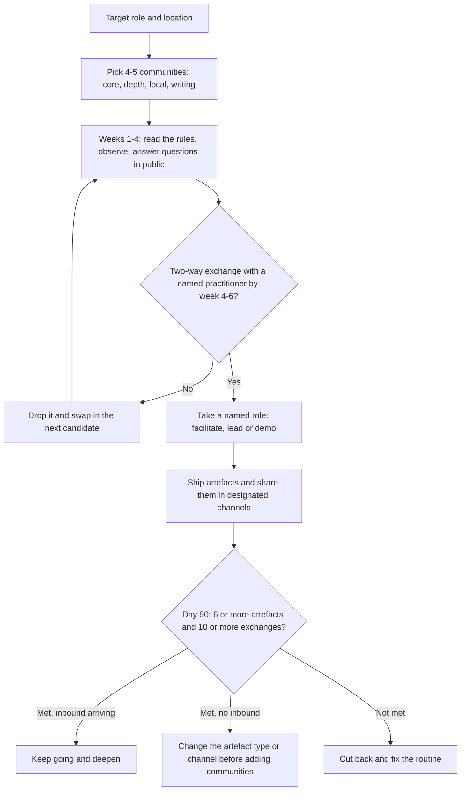

# Communities Guide: Which AI-Engineering Communities Are Worth Your Time

> Which AI-engineering communities are worth a standing weekly budget, how to take part so that it builds a reputation, and when to quit one, with a tiered directory of global and India venues as of 21 October 2026.

**Dates and grades.** Community facts come from [T0-12](../../research/sessions/T0-12-high-signal-communities-technical-visibility.md), audited on 21 October 2026 and read mostly as search-result excerpts, so the session's confidence is medium [T0-12 L18, L303]. Member counts are snapshots taken at different times and are not comparable [T0-12 L204]. Join paths, rules and event dates drift: re-verify them by 2027-01-19, and re-check each join path once a quarter [T0-12 L180]. No entry in [ERRATA.md](../../research/ERRATA.md) affects the sessions used here. **Grades** (EGP-1.0): A primary or measured; B transparent secondary; C vendor, practitioner or single source; D judgement; P practice-curated and unmeasured.

## The short answer

1. **Communities raise visibility and conversion; they are not a door to hidden jobs.** In Ashby's data on nearly 250K hires (January 2021 to June 2025), referrals are about 18% of hires (steady near 17%) and inbound 43–52% [A · T0-12.F4]; a secondary summary puts referrals at 15% at venture-backed startups [B/C · T0-12 L287]. The "hidden job market" figures, quoted at anywhere from 70% to 90% of jobs, could not be traced to a measurement [A · T0-12.F4]. Being known helps at the screen: referred candidates passed screens at 52% versus 35% in one secondary summary [B/C · T0-12 L288].
2. **Budget four or five communities and about six hours a week, all of it public output.** One conversational core, one depth community matched to your target role, one local venue, and writing; X and LinkedIn only distribute what you make. The hours are illustrative and the weighting is the session author's judgement [C · T0-12 L141–143]. T0-12 rejects joining 20 or more servers lightly: the weak-tie result is an inverted U, and activity concentrates in a small live core [C · T0-12 L193].
3. **Expect to be approached; do not ask.** The documented hiring mechanism is company-initiated: teams that run a community (Cursor, Zed, Appwrite) watch who contributes consistently and reach out. No conversion rate exists for any community in scope [A · T0-12.F3]. Across channels, the measurable lever is who initiates [A/B · T0-05.F2].
4. **Follow the etiquette that every community converges on.** Self-promotion and job asks go only in designated channels, and mass-DMed CVs count as spam [A · T0-12.F9]. Open a discussion before a pull request, keep pull requests small and disclose AI help: AI-generated "slop" has turned the drive-by pull request into a liability [B · T0-12.F10].
5. **Treat the tiers as a starting allocation, and quit fast.** The tiers below are judgement built on four proxies, not measurements [C · T0-12.F5]. Re-rank after 4–6 weeks of your own participation [C · T0-12 L95], and drop a community after 4–6 weeks with no two-way exchange [D · T0-12 L175].
6. **From India, apply with a demo and work in public remotely.** The best-evidenced offline venues are screened or approval-gated, and the largest events are vendor- or enterprise-heavy [B/C · T0-12.F7]. The deep routes open to anyone are remote and public-output: GPU MODE competitions, EleutherAI, the vLLM developer Slack and Cohere Labs [A/B · T0-12.F8].

## At a glance



The week 4–6 and day-90 thresholds are T0-12's heuristics [D · T0-12 L170–175]; the "not met" branch is practice [P].

## The weekly routine: about six hours, eight slots

T0-12's plan assumes an India-based engineer seeking AI-engineering roles at product or AI companies, with about six hours a week to spare; adjust both to your situation [C · T0-12 L143]. The session gives a cadence for each slot, not an hour split, so none is given here.

| Slot | What to do | Cadence | Why | Grade |
|---|---|---|---|---|
| Conversational core | Latent Space Discord plus the LLM Paper Club; after 4–6 weeks of attending, volunteer to facilitate a paper | Weekly | Open join. Paper Club has run weekly with rotating volunteer facilitators; its attendee list fell from 1,000 to over 450 after a cull of inactive members, so the live core is smaller than the headline count [T0-12 L149] | B |
| Depth community (pick one) | GPU MODE for kernels and performance; EleutherAI for research, evaluation and infrastructure; vLLM for inference serving | Weekly | Public, structured output: posted competition problems and leaderboards, public-by-default research projects, a developer Slack for coordinating contributions [T0-12 L150] | B |
| Production operations (optional) | MLOps Community Slack, in its designated channels | Weekly | Written norms and a jobs surface; one marketing testimonial is the only hiring evidence [T0-12 L151] | C |
| Writing | One substantive technical post every two to three weeks, shared with context in each community's designated channel; see [Online presence](online-presence.md) | Every 2–3 weeks | Anecdotal support only; the cadence is the session author's judgement [T0-12 L152] | C |
| Local | Apply to AI Tinkerers in your city with a working demo; join The Fifth Elephant meetups where they run | Monthly | Screened, demo-first, builder-dense; some Fifth Elephant meetups are members-only [T0-12 L153] | B / C |
| Vendor community | One event from Claude Community, OpenAI's community events or a vLLM Bangalore meetup | Quarterly | Staff access and credits, but vendor-run and approval-gated [T0-12 L154] | C |
| Passive monitoring | smol.ai AINews for Discord summaries; the Hacker News "Who is hiring?" and "Who wants to be hired?" threads | Monthly threads | AINews summarises AI Discords; the Hacker News threads have written posting rules [T0-12 L155] | B / C |
| Information feeds only | Hugging Face Discord and r/LocalLLaMA, for news and troubleshooting | As needed | Very large (about 226k and about 750k members); no hiring evidence found [T0-12 L156] | C |

**Paper Club timing from India.** The November 2024 Paper Club post gives Wednesdays at 12:00 Pacific. If that slot still holds, it falls at 01:30 IST on Thursday after the US clock change on 1 November 2026 (00:30 IST before it). Check the live Luma schedule; the facilitation is recorded but the Q&A is not [B · T0-12 L158].

### Pick the depth community by target role

| If you target | Depth community | What you produce there |
|---|---|---|
| [GPU Kernel Engineer](../02-roles/hubs/gpu-kernel-engineer.md) | GPU MODE | Competition submissions on public leaderboards, then a write-up [T0-12 L370–372] |
| [Inference Engineer](../02-roles/hubs/inference-engineer.md), [AI Infrastructure Engineer](../02-roles/hubs/ai-infrastructure-engineer.md) | vLLM; GPU MODE for kernel work | Discussion-first contributions, coordinated in the developer Slack [T0-12 L224] |
| [ML Platform Engineer](../02-roles/hubs/ml-platform-engineer.md), [ML Engineer](../02-roles/hubs/ml-engineer.md) | MLOps Community | Answers and write-ups in its designated channels [T0-12 L211] |
| [Research Engineer](../02-roles/hubs/research-engineer.md), [Research Scientist](../02-roles/hubs/research-scientist.md), [AI Evaluation Engineer](../02-roles/hubs/ai-evaluation-engineer.md) | EleutherAI; Cohere Labs | Volunteer work on proposed experiments; member-led programmes and co-authored papers [T0-12 L383–384] |
| [AI Engineer](../02-roles/hubs/ai-engineer.md), [Agentic AI Engineer](../02-roles/hubs/agentic-ai-engineer.md), [Applied AI Engineer](../02-roles/hubs/applied-ai-engineer.md) | Latent Space as the core, plus an open-source product you use, such as Open WebUI | Paper Club facilitation; issues with reproductions, then small pull requests [T0-12 L225, L365] |

The role-to-community mapping is practice [P]; what each community offers is graded in the directory below. T0-12 audited AI-engineering communities only: the corpus has no evidence on communities for product, governance or security roles (for the governance track, see [Governance careers](../11-tracks/governance-careers.md)).

## The directory (audit of 21 October 2026)

Sources: T0-12 D1 (L206–214), D2 (L220–236) and D3 (L244–252). Tiers are the session's judgement [C · T0-12.F5]: Tier 1 is depth plus visible contribution, Tier 2 is useful with caveats, Tier 3 is an information feed rather than a networking venue [T0-12 L93]. "Hiring signal" means evidence of employment outcomes, and none was found for most rows [A · T0-12.F3].

| Community | Focus | Tier | How to take part | India / global | Grade | As of |
|---|---|---|---|---|---|---|
| Latent Space Discord, with the LLM Paper Club | AI-engineering conversation; weekly paper reading | 1 | Open invite; read the Paper Club essay first; attend with the pre-read; volunteer to facilitate | Global, remote | A (self-description), B (counts) | About 11.5k–12k members (directory snapshots); Paper Club details from November 2024 |
| GPU MODE Discord | Kernels and GPU performance; competitions | 1 | Public join link; submit a working baseline early through the Popcorn CLI, then iterate; teams of up to three | Global, remote | B | 29,352 members (snapshot); AMD speedrun qualifiers from 6 March 2026 |
| EleutherAI Discord | Open research, evaluation and infrastructure | 1 | Public; "primarily observe" at first; individuals propose experiments and recruit volunteers; talk to the project leader before starting | Global, remote | A | About two dozen staff plus a dozen or so regular volunteers, per its about page |
| vLLM developer Slack, forum and meetups | Inference serving | 1 | Slack created in October 2024 to coordinate contributions; follow the project's contribution rules | Global; one Bangalore meetup listed | B- | Evidence is the README as copied into forks; Bangalore meetup date not shown |
| Cohere Labs Open Science Community | Research; member-led programmes | 1 (gated) | Apply; the join link arrives by email within about a week; introduce yourself in #intros; join or start a programme | Global, remote; members from 150 countries | A (self-reported) | 4,500 members, audit 2026-10-21 |
| MLOps Community Slack | Production ML operations | 2 | Self-promotion only in #be-shameless; bring links in "native", with context | Global | A (rules), C (size, hiring) | Join path not retrieved |
| DataTalks.Club Slack | Data and ML learning; free zoomcamps | 2 | Public sign-up; #jobs, #career-questions and #shameless-promotion | Global | A (rules), B (size) | "Almost 100,000" Slack members in a July 2026 sponsor post |
| Open WebUI (GitHub Discussions, Discord) | Open-source product community | 2 | Report issues with reproduction steps; "Open a discussion first"; zero tolerance for hostile behaviour | Global | A | Team page banner "We're Actively Hiring!", audit 2026-10-21 |
| Unsloth Discord | Unsloth users and contributors | 2 | Public directory listing | Global | B | 38,674 members (snapshot); no hiring evidence found |
| Nous Research Discord | Nous projects, including Hermes Agent | 2 (provisional) | Public Discord | Global | C | Every source is Grade C |
| ML Collective | Open mentorship; weekly "Deep Learning: Classics and Trends" reading group | 2 | Open | Global, remote | B | Running since 2018 per two interviews; activity not re-verified |
| AI Engineer events (World's Fair, Summit, regional) | Conferences; recorded talks on YouTube | 2 | Paid or invited tickets; go if an employer pays or you are presenting, otherwise watch the recordings | San Francisco, London, New York, Paris, Miami, Singapore | A / C | World's Fair 2026 reported at "more than 6,000" attendees; Paris 23–24 September 2026 |
| AI Tinkerers (Bengaluru, Hyderabad, Pune, Delhi and others) | Builder meetups, demo-first | 2 | Apply early ("RSVP REQUIRED"); bring a working demo; no pitching or recruiting | India and global | A | Network of 247 cities and 120,000+ members on the Pune chapter page (earlier pages: 231 and 245 cities); Bengaluru 2026 cadence not retrieved |
| The Fifth Elephant (HasGeek) | Conference since 2012; meetups; papers-reading community | 2 | One-year paid membership gives priority access; some meetups are members-only | Bengaluru, Hyderabad | A / B | 2026 conference started 17 July at NIMHANS; prices not retrieved |
| PyData (Bangalore, Indore, Global) | Python data community | 2 | Open | India; PyData Global is virtual | B | PyData Global 8–10 December 2026; the Bangalore chapter's own cadence is unestablished |
| Hugging Face Discord | News and troubleshooting | 3 | Open; link a Hub account through the verification step | Global | B | 226,018 members (snapshot); no hiring evidence found |
| r/LocalLLaMA | News and troubleshooting | 3 | Public; 10 karma to comment, 5 subreddit karma to post; 1/10th self-promotion rule with disclosure | Global | B (size), C (rules, via a mirror) | 768k members on 30 June 2026 |
| smol.ai AINews | Newsletter summarising AI Discords | Monitor | Subscribe | Global | B | Coverage known from 2023–24 archives; 2026 list not retrieved |
| Hacker News "Who is hiring?" and "Who wants to be hired?" | Posted jobs | Monitor | Read the hiring thread (hiring companies only, no recruiters or job boards); post in the "wants to be hired" thread | Global | B / C | A "Who wants to be hired? (October 2026)" thread exists; read through mirrors |
| Vendor-run: Anthropic, OpenAI, Claude Community Bengaluru | Vendor community events | Conditional | Approval-based Luma events; apply with a link to something you built | Bengaluru, Pune and other cities | A (Anthropic), B (Claude Community), B / C (OpenAI) | Events dated February to October 2026; see the India section |
| AI Engineer Foundation | Unknown | Unrated | 2023 evidence only; easily confused with the AI Engineer conference brand | Unknown | D / Gap | No 2026 evidence |

**What the numbers do not tell you.** Online-to-member ratios at one snapshot (about 9–12% for Latent Space, 11.6% for GPU MODE, 12.4% for Unsloth, 5.8–5.9% for Hugging Face) say nothing about message quality [C · T0-12.F5]. Third-party aggregator member counts were about 4.5× to 33× off first-party numbers [B · T0-12 L240]. Structured output is a better activity signal: Paper Club's unbroken weekly run of more than 100 papers over 18 months (as of November 2024), and GPU MODE's 30,000+ submissions in one AMD competition [B · T0-12 L254].

### India: where to go first

The evidence differs for India, so it gets its own rules. Signal quality is the session's judgement from each venue's stated format, not an outcome measure [C · T0-12 L303].

| City | Start with | Then | Grade |
|---|---|---|---|
| Bengaluru | AI Tinkerers Bengaluru with a demo (screened; address given only on acceptance); The Fifth Elephant meetups | vLLM or Python-community events for topic fit (import_ bengaluru listed 339+ registrations for 6 September 2026); vendor events, with a link to your work | A (format), B (cadence) |
| Hyderabad | AI Tinkerers Hyderabad ("curated", "screened"); The Fifth Elephant's Open Source AI meetup, Hyderabad edition | eChai AI Builders meetups (21 August and 25 September 2026 listed) | B |
| Pune | AI Tinkerers Pune | Practitioner-led meetups such as Oaisys (6 June 2026, with two 15-minute community demo slots) | B / C |
| Delhi NCR | AI Tinkerers Delhi ("We screen attendance to active builders") | Most other listings lean to student and hackathon formats (the session's reading) | C |

- **Expo-format conferences** (Cypher, World AI Summit, Open Source India, Bengaluru Tech Summit) give breadth and employer visibility but, in T0-12's judgement, poor conversation quality: go to the talks you care about and skip the floor [C · T0-12 L336].
- **Vendor-run events** (Anthropic, OpenAI, Claude Community) are approval-based and come with staff access and credits; apply with a link to something you built [B · T0-12 L335]. Staff access is useful, but it is not a neutral signal [D · T0-12 L478].
- **Outside Bengaluru**, join the AI Tinkerers chapter and one practitioner-led local group, and do the rest online [C · T0-12 L337]. Meetup frequency for Hyderabad, Pune and Delhi NCR is not established; the Bengaluru AI Tinkerers series ran about monthly in late 2024 and stretched to a 184-day gap by late 2025 [B · T0-12 L309, L330].
- **Fellowships.** Anthropic Fellows is the one route with a documented offer rate (over 40% of fellows in previous cohorts received a full-time offer), but it requires work authorisation in the US, UK or Canada and presence there during the programme [A · T0-12 L111]. Apply only if you are eligible.
- **Services firms and global capability centres** may hire mainly through employee-referral programmes and LinkedIn. T0-12 gathered no evidence on how they hire, so treat this guide as weak guidance for those targets [D · T0-12 L452] and see [Referrals and outreach](referrals-and-outreach.md).

## How to do it

1. **Choose the set (week 0).** One core, one depth community from the role table, one local venue, plus writing. Check that each join path is still open [T0-12 L180]. *Done when:* four or five communities are in your tracker with verified join paths [P].
2. **Spend the first 30 days giving.** Read the rules and pinned material before posting. Introduce yourself where there is an intros channel. Answer questions you can answer completely, with reproducible detail, and put code longer than five lines in a thread rather than a screenshot. Bring links in natively, with context [A · T0-12 L347–350]. Hold your first promotional post until you have made several non-promotional ones [D · T0-12 L351]. *Done when:* each community has seen several complete answers from you and at least one two-way technical exchange [P].
3. **Contribute where a team might hire.** Use the product and report issues with clear reproduction steps. Open a discussion before you write code. Keep pull requests small and consistent in quality across several contributions. Disclose AI assistance and review every AI-produced line yourself. Stay engaged after a merge [A · T0-12 L355–358], and never ask for a job inside an issue or pull request, a norm inferred rather than written [D · T0-05 L468]. When the team posts an opening, apply through its own page [A · T0-12 L359]. *Done when:* one agreed approach has led to small merged pull requests in one area [P]. A single merged contribution is the modal outcome in every repository T0-05 examined, so one alone is a weak signal [A · T0-05.F3].
4. **Or take the competition route (kernels).** Read the competition rules in GPU MODE's Discord, submit a working baseline early through the command-line tool, iterate, and write up your approach after the leaderboard closes; the write-up step is judgement [B · T0-12 L370–372]. *Done when:* you have a leaderboard entry and a public write-up [P].
5. **Take a named role (weeks 4–8).** Facilitate a Paper Club session: volunteers choose their own paper within the theme, and a session runs about 45 minutes plus 15 minutes of discussion. The organisers write that they have "not yet cracked" how to keep new volunteers coming, so a reliable facilitator is scarce [A · T0-12 L365]. Do the pre-read when attending: the essay's co-author estimates that skipping it cuts a session's value by about 80% or more (an estimate) [C · T0-12 L363]. Alternatives: a Community Lead role in a Cohere Labs programme [A · T0-12 L383], or a demo slot at AI Tinkerers. *Done when:* you have led one session or demo [P].
6. **Distribute what you make.** Share each post or demo in the designated channel, with context; use X and LinkedIn as a distribution layer [B · T0-12.F2]. *Done when:* each artefact has been shared once, in the right channel of each relevant community [P].
7. **Review at day 90 and apply the stop-loss.** Use the template below. *Done when:* each community is marked keep, change or drop [P].

## The seven operating rules

| # | Do | Don't | Evidence | Grade |
|---|---|---|---|---|
| 1 | Give far more than you ask: at least nine non-promotional contributions for each promotional one | Promote in most posts, or promote without disclosing an affiliation | r/LocalLLaMA's 1/10th rule (read through a mirror); the same norm in the MLOps Community and DataTalks.Club rules [T0-12 L162] | C |
| 2 | Put job asks in the community's jobs channel | DM your CV to members | DataTalks.Club: "mass-sending your CVs in DMs is also considered unsolicited promotion" [T0-12 L163] | A |
| 3 | Let hiring people start the DM; make your first direct contact with one only after 4–6 weeks of visible contribution in their space | Message a hiring manager in your first week asking for a job or a referral | The session's heuristic, consistent with how Zed approaches contributors [T0-12 L164] | D |
| 4 | Open an issue or discussion with a reproduction first; keep pull requests small; say when AI helped | Send a drive-by or unreviewed AI-generated pull request | Open WebUI's contributing guide; Godot's policy; Ghostty's and tldraw's January 2026 moves [T0-12 L165, L123] | A (rules) / B (reporting) |
| 5 | Take a named role: Paper Club facilitator, Cohere Labs Community Lead | Stay a silent member indefinitely | Paper Club essay; Cohere Labs programme pages [T0-12 L166] | A (roles exist) / D (effect) |
| 6 | At meetups, show something running | Pitch a product or recruit from the floor | AI Tinkerers: the room is not for "vendor presentations, recruiting events, or general AI lectures" [T0-12 L167] | A |
| 7 | Post in the designated promotion channel, with context; make links native | Paste bare LinkedIn or X links | MLOps Community calls context-free link drops "lazy" [T0-12 L168] | A |

These are rules as written. T0-12 found no post-mortems of job-DM incidents in AI Discords, so how strictly they are enforced is unmeasured [T0-12 L403].

## Templates and examples

### 90-day review

The targets are T0-12's heuristics [D · T0-12 L170–175]; the layout is practice [P].

```text
90-DAY COMMUNITY REVIEW                 Period: [start date] to [end date]
Average hours per week: [h]             (plan: about 6)

Community: [name]                       Tier at start: [1 / 2 / 3]
  Join path still open:                 [yes / no]
  Public artefacts shared here:         [n]  (posts, demos, substantive issues or PRs, facilitated sessions)
  Two-way exchanges, named people:      [n]
  Week of first two-way exchange:       [n]  (none by week 4-6 -> drop)
  Named role held:                      [none / facilitator / lead / demo]
  Inbound citing my public work:        [invitations n] [intros n] [recruiter messages n]
  Interviews that resulted:             [n]
  Decision:                             [keep / change artefact or channel / drop]
(repeat for each community)

TOTALS
  Public artefacts (target: 6 or more):         [n]
  Two-way exchanges (target: 10 or more):       [n]
  Inbound / interviews:                         [n] / [n]

RULE  Output met but no inbound after 90 days -> change the artefact type
      or the channel before adding communities.
NEXT  Keep: [ ]   Drop: [ ]   Try next: [ ]
```

### Weak → strong

All pairs are practice [P], built on the operating rules above.

**Sharing your post (rule 7)**

| Weak | Strong |
|---|---|
| "New blog post! [link]", pasted into the general channel | In the designated channel: "I measured [metric] for [system] on [setup]. Result: [one line]. The method and the command to reproduce it are in the post. The part I am least sure of is [X]; a second pair of eyes would help. [link]" |

**Asking about jobs (rules 2 and 3)**

| Weak | Strong |
|---|---|
| The same DM to many members: "Hi, I'm looking for AI roles. Can you refer me? CV attached." | In #jobs: "Looking for [role] roles, [location or remote]. Public work: [artefact, one line, link]. Happy to talk it through." Then reply in the thread to whoever responds. |

**First contribution (rule 4)**

| Weak | Strong |
|---|---|
| A large pull request with no prior discussion, generated with an assistant and not disclosed | A discussion: "[Problem] on [version]. Reproduction: [steps]. Proposed approach: [one paragraph]. If the maintainers agree with this direction, I can send a small PR. AI assistance: [none / used for X; I reviewed every line]." |

**After a meetup** (follow up within a few days, which is judgement [D · T0-12 L379])

| Weak | Strong |
|---|---|
| A connection request with no note | "Thanks for the question about [specific point] after my demo. Here is the [benchmark or repo] I mentioned: [link]." |

**First direct message to a hiring person, after 4–6 weeks of visible work (rule 3)**

| Weak | Strong |
|---|---|
| "Are you hiring? Can I send my CV?" | "[Name], on [issue or discussion link]: I tried [approach] and measured [result]. Would a PR covering [scope] help, or do you prefer [alternative]?" Keep it technical; if a role comes up, apply through the team's own page [A · T0-12 L359]. |

## Checklist

- [ ] Four or five communities chosen: core, depth (matched to your target role), local, writing [C · T0-12 L141–143]
- [ ] Each join path verified, and re-checked once a quarter [T0-12 L180]
- [ ] Rules and pinned material read before the first post in each [A · T0-12 L347]
- [ ] Jobs and promotion channels identified in each community [A · T0-12.F9]
- [ ] At least nine non-promotional contributions for each promotional one [C · T0-12 L162]
- [ ] No CVs or job asks sent by DM [A · T0-12 L163]
- [ ] Every pull request preceded by a discussion with a reproduction; AI assistance disclosed [B · T0-12.F10]
- [ ] A working demo ready before applying to a screened meetup [A · T0-12 L377]
- [ ] A named role taken by week 8 [P]
- [ ] Stop-loss applied: no two-way exchange after 4–6 weeks means drop [D · T0-12 L175]
- [ ] Day-90 review done: artefacts, exchanges, inbound and interviews counted [D · T0-12 L172–174]

## Pitfalls

| Red flag | Why it hurts | Fix |
|---|---|---|
| Mass-DMing your CV or job requests | Counted as unsolicited promotion [A · T0-12 L390] | Use the jobs channel; let hiring people start the DM |
| Hunting for "secret" gated servers | Open servers have public join paths; the hard gates sit at programmes and events [A · T0-12.F1] | Apply to the gated programmes (Cohere Labs, AI Tinkerers) with work to show |
| Choosing communities by size | No hiring evidence in the 226k-member Hugging Face server or the roughly 750k-member r/LocalLLaMA; aggregator counts were 4.5× to 33× off [B · T0-12 L432] | Allocate by tier and by your own exchange rate; re-rank at 4–6 weeks |
| Drive-by or unreviewed AI-generated pull requests | Maintainers ban, auto-close or suspend programmes: Ghostty, tldraw, curl, Godot [B/C · T0-12 L397] | Discussion first; small pull requests; review and disclose AI help |
| Headlining a single merged pull request | One merged contribution is the modal outcome [A · T0-05.F3]; vLLM bars pure code-agent PRs and one-off typo PRs, and breaches can lead to automatic banning [A · T0-05.F4; T0-05 L157] | Build a pattern in one area first |
| Expecting to be recruited at a booth | The hiring signal at conferences is mostly sponsor marketing, or disclaimed by organisers; badge scans share your contact details with sponsors [B · T0-12.F6; T0-12 L479] | Go with a demo or a talk; skip the expo floor |
| Entitled or hostile replies to maintainers | Zero tolerance, with "immediate action without prior warning" at Open WebUI [A · T0-12 L399] | Keep requests small, specific and polite |
| LLM-generated posts passed off as your own | Banned by r/LocalLLaMA's rules (read through a mirror) [C · T0-12 L396] | Write it yourself; disclose translation or assistance |
| Spreading across 20 or more servers | The weak-tie result is an inverted U, and activity concentrates in a small live core [C · T0-12 L193] | Four or five communities |
| Cold DMs to founders with a CV or pitch | Written norms reject it everywhere T0-12 looked [A · T0-12 L192] | Wait until after visible contribution |
| Relying on vendor-run events | Useful staff access, but vendor-run and not a neutral signal [D · T0-12 L478] | About one vendor event a quarter, as in T0-12's plan [C · T0-12 L154], beside independent communities |

## Evidence and limits

- **Measured or primary.** Ashby's source-of-hire shares (nearly 250K hires) [A · T0-12.F4]; community rules as written [A · T0-12.F9]; first-party hiring accounts from Cursor, Zed and Appwrite [A · T0-12.F3]; a randomised experiment on LinkedIn's "People You May Know" covering more than 20 million people over five years, which found that moderately weak ties produced the most job mobility (*Science*, 15 September 2022) [A · T0-12.F12].
- **Judgement.** The tiers [C · T0-12.F5]; the six-hour plan and its weighting [C · T0-12 L143]; the 4–6-week DM heuristic [D · T0-12 L164]; the 90-day targets and the stop-loss [D · T0-12 L170]. The weak-tie study concerns algorithm-suggested LinkedIn ties and job mobility, so read it as support for showing up regularly, not as proof that a given server pays off [C · T0-12 L135–137].
- **Not measured.** No conversion rate exists for any community in scope; the only quantified route, Anthropic Fellows, is geography-gated [A · T0-12.F3; A/B · T0-12.F8]. No enforcement evidence exists for the etiquette rules [T0-12 L403]. No AI-lab hiring manager has described sourcing from Discord in the first person [T0-12 L460]. Paid cohorts, "career masterminds", and Telegram or WhatsApp referral groups were out of scope, with no evidence either way [T0-12 L195–196].
- **Biases.** Every hiring case comes from a company that runs its own community and tells a selected success story; survivorship and selection cannot be separated [T0-12 L448]. Applicant-tracking systems have no "community" source category, so the 15–18% referral share may understate community influence by an unknown amount [T0-12 L449].
- **Staleness.** Paper Club details date from November 2024, r/LocalLLaMA's rules were read through a mirror, and ML Collective's activity was not re-verified [T0-12 L480, L229]. Re-verify statuses by 2027-01-19.
- **What would change this advice.** A community publishing hire counts or conversion rates; an applicant-tracking vendor reporting a large "community" source share; evidence that AI-lab hiring teams systematically watch specific Discords or leaderboards; open servers moving to application-only joins; a fellowship like Anthropic's opening to applicants without US, UK or Canadian work authorisation [T0-12 L179–182, L484–486].

## Next steps

- **Turn presence into a referral or a direct ask:** [Referrals and outreach](referrals-and-outreach.md).
- **Make what people find about you consistent and checkable:** [Online presence](online-presence.md).
- **Choose artefacts worth sharing:** [Proof-of-work standards](../05-portfolio/proof-of-work-standards.md) and [Project archetypes](../05-portfolio/project-archetypes.md).
- **Fit communities into the search plan:** [Job-search strategy](../06-job-search/job-search-strategy.md#27-recommended-sequencing-expanding-rings); posted-job channels are in [Channels and boards](../06-job-search/channels-and-boards.md).
- **Working from India for remote roles:** [India remote playbook](../11-tracks/india-remote-playbook.md).
- **Next stage:** [Interview loops](../08-interviewing/interview-loops.md).
- **Stage overview and evidence:** [Networking README](README.md), [findings for stage 07](../../research/findings.md#stage-07), [T0-12](../../research/sessions/T0-12-high-signal-communities-technical-visibility.md), [T0-05](../../research/sessions/T0-05-unconventional-hiring-tactics-oss-audits.md) and the [glossary](../00-start/glossary.md).
