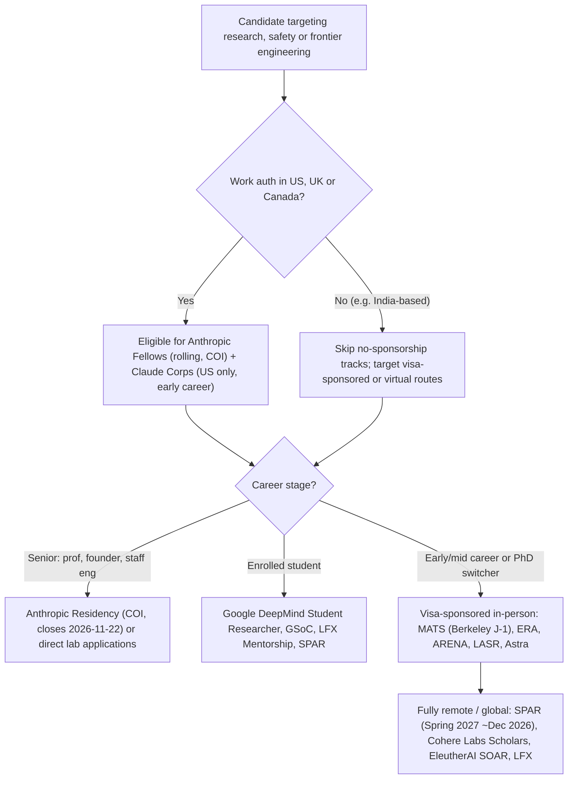

# Fellowships, Residencies and Open-Source Mentorships: Eligibility, Visas, Stipends and Outcomes

> Evidence-graded directory of 16 AI fellowships, residencies and open-source mentorships: work-authorisation gates, visa support, stipends, COI-flagged outcomes, preparation and stale-page traps.

**Dates, grades, COI and review trigger.** Programme facts come from [T0-21](../../research/sessions/T0-21-x-frontier-communities-fellowships-events.md) (retrieved 2026-11-13 to 2026-11-14 via fetch extracts from programme pages, not raw full-page text [T0-21 L22, L378]), with all three Anthropic programmes, MATS, SPAR, Astra, ERA and LFX independently re-checked via live web search on 2026-11-19. **Conflict-of-interest disclosure:** Anthropic built the model that authored T0-21; Anthropic Fellows, Anthropic Residency and Claude Corps are marked `(COI)` throughout, their eligibility and stipend terms were independently corroborated on 2026-11-19, and every outcome percentage from any programme owner is capped at **Grade C** because none has independent corroboration or a published applicant denominator [T0-21 L13, L22, L77]. **Review trigger:** `review_by: 2026-12-03` reflects class V0 (14 days from 2026-11-19) for imminent application deadlines (Anthropic Residency closes 2026-11-22) and unverified rolling windows (Claude Corps, Cohere Labs Scholars); other programme facts are class V2 (90 days). **Grades** (EGP-1.0): A primary programme page (for issuer's own eligibility, dates, stipend); B transparent secondary; C programme-owner outcome claim (COI), practitioner or single source; D judgement; E not found; M calculation; P practice-curated.

## The short answer

1. **Check work authorisation and visa support before investing application weeks.** Eligibility gates differ sharply by programme [A · T0-21 L81]: Anthropic Fellows requires existing work authorisation and physical presence in the US, UK or Canada with **no visa sponsorship** [A, COI · T0-21 L81, L202], whereas MATS provides J-1 visas for non-US citizens in Berkeley (none in London) [A · T0-21 L81, L205], ERA sponsors UK visas [A · T0-21 L208], ARENA assists with visas [A · T0-21 L207], LASR Labs supports UK Government Authorised Exchange visas [A · T0-21 L209], Astra offers international visa support [A · T0-21 L210] and SPAR is fully virtual [A · T0-21 L81, L206].
2. **Treat every published conversion rate as a programme-owner claim (Grade C), never an applicant forecast.** No programme publishes applicant-to-offer rates or denominators [C/E · T0-21 L77, L368]. Anthropic Fellows is not the only programme citing outcomes: its Greenhouse posting states >40% received a full-time offer while its Alignment Science blog states >35% later joined Anthropic full-time (different measures and probably dates) [C, COI · T0-21 L77, L202, L325], and Astra claims >80% of its first cohort work full-time in AI safety (no cohort size or date) [C, COI · T0-21 L77, L210]. MATS lists named alumni without an aggregate rate [A · T0-21 L77, L205].
3. **Match the programme to your career stage and financial floor.** Stipends span unpaid volunteer remote work (SPAR, approved compute/API covered [A · T0-21 L206]) and country-tiered open-source stipends (LFX Mentorship: US$1,300 in India vs US$6,000 in the US from 2026-07-01 [A/M · T0-21 L82, L216]) up to US$1,600/week plus housing/meals (MATS [A · T0-21 L205]), £10,000 for 10 weeks (ERA [A · T0-21 L208]), US$3,850/week plus ~US$15,000/month compute (Anthropic Fellows [A, COI · T0-21 L202]) and US$350,000–$500,000/year pro-rated for senior career-changers (Anthropic Residency [A, COI · T0-21 L203]).
4. **Do not apply on the assumption that a PhD or ML publication record is required — and do not mistake stale pages for open cohorts.** Anthropic Fellows, Anthropic Residency, MATS and SPAR state no prior ML/AI-safety experience or papers are required [A · T0-21 L64, L202–L206]. Conversely, OpenAI Residency (2021 article), Meta AI Residency (2023 cohort page) and Microsoft Research India (2024 cycle, nomination-only and excluding PhDs) remain live online with stale information — verify before planning around them [A · T0-21 L55, L83, L212, L214, L217].
5. **Pair applications with public research or engineering artefacts.** Treat fellowships as competitive upside alongside applied job applications [D · T2-01 L557–L559; T0-06 L703]. When eligible windows are closed or visa-gated, build portable public proof: paper reproductions with code, GPU MODE leaderboards, EleutherAI's SOAR online internship or open-source contributions [A/C · T0-21 L101, L113–L116, L142].

## At a glance

Decision flow derived from T0-21's eligibility and work-authorisation audit as of 2026-11-14 [A · T0-21 L81–L83, L200–L217].

## Complete programme directory (16 programmes, audited November 2026)

Every row separates **primary issuer facts** (eligibility, location, stipend, dates — Grade A from programme pages as read via fetch extracts in T0-21) from **programme-owner outcome claims** (Grade C, COI — uncorroborated, no applicant denominators) [T0-21 L22, L200–L217].

### Frontier-lab programmes and residencies

| Programme | Target profile | Work authorisation & location | Stipend & duration | Outcomes (owner claim, Grade C) | Status (as of 2026-11-19) | Verdict | Source |
|---|---|---|---|---|---|---|---|
| **Anthropic Fellows Program** (AI Safety track) **(COI)** | No PhD, prior ML or papers required; 40 h/wk | **US, UK or Canada work auth + physical presence required; no visa sponsorship.** Berkeley, London or remote inside US/UK/Canada | US$3,850/wk, £2,310/wk or C$4,300/wk + ~US$15,000/mo compute; 4 months | Posting: >80% papers, >40% full-time offer. Blog: >65% published, >35% joined full-time (>200 fellows since early 2025). Pages differ; COI | Rolling for cohorts starting July 2026+ (live-verified 2026-11-19); other tracks unchecked | **Use-with-care** (if authorised) | A (facts), C (outcomes) · T0-21 L202, L485 |
| **Anthropic Residency** **(COI)** | Senior career-changers: quantitative professors, technical founders, staff engineers; no PhD/ML required | San Francisco preferred; remote possible (especially shorter placements); separate US/UK postings; visa terms not stated | US$350,000–$500,000/yr equivalent (pro-rated) + mentor, self-study, compute; 6 wk, 3 mo or 6 mo | Aims for full-time safety research at Anthropic or elsewhere; no outcome data | **Closes 2026-11-22** (live-verified 2026-11-19) | **Use-with-care** (senior only) | A · T0-21 L203, L486 |
| **Claude Corps Fellow** **(COI)** | Early-career, no degree required; placed inside US nonprofits to deploy AI (not a research fellowship) | **US work auth without sponsorship required.** United States | Fully funded and paid (amount unstated in T0-21; external listings report US$85,000/yr via CodePath); 12 months | None stated | Accepting applications (rolling cohorts into 2027 per 2026-11-19 check) | **Watch** (non-research) | A · T0-21 L204, L487 |
| **Google DeepMind Student Researcher Program** | **Enrolled students only** (Bachelor's, Master's or PhD); 5 days/wk | In person at a Google office with host team; remote/visa not stated on page read | Paid (amount not stated); 12–24 weeks | None stated | 2026–2027 cycle; exact dates not stated | **Use-with-care** (students only) | A · T0-21 L213, L496 |
| **Cohere Labs Scholars Program** | Full-time availability and ML curiosity; prior research not required | Remote-first; in person near Cohere offices; nationality/work auth not stated | Paid full-time ("competitive pay"; amount/duration not stated) | Scholars have published papers; no hiring figures | Closed as of 2026-11-13; undated page says expected Fall 2026 while evolving | **Watch** | A · T0-21 L211, L494 |
| **OpenAI Residency** | 2021 article: 6-month SWE or non-ML scientific tracks; unconventional backgrounds | 2021 article cited global immigration and relocation support | Fully salaried (2021 article) | 2021 article cited >20 hires over 3 years from earlier programmes (stale, COI) | **Stale (2021-11-30 article only); status unverified** | **Watch** | A (stale) · T0-21 L212, L495 |
| **Meta AI Residency** | Prior ML helpful, not required; post-graduation applicants accepted | On site at allocated office; no remote; work auth not stated | Competitive salary, relocation, medical; no RSUs/bonuses; 12 mo (+12 mo optional) | Conversion not promised; residents may interview for full-time roles | **Stale (2023 cohort page, closed); status unverified** | **Watch** | A (stale) · T0-21 L214, L497 |
| **Microsoft Research India Research Fellows** | Graduated by joining; **excludes PhD students and PhD holders** | Bengaluru (Lavelle Road). International applicants can apply but cannot be nominated (CS dept heads nominate up to 3/institution) | Not stated on page read | None stated | **Stale (2024 cycle page); status unverified** | **Watch** | A (stale) · T0-21 L217, L500 |

### Independent AI-safety and alignment fellowships

| Programme | Target profile | Work authorisation & location | Stipend & duration | Outcomes (owner claim, Grade C) | Status (as of 2026-11-19) | Verdict | Source |
|---|---|---|---|---|---|---|---|
| **MATS** (ML Alignment & Theory Scholars) | Age 18+; no prior AI-safety experience required; degree not stated; multi-stage selection (tracks, streams, work tests/interviews) | US & non-US citizens eligible. **Provides J-1 visas for Berkeley; no visa support in London.** In person (Berkeley/London), remote case by case | US$1,600/wk (US$19,200 / 12 wk) + travel, housing, office, weekday lunch & dinner; optional 6–12 mo extension (~80% extension acceptance, undated) | No aggregate rate; alumni page lists named researchers (e.g. Anthropic, Apollo Research CEO) | Winter 2027 (2027-01-19 to 2027-04-10) **closed**; later window not stated | **Use** | A · T0-21 L205, L488 |
| **SPAR** (Supervised Program for Alignment Research) | Undergrads, grads, PhDs and professionals (age 13+); no degree or research experience required; 5–40 h/wk | **Fully virtual** (some sanctioned countries may be restricted); global access | Unpaid volunteer; approved project expenses (compute, API) covered; 3 months | Owner claims ICML/NeurIPS papers, US$7,000 Demo Day prizes and mentee job offers (count unstated); COI | Fall 2026 closed; **Spring 2027 expected ~December 2026** (programme statement) | **Use** | A · T0-21 L206, L489 |
| **ERA Fellowship** (Cambridge) | Age 18+; prior research helpful, not required; two interview rounds | Cambridge, UK, in person. **ERA sponsors visas** | £10,000 for 10 weeks (includes housing portion) + travel, visa, working-hours meals (~30–35 fellows planned) | None stated | Winter 2027 (2027-01-18 to 2027-03-26) **closed**; next window not stated | **Use-with-care** | A · T0-21 L208, L491 |
| **ARENA** (Alignment Research Engineer Accelerator) | ~1 year university applied maths, strong Python coding; no degree required (bootcamp format) | London (LISA workspace), in person only. **Visa assistance provided** (incl. expedited fees where needed) | No stipend; reasonable travel, accommodation, meals and snacks covered; 4–5 weeks full-time (2–3 cohorts/yr) | None stated | Undated page; next cohort dates not stated | **Use-with-care** | A · T0-21 L207, L490 |
| **LASR Labs** | Full-time (40 h/wk); degree and experience not stated | UK, in person only (no remote). **Visa support via UK Government Authorised Exchange route** | Not stated on page read | None stated | FAQ says open with no closing date (Jan–Apr cohort, year unstated); **treat as unverified** | **Use-with-care** | A · T0-21 L209, L492 |
| **Astra Fellowship** (Constellation) | Prior AI-safety experience not required; degree not stated | Berkeley, in person. **Visa support for international applicants** | 8,400/month (currency unstated on page) + ~15,000/month compute per empirical fellow; 5 months + extension | Owner claim: >80% of first cohort work full-time in AI safety (cohort size and date unstated); COI | **Status unverified** (page refers to Summer 2026 as future); check Constellation directly | **Watch** | A (facts), C (outcomes) · T0-21 L210, L493 |

### Open-source mentorships and open-science internships

| Programme | Target profile | Eligibility & geography | Stipend & duration | Outcomes | Status (as of 2026-11-19) | Verdict | Source |
|---|---|---|---|---|---|---|---|
| **LFX Mentorship** (Linux Foundation) | Students listed as eligible; open-source project applications | Worldwide (except Russia, Belarus, DNR/LNR) | Country-tiered from 2026-07-01 (PPP model): US US$6,000, UK US$5,500, Germany US$5,000, **India US$1,300** (~22% of US), Egypt US$1,000; typically 12 wk | None stated | Listed as open (page undated; check project term dates) | **Use** | A · T0-21 L82, L216, L499 |
| **Google Summer of Code (GSoC)** | Open-source contributors matched to 185 mentoring organisations (2026) | Worldwide (rules page returned metadata only; country caps unverified [E · T0-21 L339]) | Not verified (rules page unreadable) | None stated | 2026 cycle passed (apps Mar 2026, coding May 2026); 2027 timeline not published; check AI/ML org list | **Use** | A · T0-21 L215, L498 |
| **EleutherAI SOAR Internship** | Invites people with little prior research experience | Fully online (community spans 30+ countries) | Not stated on page read; yearly 5-week online research internship | None stated | Active per undated page | **Use** | A · T0-21 L184, L505 |

**Note on ML Collective.** Unlike the structured programmes above, ML Collective is an open mentorship community and weekly "Deep Learning: Classics and Trends" reading group (running since 2018 per two interviews, with no stipend, application gate or hiring-outcome data; activity was not re-verified in T0-12 or T0-21) [B · T0-12 L229; Communities guide](communities-guide.md).

## How to choose and prepare

### Decision rules by reader profile

- **India-based engineer without US/UK/Canada work authorisation:** Do not waste an application cycle on Anthropic Fellows or Claude Corps without work authorisation [A, COI · T0-21 L120, L204]. Prioritise: (1) fully virtual programmes (SPAR — watch for December 2026 Spring 2027 opening; EleutherAI SOAR; Cohere Labs Scholars when open); (2) in-person programmes with explicit visa sponsorship (MATS Berkeley J-1, ERA Cambridge, ARENA London, LASR UK, Astra Berkeley); and (3) open-source mentorships (LFX, noting the US$1,300 India stipend, and GSoC) [A · T0-21 L81–L82, L116, L121–L122].
- **Engineer in the US, UK or Canada:** If aligned with AI safety, Anthropic Fellows (rolling, COI) is accessible without a PhD [A, COI · T0-21 L127, L202]; pair with MATS, SPAR, ERA/LASR (UK/Europe) and direct open-source or product-community work [A/C · T0-21 L129–L136].
- **PhD researcher or senior technical leader:** Check whether you fit Anthropic Residency (aimed at quantitative professors, founders and staff engineers — closes 2026-11-22; new PhD graduates may fit MATS, ERA or applied roles better) [A, COI · T0-21 L144, L203]. Enrolled PhDs can target Google DeepMind Student Researcher [A · T0-21 L213]. Pair fellowship bids with an applied base-case plan (see [PhD to industry](../11-tracks/phd-to-industry.md)).

### Preparation steps

1. **Verify live programme status and visa terms directly on the official page.** Stale pages stay indexed for years (OpenAI 2021, Meta 2023, MSR India 2024, Astra undated) [A · T0-21 L83, L391]. *Done when:* you have confirmed cohort dates, closing deadline and visa eligibility on the host's live application portal [P].
2. **Build one public research reproduction or empirical mini-project first.** A named Google DeepMind researcher (Neel Nanda) advises reproducing or extending a published paper with clean code and a short write-up as the strongest signal for research mentorships and jobs — noting this is single-source practitioner advice with no measured conversion rate [C · T0-21 L142, L238, L344]. *Done when:* a public repo and write-up exist at V1 on the [verifiability ladder](../05-portfolio/proof-of-work-standards.md#the-ladder) [P].
3. **Calibrate to research-track fundamentals.** For technical safety/alignment programmes (MATS, ARENA, Anthropic Fellows), build strong PyTorch/Python fluency and mathematical rigour; a secondary report of a Google DeepMind pretraining lead's blog post emphasises intent, mathematical maturity, grit, proof-based coursework and heavy coding (single lead's view) [C · T0-21 L148, L249; A · T0-21 L207]. *Done when:* you can implement and debug transformer/mechanistic or evaluation experiments from scratch without AI-generated boilerplate you cannot explain [P].
4. **Reach out selectively with concrete work (optional).** If applying to mentor-matched tracks (MATS streams, SPAR projects), cold-emailing a mentor or researcher who has time to answer — attaching one concrete reproduction or finding — is advised by Neel Nanda, though response rates are unmeasured [C/E · T0-21 L143, L239, L345]. *Done when:* any outreach note stays under ~90 words with one verifiable link (see [Referrals and outreach](referrals-and-outreach.md)) [P].
5. **Run fellowships in parallel with your main search.** Because acceptance rates are unpublished and windows are sparse, never pause direct applications or portfolio builds while awaiting a fellowship decision [D · T0-21 L83, L102, L368]. *Done when:* target cohort deadlines sit on your calendar beside weekly job-search milestones [P].

## Templates and examples

All templates are practice-curated [P].

### Fellowship target tracker [P]

| Programme | Track / focus | Visa / work-auth fit | Stipend & costs | Next deadline (verified date) | Required artefact / work test | Status |
|---|---|---|---|---|---|---|
| `[MATS]` | `[Alignment / evals]` | `[Berkeley J-1 OK; London no]` | `[US$1,600/wk + housing]` | `[Check live page]` | `[Research proposal + work test]` | `[Watching]` |
| `[SPAR]` | `[Safety / alignment]` | `[Fully virtual]` | `[Unpaid; compute covered]` | `[Expected ~2026-12]` | `[Project preferences + sample]` | `[Prep repo]` |

### Research-proposal / application abstract: weak → strong [P]

| Weak | Strong |
|---|---|
| "I am passionate about AI safety and alignment and want to learn mechanistic interpretability from top mentors during the fellowship." | "I reproduced [Paper X]'s steering experiment on [model] (`make repro` at [repo link]) and observed [specific failure mode] on [N] prompts. Over [10–12 weeks], I propose testing [concrete hypothesis] using [metric and baseline], with [fallback if null result]. Code and 2-page error analysis: [link]." |

## Checklist

- [ ] Work-authorisation and visa-sponsorship rules checked on each programme's live page before starting an application [A · T0-21 L81]
- [ ] Stale programme pages (OpenAI 2021, Meta 2023, MSR India 2024, undated Astra/LASR) verified live rather than assumed open [A · T0-21 L83, L391]
- [ ] Financial viability checked (unpaid SPAR/ARENA vs country-tiered LFX vs paid fellowships) [A · T0-21 L82]
- [ ] At least one reproducible public artefact (paper reproduction, evaluation harness or benchmark with committed code) ready to link [C/P · T0-21 L142, L238]
- [ ] Outcome claims (>40% / >35% Anthropic Fellows, >80% Astra) treated as self-reported C-grade context without denominators, not guaranteed placement odds [C · T0-21 L77]
- [ ] Direct job applications and open-source/community work kept running in parallel [B/D · T0-21 L102]

## Pitfalls

| Red flag | Why it hurts | Fix |
|---|---|---|
| Applying to Anthropic Fellows or Claude Corps without required work authorisation | Both explicitly require local work authorisation without sponsorship [A, COI · T0-21 L202, L204] | Filter by visa sponsorship first; target MATS (Berkeley J-1), ERA, ARENA, LASR, Astra or virtual SPAR |
| Planning around stale residency pages | OpenAI (2021), Meta (2023) and MSR India (2024) pages stay reachable long after cycles close [A · T0-21 L83, L391] | Check the live application portal date before tailoring materials |
| Treating ">40% offers" or ">80% in AI safety" as your admission-to-offer probability | Owner-reported figures lack applicant counts and mix selection with programme effect [C · T0-21 L77, L357] | Read outcome claims as post-selection context only; never pause your main search |
| Assuming LFX pays the same globally | From 2026-07-01, LFX pays US$1,300 in India vs US$6,000 in the US (~22%) [A/M · T0-21 L82, L216] | Budget accurately before committing 12 weeks |
| Applying to Anthropic Residency as an early-career graduate or MSR India as a PhD holder | Anthropic Residency targets senior leaders (professors, founders, staff); MSR India excludes PhD students/graduates [A · T0-21 L144, L203, L217] | Match your career stage to the stated target profile |
| Paying for commercial "AI fellowship" cohorts expecting lab placement | Paid cohorts (e.g. Maven US$4,500) publish no independent job-outcome data [C/E · T0-21 L91, L349] | Pay only for structured learning; never pay for a "referral" or placement guarantee |

## Evidence and limits

- **Primary programme pages (via fetch extracts, live-checked 2026-11-19).** Eligibility, visa terms, stipends and stated deadlines come from each host's own pages as read in T0-21 (Grade A for issuer facts, with the caveat that T0-21 used a summarising fetch-extract tool rather than full raw page text [T0-21 L22, L378]). Anthropic Fellows, Anthropic Residency, Claude Corps, MATS, SPAR, Astra, ERA and LFX terms were independently re-verified via web search on 2026-11-19.
- **Conflict of interest.** Anthropic built the model that authored T0-21 and operates three programmes in this directory (Anthropic Fellows, Anthropic Residency, Claude Corps). All three carry `(COI)` flags, and their outcome percentages are graded C [T0-21 L13, L22, L364].
- **Searched, not found.** Applicant counts and acceptance rates for Anthropic Fellows, MATS, Astra, ERA and SPAR [E · T0-21 L368]; independent corroboration of any fellowship's placement rate [E · T0-21 L69]; GSoC 2026 eligibility rules and stipend tiers (rules page returned metadata only) [E · T0-21 L339]; a first-person verified account of a hire initiated by a public paper reproduction [E · T0-21 L344]; next cohort windows for MATS, ARENA, LASR, Astra and ERA as of 2026-11-19 [T0-21 L373].
- **What would change this advice.** Any fellowship publishing acceptance rates and hiring conversion with stated denominators; Anthropic Fellows adding visa sponsorship; new official 2027 cycles opening for OpenAI Residency, Meta AI Residency, MATS, ERA, SPAR or Cohere Labs Scholars [T0-21 L152–L155].

## Next steps

- **Pair fellowships with open communities, competitions and events:** [Communities guide](communities-guide.md).
- **PhD-specific skills block, timelines and O-1A angle:** [PhD to industry](../11-tracks/phd-to-industry.md).
- **Build a reproducible artefact before applying:** [Proof-of-work standards](../05-portfolio/proof-of-work-standards.md) and [Online presence](online-presence.md).
- **Reach researchers and hiring managers directly:** [Referrals and outreach](referrals-and-outreach.md).
- **Understand work-authorisation routes across countries:** [Visa and relocation](../11-tracks/visa-and-relocation.md).
- **Stage overview and evidence:** [Networking README](README.md) and [T0-21](../../research/sessions/T0-21-x-frontier-communities-fellowships-events.md).
