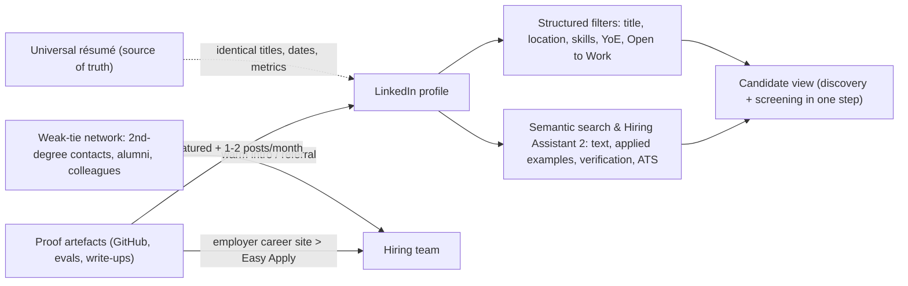

# LinkedIn Guide: Recruiter Search, Profile Mechanics, Content and Paid Tiers

> How LinkedIn Recruiter search, Hiring Assistant 2, Open to Work, verification, Easy Apply, feed ranking and Premium Career work for GenAI job seekers, separating documented mechanics from folklore.

**Dates, grades and review trigger.** Evidence comes primarily from [T0-19](../../research/sessions/T0-19-linkedin-profile-search-content-engagement.md) (researched and verification-passed on 2026-11-11, with key platform and regulatory claims re-checked against live sources on 2026-11-19), supplemented by [T0-04](../../research/sessions/T0-04-ats-filtering-funnel-conversion-math.md), [T0-05](../../research/sessions/T0-05-unconventional-hiring-tactics-oss-audits.md), [T0-11](../../research/sessions/T0-11-certification-cloud-credential-roi.md) and [T0-12](../../research/sessions/T0-12-high-signal-communities-technical-visibility.md). LinkedIn Help Center pages block automated fetching, so Help-page claims rest on search extracts or multiple vendor readings and are capped at Grade B or C [T0-19 L22]. Two Extract-only rows in T0-19's ledger (feed papers S21 and LinkedIn's 2026 talent survey S51) are downgraded from A to B here per EGP-1.0. **Review trigger:** `review_by: 2026-12-03` reflects class V0 (14 days from 2026-11-19) for the contested Texas Attorney General Civil Investigative Demand regarding LinkedIn job listings and Premium marketing; platform and product facts (class V2) expire after 90 days. **Grades** (EGP-1.0): A primary opened; B transparent secondary or sizeable dataset; C vendor, practitioner or single source, attributed; D judgement or anecdote; E untraceable (reported as absence); P practice-curated and unmeasured.

## The short answer

1. **Being found and being checked have merged into one surface.** LinkedIn Recruiter combines structured filters, anywhere-on-profile keyword matching and AI semantic search [A · T0-19 L49, L119], while Hiring Assistant 2 (announced 2026-09-30, rolling out November 2026 for English users) surfaces fit signals, verification, ATS data and connected-app activity in the same candidate view [B · T0-19 L50, L130–L132]. Earlier guidance that profiles are only for checking, not discovery, is outdated [B · T0-19 L273].
2. **Switch Open to Work on for recruiters only; treat the public frame as optional.** Recruiters-only places you in the Open to Work filter without broadcasting to your employer, though LinkedIn states it cannot guarantee employer concealment [A/B · T0-19 L51, L136]. LinkedIn's "+40% InMails" and "2× recruiter messages" figures date from an October 2020 blog post with no published method [C · T0-19 L51, L138]; no independent causal study exists, and stigma claims remain opinion [C · T0-19 L140].
3. **Skip skill assessments and stop padding skills.** LinkedIn discontinued Skill Assessments and removed badges in 2024; guides still advising them are stale [B · T0-19 L52, L166]. Tag only skills you can evidence to specific roles or projects: AI search explicitly flags qualifications found and missed [A · T0-19 L119, L166].
4. **Apply on the employer's site when a link exists; treat Easy Apply as a fallback.** In Huntr's self-selected tracker data (1.24M applications, 2024-10 to 2026-07, plus a Q3 2026 trailing-12-month cut), LinkedIn-sourced applications reached interview at 2.9–3.6% against 6.6–9.9% for Google-sourced ones, and employer career sites ran 1.7× job boards [B · T0-19 L54, L170]. No controlled Easy Apply experiment exists [E · T0-19 L293].
5. **Treat posting as artefact distribution, not a hiring engine.** No study links posting or commenting cadence to recruiter outreach or interviews [E · T0-19 L57, L291]. Format datasets conflict and measure engagement rather than hiring [B/C · T0-19 L180–L190]. The documented causal mechanism on LinkedIn is network structure: moderately weak ties drove the highest job mobility in a 20M-member randomised experiment [A · T0-19 L58, L194].
6. **Do not keep Premium Career running by default, and never use automation.** LinkedIn's Premium claims (3.9× hired on "Top applicant" jobs, January 2025) are uncontrolled and company-reported, with no independent evidence [C · T0-19 L63, L204]. Automation tools, scraping extensions and engagement pods breach LinkedIn's rules and risk visibility limits or account restriction [B · T0-19 L56, L200, L280].

## At a glance



Your [universal résumé](../06-job-search/resume-strategy.md#the-five-layers-and-their-jobs) anchors every factual field; LinkedIn feeds both Recruiter filters and AI screening in a single pass; proof artefacts live on GitHub or a site you control (see [Online presence](online-presence.md)) and are distributed through Featured and occasional posts [P; B · T0-19 L50, L132].

## How LinkedIn Recruiter and AI search actually work

LinkedIn's semantic-search playbook documents three retrieval mechanisms operating together [A · T0-19 L49, L119]:

- **Structured filters:** job title, location, Open to Work, skills, companies, schools, graduation year, industries, seniority, languages, years of experience, years in current position, fields of study, degree and company size. Protected attributes cannot be filtered, and LinkedIn states it standardises titles, skills and schools across languages [A · T0-19 L49, L119].
- **Keyword and semantic search:** keyword search matches terms anywhere on a profile (English-only for attached résumés), while AI-Assisted Search reads semantic qualifications beyond exact phrases and outputs a high, medium or low relevance label alongside "qualifications found and missed" [A · T0-19 L119]. LinkedIn publishes no field weighting [E · T0-19 L288].
- **Hiring Assistant 2:** announced 2026-09-30 for November 2026 English rollout, adding rubric screening, fit signals, verification status, connected-app activity and cross-referencing with ATS and pre-screen data — including candidates who applied off LinkedIn [B · T0-19 L50, L130–L132]. LinkedIn claims early Hiring Assistant adopters review 62% fewer profiles and achieve 69% better InMail acceptance, both uncontrolled vendor claims [C, COI · T0-19 L50, L488]. In LinkedIn's November 2025 Censuswide survey of 6,554 global HR professionals, **66%** of recruiters reported planning to increase AI use for pre-screening interviews in 2026 [B · T0-19 L487, L489].

### Platform timeline (2024–2026)

| Date | Change | Practical effect | Grade · source |
|---|---|---|---|
| 2024-03 | Creator Mode toggle removed; tools opened to all profiles | No reason to toggle Creator Mode; stale advice | B · T0-19 L178 |
| 2024-04-16 | "Verified recruiter" badge announced | Check for it before replying to recruiter DMs | B · T0-19 L123 |
| 2024 | Skill Assessments discontinued and badges removed | Ignore guides recommending skill-assessment badges | B · T0-19 L52, L166 |
| 2025-08-20 | Help line added limiting visibility of excessive or automated comments | Avoid AI comment bots and engagement pods | B · T0-19 L56, L178 |
| 2025-09 | Workplace verification required for recruiter and leadership titles | Stronger baseline check on senior and recruiting profiles | B · T0-19 L60, L208 |
| 2025-10-09 | India-only notice period and expected salary added to Open to Work and Recruiter filters | India candidates can expose ranges to recruiters only | B · T0-19 L126, L136 |
| 2026-01-29 | Verified AI skill levels reported in secondary coverage | Monitor rollout; does not restore retired Skill Assessments | C · T0-19 L127, L396 |
| 2026-03-12 | Feed rebuilt on LLM-embedding retrieval and sequence-based Generative Recommender | Pre-March 2026 format benchmarks may have drifted | B · T0-19 L56, L178 |
| 2026-06-17 | Connected apps launched (partner-verified tool activity on profiles) | Optional signal surfaced in Hiring Assistant 2; weigh data sharing | A · T0-19 L128, L162 |
| 2026-09-23 | Colleague vouching and page-admin removal of false employment claims launched; 115M verified members | Peer vouching (requires verified voucher, 2FA, 1-year connection); ~60% of verified members confirmed a workplace vs ~27% via government ID (Dec 2025) | B · T0-19 L60, L129, L208, L469 |
| 2026-09-30 | Hiring Assistant 2 announced (November 2026 English rollout) | Profile, ATS application and verification read together | B · T0-19 L130–L132 |

### Profile fields: what search and reviewers actually use

| Field | How search and reviewers use it | Action rule | Grade · source |
|---|---|---|---|
| **Headline** | Indexed as keyword text; no published field weight and no format A/B test [E · T0-19 L290] | One defensible standard target title plus 2–4 evidenced stack/problem terms | A (matching); P (format) · T0-19 L71, L148 |
| **Experience titles & dates** | Filtered and standardised by LinkedIn Recruiter [A · T0-19 L119]; matched for title similarity by ATS AI layers such as Eightfold [B · T0-19 L166] | Match your universal résumé word for word; never inflate held titles | A/B (mechanics); D (consistency) · T0-19 L72, L149 |
| **About & Experience bullets** | Indexed by keyword and AI semantic search; LinkedIn says hirers prefer examples of applied skill | Concise scope, verifiable metrics with methods, links to proof | A (matching); B/P (advice) · T0-19 L150–L151 |
| **Skills** | Filtered directly (LinkedIn claims 42% of recruiters use the skills filter weekly, no method [C · T0-19 L152]); assessments retired [B · T0-19 L166] | Tag evidenced skills to roles/projects using wording from target postings; do not pad to 50 | B (retirement); P (selection) · T0-19 L73, L166 |
| **Endorsements** | One pre-window interviewing.io analysis found little correspondence with interview performance | Do not spend time soliciting endorsements | C · T0-19 L153, L259 |
| **Featured & Projects** | Indexing undocumented; skills can be tagged to projects | Pin 2–3 checkable artefacts (repo, eval write-up, merged PR) with one line of context | P · T0-19 L75, L154 |
| **Certifications** | Heterogeneous effect: Coursera RCT found +1.0 pp (+5.9% relative) new employment concentrated in weak-baseline learners; interviewing.io found 53% vs 57% pass rate for engineers listing certifications; absent from 2026 AI/ML Boolean strings | Include role-relevant ones if other signals are thin (early career, IT services/GCC); keep projects primary for product/AI engineering roles | B · T0-19 L53, L77, L155, L166 |
| **Location, education, YoE, languages** | Explicit Recruiter filters | Fill every field accurately and consistently with your résumé | A · T0-19 L72, L159 |
| **Open to Work** | Explicit Recruiter filter; India adds recruiter-only notice period and expected salary | Switch on recruiters-only with 2–5 standard titles; public frame optional | A/B (mechanics); C (effect) · T0-19 L74, L160 |
| **Verification & vouching** | Displayed on profiles and surfaced in Hiring Assistant 2; as of December 2025, ~60% of LinkedIn's 100M+ verified members confirmed a workplace email and only ~27% verified via government ID [B · T0-19 L208, L469]; LinkedIn uplift claims (60% views, 30% connections, 13% recruiter responses) give no method | Complete workplace email verification (government ID is optional); add 1–2 colleague vouches | B (feature); C (uplift) · T0-19 L60, L76, L208 |
| **Photo, banner, custom URL, recommendations** | No measured effect on reviewer decisions; viral multipliers ("21× views") are untraceable | Keep clean and current; spend minutes, not hours | E (multipliers); P (advice) · T0-19 L156–L158, L301 |

**GenAI title, ATS-matching and skill context.** LinkedIn ranked AI Engineer first on its US Jobs on the Rise 2026 list (job starts 2023-01 to 2025-07) and reported it overtook Machine Learning Engineer as the most common AI role; common listed skills included Large Language Models, MLOps, computer vision, PyTorch and TensorFlow, and the most common prior feeder titles were **Software Engineer, Data Scientist and Data Engineer** [B · T0-19 L62, L216]. Whether RAG, agents, evaluation or MCP exist as standardised LinkedIn skill tags was not verified [E · T0-19 L52, L296], so include those exact phrases inside your headline, Experience bullets and project descriptions where keyword and semantic search read them [P; A · T0-19 L119]. Published 2026 AI/ML Boolean strings key on titles, Python, PyTorch/TensorFlow and LLM/NLP terms, with zero certification acronyms [C · T0-19 L166]. Downstream ATS AI layers cross-check similar fields: Eightfold documents title-vector cosine similarity, skill overlap, seniority fit and industry similarity, while Phenom's Fit Score documentation (skills, title, experience, location — editable by recruiters) is dated 2022-06-23 and may be stale [B · T0-19 L166, L276]. A single-author analysis of 1,680 Anthropic engineer LinkedIn profiles (June 2026; COI, survivorship-biased) found 13.7% held PhDs and Python, Java and C++ were the most-listed skills [C · T0-19 L62, L216].

## Open to Work, Easy Apply, ghost jobs and Premium Career

### Open to Work: mechanics versus claims

| Aspect | What is known | Grade · source |
|---|---|---|
| **Visibility modes** | Recruiters-only exposes status to Recruiter users (LinkedIn attempts to hide it from your employer but cannot guarantee concealment); public adds the green frame for all members. LinkedIn told *Fortune* (July 2024 data) ~200M members used it behind the scenes and ~40M publicly | A/B · T0-19 L136, L138 |
| **Effect claims** | LinkedIn's October 2020 post claimed ~2× recruiter messages overall, plus +40% InMails and +20% community messages for the public frame (no method; repeated in 2024–2025) | C · T0-19 L51, L138 |
| **Stigma and quality signal** | Recruiters quoted by *Fortune* (2024-09-05) split on stigma [C · T0-19 L140]. In interviewing.io's pre-window data (2023-04), badged engineers passed interviews at 44% in 2021 against a 51% average, then flipped to 56% in Q1 2023 after layoffs (prevalence 1.4% → 4.2%) — measuring candidate mix, not recruiter bias [B · T0-19 L140, L478–L479] | B/C · T0-19 L140 |
| **Response-rate ranking signal** | LinkedIn's 2020 post stated that accepting or declining recruiter messages signals active engagement and helps rank higher in recruiter search (pre-window, no method) | C · T0-19 L51, L138 |

### Applying on LinkedIn, volume and ghost jobs

Application volume on LinkedIn reached roughly 9,500–11,000 applications per minute in 2025 reports (*New York Times* via eWeek June 2025: 11,000/min, up 45% year on year; LinkedIn representative via CNBC October 2025: nearly 9,500/min) [B · T0-19 L55, L172]. Earlier repository text dated the 11,000 figure to late 2024; both primary reports are from 2025 [B · T0-19 L273].

- **Easy Apply versus employer sites:** No controlled comparison exists [E · T0-19 L293]. Across four cuts of Huntr's self-selected tracker data (1.24M tracked applications 2024-10 to 2026-07, plus a Q3 2026 12-month preview covering 175,416 LinkedIn applications), LinkedIn-sourced applications reached interview at 2.9–3.6% versus 6.6–9.9% for Google-sourced ones (which mostly route to employer ATS pages), and employer career sites converted at 1.7× job boards [B · T0-19 L54, L170]. Claims of "1–2% Easy Apply versus 15–30% direct" have no traceable method [E · T0-19 L54, L170].
- **Ghost jobs and staleness:** Greenhouse reported 18–22% of postings on its own platform qualified as ghost jobs per quarter in 2024 (17% in Q2 2025), while a Congressional Research Service primer cautions that most headline ghost-job estimates come from hiring-service vendors [B · T0-19 L55, L174]. Hotfix tracked 13,434 tech listings (2026-02-28 to 2026-04-28) and found one in three still live at 60 days and one in eight at 90 days — measuring staleness, not employer intent [B · T0-19 L174].
- **Texas Attorney General investigation (V0 status, re-checked 2026-11-19):** On 2026-07-14, the Texas Attorney General issued a Civil Investigative Demand to LinkedIn covering advertising, marketing, job-verification practices and Premium subscription representations, citing unspecified studies putting ghost jobs at one-fifth to one-third of listings [A · T0-19 L55, L174]. LinkedIn pushed back, pointing to its authenticity policies, verification badges and response-time indicators; coverage through September 2026 (and re-check on 2026-11-19) reports no formal lawsuit or finding of liability [B · T0-19 L55, L174].

### Premium Career and Sales Navigator ROI

| Tier | Approximate price (as of 2026-11) | What you get | Evidence and verdict |
|---|---|---|---|
| **Premium Career** | US$29.99–$39.99/month (US$39.99 cited in Texas AG release; US$29.99 on annual/aggregator lists) [A/C · T0-19 L204] | 5 InMails/month, applicant insights, "Top applicant" and "Top choice" labels, AI job tools, unlimited personalised connection notes, LinkedIn Learning [C · T0-19 L59, L204] | **Use-with-care.** LinkedIn claims 3.9× hired on Top applicant jobs (Jan 2025) and +43% recruiter messages on Top choice (Jan 2024) — uncontrolled, company-reported [C, COI · T0-19 L63, L204]. No independent benefit evidence [E · T0-19 L297]. Trial one month only during an active push, measure replies, then cancel [C · T0-19 L83]. |
| **Sales Navigator Core** | US$99.99–$119.99/month [C · T0-19 L204] | 50 InMails/month and advanced sales/tenure search filters | **Use-with-care.** Built for sales prospecting; no job-seeker ROI evidence. Rarely justified when manual search plus verified work email costs nothing [C · T0-19 L223; T0-05 L340]. |

## Feed ranking, content, engagement limits and folklore

LinkedIn Engineering documented dwell time and skip prediction in 2020 [B · T0-19 L178] and rebuilt feed retrieval and ranking around fine-tuned LLM embeddings and a sequence-based Generative Recommender (2025 research papers; March 2026 engineering post via secondary coverage) [B · T0-19 L56, L178]. LinkedIn publishes no signal weights, dwell-time targets or external-link penalties; "the 360Brew algorithm" is marketers' shorthand for a January 2025 pre-production paper [C · T0-19 L56, L178]. Relevance-ranked comments were reported in August 2026 [C · T0-19 L178], and LinkedIn documented visibility limits for excessive or automated comments on 2025-08-20 while confirming reach reductions for detected engagement pods [B · T0-19 L56, L178].

**Format and cadence studies do not prove hiring value:** Buffer (52M+ posts) and Metricool (673K posts, company-page skew) found PDF carousels leading on engagement, whereas Ordinal (256K posts) found text-only leading on impressions and The Shield Index (Dec 2025–Mar 2026) found formats clustered within ~2.6 points and drifting [B/C · T0-19 L180–L190]. None measures recruiter outreach, and most pre-date the March 2026 feed rebuild [T0-19 L190].

**Connection limits and messaging rates:**

- **Weak ties work:** A randomised experiment across >20M LinkedIn members (2015–2019, ~2B new ties, 600K jobs; *Science* 2022, LinkedIn-coauthored) showed moderately weak ties by mutual connections (~10 mutuals) and the weakest ties by interaction intensity drove the highest job mobility, strongest in digital industries [A · T0-19 L58, L194]. A South African RCT (n = 1,638) found four hours of LinkedIn training raised end-of-programme employment by 7 pp from 70%, working through information gathering rather than posting [B · T0-19 L58, L476].
- **Invitation caps:** LinkedIn Help pages checked by five vendors publish no fixed weekly number — "~100 invitations/week" is vendor consensus, and Help pages reportedly conflict on the free personalised-note allowance (3 or 5 per month, 200 characters free vs 300 on Premium), with restrictions typically lasting ~1 week [C · T0-19 L59, L196].
- **Do not misread recruiter reply rates:** Pin's 17.08% LinkedIn reply rate (roughly 276K–294K LinkedIn messages inside a 4M+ dataset; 16.6% LinkedIn vs 4.4% email on the same 165K+ candidates) and LinkedIn's 6.4% InMail average (2023–2024) are **recruiter-to-candidate** figures and do not transfer to candidate outreach [B/D · T0-19 L59, L198, L281].

### Documented mechanics versus LinkedIn folklore

| Claim or tactic | Status | Evidence | Verdict |
|---|---|---|---|
| Standard target title + evidenced keywords match search | Documented | Recruiter playbook + ATS title similarity [A/B · T0-19 L119, L166] | **Use** |
| Open to Work (recruiters-only) enters recruiter filter | Documented | Recruiter filters + Help [A/B · T0-19 L119, L136] | **Use** |
| Apply on employer site over Easy Apply | Measured association | Huntr: 6.6–9.9% Google vs 2.9–3.6% LinkedIn; 1.7× sites vs boards [B · T0-19 L170] | **Use** |
| Moderately weak ties increase job mobility | Causal RCT | *Science* 2022, 20M+ members [A · T0-19 L194] | **Use** |
| Reply (accept or decline) to verified recruiter messages | LinkedIn statement (2020) | Documented engagement ranking signal, no method [C · T0-19 L138, L252] | **Use** |
| Take LinkedIn Skill Assessments for badges | Retired | Discontinued; badges removed in 2024 [B · T0-19 L166] | **Avoid** |
| Automation tools, scraping extensions, engagement pods | Prohibited | User Agreement §8.2, comment visibility limits, account restriction [B · T0-19 L178, L200, L280] | **Avoid** |
| "Posting daily triples recruiter views" | Folklore | Origin untraced; trail ends at unsourced blogs [D · T0-19 L254] | **Untested — skip** |
| "Post twice weekly for up to 5× profile views" | Uncontrolled vendor claim | LinkedIn tip with no method; profile views ≠ recruiter views [C · T0-19 L190, L253] | **Untested** |
| "5+ skills give 17× views / 33× messages (or 31×)" | Folklore | Conflicting multipliers across guides; no traceable source [D · T0-19 L258, L304] | **Untested — do not pad** |
| "Put external links in the first comment" | Folklore | No LinkedIn documentation; no published feed signal weights [D · T0-19 L256] | **Untested** |
| "Carousels get 585% more engagement" | Conflicting engagement data | Datasets disagree and measure engagement, not hiring [C · T0-19 L255] | **Untested** |

## Geography note: India

- **High AI-screening noise:** LinkedIn's Talent 2026 research (Censuswide, 6,554 global HR professionals fielded November 2025; India sub-sample size unstated, reported 2026-02-03) found 74% of India recruiters struggle to find qualified candidates, 53% of those finding hiring harder cite AI-generated applications (47% cite skills shortages), 71% of AI-using recruiters say AI surfaces skills they would have missed, and ~80% plan more AI use [B · T0-19 L61, L212].
- **India-only Open to Work fields:** Launched 2025-10-09, allowing candidates to specify notice period and expected annual salary strictly for recruiters, matched by dedicated India Recruiter filters [B · T0-19 L126, L136, L212]. Notice periods of 60–90 days are cited as common in vendor commentary [D · T0-19 L212]. Enter only ranges you are willing to honour, as stated numbers can anchor offers [C · T0-19 L74].
- **Entry-level scarcity and multi-board necessity:** A September–October 2026 analysis of 18,752 LinkedIn and Naukri postings found only 4.3% tagged entry-level [C · T0-19 L212]. Employer guides (COI) position LinkedIn Recruiter for senior sourcing, Naukri for IT-services volume and Instahyre/Cutshort/Wellfound for product engineers, though no independent GenAI channel comparison exists [C/E · T0-19 L212, L295]. Run LinkedIn alongside Naukri and one product-tech board (see [Channels and boards](../06-job-search/channels-and-boards.md)).

## How to do it

1. **Sync structured fields to your universal résumé.** Copy titles, employers, dates, location, degree and languages verbatim so ATS cross-checks in Hiring Assistant 2 show zero discrepancies [A (fields); D (consistency) · T0-19 L72, L132]. *Done when:* a side-by-side audit finds no date, title or metric mismatch [P].
2. **Rewrite Headline, About and Experience bullets for both search and verification.** Lead your headline with one standard target title you can defend plus 2–4 evidenced stack/problem terms; keep held titles accurate in Experience [A (mechanism); P (format) · T0-19 L71]. Tag every listed skill to a role or project using exact wording from three target postings, without padding to 50 [P · T0-19 L73]. *Done when:* every listed skill maps to a visible bullet or project [P].
3. **Configure Open to Work and verification.** Enable Open to Work for recruiters only with 2–5 standard titles (plus notice period and acceptable pay band in India) [A/B · T0-19 L74]. Complete workplace email verification (and optionally ID verification plus 1–2 colleague vouches) [B (feature); C (uplift) · T0-19 L76, L208]. *Done when:* verification badge is active and preferences match your target roles [P].
4. **Curate Featured with 2–3 checkable artefacts.** Link a reproducible repo, an evaluation write-up or a merged upstream PR with a one-line result, matching your GitHub pins [P · T0-19 L75]. Connect partner apps only if the tool is relevant and you accept the data sharing [B · T0-19 L75, L128]. *Done when:* a reviewer reaches at least one V1/V2 proof item in one click [P].
5. **Screen postings before applying and route to employer sites.** Check posting age, the "reviewing applicants" or response-time indicator, and verified-company/recruiter badges; deprioritise postings older than ~60 days without an inside contact [B/C · T0-19 L79, L174]. Apply on the employer's ATS when linked, using Easy Apply only as fallback [B · T0-19 L78]. *Done when:* every submission is logged in your [application tracker](../06-job-search/application-operating-system.md) [P].
6. **Run a 2.5–3 hour weekly rhythm focused on weak ties and artefact distribution.** The time split is practice-curated [P · T0-19 L87–L97]:
   - *Monday (20 min):* audit Open to Work preferences, alerts and headline terms against three target postings.
   - *Mon/Wed/Fri (3 × 25 min):* apply within 48 hours on employer sites to 1–2 high-fit roles; log outcomes.
   - *Tuesday (30 min):* send 5–8 targeted messages to second-degree contacts, alumni or event contacts at applied employers (see [Referrals and outreach](referrals-and-outreach.md)).
   - *Wednesday (30 min):* leave 2–3 substantive comments on practitioners' posts in your niche.
   - *Daily (10 min):* verify sender identity (check for the verified-recruiter badge; FTC job-scam losses reached US$501M in 2024 [B · T0-19 L208]) before accepting or declining genuine recruiter messages [C · T0-19 L85].
   - *Friday (45 min):* publish one artefact write-up every 2–4 weeks (1–2 posts/month, not daily [D/P · T0-19 L81]), refresh Featured and verify consistency with GitHub.
   - *Monthly (30 min):* review recruiter inbound count, decide whether a single paid month of Premium Career is warranted, and cancel if replies do not justify it [C · T0-19 L83, L97].
   *Done when:* you have tracked 4 weeks of inbound messages and interview rates by source [P].

## Templates and examples

All templates are practice-curated [P], anchored on documented search mechanics [T0-19 L71–L81]. Replace every bracket with checkable facts.

### Headline: weak → strong

| | Example | Why |
|---|---|---|
| Weak | "AI Enthusiast \| Building the Future with GenAI \| AWS Certified \| Open to Work" | Zero searchable role title or stack; leads with certification acronyms absent from 2026 AI/ML Boolean strings [C · T0-19 L166] |
| Formula [P] | `[Standard target title] · [Core stack / problem terms] · [One checkable proof]` | Matches title and keyword filters while showing applied skill [A · T0-19 L49, L71] |
| Strong (Applied AI) | `AI Engineer · Python, LLM evaluation, RAG & agent systems · Eval harness & merged PRs in [repo]` | Uses LinkedIn's #1 2026 title [B · T0-19 L62] plus evidenced terms |
| Strong (Infra) | `Inference Engineer · vLLM, CUDA/Triton, PyTorch · Serving benchmarks & upstream fixes in [repo]` | Matches specialist Boolean strings without unverified buzzwords |

### About section [P]

```text
[Target title] focused on [2–3 concrete problem areas, e.g., retrieval quality,
LLM evaluation and production latency/cost] using [core languages and frameworks].

Selected verifiable work:
- [System or upstream contribution]: [measured result with method] -> [link]
- [Benchmark or write-up]: [measured result with method] -> [link]

Target roles: [2–3 standard titles] · [location / remote] · [availability]
Contact: [same email as universal résumé]
```

### Artefact distribution post: weak → strong [P]

| Weak | Strong |
|---|---|
| "Excited to share my new blog post on RAG! AI is changing everything. Link in comments 👇 #AI #GenAI #LLM #Hiring" | "I benchmarked dense vs hybrid retrieval + reranking on [N] domain queries from [corpus], measuring recall@5 and p95 latency at concurrency 8. Hybrid beat dense by [X] (95% CI [a–b]), while the reranker added [Y] ms without clearing our latency budget. Code, raw traces and `make repro`: [link]. Curious where others draw the reranker latency cut-off." |

### Recruiter reply (accept or decline cleanly) [P; C · T0-19 L85, L138]

```text
Thanks for reaching out, [Name]. [Accept: This aligns with my work in [area];
happy to share my CV and schedule 15 minutes this week.] / [Decline: I'm
focusing on [target role/location] right now, so this isn't a fit, but
appreciate the note.]
```

## Checklist

- [ ] Titles, employers, dates, location and education match the universal résumé verbatim [A/D · T0-19 L72]
- [ ] Headline leads with one defensible standard title plus 2–4 evidenced stack/problem terms [A/P · T0-19 L71]
- [ ] Skills are tagged to roles or projects using exact wording from three target postings; no padding to 50 and no time spent on retired Skill Assessments [B/P · T0-19 L73, L166]
- [ ] Open to Work enabled for recruiters only with 2–5 target titles (and realistic notice-period/salary bands in India) [A/B · T0-19 L74]
- [ ] Workplace email verification completed; optional ID check and 1–2 colleague vouches requested [B/C · T0-19 L76, L208]
- [ ] Featured holds 2–3 checkable artefacts (V1/V2) with one-line summaries and live links [P · T0-19 L75]
- [ ] Certifications placed below projects unless early career or targeting IT-services/GCC screens [B · T0-19 L53, L77]
- [ ] Postings checked for age (<60 days preferred), reviewing status and verified badges; applied on employer ATS when linked [B/C · T0-19 L78–L79]
- [ ] Every genuine recruiter message verified for sender authenticity and answered (accept or decline) [B/C · T0-19 L85, L208]
- [ ] Zero automation extensions, scrapers, AI comment tools or engagement pods installed [B · T0-19 L82, L200]
- [ ] Premium Career avoided by default, or time-boxed to one measured month [C · T0-19 L83]

## Pitfalls

| Red flag | Why it hurts | Fix |
|---|---|---|
| Treating LinkedIn as passive-only (or Easy Apply-only) | Hiring Assistant 2 screens profiles and ATS applications together [B · T0-19 L50]; Easy Apply sits in the lowest-converting tracker channel [B · T0-19 L54] | Optimise structured fields and apply directly on employer career sites |
| Stuffing all 50 skills with buzzwords | AI-Assisted Search shows qualifications found and missed [A · T0-19 L119], exposing unevidenced keywords | List only skills tied to verifiable roles or projects |
| Following stale 2023–2024 guides (Skill Assessments, Creator Mode) | Both features were retired/removed in 2024 [B · T0-19 L52, L178] | Tag skills to applied examples; ignore retired toggles |
| Running a daily content programme instead of building artefacts | No evidence links posting cadence to recruiter outreach or interviews [E · T0-19 L57, L291] | Post 1–2 artefact write-ups per month; invest the saved hours in proof and weak-tie outreach |
| Using LinkedIn automation bots, scrapers or engagement pods | Prohibited by User Agreement §8.2; triggers comment visibility limits and account restriction [B · T0-19 L178, L200, L280] | Manual outreach only; stay within conservative weekly volumes |
| Relying on "Top applicant" badges or continuous Premium Career | Vendor-only claims with no independent evidence; Premium marketing is under a Texas AG CID [A/C · T0-19 L55, L63] | Buy one month at most during an active search and track replies |
| Replying blindly to unverified recruiters or off-platform links | US job-scam losses rose from US$90M (2020) to US$501M (2024) [B · T0-19 L208]; in Gartner's Q2 2025 survey of 3,000 candidates, 6% admitted interview fraud (driving stricter verification) and Gartner forecasts 1 in 4 fake profiles by 2028 [B · T0-19 L60, L208, L470] | Verify the recruiter badge and confirm the opening on the employer's careers page |
| Expecting 17% replies on candidate cold DMs | Pin's 17.08% rate is recruiter-to-candidate and does not transfer [B/D · T0-19 L59, L198] | Plan on single-digit reply rates and pair notes with a verifiable artefact |

## Evidence and limits

- **Primary or causal.** LinkedIn Recruiter filter and semantic-search documentation [A · T0-19 L49, L119]; connected-apps launch announcement [A · T0-19 L128]; Texas Attorney General CID release [A · T0-19 L174]; *Science* 2022 weak-ties RCT on 20M+ members (LinkedIn-coauthored) [A · T0-19 L194]; South African LinkedIn-training RCT [B · T0-19 L58]; Coursera credential-sharing RCT [B · T0-19 L53].
- **Secondary and vendor datasets.** Huntr tracker data (1.24M applications, self-selected, not Easy Apply- or GenAI-isolated) [B · T0-19 L170]; Pin outreach dataset (recruiter-sent, COI) [B · T0-19 L198]; LinkedIn Talent 2026 Censuswide survey (6,554 global HR pros, India sub-sample size unstated; downgraded from A to B because Extract-only) [B · T0-19 L212, L398]; LinkedIn feed LLM-retrieval and Generative Recommender papers (Extract-only in T0-19, downgraded from A to B, independently corroborated via web search on 2026-11-19) [B · T0-19 L178, L366]; FTC Consumer Sentinel fraud losses [B · T0-19 L208].
- **Uncontrolled vendor claims (Grade C, COI).** Every LinkedIn uplift statistic lacks a published method: Open to Work (2× messages, +40% InMails, +20% community), verification (+60% views, +30% connections, +13% recruiter responses), posting twice weekly (up to 5× views), Premium Career (3.9× hired, +43% messages) and Hiring Assistant (62% fewer profiles reviewed and 69% better InMail acceptance) [C · T0-19 L50–L51, L60, L63, L190, L312, L488].
- **Searched, not found (Absences A1–A18).** Published field weights in Recruiter ranking [T0-19 L288]; independent causal Open to Work study 2024–2026 [T0-19 L289]; behavioural measure of profile opens or headline A/B tests [T0-19 L290]; any study linking posting/commenting to recruiter outreach or interviews [T0-19 L291]; a LinkedIn-published weekly invitation cap [T0-19 L292]; controlled Easy Apply vs direct test [T0-19 L293]; aggregate 2025–2026 GenAI hire profile patterns [T0-19 L294]; independent India board comparison [T0-19 L295]; verification of RAG/agents/eval/MCP as standard LinkedIn skill tags [T0-19 L296]; independent Premium Career benefit [T0-19 L297]; Texas CID developments past September 2026 [T0-19 L299].
- **Access constraint.** LinkedIn Help Center refused automated fetching (robots rules), so Help claims rest on extracts and multi-vendor checks [T0-19 L22, L305]; 13 of 59 ledger sources in T0-19 were opened in full [T0-19 L43].
- **What would change this advice.** LinkedIn publishing field weights or Hiring Assistant 2 rubric documentation; an independent Open to Work or Easy Apply experiment; formal charges, settlement or dismissal in the Texas investigation; or empirical data showing posting moves recruiter inbound [T0-19 L99].

## Next steps

- **Align GitHub, portfolio sites and writing:** [Online presence](online-presence.md).
- **Turn weak ties into warm intros and referrals:** [Referrals and outreach](referrals-and-outreach.md).
- **Keep your source-of-truth résumé and screening strategy aligned:** [Résumé strategy](../06-job-search/resume-strategy.md), [ATS mechanics](../06-job-search/ats-mechanics.md) and [Channels and boards](../06-job-search/channels-and-boards.md).
- **Build artefacts worth featuring:** [Proof-of-work standards](../05-portfolio/proof-of-work-standards.md) and [Project archetypes](../05-portfolio/project-archetypes.md).
- **Check tool verdicts:** [Tool catalog](../00-start/tool-catalog.md).
- **Stage overview and evidence:** [Networking README](README.md) and [T0-19](../../research/sessions/T0-19-linkedin-profile-search-content-engagement.md).
