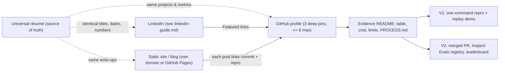

# Online Presence: GitHub, Portfolio Sites, Technical Writing and LinkedIn

> How to make GitHub, a portfolio site, technical writing and LinkedIn checkable in minutes, calibrated to your role family and employer type, with verified platform rules and honest limits.

**Dates, grades and review trigger.** GitHub, README, portfolio-site and writing evidence comes from [T0-20](../../research/sessions/T0-20-github-readme-portfolio-site-writing.md) (retrieved 2026-11-13, with key platform and methodology facts live-verified on 2026-11-19) and [T0-13](../../research/sessions/T0-13-production-portfolio-proof-of-work-standards.md) (2026-10-21). LinkedIn mechanics are summarised here and owned in full by the [LinkedIn guide](linkedin-guide.md) (from [T0-19](../../research/sessions/T0-19-linkedin-profile-search-content-engagement.md)). **Read-depth caveat:** T0-20 opened only 3 of its 66 sources in full (5%: the 2013 CSCW study, Hugging Face Spaces docs and Anthropic's FDE posting); the remaining 63 rest on search extracts and are capped at Grade B or lower [T0-20 L22]. **Review trigger:** `review_by: 2026-12-14` reflects class V1 (31 days from T0-20's 2026-11-13 postings sample); platform and hosting facts (class V2) expire after 90 days. **Grades** (EGP-1.0): A primary opened; B transparent secondary or primary extract; C vendor, practitioner or single source, attributed; D judgement or anecdote; E untraceable (reported as absence); M own count from a sample; P practice-curated and unmeasured.

## The short answer

1. **Résumé first, public proof second — and calibrate to the employer.** No study measures how often or how long reviewers open GitHub, blogs or sites; the widely repeated "87% of tech recruiters review GitHub" claim is untraceable [E · T0-20 L59, L399]. In T0-20's purposive 71-posting sample across 40 employers, public work was routinely named by OSS, inference, startup and embodied-AI employers (Hugging Face 3/3, Inferact 4/4, Sarvam 9/9, NVIDIA competition teams 3/3, embodied AI 6/6) but absent from sampled AI-governance (0/6), human-data contract (0/6) and Anthropic FDE (0/1, read in full) postings [M · T0-20 L58, L69, L310]. Keep keywords on your résumé (58% of US hiring managers in a vendor survey use AI to screen [C · T0-20 L78, L228]) and pair them with 2–3 checkable links.
2. **Keep one identity across every surface.** Match titles, employers, dates and metrics across your [universal résumé](../06-job-search/resume-strategy.md#the-five-layers-and-their-jobs), LinkedIn and GitHub. LinkedIn Recruiter and Hiring Assistant 2 now combine discovery, ATS data and profile verification in one view [B · T0-19 L50, L132]; see the [LinkedIn guide](linkedin-guide.md) for search filters, Open to Work, verification and Premium ROI.
3. **Invest in costly, verifiable GitHub signals; ignore vanity counts.** Employers discount watcher and fork counts [A · T0-20 L60, L121]; a 2024 preprint found ~4.5 million suspected fake stars across 15,835 repositories [B · T0-20 L60, L565–L566]; GitHub bans automated starring and following [B · T0-20 L60, L137–L138]; and the contribution graph counts light actions [B · T0-20 L136]. Pin up to six items (aim for three deep repositories with V1+ evidence READMEs) and archive tutorial forks and single-commit repos [P; A/B · T0-20 L79, L157–L159].
4. **Make every README reproducible and honest about limits.** Across 32,111 Hugging Face model cards, limitations and evaluation were the least-filled sections, and adding detailed cards correlated moderately with downloads in a 42-model intervention [B · T0-20 L64, L570–L571]. Every headline claim must sit at V1 or higher on the [verifiability ladder](../05-portfolio/proof-of-work-standards.md#the-ladder) [P · T0-13 L138].
5. **Default demos to replay-first, and control your own web home.** Hugging Face Gradio and Docker Spaces on compute now require PRO (US$9/month on HF's pages); static Spaces remain free, free accounts get up to 2 ZeroGPU Spaces, and free hardware sleeps [A/B · T0-20 L65, L200]. A personal website is an optional supplement (51% of 60+ surveyed hiring managers said having none would not lower chances; Gun.io reports 95% look and 15% say it carries weight [C · T0-20 L61, L123–L124]). Host writing on a static site you own (such as GitHub Pages) and cross-post — Read.cv shut down within four months of its January 2025 acquisition [B · T0-20 L65, L110, L207].
6. **Keep authorship checkable and write to explain artefacts.** In Resume Genius's 2026 survey (1,500 US hiring managers, COI), 49% flagged heavily AI-generated application materials, and practitioners report 10-minute code walkthrough screens [C · T0-20 L62, L228]. Technical writing is a stated bonus at several infrastructure and OSS employers (four Inferact postings; Hugging Face invites posts and talks [B · T0-20 L67, L213–L215]), but no blog-to-offer rate exists [E · T0-20 L401].

## At a glance



LinkedIn handles recruiter search and initial verification ([LinkedIn guide](linkedin-guide.md)); GitHub and your static write-ups let technical reviewers verify engineering claims in minutes [P; B · T0-20 L78–L84].

## When reviewers look: employer type and role family

Public proof is not equally weighted across GenAI roles. T0-20's purposive, clustered sample of 71 postings across 40 employers (retrieved 2026-11-13; extract-only except Anthropic's FDE posting, read in full — **not** a population rate because Hugging Face and Sarvam queries included GitHub/OSS terms) shows sharp employer- and role-family divergence [M · T0-20 L45, L58, L234–L310]:

| Employer / role cluster | Postings naming public work | What the postings ask for | Practical posture |
|---|---|---|---|
| **OSS-library & inference startups** (Hugging Face 3/3; Inferact 4/4) | 7 / 7 | Merged PRs reviewable on GitHub (required at HF, including a Junior-tagged US role); deep blogs or side projects on vLLM/kernels (bonus at Inferact); public artefact portfolio | **Public proof is central.** Lead with merged upstream PRs, benchmarks and deep write-ups [B/M · T0-20 L58, L238–L253, L372] |
| **Embodied & physical AI** (Humanoid, 1X, General Robotics, Skild AI) | 6 / 6 | Top-tier or first-author publications, OSS releases, simulation/ROS code, shipped systems | **Public proof is central.** Papers, OSS releases and reproducible demo videos [M · T0-20 L70, L282–L287] |
| **Competition-oriented ML teams** (NVIDIA KGMON & related) | 3 / 3 | Kaggle Grandmaster record (required on 2 postings, plus on 1) | **Role-specific.** Pursue Kaggle rank only for competition teams [B/M · T0-20 L68, L255–L257] |
| **Frontier-lab research** (Anthropic research 3/6; Apollo Research 0/1) | 3 / 7 | Original technical work via research papers, OSS LLM frameworks or production impact [COI] | **Papers + code reproductions.** Public take-home routes also exist (see [Communities guide](communities-guide.md)) [M · T0-20 L70, L264–L270] |
| **India AI startups** (Sarvam, query-biased) | 9 / 9 | OSS contributions, strong GitHub portfolio, or publications (listed/preferred) | **High-value differentiator** at Indian AI startups that ask [M · T0-20 L71, L241–L249] |
| **Leadership & fractional** (9 Leadership + 1 fractional) | 5 / 10 | Published research, patents, OSS platform leadership or industry speaking (required in 3) | **Selective.** Check whether speaking/OSS is a requirement or a role duty [M · T0-20 L69, L288, L294–L302] |
| **AI Product Managers** (7AI, Arcade, Eliza, Fractal, contract) | 2 / 5 | Portfolio of AI-native prototypes or shipped side projects (nice-to-have / listed) | **Optional bonus.** One shipped prototype + decision memo [M · T0-20 L69, L271–L275] |
| **India enterprise & IT services** (Walmart Global Tech India, HCLTech, Cognizant, Infosys, GlobalLogic) | 2 / 11 | OSS/publications preferred on 1 Walmart Staff role, optional on 1 HCLTech architect role; others screen on years and stack | **Stay résumé-first.** Treat GitHub as a bonus, not the gate [M · T0-20 L71, L289–L293, L303–L308] |
| **Forward-deployed (Anthropic FDE), AI governance, human-data / eval contracts** | 0 / 13 | Years of experience, frameworks, certifications (e.g. AIGP), domain degrees and assessment exercises | **Skip heavy GitHub investment.** Use sanitised artefacts, credentials and exercise prep [A/M · T0-20 L69, L254, L258–L263, L276–L281] |

### Surface-by-surface comparison

| Surface | What reviewers check | Measured or surveyed weight | Owner / deep guide |
|---|---|---|---|
| **LinkedIn** | Structured filters, semantic search, ATS cross-checks, workplace verification | 9 in 10 of 805 US hiring managers check social profiles in one vendor survey [C · T0-19 L144]; Recruiter & Hiring Assistant 2 mechanics [A/B · T0-19 L49–L50] | [LinkedIn guide](linkedin-guide.md) |
| **GitHub** | Pinned repos (max 6), evidence READMEs, merged upstream PRs, iterative commit history | 2013 CSCW interviews: costly signals trusted, forks/watchers discounted [A · T0-20 L121]; 37% of 4,040 devs rate GitHub #1 for showing skill vs 17% sites [C · T0-20 L125] | This page + [Proof-of-work standards](../05-portfolio/proof-of-work-standards.md) |
| **Hugging Face Hub & Kaggle** | Model/dataset cards (especially limitations/eval), Spaces demos, competition rank | Detailed model cards correlated moderately with downloads [B · T0-20 L64]; Kaggle Grandmaster required for specific NVIDIA teams [B · T0-20 L68] | This page |
| **Portfolio site & technical blog** | Concise hub linking résumé + proof; postmortems, eval write-ups, reproductions | Profy 2021 (60+ HMs, frontend-skewed): 65% definitely look, 51% say no site does not hurt; Gun.io: 95% look, 15% weight [C · T0-20 L61, L123–L124]; blog-to-offer unmeasured [E · T0-20 L401] | This page |
| **Communities & fellowships** | Sustained discussions, facilitated sessions, kernel leaderboards, fellowship cohorts | Company-initiated hiring reported by Cursor's CEO [C · T0-21 L80]; programme-owner fellowship outcomes [C · T0-21 L77] | [Communities guide](communities-guide.md) & [Fellowships and residencies](fellowships-and-residencies.md) |

## GitHub signals: what works versus what is discounted

| Signal | Reviewer inference / status | Evidence | Grade · source |
|---|---|---|---|
| **Merged PRs to active projects** | High-cost, third-party-verified competence (V2) | Weighted by employers in 2013 interviews [A · T0-20 L134]; required by Hugging Face postings [B · T0-20 L238–L240]; drive-by PRs now closed/banned by curl, tldraw, Ladybird and GitHub restrict settings [B/C · T0-20 L66, L230] | A / B · T0-20 L134, L66 |
| **Sustained ownership & iterative history** | Real authorship and ability to ship | Weighted in 2013 interviews [A · T0-20 L135]; walkthrough screens used to verify authorship [C · T0-20 L141, L228] | A / C · T0-20 L135, L141 |
| **Evidence README (eval, cost, limits)** | Engineering and evaluation rigour | Limitations & evaluation are least-filled in 32,111 HF cards [B · T0-20 L64]; `karpathy/nanochat` pattern [B · T0-20 L343] | B · T0-20 L142 |
| **Registered public evaluation** | Externally attested eval competence (V2) | Inspect Evals registration route (arXiv URL + source link; maintenance paper on 70+ evals) [B · T0-20 L149, L353] | B · T0-20 L149 |
| **CI badges fed by endpoint JSON** | Tests and smoke evals actually run | Standard GitHub Actions hosted runners free for public repos (larger runners paid; self-hosted fee postponed); Shields.io endpoint schema requires `schemaVersion: 1` (cache <300s ignored) [B · T0-20 L143, L329–L330] | B / P · T0-20 L143 |
| **Pinned repositories (max 6)** | What you choose to stand behind | GitHub caps pins at 6 repos or gists [B · T0-20 L140, L157]; reviewer weight unmeasured [P] | B / P · T0-20 L140 |
| **Contribution graph** | Weak activity signal | Counts default-branch commits, repo creation, issues, discussions, reviews; needs commit-email mapping; easily gamed [B · T0-20 L136] | B · T0-20 L136 |
| **Stars & followers** | Heavily polluted, low trust | ~4.5M suspected fake stars across 15,835 repos (2019–2024 preprint v1); GitHub AUP bans automated starring/following [B · T0-20 L137–L138, L565–L566] | B · T0-20 L137–L138 |
| **Forks & watchers** | Ignored or negative | Discounted as negligible effort in employer interviews [A · T0-20 L139] | A · T0-20 L139 |

## Profile skeletons by role family

All layouts are practice-curated [P], anchored to employer asks in T0-20's postings sample [T0-20 L161–L176]. V-levels follow the [verifiability ladder](../05-portfolio/proof-of-work-standards.md#the-ladder).

| Role family | First screen (profile README or site) | Pinned set | Target proof | Skip |
|---|---|---|---|---|
| **Applied AI Engineering** | One-line scope + live links to releases and write-ups [B · T0-20 L156] | 1 evaluated RAG or agent system with CI gates; 1 reusable tool/library; 1 technical write-up | V1; V2 if upstream PR | Tutorial PDF-chat clones [P] |
| **ML Engineering & Applied Science** | Link to measured training/fine-tuning results | Reproducible run with cost, hardware and report card [B · T0-20 L343]; model/dataset cards with limits [B · T0-20 L145] | V1 | Titanic, Iris, MNIST notebooks [C · T0-20 L72, L364] |
| **Forward Deployment & Solutions** | Sanitised delivery case studies | MCP servers, agent skills, runbooks with zero client data; 1 end-to-end build [A/B · T0-20 L167] | V1–V3 | Client code or data [P] |
| **AI Infrastructure & Platform** | Hardware, benchmark and kernel links | Pre-discussed merged upstream PRs (vLLM, Triton, NCCL); reproducible serving benchmarks; 1 deep post [B · T0-20 L168] | V2 | Unmeasured speedup claims [P] |
| **Evaluation, Safety & Security** | Evaluation list with method links | Registered Inspect Evals entry [B · T0-20 L353]; error-analysis write-up with calibrated judge [C · T0-20 L63] | V1–V2 | Dangerous payloads; follow disclosure norms [P] |
| **Research** | Papers, reproductions, Google Scholar link | Code with configs and fixed seeds; paper reproduction with deltas; static-blog research notes [B · T0-20 L170, L348] | V2 (publication) | Unreviewed claims [P] |
| **Governance, Risk & Assurance** | Skip GitHub; short static site or PDF | Sanitised model cards, risk registers, framework control mappings; certifications [B · T0-20 L171] | V1–V3 | Confidential employer documents [P] |
| **Product & Program** | Case-study write-ups | 1 shipped prototype + 1 decision memo [M · T0-20 L172] | V1 | Feature wish-lists [P] |
| **Human Data & Eval Ops** | Domain credentials + sanitised rubric sample | Inter-rater agreement write-up [P]; focus on domain screens and exercises [M · T0-20 L173] | V1 | Client data [P] |
| **Embodied & Physical AI** | Short demo videos | Simulation/ROS repos with benchmarks; publications or OSS releases [M · T0-20 L174] | V1–V2 | Unreproducible videos without code [P] |
| **Leadership & Executive** | Public talks and operating-model posts | Team/platform outcomes, talks, OSS stewardship (asked in 4/9 Leadership postings) [M · T0-20 L175] | V3 | Raw commit volume [P] |
| **Independent & Fractional** | Storefront static site + GitHub/publications where asked | Client-safe case studies, public tools [M/P · T0-20 L176] | V1–V3 | Commercial transactions on GitHub Pages (disallowed) [B · T0-20 L207] |

## Hugging Face, Kaggle, portfolio sites and technical writing

### Hugging Face and Kaggle

- **Hugging Face Spaces rules (live-verified 2026-11-19):** Static Spaces are free. Gradio and Docker Spaces running on compute require **PRO** (US$9/month on HF's pages, which also bundles publishing blog articles on an HF profile) or Team/Enterprise; free accounts in good standing can host up to **2 ZeroGPU Spaces** (Gradio SDK only), and free CPU hardware sleeps when idle [A/B · T0-20 L65, L200]. Tutorials claiming free Gradio/Docker compute Spaces are stale [A · T0-20 L433].
- **When Hugging Face beats GitHub:** When your target employer builds around the Hub or ships open weights/datasets — publish full model and dataset cards, especially the **limitations** and **evaluation** sections that most contributors leave blank [B · T0-20 L64, L201].
- **Kaggle:** Do not treat Kaggle as a general GenAI requirement. Verified demand is team-specific (for example, NVIDIA's KGMON postings require a Grandmaster-level competition record; another NVIDIA team treats it as a plus) [B · T0-20 L68, L202].

### Portfolio websites: own your domain, avoid platform lock-in

Build a lightweight static site **after** your résumé and GitHub are solid [C · T0-20 L107]. Put three items above the fold: résumé link, 3 verifiable project/PR links, and 1–2 deep write-ups [P · T0-20 L208].

- **GitHub Pages** is free on public repositories with a 1 GB site limit, soft 100 GB/month bandwidth limit and soft 10 builds/hour limit, and **prohibits commercial or SaaS use** [B · T0-20 L207, L324].
- **Avoid proprietary portfolio or writing silos:** Read.cv was acquired by Perplexity on 2025-01-17 and shut down with a four-month export deadline ending 2025-05-16 [B · T0-20 L65, L207]; Hugging Face places profile blog publishing inside its paid PRO tier [B · T0-20 L110, L200]. Publish canonical Markdown on a static site you control and syndicate excerpts elsewhere [P · T0-20 L83, L110].

### Technical writing and talks: pair every post with code

- **Employer signals:** Four Inferact postings list widely shared technical blogs, GPU-optimisation blogs or a public portfolio of artefacts (bonus or listed); Hugging Face's voice-agent posting invites blog posts, demos and talks and covers travel [B · T0-20 L67, L213–L215]. A secondary summary of *Business Insider* reports Cursor executives scanning X and GitHub profiles [C · T0-20 L126, L216].
- **Survivor accounts versus base rates:** Prolific practitioners (Simon Willison, Rachel Thomas, Eugene Yan) credit blogging for career opportunities [C · T0-20 L218–L220]; one *Towards Data Science* author reported 4–5 data-science offers and roughly two dozen technical-writing offers over 2.5 years [D · T0-20 L221]. All are survivorship-biased; no blog-to-offer conversion rate exists [E · T0-20 L222, L401].
- **What to write:** Aim for **2–4 deep, artefact-backed posts** rather than a high-frequency newsletter — evaluation write-ups, failure postmortems, latency/cost benchmarks or paper reproductions, each linking a pinned commit and reproduce command [P · T0-20 L83, L223]. Disclose AI assistance (communities such as r/LocalLLaMA restrict undisclosed LLM prose [C · T0-12 L417]) and share natively with context in designated community channels rather than pasting bare links [A · T0-12 L168].

### Verified exemplars (with survivor caveat)

Every individual exemplar below carries survivorship bias — copy their **structural pattern**, not the assumption that copying them replicates their career outcome [T0-20 L52, L338–L356]:

| Exemplar | Role family | Pattern worth adopting | Caveat / grade |
|---|---|---|---|
| `karpathy/nanochat` | ML Eng, Research | Reproduction script, stated cost and wall-clock time, report-card table, plain limitations, dated leaderboard | Survivor [B · T0-20 L343] |
| `simonw/simonw` profile README | Applied AI | Self-updating profile README pulling releases, TILs and blog posts via GitHub Actions | 2020 technique (stale-risk); survivor [B · T0-20 L156, L342] |
| `rasbt/LLMs-from-scratch` | ML Eng (teaching) | Structured chapters, exercises, `CITATION.cff`, multi-OS CI badges | Repo summarised, not opened; survivor [C · T0-20 L344] |
| `hamel.dev` AI Evals FAQ (Husain & Shankar) | Evaluation, Applied AI | Maintained reference (updated 2026-09-01) with explicit sample-size and stopping rules (100 traces, 30+ manual, 100–200 labels/failure mode) | Practitioner guidance [C · T0-20 L63, L346] |
| `lilianweng.github.io` (Lil'Log) | Research | Long-form technical notes on a static GitHub Pages blog | Survivor [B · T0-20 L348] |
| `UKGovernmentBEIS/inspect_ai` & `inspect_evals` | Evaluation, Safety | Framework README with test/citation conventions + documented registration route for external evaluations | Route process can evolve [B · T0-20 L352–L353] |
| Anthropic: *Designing AI-resistant technical evaluations* | Infra, Evaluation | Engineering postmortem structure: iterations, what broke, open challenge | COI (Anthropic authored T0-20) [B · T0-20 L350] |

## How to do it

1. **Lock your universal résumé first.** Finalise exact held titles, employers, dates and metrics in layer L1 of the [résumé strategy](../06-job-search/resume-strategy.md#the-five-layers-and-their-jobs). *Done when:* any factual line copies cleanly onto LinkedIn and GitHub with zero edits [P].
2. **Sync LinkedIn using the [LinkedIn guide](linkedin-guide.md).** Align structured fields, enable recruiters-only Open to Work, complete workplace verification and pin 2–3 artefacts in Featured [A/B · T0-19 L71–L76]. *Done when:* LinkedIn matches your résumé verbatim and links to your GitHub evidence [P].
3. **Prune and pin GitHub for your role family.** Archive unmodified tutorial forks, Titanic/MNIST/Iris notebooks and single-commit dumps; retrofit a RAG repo with evaluation instead of deleting it (RAG appears in 26–40% of sampled AI-engineer postings [C · T0-20 L72, L362]) [C/P · T0-20 L79, L365]. Pin 3 deep repos (never more than 6) matching your role-family skeleton above [B/P · T0-20 L79]. *Done when:* nothing pinned is V0 [P].
4. **Upgrade each pinned README to the 13-element standard.** Include claim line with date/commit, results table (baselines, trials, variance), one-command repro, cost and latency, evaluation method (20–50 failure-derived tasks, 100 traces with 30+ manually coded, 100–200 judge labels per failure mode [B/C · T0-20 L63, L196]), architecture diagram, explicit limits, decision log, capped smoke CI badge, replay-first demo, model/dataset cards, `PROCESS.md` AI disclosure and `CITATION.cff`/licence [B/P · T0-20 L180–L195]. See [Proof-of-work standards](../05-portfolio/proof-of-work-standards.md) for PA-01 through PA-15. *Done when:* a stranger can regenerate headline numbers in minutes [P].
5. **Keep authorship verifiable.** Maintain incremental commits, architectural decision records and an explicit AI-use disclosure, and rehearse a 10-minute walkthrough of any file you pin [C · T0-20 L84, L228]. *Done when:* you can explain every design choice and failing trace live without prompts [P].
6. **Add a minimal static site and 2–4 artefact write-ups (if your target role values them).** Skip heavy site work for governance, human-data or services-first targets [M · T0-20 L90, L94]. For engineering, infra and research targets, publish 2–4 deep write-ups on a static site you own and distribute natively in relevant communities and on LinkedIn/X [P · T0-20 L83; A · T0-12 L168]. *Done when:* every post links a pinned commit and reproduce command [P].
7. **Re-audit quarterly.** Check demo links, remove stale hosting claims (such as free Gradio compute Spaces), refresh "last verified" dates and confirm consistency with your résumé [A/B · T0-13.F11; T0-20 L65]. *Done when:* every checklist item below passes [P].

## Templates and examples

### GitHub profile README [P]

```markdown
# [Name]
[Target title] · [location or remote] · [same email as universal résumé] · [LinkedIn] · [static site]

## Verifiable work
- **[System / library]** — [one-line measured result with baseline & method] ([V1/V2]) -> [repo link]
- **[Upstream contribution / Inspect Evals entry]** — [merged PR or registered eval] (V2) -> [link]
- **[Write-up]** — [postmortem or benchmark title] -> [post link]

Focus as of [YYYY-MM]: [one line matching target role family].
```

### AI-system project README skeleton [P; B/C · T0-20 L180–L195]

Weak (V0 — uncheckable):
```markdown
# AI RAG Assistant
Production-ready RAG app with 95% accuracy! Deployed on free Gradio Space.
[Screenshot of chat box]
```

Strong (V1+ — combines T0-13's evidence block [T0-13 L458–L468] with T0-20's README elements [T0-20 L180–L195]):
```markdown
# [Project name]
[One sentence: what it does, for whom, on what corpus; version and date YYYY-MM-DD.]

## Evidence (generated [YYYY-MM-DD] from commit [sha])
| Claim | Metric (with CI / spread) | Method & trials | Reproduce | Hardware / env | Level |
|---|---|---|---|---|---|
| [Hybrid vs dense retrieval] | recall@5 [x] vs [y] (95% CI [a–b]) | [N] failure-derived tasks, [k] trials | `make eval-full` (~[N] min, ~$[N]) | API / [GPU] | V1 |
| [p95 latency at concurrency 8] | [N] ms warm (cold [N] ms) | k6, 5 min, 3 repeats | `make bench` | client [spec]; server [spec] | V1 |
| Cost per successful task | $[N] | price table dated [YYYY-MM-DD] ([URL]) | `make cost` | n/a | V1 |
| [Upstream fix / eval registry] | [PR or Inspect Evals link] | maintainer review | [link] | n/a | V2 |

## Architecture & decisions
[One SVG diagram + link to docs/decisions/ naming rejected alternatives.]

## Evaluation, limits & provenance
- Evaluation harness & judge calibration (100–200 labels/failure mode): [eval_harness/ link]
- Model / dataset cards: [docs/dataset-card.md]
- Known failure modes & non-claims: [docs/failure-analysis.md]
- Replay demo / walkthrough (last verified [YYYY-MM-DD]; spend cap $[N]/mo if live): [link]
- Authorship & AI-use disclosure: [docs/PROCESS.md] · Licence & citation: [CITATION.cff]
```

### Geography note: India

- **Indian AI startups versus enterprise/GCCs:** In T0-20's clustered sample, Sarvam listed GitHub portfolios or OSS in 9/9 engineering extracts (note: retrieved using GitHub/OSS queries), whereas only 2 of 11 enterprise and IT-services postings (Walmart Global Tech India Staff preferred; HCLTech architect optional) mentioned OSS or publications [M · T0-20 L71, L241–L249, L289–L293, L303–L308]. Stay résumé-first for GCC and IT-services pipelines; lead with GitHub at AI startups that ask [M/C · T0-20 L94].
- **LinkedIn India specifics:** Notice-period and expected-salary Open to Work fields, the 74% recruiter-difficulty survey and multi-board strategy (Naukri, Instahyre, Cutshort) live in the [LinkedIn guide](linkedin-guide.md#geography-note-india).

## Checklist

**Cross-surface identity**
- [ ] Name, email, held titles, employers, dates and headline metrics match identically across résumé, LinkedIn and GitHub [D · T0-04 R7; B · T0-19 L132]
- [ ] LinkedIn setup completed per the [LinkedIn guide](linkedin-guide.md) [P]

**GitHub profile and repositories**
- [ ] Pinned set calibrated to target role family: 3 deep repositories (maximum 6), zero unmodified tutorial forks or single-commit dumps [B/P · T0-20 L79, L157–L159]
- [ ] Every pinned README opens with a dated, commit-linked V1+ evidence block, cost/latency methodology and an explicit limits section [B/P · T0-20 L64, L180–L195]
- [ ] Evaluation harness reflects failure-derived tasks, 100+ traces (30+ manually coded) and calibrated judges (100–200 labels/failure mode) [B/C · T0-20 L63, L196]
- [ ] Incremental commit history, decision log and `docs/PROCESS.md` AI-use disclosure intact; ready for a 10-minute live walkthrough [C · T0-20 L84, L228]
- [ ] Demos are replay-first, dated and capped (OpenAI hard-limit toggle on; named Anthropic Console workspace); no stale "free Gradio compute Space" instructions [A/B · T0-20 L65, L81]
- [ ] Upstream PRs are pre-discussed and small (or evaluations registered via Inspect Evals); zero drive-by PRs [B · T0-20 L66, L82]

**Site, Hugging Face and writing**
- [ ] Static site hosted on exportable, own-controlled infrastructure (not a closed or SaaS-locked platform; no commercial use on GitHub Pages) [B · T0-20 L65, L110, L207]
- [ ] 2–4 deep artefact-backed write-ups published with code/repro links and AI disclosure; shared natively with context [P · T0-20 L83; A · T0-12 L168]
- [ ] Hugging Face model/dataset cards include limitations and evaluation sections where Hub artefacts apply [B · T0-20 L64]

## Pitfalls

| Red flag | Why it hurts | Fix |
|---|---|---|
| Treating "87% of recruiters check GitHub" as fact | Untraceable SEO claim [E · T0-20 L399]; whether reviewers open GitHub varies sharply by employer and role [M · T0-20 L58] | Keep résumé keywords first; calibrate GitHub investment to the posting |
| Chasing GitHub stars, followers or green squares | ~4.5M suspected fake stars; rank abuse banned by GitHub AUP; graph counts light actions [B · T0-20 L60, L136–L138] | Spend effort on V1 reproducibility and V2 upstream merges |
| Squashed single-commit or AI-polished repos you cannot walk through | 49% of surveyed US hiring managers flag heavily AI-generated materials; walkthrough screens expose unowned code [C · T0-20 L62, L228] | Keep incremental history, write `docs/PROCESS.md` and rehearse live walkthroughs |
| Leaving limitations and evaluation blank on READMEs or HF cards | Least-filled sections across 32,111 model cards; filling them distinguishes serious work [B · T0-20 L64] | Commit an explicit failure-analysis and non-claims section |
| Building a portfolio site before fixing résumé and GitHub | 51% of surveyed managers say no site does not hurt; a broken site can hurt [C · T0-20 L61, L206] | Build a minimal static site only after résumé and 2–3 pinned repos pass |
| Locking writing or profiles inside proprietary platforms | Read.cv closed 4 months after acquisition; HF blog publishing sits behind PRO [B · T0-20 L65, L110] | Publish canonical Markdown on a static site you own; cross-post excerpts |
| Hosting uncapped live demos or citing free Gradio compute Spaces | Gradio/Docker on compute require PRO (US$9/mo); free hardware sleeps; OpenAI alerts do not cap and Claude Default Workspace cannot be capped [A/B · T0-20 L65, L200] | Default to static/replay demos with a recorded walkthrough and hard caps if live |
| Sending drive-by PRs for GitHub visibility | curl ended its bug bounty, tldraw and Ladybird closed external PRs, GitHub added PR-restrict settings [B/C · T0-20 L66, L230] | Open a discussion first, keep PRs small, or register an evaluation via Inspect Evals |
| Investing in GitHub when targeting governance or human-data contracts | 0 of 12 sampled governance and human-data postings asked for GitHub [M · T0-20 L69] | Focus on sanitised artefacts, credentials, domain depth and exercises |
| Treating Kaggle rank as universally required | Verified demand is team-specific (e.g. NVIDIA KGMON) [B · T0-20 L68] | Pursue Kaggle only when targeting competition-focused teams |

## Evidence and limits

- **Primary opened sources (few).** In T0-20, only 3 of 66 ledger sources were opened in full (5% Read rate): Marlow & Dabbish CSCW 2013 interviews (n = 13, stale-risk) [A · T0-20 L121], Hugging Face Spaces official docs [A · T0-20 L200] and Anthropic's FDE posting [A · T0-20 L254]. Platform rules (HF Spaces PRO/ZeroGPU, GitHub Actions billing, GitHub AUP, GitHub partial clones, Husain & Shankar's 100–200 label FAQ) were independently live-verified via web search on 2026-11-19.
- **Secondary and sample-based evidence.** 71-posting purposive sample across 40 employers (extract-only except 1 posting; Hugging Face and Sarvam queries contained GitHub/OSS terms — **do not extrapolate as market rates**) [M · T0-20 L45, L310]; 32,111 HF model-card study (*Nature Machine Intelligence*, extract) [B · T0-20 L64]; 4.5M fake-star preprint v1 (extract) [B · T0-20 L60]; Profy 2021 (n = 60+, frontend-skewed), Gun.io, daily.dev 2025 (n = 4,040 developers) and Resume Genius 2026 (n = 1,500 hiring managers, COI) [C · T0-20 L61–L62, L123–L125]; RAG (26–40%) and evaluation (56% of 390) vendor analyses [C · T0-20 L72, L362–L363]. Anthropic-linked rows in T0-20 carry COI disclosure [T0-20 L13].
- **Searched, not found.** Measured recruiter open rates, stage or duration for GitHub, sites or blogs [E · T0-20 L398]; original source for "87% of tech recruiters review GitHub" [E · T0-20 L399]; post-2013 peer-reviewed GitHub signal inference studies [E · T0-20 L400]; blog- or talk-to-offer rates [E · T0-20 L401]; measured weight of a live demo against a repo [E · T0-20 L402]; peer-reviewed data on AI-written READMEs [E · T0-20 L403]; level-calibrated proof evidence (T0-20 K2 unverifiable: even a Junior-tagged HF posting asks for public OSS) [C · T0-20 L372]; Big Tech reviewer behaviour beyond Anthropic and NVIDIA [E · T0-20 L404]; static site-generator comparisons [E · T0-20 L410].
- **What would change this advice.** Tracked link-open telemetry or ATS analytics by employer type; a blinded field experiment testing GitHub links on callbacks; policy/price changes at GitHub, Hugging Face or Cloudflare; or verified provenance standards adopted by hiring teams [T0-20 L96–L101].

## Next steps

- **Deep LinkedIn strategy:** [LinkedIn guide](linkedin-guide.md).
- **Full portfolio rubric, artefacts PA-01–PA-15 and demo hardening H1–H14:** [Proof-of-work standards](../05-portfolio/proof-of-work-standards.md) and [Project archetypes](../05-portfolio/project-archetypes.md).
- **Turn public proof into interviews:** [Referrals and outreach](referrals-and-outreach.md), [Communities guide](communities-guide.md) and [Fellowships and residencies](fellowships-and-residencies.md).
- **Keep your source-of-truth résumé aligned:** [Résumé strategy](../06-job-search/resume-strategy.md) and [ATS mechanics](../06-job-search/ats-mechanics.md).
- **Role hubs:** [AI Engineer](../02-roles/hubs/ai-engineer.md), [ML Engineer](../02-roles/hubs/ml-engineer.md), [AI Evaluation Engineer](../02-roles/hubs/ai-evaluation-engineer.md), [Inference Engineer](../02-roles/hubs/inference-engineer.md), [Research Engineer](../02-roles/hubs/research-engineer.md).
- **Stage overview and evidence:** [Networking README](README.md), [T0-20](../../research/sessions/T0-20-github-readme-portfolio-site-writing.md) and [T0-19](../../research/sessions/T0-19-linkedin-profile-search-content-engagement.md).
