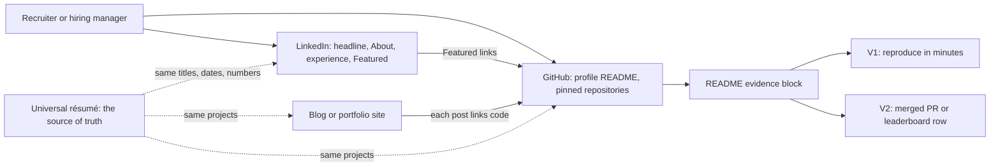

# Online Presence: What Recruiters and Hiring Managers Find

> What recruiters and hiring managers find when they look you up on LinkedIn, GitHub and a blog or portfolio site, and how to make those surfaces consistent with your résumé and checkable in minutes.

**Dates and grades.** Facts come from research sessions dated October 2026: [T0-12](../../research/sessions/T0-12-high-signal-communities-technical-visibility.md) (communities and visibility, 21 October), [T0-13](../../research/sessions/T0-13-production-portfolio-proof-of-work-standards.md) (portfolio standards), [T0-04](../../research/sessions/T0-04-ats-filtering-funnel-conversion-math.md) (screening and funnels), [T0-11](../../research/sessions/T0-11-certification-cloud-credential-roi.md) (credentials) and [T0-05](../../research/sessions/T0-05-unconventional-hiring-tactics-oss-audits.md) (open source and outreach). Re-verify platform and hiring-channel facts by 2027-01-19. No session measures how often recruiters open a LinkedIn or GitHub profile, so most formats on this page are practice [P]. **Grades** (EGP-1.0): A primary or measured; B transparent secondary; C vendor, practitioner or single source; D judgement; P practice-curated and unmeasured.

## The short answer

1. **Treat your profiles as the place a reviewer checks you, not the place you get found.** LinkedIn's documented problem is application volume: about 11,000 applications per minute, up 45% year on year (a late-2024 figure). In 2026, 74% of India recruiters told LinkedIn they struggle to find qualified candidates, with AI-generated applications a key challenge [B · T0-12.F2]. Use LinkedIn and X as a distribution layer for your own work [B · T0-12 L188].
2. **Keep one identity everywhere.** Use the same name, contact details, titles, employers and dates on your résumé, LinkedIn and GitHub. Fraud and spam dilute cold-inbound averages [B · T0-04.F11]. That consistency reduces false fraud flags is inferred from the documented signal types, and T0-04 holds it with low confidence [D · T0-04 R7, L141].
3. **Put titles, languages and frameworks where search reads them.** Published 2026 recruiter Boolean strings for AI/ML engineers key on titles, languages and frameworks, and contain no certification acronyms [C · T0-11.F3]. AI matching layers score title similarity (Eightfold) and recruiter-set skills, experience, title and location (Phenom) [A · T0-04.F8].
4. **Make every headline claim checkable in minutes.** Rate claims on T0-13's verifiability ladder and headline only V1 (reproducible) or higher, such as V2 (externally attested) [P · T0-13 §4.1]. Every channel is raising its guard against low-effort volume, which raises the value of hard-to-fake, verifiable artefacts [B/C · T0-05.F12].
5. **Write to explain your artefacts, not to build an audience.** Writing as an inbound channel rests on two prolific authors' anecdotes, with no blog-to-offer data [C · T0-12.F11]. One employer posting, Inferact's (posted 18 June 2026), lists "widely-shared technical blogs or side projects on vLLM or LLM inference" as a bonus [B · T0-05 L109, L157, L642]. Pair each post with a V1 artefact.
6. **Prune before you polish.** Archive unmodified tutorial forks, Titanic, MNIST and Iris notebooks, and single-commit repositories; upgrade a mediocre repository into a measured system rather than deleting it [C · T0-13 L140; T0-13.F2].

## At a glance



LinkedIn is where you are searched and cross-checked; GitHub and your write-ups are where claims are verified; the [universal résumé](../06-job-search/resume-strategy.md#the-five-layers-and-their-jobs) is the source every surface copies [P].

## The verifiability ladder

Rate every public claim on T0-13's verifiability ladder by what it costs a reviewer to check it: V0 self-asserted, V1 reproducible, V2 externally attested, V3 operationally evidenced. Headline only V1 or higher, and at senior and staff level, where evidence is externally verifiable engineering plus influence, aim for V2 items [D · T0-13 L131–138; B · T0-13.F9]. The full ladder, with examples, reviewer costs and what each level must prove, is in [proof-of-work standards](../05-portfolio/proof-of-work-standards.md#the-ladder).

## The four surfaces and what each must prove

| Surface | What a searcher checks | What it must prove | Evidence |
|---|---|---|---|
| LinkedIn | Title, skills and employers against a search string; consistency with your résumé | That you are the person on the résumé, in the role family being searched | [C · T0-11.F3]; [A · T0-04.F8]; [D · T0-04 R7] |
| GitHub | Pinned repositories, READMEs, contribution history | That your claims reproduce, and that maintainers or leaderboards attest to your work | [P · T0-13 §4.1]; one 2025 open-source side event in Paris asked people to reserve a spot by sharing a GitHub profile [B · T0-12 L271] |
| Blog or portfolio site | Write-ups that explain what you measured and why | That you can reason about trade-offs, and that every post points to code | [C · T0-12.F11]; [B · T0-05 L109] |
| Community footprint | Issues, discussions, facilitated sessions, leaderboard rows | Sustained, good-quality contribution over time, which is what teams that hire from their own communities say they look for | [A · T0-12 L263]; see the [communities guide](communities-guide.md) |

## How to do it

1. **Fix the source of truth.** Settle your universal résumé first: titles, employers, dates, project names and numbers. It is the generic profile, layer L1, in the layered résumé model of the [résumé strategy](../06-job-search/resume-strategy.md#the-five-layers-and-their-jobs), anchored on one identity. *Done when:* any line could be pasted onto LinkedIn without changing a fact [P].
2. **Align LinkedIn with it.** Keep the headline, About section and skills consistent with the universal résumé, because identity mismatches risk fraud flags (the [résumé strategy](../06-job-search/resume-strategy.md#what-the-universal-résumé-can-and-cannot-cover-computed)'s rule, resting on [D · T0-04 R7]). Add each credential to Licenses and Certifications *and* its related skills to Skills, because sources disagree on which field recruiter search reads [C · T0-11 L133]. *Done when:* a side-by-side read finds no mismatch in titles, dates or numbers [P].
3. **Prune GitHub.** Archive tutorial forks, toy-dataset notebooks and single-commit repositories, or retrofit them into measured systems [C · T0-13 L140]. *Done when:* nothing pinned is V0 [P].
4. **Add an evidence block to each pinned README.** Use T0-13's template below. *Done when:* every headline claim carries a level of V1 or higher [P · T0-13 L138].
5. **Feature your strongest attested item.** Put a merged upstream PR, a leaderboard row with a commit hash or an independent reproduction in LinkedIn's Featured section and at the top of your GitHub profile README [P]. *Done when:* a reviewer reaches one V2 item in one click from LinkedIn [P].
6. **Write about what you built.** Follow the writing plan below. *Done when:* each post links a repository, a commit and a reproduce command [P].
7. **Distribute with context.** Share each post in the designated channel of the communities where you are active, with a native summary rather than a bare link [A · T0-12 L168]; use LinkedIn and X to distribute it further [B · T0-12.F2]. *Done when:* each post has gone to each relevant channel once [P].
8. **Re-audit once a quarter.** Re-run the checklist and remove stale tool advice, which is itself a red flag in 2026 [A/B · T0-13.F11]. *Done when:* every checklist item passes [P].

## Templates and examples

### Headline: weak → strong

The formula is practice [P]. Title first, because search strings and matching layers key on titles [C · T0-11.F3; A · T0-04.F8].

| | Headline | Why |
|---|---|---|
| Weak | "Passionate AI enthusiast · Open to opportunities · Learning GenAI" | No title, language or framework that a search string would match; nothing a reviewer can check |
| Formula [P] | "[Target title, as postings write it] · [language] · [framework or stack] · [one checkable proof]" | Searchable terms first, then one V1 or V2 pointer |
| Strong | "AI Engineer · Python · RAG evaluation and agent tooling · merged fixes in [project]" | Every term appears in target postings; the proof is V2 |

Use a target title in the headline only when your day-to-day work already matches it, and keep experience titles exactly as held, so the headline never contradicts your résumé [P; D · T0-04 R7].

### About section [P]

```text
[One sentence: the work you do, in your target title's words, with your stack.]

Evidence:
- [Claim with a number] -> [link to a V1 repository, or a V2 PR or leaderboard row]
- [Claim with a number] -> [link]

Looking for: [role family], [location or remote], from [month year].
Contact: [the same email as on your résumé]
```

### Experience entry: weak → strong [P]

| Weak | Strong |
|---|---|
| "Worked on exciting GenAI projects using LLMs." | "[Action verb] [system] for [users or scale] at [employer], [measured result] ([method]); [tools]." The same line, word for word, as on your résumé. |

### Pinned-repository README: weak → strong

The weak version is all V0 [T0-13 L133]:

```markdown
# RAG Chatbot
Production-ready RAG chatbot. Achieves 95% accuracy!
[A screenshot of the chat window, and nothing else]
```

The strong version opens with T0-13's evidence block, where every value is a placeholder [T0-13 L458–468]; the surrounding layout is practice [P]:

```markdown
# [Project name]
[One line: what it does, for whom, on what data.]

## Evidence (generated [YYYY-MM-DD] from commit [sha])
| Claim | Metric | Method | Reproduce | Hardware / env | Level |
|---|---|---|---|---|---|
| Hybrid retrieval beats dense on my test split | recall@5 [x] vs [y] (95% CI [a–b]) | [N]-question test split, author-labelled | `make eval-full` (about [N] min, about $[N]) | API only | V1 |
| p95 latency at 8 concurrent | [N] ms (cold [N] ms) | k6, 5 min, 3 repeats | `make bench` | client [spec]; server [spec] | V1 |
| Cost per successful task | $[N] | price table dated [YYYY-MM-DD] ([URL]) | `make cost` | n/a | V1 |
| Upstream fix merged | [PR link] | maintainer review | link | n/a | V2 |

## Limits
[What the evaluation does not cover; known failure cases.]
```

Latency and cost numbers need their methodology beside them [B · T0-13.F5], and what counts as evaluation evidence is specific as of 2026 [A · T0-13.F4]. The full standard is in [Proof-of-work standards](../05-portfolio/proof-of-work-standards.md).

### GitHub profile README [P]

```markdown
# [Name]
[Target title] · [location or remote] · [email, same as on your résumé]

Evidence I would point a reviewer to:
- [Project]: [claim with a number], [V1 or V2] -> [repository link]
- [Upstream PR in project]: [what it fixed] -> [PR link]
- [Write-up]: [title] -> [post link]

Working on, as of [month year]: [one line]
```

### Credentials on LinkedIn

Give the full name, exam code, issue and expiry dates and a public verification link (for example Credly). Never present a retired exam as current; label one you still hold "valid to [date]". For AI/ML engineer roles, lead with projects and measured outcomes and list certifications after them [C · T0-11 L132–135]. Which credentials are worth holding is covered in [Credential ROI](../04-certifications/credential-roi.md).

## A writing plan: every post paired with an artefact

The pairing is practice [P]. Cadence: one substantive post every two to three weeks; the cadence is the session author's judgement [C · T0-12 L152].

| Post | Pairs with | Level | Why this pairing |
|---|---|---|---|
| "What I measured": an evaluation write-up | A repository whose one command regenerates the results table | V1 | Evaluation literacy is the most consistently cited separator [B · T0-13.F3] |
| Latency and cost under load | A benchmark script with method, repeats and hardware | V1 | Latency and cost proof must include methodology, not only numbers [B · T0-13.F5] |
| An upstream fix explained | The merged PR, and the issue or discussion that preceded it | V2 | Headline open-source work only as a pattern; T0-05's threshold is at least 3 merged or in-review PRs plus 5 reviews or triage actions in one area [D · T0-05 L194] |
| A competition write-up | Your leaderboard row with a commit hash | V2 | Write up after the leaderboard closes, which is judgement [D · T0-12 L372] |
| Paper Club notes or an explainer | A session you facilitated; code if you reproduced a result | V1 if reproduced | Publishing notes after facilitating is judgement [D · T0-12 L366] |
| A postmortem | 30+ days of uptime and spend logs, and an incident | V3 | T0-13's example of operational evidence [T0-13 L136] |

Rules for the writing:

- **Prefer verifiable posts.** Reproducible, benchmarked or source-linked posts are easier for a hiring person to verify than opinion posts. That is judgement: no evidence exists on which topics, lengths or formats work [D · T0-12 L416].
- **Disclose AI help.** Several communities restrict LLM-generated copy, among them r/LocalLLaMA (rules read through a mirror) [C · T0-12 L417].
- **Attach writing to a community.** Writing alone was rejected as a plan; Latent Space's own advice is to attach to an existing community and produce artefacts [C · T0-12 L194].
- **Share natively.** Post in the designated channel with context [A · T0-12.F9], then distribute on LinkedIn and X [B · T0-12.F2].
- **Guest posts.** Latent Space's about page lists guest posts, but T0-12 found no submission guidelines [B · T0-12 L410].

## Consistency rules with the universal résumé

| Field | Rule | Grade |
|---|---|---|
| Name, email, phone | Identical on résumé, LinkedIn and GitHub; a stable real email address and mobile number; no VPN or disposable email while applying | D · T0-04 R7 |
| Titles and employers | As held, word for word, on the résumé and in LinkedIn's experience section | D · T0-04 R7 |
| Dates | Same month and year on every surface | P |
| Headline, About, skills | Consistent with the universal résumé, because identity mismatches risk fraud flags | D · T0-04, via the [résumé strategy](../06-job-search/resume-strategy.md#what-the-universal-résumé-can-and-cannot-cover-computed) |
| Skills | Consistent with the evidence in your bullets | A (mechanics) / D (advice) · T0-04 R4 |
| Numbers | Every metric on LinkedIn or in a post appears, with the same value, in a README evidence block at V1 or higher | P · T0-13 §4.1 |
| Project names | One name per project across résumé, LinkedIn Featured, GitHub and posts | P |
| Credentials | Full name, exam code, dates and verification link; retired exams labelled "valid to [date]" | C · T0-11 L132–134 |

If you also run family or role résumés, LinkedIn mirrors the universal one, which is the version uploaded to platforms and recruiter databases [P]; the layers are set out in the [résumé strategy](../06-job-search/resume-strategy.md#the-five-layers-and-their-jobs).

### Geography note: India

- In LinkedIn's 2026 India report, about 80% of recruiters planned to use more AI for screening and sourcing, and applicants per job had more than doubled since 2022 [B · T0-12 L75]. Write the profile for both search strings and matching layers.
- Certificates count most where hiring runs through IT services, staffing agencies, hyperscaler partners and GCC volume programmes; the direction is supported, the size is unmeasured [B/C · T0-11.F8]. For those targets, keep the Licenses and Certifications section complete.
- T0-12 did not cover how India's services firms and global capability centres hire; LinkedIn may carry more weight there than this page assumes [D · T0-12 L452].

## Checklist

**LinkedIn**

- [ ] Headline: target title as postings write it, language, framework, one checkable proof [P; C · T0-11.F3]
- [ ] About: the work you do, evidence lines linking V1 or V2 artefacts, what you want, the same email as your résumé [P]
- [ ] Experience: titles, employers and dates identical to the universal résumé [D · T0-04 R7]
- [ ] Experience bullets: the same claims and numbers as the résumé [P]
- [ ] Featured: one V2 item and one write-up, each one click away [P]
- [ ] Skills: the languages and frameworks your bullets use [C · T0-11 L133]
- [ ] Licenses and Certifications: full name, code, dates, verification link; no retired exam shown as current [C · T0-11 L132–134]

**GitHub**

- [ ] Profile: same name and email as the résumé; a profile README that points to evidence [D · T0-04 R7; P]
- [ ] Pinned repositories: no tutorial forks, toy-dataset notebooks or single-commit repositories [C · T0-13 L140]
- [ ] Each pinned README opens with an evidence block: claim, metric, method, reproduce, environment, level [P · T0-13 L458–468]
- [ ] Every headline README claim is V1 or higher [P · T0-13 L138]
- [ ] Open-source work headlined only as a pattern in one area [D · T0-05 L194]
- [ ] No stale tool advice [A/B · T0-13.F11]

**Blog or portfolio site**

- [ ] Each post links a repository, a commit and a reproduce command [P]
- [ ] AI assistance disclosed where used [C · T0-12 L417]
- [ ] Any live demo endpoint is a deliberate choice: it cuts verification cost but carries real risk [A · T0-13.F6]

**Across surfaces**

- [ ] One identity across résumé, LinkedIn, GitHub and site [D · T0-04 R7]
- [ ] Posts shared with context in community channels, not as bare links [A · T0-12 L168]

## Pitfalls

| Red flag | Why it hurts | Fix |
|---|---|---|
| Titles or dates differ between résumé and LinkedIn | Identity mismatches risk fraud flags (inferred) [D · T0-04 R7] | Copy every fact from the universal résumé |
| Screenshot metrics: "achieves 95% accuracy" | V0: a reviewer cannot verify it [T0-13 L133] | An evidence block with a reproduce command |
| Pinned tutorial forks and toy notebooks | T0-13 advises archiving them [C · T0-13 L140] | Archive, or retrofit into a measured system |
| Adjective headline with no title or stack | Search strings key on titles, languages and frameworks [C · T0-11.F3] | Title · language · framework · proof |
| A credential as the headline's main claim | Recruiter strings for AI/ML roles contain no certification acronyms [C · T0-11.F3] | Projects first; credentials in their own section |
| LinkedIn as the main channel | Applications are saturated [B · T0-12.F2] | Use it to distribute; relationships form in communities and through referrals |
| Undisclosed AI-written posts | Several communities restrict LLM-generated copy [C · T0-12 L417] | Write it yourself; disclose help |
| Bare links to your posts dropped in communities | MLOps Community calls this "lazy" [A · T0-12 L168] | A native summary in the designated channel |
| Headlining one merged pull request | A single merged contribution is the modal outcome, and a weak signal by itself [A · T0-05.F3] | Build a pattern in one area first |
| Stale tool advice in READMEs or posts | Itself a red flag in 2026 [A/B · T0-13.F11] | Date tool claims; re-audit once a quarter |
| Inflated or unverifiable proof | Authorship verification is the live problem of 2026 [B/C · T0-13.F8]; Gartner predicts that a quarter of candidates could be fake by 2028 [B · T0-12 L293] | Evidence at V1 or higher only |

## Evidence and limits

- **Measured or primary.** Vendor documentation of AI matching features, including title similarity [A · T0-04.F8]. The LinkedIn application-volume figure (New York Times via eWeek, late 2024, so about two years old) and LinkedIn's 2026 India recruiter survey, a vendor survey [B · T0-12 L291–292].
- **Single-source or anecdotal.** Recruiter Boolean strings [C · T0-11.F3]; writing as an inbound channel, from two authors describing their own paths, with survivorship bias not ruled out [C · T0-12.F11]; the Inferact posting, one employer, read through a job-board mirror [B · T0-05 L109, L157, L564].
- **Judgement.** Identity consistency [D · T0-04 R7], held with low confidence [T0-04 L141]; the writing cadence [C · T0-12 L152]; the verifiability ladder [P · T0-13 §4.1]; every headline, About and README formula on this page [P].
- **Not measured.** How often recruiters or hiring managers open LinkedIn, GitHub or a blog; which headline or README format performs better; blog-to-offer rates [T0-12 L415]; engagement-farming prevalence on LinkedIn or X, searched for and not found [T0-12 L462]. On X, Axios (10 September 2026) describes AI-industry hiring moves ricocheting there [B · T0-12 L75].
- **What would change this advice.** A measurement of how reviewers use profiles; a controlled or large observational comparison of writing, open-source work and cold outreach as routes to offers [T0-12 L487]; evidence on how fraud screens treat identity mismatches in practice.

## Next steps

- **Build something worth showing:** [Proof-of-work standards](../05-portfolio/proof-of-work-standards.md) and [Project archetypes](../05-portfolio/project-archetypes.md).
- **Turn visibility into a referral:** [Referrals and outreach](referrals-and-outreach.md).
- **Where to share your work:** [Communities guide](communities-guide.md).
- **The résumé every profile copies:** [Résumé strategy](../06-job-search/resume-strategy.md) and the [résumé skills matrix](../06-job-search/resume-skills-matrix.md); screening mechanics are in [ATS mechanics](../06-job-search/ats-mechanics.md), and the wider plan is the [job-search strategy](../06-job-search/job-search-strategy.md).
- **Credentials:** [Credential ROI](../04-certifications/credential-roi.md).
- **Role hubs:** [AI Engineer](../02-roles/hubs/ai-engineer.md), [ML Engineer](../02-roles/hubs/ml-engineer.md), [AI Evaluation Engineer](../02-roles/hubs/ai-evaluation-engineer.md), [Inference Engineer](../02-roles/hubs/inference-engineer.md).
- **Evidence:** [findings for stage 07](../../research/findings.md#stage-07), [stage 05](../../research/findings.md#stage-05) and [stage 06](../../research/findings.md#stage-06); the stage overview is the [Networking README](README.md).
