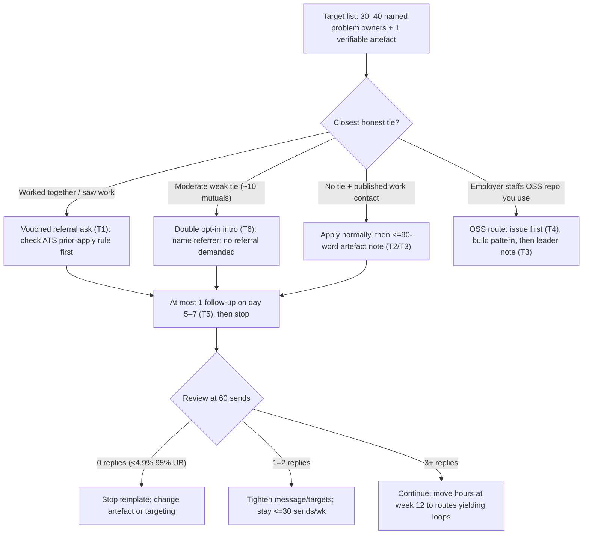

# Referrals and Outreach: Vouched Ties, Cold Notes, Outreach Law and Open Source

> How to earn vouched referrals, run double opt-in introductions, write compliant artefact-led cold notes across seven jurisdictions, avoid recruiter scams and decide when open source pays off.

**Dates, grades and caveats.** Referral economics, ATS mechanics, contact-finder updates, recruiter fees, yield-per-hour calculations and outreach law come from [T0-22](../../research/sessions/T0-22-referrals-warm-intros-cold-outreach-law.md) (researched 2026-11-11; 9 of 62 ledger sources opened in full [15%], 53 extract-only; legal statutes and tool pricing independently live-verified via web search on 2026-11-19). Open-source repository rules and micro-audit standards come from [T0-05](../../research/sessions/T0-05-unconventional-hiring-tactics-oss-audits.md) (commits pinned 2026-10-21), updated with [T0-20](../../research/sessions/T0-20-github-readme-portfolio-site-writing.md) (2026-11-13) and [T0-21](../../research/sessions/T0-21-x-frontier-communities-fellowships-events.md) (2026-11-14). **Legal disclaimer:** *The outreach-law section is pointers, not legal advice.* **Review trigger:** `review_by: 2027-01-19` reflects class V2 (90 days from the earliest unrefreshed T0-05 repository/platform rules dated 2026-10-21); statutes are class V4 (365 days), with India's DPDP core duties commencing May 2027. **Grades** (EGP-1.0): A primary opened or peer-reviewed field experiment; B transparent secondary or sizeable dataset; C vendor, practitioner or single source, attributed; D judgement; E untraceable (reported as absence); M calculation; P practice-curated.

## The short answer

1. **Vouched referrals carry real information — stranger and paid referrals do not.** In Ashby's dataset (38M applications, 2021–2024), referred applications reached interview at 40% versus 3% inbound and converted interviews to offers at 16% versus 6% (~6.4 vs ~0.18 offers per 100 applications, ≈36×; sourced ~1.5 per 100, ≈8×; Gem reports 11× referrals and 4–8× sourced across 165M applications) [B/M · T0-22 L72, L320]. Peer-reviewed field experiments confirm referrals transmit performance and persistence information invisible on a CV — not pure selection — while flat or oversized referral bonuses distort quality [A/B · T0-22 L74–L75, L142–L145]. Never ask strangers or pay for referrals: GitLab instructs staff to decline stranger asks, and a survey (n ≈ 500) rated cold referrals net negative at FAANG-type firms and small startups [A/C · T0-22 L78, L175].
2. **Run referrals beside normal applications, and ask how the employer's ATS handles prior applicants.** Referrals account for ~18% of hires from ~1% of applications, against 43–52% inbound; the "70–85% hidden job market" traces to a 1966 claim and a 2016 self-selected poll [B/C/E · T0-22 L73]. Prior applications do not universally "block" a referral — treatment is employer- and ATS-specific (for example, GitLab downgrades a progressed application to a non-bonus endorsement; Greenhouse and Lever allow source edits or duplicate rules) [A/B · T0-22 L77, L161–L164, L322]. Ask the referrer before applying; if you already applied, tell them immediately and request an endorsement [B · T0-22 L93].
3. **Budget referral time rationally: break-even is under ~6–12 hours per vouched referral.** At an assumed 3 cold applications/hour, cold applying yields ~0.0054 offers/hour (~1 offer per 185 hours); a vouched referral beats cold applying if secured in under ~11.9 hours — or ~5.9 hours if half the lift is selection [M · T0-22 L85, L248–L254]. Prefer a referrer in the **same function** (in Ashby's 2026 benchmarks on business roles, same-function referrals interviewed at 37% vs 26% and converted at 5.2% vs 3.1%) [B · T0-22 L77].
4. **No measured candidate cold-outreach reply rate exists; judge batches at 60 sends.** Every 15–50% reply claim traces to vendor blogs [E · T0-22 L79]. Sales and recruiter datasets are **proxies only**: Instantly cold sales email averages 3.43% (5.5% top quartile, 10.7% top decile; best under 80 words; 58% of replies on email 1), and Pin recruiter-to-candidate outreach gets 4.96–6.31% on email and 17.08% on LinkedIn [B/C · T0-22 L79, L191, L516–L518]. Zero replies in 60 sends bounds your true rate below 4.87% (~4.9%, one-sided 95%), though a true 3% rate still produces zero replies 16.1% of the time — change the artefact or target list before raising volume [M · T0-22 L80, L524–L525].
5. **Keep cold outreach individual, role-relevant and one-to-one — and avoid scrapers, bought lists and fee-charging recruiters.** Anti-spam statutes across the EU, UK, US, Canada, India, Singapore and Australia target commercial/direct-marketing messages; a personal request for employment probably falls outside by definition, **but no regulator has confirmed this**, GDPR's household exemption is read narrowly (CJEU C-25/17), UK PECR fines rose to £17.5M or 4% of turnover in February 2026, and CNIL fined Kaspr €240,000 for scraping restricted LinkedIn contacts [A/B (rules); D (job-seeker reading) · T0-22 L81–L82, L215, L220–L228]. Legitimate recruiters are always employer-paid; any candidate fee demand is a scam signal [B/C · T0-22 L83, L232–L235].
6. **Headline open source only after a sustained pattern in an employer-aligned repository.** Single-commit identities account for 49–82% of contributors across eight audited AI repos [A · T0-05.F3], while vLLM, PyTorch, llama.cpp, transformers, Zed and Ghostty enforce strict issue-first and AI-disclosure policies (including permanent bans for undisclosed AI use) [A · T0-05.F4; T0-21 L85]. Aim for 3+ merged or in-review PRs plus 5+ substantive reviews/triages in one area — and stop at week 8 with no merge or maintainer exchange [D · T0-05 L83, L209].

## At a glance



## Referral economics, ATS mechanics and yield per hour

### Funnel rates and what drives them

| Route | Application → interview | Interview → offer | Offers per 100 apps (M) | Share of hires | Caveat / grade |
|---|---|---|---|---|---|
| **Inbound application** | 3% (Huntr trackers: 1.95% on 1.24M apps [C · T0-22 L200]) | 6% | ~0.18 | 43–52% (Q2 2025: 52%) | Population baseline [B · T0-22 L72–L73, L200] |
| **Sourced (recruiter-initiated)** | 25% | 6% | ~1.5 (≈8× inbound) | ~16% (24% in technical roles) | Employer-initiated, not a candidate action [B · T0-22 L72–L73, L202, L505] |
| **Vouched referral** | 40% (initial screen pass: 52% vs 35% on 54M apps [B · T0-22 L512]) | 16% | ~6.4 (≈36× inbound) | ~18% (from ~1% of apps; 15% at startups) | Blends selection, information and gating [B/M · T0-22 L72–L73, L150–L155] |
| **Agency recruiter** | Not stated | 8% (Ashby) | — | ~9.2% in AI-titled roles (Ashby Jul 2026 [B · T0-04.F11]) | Survey (n ≈ 500) rated net negative [B/C · T0-22 L208] |

**Separating selection, information and incentives (peer-reviewed literature):**

- **Information effect is real:** Three field experiments (Pallais & Sands, *JPE* 2016) showed referrals reveal productivity and persistence absent from observable credentials and perform especially well when working alongside their referrer [A · T0-22 L74, L142].
- **Turnover drops; wage effects are mixed:** Lower quit rates recur across Burks et al. (*QJE* 2015), Brown et al. (*JOLE* 2016), Dustmann et al. (*REStud* 2016) and Friebel et al. (*JPE* 2023 RCT, −15% attrition) [B · T0-22 L140–L144]. Initial wage premia fade with tenure, and jobs found through family and friends carried a 5–7% wage discount in US/EU panels [B · T0-22 L147].
- **Bonus distortion:** In Beaman & Magruder's Kolkata lab-in-field experiment (562 participants, 407 referrals), flat pay shifted referrals toward closer, lower-ability ties while performance pay surfaced higher ability; in Friebel et al.'s RCT, larger bonuses raised volume while lowering quality [B · T0-22 L75, L144–L145]. Bonus-driven stranger referrals carry weak signal [D · T0-22 L75].
- **Weak ties work causally:** Randomised experiments across ~20M LinkedIn users (*Science* 2022, LinkedIn-coauthored) found moderately weak ties (~10 mutual connections) drove the most job mobility, strongest in digital industries [B · T0-22 L76, L148].

### How ATS systems and employers handle referrals

| System / employer | Documented rule | Practical takeaway | Grade · source |
|---|---|---|---|
| **GitLab** (only public handbook found) | Referral = someone you worked with or know closely (reviewed within 5 business days; lasts 6 months in job family). **Endorsement** = recommendation after TA progressed an application (no bonus). Staff told to **decline cold stranger asks** | Ask before applying; if already applied, ask for an endorsement; never cold-ask strangers | A · T0-22 L77–L78, L153, L164, L175 |
| **Greenhouse** | "Who gets credit" field names the referrer; recruiters can edit source; referrals tracked via system or unique link | Ask the referrer for their referral link before submitting | B · T0-22 L162 |
| **Lever** | "Referral" source tag attaches a referral form and referred-by field; first-ranked source drives reporting; duplicate referrals to one posting can be blocked | Ask before submitting so the first source tag is clean | B · T0-22 L161 |
| **Ashby** | Secondary docs summary states admins can block referrals for existing candidates | Check with the referrer before submitting | C · T0-22 L163 |
| **Frontier labs & Big Tech** | No public referral-policy pages found; separate-queue claims unverified | Ask your contact directly before applying | E · T0-22 L165, L342 |

### Yield-per-hour break-even (model)

Using Ashby's per-application offer rates [B · T0-22 L72] and an assumed 3 cold applications per hour [D · T0-22 L248]:

| Route | Modelled offers per hour (M) | Decision threshold |
|---|---|---|
| Cold applying (3 apps/hour) | `0.0018 × 3 = 0.0054` (~1 offer per 185 hours) | Population baseline [M · T0-22 L252] |
| Vouched referral (`H` hours to secure) | `0.064 ÷ H` | Beats cold applying when `H < 11.9 hours` [M · T0-22 L253] |
| Vouched referral (half lift is selection) | `0.032 ÷ H` | Beats cold applying when `H < 5.9 hours` [M · T0-22 L254] |
| Artefact cold outreach, community, writing | Unmeasured | Earn hours once cheap relevant postings saturate [D · T0-05.F11; E · T0-22 L255] |

## Outreach law pointers across seven jurisdictions

> **Pointers, not legal advice.** Statutes below were retrieved in T0-22 (2026-11-11) and independently live-verified via web search on 2026-11-19. **No regulator in any listed jurisdiction has published guidance specifically addressing an individual job seeker's cold email.** Reading one-to-one personal employment requests as outside "commercial / direct marketing" definitions is a **Grade D interpretation**; **freelance or consulting service pitches, bulk/automated sends, and scraped or purchased contact lists clearly raise legal risk** [A/B (statutes); D (job-seeker reading) · T0-22 L81, L108–L109, L218–L228]. Consult qualified counsel for commercial or automated outreach.

| Jurisdiction | Instrument & rule | Reading for an individual job seeker | Effective / status | Grade · source |
|---|---|---|---|---|
| **EU** | ePrivacy Directive art 13 requires prior consent for "direct marketing" email to natural persons (Member States protect legal-person subscribers under art 13(5)). GDPR art 2(2)(c) household exemption is read strictly by the CJEU (Case C-25/17). CNIL fined **Kaspr €240,000** (2024-12-05) for scraping restricted LinkedIn contacts | Personal employment request probably not "direct marketing" (unconfirmed); **systematic scraping or database building likely leaves the household exemption**; Member State rules vary | In force (art 13 rev. 2009-12-19; C-25/17 2018-07-10) | A (art 13), B (GDPR/Kaspr), D (reading) · T0-22 L215, L222 |
| **UK** | PECR reg 22 requires consent/soft opt-in for direct marketing email to individual subscribers (including **sole traders** and some partnerships); corporate subscribers exempt from prior consent, but sender ID and opt-out apply. **DUAA 2025 aligned max PECR fines to £17.5M or 4% of global turnover from 2026-02-05** | Unclear whether personal job outreach is marketing (no ICO statement); treat sole-trader emails and any bulk sending as high risk | In force (PECR fines escalated 2026-02-05) | B (rule), D (reading) · T0-22 L223, L493 |
| **US** | CAN-SPAM covers email whose **primary purpose** is commercial advertisement or promotion of a commercial product/service (no B2B exemption; opt-out model; FTC civil penalties up to US$53,088/email, live-verified 2026-11-19) | Personal employment request not obviously commercial (no FTC statement); **freelance/consulting pitches ARE covered** | In force | B (rule), D (reading) · T0-22 L224, L494 |
| **Canada** | CASL requires consent for commercial electronic messages; implied consent applies to a conspicuously published address if the message matches the person's role. **SOR/2013-221 s.4** exempts the **first** message after a referral if it names the referrer (who has a relationship with both parties) and states the referral | Unclear for job seekers (no CRTC statement); **always name the mutual contact in a first warm-intro email** | In force (regs consolidated to 2026-05-26) | A/B (rule), D (reading) · T0-22 L225, L495–L496 |
| **India** | **DPDP Act 2023 s.3(c)** excludes personal/domestic processing and personal data made public by the data principal. **DPDP Rules 2025** notified 2025-11-13: Rule 4 (consent managers) effective 2026-11-13; **core duties effective 2027-05-13**. No Indian email anti-spam statute found; TRAI TCCCPR 2018 covers commercial voice/SMS | Core DPDP duties not yet active until May 2027; personal one-to-one email likely outside commercial telecom rules; **bought "HR contact" spreadsheets compiled without consent carry risk** | Enacted; core duties start 2027-05-13 (sources vary 13/14) | B (rule), D (reading) · T0-22 L216, L226, L497–L499 |
| **Singapore** | **Spam Control Act 2007** regulates unsolicited commercial messages sent in **bulk** (>100 similar messages in 24h; further 30-day/annual thresholds; requires `<ADV>` header and unsubscribe; published address does not imply consent). PDPA DNC covers phone marketing | One-to-one personal emails are not bulk commercial messages | In force | B (rule), D (reading) · T0-22 L227, L500–L501 |
| **Australia** | **Spam Act 2003** requires express or inferred consent, sender ID and unsubscribe for commercial messages; consent can be inferred from a conspicuously published work address when relevant to the recipient's role (and no anti-spam disclaimer) | Job application not clearly commercial (no ACMA statement); stick to published role-relevant work addresses | In force | B (rule), D (reading) · T0-22 L228, L502 |

**Safe cross-border operating baseline [D · T0-22 L108]:** send strictly individual, role-relevant, one-to-one messages from your own identity; use published work addresses (never GitHub-harvested emails or bought lists); honour any opt-out immediately; name the referrer in Canadian warm intros; treat freelance/consulting pitches as commercial email subject to full compliance.

## Contact tools, sending hygiene and recruiter scams

### Contact-finder accuracy and pricing (updated November 2026)

In Pin's vendor-run audit of 1.3M+ lookups (March–May 2026, COI; measures **hit rate**, not deliverability, on recruiter candidate lists), paid finders returned 29.8–55.2% versus vendor claims of 92–99% [C · T0-22 L82, L213].

| Tool | Free tier / price (verified Nov 2026) | Audit / evidence | Verdict | Grade · source |
|---|---|---|---|---|
| **Pattern guessing + manual verification** | Free | Common baseline; accuracy unmeasured [E · T0-22 L212, L348] | **Use-with-care** (primary default) | C/P · T0-22 L106, L212 |
| **Hunter.io** | **50 free credits/month**; Starter US$49/mo (US$34/mo annual) | Covers only **~1/3** of a 30-sends/week cadence (~130 new contacts/mo); combine with manual pattern guessing [B/M · T0-22 L308, L331] | **Use-with-care** | B/M · T0-22 L308, L331 |
| **Apollo.io** | **900 credits/year (75/month)** in Sep–Nov 2026 captures (down from 1,200/yr; conflicting pages) | Not in Pin audit; LinkedIn removed Apollo's page in Mar 2025 [C · T0-22 L309, L481] | **Use-with-care** | C · T0-22 L309, L330 |
| **RocketReach** | **US$396–$399/year annual-only** (up from US$329) | Lowest hit rate in Pin audit: **29.8%** [C · T0-22 L310, L332] | **Avoid** | C · T0-22 L310, L332 |
| **Clay** | Launch **US$185/month monthly** (**US$167/month annual**) | Built for GTM sales teams; overkill at ≤30 sends/week [C · T0-22 L311, L333] | **Avoid** | C · T0-22 L311, L333 |
| **Wiza, ContactOut, Forager** | Paid tiers | Pin audit hit rates: 55.2%, 48.2%, 45.9% (hit ≠ deliverable) [C · T0-22 L213, L312] | **Avoid** | C · T0-22 L312, L334 |
| **LinkedIn automation bots / scrapers** | Paid | Prohibited by LinkedIn Help; account restriction; LinkedIn sued Proxycurl (resolved Jul 2025) and ProAPIs (filed Oct 2025) [B · T0-22 L214, L313] | **Avoid** | B · T0-22 L214, L313 |

### Sending hygiene and artefact standards

- **Deliverability basics:** Configure SPF, DKIM and DMARC on a custom domain (cheap hygiene even though Google's 5,000/day bulk threshold does not bind job seekers [B/C/D · T0-05 L372]). Prefer an established mailbox (if warming a new domain, Instantly's sales ramp is 5–10/day for 4–6 weeks [B · T0-05 L373]). Keep bounces under 2% [D · T0-05 L378].
- **Platform bans:** Never harvest addresses from GitHub — its Acceptable Use Policy ("Services Usage Limits", section 6 in T0-20's extract, previously cited as §7 in T0-05) bars unsolicited email and selling personal data to recruiters/job boards [B · T0-20 L152, L392; A · T0-05 L368]. Run LinkedIn strictly manually [B · T0-22 L214].
- **Message format & artefact rule:** Plain text, ≤ ~80–90 words (proxy: Instantly <80 words [B · T0-22 L191]), one link to a reproducible V1/V2 artefact, one specific ask, no attachments (interviewing.io also advises against attaching a résumé [C · T0-05 L327]), calibrated wording ("In my setup, X was observed; this may reflect a configuration I cannot see" [B/D · T0-05 L242, L311]), and an easy exit. Build one reusable category-level benchmark/teardown (~10–15 h across ~20 targets) rather than 12-hour bespoke audits outside your top 5 targets [D · T0-05 L79, L519]. Stay in the green zone (documented APIs on your own account at normal rates, or own-instance OSS audits; OpenAI prohibits unsolicited safety testing [A · T0-05.F8]); disclose vulnerabilities privately first [A/D · T0-05 L316–L318, L480].

### Agency recruiters, India market and scam protection

- **Recruiter incentives:** Employers pay contingency agencies 15–25% of first-year base (only on placement) and retained executive search 25–35% of first-year total compensation [C · T0-22 L83, L232]. Use legitimate employer-paid agencies strictly as a secondary channel [C · T0-22 L110].
- **Never pay a fee — global and India scam alerts:** US FTC-reported job-scam losses jumped from US$90M (2020) to US$501M (2024) [B · T0-22 L83, L235]. In India, official advisories warn explicitly:
  - **Ministry of Labour & Employment (2026-11-09):** All National Career Service (NCS) services are free; never pay for registration, applications or interviews; report to **NCS 1514** or **cybercrime helpline 1930** [B · T0-22 L241].
  - **Ministry of External Affairs (Dec 2023):** Registered overseas recruitment agents face a statutory service-charge cap of ₹30,000 + 18% GST; unregistered agents overcharge ₹2–5 lakh [B · T0-22 L242].
  - **MHA / I4C alert (2026-05-29):** Warns against fake online interviews and AI/biometric-data scams [C · T0-22 L243].
  - **Malware via coding tests:** Sandbox every take-home repo from an unknown recruiter (DC3 advisory: 30,000+ compromised devices; see [Communities guide](communities-guide.md#pitfalls)) [A · T0-21 L91, L240].
- **India referral context:** Services firms pay explicit referral bonuses (TCS Bring Your Buddy ₹40,000 mid-level; Infosys ₹10,000–50,000 by level [C · T0-22 L84, L166]), and India GCC hiring is projected at 510,452 jobs in 2026 with 64% needing AI or data skills (foundit Insights Tracker [B · T0-22 L84, L535]), though no measured Indian referral share of hires exists [E · T0-22 L347]. Avoid paid Telegram/WhatsApp "referral groups" and bought HR spreadsheets [C · T0-22 L110, L244].

## The open-source route (when it earns hours)

Use open source as an outreach feeder **only** when a target employer stewards or staffs the repository and you can sustain ~8–10 hours/week for 8–12 weeks; otherwise put those hours into artefact-led outreach [D · T0-05 L80, L143].

- **Single PRs are noise; anti-slop rules are enforced:** 49–82% of contributor identities across eight audited AI repos have one commit, and only 1.8–17.4% of newcomers reached 10+ commits within a year [A · T0-05.F3]. vLLM bans pure-agent and typo PRs (committership reflects ~30+ substantial PRs and ~10+ external reviews across releases [A · T0-21 L85, L300]); PyTorch requires an actionable issue before a PR [A · T0-21 L246]; transformers closes agent PRs without review [A · T0-05.F4]; llama.cpp mandates AI disclosure (permanent ban risk) and caps newcomers at 1 open PR [A · T0-05.F4; T0-21 L242]; Zed and Ghostty reject ununderstood agent code [A · T0-21 L243]; GitHub added PR-restrict settings in 2026 [A/B · T0-05.F4; T0-20 L66].
- **Employer fit beats repo fame:** Hugging Face, Inferact, RadixArk and Red Hat postings explicitly ask for or prefer OSS records [A/B · T0-05.F5; T0-20 L58]. Use **OSS Insight** or `git log` on a **blobless clone** (`--filter=blob:none`, which GitHub recommends over treeless clones for path-filtered history queries [B · T0-20 L334, L391]) to inspect which employers commit — never to harvest emails [B · T0-20 L392].
- **Stop-loss:** Aim for 3+ merged or in-review PRs plus 5+ substantive reviews/triage actions in one area; reallocate hours at **week 8** if you have zero merges and zero substantive maintainer exchanges [D · T0-05 L83, L209]. Keep hiring asks strictly out of issue/PR threads [D · T0-05 L468].

## How to do it

1. **Map vouchable ties and build a 30–40 target list.** Start from your [targeting workbook](../00-start/targeting-workbook.md) and [employer landscape](../01-landscape/employer-landscape.md). List people who have worked with you or seen your work first (preferring contacts in the **same function** [B · T0-22 L77]), then second-degree contacts (~10 mutuals [B · T0-22 L76]), then named engineering managers or founders (≤ ~50-person startups; managers rather than VPs, especially <2 years in role per interviewing.io [C · T0-05 L327]). *Done when:* every row in log T0 lists a named human, a public problem, a route and a verified work contact [P].
2. **Prepare one reusable category-level artefact.** Spend ~10–15 hours building a reproducible V1 benchmark or own-instance OSS teardown reusable across ~20 targets; reserve bespoke 1–2 page notes for your top 5 targets only [D · T0-05 L79, L519]. *Done when:* raw data, scope/limits and a one-command repro live behind one public link [P].
3. **Execute warm routes first.** For vouchable ties (T1), **ask how their ATS handles prior applicants before applying** [B · T0-22 L93]. For moderate ties (T6), request a **double opt-in** introduction with a paste-ready blurb [P · T0-22 L95]. *Done when:* every warm target has been asked without burning credibility on strangers [P].
4. **Run compliant cold outreach where no tie exists.** Set up SPF/DKIM/DMARC, pattern-guess plus verify addresses (free Hunter/Apollo tiers plus manual checks), apply via the employer's normal portal, and send a ≤90-word plain-text artefact note (T2/T3) [B/C/P · T0-22 L97, L106; T0-05 L372–L376]. Ramp 10 → 15 → 20 → ≤30 sends/week counting follow-ups [D · T0-05 L377]. *Done when:* every send, source and opt-out is logged on the day [P].
5. **Follow up once, then stop.** Send one ~40-word follow-up (T5) on day 5–7 carrying a new piece of evidence if available, then stop; never re-approach after an explicit no [D/P · T0-22 L97, L297–L302; T0-05 L378]. *Done when:* no contact exceeds two touches [P].
6. **Evaluate at 60 sends and reallocate at week 12.** Check your log against the binomial table below (remembering 60 sends flags <5% rates cleanly but cannot separate 0–3% [M · T0-22 L80]); change one variable per 30-send batch; at week 12 shift hours toward whichever route produced interview loops [M/D · T0-05 L89, L408]. *Done when:* a written stop/pivot decision is recorded [P].

### Stop and pivot rules at 60 sends (binomial 95% Clopper–Pearson)

| Replies in 60 sends | Observed | 95% interval | Decision [M · T0-05 L397–L406; T0-22 L80] |
|---|---|---|---|
| 0 | 0% | 0–6.0% (one-sided 95% UB: **4.87%**) | Pause template; change artefact or targeting before sending more (note: a true 3% rate still gives 0/60 16.1% of the time) |
| 1 | 1.7% | 0–8.9% | Tighten targeting and opening line; continue |
| 2–5 | 3.3–8.3% | 0.4–18.4% | Inside proxy planning band; hold cap at ≤30/week |
| 8+ | 13.3%+ | 5.9–24.6%+ | Above proxy band; verify whether warm contacts lifted the rate |

## Templates and examples

All templates are practice-curated [P]: no verified candidate reply rate exists for any script [E · T0-22 L79]. Replace every bracket and delete any claim without a link.

### T0. Outreach log [P · T0-05 L380; T0-22 L106]

| # | Person, title | Company, team | Route | Contact source | Artefact | ATS rule checked / applied | Sent | Follow-up | Opt-out / reply | Loop / outcome |
|---|---|---|---|---|---|---|---|---|---|---|
| 1 | `[Name, role]` | `[Company, team]` | `[referral / double opt-in / cold / OSS]` | `[published URL / pattern verified]` | `[link]` | `[date]` | `[date]` | `[date]` | `[yes/no]` | `[result]` |

### T1. Vouched referral ask (to someone who has seen your work) [P; A/B · T0-22 L263–L274]

```text
Subject: [Role], [Req ID] at [Company]: would you be comfortable referring me?

Hi [Name], I'm targeting [role, req link] on [team]. Since you've seen my work
on [project], would you be comfortable referring me? Totally fine if not.

Two lines you can paste:
- [Role], [N] years in [area]; built [artefact]: [measured result] ([link],
  reproduce with `make repro`).
- Fits [team]'s [specific problem] because [one reason].

How does [Company]'s ATS treat someone who has already applied? I'll hold off
submitting until you say so.

Thanks, [Name] · [CV link]
```

### T2. Hiring-manager or engineer note with artefact (≤ ~90 words) [P · T0-22 L286–L295; T0-05 L414–L426]

```text
Subject: [Product / post / PR]: [my artefact in five words]

Hi [Name],

I read [post, PR or paper] and tested [documented endpoint / own-instance OSS]
on [setup]. In my setup, [one-line observed result]. Raw data and one-command
repro: [link].

I can't see your infrastructure, so this may reflect a config I'm unaware of.
I applied for [role, Req ID] via your careers page. Are you the right person to
ask [one specific question], or could you point me to who is?

If not relevant, ignore this — I'll follow up at most once.

[Name] · [profile link]
```

### T3. Founder or leader note citing merged OSS work [P · T0-05 L428–L438]

```text
Subject: [repo] #[PR number]: [one-line measured result]

Hi [Name],

I've been contributing to [repo]: #[PR number] ([what it fixed], [result]) and
reviews on #[PR number]. Write-up with numbers and links: [link].

I'd like to work on [area] full-time. Are you hiring for it, or is there
someone on the team I should speak with?

[Name] · [GitHub profile]
```

### T4. Maintainer scope check (posted in the issue — never ask for a job here) [P · T0-05 L440–L442]

```text
Before starting on #[N]: I reproduced [bug] on [commit/version] (repro: [link])
and bisected to [commit]. Plan: [1–3 bullets]; test: [what]. Is this in scope,
or is someone already working on it? AI use: [none / assisted on X; every line
reviewed and run by me].
```

### T5. One follow-up on day 5–7 (~40 words, then stop) [P · T0-22 L297–L302]

```text
Hi [Name], one update since my note: [new evidence — merged PR, updated bench
result or fix, with link]. No reply needed if the timing or fit isn't right.
Thanks, [Name]
```

### T6. Double opt-in warm introduction [P; B · T0-22 L276–L284]

```text
Subject: Could you ask [Target] if they'd be open to hearing from me?

Hi [Mutual], I'd value a brief intro to [Target], [role] at [Company], regarding
[specific technical topic]. Please ask them first; I'll write only if they agree.

Forwardable blurb: "[Name] is a [role] who [one-line proof]. Their [artefact link]
shows [result]. They'd like 15 minutes to ask about [topic] — no referral
requested." (In Canada, name [Mutual] in your first message to [Target] per
SOR/2013-221 s.4.)

Thanks either way, [Name]
```

### Weak → strong cold note [P]

| Element | Weak | Strong |
|---|---|---|
| **Recipient & opener** | "Dear Hiring Team — I am a passionate AI engineer with 5 years of experience..." | Named manager/engineer + specific reference to their product, paper or repo [C/P · T0-22 L192, L289] |
| **Proof & claim** | "Your RAG pipeline could be 10× faster! Résumé attached." | "In my setup on [documented endpoint], p99 TTFT was [X]× p50 at concurrency 16; `make repro`: [link]." (no attachment) [B/D · T0-05 L242, L376] |
| **Ask & exit** | "Please review my CV, share all open roles and book a call this week." | One specific question or pointer + "No reply needed; I'll follow up at most once." [P · T0-22 L291–L292] |

## Checklist

- [ ] Vouchable ties mapped first (preferring same-function contacts), then moderate weak ties (~10 mutuals), then named problem owners [B · T0-22 L76–L77]
- [ ] Referrer asked how their ATS handles prior applicants before submitting; if already applied, endorsement requested instead [A/B · T0-22 L93]
- [ ] Zero stranger referral asks, zero paid referral services, zero bought HR contact lists and zero recruiter fees paid [A/B/C · T0-22 L99–L105]
- [ ] One reusable V1 category-level artefact built (~10–15 h); bespoke notes limited to top 5 targets; green-zone testing and private vulnerability disclosure followed [A/D · T0-05 L79, L519, L480]
- [ ] SPF, DKIM and DMARC active; work addresses pattern-guessed and verified (bounces <2%); zero GitHub-harvested emails and zero LinkedIn bots/scrapers [B/C · T0-22 L214; T0-20 L392]
- [ ] Outreach kept individual, one-to-one, role-relevant and logged (with referrer named in Canadian first messages; commercial rules observed if pitching freelance work) [A/B/D · T0-22 L108, L220–L228]
- [ ] Cold notes ≤ ~90 words, plain text, one link, one ask, calibrated claims, no attachment; max 30 sends/week; one follow-up on day 5–7 then stop [D/P · T0-22 L97; T0-05 L375–L378]
- [ ] Written decision logged at 60 sends; hours reallocated at week 12 [M/D · T0-22 L80; T0-05 L89]
- [ ] Open source: issue-first, AI disclosed, 1 open PR at a time, week-8 stop-loss in calendar, no job asks in PR threads [A/D · T0-05 L209, L468; T0-21 L242–L246]

## Pitfalls

| Red flag | Why it hurts | Fix |
|---|---|---|
| Cold-asking strangers or paying for referrals (e.g. paid Telegram/Topmate groups) | Zero vouching information; GitLab instructs staff to decline; survey rates stranger referrals net negative; employer-policy and scam risk [A/C · T0-22 L78, L178–L180] | Ask only people who know your work; use double opt-in intros for moderate ties |
| Submitting a cold application before checking the referrer's ATS policy | Can downgrade a referral to a non-bonus endorsement (GitLab) or lock source attribution (Lever/Ashby) [A/B/C · T0-22 L161–L164] | Ask the referrer how their ATS treats prior applicants first |
| Scraping LinkedIn or buying "HR contact" spreadsheets | LinkedIn bans scrapers and sued Proxycurl & ProAPIs; CNIL fined Kaspr €240,000; UK PECR fines reach £17.5M/4%; India DPDP core duties start May 2027 [B · T0-22 L82, L214–L216, L223] | Manual LinkedIn use; pattern-guess and verify published work emails on free tiers |
| Harvesting email addresses from GitHub commit logs | Breaches GitHub AUP ("Services Usage Limits") against unsolicited email and recruiter lead harvesting [B · T0-20 L152, L392; A · T0-05 L368] | Use contact channels people publish explicitly |
| Treating 15–50% reply claims or Pin's 17.08% LinkedIn rate as your baseline | Vendor claims are untraced; Pin's 17.08% is recruiter-to-candidate and does not transfer [B/E · T0-22 L79, L193] | Plan on single-digit proxies; evaluate at 60 sends |
| Paying for RocketReach, Clay or Wiza at ≤30 sends/week | Find rates 29.8–55.2% (not deliverability); RocketReach is US$396–$399 annual-only; Clay Launch is US$185/mo monthly (US$167 annual) [C · T0-22 L82, L310–L312] | Pattern-guess + free Hunter (50/mo) / Apollo (75/mo) tiers + manual checks |
| Sending unsolicited freelance pitches assuming "personal outreach" exemptions apply | CAN-SPAM, CASL, PECR and ePrivacy explicitly cover commercial service promotion [A/B · T0-22 L108, L222–L225] | Comply with full commercial-email law when pitching paid services |
| Paying any recruiter, registration, biometric or placement fee | Employers pay recruiters (15–35%); FTC losses hit US$501M (2024); India NCS/MEA/I4C explicitly flag candidate fees as fraud [B/C · T0-22 L83, L241–L243] | Never pay; report India scams to 1930 / NCS 1514 |
| Sending agent-written, undisclosed or un-discussed PRs, or asking for a job in PR threads | Automatic bans (vLLM, llama.cpp), unreviewed closures (transformers, PyTorch, Zed, Ghostty) and reputational damage [A · T0-05.F4; T0-21 L85, L242–L246] | Issue first, small diffs, full AI disclosure, take hiring to email |
| Unsolicited safety red-teaming of production AI or publishing bugs before notice | Prohibited by OpenAI Usage Policies and Anthropic safe harbor; destroys trust [A · T0-05 L478–L480] | Green-zone API/own-instance tests only; private disclosure first |

## Evidence and limits

- **Primary and peer-reviewed.** Pallais & Sands (*JPE* 2016) field experiments [A · T0-22 L142]; GitLab public referral handbook [A · T0-22 L164]; EU ePrivacy art 13 and ISED Canada CASL pages opened in full [A · T0-22 L432, L436]; OSS repository contribution files read directly from git [A · T0-05.F3–F4; T0-21 L85]. Additional statutes (UK DUAA/PECR, US CAN-SPAM, Canada SOR/2013-221 s.4, India DPDP Rules 2025, Singapore SCA 2007, Australia Spam Act 2003, CNIL Kaspr) and tool prices (Hunter, Apollo, RocketReach, Clay) were independently live-verified via web search on 2026-11-19.
- **Large vendor datasets and economics literature (extract-heavy).** Ashby (38M apps, 54M screen benchmarks, ~250K hires) and Gem (165M apps) [B · T0-22 L72–L73, L512]; Burks et al., Brown et al., Dustmann et al., Friebel et al., Beaman & Magruder, Mouw, Rajkumar et al. (*Science* 2022) [B · T0-22 L140–L148]; Instantly & Pin proxy datasets (COI) [B/C · T0-22 L79]. **Read-depth caveat:** T0-22 opened 9 of 62 sources in full (15%); six ledger rows lacked retained URLs (S10, S11, S14, S21, S30, S31) and S16's DOI was recalled [T0-22 L56, L369].
- **Searched, not found.** Measured candidate-initiated cold-email, LinkedIn InMail or X DM reply/interview rates [E · T0-22 L338, L350]; referral-request acceptance rates [E · T0-22 L339]; warm-intro or alumni yield in GenAI hiring [E · T0-22 L340]; ATS split between vouched and submit-only referrals [E · T0-22 L341]; official referral policies at frontier labs or Big Tech [E · T0-22 L342]; Workday referral docs [E · T0-22 L343]; **any regulator statement confirming job-seeker cold outreach status** under CAN-SPAM, PECR, CASL, Spam Act or PDPA [E · T0-22 L345]; EU Member State B2B email rules [E · T0-22 L346]; measured Indian referral share of hires [E · T0-22 L347]; pattern-guessing accuracy [E · T0-22 L348].
- **What would change this advice.** Published candidate-initiated reply or loop rates by artefact type; ATS splits of vouched vs cold referrals; explicit regulator guidance on job-seeker outreach; or India DPDP enforcement practices after 2027-05-13 [T0-22 L113–L118].

## Next steps

- **Build the verifiable artefact:** [Proof-of-work standards](../05-portfolio/proof-of-work-standards.md) and [Project archetypes](../05-portfolio/project-archetypes.md).
- **Make yourself checkable when recipients look you up:** [Online presence](online-presence.md) and [LinkedIn guide](linkedin-guide.md).
- **Build weak ties and public reputation:** [Communities guide](communities-guide.md) and [Fellowships and residencies](fellowships-and-residencies.md).
- **Track applications and outreach conversion:** [Application operating system](../06-job-search/application-operating-system.md), [Channels and boards](../06-job-search/channels-and-boards.md) and [Job-search strategy](../06-job-search/job-search-strategy.md#26-the-constraints-that-bind-first).
- **Prepare when a reply opens a loop:** [Interview loops](../08-interviewing/interview-loops.md) and [Prep packs](../08-interviewing/prep-packs.md).
- **Tool verdicts:** [Tool catalog](../00-start/tool-catalog.md).
- **Stage overview and evidence:** [Networking README](README.md), [T0-22](../../research/sessions/T0-22-referrals-warm-intros-cold-outreach-law.md) and [T0-05](../../research/sessions/T0-05-unconventional-hiring-tactics-oss-audits.md).
