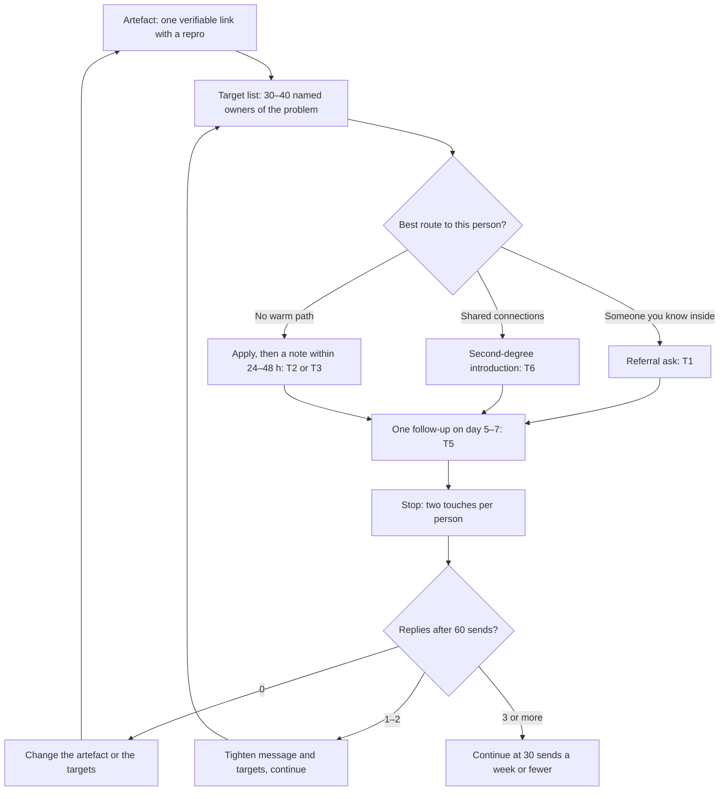

# Referrals and Outreach: Getting Pulled In by a Named Human

> How to get referred and how to reach hiring managers, founders and maintainers with an artefact they can verify: who to contact, what to send, how often, when to stop, and when open source is worth it, with the evidence and its limits.

**Dates and grades.** Outreach, open-source and audit evidence comes from [T0-05](../../research/sessions/T0-05-unconventional-hiring-tactics-oss-audits.md): research ran 2026-10-21 to 2026-10-23, and repository rules were read at commits pinned on 2026-10-21. Channel conversion comes from [T0-04](../../research/sessions/T0-04-ats-filtering-funnel-conversion-math.md) and share of hires from [T0-12](../../research/sessions/T0-12-high-signal-communities-technical-visibility.md), both October 2026 sessions. Repository and platform rules changed within months during 2026 [A · T0-05.F4]: re-verify them, and the vendor terms quoted here, by 2027-01-19. Grades (EGP-1.0): A primary or measured; B transparent secondary; C vendor or single source, attributed; D judgement; M model output; P practice-curated and unmeasured.

## The short answer

1. **Get pulled in by a named human: that is the measured lever.** In Ashby's data (38M applications, 2021–2024), 3% of inbound applications reach an interview, against 25% of sourced and 40% of referred ones. Gem puts referrals at about 11× and sourced candidates at about 8× inbound per application [B · T0-04.F10]. These are selection effects. They size the prize for being vouched for, not the effect of any tactic [A/B · T0-05.F2].
2. **Run referrals beside applications, not instead of them.** Referrals are about 15–18% of hires and inbound about half; the "70–85% hidden job market" has no evidence base [A · T0-12.F4]. Apply through the normal channel, then message the named person within 24–48 hours so they can find and flag the application. That sequence is unmeasured [D · T0-05 L329].
3. **Every message carries one artefact the reader can verify:** a merged pull request, a reproducible benchmark or a short audit, with a one-command repro. Every channel is raising its guard against low-effort volume, which raises the value of hard-to-fake artefacts [B/C · T0-05.F12].
4. **Write to the owner of the problem, briefly, and twice at most.** Named engineering directors, hiring managers and founders, not generic inboxes. At most 30 sends a week; a first touch of ≤ ~80–90 words with one link and one ask; one follow-up on day 5–7; then stop [D · T0-05 L87, L454]. The length rule borrows from cold sales email, where the best first touches run under 80 words [B · T0-05 L387].
5. **Plan for 3–8% replies and decide at 60 sends.** No verified candidate-to-hiring-manager reply rate exists. 3–8% is a planning judgement, and 25–50% claims are unverified [D · T0-05.F9]. Zero replies after 60 sends puts the one-sided 95% upper bound on your true rate at 4.9%: change the artefact or the targets, not the volume [M · T0-05 L401].
6. **Headline open source only after a pattern.** One merged commit is the modal outcome: 49–82% of contributor identities in the eight repositories T0-05 examined stop there [A · T0-05.F3]. Wait for at least 3 merged or in-review PRs plus 5 reviews or triage actions in one area. Start with work agents can't do, and stop after 8 weeks without a merge or a substantive maintainer exchange [D · T0-05 L83].

## At a glance



The open-source route below feeds this loop: merged PRs become artefacts, and maintainers you have worked with become named humans [D · T0-05 L80].

## The pull-in pipeline: five parts

### Why a named human matters

| Channel | Application → interview | Interview → offer | Offers per 1,000 applications | Share of hires |
|---|---|---|---|---|
| Inbound: a cold application | 3% | 6% | about 1.8 | 43–52% |
| Sourced: a recruiter or manager reaches out | 25% | 6% | about 15 | about 16% |
| Referral: an employee vouches | 40% | 16% | about 64 | about 18% |

Stage rates are Ashby's (38M applications, 2021–2024), with offers per 1,000 derived by T0-04 [B · T0-04.F10]. Shares come from Ashby's analysis of nearly 250K hires, January 2021 to June 2025 [A · T0-12.F4].

- Ashby's own offer rates, 0.2% inbound against 7.3% referral, imply about 36×. In Gem's engineering data, referrals are about 2% of applications but 18.7% of hires [B · T0-04.F10].
- For technical roles with "AI" in the title (Ashby, July 2026), 37.1% of hires came from inbound, 28.0% from sourcing and 9.2% from agencies, leaving about 26% for referral, internal and other [B · T0-04.F11].
- A secondary summary reports a 15% referral share at venture-backed startups, with referred candidates passing screens at 52% against 35% [B/C · T0-12 L87].
- **What the numbers do not say.** The multipliers include pre-vetting, so a referral does not make a weak profile strong. No GenAI-specific funnel by employer tier is published, and the vendors' customers skew to tech-forward companies [B · T0-04.F11, L113]. The practical reading is T0-05's: an application plus a champion starts to look like a referral [D · T0-05 L523].

### The five parts

| # | Part | Rule | Evidence |
|---|---|---|---|
| 1 | Artefact | One public, reproducible, claim-calibrated piece of work aimed at the recipient's problem | The surviving teardown→hire cases share this pattern [C · T0-05.F7] |
| 2 | Target list | 30–40 people who own the problem: the team's director or manager, or the founder at companies of up to ~50 people. Not careers@, not a random recruiter | [D · T0-05 L325] |
| 3 | Note | ≤ ~80–90 words, plain text, one artefact link, one ask, no attachment, an easy exit | [D · T0-05 L87, L375–376] |
| 4 | Follow-up | One, on day 5–7; then stop | Replies fall by step, 5.52% to 2.93%, in Pin's recruiter data [B · T0-05 L386]; the two-touch limit is judgement [D · T0-05 L454] |
| 5 | Stop or pivot | Judge at 60 sends; change one thing per 30-send batch; at week 12, move hours to the route that produced loops | [M · T0-05 L397–408]; [D · T0-05 L89] |

### Choose the route for each target

| If… | Route | Template | Why |
|---|---|---|---|
| Someone you know at the company can speak to your work | Referral ask | T1 | Referral is the highest-converting external channel [B · T0-04.F10] |
| You share connections with someone there | Second-degree introduction | T6 | In a 2022 *Science* study of ~20M LinkedIn users, moderately weak ties (inflection at about 10 mutual connections) transmitted jobs best, most strongly in digital industries [A · T0-12.F12; T0-05 L328] |
| No warm path, and the owner publishes a professional contact | Apply, then a hiring-manager or founder note | T2 or T3 | The champion effect above [D · T0-05 L523] |
| A target company stewards or staffs an open-source repository you use | Maintainer route, then a leader or founder note | T4, then T3 | Hugging Face, Inferact, RadixArk and Red Hat postings require or prefer open-source contributions [A/B · T0-05.F5] |
| None of these | Standard application only | none | Cheap but saturating: the pool of openings is finite [D · T0-05 L78] |

### The artefact: what to attach

| Artefact | Effort | Use it for | Evidence |
|---|---|---|---|
| Published category-level benchmark or teardown of several providers or open-source engines | ≈ 10–15 h, reusable across ~20 targets | Every note | [D · T0-05 L79] |
| Company-specific note of 1–2 pages, sent privately | ≈ 8–12 h of tailoring across the top 5 targets | The top 5 targets only | A 12-hour audit for one target needs a ~17× lift in that target's offer odds to pay back; a category artefact spread over 20 targets needs ~1.8× [D · T0-05 L519] |
| Merged PR plus a short write-up | Weeks: see the open-source route | Leader, founder and maintainer routes | [A/B · T0-05.F5] |
| Own-instance audit of an open-source component (vLLM, SGLang, Ollama, LiteLLM, Langfuse) on your own hardware | Not measured | Founder notes; a bridge to a first PR | [D · T0-05 L85, L278] |

- **Stay in the green zone.** Measure public, documented behaviour with your own account, through the documented API, at normal rates; or audit open-source software you run yourself. OpenAI's Usage Policies (effective 2025-10-29) prohibit "unsolicited safety testing" [A · T0-05.F8]. The zone reduces risk; it is not legal advice.
- **Private before public.** Send company-specific notes privately and publish only category-level work. Report any vulnerability through the vendor's channel before anything is public, and never use or validate a credential you find [D · T0-05 L272, L316–318].
- **Calibrate every claim:** "In my setup, X was observed"; "I could not verify what I tested"; "This may reflect a configuration I cannot see"; "I will re-run when [version] is available" [D · T0-05 L311]. The model is the cautious wording Artificial Analysis used on Reflection 70B [B · T0-05 L242].
- **Any one of these gets a note dismissed:** a factual error about the target; unreproducible numbers; a method that breaks the target's terms; a "gotcha" or shaming tone; a vulnerability published before notice; unverified AI-generated claims; more than three pages; no next step; no disclosure statement [D · T0-05 L309].

To build and present it, see [proof-of-work standards](../05-portfolio/proof-of-work-standards.md) and [project archetypes](../05-portfolio/project-archetypes.md).

## How to do it

### Outreach in eight steps

1. **Build one category-level artefact** in about 10–15 hours [D · T0-05 L79]. *Done when* it states scope, method and limits, ships raw data and a one-command reproduction, and every claim is calibrated.
2. **List 30–40 named owners.** Start from your [targeting workbook](../00-start/targeting-workbook.md) and the [employer landscape](../01-landscape/employer-landscape.md). Find people through open roles, maintainers and committers named in public governance files, OSS Insight company tables and manual LinkedIn title searches [D · T0-05 L325]. interviewing.io advises targeting managers rather than VPs, especially those under two years in role [C · T0-05 L327]. *Done when* each row of the log (T0) names a person, the team's public problem and a contact channel that person publishes.
3. **Mark one route per target** from the route table. *Done when* every row has a route and a template.
4. **Set up sending hygiene** (rules below). *Done when* SPF, DKIM and DMARC pass, each address is verified and the log exists.
5. **Apply, then send.** Apply through the normal channel, then send the note within 24–48 hours, citing the application [D · T0-05 L329]. Ramp 10 → 15 → 20 → ≤ 30 sends a week over four weeks, counting follow-ups [D · T0-05 L377]. *Done when* each send is logged on the day it goes out.
6. **Follow up once.** Send T5 on day 5–7, then stop. Never re-approach through another channel after an explicit no [D · T0-05 L378, L454]. *Done when* no target has more than two touches.
7. **Review at 60 sends** with the stop/pivot table below. *Done when* you have written down one decision: continue, tighten, or change the artefact or the targets.
8. **Review the portfolio at week 12.** Move hours to whichever route produced interview loops [D · T0-05 L89]. *Done when* next quarter's hours are re-split.

### Sending rules

| Rule | Setting | Evidence |
|---|---|---|
| Authentication | SPF, DKIM and DMARC on your sending domain. Google requires SPF and DKIM of all senders and adds DMARC for bulk senders above 5,000 a day. The bulk thresholds do not formally bind a job seeker; authentication is cheap hygiene | [B/C · T0-05 L372], secondary sources; the job-seeker reading is [D] |
| Mailbox | Prefer an established mailbox. For a new domain, Instantly's ramp is 5–10 a day for 4–6 weeks (cold-sales context) | [B · T0-05 L373] |
| Addresses | Use addresses people publish for contact; verify each; keep bounces under 2%. In Pin's audit of 1.3M lookups (March–May 2026), email finders found 29.8–55.2% of addresses, against vendor claims of 90–99%; Pin is itself a vendor | [B/C · T0-05.F10] |
| GitHub | Never harvest addresses from GitHub. Its Acceptable Use Policy §7 bars using its information "for the purposes of sending unsolicited emails to users" | [A · T0-05 L368] |
| LinkedIn | Manual only. LinkedIn removed Apollo's and Seamless.ai's company pages on 2025-03-06; PhantomBuster's own guidance is ~50–100 connection requests a week to start, and paid plans do not lift the limits | [B/C · T0-05.F10] |
| Content | Plain text; one link; no attachments; wording varied per recipient; close with "No reply needed if this isn't relevant." | [D · T0-05 L375–376] |
| Paid tools | Free tiers (Apollo, Hunter) plus manual verification are enough at ≤ 30 sends a week | [B/C · T0-05.F10] |
| Log | Date, target, channel, artefact, reply, loop, outcome. It is the only source of a real response rate for your situation | [D · T0-05 L380] |

Pin's recruiter-to-candidate data adds two signals, with the direction reversed: messages with a first name drew 5.13% replies against 2.61% without, and engineering and data candidates replied at 4.64% [B · T0-05 L386]. Other tools: [tool catalog](../00-start/tool-catalog.md).

### Where the hours go

Per 100 search hours a quarter, T0-05's judgement [D · T0-05 L76–81]:

| Hours | Activity | Why |
|---|---|---|
| ~25 | Standard applications to the relevant openings (T0-05 assumes ~300), each tied to a named-human route where one exists | Cheap and saturating: once the pool is covered, extra hours have zero marginal yield |
| ~45 | Artefact-carrying outreach: one category-level artefact plus tailoring for the top 5 targets; ≤ 30 sends a week | The best-evidenced route to a named human |
| ~20 | Open source in one repository whose steward or major contributing employer is on your list, only if you can sustain ~8–10 h a week for 8–12 weeks; otherwise, outreach | Slow signal with no verified per-hour yield |
| ~10 | Instrumentation: the log | Without it, the stop rules cannot work |

In T0-05's model, artefact-carrying outreach yields about 0.27 offers per 100 focused hours at base, against about 0.45 for tailored applications. No tactic shows a 10× per-hour edge in any scenario [D · T0-05.F11]. Outreach earns its hours because the cheap channel saturates, not through a multiplier. For the wider sequence, see the [job-search strategy](../06-job-search/job-search-strategy.md#27-recommended-sequencing-expanding-rings).

### The open-source route

Use it when a target employer stewards or staffs the repository and you can sustain the hours; otherwise put the hours into outreach [D · T0-05 L80].

- **One PR is not a signal.** Only 1.8–17.4% of newcomers (first commit 12–24 months before 2026-10-21) reached 10 or more commits within a year [A · T0-05.F3].
- **The bar is rising.** vLLM bans pure-agent PRs ("automatic banning") and one-off typo PRs. transformers closes agent-written PRs without review. llama.cpp permanently bans undisclosed AI use and allows new contributors one open PR. Axolotl rejects "contribution farming". GitHub added open-PR caps for non-write users on 2026-06-17 [A · T0-05.F4]. The drive-by PR has turned from a hiring tactic into a liability; discussion first is the documented norm [B · T0-12.F10].
- **Hiring runs through postings, not repository processes.** Hugging Face's Open-Source MLE posting requires "A public open-source track record"; Inferact, RadixArk and Red Hat postings prefer or require contributions. No named contributor→hire case could be verified [A/B · T0-05.F5].
- **Who benefits.** In vLLM and SGLang, by T0-05's count of commit email domains, the people who ship are mostly employees of hardware and platform vendors such as AMD, NVIDIA, Intel, Red Hat, IBM and Meta [C · T0-05.F6]. The plausible channel is contribution, then a hire by such a vendor or an inference startup.
- **Companies approach consistent contributors.** In the documented company-run cases (Cursor, Zed, Appwrite), the company watched its own channels and approached or hired people who contributed consistently; Zed: "These aren't drive-by contributions" [A/B · T0-12 L262–264]. No conversion rate exists for any community [A · T0-12.F3].

Steps, with T0-05's assumed times [D · T0-05 L199–209]:

| Step | What to do | Time | Done when |
|---|---|---|---|
| 0. Pick one repository | Require an employer on your target list, a newcomer on-ramp and a skills match: employer fit beats repo fame | 2–3 h | The steward or a major contributing employer is on your list |
| 1. Read the gates | CONTRIBUTING, AGENTS.md and governance files, on the day you start | 2–4 h | You can state the AI policy, PR cap, CLA or DCO, issue-first rule and test rule |
| 2. Build and test | Reproduce the dev environment; in GPU-gated repositories, expect CI you cannot trigger | 4–10 h | A green local test run |
| 3. Triage and review, weeks 1–2 | Reproduce 3–5 open issues, add minimal reproducers, bisect; review others' PRs only with substance | 5–10 h a week | Maintainers start to recognise your handle |
| 4. First PR, weeks 2–4 | A bug, performance or security issue; claim it first with T4; minimal diff; tests; disclose AI help; one open PR at a time | 8–20 h of work; 8–16 weeks of calendar time | Merged, or a substantive review within 2 weeks |
| 5. Widen in one area, weeks 4–12 | Find reviewers through the named area owners | 8–10 h a week | 3 or more merged or in-review PRs plus 5 or more reviews or triage actions |
| 6. Publish evidence | One short note per merged PR: problem, measurement, diff, result, reproduction command | 2–4 h each | Every PR has a note you can link |
| 7. Convert | Name an engineering leader at the steward company; send T3 or T6; apply to roles that list contributions; ask maintainers for feedback and introductions, not jobs | 3–6 h | A named human replies |
| 8. Stop-loss | Apply the week-8 and week-12 gates in the stop/pivot table | none | You have reallocated, or continued on purpose |

Calendar time is long: in one contributor's account, a vLLM PR took about four months from submission (2025-04-20) to merge (2025-08-16) [C · T0-05 L205]. vLLM's committer bar, about 30+ substantial PRs and about 10+ reviews of external PRs, is a long-run anchor, not an entry bar [A · T0-05.F4].

Pick the repository by employer fit [D · T0-05 L213–220]:

| Your profile and targets | Repository | Watch for |
|---|---|---|
| CUDA, ROCm, Triton or systems work; AMD, NVIDIA, Intel, Red Hat, Inferact or RadixArk | vLLM or SGLang | Corporate-staffed, with named areas; SGLang CI runs only when trusted contributors trigger it |
| Python and ML, aiming at Hugging Face | transformers | The posting requires merged PRs, but only 2.5% of newcomers reached 10 commits |
| C or C++ edge inference | llama.cpp | One open PR for new contributors; permanent ban for undisclosed AI |
| Backend, gateway or observability at startups | LiteLLM or Langfuse | Core-team-dominated; LiteLLM's onsite includes fixing a repository issue; pair with founder outreach |
| Local inference, product-minded | Ollama | 81% of contributor identities have one commit; better for an own-instance audit than a pipeline |
| Fine-tuning tooling | Axolotl | Welcomes real use-case contributions; rejects profile padding |

### Stop and pivot rules

Replies after 60 sends, with 95% Clopper–Pearson intervals for your true reply rate [M · T0-05 L397–406]:

| Replies | Observed | 95% interval | Action |
|---|---|---|---|
| 0 | 0% | 0–6.0%; one-sided upper bound 4.9% | Stop this template; change the artefact or the targeting before sending more |
| 1 | 1.7% | 0–8.9% | Tighten the message and the targets; continue |
| 2 | 3.3% | 0.4–11.5% | Continue: inside the planning range |
| 3 | 5.0% | 1.0–13.9% | Continue |
| 5 | 8.3% | 2.8–18.4% | Continue; the cap stays at 30 a week |
| 8 | 13.3% | 5.9–24.6% | Above plan: check whether warm contacts inflated it |

After 30 sends the intervals are too wide to judge: 0 replies gives 0–11.6%, and 3 replies gives 2.1–26.5%. So at 30 sends a week or fewer you cannot A/B test wording. Change one thing between 30-send batches, and judge by the quality of the loops [M · T0-05 L408].

| Other signal | Action | Evidence |
|---|---|---|
| Bounces above 2% over 50 or more sends | Pause and clean the list | [D · T0-05 L378] |
| Any spam complaint or hostile reply | Stop contacting that domain; review the template | [D · T0-05 L378] |
| An explicit no | Never re-approach, through any channel | [D · T0-05 L378] |
| Two touches and no reply | Stop for this person | [D · T0-05 L454] |
| Open source, week 8: no merged PR and no substantive maintainer exchange | Reallocate the hours | [D · T0-05 L209] |
| Open source, week 12: fewer than 3 merged or in-review PRs in one area | Treat open source as a one-off artefact source, not a pipeline | [D · T0-05 L209] |
| A company-specific audit for a target outside your top 5 | Use the category-level artefact instead | [D · T0-05 L519] |

### Geography: India and remote targets

- Most postings T0-05 found were US-located (Palo Alto, San Francisco, "US Remote"); work authorisation was not assessed [C · T0-05 L558]. Geography gates the top global pathways, and remote-friendly routes are the accessible ones from India [A/B · T0-12.F8]. Filter targets for location before you write: see [visa and relocation](../11-tracks/visa-and-relocation.md) and the [India remote playbook](../11-tracks/india-remote-playbook.md).
- Before any security-style audit from India, read T0-05 section D3.2 on Indian law; its source is a 2021 advocacy page that may be dated [B · T0-05.F8]. This is a pointer, not legal advice.

## Templates and examples

All templates are [P]: no verified reply or loop rate exists for any of these scripts [D · T0-05 L412]. They apply what cold-email benchmarks and job-seeker guidance agree on: short, one specific ask, one link, relevant to the recipient's problem, easy to forward or ignore. Replace every bracket, and delete anything you cannot back with a link.

### T0. Target list and log

[P] Columns from T0-05's targeting and logging rules [T0-05 L325, L380].

| # | Person, title | Company, team | Public problem | Route | Published contact | Artefact | Applied | Sent | Follow-up | Reply | Loop | Outcome |
|---|---|---|---|---|---|---|---|---|---|---|---|---|
| 1 | [name], [title] | [company], [team] | [problem], [source] | [referral / second-degree / direct / maintainer] | [channel] | [artefact] | [date] | [date] | [date] | [yes/no] | [yes/no] | [result] |

### T1. Referral ask to someone you know at the company

[P] Adapted from S5 [T0-05 L450]: the same structure, plus a paste-ready blurb.

```text
Subject: Referral for [job title] ([job ID])?

Hi [first name], I'm applying for [job title] ([job ID]) on [team].
The closest proof I have is [artefact]: [one-line measured result].
[link]

Would you be comfortable referring me? If not, no problem, and no
reply needed.

If yes, here is a three-line blurb you can paste:
[Name]: [role], [N] years in [area].
Built [artefact], which [measured result].
Relevant to [team]'s [problem] because [reason].

Thanks, [Name]
```

Ask people who can speak to your work, and make it easy to decline [P].

### T2. Hiring-manager note after applying

[P] Adapted from S1 [T0-05 L414–426]. At companies of up to ~50 people, write to the founder instead (T3) [D · T0-05 L325].

```text
Subject: [Product]: reproducible [metric] numbers on [documented endpoint]

Hi [first name],

I'm [Name], a [role]. I applied for [job title] ([job ID]) on [date].
I measured [documented endpoint] on my own account: [fixed inputs],
[N] requests per [condition]. In my setup, [observed result].
Method, raw data and one-command repro: [link].

I can't see your infrastructure, so this may reflect a setting I'm
unaware of. I have two ideas for [specific fix] and can send a patch.

If you're the wrong person, a pointer would help.

[Name] · [profile link]
```

### T3. Founder or leader note citing an artefact

[P] Adapted from S2 [T0-05 L428–438]. S2 links two PRs and a write-up; this version keeps one artefact link.

```text
Subject: [repo] #[PR number]: [one-line result]

Hi [first name],

I've been working on [repo]: #[PR number] ([what it fixed], [measured
result]), and I reviewed #[PR number]. I use [feature] in [project]
and noticed [specific gap tied to a public issue or roadmap item].
Write-up with numbers and links to both PRs: [link].

I'd like to work on [area] full-time. Are you hiring for it, or is
there someone on the team I should talk to?

[Name] · [GitHub profile]
```

At a startup with an open-source product, an own-instance audit of that product can replace the PR sentence [D · T0-05 L96].

### T4. Maintainer scope check, posted in the issue

[P] S3 [T0-05 L440–442]. This is not a job request: keep hiring out of issue and PR threads (pitfall F9).

```text
Before I start on #[N]: I reproduced [bug] on [version or commit]
(repro: [link]) and bisected it to [commit]. Plan: [1–3 bullets];
test: [what]. Is this in scope, or does someone have a branch?
AI use: [none / assisted; every line reviewed and run by me].
Happy to follow your preferred approach.
```

### T5. Follow-up on day 5–7

[P] S4 [T0-05 L444–446]. The second and last touch.

```text
Hi [first name], one nudge in case this got buried: [one-line recap]
[link]. If it isn't relevant, no reply needed. Thanks for reading.
```

### T6. Second-degree introduction

[P] S5 [T0-05 L448–450]. When several people could introduce you, let tie strength break the tie: moderately weak ties, around 10 mutual connections, transmit jobs best [A · T0-12.F12; T0-05 L328].

```text
Hi [first name], we share [N] connections ([names]). I admire
[specific work]. I built [artefact] aimed at [team]'s [problem]:
[one-line result] [link]. Would you be open to forwarding it to
[Name], or pointing me to the right person? I can send a three-line
blurb you can paste.
```

### Weak → strong: one note

Weak: no named reader, no proof, three asks, an attachment.

```text
Subject: Job opportunity

Dear Hiring Team,

I am a passionate AI professional with [N] years of experience in
machine learning, NLP, LLMs, RAG and agents, and I am very excited
about [Company]'s mission. I have worked on many projects and I am a
fast learner. I believe I would be a great fit for any role on your
team. Please find my résumé attached. Could you share any open
positions, review my profile and set up a call at your convenience?

Best regards,
[Name]
```

Strong: adapted from S1, with its brackets kept [P · T0-05 L414–426].

```text
Subject: [Product] streaming API: p99 time to first token under load

Hi [first name],

I'm [Name], an inference engineer; I applied for [job ID] on [date].
I benchmarked your documented streaming endpoint on my own account:
fixed prompt lengths, 200 requests per concurrency level. In my setup,
p99 TTFT was [X]× p50 at concurrency 16. Method, raw CSV and
one-command repro: [link].

I can't see your infrastructure, so this may reflect a setting I'm
unaware of. I have two ideas for [fix] and can send a patch.

If you're the wrong person, a pointer would help.

[Name] · [profile link]
```

### Weak → strong: element by element

| Element | Weak | Strong | Why |
|---|---|---|---|
| Recipient | "Dear Hiring Team", careers@ | The named manager who owns the problem | [D · T0-05 L325] |
| Subject | "Job opportunity" | Names the product and the artefact | [P · T0-05 L416] |
| Proof | Adjectives and years of experience | One measured, reproducible result behind one link | [B/C · T0-05.F12] |
| Claim | "Your latency is poor" | "In my setup… this may reflect a setting I'm unaware of" | [B · T0-05 L242] |
| Ask | Three: openings, a profile review, a call | One: a role in [area], or a pointer | [D · T0-05 L87] |
| Attachment | Résumé attached | One link, no attachment; interviewing.io also advises against attaching a résumé | [D · T0-05 L376]; [C · T0-05 L327] |
| Length | About as long, but every sentence is about you | ≤ ~80–90 words, most of them evidence | [D · T0-05 L87, L376]; [B · T0-05 L387] |
| Exit | None | "If it isn't relevant, no reply needed." | [D · T0-05 L375] |
| Follow-up | Weekly nudges by email, LinkedIn and X | One nudge on day 5–7, then stop | [B · T0-05 L386]; [D · T0-05 L454] |
| Maintainer thread | "Can I take this? Also, is [company] hiring?" | T4: repro, bisect, plan, test, AI-use disclosure | [D · T0-05 L468] |

## Checklist

- [ ] One artefact with scope, method, limits, raw data and a one-command reproduction
- [ ] 30–40 named owners in the log, each with a public problem, a route and a published contact channel
- [ ] Warm paths tried first: people you know (T1), then second-degree introductions (T6)
- [ ] Applied through the normal channel before each note
- [ ] SPF, DKIM and DMARC set; every address verified; bounces under 2%
- [ ] Each note ≤ ~80–90 words, with one artefact link, one ask, no attachment and an easy exit
- [ ] Claims calibrated: "in my setup", "could not verify"
- [ ] At most 30 sends a week counting follow-ups, ramped 10 → 15 → 20 → 30
- [ ] One follow-up on day 5–7, then stop; no re-approach after a no
- [ ] No addresses taken from GitHub; no LinkedIn automation
- [ ] Every send, reply, loop and outcome logged on the day
- [ ] A written decision at 60 sends; one change per 30-send batch
- [ ] Open source: gates read on the day you start, AI use disclosed, issue first, one open PR
- [ ] Open source headlined only after 3 merged or in-review PRs and 5 reviews or triage actions in one area
- [ ] Week-8 and week-12 open-source gates in your calendar
- [ ] Audits in the green zone only; private notice before anything about a vulnerability is public
- [ ] Week-12 review done: hours moved to the route that produced loops

## Pitfalls

Red flag → why it hurts → fix. F-numbers follow T0-05's catalogue: F1–F10 concern open source, F11–F17 outreach and F18–F21 audit artefacts [T0-05 L456–480]. The last row adds a community norm from T0-12.

| # | Red flag | Why it hurts | Fix |
|---|---|---|---|
| F1 | Agent-written PRs | vLLM: "automatic banning"; transformers closes them without review [A · T0-05 L460] | Write and run the code yourself |
| F2 | Typo, busywork or profile-padding PRs | Axolotl rejects "contribution farming"; vLLM refuses one-off typo PRs [A · T0-05 L461] | Bugs, performance or security, with a reproducer and your real use case |
| F3 | Undisclosed AI use | llama.cpp may ban the account permanently [A · T0-05 L462] | Disclose every time |
| F4 | A feature PR before an issue | llama.cpp: "Features must begin with an issue, not a PR"; Ollama and Langfuse are issue-first [A · T0-05 L463] | Open the issue; post T4 |
| F5 | Several open PRs at once | llama.cpp allows new contributors one; GitHub caps open PRs for non-write users from 2026-06-17 [A · T0-05 L464] | One PR at a time; use drafts |
| F6 | Assuming CI or merge rights | SGLang CI runs only when trusted contributors apply `run-ci` [A · T0-05 L465] | Ask for the label; plan for the wait |
| F7 | Missing tests, CLA or DCO | LiteLLM calls at least one test a "hard requirement"; vLLM needs DCO sign-off [A · T0-05 L466] | A pre-submit checklist |
| F8 | AI-written comments | llama.cpp prohibits using AI to write your posts [A · T0-05 L467] | Your own words |
| F9 | Asking for a job in an issue or PR | A norm inferred, not sourced [D · T0-05 L468]; communities confine job-seeking to designated channels [A · T0-12.F9] | Keep threads technical; take hiring to email, with the PR as evidence |
| F10 | PR bursts timed to events | Hacktoberfest 2026 stopped counting PRs toward rewards [A · T0-05 L469] | Contribute on your own schedule |
| F11 | Harvesting emails from GitHub | Breaches GitHub's Acceptable Use Policy §7 [A · T0-05 L470] | Channels people publish for contact |
| F12 | LinkedIn automation or scraping | Restriction risk: Apollo's and Seamless.ai's pages vanished from LinkedIn on 2025-03-06 [B/C · T0-05 L471] | Manual only |
| F13 | Unauthenticated sending; high bounces | Misrouted mail; keep bounces under 2% [B/C · T0-05 L472] | SPF, DKIM, DMARC; verify addresses |
| F14 | Generic target or message | Recruiter messages with a first name drew 5.13% replies against 2.61% without; small targeted sequences get about 2× the replies of blasts (secondary) [B/C · T0-05 L473] | A named owner and one specific artefact |
| F15 | A long first touch with several asks | Best first touches run under 80 words; 58% of replies come from step 1 [B · T0-05 L474] | Short; one ask; one link |
| F16 | Over-following-up | Replies fall by step, 5.52% to 2.93% [B · T0-05 L475] | Two touches in total |
| F17 | Trusting email-finder claims | Find rates of 29.8–55.2% against 90–99% claimed [B/C · T0-05 L476] | Verify before sending |
| F18 | Factual errors from black-box inference | Reflection 70B's claims were contested within days; the evaluator's cautious wording held up [B · T0-05 L477] | Caveats, reproducibility, a private pre-send |
| F19 | Unsolicited safety testing of production AI | OpenAI's Usage Policies prohibit it; Anthropic's safe harbor excludes model red-teaming [A · T0-05 L478] | Your own instance or a sanctioned scope |
| F20 | Automated extraction or circumventing safeguards | Barred by OpenAI's EU Terms [A · T0-05 L479] | Normal rates; documented API |
| F21 | Publishing a vulnerability before notice | Anthropic forbids it without prior written notice; Project Zero's norm is 90 + 30 days [A · T0-05 L480] | Private first |
| — | Mass-DMing your CV in community servers | Communities treat mass-DMed CVs as spam [A · T0-12.F9] | Designated job channels; lead with work |

## Evidence and limits

**Measured.**
- Channel conversion and share of hires come from large ATS-vendor datasets: Ashby (38M applications; nearly 250K hires) and Gem (165M+ applications) [B · T0-04.F10; A/B · T0-05.F2; A · T0-12.F4]. They are correlational, the vendors' customers skew to tech-forward companies, and GenAI-specific rates by employer tier are unpublished [B · T0-04.F11, L113].
- Repository rules and contributor statistics were read from commits pinned on 2026-10-21 [A · T0-05.F3; A · T0-05.F4]. Commits are not PRs, so there are no merge rates.
- Message mechanics come from datasets with another direction or purpose: Pin (4M+ recruiter-to-candidate messages, June 2025 to May 2026) and Instantly (cold B2B email: average reply 3.43%, top quartile 5.5%+) [B · T0-05 L386–387]. Pin's 17.08% LinkedIn reply rate is recruiter-to-candidate [B · T0-05 L386]; T0-05 judges that it does not transfer to candidate outreach [D · T0-05 L145].

**Judgement or model.** The 3–8% planning range, the 30-a-week cap, the two-touch rule, the hour budget, the open-source thresholds and the time-versus-yield model are T0-05's judgement or arithmetic on assumed inputs [D · T0-05.F9; D · T0-05.F11]. The stop/pivot intervals are binomial calculations: they describe your own log, not a population [M · T0-05 L397–408].

**Claims to drop.**

| Claim | Status | Evidence |
|---|---|---|
| "10× recruiter inbound per merged PR" | Not measured, and ill-posed | [C · T0-05.F1] |
| "70–85% of jobs are hidden" | No evidence base; referrals are about 15–18% of hires | [A · T0-12.F4] |
| "Referrals drive 30–50% of all hires" | SEO and consultancy pages, contradicted by Ashby | [C/D · T0-12 L289] |
| "25–50% of personalised notes get replies" | interviewing.io's estimate, with no sample | [D · T0-05.F9] |
| "Drive-by PRs get you noticed" | Reversed: they are a liability | [B · T0-12.F10] |

**What would change the advice.** A measured candidate-to-manager reply or loop rate by artefact type; employer counts of hires who were prior contributors; GenAI application-to-offer rates by tier; and evidence on frontier labs, which T0-05 did not research [T0-05 L554–557]. Privacy and anti-spam law for cold email (GDPR, India's DPDP Act, CAN-SPAM) was not researched either [T0-05 L559].

**Errata and dates.** No entry in [research/ERRATA.md](../../research/ERRATA.md) touches the T0-04, T0-05 or T0-12 lines used here (checked 2026-11-06). Re-verify repository rules, platform rules and vendor terms by 2027-01-19. All graded findings: [findings registry](../../research/findings.md).

## Next steps

- **Build the artefact:** [proof-of-work standards](../05-portfolio/proof-of-work-standards.md), [project archetypes](../05-portfolio/project-archetypes.md).
- **Fit outreach into the week:** [application operating system](../06-job-search/application-operating-system.md), [channels and boards](../06-job-search/channels-and-boards.md), [the constraints that bind first](../06-job-search/job-search-strategy.md#26-the-constraints-that-bind-first).
- **Make yourself checkable:** [online presence](online-presence.md), [communities guide](communities-guide.md), [résumé strategy](../06-job-search/resume-strategy.md).
- **Next stage, when a reply opens a loop:** [interview loops](../08-interviewing/interview-loops.md), [prep packs](../08-interviewing/prep-packs.md).
- **Role hubs** for the inference and infrastructure roles in T0-05's postings: [inference engineer](../02-roles/hubs/inference-engineer.md), [AI infrastructure engineer](../02-roles/hubs/ai-infrastructure-engineer.md), [GPU kernel engineer](../02-roles/hubs/gpu-kernel-engineer.md), [ML engineer](../02-roles/hubs/ml-engineer.md). For any other role, start from the [role catalog](../02-roles/role-catalog.md).
