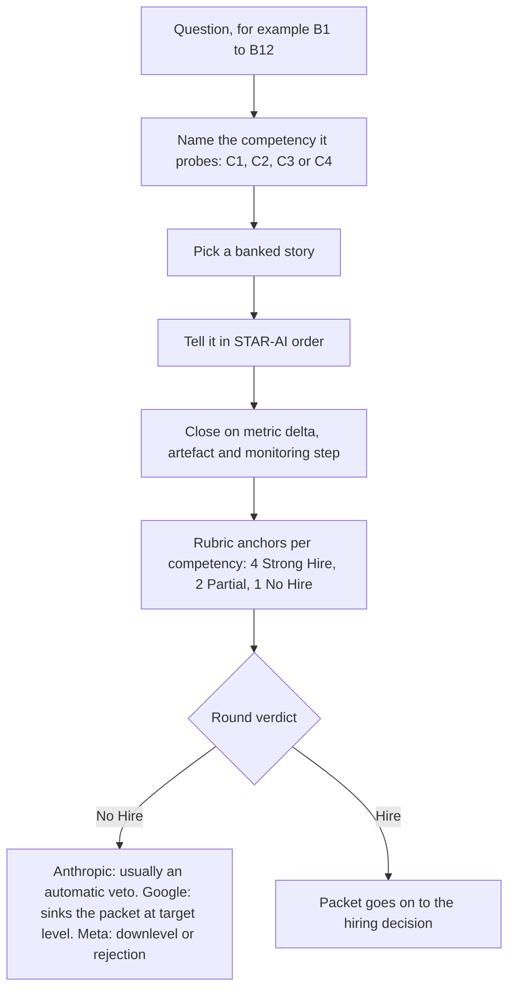

# Behavioural Calibration: How GenAI Behavioural Rounds Are Scored

> How behavioural rounds are scored in GenAI hiring, the four competencies that decide them, and how to build a STAR-AI story bank that survives a round where one No Hire can veto the loop.

**Dates.** Firm practices are as reported in [T1-03](../../research/sessions/T1-03-interview-execution-offer-negotiation.md), dated 2026-10-25, which takes its level signals from [T0-14](../../research/sessions/T0-14-ai-system-design-interview-patterns.md). Re-verify the firm rows by 2027-01-23. [ERRATA](../../research/ERRATA.md) lists these corrections to T1-03: U14 (India pay bands), U24 (funnel stage rates) and U26 (the count behind the infrastructure track). None touches the behavioural material used here; the onsite-to-offer figure under Evidence and limits carries T0-04's rate beside T1-03's.

**Grades** (EGP-1.0, defined in [CONTRIBUTING §3](../../CONTRIBUTING.md#3-writing-standard-egp-10-in-brief)): A primary or measured; B transparent secondary; C coaching, vendor or single source; D judgement; E searched, nothing found; M model output or count; P practice-curated and unmeasured. A compound grade such as B/C rests on both; rely on the weaker.

## The short answer

1. **Treat the behavioural round as a gate, not a formality.** A behavioural No Hire is a near-automatic veto at Anthropic (values round) and Google (Googlyness and Leadership, G&L). At Meta it triggers a downlevel or rejection [B/C · T1-03.F4]. T1-03 rejects "behavioural rounds are soft" as a general claim for the firms it studied [B/C · T1-03 L418].
2. **Four competencies decide the round:** C1 technical pragmatism under ambiguity, C2 communicating probabilistic trade-offs, C3 ownership and incident response, C4 responsible AI and safety [B/C · T1-03.F5]. No firm-published AI behavioural rubric was found; the 4/2/1 anchors below are T1-03's synthesis of coaching guides and web research [E · T1-03 L169, L407].
3. **Bank four core stories, one per competency, then add one or two more C1 stories.** Each story needs a metric delta and a continuous-monitoring step [D · T1-03 L117]. Seven of the twelve high-yield questions probe C1; C2, C3 and C4 appear in three each [M · count of T1-03 L193–204]. The extra C1 depth is a rule of thumb [P].
4. **Tell every story in STAR-AI order and end on monitoring.** Situation with scale and non-determinism; Task with the cost of being wrong; Action in the first person, with the eval method and the trade-off; Result with a metric delta and an artefact [D · T1-03 L182–187]. T1-03 calls STAR-AI the scoring template [B/C · T1-03.F5] but grades the framework as its own synthesis [D · T1-03 L396].
5. **Signal level through scope, not polish.** In T0-14's level rubric, Staff candidates question the premise and volunteer trade-offs and failure modes before being asked [B/C · T0-14.F10; T0-14 L778–779]. Coaching for Google says that if the interviewer must prompt you for trade-offs, you are signalling L5 in an L6 loop [C · T0-14 L774]. These rubrics come from system design; applying them to stories is judgement [D].
6. **Debrief within 30 minutes of every round and update the bank.** Coaching sources recommend it universally; no controlled study shows that it raises pass rates [C/D · T1-03.F12].

## At a glance



The anchors are T1-03's synthesis [B/C/D · T1-03 L169]. T1-03 does not say how per-competency scores combine into a round verdict.

## The four competencies and the 4/2/1 rubric

T1-03 built this rubric from Hello Interview, Aced and DesignGurus guides, web research on hiring-committee calibration, and T0-14's level table. Its entries are graded B/C/D [T1-03 L169]. It gives anchors for scores 4, 2 and 1 only; it describes no 3 [T1-03 L173].

| # | Competency | What it tests | 4: Strong Hire | 2: Partial | 1: No Hire |
|---|---|---|---|---|---|
| C1 | Technical pragmatism and ambiguity tolerance | Can you ship under uncertainty? | Acknowledges ML is experimental; sets baselines, defines eval metrics, pivots when hypotheses fail; treats non-determinism as a first-class design constraint | Treats ML like deterministic software; focuses on framework choice over data quality and metric drift | Blames external factors ("the data was bad") without systematic troubleshooting |
| C2 | Cross-functional communication and trade-off translation | Can you make probabilistic trade-offs legible to non-technical stakeholders? | Translates latency against accuracy, and cost against safety, into business terms; uses analogies and quantified impact | Communicates decisions but relies on jargon ("we tuned hyperparameters") without linking them to user impact | Friction with non-technical stakeholders; dismisses product requirements; defensive about model limitations |
| C3 | Ownership, accountability and incident response | Do you own production outcomes? | Owns the failure; explains immediate remediation (rollback, fallback, routing) and systemic prevention (alerts, eval pipelines, postmortem artefacts) | Explains what "the team" did; cannot isolate a personal contribution; mentions the fix but lacks postmortem thoroughness | Deflects blame to teammates, data engineers or third-party model providers |
| C4 | Responsible AI and safety consciousness | Do you treat safety as a design requirement? | Builds safety, fairness and privacy into the design phase unprompted; knows when to pause deployment and escalate to legal or trust and safety | Considers ethics only when the interviewer prompts | Dismisses guardrails as "red tape" that slows shipping |

Source: [B/C/D · T1-03 L173–178].

### Three failures dominate

Three archetype failures dominate behavioural No Hires [B/C · T1-03.F4]. Each breaks one competency (the mapping is ours, D):

| Failure archetype | Competency it breaks | The story that answers it |
|---|---|---|
| Arrogance or poor communication | C2 | A model risk you translated for a sceptical stakeholder |
| Failure of ownership in production incidents | C3 | An incident you detected, owned and stopped from recurring |
| Ethical or safety blind spots | C4 | A launch you paused or changed for a safety, privacy or fairness reason |

### How three firms use the verdict

| Firm | Weight of the round | Consequence of a No Hire | Top veto triggers |
|---|---|---|---|
| Anthropic | The values round is a heavy filter, not an HR formality | Usually an automatic veto, regardless of technical scores | Lack of epistemic humility; posturing about AI safety; evasiveness about trade-offs; inability to admit mistakes |
| Google | Googlyness and Leadership (G&L) is a scored dimension | Sinks the packet at target level; the hiring committee may downlevel if technical scores are exceptional | Failure to take accountability; blaming PMs; poor data-privacy or ethics judgement |
| Meta | Core values (Move Fast, Focus on Long-Term Impact) | Downlevel or rejection [T1-03.F4]; the hiring committee perceives cultural mismatch or insufficient leadership scope | Academic framing ("I researched…") instead of impact ("I shipped/scaled…"); bypassing cross-functional partners |

Source: [B/C · T1-03 L206–212], from web research. T1-03 covers these three firms only. This page has no firm-specific behavioural evidence for other employers.

### Level signal: Senior versus Staff

T0-14's level table is for system design, and its AI-specific evidence is thin [B/C · T0-14.F10]; the full table, with nine dimensions and a Principal column, is in [system design archetypes](system-design-archetypes.md#senior-staff-and-principal-signals). This page uses five of its dimensions, and the last column is our adaptation to behavioural stories [D].

| Dimension | Senior signal | Staff signal | How it shows in a story [D] |
|---|---|---|---|
| Framing | Clarifies requirements and SLOs; picks a sensible architecture | Questions the premise (is an LLM needed? build or buy? what not to build); names stakeholders and success metrics | Say what you chose not to build, and why; B3 is the natural home |
| Driving | Leads most of the design; responds well to probes | Leads deep dives proactively; volunteers trade-offs and failure modes before being asked | Name the trade-off and the failure mode before the interviewer asks |
| Trade-offs | States pros and cons | States the decision, the number, the failure mode and what was given up; notes reversibility | End the Action with what you gave up and whether the decision could be reversed |
| Evaluation | Golden set plus LLM judge plus online metrics | Eval governance: shared contracts, judge calibration, regression gates, saturation management, ties to business metrics | Show the eval you built and who else relied on it |
| Organisation | Single-team scope | Multi-team and multi-tenant; migration paths; platform or product ownership | Show work other teams consumed |

Source: [B/C · T0-14 L776–786]. A Staff AI Engineer job description cited by T0-14 defines Staff scope as shared evaluation and observability practices that other teams consume [C · T0-14 L774]. T0-14's Principal column is extrapolation [D · T0-14 L774] and is not used here. T0-14 also lists observable markers (synthesis): stating what you will not build, offering "what would change my mind", and separating reversible from irreversible decisions [D · T0-14 L788–793]. Each can close a story.

### The twelve high-yield questions

T1-03's bank of twelve questions, B1–B12 [T1-03 L189–204], is in the [behavioural pack](prep-packs.md#behavioural-pack) as prompts p042 to p053, in the same order (B1 is p042, B12 is p053), each with the competencies it probes, what a strong answer covers and the red flags. The [story-bank matrix](#story-bank-matrix-p) below gives every question a story slot.

Some loops also run a project deep dive (Anthropic, OpenAI and Uber); OpenAI's works like a reverse design interview [B/C · T0-14 L554]. T0-14 suggests rehearsing two systems with numbers and rollbacks (synthesis) [D · T0-14 L554]. Your S1 and S5 stories can double as that material [P].

## How to build the bank

1. **Confirm the format.** Ask the recruiter which round is behavioural and what the firm calls it: a values round, G&L or core values [P]. *Done when* you can name the behavioural round in each loop and the framework behind it.
2. **Mine for raw stories.** Use B1–B12 ([behavioural pack](prep-packs.md#behavioural-pack)) as prompts, plus four situations from T0-09's onboarding research (using them as story prompts is [P]):
   - starting with no usable data, which T0-09 found is a common starting state, not an exception [B · T0-09.F4] → B4;
   - quantifying non-determinism, which T0-09 finds measurable and partly fixable by engineering [A · T0-09.F6] → B9, B11;
   - a small regression eval suite built from real failures, or a measured cost cut, the two quick wins with independent support [A · T0-09.F10] → B7, B11, B12;
   - stopping the failure shape in T0-09's case library: early demo success, an inflated promise, no eval, guardrail or owner, then reversal or liability [B · T0-09.F12] → B6, B8, B10.

   *Done when* each of B1–B12 has at least one candidate story [P].
3. **Select and map.** Choose four core stories, one per competency, then one or two more C1 stories, and fill the matrix below [D · T1-03 L117; P for the extra C1 stories]. *Done when* every competency has a primary story and every question has a slot.
4. **Draft each story on the STAR-AI card.** *Done when* each card names the scale, the cost of being wrong, your own actions, the eval method, the trade-off, a metric delta, an artefact and a monitoring step [D · T1-03 L182–187].
5. **Add level signal.** *Done when* each story says what you gave up and whether the decision was reversible, and, for Staff loops, at least one story shows work other teams used [B/C · T0-14.F10; C · T0-14 L774].
6. **Veto-proof each story for the target firm.** Read it against the firm's triggers above. *Done when* no story blames a person, a team or a model provider; at least one story admits a mistake and what you changed; and, for Meta, every story leads with shipped impact [P, built on B/C · T1-03 L210–212].
7. **Rehearse aloud, then mock.** Tell each story without notes. Then have a partner choose the question and add three follow-ups: "What would you do differently?", "How did you know it worked?" and "What would have changed your mind?" [P]. *Done when* you can answer all three for every story.
8. **Debrief after every mock and every real round.** Use the 30-minute debrief in [interview loops](interview-loops.md#debrief-within-30-minutes-of-each-round), with the behavioural additions below, then update the bank [D · T1-03 L236–246]. *Done when* every round has a debrief entry and every gap has a dated action.

## Templates and examples

### STAR-AI story card

The fields come from T1-03 [D · T1-03 L182–187]; fields marked (P) are additions from the level rubric and from practice.

```text
Story [S#]: [one-line title]
Primary competency: [C1 | C2 | C3 | C4]    Secondary: [C1 | C2 | C3 | C4 | none]
Questions it answers: [B#, B#]

S  Situation
   System and scale: [users | QPS | documents | model size]
   Model and data: [model or API]; data sensitivity: [public | internal | personal | regulated]
   Non-determinism: [what varied between runs, and how you measured it]

T  Task
   Constraint: [latency ceiling | accuracy bar | cost cap] = [value]
   Cost of being wrong: [what one wrong output costs here]

A  Action (what I did, not the team)
   Decisions: [decision 1]; [decision 2]
   Eval method: [golden set | LLM judge | human audit], size [n]
   Trade-off: chose [X] over [Y] because [number or reason]
   Given up: [what I gave up]; reversible: [yes | no]               (P)
   Who I brought in: [PM | legal | trust and safety | data owner]   (P)

R  Result
   Metric delta: [metric] from [before] to [after] over [period]
   Artefact: [postmortem | eval pipeline | dashboard | design doc]
   Monitoring: [ongoing check, e.g. weekly sampling through the grader pipeline]
   What monitoring caught later: [regression, or none yet]

Follow-ups ready: [what I would do differently] / [how I knew it worked] / [what would have changed my mind]
```

### Story-bank matrix [P]

An example layout. ● marks the competency a story proves best; ○ marks a secondary fit.

| Story | Working title | C1 | C2 | C3 | C4 | Questions | Metric delta | Monitoring step |
|---|---|---|---|---|---|---|---|---|
| S1 | [A production failure you detected and owned] | ○ | | ● | | B1, B7, B10 | [ ] | [ ] |
| S2 | [A simple heuristic you chose over an LLM] | ● | ○ | | | B3, B7 | [ ] | [ ] |
| S3 | [A model risk you explained to an executive or PM] | | ● | | ○ | B2, B6, B8 | [ ] | [ ] |
| S4 | [A bias, privacy or safety hazard you caught] | | | ○ | ● | B5, B6, B10 | [ ] | [ ] |
| S5 | [An eval that was harder than the feature] | ● | | | | B11, B12 | [ ] | [ ] |
| S6 | [A data gap or model change you adapted to] | ● | | | | B4, B9 | [ ] | [ ] |

Rules [P]: every competency column has a ● and an ○; every question from B1 to B12 appears in a row; S1–S4 are the four core stories that T1-03 asks for [T1-03 L117], and S5–S6 add C1 depth.

### Weak and strong answers [P]

Illustrative pairs built from T1-03's anchors. Bracketed values are placeholders: use your own numbers.

**B1 · C3. "Tell me about a time your model failed catastrophically in production."**
- *Weak:* "The data team pushed a bad index, so answers got worse for a while. We fixed it." It blames another team and gives no detection method and no prevention: the C3 score-1 anchor [T1-03 L177].
- *Strong:* "I owned the retrieval service. Our [answer-quality alert] fired [time] after an index rebuild. I rolled back to the last good index within [time], added an eval gate to every rebuild and wrote the postmortem. The gate later blocked [a bad rebuild]." Detection by alert, remediation and prevention, an artefact and a monitoring step [T1-03 L177, L193].

**B2 · C2. "How do you explain hallucination risks to an executive demanding 100% accuracy?"**
- *Weak:* "I explained that LLMs hallucinate, so 100% is impossible." True, but defensive, and it offers no options [T1-03 L176].
- *Strong:* "I said we could not promise 100%, then offered three options: [a confidence threshold with human review below it], [citations with a refusal path] and [a narrower launch]. For each I gave [the expected error rate] and [the monthly cost]. We launched [option] with [weekly sampled audits]." Translation, guardrails, thresholds and fallbacks [T1-03 L194].

**B3 · C1. "Describe a scenario where you chose a simple heuristic over an LLM."**
- *Weak:* "We used the LLM because it was the most capable option." Model choice ahead of the problem, close to the C1 score-2 anchor [T1-03 L175].
- *Strong:* "I tested [a rule or small classifier] against the LLM on a [n-item] golden set: [X%] at [cost] against [Y%] at [cost]. I shipped the rule, routed [low-confidence cases] to the LLM and re-ran the golden set [monthly]." A baseline, an eval metric and cost-awareness [T1-03 L195].

**B5 · C4. "Give an example of when you caught a potential bias, privacy leak, or safety hazard in a model output."**
- *Weak:* "I noticed some outputs contained email addresses, so I flagged it." The interviewer listens for more than "I flagged it" [T1-03 L197].
- *Strong:* "During [sampled review] I found [personal data] in [n of m] outputs. I paused the rollout, escalated to [privacy or trust and safety], added [a filter and a regression test] and made the check a release gate." Escalation, a concrete action and a systemic fix [T1-03 L178, L197].

**Any question, at Meta.**
- *Weak:* "I researched retrieval methods and wrote up the findings."
- *Strong:* "I shipped [a re-ranker] to [n users]; [metric] moved from [a] to [b]." Meta's veto triggers include academic framing instead of impact [B/C · T1-03 L212].

### The 30-minute debrief

Run T1-03's five-step debrief straight after every round, with the template in [interview loops](interview-loops.md#debrief-within-30-minutes-of-each-round) [D · T1-03 L238–246]. No controlled study shows that it improves pass rates [C/D · T1-03.F12].

For behavioural rounds, also note which competency each question probed, which story you used and which follow-up you struggled with, and rate yourself on C1–C4 against the 4/2/1 anchors [P]. Log every round in the Interviews tab of the [application operating system's tracker](../06-job-search/application-operating-system.md#the-tracker-fill-in-schema) [D · T1-03 L250–257].

## Checklist

- [ ] I know which round in each loop is behavioural and what the firm calls it.
- [ ] I have four core stories, one per competency, and at least one more C1 story.
- [ ] Every question from B1 to B12 has a slot in my matrix.
- [ ] Every story states the scale, the cost of being wrong, my own actions, an eval method and a trade-off.
- [ ] Every story ends with a metric delta, an artefact and a continuous-monitoring step.
- [ ] Every story says what I gave up; for Staff loops, at least one shows work other teams used.
- [ ] No story blames a teammate, a PM, a data engineer or a model provider.
- [ ] At least one story admits a mistake of mine and what I changed.
- [ ] At least one story shows me pausing or rolling back a launch and escalating.
- [ ] For Anthropic, I discuss safety through actions I took, not stated values.
- [ ] For Meta, every story leads with shipped impact, not research.
- [ ] I have rehearsed every story aloud with three follow-ups.
- [ ] My debrief template is ready, and I will fill it within 30 minutes of each round.

## Pitfalls

| Red flag | Why it hurts | Stronger answer | Grade · source |
|---|---|---|---|
| "The data was bad", with no troubleshooting | The C1 score-1 anchor | Show the baseline you set, the metric you defined, the hypothesis that failed and your pivot | B/C/D · T1-03 L175 |
| Talking framework choice instead of data quality or metric drift | The C1 score-2 anchor: ML treated like deterministic software | Name the data problem and the metric you watched for drift | B/C/D · T1-03 L175 |
| Jargon without user impact ("we tuned hyperparameters") | The C2 score-2 anchor | Translate the change into latency, accuracy, cost or safety, in business terms | B/C/D · T1-03 L176 |
| Defensive about model limitations; dismissing product requirements | The C2 score-1 anchor | State the limitation, then the guardrail or fallback you proposed | B/C/D · T1-03 L176 |
| "The team did…" throughout | The C3 score-2 anchor: no personal contribution visible | Use "I" for your actions and name the artefact you produced | B/C/D · T1-03 L177 |
| Blaming teammates, data engineers, PMs or the model provider | The C3 score-1 anchor and a Google veto trigger | Own the failure; give the remediation and the prevention | B/C · T1-03 L177, L211 |
| Raising ethics only when asked | The C4 score-2 anchor | Put the risk in your Task line, unprompted | B/C/D · T1-03 L178 |
| Calling guardrails "red tape" | The C4 score-1 anchor | Show a guardrail that let you ship safely | B/C/D · T1-03 L178 |
| Posturing about AI safety | An Anthropic veto trigger | Describe the safety actions you took and their limits | B/C · T1-03 L210 |
| No mistake you will admit | Anthropic veto triggers: lack of epistemic humility, inability to admit mistakes | Name a mistake, what it cost and what you changed | B/C · T1-03 L210 |
| Evasive about trade-offs | An Anthropic veto trigger | State the decision, the alternative and what you gave up | B/C · T1-03 L210 |
| "I researched…" framing | A Meta veto trigger | "I shipped…", with a metric | B/C · T1-03 L212 |
| Going around PM, legal or trust and safety | A Meta veto trigger: bypassing cross-functional partners | Show how you brought them in and what changed as a result | B/C · T1-03 L212 |
| The story ends at launch | STAR-AI requires a continuous-monitoring step | End on the monitoring and what it caught | D · T1-03 L117, L187 |
| Waiting to be asked about trade-offs | Coaching for Google reads it as L5 in an L6 loop | Volunteer the trade-off and the failure mode | C · T0-14 L774 |
| Treating the round as a formality | T1-03 rates a behavioural veto despite strong technical rounds as a medium risk, higher at Anthropic | Prepare it like a technical round | D · T1-03 L430 |

## Evidence and limits

- **What is measured.** Nothing on this page is measured at firm level. The four competencies and the firm veto signals are B/C, from coaching guides and web research [T1-03.F4, T1-03.F5]. The 4/2/1 anchors are B/C/D synthesis [T1-03 L169]. STAR-AI and the debrief protocol are T1-03's own synthesis, graded D [T1-03 L236, L396].
- **What is missing.** No firm-published AI behavioural rubric was found [E · T1-03 L407]. T0-14 found no firm-published AI level rubric and no Principal rubric [B/C · T0-14.F10]. Pass rates by round type are not published: the 15–20% onsite-to-offer figure is industry consensus [C · T1-03 L404], and T1-03 notes it may be optimistic for frontier labs [T1-03 L421]. Gem's engineering funnel, all rounds combined, gives 29% onsite-to-offer (erratum U24) [B · T0-04.F9]. T1-03 does not say how competency scores combine into a verdict.
- **A tension to note.** T1-03's finding groups Google with Anthropic as a near-automatic veto [T1-03.F4]. Its firm table adds that a Google No Hire sinks the packet at target level and that the hiring committee may downlevel when technical scores are exceptional [T1-03 L211]. Read the table as the detail: at Google, an exceptional technical packet may survive at a lower level.
- **Coverage.** Three firms: Anthropic, Google and Meta. Other employer types, such as startups, services firms and global capability centres, have no behavioural evidence on this page.
- **Dates.** As reported in T1-03, dated 2026-10-25. `review_by` is 2027-01-23, 90 days on, the interval used for tool statuses [P].
- **What would change this advice.** A firm publishing its behavioural rubric or calibration process; pass-rate data by round type; evidence from employers beyond these three; a controlled test of debriefing.

## Next steps

- [Interview loops](interview-loops.md): where the behavioural round sits in each loop.
- [Prep packs: behavioural pack](prep-packs.md#behavioural-pack): practice prompts.
- [Coding rounds](coding-rounds.md) and [system design archetypes](system-design-archetypes.md): the technical rounds in the same loop.
- [Role skill maps](../03-skills-and-tech/role-skill-maps.md): each role's interview track, practice notes and typical gaps, to aim your stories at the role.
- [Proof-of-work standards](../05-portfolio/proof-of-work-standards.md): artefacts that make a story checkable.
- [Offer evaluation](../09-compensation/offer-evaluation.md) and [negotiation playbook](../09-compensation/negotiation-playbook.md): what comes after the loop.
- [First 90 days](../10-onboarding/first-90-days.md): the work that becomes your next stories.
- Role hubs: [AI engineer](../02-roles/hubs/ai-engineer.md), [AI product manager](../02-roles/hubs/ai-product-manager.md), [responsible AI engineer](../02-roles/hubs/responsible-ai-engineer.md), [AI safety researcher](../02-roles/hubs/ai-safety-researcher.md), [AI engineering manager](../02-roles/hubs/ai-engineering-manager.md).
- Evidence: [findings for stage 8](../../research/findings.md#stage-08); sessions [T1-03](../../research/sessions/T1-03-interview-execution-offer-negotiation.md), [T0-14](../../research/sessions/T0-14-ai-system-design-interview-patterns.md) and [T0-09](../../research/sessions/T0-09-onboarding-probation-first-90-days.md); [glossary](../00-start/glossary.md).
