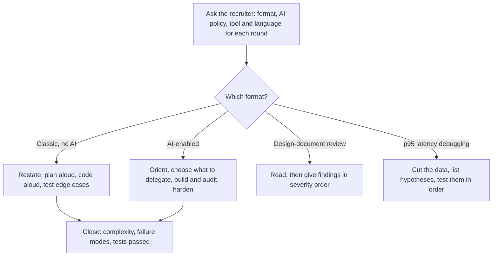

# Coding Rounds in GenAI Loops

> The coding-round formats reported in GenAI loops (classic, AI-enabled, design-document review and p95 latency debugging), what each one scores, and how to prepare for them without memorising solutions.

**Dates.** Formats are as reported in [T1-03](../../research/sessions/T1-03-interview-execution-offer-negotiation.md), dated 2026-10-25, and in its upstream source [T0-14](../../research/sessions/T0-14-ai-system-design-interview-patterns.md). Re-verify them by 2027-01-23. Of the corrections in [ERRATA](../../research/ERRATA.md), only U26 touches this material: it corrects T1-03's count for the infrastructure track, applied under level and track notes. U14 and U24 concern T1-03's India pay bands and funnel stage rates, and U11–U12 concern T0-03 lines not used here.

**Grades** (EGP-1.0, defined in [CONTRIBUTING §3](../../CONTRIBUTING.md#3-writing-standard-egp-10-in-brief)): A primary or measured; B transparent secondary; C coaching, vendor or single source; D judgement; E searched, nothing found; M model output or arithmetic; P practice-curated and unmeasured. A compound grade such as B/C rests on both; rely on the weaker.

**Scope.** LeetCode-style algorithm preparation is outside the research corpus: T0-14 left it out of scope [T0-14 L73]. This page says what each format scores and how to rehearse it. It gives no reference solutions. For language and library basics, use the official documentation: Python type hints and AsyncIO, Pydantic, JSON Schema, and your model provider's guides to structured outputs and tool calling.

## The short answer

1. **Find out each round's format and AI policy before you prepare.** T1-03 lists four formats [T1-03 L216–223]. Policies differ: Anthropic's live rounds default to no AI assistance [B/C · T0-14.F11], and T0-14 notes that Meta's AI policy varies by team [D · T0-14 L553]. Ask the recruiter [P].
2. **Classic rounds fail candidates who code before framing, code silently or skip tests.** T1-03 lists Google, Meta ("still primary"), Stripe and many others as running them, without a source [D · T1-03 L220].
3. **In an AI-enabled round, working with the assistant is what is scored.** Delegate boilerplate, own the logic, catch its hallucinations and say what you are doing. Blind reliance ("vibe coding") is a strong No Hire signal [B/C · T1-03.F6]. The evidence is an early signal from Meta in spring 2026, and the two sessions disagree on whether that round is a coding or a design round (see Evidence and limits).
4. **A design-document review scores prioritisation.** You critique a pre-written design and order your findings by severity: missing requirements, capacity assumptions, failure modes, rollout, alternatives [B · T0-14 L550]. Surface-level comments fail [B · T1-03 L222]. The format rests on 3 Anthropic reports, first observed April 2026 [B · T0-14 L550].
5. **A latency-debugging exercise scores hypotheses, not guesses.** Segment by percentile and cohort; split queue, prefill and decode; then check causes such as batch size, KV pressure and long-context outliers [C · T1-03 L223]. It rests on one report [C · T0-14 L552].
6. **Rehearse behaviours, not solutions.** Neither T1-03 nor T0-14 measures how any preparation method changes coding pass rates, and no prep platform has independent outcome evidence [E · ERRATA U17]. The practice ladder below is practice-curated [P].

## At a glance



## The four formats

### What each format asks of you

| Format | What you do | What is scored | Time | How to prepare |
|---|---|---|---|---|
| Classic algorithmic, no AI | Standard data structures and optimisation; state the approach before coding; test edge cases [D · T1-03 L220] | Not stated; T1-03 lists only what fails: no framing, silent coding, no testing [D · T1-03 L220] | Not reported in T1-03 or T0-14 | Narration and testing drills on any problem set [P]; algorithm content is outside the corpus [T0-14 L73] |
| AI-enabled coding | Delegate boilerplate to the assistant; own the core logic; say out loud who does what [B/C · T1-03 L221] | How you collaborate with the assistant: delegating, owning the logic, catching hallucinations [B/C · T1-03.F6] | Four phases at 10%, 15%, 50% and 25% of the clock [D · T1-03 L227–232]; round length not reported | The timed protocol below; practise critiquing AI output, and Mermaid if the round is the design variant [D · T0-14 L553] |
| Design-document review | Critique a pre-written design [B · T0-14 L550] | Prioritised findings on missing requirements, capacity assumptions, failure modes, rollout and alternatives [B · T0-14 L550] | T0-14 suggests a 10-minute read, then prioritised findings [D · T0-14 L550]; round length not reported | Review RFCs against a checklist: requirements, numbers, failure modes, migration, observability, security, alternatives rejected [D · T0-14 L550] |
| p95 latency debugging | Diagnose a p95 jump, reported as about 100 ms to about 2,000 ms [C · T0-14 L552] | Hypothesis-driven diagnosis [C · T0-14 L552] | Runs inside the design round [C · T0-14 L552]; interviewing.io describes Anthropic's design round as one hour in a shared Google Doc [B/C · T0-14.F11] | Hypothesis drills on real latency data [P], using the cut list in the template below [D · T0-14 L552] |

### How solid the evidence is

| Format | Where reported | Evidence size | Grade | Caveat |
|---|---|---|---|---|
| Classic algorithmic | Google, Meta ("still primary"), Stripe, many others | No source given | D · T1-03 L220 | Algorithm preparation is out of the corpus's scope [T0-14 L73] |
| AI-enabled | Meta, spring 2026 | Early signal | B/C · T1-03.F6; B/C · T0-14 L553 | T0-14 records an AI-enabled design round with Mermaid in CoderPad; T1-03 describes a coding round |
| Design-document review | Anthropic; Aced reports the format for staff-level engineers and engineering leaders | 3 reports, first observed April 2026 | B · T0-14 L550 | No source describes the format in detail [T0-14 L910; T1-03 L409]. T1-03 calls it "code review / design-document review"; the reports describe a design critique |
| p95 latency debugging | Anthropic, in one second-hand aggregator summary [T0-14 L1012] | 1 report | C · T0-14 L552 | An exercise inside the design round, not a separate coding round |

Neighbouring formats belong on other pages. Roofline analysis (4 Anthropic reports) [B · T0-14 L551] sits with [system design archetypes](system-design-archetypes.md). The project deep dive [B/C · T0-14 L554] sits with [behavioural calibration](behavioral-calibration.md).

### Level and track notes

- **Staff and leadership loops.** Aced reports the design-review format for staff-level engineers and engineering leaders [B · T0-14 L550]. Weight the review rung of the ladder if you interview at that level [P].
- **Infrastructure or application track.** AI system design splits into infrastructure (inference serving, batching, GPU scheduling) and application (RAG, agents, evals) [B/C · T1-03.F2]; T1-03's "41/112 Anthropic reports" is the count for the inference-API prompt alone, not for the whole infrastructure track (erratum U26) [B · T0-14 L80]. Infrastructure candidates should weight the debugging rung; application candidates the async-loop and AI-assisted rungs [D].

## The AI-enabled protocol as a timed checklist

T1-03 splits the clock into four phases [D · T1-03 L227–232]. It gives no source for the split, so use it as a pacing aid. Round length is not reported; the checkpoints below are cumulative shares of the time you have, added up from T1-03's split [M].

**By 10% of the clock: orient and deconstruct.**
- [ ] Restate the input, the output and the constraints; ask about any latency target.
- [ ] Agree what "done" means: the success criteria and the test cases.
- Script: "Before I write code, I want to confirm: the input is [X], the output must satisfy [Y], and the SLA is [Z]." [T1-03 L229]

**By 25%: choose what to delegate.**
- [ ] Say what the assistant will write (scaffolding, parsing utilities, boilerplate) and what you will own (the core algorithm, the tests).
- [ ] Check that the interviewer is happy with the split [P].
- Script: "I'll have the assistant scaffold the parsing utility while I design the core algorithm and write the tests." [T1-03 L230]

**By 75%: build and verify in small steps.**
- [ ] Prompt for one piece at a time; pasting giant prompts and accepting unverified output is a named failure [B/C · T1-03 L221].
- [ ] Read every generated line before you accept it, and say what you checked [T1-03 L231].
- [ ] Run the tests after each piece [P].
- [ ] Be able to explain every line you keep: inability to explain AI-generated code is a named failure [B/C · T1-03 L221].
- [ ] When the assistant is wrong, say what is wrong and why. T1-03 asserts that catching a hallucination scores higher than writing clean code from scratch [D · T1-03 L231]; its finding says only that catching hallucinations is part of what is scored [B/C · T1-03.F6].

**By 100%: harden.**
- [ ] State the time and space complexity.
- [ ] Walk through failure modes: "What happens when the downstream API times out?" [T1-03 L232]
- [ ] Name the extensions you would build next.

| Delegate to the assistant | Own yourself |
|---|---|
| Boilerplate and scaffolding [B/C · T1-03.F6] | The core logic [B/C · T1-03.F6] |
| A parsing utility; a data loader [T1-03 L221, L230] | The core algorithm, the retrieval loop and the tests [T1-03 L221, L230] |
| Nothing you cannot read and explain [P] | Complexity and failure-mode analysis [T1-03 L232] |

## The practice ladder

Rehearse in this order. The order and the "done when" tests are practice-curated [P]; the reasons carry their own grades.

1. **Map your loop.** For each round, find out: coding, review or debugging; AI allowed or not; the tool (an IDE, CoderPad or a shared doc); the language. Formats and tools differ by firm [B/C · T0-14.F11]. *Done when* every round in your tracker has these four fields.
2. **Classic narration.** On any problem source, restate the problem, propose an approach with its complexity, code aloud and test edge cases. Their absence is what T1-03 names as failure [D · T1-03 L220]. *Done when* a practice partner can follow your plan before you type, and you test edge cases unprompted.
3. **Production Python without a framework.** Rebuild fluency in skills that T0-03's skills stack lists: Python type hints, AsyncIO, Pydantic schema validation and structured outputs in JSON Schema mode [P · T0-03 L303–304]. Then write a plain async loop that calls a tool, validates the model's structured output and stops on a step, token or time budget. Why: 85% of production teams deploy custom async loops without frameworks [A/B · T0-03.F9]; T0-03 found no top-band job description that names LangChain, but counts its sample two ways: KF2 says none of the top-band job descriptions it read (J1–J8) names LangChain or an eval framework [B · T0-03.F2], while L179 says 0 of 10 top-band lab job descriptions name LangChain, the reading the [market overview](../01-landscape/market-overview.md#6-in-short-supply-evaluation-and-security-commoditised-thin-wrapper-skills) follows. [ROADMAP §7](../../ROADMAP.md#7-known-issues-and-follow-ups) lists the mismatch as a candidate erratum. Unbounded agent loops are a red flag in AI design rounds [C · T0-14 L808]. *Done when* you can write the loop from a blank file, with tests, without looking anything up.
4. **AI-assisted sessions.** Run the timed protocol with an AI coding assistant on practice tasks. Narrate the split, and keep a log of every assistant error you caught and how you caught it [P]. Why: collaboration with the assistant is what the AI-enabled round scores [B/C · T1-03.F6]. *Done when* you hit the four checkpoints and your log shows errors caught by reading, not only by failing tests.
5. **Streaming and reliability.** Add streaming to the loop from rung 3 and measure time to first token (TTFT) and time per output token (TPOT). Add timeouts, retries and idempotency. Why: in AI design rounds, ignoring TTFT and TPOT [C/A · T0-14 L807] and dropping queues, retries and idempotency once a model appears [B/C · T0-14 L814] are red flags, and Senior and Staff loops probe TTFT and TPOT latency budgets [A/C · T0-03.F14]. *Done when* you can say where the time goes in your own loop.
6. **Design-document review drills.** Take a design doc or RFC, your own or a public one. Read it for 10 minutes and write severity-ordered findings on the template below [D · T0-14 L550]. *Done when* your first finding is always structural, never a style comment.
7. **Latency-debugging drills.** Use latency data from your own service or a load test, and fill in the hypothesis log below [D · T0-14 L552]. Learn the vocabulary Senior and Staff loops probe: KV-cache memory sizing, speculative-decoding acceptance rates, prefix-cache hit rates and TTFT or TPOT budgets [A/C · T0-03.F14]. The numbers are in [system design archetypes](system-design-archetypes.md). *Done when* you name your first three cuts of the data before you name a cause.
8. **Mocks and debriefs.** Run timed mocks of each format your loops use. After every mock or real round, run the 30-minute debrief in [interview loops](interview-loops.md#debrief-within-30-minutes-of-each-round) and tag each gap as [formula], [concept], [tool] or [trade-off] [D · T1-03 L245]. *Done when* every round has a debrief entry and every gap has a dated action [C/D · T1-03.F12].

## Templates and examples

### Narration scripts

Orient, Delegate and Harden adapt T1-03's scripts [T1-03 L229–232]; Plan and Audit are [P].

```text
Orient:    "Before I write code, I want to confirm: the input is [X], the output must satisfy [Y], and the SLA is [Z]."
Plan:      "My approach is [approach], [time] time and [space] space. I'll test [edge case], [edge case] and [empty or invalid input]."
Delegate:  "I'll have the assistant scaffold [boilerplate] while I design [core logic] and write the tests."
Audit:     "The assistant wrote [function]. I'm checking [assumption]. It [does | does not] handle [case], so I'm [keeping | rewriting] it."
Harden:    "Time is [ ], space is [ ]. If [dependency] times out, [behaviour]. With more time I would add [extension]."
```

### Questions for the recruiter [P]

Ask these for every round in the loop. Policies differ: Anthropic's live rounds default to no AI assistance [B/C · T0-14.F11], and Meta's AI policy varies by team [D · T0-14 L553]. Neither T1-03 nor T0-14 reports coding-round lengths, so ask.

```text
Round [n] of [N]
1. Format:     coding, design, a review of a pre-written document, or a debugging exercise?
2. AI policy:  may I use an AI assistant? Which one? Is how I use it part of the evaluation?
3. Tool:       an IDE, CoderPad or a shared document? Can I run code and tests?
4. Language:   which languages are allowed?
5. Length:     how many minutes, and how much of that is coding?
```

### Design-review finding [P]

The categories come from the reported format [B · T0-14 L550]; the severity scale is [P].

```text
Finding [n]    Severity: [blocker | major | minor]
Category:      [missing requirement | capacity assumption | failure mode | rollout | alternatives]
Where:         [section or diagram]
Issue:         [what is missing or wrong, with the number if there is one]
Impact:        [what breaks, for whom, at what scale]
Ask or fix:    [question for the author, or the change you propose]
```

Order the findings by severity, not by where they appear in the document [B · T1-03 L222].

### Latency hypothesis log [P]

The cuts and candidate causes come from T0-14's synthesis [D · T0-14 L552].

```text
Symptom:       p95 [metric] went from [a] to [b] at [time]; p50 [moved | flat]
Cuts:          percentile [p50 | p95 | p99]; cohort [tenant | prompt length | model | region];
               phase [queue | prefill | decode]
Hypothesis 1:  [cause]   evidence for: [ ]   test: [ ]   result: [ ]
Hypothesis 2:  [cause]   evidence for: [ ]   test: [ ]   result: [ ]
Hypothesis 3:  [cause]   evidence for: [ ]   test: [ ]   result: [ ]
Candidates:    batch size, KV pressure, long-context outliers, retries and timeouts,
               cache-hit shift, noisy neighbour, deploy diff
Conclusion:    [cause]; fix: [ ]; verify by: [metric and threshold]
```

### Weak and strong moves [P]

| Moment | Weak | Strong |
|---|---|---|
| Opening a classic round | Starts typing after reading the prompt | Restates the input and output, proposes an approach with its complexity, names edge cases, then types |
| Delegating to the assistant | Pastes the whole task into one prompt and accepts the result | Asks for one scaffold, reads it, and says: "This retries on every exception, including validation errors; I'll limit it to timeouts." |
| Reviewing a design document | "Could use more comments and a diagram." | "Blocker: the cache is sized for [n] requests per second but the stated peak is [m], so the capacity assumption fails at peak." |
| Debugging a p95 jump | "Probably the GPUs are slow; add more." | "Did p50 move too? If only p95 moved, I'd cut by prompt length to look for long-context outliers, then split queue time from prefill and decode." |
| Finishing | "I think it works." | "Tests pass for [cases]; complexity is [ ]; if the downstream API times out, [behaviour]." |

## Checklist

- [ ] I know each round's format, AI policy, tool and language.
- [ ] I state the approach, its complexity and my edge cases before I type.
- [ ] I test before I call a solution done.
- [ ] (Application track) I can write an async tool-calling loop with structured-output validation and step, token and time budgets, in plain Python, from a blank file.
- [ ] I have rehearsed the AI-enabled protocol and can hit its four checkpoints.
- [ ] My error log shows assistant mistakes I caught by reading the code.
- [ ] I can explain every line I keep, including the lines the assistant wrote.
- [ ] (Staff and leadership loops) I can give severity-ordered findings on a design document, structural issues first.
- [ ] (Infrastructure track) I can debug a latency jump by cutting the data before naming a cause.
- [ ] I close every round with complexity, failure modes and tests.
- [ ] I debrief within 30 minutes of each round and log the gaps.

## Pitfalls

Rows sourced to T0-14 come from AI system design rounds; applying them to coding is judgement [D].

| Red flag | Why it hurts | Fix | Grade · source |
|---|---|---|---|
| Silent coding | A named failure in classic rounds | Narrate the plan and each step | D · T1-03 L220 |
| Jumping to code without framing | A named failure in classic rounds | Orient first; in AI-enabled rounds that is the first 10% of the clock | D · T1-03 L220, L229 |
| No tests | A named failure in classic rounds | Write edge-case tests with the code | D · T1-03 L220 |
| "Vibe coding": giant prompts, unverified output | A strong No Hire signal in AI-enabled rounds | One piece at a time; read every line | B/C · T1-03.F6 |
| Silent AI interaction | A named failure in AI-enabled rounds | Say what you delegate and why | B/C · T1-03 L221 |
| Unable to explain AI-written code | A named failure in AI-enabled rounds | Keep only what you can explain | B/C · T1-03 L221 |
| Treating model output as a source of truth | It ignores non-determinism | Validators, citations and fallbacks | C · T0-14 L806 |
| An unbounded agent loop | No budgets, no termination | Step, token and time budgets | C · T0-14 L808 |
| Dropping retries, timeouts or idempotency once a model appears | AI-framed rounds are classic underneath | Keep the reliability basics | B/C · T0-14 L814 |
| Pasting a memorised or LLM-generated design | Its shape does not fit the stated constraints | Derive it from the stated constraints | C · T0-14 L811 |
| Surface-level review comments | They miss the structural issues | Order findings by severity | B · T1-03 L222 |
| Guessing in a debugging exercise | No data, no hypotheses | Cut the data, then test hypotheses | C · T1-03 L223 |
| Preparing for the wrong round type | Wrong altitude and vocabulary | Ask the recruiter | C · T0-14 L812 |

## Evidence and limits

- **What is measured.** No format on this page is measured. The evidence is report counts from aggregators and coaching sources: AI-enabled rounds are an early signal [B/C]; the design-document review rests on 3 reports [B]; p95 debugging on 1 report [C]; classic rounds on an unsourced statement [D]. T1-03's AI-enabled time split, and its claim that catching a hallucination outscores clean code, have no source [D · T1-03 L227–232].
- **A classification conflict.** T0-14 records Meta's spring 2026 signal as an AI-enabled design round, with Mermaid in CoderPad [B/C · T0-14 L553, L826]. T1-03 describes an AI-enabled coding round, citing T0-14 plus its own web research [B/C · T1-03.F6]. T1-03 also files the design-document review and the p95 exercise under coding, while T0-14 places both with design rounds [T0-14 L546–552]. Prepare the behaviours (working with an assistant, critiquing a design, debugging with data) for whichever round they appear in.
- **Gaps.** Neither T1-03 nor T0-14 lists the tasks set in GenAI coding rounds, so the practice tasks above are [P]. Algorithm preparation is out of the corpus's scope [T0-14 L73]. Pass rates by round type are not published [T1-03 L404]. Whether an AI-assisted round changes the scoring is an open question in T0-14 [T0-14 L912]. The evidence used here does not cover specialist coding, such as GPU kernels.
- **Dates.** As reported up to 2026-10-25. `review_by` is 2027-01-23, 90 days on, the interval used for tool statuses [P]. Re-check before then if a target firm announces a change to its AI-assistant policy.
- **What would change this advice.** A firm publishing its AI-assistant policy or coding rubric; reports of AI-enabled rounds at firms other than Meta; a detailed description of Anthropic's design-document review.

## Next steps

- [Interview loops](interview-loops.md): which rounds each loop contains, and the debrief and tracker for every round.
- [System design archetypes](system-design-archetypes.md): the design rounds, and the numbers behind the debugging vocabulary.
- [Prep packs: coding pack](prep-packs.md#coding-pack), with the [application pack](prep-packs.md#application-pack) and the [infrastructure pack](prep-packs.md#infrastructure-pack).
- [Behavioural calibration](behavioral-calibration.md): the round that can veto a strong technical packet.
- [Agentic protocols](../03-skills-and-tech/agentic-protocols.md) and [learning roadmaps](../03-skills-and-tech/learning-roadmaps.md): the skills behind rungs 3 and 5.
- [Project archetypes](../05-portfolio/project-archetypes.md) and [proof-of-work standards](../05-portfolio/proof-of-work-standards.md): turn practice code into portfolio evidence.
- [Tool catalog](../00-start/tool-catalog.md): ecosystem tools with dated verdicts.
- Role hubs: [AI engineer](../02-roles/hubs/ai-engineer.md), [agentic AI engineer](../02-roles/hubs/agentic-ai-engineer.md), [inference engineer](../02-roles/hubs/inference-engineer.md), [AI infrastructure engineer](../02-roles/hubs/ai-infrastructure-engineer.md), [forward-deployed engineer](../02-roles/hubs/forward-deployed-engineer.md).
- Evidence: [findings for stage 8](../../research/findings.md#stage-08); sessions [T1-03](../../research/sessions/T1-03-interview-execution-offer-negotiation.md), [T0-14](../../research/sessions/T0-14-ai-system-design-interview-patterns.md) and [T0-03](../../research/sessions/T0-03-skills-compute-infra-eval-stack.md); [glossary](../00-start/glossary.md).
