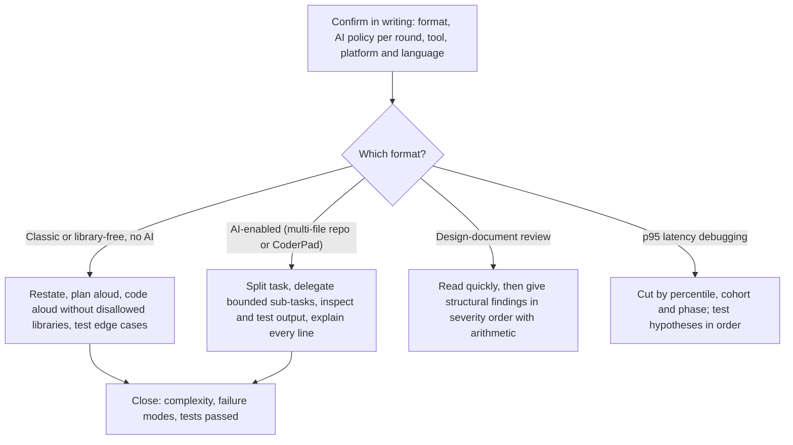

# Coding Rounds in GenAI Loops

> Coding-round formats in GenAI loops (classic and library-free, AI-enabled, design-document review and p95 latency debugging), employer AI-coding policies, platform proctoring and anti-cheat reality, and a practice ladder.

**Dates.** Employer AI-coding policies, round formats, proctoring signals and take-home security findings are updated from [T0-46](../../research/sessions/T0-46-interview-loops-genai-employers-2026.md) (retrieved 2026-11-13 to 2026-11-14), [T0-47](../../research/sessions/T0-47-ai-mediated-hiring-screening-interviews-fraud.md) (retrieved 2026-11-13) and RP2 role dossiers ([T0-49](../../research/sessions/T0-49-role-dossier-ml-engineer.md), [T0-50](../../research/sessions/T0-50-role-dossier-research-engineer.md), [T0-52](../../research/sessions/T0-52-role-dossier-applied-scientist.md), [T0-56](../../research/sessions/T0-56-role-dossier-inference-engineer.md), [T0-57](../../research/sessions/T0-57-role-dossier-agentic-ai-engineer.md), [T0-63](../../research/sessions/T0-63-role-dossier-gpu-kernel-engineer.md)), building on [T1-03](../../research/sessions/T1-03-interview-execution-offer-negotiation.md) (2026-10-25), [T0-14](../../research/sessions/T0-14-ai-system-design-interview-patterns.md) (2026-10-21) and [T0-03](../../research/sessions/T0-03-skills-compute-infra-eval-stack.md). Re-verify by 2027-02-11 (90 days from T0-46/T0-47 retrieval). Of the corrections in [ERRATA](../../research/ERRATA.md), U26 applies under level and track notes and U36 applies in rung 3 of the practice ladder. Anthropic policy and take-home facts carry a **COI** tag because the RP2 author model is Anthropic's; primary Anthropic pages were independently re-verified on 2026-11-19.

**Grades** (EGP-1.0, defined in [CONTRIBUTING §3](../../CONTRIBUTING.md#3-writing-standard-egp-10-in-brief)): A primary or employer-published; B transparent secondary or platform documentation; C coaching, vendor or single candidate report; D judgement; E searched, nothing found; M model output or arithmetic; P practice-curated and unmeasured. A compound grade such as B/C rests on both; rely on the weaker.

**Scope.** LeetCode-style algorithm preparation is outside the research corpus: T0-14 left it out of scope [T0-14 L73], and T0-46 confirms classic rounds remain AI-free at Meta, Anthropic and DeepMind so LeetCode remains a baseline [C · T0-46 L464]. This page says what each format scores, what employers allow or detect, and how to rehearse without memorising solutions. For language and library basics, use the official documentation: Python type hints and AsyncIO, Pydantic, JSON Schema, and your model provider's guides to structured outputs and tool calling.

## The short answer

1. **Treat the AI rule as a per-employer, per-round rule — default to no AI unless written instructions allow it.** Anthropic bans live AI unless the interviewer says otherwise (while explicitly allowing AI in its performance-engineering take-home, cut from 4 hours to 2 hours) [A, COI · T0-46 L201, L239]. Amazon and Google bar unauthorised live AI and state disqualification as the consequence [B · T0-47 L161–162]. Ask the recruiter in writing before every stage [A/C · T0-46 L101–102].
2. **Keep classic, practical on-the-job and write-it-yourself coding sharp.** AI-enabled rounds sit *beside* AI-free rounds rather than replacing them across the board [A/C · T0-46 L104, L123]: Anthropic's postings state its coding rounds reflect on-the-job engineering rather than LeetCode puzzles (without live AI unless stated) [A, COI · T0-56 L662], Meta keeps classic coding rounds AI-free, Google DeepMind sets a 60-minute core ML primitive without libraries, Microsoft and Amazon Applied Scientist loops pair ML-from-scratch coding with DSA [C · T0-52 L711, L714], Amazon's agentic guide advises against high-level libraries, and Amazon India (ADCI) mixes DSA, low-level design and GenAI coding [C · T0-46 L104, L193, L350].
3. **In AI-enabled coding rounds, direction, review, testing and ownership are what is scored.** T0-46 resolves the earlier Meta coding-vs-design conflict into two distinct rounds: a **60-minute AI-assisted coding round** in customised CoderPad (piloted October 2025, corroborated by CoderPad, interviewing.io and PracHub) and a separate 2026 agentic design round [A/B/C · T0-46 L81, L451; T0-50 L658]. Primary employer disclosures confirm AI-assisted coding at **Sierra** (May 2026: algorithm coding interviews removed in favour of a 2-hour AI-native **Plan-Build-Review** onsite where reviewers examine how AI tooling was used [A · T0-57 L600]), **Canva** (mandatory [A · T0-46 L80]) and **Glean** (brief AI-focused exercise or discussion [A · T0-49 L639]). AI-enabled coding also appears at Microsoft CoreAI (45-minute 5-issue repair in a multi-file repo), Scale AI (Claude-assisted; candidate authors prompt), Cursor (later rounds on a real codebase), Accenture (co-building; explain every line), Google (H2 2026 Gemini code-comprehension pilot) and HackerRank Chakra (GA 2026-10-05) [A/B/C · T0-46 L147, L149, L208–211; T0-47 L149]. Canva calls prompting and accepting output the weakest approach [A · T0-46 L80].
4. **A design-document review scores severity-ordered structural critique.** T0-46 finds two dated PracHub reports for Anthropic (2026-04-16 and 2026-09-18: critiquing a batched GPU inference API design for QPS/batch arithmetic, mixed-model GPU scheduling and failure modes; T0-14 cited 3 April 2026 reports) [C · T0-46 L82, L257, L452]. Surface-level comments fail [B · T1-03 L222].
5. **p95 latency debugging remains thin evidence.** It rests on one second-hand Anthropic report in T0-14; **no latency-debugging report surfaced in T0-46**, and one Anthropic guide lists no debugging round [C · T0-14 L552; E · T0-46 L452, L480]. Keep the hypothesis-driven method ready for infrastructure loops, without over-weighting it.
6. **Never use undisclosed live copilots, and sandbox unknown take-home repos.** Platforms run code replay and typing-linearity / suspicion scoring (HackerRank, CodeSignal), interviewers watch for reading/typing cues (Amazon), and Google and McKinsey restored in-person rounds [B · T0-46 L222–223; T0-47 L161, L177]. Live copilots risk disqualification and data exposure (Final Round AI's privacy policy allows AI training on audio and screen captures [A, COI · T0-46 L516]), while fake AI coding tests deliver malware ("Contagious Interview" campaign), making a disposable VM essential [A/B · T0-47 L79, L186].

## At a glance



## The four formats

### What each format asks of you

| Format | What you do | What is scored | Time and tools | How to prepare |
|---|---|---|---|---|
| **Classic / write-it-yourself, no AI** | Standard DSA, practical HTTP/data tasks, or core ML primitives without high-level libraries (Anthropic live Python, Meta classic, DeepMind 60-min library-free ML primitive, Amazon agentic no-high-level-libraries, Microsoft Bing k-means, ADCI DSA+LLD, Infosys warm-ups/self-attention) [C · T0-46 L104, L193, L350–351] | Correctness, complexity, framing before coding, thinking aloud and testing edge cases [C · T0-46 L193; D · T1-03 L220] | 45–60 min typical (DeepMind 60 min; Infosys technical rounds 15–60 min) [C · T0-46 L165, L341] | Narration, edge-case testing and blank-file Python / ML-primitive drills [P]; LeetCode stays baseline [C · T0-46 L464] |
| **AI-enabled coding** | Multi-file repo bug fix, feature build, repair or comprehension with an approved built-in assistant (Meta 60-min customised CoderPad, Canva required round, Microsoft CoreAI 45-min 5-issue repo fix, Scale AI Claude-assisted HTTP CSV→JSON, Google H2 2026 Gemini pilot, Cursor codebase round, Accenture co-building, HackerRank Chakra) [A/B/C · T0-46 L80, L147–149, L193, L208–211; T0-47 L149] | Task breakdown, technical judgement, catching faults in generated code, testing, production standard, writing your own prompt and explaining every kept line [A/C · T0-46 L80, L103] | Meta 60 min; Microsoft CoreAI ~45 min; T1-03 pacing split 10% / 15% / 50% / 25% [C · T0-46 L81, L149; D · T1-03 L227–232] | Practise on multi-file repositories (not single functions) using the timed protocol below [A/C · T0-46 L103] |
| **Design-document review** | Critique a flawed written design (e.g., Anthropic batched GPU inference API: 100 ms/batch, 10,000 QPS, mixed large+small models on 8 GPUs) [C · T0-46 L257, L718–719] | Severity-ordered structural findings: requirement gaps, batch/QPS arithmetic, shared-GPU scheduling, retries, failure modes, migration and validation [B · T0-14 L550; C · T0-46 L257] | 10-min read then prioritised findings [D · T0-14 L550]; Anthropic design rounds reported 35–60 min (inconsistent across guides) [C · T0-46 L171] | Review RFCs against the severity checklist below; check every capacity number first [C · T0-46 L257] |
| **p95 latency debugging** | Diagnose a p95 latency jump (reported as ~100 ms to ~2,000 ms in T0-14) [C · T0-14 L552] | Hypothesis-driven diagnosis [C · T0-14 L552] | Reported inside a design round in T0-14 [C · T0-14 L552] | Hypothesis drills on real latency data [P], using the cut list below [D · T0-14 L552] |

### How solid the evidence is

| Format | Where reported | Evidence size | Grade | Caveat |
|---|---|---|---|---|
| **Classic / write-it-yourself** | Meta, Anthropic, Google, Amazon, DeepMind, Microsoft Bing, ADCI, Infosys, Stripe | Multi-employer guides and candidate reports | C (guides/reports) · T0-46 L193, L464 | Algorithm prep itself is outside the research corpus [T0-14 L73] |
| **AI-enabled coding** | Canva (2025-06-11), Meta (piloted Oct 2025), Google (H2 2026 pilot), Microsoft CoreAI (June 2026), Scale AI (July 2026), Cursor, Accenture, HackerRank Chakra (GA 2026-10-05) | Primary posts (Canva, CoderPad, Chakra) + press (Google) + corroborated Meta reports + single reports | A (Canva, CoderPad COI) / B (Google pilot, Chakra) / C (others) · T0-46 L79–81, L204–211; T0-47 L149 | Resolves T0-14/T1-03 conflict: Meta runs *both* a 60-min coding round and a separate agentic design round; Mermaid-in-CoderPad is unverified [E · T0-46 L420, L451] |
| **Design-document review** | Anthropic (Staff/SWE/leadership) | 2 dated PracHub reports (2026-04-16, 2026-09-18) in T0-46; 3 April 2026 reports in T0-14 | C · T0-46 L82, L452; B · T0-14 L550 | Both T0-46 pages come from one prep vendor (PracHub, COI); no official Anthropic rubric published |
| **p95 latency debugging** | Anthropic (1 second-hand summary in T0-14) | 1 report in T0-14; **0 found in T0-46** | C · T0-14 L552; E · T0-46 L452, L480 | One Anthropic guide lists no debugging round; treat as an optional infrastructure probe |

Neighbouring formats belong on other pages. Roofline analysis (4 Anthropic reports) [B · T0-14 L551] sits with [system design archetypes](system-design-archetypes.md). The project deep dive [B/C · T0-14 L554] sits with [behavioural calibration](behavioral-calibration.md). Take-home assignments (Ashby ~13% all-role prevalence, 4–8 h senior/research concentration, Anthropic's 2-hour AI-allowed performance-engineering take-home) sit in [interview loops](interview-loops.md#take-homes) and [employer interview loops](employer-interview-loops.md#take-home-assignments-and-paid-work-trials).

### Employer AI-coding policies, platform proctoring and anti-cheat reality

Employers have split into three camps on AI in coding rounds — **barred in live rounds**, **permitted or required in dedicated AI-assisted rounds**, and **silent on public pages** — while strengthening detection and integrity controls across all three [A/B/C · T0-46 L79–81, L199–212; T0-47 L58–60, L158–177]:

- **Where live AI is explicitly barred or restricted:** Anthropic bans live AI unless told [A, COI · T0-46 L201]; Amazon requires acknowledgement and trains interviewers on behavioural cues (typing while answering, reading off-screen answers) with disqualification stated [B · T0-47 L161]; Google tells applicants before interviews that live AI use means disqualification [B · T0-47 L162]; Google DeepMind generally prohibits or heavily limits tools in technical rounds [C · T0-46 L203]; Cursor restricts AI in early screens [C · T0-46 L210].
- **Where AI is explicitly provided or required:** Sierra expects AI tooling in its 2-hour Plan-Build-Review onsite and explicitly evaluates how the candidate used it (having removed algorithm coding interviews) [A · T0-57 L600]; Canva requires AI use in its technical interview [A · T0-46 L208]; Glean includes a brief AI-focused exercise or discussion [A · T0-49 L639]; Meta runs a 60-minute AI-assisted round in a customised CoderPad alongside AI-free classic rounds [A/B/C · T0-46 L148, L205; T0-50 L658]; Google launched a Gemini-assisted code-comprehension pilot for junior/mid US SWEs from H2 2026 [B · T0-46 L204]; HackerRank Chakra (generally available 2026-10-05; >500,000 beta interviews vendor-reported) runs autonomous real-repository interviews with a built-in AI assistant [B · T0-47 L149]; single reports also document AI-assisted rounds at Microsoft CoreAI, Scale AI (candidate writes prompt rather than pasting a screenshot), Accenture (explain every generated line), Stripe (told not to trust the AI) and LinkedIn [C · T0-46 L206, L209, L211; T0-14 L176; T0-47 L165]. See the full per-stage table in [employer interview loops](employer-interview-loops.md#ai-assistant-policies-by-employer-and-stage).
- **Platform telemetry and anti-cheat signals:** Assessment platforms do not rely on trust alone. **HackerRank** runs plagiarism detection with full code replay (audited under NYC LL144 in a BABL AI summary dated 2024-12-12) [B · T0-47 L177]; **CodeSignal** pairs rubric scores with a separate multi-signal **Suspicion Score** and typing-linearity telemetry [B · T0-47 L177]; **Google** (announced June 2025) and **McKinsey** restored in-person steps specifically to curb virtual AI cheating [B · T0-46 L222–223]. A detection vendor (Fabric) reports 38.5% of 19,368 AI-powered interviews flagged (48% for technical roles; method undisclosed, C, COI) [C · T0-47 L177].
- **Why live interview copilots are an avoid:** Overlay tools (Final Round AI live copilot, Cluely — whose CEO retracted a false $7M ARR claim on 2026-03-05 — Parakeet AI, LeetCode Wizard) market unverified "undetectable" live answers [C · T0-47 L59, L173–175]. Using one breaks stated policies at Amazon, Google and Anthropic with disqualification as the stated consequence [A, COI / B · T0-46 L231; T0-47 L161–162], and exposes audio and screen content (Final Round AI's 2026-10-08 privacy policy allows user recordings, voice samples and screen captures — including interviewers' voices — to be used for AI training with human review and states no retention period [A, COI · T0-46 L418, L516]). Use AI for preparation and mocks, never as an undisclosed live overlay [B/C · T0-47 L76].
- **Security hygiene on take-home code:** Treat recruiter-supplied repositories and local test scripts as untrusted. Microsoft (2026-03-11) and Unit 42 document the **"Contagious Interview"** campaign (active since at least December 2022; a September 2026 alert cited 30,000 compromised devices), which lures AI-sector candidates with fake coding tests and weaponised VS Code project files [A/B · T0-47 L62, L186]. Verify the recruiter's company domain and ATS link first, use a browser IDE where offered, and execute any unknown repo strictly inside a disposable VM or container [B · T0-47 L79].

### Level and track notes

- **Staff and leadership loops.** Aced reports the design-document review format for staff-level engineers and engineering leaders [B · T0-14 L550], and T0-46's two dated Anthropic PracHub reports focus on batched GPU inference architecture and capacity arithmetic [C · T0-46 L257]. Weight the review rung of the ladder if you interview at that level [P].
- **Infrastructure, kernel or application track.** AI system design splits into infrastructure (inference serving, batching, GPU scheduling) and application (RAG, agents, evals) [B/C · T1-03.F2]; T1-03's "41/112 Anthropic reports" is the count for the inference-API prompt alone, not for the whole infrastructure track (erratum U26; note AceOffer's underlying 112-report tally did not surface in T0-46 [C · T0-46 L462]) [B · T0-14 L80]. Infrastructure and GPU-kernel candidates should weight design-review arithmetic, simulated-accelerator / constrained-ISA optimisation take-homes (Anthropic 2-hour performance take-home [A, COI · T0-50 L654; C · T0-63 L714]), CUDA/profiler roofline walkthroughs and BF16/FP8 numerics (NVIDIA [C · T0-63 L715]) and public kernel code on GitHub (Sarvam AI's highest-yield screen [A · T0-63 L717]); application candidates should weight plain-Python async loops and multi-file AI-assisted repair [D].
- **India loops.** Amazon India (ADCI) combines LeetCode-style DSA, low-level design and GenAI coding (and Applied Scientist Bengaluru combines coding with ML depth [C · T0-52 L712]); Sarvam AI screens kernel candidates directly on GitHub open-source kernel performance [A · T0-63 L717]; IT-services firms (Infosys, Wipro, HCLTech, Accenture) run shorter virtual screens covering Python basics, RAG/agent coding or co-building, and architecture discussion [C · T0-46 L146, L350–356].

## The AI-enabled protocol as a timed checklist

T1-03 splits the clock into four phases (**10% / 15% / 50% / 25%**) [D · T1-03 L227–232], and T0-46 plus T0-57 corroborate the underlying rubric across Sierra (Plan-Build-Review), Canva, Meta (60 minutes in CoderPad), Microsoft CoreAI (~45 minutes on 5 issues in a multi-file repo), Scale AI and Accenture [A/C · T0-46 L80, L103, L148–149, L209, L211; T0-57 L600]. Use the phase budgets and cumulative checkpoints below as a pacing aid across 45- or 60-minute rounds [M].

**Phase 1 — First 10% (0–10% of the clock): orient and deconstruct.**
- [ ] Read the repository structure, existing tests and constraints before touching the assistant; confirm input, output and SLA [D · T1-03 L229; A/C · T0-46 L103].
- [ ] Agree what "done" means: the success criteria and test cases.
- Script: "Before I write code, I want to confirm: the input is [X], the output must satisfy [Y], and the SLA is [Z]." [T1-03 L229]

**Phase 2 — Next 15% (by 25%): split the task and choose what to delegate.**
- [ ] Break the problem into bounded sub-tasks (Canva explicitly grades task breakdown [A · T0-46 L80]).
- [ ] Say what the assistant will draft (scaffolding, parsing utilities, boilerplate) and what you will own (architecture, core logic, tests).
- [ ] Check that the interviewer is happy with the split [P].
- Script: "I'll have the assistant scaffold the parsing utility while I design the core algorithm and write the tests." [T1-03 L230]

**Phase 3 — Next 50% (by 75%): build, inspect and verify in small steps.**
- [ ] Author bounded prompts yourself — do not paste screenshots or giant whole-task prompts (Scale AI required self-authored prompts [C · T0-46 L209]; Canva calls prompting and accepting output the weakest approach [A · T0-46 L80]).
- [ ] Read every generated line before accepting it, and say aloud what you verified or rejected [A/C · T0-46 L103; T1-03 L231].
- [ ] Run tests after each small change [P].
- [ ] Keep only code you can explain line by line (Accenture requires explaining every generated line and defending design choices [C · T0-46 L211]; inability to explain AI-written code is a named failure [B/C · T1-03 L221]).
- [ ] When the assistant is wrong, name the bug and why it matters (finding faults in generated code is an explicit Canva criterion [A · T0-46 L80]; T1-03's stronger claim that catching a hallucination outscores clean code from scratch is unsourced [D · T1-03 L231]).

**Phase 4 — Final 25% (by 100%): harden.**
- [ ] State time and space complexity and production readiness.
- [ ] Walk through failure modes: "What happens when the downstream API times out?" [T1-03 L232]
- [ ] Name the extensions or follow-up refactors you would build next.

| Delegate to the assistant | Own yourself |
|---|---|
| Bounded boilerplate and scaffolding [A/C · T0-46 L103; B/C · T1-03.F6] | Task breakdown and architecture decisions [A · T0-46 L80] |
| A parsing utility, test fixture or data loader [T1-03 L221, L230] | Core logic, bug diagnosis, edge-case tests and prompt authoring [C · T0-46 L80, L209] |
| Nothing you cannot read, verify and explain line by line [C · T0-46 L211; P] | Complexity, fault-finding and failure-mode analysis [A · T0-46 L80; T1-03 L232] |

## The practice ladder

Rehearse in this order. The order and the "done when" tests are practice-curated [P]; the reasons carry their own grades.

1. **Map your loop.** For each round, get in writing: coding, review or debugging; AI allowed, required or barred; tool (IDE, CoderPad, HackerRank Chakra, shared doc); language; and whether any stage is in person [A/C · T0-46 L101, L107; B · T0-47 L149]. *Done when* every round in your tracker has these fields.
2. **Classic narration.** On any problem source (LeetCode stays a baseline because AI-free rounds persist [C · T0-46 L464]), restate the problem, propose an approach with its complexity, code aloud and test edge cases. Their absence is what T1-03 names as failure [D · T1-03 L220]. *Done when* a practice partner can follow your plan before you type, and you test edge cases unprompted.
3. **Write-it-yourself Python and core primitives without a framework.** Rebuild fluency in Python type hints, AsyncIO, Pydantic schema validation and JSON Schema structured outputs [P · T0-03 L303–304], then write (a) a plain async tool-calling loop with step, token and time budgets, and (b) for ML/research tracks, a core ML primitive from scratch without libraries (DeepMind sets a 60-minute library-free round; Microsoft and Amazon Applied Scientist loops pair ML coding with DSA; Amazon's agentic guide advises against leaning on high-level libraries; Infosys reports self-attention from scratch) [C · T0-46 L104, L193, L351; T0-52 L711, L714]. Why: 17 of 20 interviewed production teams (85%, n = 20) built custom async loops without frameworks, whereas 61% of a wider n = 306 practitioner survey reported using an agent framework — employers expect bare-loop fluency regardless [B · T0-03.F9; ERRATA U36], T0-03 found zero top-band job descriptions naming LangChain (with a sample-count mismatch logged in [ROADMAP §7](../../ROADMAP.md#7-known-issues-and-follow-ups) [B · T0-03.F2, L179]), and unbounded loops are a red flag [C · T0-14 L808]. *Done when* you can write the loop (or primitive) from a blank file, with tests, without looking anything up.
4. **AI-assisted sessions on a multi-file repository.** Run the timed protocol with an AI coding assistant on a real multi-file codebase — bug fix, feature addition, and 5-issue triage — NOT single standalone functions [A/C · T0-46 L103, L149]. Author bounded prompts yourself, narrate the split, explain every kept line and log every assistant fault caught by reading [A/C · T0-46 L80, L209, L211; P]. *Done when* you hit the four checkpoints in 45–60 minutes and your log shows bugs caught by reading, not only failing tests.
5. **Streaming and reliability.** Add streaming to the loop from rung 3 and measure time to first token (TTFT) and time per output token (TPOT). Add timeouts, retries and idempotency. Why: ignoring TTFT/TPOT [C/A · T0-14 L807] and dropping queues, retries and idempotency once a model appears [B/C · T0-14 L814] are red flags, and Senior/Staff loops probe TTFT and TPOT budgets [A/C · T0-03.F14]. *Done when* you can say where the time goes in your own loop.
6. **Design-document review drills.** Take a design doc or RFC (for example, an inference-serving or batched GPU API spec). Read it for 10 minutes, check the QPS/batching arithmetic first, and write severity-ordered findings on the template below [C · T0-46 L257; D · T0-14 L550]. *Done when* your first finding is always a structural or arithmetic blocker, never a style comment.
7. **Latency-debugging drills (infrastructure tracks).** Use latency data from your own service or a load test, and fill in the hypothesis log below [D · T0-14 L552]. Learn the vocabulary Senior and Staff loops probe: KV-cache memory sizing, speculative-decoding acceptance rates, prefix-cache hit rates and TTFT/TPOT budgets [A/C · T0-03.F14]. Numbers are in [system design archetypes](system-design-archetypes.md). *Done when* you name your first three cuts of the data before naming a cause.
8. **Mocks and debriefs.** Run timed mocks of each format your loops use (remember Hello Interview ended human mocks on 2026-05-31 and runs AI-only Live Practice, and no prep platform has independent outcome evidence [A, COI / E · T0-46 L406, L455]). After every mock or real round, run the 30-minute debrief in [interview loops](interview-loops.md#debrief-within-30-minutes-of-each-round) and tag each gap as `[formula]`, `[concept]`, `[tool]` or `[trade-off]` [D · T1-03 L245]. *Done when* every round has a debrief entry and every gap has a dated action [C/D · T1-03.F12].

## Templates and examples

### Narration scripts

Orient, Delegate and Harden adapt T1-03's scripts [T1-03 L229–232]; Plan and Audit are [P].

```text
Orient:    "Before I write code, I want to confirm: the input is [X], the output must satisfy [Y], and the SLA is [Z]."
Plan:      "My approach is [approach], [time] time and [space] space. I'll test [edge case], [edge case] and [empty or invalid input]."
Delegate:  "I'll have the assistant scaffold [boilerplate] while I design [core logic] and write the tests."
Audit:     "The assistant wrote [function]. I'm checking [assumption]. It [does | does not] handle [case], so I'm [keeping | rewriting] it."
Harden:    "Time is [ ], space is [ ]. If [dependency] times out, [behaviour]. With more time I would add [extension]."
```

### Questions for the recruiter [P]

Ask these in writing for every round in the loop. AI rules differ by employer and round, and unauthorised live AI states disqualification at Amazon and Google [A, COI · T0-46 L201; B · T0-47 L161–162].

```text
Round [n] of [N]
1. Format:     classic coding, library-free ML coding, AI-enabled coding, design-doc review or debugging?
2. AI policy:  is AI barred, optional or required? Which tool is provided, and what is assessed?
3. Platform:   CoderPad, HackerRank (or Chakra), CodeSignal, local IDE or shared document? Can I run tests?
4. Language:   which languages and libraries are allowed or barred?
5. Length:     how many minutes, and is the round virtual or in person?
```

### Design-review finding [P]

The categories come from the reported Anthropic format [B · T0-14 L550; C · T0-46 L257]; the severity scale is [P].

```text
Finding [n]    Severity: [blocker | major | minor]
Category:      [missing requirement | capacity/QPS arithmetic | failure mode | rollout | alternatives]
Where:         [section or diagram]
Issue:         [what is missing or wrong, with the number if there is one]
Impact:        [what breaks, for whom, at what scale]
Ask or fix:    [question for the author, or the change you propose]
```

Order the findings by severity, not by where they appear in the document [B · T1-03 L222; C · T0-46 L257].

### Latency hypothesis log [P]

The cuts and candidate causes come from T0-14's synthesis [D · T0-14 L552].

```text
Symptom:       p95 [metric] went from [a] to [b] at [time]; p50 [moved | flat]
Cuts:          percentile [p50 | p95 | p99]; cohort [tenant | prompt length | model | region];
               phase [queue | prefill | decode]
Hypothesis 1:  [cause]   evidence for: [ ]   test: [ ]   result: [ ]
Hypothesis 2:  [cause]   evidence for: [ ]   test: [ ]   result: [ ]
Hypothesis 3:  [cause]   evidence for: [ ]   test: [ ]   result: [ ]
Candidates:    batch size, KV pressure, long-context outliers, retries and timeouts,
               cache-hit shift, noisy neighbour, deploy diff
Conclusion:    [cause]; fix: [ ]; verify by: [metric and threshold]
```

### Weak and strong moves [P]

| Moment | Weak | Strong |
|---|---|---|
| Opening a classic round | Starts typing after reading the prompt | Restates the input and output, proposes an approach with its complexity, names edge cases, then types |
| Delegating to the assistant | Pastes a screenshot or whole task into one prompt and accepts the result | Authors a bounded prompt for one scaffold, reads it, and says: "This retries on every exception, including validation errors; I'll limit it to timeouts." |
| Reviewing a design document | "Could use more comments and a diagram." | "Blocker: 100 ms per batch across 8 GPUs cannot meet 10,000 QPS at the stated batch size, so the throughput assumption fails before we even add the second model." |
| Debugging a p95 jump | "Probably the GPUs are slow; add more." | "Did p50 move too? If only p95 moved, I'd cut by prompt length to look for long-context outliers, then split queue time from prefill and decode." |
| Finishing | "I think it works." | "Tests pass for [cases]; complexity is [ ]; if the downstream API times out, [behaviour]." |

## Checklist

- [ ] I have each round's format, AI policy, platform, allowed libraries and length in writing.
- [ ] I state the approach, its complexity and my edge cases before I type.
- [ ] I test before I call a solution done.
- [ ] (Application / ML track) I can write an async tool-calling loop with structured-output validation and step/token/time budgets — or a core ML primitive without high-level libraries — from a blank file.
- [ ] I have rehearsed the AI-enabled protocol on a multi-file repository and can hit its four checkpoints.
- [ ] My error log shows assistant mistakes I caught by reading the code, and I can explain every line I keep.
- [ ] I do not run any undisclosed live copilot or overlay tool in assessed rounds.
- [ ] I run unfamiliar take-home repositories only inside a disposable VM or browser IDE.
- [ ] (Staff and leadership loops) I can give severity-ordered findings on a design document, structural and arithmetic blockers first.
- [ ] (Infrastructure track) I can debug a latency jump by cutting the data before naming a cause.
- [ ] I close every round with complexity, failure modes and tests, and debrief within 30 minutes.

## Pitfalls

Rows sourced to T0-14 come from AI system design rounds; applying them to coding is judgement [D].

| Red flag | Why it hurts | Fix | Grade · source |
|---|---|---|---|
| Silent coding or jumping to code without framing | Named failures in classic rounds | Orient and narrate plan, complexity and edge cases first | D · T1-03 L220, L229 |
| No tests | Named failure in classic rounds | Write edge-case tests with the code | D · T1-03 L220 |
| Prompting and accepting output unverified ("vibe coding") | Canva calls it the weakest approach; Meta/T1-03 flag blind reliance | Split into bounded sub-tasks; read and test every line | A · T0-46 L80; B/C · T1-03.F6 |
| Unable to explain AI-written code | Accenture requires explaining every line; named failure in T1-03 | Keep only code you can explain and defend | C · T0-46 L211; B/C · T1-03 L221 |
| Leaning on high-level libraries when barred | DeepMind runs library-free ML coding; Amazon's agentic guide warns against it | Practise blank-file Python and core primitives | C · T0-46 L104, L193 |
| Using an undisclosed live copilot | Disqualification at Amazon and Google; rule breach at Anthropic; platform code-replay and typing-linearity telemetry; Final Round AI training-data risk | Never use live overlays; use AI for prep only | A, COI / B · T0-46 L516; T0-47 L161–162, L177 |
| Running an unverified take-home repo on your host machine | Active "Contagious Interview" malware campaign targets AI roles | Verify domain/ATS link; use a disposable VM | A/B · T0-47 L79, L186 |
| Treating model output as a source of truth | Ignores non-determinism | Validators, citations and fallbacks | C · T0-14 L806 |
| An unbounded agent loop | No budgets, no termination | Step, token and time budgets | C · T0-14 L808 |
| Dropping retries, timeouts or idempotency once a model appears | AI-framed rounds are classic underneath | Keep the reliability basics | B/C · T0-14 L814 |
| Surface-level design-review comments | Miss structural and arithmetic blockers | Order findings by severity; check QPS/batch math first | B · T1-03 L222; C · T0-46 L257 |
| Guessing in a debugging exercise | No data, no hypotheses | Cut the data, then test hypotheses | C · T1-03 L223 |
| Preparing for the wrong round type | Wrong altitude, libraries or AI rules | Confirm format and AI policy in writing | C · T0-46 L101; T0-14 L812 |

## Evidence and limits

- **What is primary vs reported.** Canva's AI-assisted interview criteria (2025-06-11, stale), CoderPad's confirmation of Meta's pilot (2025-10-30, COI, stale), Anthropic's candidate AI guidance (2025-07-10, COI, stale) and Anthropic's performance-engineering take-home post (2026-01-21, COI) are primary vendor/employer sources [A · T0-46 L201, L205, L208, L239]. Amazon and Google disqualification policies, Google's Gemini code-comprehension pilot, HackerRank Chakra (GA 2026-10-05), platform proctoring signals and the "Contagious Interview" malware advisories are Grade A/B [A/B · T0-46 L204; T0-47 L62, L149, L161–162, L177, L186]. Most employer-specific coding tasks and timings rest on prep-vendor guides or single candidate reports (Grade C). T1-03's 10/15/50/25% pacing split has no primary source [D · T1-03 L227–232].
- **Earlier classification conflict resolved.** T0-14 recorded Meta's spring 2026 signal as an AI-enabled design round with Mermaid in CoderPad [B/C · T0-14 L553], while T1-03 described an AI-enabled coding round [B/C · T1-03.F6]. T0-46 resolves this into **two distinct Meta rounds**: a 60-minute AI-assisted coding round in customised CoderPad (piloted October 2025, corroborated by CoderPad, interviewing.io and PracHub) and a separate 2026 agentic design round (one March 2026 candidate got no AI despite prep notes); Mermaid support inside CoderPad was unverified [A/C/E · T0-46 L81, L420, L451, L470].
- **Gaps.** No controlled study measures how AI-assisted coding formats or prep methods change pass rates [E · T0-46 L455; T1-03 L404]. Anthropic p95 latency debugging did not surface in T0-46 (1 report remains in T0-14) [E · T0-46 L480]. Employer-published coding rubrics remain unpublished, and no blacklist rate for copilot disqualification was found [E · T0-47 L177, L241]. Specialist GPU-kernel coding rounds are only lightly noted (NVIDIA memory-hierarchy algorithms in T0-46 L187).
- **Dates.** Refreshed against T0-46 and T0-47 (retrieved 2026-11-13 to 2026-11-14). `review_by` is 2027-02-11 (90 days from retrieval).
- **What would change this advice.** Additional employers publishing official AI-coding policies or rubrics; wider rollout of Google's Gemini pilot beyond junior/mid US SWEs; independent validity evidence for HackerRank Chakra or CodeSignal suspicion scoring; verifiable latency-debugging reports.

## Next steps

- [Employer interview loops](employer-interview-loops.md): full 61-employer matrix, per-stage AI policies, take-homes and India loops.
- [Interview loops](interview-loops.md): loop classification, recruiter template, take-homes, debrief and tracker.
- [System design archetypes](system-design-archetypes.md): the design rounds, dated model prices and the numbers behind debugging vocabulary.
- [Prep packs: coding pack](prep-packs.md#coding-pack), with the [application pack](prep-packs.md#application-pack) and [infrastructure pack](prep-packs.md#infrastructure-pack).
- [ATS mechanics: AI-mediated hiring](../06-job-search/ats-mechanics.md#ai-mediated-hiring-interviewers-integrity-checks-and-legal-pointers): employer AI interviewers (HackerRank Chakra, CodeSignal, HireVue, micro1 Zara), proctoring, identity checks and legal pointers.
- [Behavioural calibration](behavioral-calibration.md): employer-specific behavioural rubrics and veto/downlevel calibration.
- [Agentic protocols](../03-skills-and-tech/agentic-protocols.md) and [learning roadmaps](../03-skills-and-tech/learning-roadmaps.md): the skills behind rungs 3 and 5.
- [Project archetypes](../05-portfolio/project-archetypes.md) and [proof-of-work standards](../05-portfolio/proof-of-work-standards.md): turn practice code into portfolio evidence.
- [Tool catalog](../00-start/tool-catalog.md): ecosystem tools with dated verdicts.
- Role hubs: [AI engineer](../02-roles/hubs/ai-engineer.md), [agentic AI engineer](../02-roles/hubs/agentic-ai-engineer.md), [inference engineer](../02-roles/hubs/inference-engineer.md), [AI infrastructure engineer](../02-roles/hubs/ai-infrastructure-engineer.md), [forward-deployed engineer](../02-roles/hubs/forward-deployed-engineer.md).
- Evidence: [findings for stage 8](../../research/findings.md#stage-08); sessions [T0-46](../../research/sessions/T0-46-interview-loops-genai-employers-2026.md), [T0-47](../../research/sessions/T0-47-ai-mediated-hiring-screening-interviews-fraud.md), [T1-03](../../research/sessions/T1-03-interview-execution-offer-negotiation.md), [T0-14](../../research/sessions/T0-14-ai-system-design-interview-patterns.md) and [T0-03](../../research/sessions/T0-03-skills-compute-infra-eval-stack.md); [glossary](../00-start/glossary.md).
