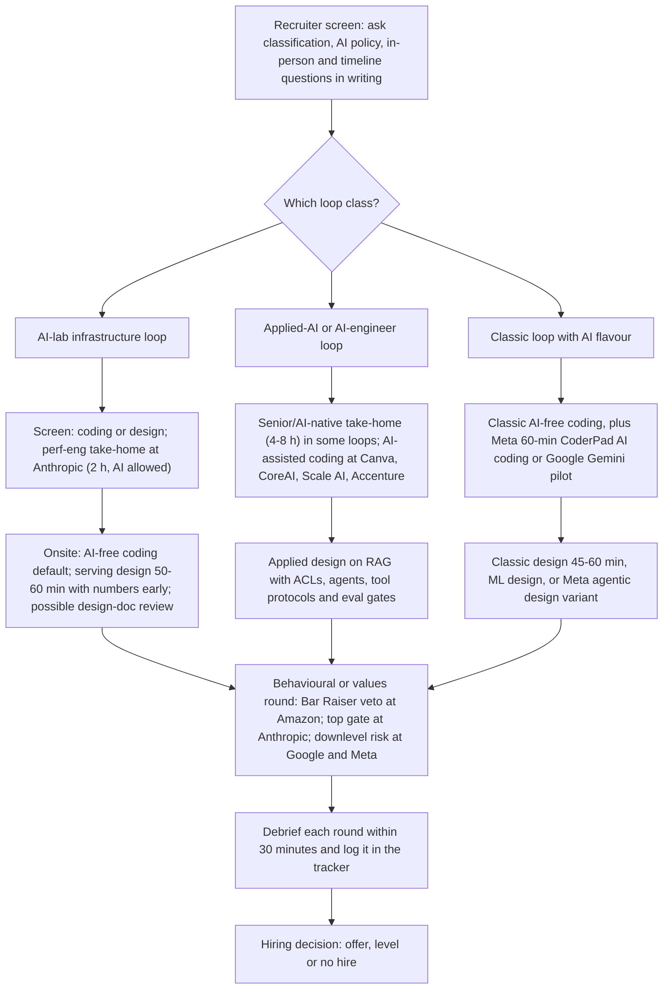

# Interview Loops: Classify, Prepare, Run the Day, Follow Up

> How GenAI interview loops are structured across 27 employers, how to classify yours before preparing, what each round tests, AI-assistant and in-person policies, take-homes, debriefs and recruiter templates.

**Dates and grades.** Loop structures, employer policies, timelines and platform pass-rate benchmarks are refreshed from [T0-46](../../research/sessions/T0-46-interview-loops-genai-employers-2026.md) (retrieved 2026-11-13 to 2026-11-14, covering 25 employers across 31 loops) and [T0-47](../../research/sessions/T0-47-ai-mediated-hiring-screening-interviews-fraud.md) (retrieved 2026-11-13, employer AI-enforcement rules and AI interviewers), alongside carry-forward details from [T0-14](../../research/sessions/T0-14-ai-system-design-interview-patterns.md) (2026-10-21), [T1-03](../../research/sessions/T1-03-interview-execution-offer-negotiation.md) (2026-10-25), [T0-06](../../research/sessions/T0-06-career-transition-timelines-5-backgrounds.md), [T0-09](../../research/sessions/T0-09-onboarding-probation-first-90-days.md) and [T0-04](../../research/sessions/T0-04-ats-filtering-funnel-conversion-math.md) (2026-10-23). Most employer-loop rows record what prep-vendor guides and candidate reports describe, not official employer documentation; only Anthropic (COI), OpenAI and Canva published loop or policy pages read in T0-46 [A · T0-46 L121]. Re-verify carry-forward October 2026 rows by 2027-01-19 and November 2026 rows by 2027-02-11. **Grades** (EGP-1.0, defined in [CONTRIBUTING §3](../../CONTRIBUTING.md#3-writing-standard-egp-10-in-brief)): A primary or employer-published; B transparent secondary or large platform dataset; C vendor, aggregator or single source; D forum report or judgement; E searched, nothing found; M model output; P practice-curated and unmeasured. Terms are in the [glossary](../00-start/glossary.md).

## The short answer

1. **Classify the loop before you prepare, and re-ask before each stage.** Loops vary by level, team and track inside a single employer: Meta varies by level, Google has an optional fifth domain round, OpenAI's skills assessment varies by team, Databricks differs between its AI Engineer guide and a forward-deployed report, and Cursor's final stage is described three different ways [A/C · T0-46 L67, L101, L448–449]. Ask the recruiter in writing for the rounds, design flavour, AI policy per round, in-person rule, take-home terms and timeline.
2. **Default to no AI in live rounds and take-homes unless written instructions allow it.** AI-assistant rules are set per employer and per stage, not per sector [A/C · T0-46 L79]. Anthropic bars live AI unless told [A, COI · T0-46 L201]; Amazon and Google state disqualification for unauthorised live AI [B · T0-47 L161–162]. Where AI is allowed or required (Canva mandatory; Meta's 60-minute CoderPad coding round, piloted October 2025, alongside a separate 2026 agentic design round; Google's H2 2026 Gemini code-comprehension pilot; Microsoft CoreAI; Scale AI; Accenture), rounds grade task breakdown, auditing generated code, testing and ownership — not prompting [A/C · T0-46 L79–81, L451].
3. **Treat the behavioural or values round as a real gate, but know each employer's rule.** Amazon's Bar Raiser is the only explicit final No-Hire veto found in T0-46; Anthropic's values and safety round is reported as the top late-stage gate; Meta's behavioural round alone can downlevel an E5 to an E4; and Google's hiring committee weighs variance heavily and can override panel votes in either direction including downlevelling ("automatic packet sink" is unsupported) [C · T0-46 L90, L324–327, L333, L450].
4. **Budget for take-homes mainly at senior, research and AI-native roles, and expect in-person rounds at Google and McKinsey.** Take-homes appear in about 13% of hires overall in Ashby's dataset and cluster at 4–8 hours at Anthropic (research engineering), Scale AI, Perplexity, Cursor and xAI, while Anthropic's performance-engineering take-home was cut from 4 hours to 2 hours and explicitly permits AI tools [A, COI; B/C · T0-46 L83, L235–245]. Google (announced June 2025) and McKinsey reinstated in-person steps; OpenAI keeps finals virtual by default [A/B · T0-46 L84, L222–224].
5. **Read pass rates as a 14%–26% range, and run several same-track loops in parallel.** Gem's 2024 engineering onsite-to-offer rate is **26%** — not 29% (the 29% cited in T0-04 and [erratum U24](../../research/ERRATA.md) matches Gem's 2021 inbound all-roles pre-onsite-to-onsite rate) [B · T0-46 L85, L385–387, L453]. Across Gem and Ashby datasets, interview-stage conversion spans 14% (enterprises ≥2,000 staff) to 26% (engineering onsite-to-offer), with Ashby onsite pass-through around 24% [B · T0-46 L85, L388–389]; no employer publishes its own rate, and entry binds far harder (0.2% engineering application-to-hire; 254 applicants per Greenhouse role) [B · T0-46 L86, L390–391]. Running 3–5 staggered loops in one track is practice guidance without outcome data [P · T0-46 L86, L108].
6. **Debrief within 30 minutes of every round, and keep a tracker.** Coaching sources recommend it universally; no study proves it raises pass rates [C/D · T1-03.F12]. Because 38% of paired interviewer scorecards disagree by at least a point in Ashby's data [B · T0-46 L396], read one rejection as weak evidence and read multi-loop patterns in your tracker [D · T0-06 L398, L403–405; P].

## At a glance



Sources for the diagram: loop classes [B/C · T0-14 L118–121]; Anthropic take-home and design-doc review [A, COI / C · T0-46 L82, L239]; AI-assisted rounds [A/C · T0-46 L79–81]; take-homes [B/C · T0-46 L83]; behavioural gates [C · T0-46 L90, L324–327, L333]; debrief [C/D · T1-03.F12].

## The loop map: three engineering classes and four specialist tracks

T0-14 sorts engineering loops by what the system-design round tests [B/C · T0-14 L118–121], and T0-46 confirms that track — not employer label alone — drives preparation because Meta, Databricks, Google and Cursor each vary internally [C · T0-46 L67, L120]. A practitioner who interviewed with 46 companies found no standard AI-engineer format [C · T0-06 L314], so treat the class as a starting prior until the recruiter confirms it in writing [P].

### The three engineering classes

| Class | Where it is reported | What the design round is about | Prepare first | Prep pack |
|---|---|---|---|---|
| **AI-lab infrastructure** | Anthropic, OpenAI infrastructure, NVIDIA, xAI [A/C · T0-46 L138, L141, L144, L151, L187]; Databricks GenAI-engineer track [B/C · T1-03 L104] | Inference serving, batching, admission control, fairness, GPU memory/parallelism and critiquing flawed design documents; the model is often treated as a black box, so strong infrastructure engineers without ML backgrounds do well [B · T0-14.F1; C · T0-46 L187] | A1–A5 (inference API, batching, offline batch, GPU scheduling, weights), design-document review, then A7 and A14; expect numbers early [B/C · T0-14 L119; C · T0-46 L105] | [Infrastructure](prep-packs.md#infrastructure-pack) |
| **Applied-AI or AI-engineer** | Databricks, Google GenAI, Meta ML/agentic, Microsoft CoreAI, Amazon Agentic AI, Perplexity, Cursor, Scale AI, Canva, consultancies and IT-services [A/C · T0-46 L184–185] | RAG with per-user access control, agent loop control and tool routing, tool-integration protocols, evaluation gates, latency budgets, guardrails and production monitoring [C · T0-46 L89, L184] | A8–A15 (enterprise RAG, chat/memory, coding assistants, agents, voice, extraction, eval, safety) [B/C · T0-14 L120; C · T0-46 L105] | [Application](prep-packs.md#application-pack); [application plus customer scoping](prep-packs.md#application-plus-customer-scoping-pack) |
| **Classic with AI flavour** | Google SWE, Meta SWE, Stripe, Uber, Goldman Sachs, JPMorgan Chase, Microsoft Bing MLE [B/C · T0-14 L121, L176–177; C · T0-46 L150, L157–158, L186] | Classic distributed design or classic ML pipelines (features, ranking, monitoring, governance) with an LLM component or probe where warranted [C · T0-46 L186] | Classic design or classic ML design, plus A8 (RAG) and A9 (assistant) as insurance; no KV-cache maths unless the team serves models [B/C · T0-14 L121; C · T0-46 L105] | [Coding](prep-packs.md#coding-pack); [classic ML system design](prep-packs.md#classic-ml-system-design-pack) |

### Four specialist tracks

| Track | What the sessions report | Prepare with |
|---|---|---|
| **Research scientist or research engineer** | Combines depth discussion of prior work, hand-written core ML code and research-problem scoping: OpenAI runs 4–6 h finals (4–6 interviewers) on the candidate's area [A · T0-46 L339]; DeepMind runs 5–7 rounds including a 60-min library-free ML coding round and takes 6–10 weeks [C · T0-46 L341]; Anthropic sets paper walkthroughs, training-run debugging and a 4–8 h research-engineering take-home [C · T0-46 L340]; xAI tests scaling-law trade-offs on a 1–2 week senior schedule [C · T0-46 L342] | [Research pack](prep-packs.md#research-pack); [employer interview loops](employer-interview-loops.md#research-loops); [PhD to industry](../11-tracks/phd-to-industry.md) |
| **Evaluation** | Judge scoring (faithfulness, groundedness), CI release gates, safety red-teaming and reproducible harnesses appear in 2026 guides at Databricks, Anthropic, Scale AI, DeepMind, Goldman Sachs and Amazon [C · T0-46 L188]; Google ML-platform loops treat LLM-as-judge vs human annotation as central [B/C · T0-14 L174] | [Evaluation design pack](prep-packs.md#evaluation-design-pack); [AI evaluation engineer](../02-roles/hubs/ai-evaluation-engineer.md) |
| **Governance, risk and responsible AI** | **No loop sources found in T0-46, T0-14 or T1-03 [E · T0-46 L190, L479].** Only fragments exist: ML pipeline governance at Goldman Sachs and regulated GenAI risk sign-off at Cognizant [C · T0-46 L190]; EU AI Act / NIST AI RMF / ISO 42001 fluency was not seen in any retrieved interview report | [Governance pack](prep-packs.md#governance-pack) (practice-curated [P]); [governance careers](../11-tracks/governance-careers.md) |
| **AI product management / product engineering** | OpenAI lists a 5-stage product track (4–6 h finals) [A · T0-46 L142]; Cursor probes product friction in AI-native editing [C · T0-46 L191]; Perplexity runs product critique and a founder round [C · T0-46 L155, L191]; Meta tests cross-functional trade-offs and end-to-end feature design [C · T0-46 L191] | [Product pack](prep-packs.md#product-pack); [AI product manager](../02-roles/hubs/ai-product-manager.md) |

### Reported loop structures by employer

The full 27-employer matrix — with per-cell sources, AI policies, take-homes, in-person attendance rules, India loops and unresolved source conflicts — lives in [employer interview loops](employer-interview-loops.md). The summary below highlights the main anchor employers across all five employer groups; **every row names its own source and grade** [T0-46 L133–167; T0-14 L176–177]. Design prompts by firm are in [system design archetypes](system-design-archetypes.md#reported-design-prompts-by-firm).

| Employer (group) | Reported format and key differences | Design flavour | Grade and sources |
|---|---|---|---|
| **Anthropic** (frontier lab) | Live Python screen, onsite coding + serving design (length inconsistent across pages: 35–60 min), values/safety round; 2 dated PracHub design-doc review reports (2026-04-16, 2026-09-18); perf-eng take-home 4 h → 2 h (AI allowed); research-eng take-home 4–8 h | AI-framed inference infrastructure; safety/values gate | A (policy & perf take-home, COI) / C (IGotAnOffer, techinterview.org, PracHub, DesignGurus) · T0-46 L137–139, L171 |
| **OpenAI** (frontier lab) | Application (~1 w), recruiter call, team-specific skills assessment (~1 w), 4–6 h finals with 4–6 interviewers over 1–2 days (virtual by default, SF onsite optional), decision ~1 w; reverse design deep dive and post-loop levelling in T0-14 | Infrastructure, product or research by track; guide lists no prompts or AI rule | A (OpenAI official guide) · T0-46 L141–143, L368; B/C · T0-14 L172 |
| **Google DeepMind & xAI** (frontier labs) | DeepMind: 5–7 rounds, 60-min library-free ML coding, committee, 6–10 w. xAI: 60-min screen, optional 4–8 h take-home, 4–5 compressed rounds + senior exec round, 1–2 w for seniors | DeepMind: distributed training, eval infra, research depth. xAI: GPU-scale training/inference, scaling laws | C (techinterview.org single guides) · T0-46 L140, L144, L341–342 |
| **Google** (Big Tech) | 4 core rounds + optional 5th domain round (60 min at L6), 45-min Googleyness, hiring committee, 6–10 w; ≥1 in-person round reinstated (June 2025); Gemini code-comprehension pilot (US junior/mid SWE, H2 2026) | Role-dependent: classic SWE, ML platform or Cloud GenAI | B (in-person: Entrepreneur; pilot: Yahoo Finance/BI; live AI ban: T0-47 L162) / C (dglearning) · T0-46 L147 |
| **Meta** (Big Tech) | 5 onsite rounds at E4/E5 (E6 adds leadership pre-assessment); 60-min AI-assisted coding in customised CoderPad (piloted Oct 2025) beside AI-free classic coding; separate 2026 agentic design round (AI availability varied) | SWE classic; ML/agentic pool LLM-native (35–40 usable min per T0-14) | A (CoderPad COI) / C (interviewing.io, PracHub, dglearning) · T0-46 L148, L451 |
| **Amazon & Microsoft** (Big Tech) | Amazon: OA, phone screen, loop + Bar Raiser, graded 2026 AI-tool behavioural question, avoid high-level libraries, 3–5 w. Microsoft: virtual super day, 3–6 w; CoreAI report had 45-min AI-agent multi-file repo fix; Bing MLE had classic ML design | Amazon: agentic AI + classic/LLD. Microsoft: applied CoreAI or ML product search | B (Amazon live AI ban: T0-47 L161) / C (Dataford, dglearning, PracHub) · T0-46 L145, L149–150 |
| **NVIDIA, Stripe & Uber** (Big Tech) | NVIDIA: 4–6 onsite rounds on CUDA/memory hierarchy, distributed training and GPU serving. Stripe (T0-14): coding, integration, debugging + 2026 "AI round". Uber (T0-14): MLE coding, classic ML design + LLM probe | NVIDIA: GPU infra. Stripe: classic. Uber: classic ML + LLM probes | C (techinterview.org, interviewing.io 2024 stale) · T0-46 L151; C · T0-14 L176–177 |
| **AI-native & data platforms** (Canva, Cursor, Databricks, Perplexity, Scale AI) | Canva: mandatory AI-assisted coding round. Cursor: 3–5 w, conflicting work-stage reports (4–8 h take-home vs paid 8–9 h Project Day vs 2-day onsite). Databricks: 4–6 w, 5–6 rounds (AI-FDE customer round unconfirmed). Perplexity (~3 w) & Scale AI: 4–6 h senior take-homes; Scale AI had Claude-assisted coding | Applied RAG with ACLs, agents, answer-engine quality, eval harnesses, inference APIs | A (Canva post, stale) / C (Dataford, PracHub, techinterview.org, techprep.app, DesignGurus) · T0-46 L152–156 |
| **Banks & consultancies** (Goldman Sachs, JPMorgan Chase, McKinsey QuantumBlack, Deloitte) | 3–5 weeks typical (McKinsey QuantumBlack 4–8 w / ~43 d avg, 70–120 min timed coding test, face-to-face meeting required before offer); Goldman & JPMorgan run Superdays with ML/LLM governance | Regulated ML/LLM pipelines, classic ML + LLM hybrid cases, monitoring and governance | B (McKinsey in-person: Entrepreneur) / C (Interview Query, Dataford, Hacking the Case Interview, Jointaro) · T0-46 L157–160 |
| **India & IT-services** (Amazon India ADCI, Infosys, Wipro, Accenture, Capgemini, Cognizant, HCLTech, Iris Software) | ADCI combines OA (hard LeetCode), GenAI coding, DSA, LLD and LPs. IT-services firms run 2–5 weeks, mostly virtual, median ~3 rounds (Dataford): fundamentals, RAG/agent project deep dives, managerial/HR; Accenture allows AI co-building if every line is explained | ADCI: DSA + LLD + GenAI coding. Services: RAG, agents, tool integration, deployment | C/D (PracHub, Interview Query, Glassdoor, Dataford, Jointaro) · T0-46 L146, L161–167, L348–360 |

### Where the funnel narrows

Stage-by-stage cold-inbound benchmarks live in the [application operating system](../06-job-search/application-operating-system.md#the-funnel-you-are-running), and T0-46 updates the interview-stage figures directly against Gem's 2025 Benchmarks Report (2024 data), Gem's 2026 tech hiring guide (data through 2025-05) and Ashby's 2026 Talent Trends Report (over 54 million applications through 2026-03-31) [B · T0-46 L383–398]:

- **Entry binds far harder than passing.** In Gem's 2024 data, 6% of inbound applicants reach pre-onsite against 44% of sourced candidates, and overall application-to-hire is 0.5% (0.4% inbound, 2.0% outbound; 0.2% for engineering) [B · T0-46 L86, L390]. Greenhouse reports 254 applicants per open role across 175,000 live jobs (2026-08-07) [B · T0-46 L391]. In Ashby's dataset, referred candidates pass the recruiter screen at 52% against 35% for all candidates, and onsite at 36% against 24% [B · T0-46 L389].
- **Onsite-to-offer sits in a 14%–26% dataset range, not 29%.** Gem's 2024 engineering onsite-to-offer rate is **26%** (offer acceptance 76%) [B · T0-46 L385, L392]. The 29% cited in earlier Phase 0 documents ([erratum U24](../../research/ERRATA.md) / T0-04.F9) matches Gem's 2021 inbound all-roles pre-onsite-to-onsite rate, not engineering onsite-to-offer [B · T0-46 L387, L398, L453]. Across Gem's 2026 tech guide, engineering interview-to-offer is **14%** at enterprises (≥2,000 staff) and **22%** at startups (<500 staff), while Ashby's all-role onsite pass-through is **~24%** [B · T0-46 L388–389].
- **No employer publishes its own stage rate.** Prep-vendor offer rates on company guides swing from 20% to 80% on 5 to 9 self-selected reports (Databricks 20% n=5, JPMorgan 50% n=7, Accenture 80% n=8, McKinsey 20% n=9) and are unusable as odds [C · T0-46 L85, L395].
- **Expect noise in individual verdicts.** Ashby's dataset shows **38% of paired interviewer scorecards disagree by at least a point** [B · T0-46 L396]. Read a single rejection as weak evidence; read patterns across multiple loops in your tracker [P].

### The loop also sets your level

- **Committee and veto rules differ by employer.** Amazon's Bar Raiser holds the only explicit final No-Hire veto found in T0-46; mixed votes can yield a lower-level offer [C · T0-46 L325, L450]. Google's hiring committee reads written packets, weighs interviewer variance heavily and can override panel votes in either direction including downlevelling — an automatic single-round "packet sink" is unsupported [C · T0-46 L326, L333, L450]. Meta's behavioural round alone can downlevel an E5 to an E4 [C · T0-46 L327], and OpenAI sets level after the loop [B/C · T0-14 L172]. Databricks and DeepMind also route packets through hiring committees [C · T0-46 L329, L341].
- **Senior and Staff look different in design rounds.** Coaching rubrics converge: Senior drives the conversation and anticipates failures and trade-offs; Staff scopes the problem, quantifies unprompted, proposes the lever that changes the cost curve, and designs for organisational ownership and migration. Google-specific coaching reads needing a prompt for trade-offs as L5 in an L6 loop [B/C · T0-14.F10].
- **Level drives pay.** Level-median steps run ×1.38–1.46 per level [B/C · T1-03 L330]. Ask which level the loop is calibrated for; negotiate level in the [negotiation playbook](../09-compensation/negotiation-playbook.md).

## How to do it

1. **Classify the loop with the recruiter in writing (about 10 minutes), and re-ask before each stage** [A/C · T0-46 L101; B/C · T0-14 L118]. Use the checklist below. *Done when* you have in writing the rounds, design flavour, AI policy per round, in-person rule, take-home terms and expected timeline.
2. **Map every round to preparation.** Use the round table; drill your class's archetypes first and keep classic AI-free coding sharp beside any AI-assisted practice [A/C · T0-46 L103–105]. *Done when* each round has a guide or pack and you have run at least one timed mock of each round type [P].
3. **Bank four behavioural stories (plus C1 depth and an AI-tool-use example),** covering pragmatism under ambiguity, communicating probabilistic trade-offs, ownership and incident response, and responsible AI. Use STAR-AI: each result carries a metric delta and a monitoring step [B/C · T1-03.F5; C · T0-46 L325]. *Done when* every story says what *you* did, which metric moved and how you kept watching it.
4. **Choose your questions and a place to record promises.** Pick questions from the bank below whose answers would change your decision [P]. *Done when* you have questions for each interviewer and a page for what the loop promises about data, compute, team and scope, to check in days 3–10 of the job [D · T0-09 L150, L167].
5. **Run the day** with the timings and behaviours below. *Done when* every round has notes, with the questions written down verbatim.
6. **Debrief within 30 minutes of each round** [C/D · T1-03.F12]. *Done when* the five-step debrief is written and each gap has a study action and a date.
7. **Follow up and log the loop.** Account for employer timeline spreads (1–2 weeks at xAI vs 6–10 weeks at Google/DeepMind [C · T0-46 L87, L370–371]) when staggering applications so offers can overlap [P]. *Done when* the recruiter has your note, the tracker row is complete, and after several loops you can name the stage where you lose [D · T0-06 L398].

### Classify your loop: the checklist

Read the signals before the call [P]:

- [ ] **Team and job description.** Serving, batching, GPUs or latency SLOs point to the infrastructure class; RAG, agents, evaluation or customer work point to the applied class; a general SWE or ML product team points to the classic class (groupings from T0-14 L119–121).
- [ ] **Your role's interview track,** from its role hub (start at the [role map](../02-roles/role-map.md)), and the employer's starting prior in [employer interview loops](employer-interview-loops.md).

Ask the recruiter, and keep the reply in writing [A/C · T0-46 L101, L106–107]:

- [ ] "Which rounds are in the loop, in what order, and how long is each?" Lengths run from 45 to 60 minutes (15–60 minutes in Indian IT-services technical rounds) [B/C · T0-14.F8; C · T0-46 L165].
- [ ] "Is the system design round about infrastructure (serving, batching, GPU scheduling), about AI applications (RAG, agents, evaluation), or classic ML/general design?" T0-14 and T0-46 call this the highest-leverage first step [B/C · T0-14 L83; C · T0-46 L101].
- [ ] "Is there a separate ML design round, a take-home, a project deep dive, a design-document review or an AI-interviewer screen?" [B/C · T0-46 L82–83; B · T0-47 L57].
- [ ] "If there is a take-home, what is the time cap, what is the AI rule and is it paid?" [C · T0-46 L106].
- [ ] "Which tools do the rounds use: a shared document, CoderPad, a local IDE, Excalidraw or another whiteboard?" [A/C · T0-46 L110; B/C · T0-14.F11].
- [ ] "What is the AI-assistant rule for *each* round? If AI is allowed or required, which tool is provided and what are you assessing?" [A/C · T0-46 L101–103].
- [ ] "Are any stages in person, and are identity-verification checks required?" [A/B · T0-46 L107; B · T0-47 L77].
- [ ] "Is there a values, behavioural or Bar Raiser round, and which level is the loop calibrated for?" [C · T0-46 L90, L324–327].
- [ ] "What is the expected timeline from first screen to decision?" [C · T0-46 L101].

| If the answers say… | Class | Prepare |
|---|---|---|
| Serving, batching, GPU scheduling or flawed design doc; numbers expected; 50–60-minute design rounds | AI-lab infrastructure | A1–A5 and design-doc review first, then A7 and A14 [B/C · T0-14 L119; C · T0-46 L105] |
| RAG with ACLs, agents, tool protocols or eval gates; a take-home; a scoping or customer round | Applied-AI | A8–A15 first [B/C · T0-14 L120; C · T0-46 L105] |
| General design, classic ML pipelines and algorithmic coding, perhaps with an LLM extension or probe | Classic with AI flavour | Classic design or ML design, plus A8 and A9 as insurance [B/C · T0-14 L121; C · T0-46 L105] |
| Unclear or mixed | Mixed | Ask again in writing before each stage; prepare the class the team signals [P], plus classic architecture [B · T0-14 L80] |

### What each round tests and how to prepare

| Round | What it tests | How to prepare | Where in this repo |
|---|---|---|---|
| Recruiter screen | Fit, level, logistics, AI/in-person rules; often pay expectations | Ask the classification questions in writing; ask for the approved band instead of disclosing pay [C/D · T1-03 L276] | [Negotiation playbook](../09-compensation/negotiation-playbook.md) |
| Employer AI interviewer (screen) | Structured recorded voice/text or real-repo coding screen (HireVue, HackerRank Chakra, CodeSignal, micro1 Zara, Greenhouse) [B · T0-47 L57, L148–152] | Read consent text, request accommodation or human alternative before starting if needed, test audio, give specific checkable evidence [B/P · T0-47 L74] | [ATS mechanics: AI-mediated hiring](../06-job-search/ats-mechanics.md#ai-mediated-hiring-interviewers-integrity-checks-and-legal-pointers) |
| Technical phone screen | Coding or design: Anthropic Staff screens lean design [B · T0-14 L171]; OpenAI's skills assessment varies by team (~1 week result) [A · T0-46 L245]; Uber MLE paired 45 min coding + 15 min LLM probe [C · T0-14 L177] | Confirm format in writing, then prepare as for that onsite round | The rows below |
| Coding, classic or write-it-yourself (no AI) | Data structures, optimisation, communication; DeepMind runs 60-min library-free ML coding and Amazon's agentic guide advises against high-level libraries [A/C · T0-46 L104, L193] | Frame before coding, think aloud, test edge cases; drill plain Python / core ML primitives without libraries | [Coding rounds](coding-rounds.md); [coding pack](prep-packs.md#coding-pack) |
| Coding, AI-enabled | Task breakdown, directing an assistant on bounded sub-tasks, finding faults, testing and explaining every kept line (Canva, Meta 60-min CoderPad, Microsoft CoreAI, Scale AI, Accenture, Google Gemini pilot) [A/C · T0-46 L80, L103, L193] | Practise on a multi-file repository; delegate boilerplate, own architecture and tests, audit aloud | [Coding rounds](coding-rounds.md) |
| Design: infrastructure | Multi-tenant inference serving, batching, admission control, fairness, GPU memory/parallelism and failure handling [B · T0-14.F1; C · T0-46 L187] | A1–A5; carry dated vendor prices and KV-cache math into the design [A/M · T0-46 L105] | [System design archetypes](system-design-archetypes.md); [infrastructure pack](prep-packs.md#infrastructure-pack) |
| Design: application | RAG with query-time ACLs, agent loop control, tool-integration protocols, eval gates, latency budgets and production monitoring [C · T0-46 L89, L184] | A8–A15; make evaluation and safety named sections [B/C · T0-14 L128] | [System design archetypes](system-design-archetypes.md); [application pack](prep-packs.md#application-pack) |
| Design: classic or classic ML, extended with AI | Distributed systems or ML pipelines (features, ranking, governance, monitoring) plus sensible LLM placement [C · T0-46 L186] | Classic design / ML design plus A8 and A9 | [System design archetypes](system-design-archetypes.md); [classic ML pack](prep-packs.md#classic-ml-system-design-pack) |
| Design-document review | Critiquing a flawed written design (Anthropic: 2 dated PracHub reports, 2026-04-16 and 2026-09-18, e.g. batched GPU inference API; T0-14 noted 3 April 2026 reports) [C · T0-46 L82, L257, L452] | Read quickly, then give findings ordered by severity: requirement gaps, QPS/batch arithmetic, failure modes, rollout, alternatives | [System design archetypes](system-design-archetypes.md); [coding rounds](coding-rounds.md) |
| Debugging: p95 latency | Hypothesis-driven diagnosis (1 report in T0-14; **no report surfaced in T0-46**, and one Anthropic guide lists no debugging round) [C · T0-14 L552; E · T0-46 L452, L480] | Segment by percentile and cohort; split queue, prefill and decode; check batch size, KV pressure and long-context outliers | [Infrastructure pack](prep-packs.md#infrastructure-pack) |
| Project deep dive | Reverse design interview on a system you built (OpenAI, Infosys, Microsoft Bing, Anthropic) [B/C · T0-14 L172; C · T0-46 L150, L165] | One system you can defend: numbers, trade-offs, failures and what you would change [P] | [Proof-of-work standards](../05-portfolio/proof-of-work-standards.md); [project archetypes](../05-portfolio/project-archetypes.md) |
| Take-home | Performance engineering, ML experiment, RAG+evals or practical build (4–8 h senior/research/AI-native; 2 h Anthropic perf-eng) [A, COI; B/C · T0-46 L83, L239–245] | Confirm time cap, AI rule and pay; run unfamiliar code in a disposable VM [B · T0-47 L79] | Take-homes below; [evaluation design pack](prep-packs.md#evaluation-design-pack) |
| Scoping or customer-style conversation | Turning a vague client ask into a scoped, governed architecture (McKinsey QuantumBlack, Cognizant, HCLTech, applied-AI startups; Databricks FDE customer round unconfirmed) [C · T0-46 L185; C/D · T0-06 L318] | Rehearse discovery questions, business framing, expectation resets and non-technical explanation [P] | [Application plus customer scoping pack](prep-packs.md#application-plus-customer-scoping-pack); [forward-deployed engineer](../02-roles/hubs/forward-deployed-engineer.md) |
| Behavioural or values | Four AI competencies plus AI-tool-use judgement (Amazon) and values/safety (Anthropic); Amazon Bar Raiser veto, Anthropic top gate, Google/Meta downlevel risk [C · T0-46 L90, L324–333; B/C · T1-03.F5] | Four+ STAR-AI stories; no blame; admit mistakes; check employer triggers | [Behavioural calibration](behavioral-calibration.md); [behavioural pack](prep-packs.md#behavioural-pack) |
| Research discussion (labs) | Paper walkthrough, research-problem scoping, scaling laws, training-run debugging, 60-min library-free ML coding (DeepMind) [A/C · T0-46 L92, L337–342] | Prepare deep mastery of your own area plus hand-written ML primitives | [Research pack](prep-packs.md#research-pack); [employer interview loops](employer-interview-loops.md#research-loops) |

### AI tools in the interview

Policies split per employer and per round; the full per-stage table is in [employer interview loops](employer-interview-loops.md#ai-assistant-policies-by-employer-and-stage).

| Employer | Reported live-round policy or AI-enabled format | Grade and source |
|---|---|---|
| **Anthropic** (COI) | Default no AI in live rounds unless interviewer says otherwise; AI allowed to refine self-written application draft and in performance-engineering take-home (2026-01-21) | A, COI · T0-46 L201 |
| **Canva** | AI use **required** in the AI-assisted round; prompting and accepting output called the weakest approach | A (stale) · T0-46 L80, L208 |
| **Meta** | Classic coding stays AI-free; **60-minute AI-assisted coding round** in customised CoderPad (piloted Oct 2025); separate 2026 agentic design round (AI availability inconsistent) | A (CoderPad COI) / C · T0-46 L81, L205, L451 |
| **Google** | Spokesperson: AI use in live interviews means disqualification; separate H2 2026 Gemini-assisted code-comprehension pilot (junior/mid US SWEs) | B · T0-46 L204; T0-47 L162 |
| **Amazon** | Barred where not permitted (interviewer cue guidance; disqualification stated); graded 2026 behavioural question on past AI use | B · T0-47 L161; C · T0-46 L207 |
| **Microsoft CoreAI, Scale AI, Cursor, Accenture, Stripe** | CoreAI: 45-min AI-agent multi-file repo fix; Scale AI: Claude-assisted (candidate writes own prompt); Cursor: AI restricted early, real codebase later; Accenture: AI co-building if every line explained; Stripe: "AI round" testing scepticism | C · T0-46 L206, L209–211; C · T0-14 L176 |

- **Ask, and get the answer in writing** [P]. Without written permission, work unaided. Amazon and Google state disqualification for unauthorised live AI, and Anthropic's policy makes a live copilot a clear rule breach [A, COI · T0-46 L231; B · T0-47 L161–162].
- **Avoid undisclosed live interview copilots.** Overlay tools (Final Round AI live copilot, Cluely, Parakeet AI, LeetCode Wizard) carry disqualification risk and unverified undetectability claims [B/C · T0-47 L59, L173–177]. Final Round AI's privacy policy (2026-10-08) also permits audio, voice samples and screen captures — including interviewers' voices — to be used for AI training with human review, and its Trustpilot rating sits at 2.8/5 on 280 reviews (2026-10-22; contradicting T0-10's earlier 3.5/5 figure) [A, COI / B · T0-46 L418, L468, L516].
- **In an AI-enabled round, work as director and reviewer.** Split the task, give bounded sub-tasks, read and test what returns, explain every kept line and say why you accept or reject each piece; practise on a multi-file repository [A/C · T0-46 L80, L103]. Details and timed protocol: [coding rounds](coding-rounds.md).
- **Practise on the round's actual board tool.** Ask which board the interviewer uses: Excalidraw's free plan has the full editor and is named by one prep guide for Anthropic's design rounds (its status as Meta's most common board was unverified in T0-46, and Mermaid support inside CoderPad was unverified [A/C/E · T0-46 L419–420, L469–470]).

### Take-homes

- **Prevalence and concentration.** Across all roles in Ashby's platform dataset, **about 13% of hires** included a take-home [B · T0-46 L83, L235]. None was reported in the Big Tech or Indian IT-services loops read in T0-46; McKinsey's 70–120 minute coding assessment is a timed test, not a take-home [C · T0-46 L235].
- **Where they concentrate and how long they run.** Take-homes cluster in senior, staff, research and AI-native roles at **4–8 hours**: Anthropic research engineering (4–8 h), Scale AI (4–6 h), Perplexity (4–6 h), xAI (4–8 h, short turnaround) and Cursor (three conflicting descriptions: 4–8 h take-home, paid 8–9 h Project Day, or 2-day onsite) [C · T0-46 L83, L240–244]. Anthropic's performance-engineering take-home is a documented exception: cut from 4 hours (v1, early 2024) to **2 hours** (v2, mid-2025) after Claude matched human candidates, with **AI tools explicitly allowed** (>1,000 candidates self-reported) [A, COI · T0-46 L82, L239]. OpenAI's skills assessment is team-specific [A · T0-46 L245]. Applied-AI startups also set RAG-plus-evals tasks (e.g. ~50 docs, recall@5 and faithfulness on 20 questions) [C/D · T0-06 L318].
- **Pay and rubrics.** Only Cursor's Project Day is described as paid (one guide, Grade C), and no employer-published take-home scoring rubric was found [C/E · T0-46 L83, L235, L243].
- **Ask three things before starting:** the time cap, the AI rule and whether it is paid [C · T0-46 L106].
- **Run unfamiliar repos in a disposable VM.** Fake coding tests and weaponised VS Code project files are an active malware delivery vector ("Contagious Interview", active since at least December 2022; Microsoft March 2026 advisory) [A/B · T0-47 L62, L79, L186]. Verify the recruiter's company domain and ATS link first, or use the platform's browser IDE.
- **Practice** [P]. Report metrics on a documented question set, make headline numbers reproducible from the README, and include a short "what broke" note [D · T0-06 L395]. Three failed take-homes signal a gap in eval design and error analysis [D, heuristic · T0-06 L404].

### In-person rounds and India loops

- **In-person rounds.** Google (at least one in-person round, announced June 2025) and McKinsey (face-to-face meeting required before an offer) reinstated in-person steps with curbing virtual AI cheating as the stated reason [B · T0-46 L84, L222–223]. OpenAI keeps finals virtual by default with an optional San Francisco onsite [A · T0-46 L224]. Confirm attendance rules early for every other employer [P; T0-46 L107].
- **India loops.** India loops retrieved in T0-46 are shorter (2–5 weeks) and mostly virtual [C/D · T0-46 L91, L346–360]: Amazon India (ADCI) mixes online assessments, DSA, low-level design and GenAI coding [C · T0-46 L350], while IT-services firms (Infosys, Wipro, Accenture, Capgemini, HCLTech, Iris Software) focus on GenAI/RAG fundamentals, project deep dives and managerial/HR rounds, with a median of 3 rounds in Dataford's tracker [C/D · T0-46 L351–360]. No loop sources were found for Indian AI labs, Indian product companies, named GCCs or aptitude-test vendors [E · T0-46 L360, L488–489]. Full table: [employer interview loops](employer-interview-loops.md#india-and-it-services-employers).

### On the day

| Round | Do | Avoid |
|---|---|---|
| System design, 45 minutes | Requirements 5 → targeted estimate 4 → high-level design and request walk 9 → two deep dives 16 → evaluation, safety and operations 7 → wrap-up 4 [B/C · T1-03.F3]. Checkpoints: no numbers by 0:09, stop drawing and estimate; no deep dives named by 0:18, pick the two riskiest components; evaluation and safety untouched at 0:34, go there [D · T1-03 L111–113] | Opening with model architecture instead of requirements and scale; never quantifying; over-engineering past the stated scale; passively waiting for prompts [C · T0-14.F9] |
| Coding, classic / library-free | Confirm inputs, outputs and constraints before writing; think aloud; test edge cases [D · T1-03 L220, L229] | Jumping to code, silent coding, not testing, leaning on high-level libraries when barred [D · T1-03 L220; C · T0-46 L104] |
| Coding, AI-enabled | Split the task, give bounded sub-tasks, inspect and test generated output, explain every line you keep [A/C · T0-46 L80, L103] | Prompting and accepting output unverified (Canva's weakest-approach signal); being unable to explain generated code [A · T0-46 L80; B/C · T1-03 L221] |
| Behavioural or values | What you did, a metric delta, a monitoring step; admit mistakes and trade-offs; prepare an example of disciplined AI tool use [B/C · T1-03 L187, L210; C · T0-46 L325] | Blaming PMs, data engineers or model providers; posturing about AI safety; "I researched" instead of "I shipped" at Meta [B/C/D · T1-03 L177; B/C · T1-03 L210–212] |

- **Scale the blueprint to the clock.** Meta's 45-minute rounds leave about 35–40 usable minutes [B/C · T0-14.F8]; T0-14 gives 35-, 55- and 60-minute variants [B/C · T0-14 L122].
- **Confirm scope first.** The scope of a prompt matters as much as its name [B · T0-14.F1].
- **Drive the round.** Some interviewers are hands-off (one OpenAI review) [B/C · T0-14 L172].
- **Between rounds,** write the questions down verbatim [P].

### Variations by background

- **Backend or infrastructure engineers.** Lab infrastructure loops treat the model as a black box, and strong infrastructure candidates without ML experience do well [B · T0-14.F1]. Big-company ML/AI loops favour backend and systems engineers [D · T0-06 L319].
- **ML or data-science backgrounds.** In big-company loops, candidates from these backgrounds report system design and coding as the deciding rounds [D · T0-06 L319]; one Google MLE reviewer says talking only about training is not enough in the design round [C · T0-14 L104]. Drill distributed design and coding first.
- **Domain experts.** Vertical-AI startup loops favour domain experts, alongside software engineers and data scientists with deployment skills [C/D · T0-06 L318].
- **PhDs and researchers.** See the research track above, [employer interview loops](employer-interview-loops.md#research-loops) and [PhD to industry](../11-tracks/phd-to-industry.md).

## Templates and examples

### Recruiter message: classify the loop

Practice-curated [P]; no session measures recruiter messages. Adapted to capture T0-46's per-round AI, in-person, take-home and timeline checks [A/C · T0-46 L101, L106–107].

```text
Subject: Preparing for the [Role title] loop

Hi [Recruiter name],

Thank you for moving me forward for [Role title] on [Team]. So that I prepare
for the right things, could you confirm in writing:

1. Which rounds are in the loop, in what order, and how long is each?
2. Is system design about infrastructure (serving, batching, GPU scheduling),
   AI applications (RAG, agents, evaluation), or classic ML/general design?
3. Is there a take-home (if so: time cap, AI rule and whether it is paid), a
   project deep dive, a design-document review or an AI-interviewer screen?
4. Which tools do the rounds use, and what is the AI-assistant rule for each
   round?
5. Are any rounds in person, and is identity verification required?
6. Is there a values, behavioural or Bar Raiser round, which level is the loop
   calibrated for, and when is the level decided?
7. What is the expected timeline from first screen to final decision?

Thanks,
[Name]
```

### Weak and strong

| Moment | Weak | Strong | Basis |
|---|---|---|---|
| Asking about the loop | "What should I prepare?" | "Is the design round infrastructure-focused or application-focused, what is the AI rule per round, and are any rounds in person?" | P; T0-46 L101 |
| Opening a design round | "I'd start by choosing which model to fine-tune." | "First: who are the users, what latency and cost targets apply, and what traffic do we expect? Then I'll estimate tokens and memory, because those change the design." | C · T0-14.F9; B/C · T0-14.F8 |
| AI-enabled coding | Pastes a long prompt and accepts the output in silence | "I'm giving the assistant this bounded parser sub-task while I design the core logic; I'll review, test and explain every line I keep." | A/C · T0-46 L80, L103 |
| Ownership story | "The data was bad, so the model failed." | "I owned the regression: I rolled back to [fallback], added an alert on [metric], and set up [weekly sampling through our grader pipeline], which caught [the next regression]." | B/C/D · T1-03 L175–177, L187 |
| Impact framing at Meta | "I researched retrieval methods." | "I shipped a retrieval change that moved [metric] from [x] to [y] for [users]." | B/C · T1-03 L212 |
| Your questions | "What's the culture like?" | "Who signs off moving a pilot to production, and on which metric?" | P; T0-09 L154 |

### Debrief: within 30 minutes of each round

From T1-03's protocol [C/D · T1-03 L238–246]:

```text
Loop: [Company] · [Team] · [Round type] · [Date]

1. Exact questions (5 min)
   - [Question, verbatim or as close as possible]
2. My answers (10 min)
   - [What I said, the numbers I used, the trade-offs I stated]
   - [Photo of the board or export of the shared document]
3. Interviewer reactions (5 min)
   - [Where they probed, nodded, looked sceptical or redirected]
4. Gaps (5 min)
   - [Gap] - tag: [formula] / [concept] / [tool] / [trade-off]
5. Iteration plan (5 min)
   - [Gap] -> [what to study] -> [by date]
   - Story bank: [update needed? which story?]
```

### Loop tracker

Log every round in your tracker's interview records, with the fields listed in the [application operating system](../06-job-search/application-operating-system.md#the-tracker-fill-in-schema), which owns the tracker fields, the thresholds and the [decision table](../06-job-search/application-operating-system.md#when-to-change-course-decision-table) [D · T1-03 L250–257; T0-06 L403–405]. Add a loop-class column (infrastructure, applied or classic) so that patterns show by class [P]. Two readings are specific to interviews: failed onsites at system design call for system design and DSA practice for big-company loops, or a switch to applied-AI loops [D · T0-06 L405]; a round whose flavour surprised you is a classification miss, so ask the classification questions in writing next time [P].

### Follow-up notes

Practice-curated [P]: no session measures whether thank-you or status notes change outcomes. Keep them short and specific.

```text
Subject: Thank you - [Role title] loop on [date]

Hi [Name],

Thank you for organising the loop on [date]. I enjoyed [specific discussion,
e.g. the batching trade-off in the design round].

I am in other processes with decisions expected around [date]. If your
timeline differs, please let me know.

Best,
[Name]
```

```text
Subject: Following up - [Role title] loop on [date]

Hi [Name],

You mentioned a decision around [date]. Is there an update, or anything else
you need from me? I have [another offer / a deadline] on [date], so a sense of
timing would help.

Best,
[Name]
```

- **After an offer,** pause before answering. T1-03's script: "I'm very excited about this. Thank you for putting this together. I'd like to take 48 hours to review the details carefully." [C/D · T1-03 L284]. Then use [offer evaluation](../09-compensation/offer-evaluation.md) and the [negotiation playbook](../09-compensation/negotiation-playbook.md).
- **After a rejection** [P], thank the recruiter, ask whether any feedback is available, and run the debrief anyway: the gaps are the useful part.

### Questions to ask your interviewers

Ask to decide, and write down what the loop promises. In a 2018 Jobvite survey, 43% of job seekers said the day-to-day role was not what the hiring process led them to expect; the figure is general, not AI-specific [B · T0-09 L81]. A recruiter lists three failure modes for first AI hires: a researcher hired for a builder's job, no measure of success and no accountable executive [C · T0-09 L82]. Most questions below adapt T0-09's week-one diagnostic, whose probes each cite evidence while its scoring rule is heuristic [D · T0-09 L150]; asking them during the loop is [P].

| Group | Ask | Red flag in the answer | Basis |
|---|---|---|---|
| Problem and owner | "Which business metric does this work move, and who signs off moving a pilot to production?" | No named owner; the goal is "use AI" | D · T0-09 L154 |
| Problem and owner | "Is this role mainly research or mainly building, and how will you measure success?" | No clear answer to either | C · T0-09 L82 |
| Problem and owner | "What has leadership seen so far, and when do they expect production?" | Dates set from a demo | D · T0-09 L168 |
| Data and evaluation | "What does the accuracy target mean: per field, per document or per answer, and against which human baseline?" | One headline number; no human fallback | D · T0-09 L155 |
| Data and evaluation | "Do 20 real inputs with desired outputs exist, and where do they live?" | Nobody can produce them within a week | D · T0-09 L156; "no usable data" is a common starting state [B · T0-09.F4] |
| Data and evaluation | "Is there trace logging, a golden set, a regression test or any baseline?" | "We eyeball it" | D · T0-09 L161; a small regression suite built from real failures has independent support [A · T0-09.F10] |
| Data and evaluation | "Do stakeholders know outputs vary from run to run?" | They believe temperature 0 means identical outputs | A · T0-09.F6; T0-09 L162 |
| Compute and spend | "API-only, hosted GPU or self-hosted? What quota does the team have?" | Infrastructure promised in the loop that does not exist | A · T0-09.F5; T0-09 L159 |
| Compute and spend | "Is there a monthly LLM spend cap, a per-project key and cost attribution?" | One shared organisation key; no caps | D · T0-09 L160 |
| Compute and spend | "Which model providers, regions and retention terms are approved?" | None approved, or nobody knows | D · T0-09 L158 |
| Governance and failure | "Who approves data access? Is customer data allowed in development, in LLM APIs and in logs?" | No data classification | D · T0-09 L157 |
| Governance and failure | "Which reviews apply (legal, infosec, privacy, vendor, model risk), and how long do they take?" | Unknown, or reviews started late and run in series | A · T0-09.F7; T0-09 L164 |
| Governance and failure | "What happens when the system is wrong? Is there a human fallback?" | Autonomous output expected for customer-facing, legal or financial use | D · T0-09 L163 |
| How you are judged | "Which dashboards or metrics feed performance reviews?" | Activity metrics only, such as AI-usage counts | B/C · T0-09.F11; T0-09 L165 |
| History | "What was tried before? Are there postmortems or abandoned prototypes?" | No history, or nobody who remembers | D · T0-09 L166 |
| Startup and team | "How long is the runway, and which paying customers use the GenAI feature?" | Vague on both | P |
| Startup and team | "Who is on call when a model or provider fails, and what is the plan if a provider changes its price or terms?" | Nobody owns it | P |

**Equity, for private companies** [B/C/D · T1-03.F11]. At the offer stage, ask in writing for: the fully diluted share count; the last preferred price and the last 409A value; the liquidation preference stack, its seniority and any participation; the last tender (price, cap, tenure gate, ex-employee eligibility); the vesting schedule and cliff; RSUs or options, with strike price and early exercise; the post-termination exercise window; single- or double-trigger acceleration on change of control; and how people who had joined shortly before past acquisitions were treated [T1-03 L346–357]. A refusal to answer is itself a signal [T1-03 L344]. Valuing the answers: [offer evaluation](../09-compensation/offer-evaluation.md).

## Checklist

**Before the loop**

- [ ] Class, rounds, lengths, tools, AI policy per round, in-person rule, take-home terms, level and timeline confirmed in writing [A/C · T0-46 L101, L106–107].
- [ ] Your class's archetypes drilled, with classic AI-free coding kept sharp beside any AI-assisted practice [A/C · T0-46 L103–105].
- [ ] Four+ STAR-AI stories (one per competency, extra C1 depth, plus an AI-tool-use example), each with a metric delta and a monitoring step [B/C · T1-03.F5; C · T0-46 L325].
- [ ] One system ready for a deep dive: numbers, trade-offs, failures, what you would change [P].
- [ ] Disposable VM or container ready before executing any take-home repository [B · T0-47 L79].
- [ ] Salary answer ready: ask for the approved band and do not disclose your pay [C/D · T1-03 L276].
- [ ] Questions chosen for each interviewer, and a page for the loop's promises [P].
- [ ] Other processes in the same track timed for overlapping offers, accounting for 1–10 week employer spreads [C · T0-46 L87; P].

**On the day**

- [ ] Video link, shared document, coding pad and whiteboard tool tested [P].
- [ ] A visible clock: the blueprint split and the 0:09, 0:18 and 0:34 checkpoints for 45-minute design rounds [B/C · T1-03.F3; D · T1-03 L111–113].
- [ ] No AI assistant or live copilot unless written round rules explicitly allow it [A, COI · T0-46 L201; B · T0-47 L161–162].
- [ ] Design: requirements, SLOs and scale first; one number that breaks first; evaluation and safety as named sections; what you gave up after each deep dive [C · T0-14 L125–131].
- [ ] Coding: frame, think aloud, test [D · T1-03 L220]; in AI-enabled rounds, audit and explain every kept line [A/C · T0-46 L80].
- [ ] Behavioural: what you did, the metric delta, the monitoring step; no blame [B/C · T1-03.F5].
- [ ] Questions noted verbatim between rounds [P].

**After each round and after the loop**

- [ ] Five-step debrief within 30 minutes [C/D · T1-03.F12].
- [ ] Tracker row updated, and patterns checked against the [decision table](../06-job-search/application-operating-system.md#when-to-change-course-decision-table) [D · T0-06 L403–405].
- [ ] Thank-you note sent; a status check after the promised date [P].
- [ ] The loop's promises recorded, to check in days 3–10 of the job [D · T0-09 L150, L167].
- [ ] Offer: a 48-hour pause, then [offer evaluation](../09-compensation/offer-evaluation.md) [C/D · T1-03 L284].

## Pitfalls

| Red flag | Why it hurts | Fix |
|---|---|---|
| Preparing from the company name alone | Loops vary by level, team and track inside Meta, Google, OpenAI, Databricks and Cursor [A/C · T0-46 L67, L448–449] | Ask the classification questions in writing before each stage [T0-46 L101] |
| Treating the behavioural round as a formality | Explicit Bar Raiser veto at Amazon; top late-stage gate at Anthropic; downlevel risk at Google and Meta [C · T0-46 L90, L324–327, L333] | Prepare four+ STAR-AI stories; see [behavioural calibration](behavioral-calibration.md) |
| Opening a design round with model architecture or fine-tuning | Recurring red flag in coaching lists [C · T0-14.F9] | Open with requirements, SLOs and scale |
| No numbers in an AI design round | Tokens, KV memory and TTFT almost always change an AI design [B/C · T0-14.F8] | Run a targeted four-minute estimate early |
| Dropping classic coding to train only on AI-enabled formats | Classic AI-free rounds persist at Meta, Anthropic, DeepMind and Amazon [A/C · T0-46 L104, L123] | Keep write-it-yourself coding sharp beside AI-assisted drills |
| Prompting and accepting output unverified in an AI-enabled round | Canva calls it the weakest approach; inability to explain generated code fails [A · T0-46 L80; B/C · T1-03 L221] | Split the task, inspect, test and explain every kept line [T0-46 L103] |
| Using an undisclosed live copilot in a no-AI round | Disqualification stated at Amazon and Google, rule breach at Anthropic; Final Round AI's privacy policy allows AI training on audio/screen recordings [A, COI / B · T0-46 L231, L516; T0-47 L161–162] | Ask first; without written permission, work unaided [P] |
| Running an unverified take-home repo on your host machine | Active malware campaign ("Contagious Interview") targets AI roles via fake coding tests [A/B · T0-47 L62, L186] | Verify recruiter domain/ATS link; use a disposable VM [B · T0-47 L79] |
| Reading prep-vendor offer rates (20%–80%) as employer odds | Based on 5–9 self-selected reports [C · T0-46 L85, L395] | Use the 14%–26% platform dataset range [B · T0-46 L85, L385–389] |
| Blaming teammates, PMs or model providers | Scores No Hire on ownership [B/C/D · T1-03 L169, L177] | Own the failure, the fix and the prevention |
| Skipping the debrief or over-reading one rejection | 38% of paired scorecards disagree by at least a point [B · T0-46 L396]; debriefs capture exact gaps [C/D · T1-03.F12] | Debrief within 30 minutes; judge from multi-loop patterns [P] |
| Taking the loop's promises on trust | 43% of job seekers (Jobvite 2018) said the role differed from what hiring led them to expect [B · T0-09 L81] | Ask the question bank; record answers; check them in days 3–10 [D · T0-09 L150, L167] |

## Evidence and limits

- **What is measured (B).** Funnel and pass-rate ranges come from Gem's 2025 Benchmarks Report (2024 data: 26% engineering onsite-to-offer, 0.2% engineering application-to-hire, 6% inbound vs 44% sourced pre-onsite), Gem's 2026 tech hiring guide (14% enterprise vs 22% startup interview-to-offer), Ashby's 2026 Talent Trends Report (>54M applications through 2026-03-31: ~24% onsite pass-through, ~13% take-home share, 38% scorecard disagreement, 14.4–17.9 day loop span) and Greenhouse (254 applicants per open role, 2026-08-07) [B · T0-46 L83–87, L379–398]. T0-46 corrects T0-04/ERRATA U24's 29% engineering onsite-to-offer figure to 26% [B · T0-46 L453]. Nothing on this page is a controlled measurement of interview-prep outcomes.
- **What is primary vs reported (A vs C).** Only three employers in T0-46 published pages read directly: Anthropic (COI), OpenAI (silent on AI rules) and Canva (2025-06-11, stale) [A · T0-46 L121]. Meta's AI-assisted coding round is corroborated across CoderPad, interviewing.io and PracHub [A/C · T0-46 L66]. Most other employer rows are single prep-vendor guides or candidate reports (Grade C/D), unaudited and subject to self-selection [C · T0-46 L503].
- **Anthropic COI note.** Anthropic policy and performance-take-home facts are primary (Grade A) but tagged COI because the T0-46/T0-47 author model is Anthropic's; Anthropic's outcome claims are not relied on, and primary pages were re-verified independently on 2026-11-19 [A, COI · T0-46 L508].
- **Known absences (E).** No employer publishes stage pass rates or formal AI interview rubrics [E · T0-46 L483; T1-03 L407]. No loop sources were found for the governance track, Anthropic p95 latency debugging in T0-46 (1 report remains in T0-14), seven frontier labs beyond Anthropic/OpenAI/DeepMind/xAI, Indian AI labs, Indian product firms, named GCCs or Indian aptitude-test vendors [E · T0-46 L479–495].
- **Prep platforms.** No interview-prep platform has independent outcome evidence [E · T0-46 L455; ERRATA U17]. Hello Interview ended human mocks and mentorship on 2026-05-31 [A, COI · T0-46 L406].
- **Judgement on this page** [P]: the classification signals, the 3–5 staggered loops tactic, the recruiter message, the follow-up notes, the startup questions and using T0-09's week-one probes during the loop.
- **What would change this advice:** more employers publishing official AI policies or rubrics; employer-published stage pass rates; verified governance-track or Indian AI-lab loop reports; controlled evidence on debriefs or prep platforms.

## Next steps

- **Full 27-employer matrix, policies, take-homes, research loops and timelines:** [employer interview loops](employer-interview-loops.md).
- **Prepare each round:** [AI system design archetypes](system-design-archetypes.md), [coding rounds](coding-rounds.md), [behavioural calibration](behavioral-calibration.md) and the [prep packs](prep-packs.md) (122 prompts across 10 tracks).
- **AI screening, AI interviewers, proctoring and legal pointers:** [ATS mechanics and AI-mediated hiring](../06-job-search/ats-mechanics.md#ai-mediated-hiring-interviewers-integrity-checks-and-legal-pointers).
- **Get more loops:** getting in is the binding constraint [B · T0-46 L86]. See the [job-search strategy](../06-job-search/job-search-strategy.md#recommended-sequencing-expanding-rings), [referrals and outreach](../07-networking/referrals-and-outreach.md) and the [application operating system](../06-job-search/application-operating-system.md).
- **After an offer:** [offer evaluation](../09-compensation/offer-evaluation.md), the [negotiation playbook](../09-compensation/negotiation-playbook.md) and [pay benchmarks](../09-compensation/pay-benchmarks.md).
- **After you accept:** [first 90 days](../10-onboarding/first-90-days.md); re-run the expectations-gap probes in days 3–10 [D · T0-09 L150].
- **By role:** [AI engineer](../02-roles/hubs/ai-engineer.md), [ML engineer](../02-roles/hubs/ml-engineer.md), [inference engineer](../02-roles/hubs/inference-engineer.md), [AI infrastructure engineer](../02-roles/hubs/ai-infrastructure-engineer.md), [forward-deployed engineer](../02-roles/hubs/forward-deployed-engineer.md), [research engineer](../02-roles/hubs/research-engineer.md), [AI evaluation engineer](../02-roles/hubs/ai-evaluation-engineer.md), [AI product manager](../02-roles/hubs/ai-product-manager.md); every role is in the [role map](../02-roles/role-map.md).
- **By background:** [career transitions](../11-tracks/career-transitions.md) and [PhD to industry](../11-tracks/phd-to-industry.md).
- **Evidence:** [stage 8 findings](../../research/findings.md#stage-08), [T0-46](../../research/sessions/T0-46-interview-loops-genai-employers-2026.md), [T0-47](../../research/sessions/T0-47-ai-mediated-hiring-screening-interviews-fraud.md), [T0-14](../../research/sessions/T0-14-ai-system-design-interview-patterns.md), [T1-03](../../research/sessions/T1-03-interview-execution-offer-negotiation.md) and the [errata](../../research/ERRATA.md).
