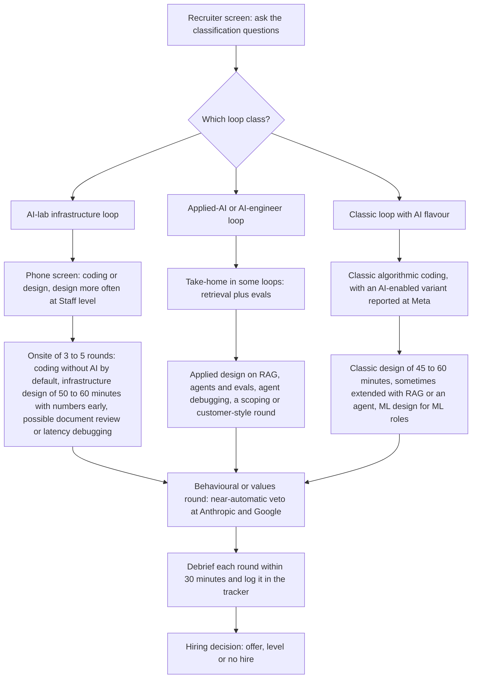

# Interview Loops: Classify, Prepare, Run the Day, Follow Up

> How GenAI interview loops are structured, how to classify yours before you prepare, what each round tests, what to do on the day, and how to debrief and follow up, with recruiter questions, templates and questions to ask your interviewers.

**Dates and grades.** Loop structures come from [T0-14](../../research/sessions/T0-14-ai-system-design-interview-patterns.md) (dated 2026-10-21) and [T1-03](../../research/sessions/T1-03-interview-execution-offer-negotiation.md) (dated 2026-10-25); loop types and take-homes from [T0-06](../../research/sessions/T0-06-career-transition-timelines-5-backgrounds.md); the probes behind your own questions from [T0-09](../../research/sessions/T0-09-onboarding-probation-first-90-days.md); funnel stage rates from [T0-04](../../research/sessions/T0-04-ats-filtering-funnel-conversion-math.md) (dated 2026-10-23), which [erratum U24](../../research/ERRATA.md) prefers to T1-03's. They record what candidates, aggregators and coaching vendors *report*, not official employer processes. Formats, tools and AI policies change: re-verify by 2027-01-19. **Grades** (EGP-1.0, defined in [CONTRIBUTING §3](../../CONTRIBUTING.md#3-writing-standard-egp-10-in-brief)): A primary or measured; B transparent secondary; C vendor, aggregator or single source; D judgement; E searched, nothing found; M model output; P practice-curated and unmeasured. Terms are in the [glossary](../00-start/glossary.md).

## The short answer

1. **Classify the loop before you prepare.** Ask the recruiter which rounds you will face, whether system design is about infrastructure, AI applications or classic systems, and what the AI-tool policy is. Loops are heterogeneous by role and team [B/C · T0-14.F2], and preparing for the wrong track is the most avoidable failure mode [B/C · T1-03.F2].
2. **Classify by team, not by employer.** Google runs classic or ML design depending on role and interviewer, and OpenAI's reported prompt pool mixes classic and AI-product prompts [B/C · T0-14 L172, L174]; Databricks varies by track, per interview-guide aggregators such as Dataford [C · T0-14 L175, L973].
3. **Treat the behavioural or values round as a gate.** A "No Hire" there is a near-automatic veto at Anthropic (values round) and Google (Googlyness and Leadership), and triggers downlevel or rejection at Meta [B/C · T1-03.F4].
4. **Assume no AI assistant unless the recruiter allows one** [P]. Anthropic's live rounds default to none [B/C · T0-14.F11]. Where an AI-enabled coding round exists (Meta, spring 2026, an early signal), you are scored on how you direct and audit the assistant, and blind reliance is a strong No Hire signal [B/C · T1-03.F6].
5. **Run several loops at once; expect most to end without an offer.** Onsite-to-offer is 29% in Gem's engineering data [B · T0-04.F9] and ≈ 15–20% by industry consensus; no firm publishes its own rate, and the consensus figure may be optimistic for frontier labs [C · T1-03 L160, L404, L421]. Getting into loops binds harder than passing them [B/C · T1-03.F1]. T1-03 suggests 3–5 parallel loops, staggered so offers overlap [D · T1-03 L270].
6. **Debrief within 30 minutes of every round, and keep a tracker.** Coaching sources recommend it universally; no study shows it raises pass rates [C/D · T1-03.F12]. The tracker shows where you lose, so you can change loop type, level or tier [D · T0-06 L398, L403–405].

## At a glance



Sources for the diagram: classes [B/C · T0-14 L118–121]; Anthropic rounds and timings [B · T0-14 L171]; take-homes and scoping rounds [C/D · T0-06 L248, L318]; classic timings [B/C · T0-14.F8]; AI-enabled coding [B/C · T1-03.F6]; veto [B/C · T1-03.F4]; debrief [C/D · T1-03.F12].

## The loop map: three engineering classes and four specialist tracks

T0-14 sorts engineering loops by what the system design round is about [B/C · T0-14 L118–121], and T1-03 uses the same three-way split [B/C · T1-03 L102–106]. A practitioner who interviewed with 46 companies found no standard AI-engineer interview format [C · T0-06 L314], so treat the class as a hypothesis until the recruiter confirms it [P].

### The three engineering classes

| Class | Where it is reported | What the design round is about | Prepare first | Prep pack |
|---|---|---|---|---|
| **AI-lab infrastructure** | Anthropic; OpenAI infrastructure and inference teams [B/C · T0-14 L119]; Databricks GenAI-engineer track [B/C · T1-03 L104] | AI-framed infrastructure: the model is a black box, and strong infrastructure candidates without ML experience do well [B · T0-14.F1] | A1–A5 (inference API, request batching, batch inference, GPU scheduling, weight distribution), then A7 (prompt playground) and A14 (evaluation platform); expect numbers early and failure-mode probing [B/C · T0-14 L119, L186–200] | [Infrastructure](prep-packs.md#infrastructure-pack) |
| **Applied-AI or AI-engineer** | Databricks, Google GenAI tracks, Meta ML, scale-ups [B/C · T0-14 L120]; OpenAI applied teams [B/C · T1-03 L105]; applied-AI startups [C/D · T0-06 L318] | AI-native: RAG with access control, agent loop control, evaluation architecture, context management [B/C · T1-03 L105] | A8–A15 (enterprise RAG, assistant, coding assistant, agents, voice, extraction, evaluation, safety) [B/C · T0-14 L120]; Dataford's aggregate of GenAI-engineer guides lists "Evaluate an LLM System" most often (19 guides) [C · T0-14 L104] | [Application](prep-packs.md#application-pack); [application plus customer scoping](prep-packs.md#application-plus-customer-scoping-pack) for customer-facing roles |
| **Classic with AI flavour** | Meta and Google SWE, Stripe, Uber [B/C · T0-14 L121; T1-03 L106] | Classic distributed design; at most an LLM probe, or a classic design extended with RAG or an agent [C · T0-14 L83] | Classic design, plus one or two LLM-flavoured prompts (A8 RAG, A9 assistant) as insurance; no KV-cache maths [B/C · T0-14 L121; T1-03 L106] | [Coding](prep-packs.md#coding-pack); [classic ML system design](prep-packs.md#classic-ml-system-design-pack) for ML roles |

### Four specialist tracks

| Track | What these sessions report | Prepare with |
|---|---|---|
| Research engineer or residency at a frontier lab | Highly selective; fellowships and research-engineer tracks are an entry route, and one lab's fellowship page says no PhD or prior ML experience is required [B, conflict of interest · T0-06 L320]. Round formats are not measured | [Research pack](prep-packs.md#research-pack); [PhD to industry](../11-tracks/phd-to-industry.md) |
| Evaluation | A design topic rather than a separate loop: archetype A14, and LLM-as-judge versus human annotation is reported as central in Google ML-platform and GenAI tracks [B/C · T0-14 L174, L199] | [Evaluation design pack](prep-packs.md#evaluation-design-pack); [AI evaluation engineer](../02-roles/hubs/ai-evaluation-engineer.md) |
| Governance, risk and responsible AI | No loop structures in T0-14 or T1-03 | [Governance pack](prep-packs.md#governance-pack); [governance careers](../11-tracks/governance-careers.md) |
| AI product management | No loop structures in T0-14 or T1-03 | [Product pack](prep-packs.md#product-pack); [AI product manager](../02-roles/hubs/ai-product-manager.md) |

### Reported loop structures by employer

This is what is reported, not what is official [T0-14 L167]; aggregator tallies are unaudited [T0-14 L80]. The design prompts each firm is reported to set are in [system design archetypes](system-design-archetypes.md#reported-design-prompts-by-firm).

| Employer | Reported format | Design flavour | Grade |
|---|---|---|---|
| Anthropic | Onsite 4–5 rounds per Aced, 3–5 per DesignGurus; design rounds 50–55 minutes (Aced guide), 55–60 (Aced process page) or about 60 (DesignGurus, interviewing.io); run over Google Meet, with the one-hour design round in a shared Google Doc (interviewing.io); Staff phone screens more often design; document-review, roofline and p95-debugging variants | AI-framed infrastructure; AI-native prompts exist but rank lower | B · T0-14 L171 |
| OpenAI | 45–60-minute rounds; the phone screen includes a 60-minute design round per Aced; the technical deep dive works like a reverse design interview (explain a system you built); level is set after the loop | Mixed: classic plus AI products; agent-building experience expected for some teams | B/C · T0-14 L172 |
| Meta | E6: two 45-minute design rounds, about 35–40 usable minutes; Excalidraw; an AI-enabled variant reportedly uses Mermaid in CoderPad (spring 2026, early signal) | SWE classic; ML pool LLM-native | B/C · T0-14 L101, L173 |
| Google | L6: 60-minute rounds; classic or ML design depending on role and interviewer; one MLE reviewer calls the design round the biggest filter | Role-dependent | B/C · T0-14 L174 |
| Databricks | By track: data-infrastructure design for SWE; RAG over sensitive documents and multi-agent evaluation for AI-FDE; distributed LLM inference for GenAI engineers; training systems and RAG for MLE | Role-dependent | C · T0-14 L175 |
| Stripe | Coding, integration, debugging and design; a 2026 review lists an "AI round" in which the candidate was told not to trust the AI | Classic; no LLM-design evidence | C · T0-14 L176 |
| Uber | MLE: coding, ML coding, ML design, behavioural; an August 2026 phone screen paired 45 minutes of coding with 15 minutes on where ML or LLMs could help | Classic ML with LLM probes | C · T0-14 L177 |
| Scale-ups (Mistral, LangChain, Eightfold, per one playbook) | ML design or "applied system design" after a take-home | AI-native: agents, RAG, evals | C/D · T0-14 L178 |
| Applied-AI startups, dev-tool and vertical-AI companies | Four to five rounds: a take-home (one write-up), agent debugging, scoping and a customer-style conversation | Applied | C/D · T0-06 L318 |

### Where the funnel narrows

The stage-by-stage conversion rates for cold-inbound engineering applications are in the [application operating system](../06-job-search/application-operating-system.md#the-funnel-you-are-running): T0-04's reading of Gem and Ashby benchmarks (dated 2026-10-23), which [erratum U24](../../research/ERRATA.md) prefers to the stage rates T1-03 gives for the same sources [T1-03 L158–161]. The published figures do not separate recruiter screens from technical screens [B · T0-04.F9; T0-04 L409]. For planning interviews, two points matter:

- **Most of the loss happens before the loop.** Cold inbound converts at ≈ 0.2% from application to hire, about 340–380 applications per offer [B · T0-04.F9], and referrals yield 11–36× more per application [B/C · T1-03.F1].
- **Most loops end without an offer** [M]: onsite-to-offer is 29% in Gem's engineering chain [B · T0-04.F9] and ≈ 15–20% by industry consensus, with no firm publishing its own rate [C · T1-03 L160, L404]. Frontier labs may convert lower still: some anecdotal accounts put onsite-to-offer below 10%, and there is no firm data [D · T1-03 L421]. Read one rejection as weak evidence; read patterns across loops in the tracker [P].

### The loop also sets your level

- **Level is decided in or after the loop.** OpenAI sets level after the loop [B/C · T0-14 L172]. At Google, a behavioural No Hire sinks the packet at the target level, and the hiring committee may downlevel instead when technical scores are exceptional [B/C · T1-03 L211]. At Meta, it triggers downlevel or rejection [B/C · T1-03.F4].
- **Senior and Staff look different in design rounds.** Coaching rubrics converge: Senior drives the conversation and anticipates failures and trade-offs; Staff scopes the problem, quantifies unprompted, proposes the lever that changes the cost curve, and designs for organisational ownership and migration. Google-specific coaching says that needing a prompt for trade-offs signals L5 in an L6 loop [B/C · T0-14.F10].
- **Level drives pay.** Level-median steps run ×1.38–1.46 per level [B/C · T1-03 L330]. Ask which level the loop is calibrated for; negotiate level in the [negotiation playbook](../09-compensation/negotiation-playbook.md).

## How to do it

1. **Classify the loop with the recruiter (about 10 minutes)** [B/C · T0-14 L118]. Use the checklist below. *Done when* you can name the class and, for every round, its type, length, tool and AI policy.
2. **Map every round to preparation.** Use the round table; drill your class's archetypes first [B/C · T0-14 L119–121]. *Done when* each round has a guide or pack and you have run at least one timed mock of each round type [P].
3. **Bank four behavioural stories,** one per competency: pragmatism under ambiguity, communicating probabilistic trade-offs, ownership and incident response, responsible AI. Use STAR-AI: each result carries a metric delta and a monitoring step [B/C · T1-03.F5]. *Done when* every story says what *you* did, which metric moved and how you kept watching it.
4. **Choose your questions and a place to record promises.** Pick questions from the bank below whose answers would change your decision [P]. *Done when* you have questions for each interviewer and a page for what the loop promises about data, compute, team and scope, to check in days 3–10 of the job [D · T0-09 L150, L167].
5. **Run the day** with the timings and behaviours below. *Done when* every round has notes, with the questions written down verbatim.
6. **Debrief within 30 minutes of each round** [C/D · T1-03.F12]. *Done when* the five-step debrief is written and each gap has a study action and a date.
7. **Follow up and log the loop.** *Done when* the recruiter has your note, the tracker row is complete, and after several loops you can name the stage where you lose [D · T0-06 L398].

### Classify your loop: the checklist

Read the signals before the call [P]:

- [ ] **Team and job description.** Serving, batching, GPUs or latency SLOs point to the infrastructure class; RAG, agents, evaluation or customer work point to the applied class; a general SWE or ML product team points to the classic class (groupings from T0-14 L119–121).
- [ ] **Your role's interview track,** from its role hub (start at the [role map](../02-roles/role-map.md)).

Ask the recruiter, and write the answers down:

- [ ] "Which rounds are in the loop, in what order, and how long is each?" Lengths run from 45 to 60 minutes by employer [B/C · T0-14.F8].
- [ ] "Is the system design round about infrastructure (serving, batching, GPU scheduling), about AI applications (RAG, agents, evaluation), or general design?" T0-14 calls this the highest-leverage first step [B/C · T0-14 L83].
- [ ] "Is there an ML system design round as well as general design?" Big-company ML/AI loops can include algorithmic coding, general design, ML design and behavioural [D · T0-06 L319].
- [ ] "Is there a take-home, a project deep dive, a design-document review or a debugging exercise?" Each is reported somewhere [B · T0-14 L171; B/C · T0-14 L172; C/D · T0-06 L318].
- [ ] "Which tools do the rounds use: a shared document, a coding pad, a whiteboard tool?" [B/C · T0-14.F11]
- [ ] "May I use an AI assistant in any round? If so, which one, and what are you assessing?" [B/C · T0-14.F11; T1-03.F6]
- [ ] "Is there a values or behavioural round, and how much does it weigh in the decision?" [B/C · T1-03.F4]
- [ ] "Which level is the loop calibrated for, and when is the level decided?" [B/C · T0-14 L172]
- [ ] "When should I expect a decision?" [P]

| If the answers say… | Class | Prepare |
|---|---|---|
| Serving, batching or GPU scheduling; numbers expected; 50–60-minute design rounds | AI-lab infrastructure | A1–A5 first, then A7 and A14 [B/C · T0-14 L119] |
| RAG, agents or evaluation; a take-home; a scoping or customer round | Applied-AI | A8–A15 first [B/C · T0-14 L120] |
| General design and algorithmic coding, perhaps with an LLM extension or probe | Classic with AI flavour | Classic design, plus A8 and A9 as insurance [B/C · T0-14 L121] |
| Unclear or mixed | Mixed | Ask again in writing; prepare the class the team signals [P], plus regular architecture, which a Staff candidate advises covering even when a prompt sounds model-deep [B · T0-14 L80] |

### What each round tests and how to prepare

| Round | What it tests | How to prepare | Where in this repo |
|---|---|---|---|
| Recruiter screen | Fit, level and logistics; often salary expectations | Ask the classification questions; answer salary questions by asking for the approved band for the level [C/D · T1-03 L276] | [Negotiation playbook](../09-compensation/negotiation-playbook.md) |
| Technical phone screen | Coding or design: Anthropic's Staff screens are more often design [B · T0-14 L171]; OpenAI's includes a 60-minute design round per Aced [B/C · T0-14 L172]; one Uber MLE screen (August 2026) added 15 minutes on where ML or LLMs could help [C · T0-14 L177] | Ask which, then prepare as for that onsite round | The rows below |
| Coding, classic (no AI) | Data structures, optimisation, communication [D · T1-03 L220] | Frame the approach before coding, think aloud, test edge cases | [Coding rounds](coding-rounds.md); [coding pack](prep-packs.md#coding-pack) |
| Coding, AI-enabled | How you direct and audit an assistant [B/C · T1-03.F6] | Delegate boilerplate, own the logic, say who does what, audit every line | [Coding rounds](coding-rounds.md) |
| Design: infrastructure | Serving, batching, queueing, scheduling and failure handling [B · T0-14.F1]; KV-cache maths, decode rooflines, GPU scheduling [B/C · T1-03 L104] | A1–A5; carry one "number that breaks first" into the design [B/C · T0-14 L127] | [System design archetypes](system-design-archetypes.md); [infrastructure pack](prep-packs.md#infrastructure-pack) |
| Design: application | RAG with access control, agent loop control, evaluation architecture, context management [B/C · T1-03 L105] | A8–A15; make evaluation and safety named sections [B/C · T0-14 L128] | [System design archetypes](system-design-archetypes.md); [application pack](prep-packs.md#application-pack) |
| Design: classic, extended with AI | Classic distributed design, then adding RAG or an agent [C · T0-14 L83] | Classic design practice (outside this repository), plus A8 and A9 | [System design archetypes](system-design-archetypes.md) |
| ML system design | Classic ML problems such as surge pricing, ETA and fraud (Uber MLE) [C · T0-14 L177] | Classic ML design; be ready to place an LLM component sensibly [B/C · T0-14 L121] | [Classic ML system design pack](prep-packs.md#classic-ml-system-design-pack) |
| Design-document review | Spotting structural problems in a written design (Anthropic: 3 reports, April 2026) [B · T1-03 L222]; reported for staff-level engineers and engineering leaders [B/C · T0-14 L110] | A 10-minute read, then findings by severity: missing requirements, capacity assumptions, failure modes, rollout, alternatives | [System design archetypes](system-design-archetypes.md) |
| Debugging: p95 latency | Hypothesis-driven diagnosis (Anthropic: 1 report) [C · T1-03 L223] | Segment by percentile and cohort; split queue, prefill and decode; check batch size, KV pressure and long-context outliers | [Infrastructure pack](prep-packs.md#infrastructure-pack) |
| Project deep dive | A system you built, examined like a reverse design interview (OpenAI) [B/C · T0-14 L172] | One system you can defend: its numbers, trade-offs, failures and what you would change [P] | [Proof-of-work standards](../05-portfolio/proof-of-work-standards.md); [project archetypes](../05-portfolio/project-archetypes.md) |
| Take-home | Eval design, error analysis, retrieval judgement, agent debugging, cost and latency reasoning [C/D · T0-06 L141] | See take-homes below | [Evaluation design pack](prep-packs.md#evaluation-design-pack) |
| Scoping or customer-style conversation | Turning a vague ask into a scoped plan (applied-AI startups) [C/D · T0-06 L318] | Rehearse discovery questions, constraints and trade-offs aloud [P] | [Application plus customer scoping pack](prep-packs.md#application-plus-customer-scoping-pack); [forward-deployed engineer](../02-roles/hubs/forward-deployed-engineer.md) |
| Behavioural or values | Four AI competencies [B/C · T1-03.F5]; a veto at several firms [B/C · T1-03.F4] | Four STAR-AI stories; no blame; admit mistakes | [Behavioural calibration](behavioral-calibration.md); [behavioural pack](prep-packs.md#behavioural-pack) |
| Research discussion (labs, residencies) | Research taste plus engineering depth [B, conflict of interest · T0-06 L320] | Format not measured in these sessions | [Research pack](prep-packs.md#research-pack) |

### AI tools in the interview

| Employer | Reported policy or format | Grade |
|---|---|---|
| Anthropic | Live rounds default to no AI assistance | B/C · T0-14.F11 |
| Meta | An AI-enabled coding round (spring 2026, early signal); classic algorithmic coding is still the primary format | B/C · T1-03 L221; D · T1-03 L220 |
| Stripe | A 2026 review lists an "AI round" in which the candidate was told not to trust the AI | C · T0-14 L176 |
| Google and others | Classic algorithmic coding without AI | D · T1-03 L220 |

- **Ask, and get the answer in writing** [P]. If nobody says AI is allowed, treat the round as no-AI. T0-14 warns that AI-assistance rules vary and can disqualify [D · T0-14 L924]; no session records what happens to candidates who use an assistant in a no-AI round.
- **In an AI-enabled round, narrate the division of labour.** T1-03's protocol splits the clock: orient and confirm constraints (first 10%), decide what to delegate (15%), write, prompt and audit (50%), then harden with complexity and failure modes (25%) [D · T1-03 L227–232]. It asserts, without a source, that catching an assistant's hallucination scores higher than clean code written from scratch [D · T1-03 L231].
- **Practise on the round's tool.** A shared Google Doc for Anthropic's design round; Excalidraw for most Meta design rounds; Mermaid in CoderPad for Meta's AI-enabled variant. Eraser.io has no evidence of use in live interviews [B/C · T0-14.F11]. Details: [coding rounds](coding-rounds.md).

### Take-homes

- **Where they appear.** Applied-AI startups, dev-tool and vertical-AI companies set retrieval-plus-evals take-homes [C/D · T0-06 L141, L248]; scale-ups set one before an "applied system design" round [C/D · T0-14 L178]. Anthropic sets a timed performance take-home, and its candidate guidance asks for AI-free take-homes unless stated [A · T0-13 L109]; the other big-company and lab loops in T0-14 and T1-03 report none.
- **One reported shape.** Answer questions over about 50 documents and report recall@5 and faithfulness on a 20-question set [C/D · T0-06 L318].
- **Not in the corpus.** How long take-homes run (Anthropic's has a time limit; its length is not stated), scoring rubrics, whether take-homes are paid, and pass rates.
- **Practice** [P]. Confirm the time box and what is scored before you start. Report metrics on a question set you built, and say how you built it. Make the headline numbers reproducible from the README and list what broke; T0-06 uses both tests, with a "what broke" memo naming three specific failures, for its portfolio milestones [D · T0-06 L395]. Expect the next round to probe your choices.
- **Diagnostic.** Three failed take-homes: invest in eval design and error analysis [D, heuristic · T0-06 L404].

### On the day

| Round | Do | Avoid |
|---|---|---|
| System design, 45 minutes | Requirements 5 → targeted estimate 4 → high-level design and request walk 9 → two deep dives 16 → evaluation, safety and operations 7 → wrap-up 4 [B/C · T1-03.F3]. Checkpoints: no numbers by 0:09, stop drawing and do the four-line estimate; no deep dives named by 0:18, pick the two riskiest components; evaluation and safety untouched at 0:34, go there [D · T1-03 L111–113] | Opening with model architecture instead of requirements and scale; never quantifying; over-engineering past the stated scale; passively waiting for prompts [C · T0-14.F9] |
| Coding | Confirm inputs, outputs and constraints before writing; think aloud; test edge cases [D · T1-03 L220, L229] | Jumping to code, silent coding, not testing [D · T1-03 L220] |
| AI-enabled coding | Say what the assistant does and what you own; audit its output line by line [B/C · T1-03 L221; D · T1-03 L231] | Pasting giant prompts and accepting unverified output; being unable to explain generated code [B/C · T1-03 L221] |
| Behavioural or values | What you did, a metric delta, a monitoring step; admit mistakes and trade-offs [B/C · T1-03 L187, L210] | Blaming PMs, data engineers or model providers; posturing about AI safety; "I researched" instead of "I shipped" at Meta [B/C/D · T1-03 L177; B/C · T1-03 L210–212] |

- **Scale the blueprint to the clock.** Meta's 45-minute rounds leave about 35–40 usable minutes [B/C · T0-14.F8]; T0-14 gives 35-, 55- and 60-minute variants [B/C · T0-14 L122].
- **Confirm scope first.** The scope of a prompt matters as much as its name [B · T0-14.F1].
- **Drive the round.** Some interviewers are hands-off (one OpenAI review) [B/C · T0-14 L172].
- **Between rounds,** write the questions down verbatim [P].

### Variations by background

- **Backend or infrastructure engineers.** Lab infrastructure loops treat the model as a black box, and strong infrastructure candidates without ML experience do well [B · T0-14.F1]. Big-company ML/AI loops favour backend and systems engineers [D · T0-06 L319].
- **ML or data-science backgrounds.** In big-company loops, candidates from these backgrounds report system design and coding as the deciding rounds [D · T0-06 L319]; one Google MLE reviewer says talking only about training is not enough in the design round [C · T0-14 L104]. Drill distributed design and coding first.
- **Domain experts.** Vertical-AI startup loops favour domain experts, alongside software engineers and data scientists with deployment skills [C/D · T0-06 L318].
- **PhDs and researchers.** See the research track above and [PhD to industry](../11-tracks/phd-to-industry.md).

## Templates and examples

### Recruiter message: classify the loop

Practice-curated [P]; no session measures recruiter messages.

```text
Subject: Preparing for the [Role title] loop

Hi [Recruiter name],

Thank you for moving me forward for [Role title] on [Team]. So that I prepare
for the right things, could you tell me:

1. Which rounds are in the loop, in what order, and how long is each?
2. Is system design about infrastructure (serving, batching, GPU scheduling),
   about AI applications (RAG, agents, evaluation), or general design?
3. Is there an ML design round, a take-home, a project deep dive, a document
   review or a debugging exercise?
4. Which tools do the rounds use, and may I use an AI assistant in any of them?
5. Is there a values or behavioural round?
6. Which level is the loop calibrated for, and when is the level decided?

Thanks,
[Name]
```

### Weak and strong

| Moment | Weak | Strong | Basis |
|---|---|---|---|
| Asking about the loop | "What should I prepare?" | "Is the design round infrastructure-focused or application-focused, and is there a separate ML design round?" | P; T0-14 L83 |
| Opening a design round | "I'd start by choosing which model to fine-tune." | "First: who are the users, what latency and cost targets apply, and what traffic do we expect? Then I'll estimate tokens and memory, because those change the design." | C · T0-14.F9; B/C · T0-14.F8 |
| AI-enabled coding | Pastes a long prompt and accepts the output in silence | "I'm having the assistant scaffold the data loader while I design the retrieval loop, and I'll check its output line by line." | B/C · T1-03 L221 |
| Ownership story | "The data was bad, so the model failed." | "I owned the regression: I rolled back to [fallback], added an alert on [metric], and set up [weekly sampling through our grader pipeline], which caught [the next regression]." | B/C/D · T1-03 L175–177, L187 |
| Impact framing at Meta | "I researched retrieval methods." | "I shipped a retrieval change that moved [metric] from [x] to [y] for [users]." | B/C · T1-03 L212 |
| Your questions | "What's the culture like?" | "Who signs off moving a pilot to production, and on which metric?" | P; T0-09 L154 |

### Debrief: within 30 minutes of each round

From T1-03's protocol [C/D · T1-03 L238–246]:

```text
Loop: [Company] · [Team] · [Round type] · [Date]

1. Exact questions (5 min)
   - [Question, verbatim or as close as possible]
2. My answers (10 min)
   - [What I said, the numbers I used, the trade-offs I stated]
   - [Photo of the board or export of the shared document]
3. Interviewer reactions (5 min)
   - [Where they probed, nodded, looked sceptical or redirected]
4. Gaps (5 min)
   - [Gap] - tag: [formula] / [concept] / [tool] / [trade-off]
5. Iteration plan (5 min)
   - [Gap] -> [what to study] -> [by date]
   - Story bank: [update needed? which story?]
```

### Loop tracker

Log every round in your tracker's interview records, with the fields listed in the [application operating system](../06-job-search/application-operating-system.md#the-tracker-fill-in-schema), which owns the tracker fields, the thresholds and the [decision table](../06-job-search/application-operating-system.md#when-to-change-course-decision-table) [D · T1-03 L250–257; T0-06 L403–405]. Add a loop-class column (infrastructure, applied or classic) so that patterns show by class [P]. Two readings are specific to interviews: failed onsites at system design call for system design and DSA practice for big-company loops, or a switch to applied-AI loops [D · T0-06 L405]; a round whose flavour surprised you is a classification miss, so ask the classification questions in writing next time [P].

### Follow-up notes

Practice-curated [P]: no session measures whether thank-you or status notes change outcomes. Keep them short and specific.

```text
Subject: Thank you - [Role title] loop on [date]

Hi [Name],

Thank you for organising the loop on [date]. I enjoyed [specific discussion,
e.g. the batching trade-off in the design round].

I am in other processes with decisions expected around [date]. If your
timeline differs, please let me know.

Best,
[Name]
```

```text
Subject: Following up - [Role title] loop on [date]

Hi [Name],

You mentioned a decision around [date]. Is there an update, or anything else
you need from me? I have [another offer / a deadline] on [date], so a sense of
timing would help.

Best,
[Name]
```

- **After an offer,** pause before answering. T1-03's script: "I'm very excited about this. Thank you for putting this together. I'd like to take 48 hours to review the details carefully." [C/D · T1-03 L284]. Then use [offer evaluation](../09-compensation/offer-evaluation.md) and the [negotiation playbook](../09-compensation/negotiation-playbook.md).
- **After a rejection** [P], thank the recruiter, ask whether any feedback is available, and run the debrief anyway: the gaps are the useful part.

### Questions to ask your interviewers

Ask to decide, and write down what the loop promises. In a 2018 Jobvite survey, 43% of job seekers said the day-to-day role was not what the hiring process led them to expect; the figure is general, not AI-specific [B · T0-09 L81]. A recruiter lists three failure modes for first AI hires: a researcher hired for a builder's job, no measure of success and no accountable executive [C · T0-09 L82]. Most questions below adapt T0-09's week-one diagnostic, whose probes each cite evidence while its scoring rule is heuristic [D · T0-09 L150]; asking them during the loop is [P].

| Group | Ask | Red flag in the answer | Basis |
|---|---|---|---|
| Problem and owner | "Which business metric does this work move, and who signs off moving a pilot to production?" | No named owner; the goal is "use AI" | D · T0-09 L154 |
| Problem and owner | "Is this role mainly research or mainly building, and how will you measure success?" | No clear answer to either | C · T0-09 L82 |
| Problem and owner | "What has leadership seen so far, and when do they expect production?" | Dates set from a demo | D · T0-09 L168 |
| Data and evaluation | "What does the accuracy target mean: per field, per document or per answer, and against which human baseline?" | One headline number; no human fallback | D · T0-09 L155 |
| Data and evaluation | "Do 20 real inputs with desired outputs exist, and where do they live?" | Nobody can produce them within a week | D · T0-09 L156; "no usable data" is a common starting state [B · T0-09.F4] |
| Data and evaluation | "Is there trace logging, a golden set, a regression test or any baseline?" | "We eyeball it" | D · T0-09 L161; a small regression suite built from real failures has independent support [A · T0-09.F10] |
| Data and evaluation | "Do stakeholders know outputs vary from run to run?" | They believe temperature 0 means identical outputs | A · T0-09.F6; T0-09 L162 |
| Compute and spend | "API-only, hosted GPU or self-hosted? What quota does the team have?" | Infrastructure promised in the loop that does not exist | A · T0-09.F5; T0-09 L159 |
| Compute and spend | "Is there a monthly LLM spend cap, a per-project key and cost attribution?" | One shared organisation key; no caps | D · T0-09 L160 |
| Compute and spend | "Which model providers, regions and retention terms are approved?" | None approved, or nobody knows | D · T0-09 L158 |
| Governance and failure | "Who approves data access? Is customer data allowed in development, in LLM APIs and in logs?" | No data classification | D · T0-09 L157 |
| Governance and failure | "Which reviews apply (legal, infosec, privacy, vendor, model risk), and how long do they take?" | Unknown, or reviews started late and run in series | A · T0-09.F7; T0-09 L164 |
| Governance and failure | "What happens when the system is wrong? Is there a human fallback?" | Autonomous output expected for customer-facing, legal or financial use | D · T0-09 L163 |
| How you are judged | "Which dashboards or metrics feed performance reviews?" | Activity metrics only, such as AI-usage counts | B/C · T0-09.F11; T0-09 L165 |
| History | "What was tried before? Are there postmortems or abandoned prototypes?" | No history, or nobody who remembers | D · T0-09 L166 |
| Startup and team | "How long is the runway, and which paying customers use the GenAI feature?" | Vague on both | P |
| Startup and team | "Who is on call when a model or provider fails, and what is the plan if a provider changes its price or terms?" | Nobody owns it | P |

**Equity, for private companies** [B/C/D · T1-03.F11]. At the offer stage, ask in writing for: the fully diluted share count; the last preferred price and the last 409A value; the liquidation preference stack, its seniority and any participation; the last tender (price, cap, tenure gate, ex-employee eligibility); the vesting schedule and cliff; RSUs or options, with strike price and early exercise; the post-termination exercise window; single- or double-trigger acceleration on change of control; and how people who had joined shortly before past acquisitions were treated [T1-03 L346–357]. A refusal to answer is itself a signal [T1-03 L344]. Valuing the answers: [offer evaluation](../09-compensation/offer-evaluation.md).

## Checklist

**Before the loop**

- [ ] Class, rounds, lengths, tools, AI policy and level written down from the recruiter's answers.
- [ ] Your class's archetypes drilled, with at least one timed mock per round type [P].
- [ ] Four STAR-AI stories, one per competency, each with a metric delta and a monitoring step [B/C · T1-03.F5].
- [ ] One system ready for a deep dive: numbers, trade-offs, failures, what you would change [P].
- [ ] Salary answer ready: ask for the approved band and do not disclose your pay [C/D · T1-03 L276].
- [ ] Questions chosen for each interviewer, and a page for the loop's promises [P].
- [ ] Other processes timed so that offers can overlap [D · T1-03 L270].

**On the day**

- [ ] Video link, shared document, coding pad and whiteboard tool tested [P].
- [ ] A visible clock: the blueprint split and the 0:09, 0:18 and 0:34 checkpoints for 45-minute design rounds [B/C · T1-03.F3; D · T1-03 L111–113].
- [ ] No AI assistant unless the round allows it [P; B/C · T0-14.F11].
- [ ] Design: requirements, SLOs and scale first; one number that breaks first; evaluation and safety as named sections; what you gave up after each deep dive [C · T0-14 L125–131].
- [ ] Coding: frame, think aloud, test [D · T1-03 L220].
- [ ] Behavioural: what you did, the metric delta, the monitoring step; no blame [B/C · T1-03.F5].
- [ ] Questions noted verbatim between rounds [P].

**After each round and after the loop**

- [ ] Five-step debrief within 30 minutes [C/D · T1-03.F12].
- [ ] Tracker row updated, and patterns checked against the [decision table](../06-job-search/application-operating-system.md#when-to-change-course-decision-table) [D · T0-06 L403–405].
- [ ] Thank-you note sent; a status check after the promised date [P].
- [ ] The loop's promises recorded, to check in days 3–10 of the job [D · T0-09 L150, L167].
- [ ] Offer: a 48-hour pause, then [offer evaluation](../09-compensation/offer-evaluation.md) [C/D · T1-03 L284].

## Pitfalls

| Red flag | Why it hurts | Fix |
|---|---|---|
| Preparing from the company name | Loops vary by role and team: a Google candidate on a conversational-AI team expected an AI-centred discussion and was steered to delivery guarantees, ordering and throughput [B/C · T0-14 L174] | Ask the classification questions; keep regular architecture as insurance [B · T0-14 L80] |
| Treating the behavioural round as a formality | A near-automatic veto at Anthropic and Google [B/C · T1-03.F4] | Four STAR-AI stories; see [behavioural calibration](behavioral-calibration.md) |
| Opening with model architecture, training or fine-tuning | A recurring red flag in coaching lists [C · T0-14.F9] | Open with requirements, SLOs and scale |
| No numbers in an AI design round | Tokens, KV memory and TTFT almost always change an AI design [B/C · T0-14.F8] | A targeted four-minute estimate early |
| Infrastructure depth in an applied loop | Aced warns that 15 minutes on GPU allocation or model routing wastes time with OpenAI's product-focused Applied-AI teams [C · T0-14 L172] | Match depth to the class |
| "Vibe coding" in an AI-enabled round | A strong No Hire signal [B/C · T1-03.F6] | Delegate boilerplate, own the logic, audit aloud |
| Using an assistant without permission | Anthropic's live rounds default to no AI [B/C · T0-14.F11] | Ask first; without a yes, work unaided [P] |
| Blaming teammates, PMs or model providers | Scores No Hire on ownership in T1-03's synthesised rubric [B/C/D · T1-03 L169, L177] | Own the failure, the fix and the prevention |
| Skipping the debrief | You lose the exact questions and the pattern across loops [P] | Debrief within 30 minutes [C/D · T1-03.F12] |
| Taking the loop's promises on trust | 43% of job seekers (Jobvite 2018) said the role differed from what hiring led them to expect [B · T0-09 L81] | Ask the question bank; record the answers; check them in days 3–10 [D · T0-09 L150, L167] |
| One loop at a time | Offers cannot overlap, and negotiating without competing offers is a high-likelihood risk in constrained markets [D · T1-03 L428] | Run several processes, staggered [D · T1-03 L270] |

## Evidence and limits

- **What is measured.** The stage conversion rates behind the funnel section are vendor benchmarks (Gem engineering; Ashby technical, Q1 2026) as compiled by T0-04 [B · T0-04.F9], held in the [application operating system](../06-job-search/application-operating-system.md); erratum U24 sets aside the stage rates T1-03 gives for the same sources [T1-03 L158–161]. T1-03's onsite-to-offer figure of 15–20% is industry consensus [C · T1-03 L404]. Nothing on this page is a controlled measurement of interview outcomes.
- **What is reported.** Loop structures and prompts are candidate, aggregator and coaching-vendor reports, unaudited and dated October 2026 [T0-14 L80, L167].
- **No pass-rate data.** No firm publishes pass rates by round for AI engineers. T1-03 holds AI-specific pass rates at lower confidence (C/G) and notes that the 15–20% may overstate frontier-lab rates [T1-03 L34, L404, L421].
- **No firm-published rubrics.** There is no AI-specific behavioural rubric [E · T1-03 L169, L407], and no AI-specific or Principal-level design rubric [B/C · T0-14.F10].
- **Heterogeneity is the finding.** No standard AI-engineer format [C · T0-06 L314]; AI-native design rounds are role- and team-dependent [B/C · T0-14.F2]; T0-14 found no independent prevalence data on AI-native rounds [T0-14 L83].
- **Early signals.** AI-enabled coding is reported at one employer from spring 2026 [B/C · T1-03.F6]. The design-document review rests on 3 reports as of April 2026, and no source describes its format in detail [T1-03 L409].
- **Thin areas.** Take-homes (apart from the fact that Anthropic sets a timed one), scoping rounds and research loops rest on C/D sources or none. Debriefs are recommended on learning-science grounds and untested for pass rates; T1-03 leaves that objection unresolved [C/D · T1-03.F12; T1-03 L420].
- **Prep platforms.** No interview-prep platform has independent outcome evidence ([errata](../../research/ERRATA.md), U17).
- **Geography.** These sessions hold no country-specific loop evidence.
- **Judgement on this page** [P]: the classification signals, the recruiter message, the follow-up notes, the startup questions, and the use of T0-09's week-one probes during the loop.
- **What would change this advice:** firm-published rubrics or pass rates; prevalence data on AI-native or AI-enabled rounds; AI assistance becoming the default in live rounds; a controlled test of debriefs.

## Next steps

- **Prepare each round:** [AI system design archetypes](system-design-archetypes.md), [coding rounds](coding-rounds.md), [behavioural calibration](behavioral-calibration.md) and the [prep packs](prep-packs.md).
- **Get more loops:** getting in is the binding constraint [B/C · T1-03.F1]. See the [job-search strategy](../06-job-search/job-search-strategy.md#recommended-sequencing-expanding-rings), [referrals and outreach](../07-networking/referrals-and-outreach.md) and the [application operating system](../06-job-search/application-operating-system.md).
- **After an offer:** [offer evaluation](../09-compensation/offer-evaluation.md), the [negotiation playbook](../09-compensation/negotiation-playbook.md) and [pay benchmarks](../09-compensation/pay-benchmarks.md).
- **After you accept:** [first 90 days](../10-onboarding/first-90-days.md); re-run the expectations-gap probes in days 3–10 [D · T0-09 L150].
- **By role:** [AI engineer](../02-roles/hubs/ai-engineer.md), [ML engineer](../02-roles/hubs/ml-engineer.md), [inference engineer](../02-roles/hubs/inference-engineer.md), [AI infrastructure engineer](../02-roles/hubs/ai-infrastructure-engineer.md), [forward-deployed engineer](../02-roles/hubs/forward-deployed-engineer.md), [research engineer](../02-roles/hubs/research-engineer.md), [AI evaluation engineer](../02-roles/hubs/ai-evaluation-engineer.md), [AI product manager](../02-roles/hubs/ai-product-manager.md); every role is in the [role map](../02-roles/role-map.md).
- **By background:** [career transitions](../11-tracks/career-transitions.md) and [PhD to industry](../11-tracks/phd-to-industry.md).
- **Evidence:** [stage 8 findings](../../research/findings.md#stage-08), [T0-14](../../research/sessions/T0-14-ai-system-design-interview-patterns.md), [T1-03](../../research/sessions/T1-03-interview-execution-offer-negotiation.md) and the [errata](../../research/ERRATA.md).
