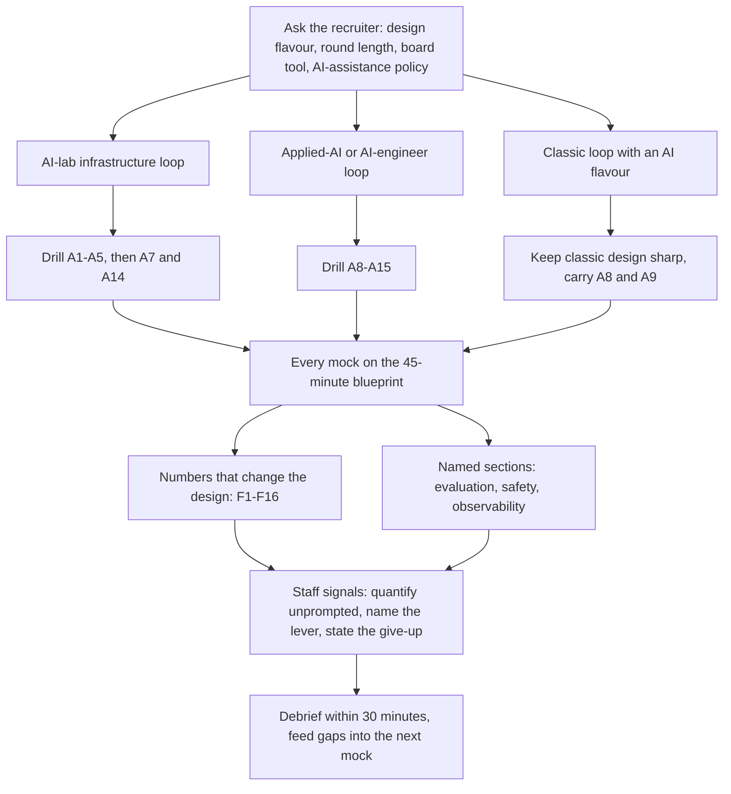
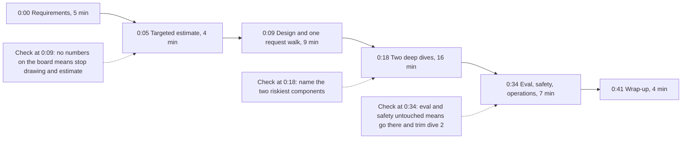

# GenAI System-Design Interviews: Archetypes, Blueprint, Numbers and Rubrics

> How to prepare for and run a GenAI system-design round: classify the loop, drill the right archetypes out of 15, run the 45-minute blueprint, compute the numbers that change the design, and meet the evaluation, safety and Staff-level rubrics.

**Dates and grades.** The evidence is [T0-14](../../research/sessions/T0-14-ai-system-design-interview-patterns.md), dated 2026-10-21, plus findings from [T1-03](../../research/sessions/T1-03-interview-execution-offer-negotiation.md). Prices were fetched on 2026-10-21. Re-verify prices, tool names and round formats by 2027-01-19. **Grades** (EGP-1.0, defined in [CONTRIBUTING §3](../../CONTRIBUTING.md#3-writing-standard-egp-10-in-brief)): A primary or measured; B transparent secondary; C vendor, coach or single source; D judgement; E searched, nothing found; M model output (T0-14's re-executed arithmetic); P practice-curated. "Synthesis" marks T0-14's own frameworks, which no firm publishes; they are graded D. T0-14 §6.3 has a reference component diagram for each of the 15 archetypes, in Mermaid.

## The short answer

1. **Classify the loop before you prepare.** Ask the recruiter which flavour the design round is. AI-native design rounds depend on role and team [B/C · T0-14.F2], and preparing for the wrong track is the most avoidable failure [B/C · T1-03.F2]. Infrastructure loops: drill A1–A5 first. Applied-AI loops: drill A8–A15 first. Classic loops: keep classic design sharp and carry A8 and A9 as insurance [D · T0-14 L118–121].
2. **At AI labs, expect classic infrastructure in AI clothing.** In AceOffer's tally of 112 Anthropic design reports, an inference API led (41), then model distribution (16), prompt playground (15) and batch inference (12). Semantic caching, RAG and LLM-judge eval harnesses were not in its top 11 [B · T0-14.F1]. The tally is unaudited and ranks reported prompts only [T0-14 L164, L903].
3. **Run every mock on one clock: 5, 4, 9, 16, 7 and 4 minutes.** Requirements, a targeted estimate, high-level design with one request walk, two deep dives, evaluation-safety-operations, wrap-up. It is the highest-convergence framework across coaching sources [B/C · T1-03.F3]. No firm publishes time splits, and rounds run from about 35 usable minutes (Meta) to 60 (Google L6) [B/C · T0-14.F8, L900].
4. **Compute only the numbers that change the design, and compute them early.** Coaches disagree about estimating first, but both sides accept that numbers must change the design. In AI systems they usually do: tokens set cost, KV memory sets concurrency, TTFT sets architecture [B/C · T0-14.F8; D · T0-14 L580]. About ten formulas cover nearly every estimation prompt [A/B · T0-14.F4].
5. **Give evaluation and safety their own named sections.** Separate retrieval, tool and generation evals; calibrate judges against humans; gate CI on regressions; feed production traces back [A · T0-14.F5]. Assume injection succeeds and contain it. Adaptive attacks bypassed 12 published defenses with over 90% success in most cases, so least privilege, egress control, approvals and ACLs at retrieval are the primary controls, and classifiers are one layer [A/B · T0-14.F6].
6. **Staff level shows in what you volunteer.** Scope the problem, quantify unprompted, name the lever that changes the cost curve, say what you gave up, and design for ownership and migration [B/C · T0-14.F10]. Prepfully's Google guide reads "the interviewer had to prompt for trade-offs" as an L5 signal in an L6 loop [C · T0-14 L774]. T0-14 found no firm-published rubric for AI system design [E · T0-14 L161].

## At a glance



## Step zero: classify the loop

Classify the loop with the recruiter first: [interview loops](interview-loops.md#the-three-engineering-classes) owns the three loop classes, where each is reported and the questions to ask. Each class sets a different drill order for the design round:

| Loop type | Repository track and prep pack | Drill first | Then |
|---|---|---|---|
| AI-lab infrastructure | `infrastructure`: [infrastructure pack](prep-packs.md#infrastructure-pack) | A1–A5 | A7 and A14; expect numbers early, 50–60-minute rounds and failure probing |
| Applied-AI or AI engineer | `application`, `evaluation`, `customer-application`: [application](prep-packs.md#application-pack), [evaluation design](prep-packs.md#evaluation-design-pack), [application plus customer scoping](prep-packs.md#application-plus-customer-scoping-pack) | A8–A15, best-evidenced first: A8, A9, A11, A14 | Evaluation roles lead with A14; forward-deployed loops report A8, A11 and A14 |
| Classic with an AI flavour | `ml-system-design`: [classic ML system-design pack](prep-packs.md#classic-ml-system-design-pack) | Classic design | A8 and A9 as insurance; be ready to place an LLM component sensibly |

Loop types and drill order: T0-14 L118–121 [D]. Best-evidenced clusters [B/C · T0-14.F3]; forward-deployed prompts [C · T0-14 L174–175]. Each role hub states its interview track; mapping those tracks onto T0-14's loop types is this page's judgement [P].

### Reported design prompts by firm

Candidate reports, not official formats (T0-14 §6.2, L171–178). Each firm's round lengths, format and design flavour are in [interview loops](interview-loops.md#reported-loop-structures-by-employer); practice versions of these prompts, with answer criteria, are in the [prep packs](prep-packs.md).

| Firm | Reported prompts | Grade |
|---|---|---|
| Anthropic | Inference API and batching, distributed search over about 1B documents, P2P weight distribution, GPU scheduling with credits, prompt playground, eval and monitoring, design-doc review, roofline, p95 debugging | B |
| OpenAI | Playground, enterprise search, GPU-credit allocation, RAG assistants, Sora-style video orchestration, beside classic prompts (payments, chat, rate limiter, job scheduler); 2026 reviews add task-executing agents | B/C |
| Meta | SWE: auctions, ticketing, click aggregation, chat. ML pool: LLM assistant, coding assistant, agentic ticket investigation, real-time voice, LLM inference | B/C |
| Google | SWE classic. ML-platform and GenAI tracks: LLM serving with strict latency; agentic design in Cloud GenAI FDE loops; evaluation discussion central | B/C |
| Databricks | AI-FDE: RAG over sensitive, fast-changing documents; evaluating a multi-agent system. GenAI engineer: distributed LLM inference. MLE: training systems, RAG at millions of documents | C |
| Stripe | Payments, reliability, consistency, graceful failure; no LLM-design evidence | C |
| Uber | Surge pricing, ETA, fraud, matching | C |
| Scale-ups | Agents, RAG, evals | C/D |

## The 45-minute blueprint

T0-14 built the blueprint from three coaching frameworks (Hello Interview, DesignGurus, GenAITrail) that agree within about 5 minutes per phase, and moved a short estimate up front because AI numbers usually change the design [B/C · T1-03.F3; D · T0-14 L578–580, L900]. It is a scaffold: if the interviewer redirects, follow them, then return to it [D · T0-14 L925].



| Clock | Phase | What to do and say | Board output | Exit check |
|---|---|---|---|---|
| 0:00–0:05 | Frame and requirements | Ask six things: users, QPS and tokens; latency targets (TTFT, TPOT or end-to-end; interactive or batch); does it act or only answer; knowledge source, freshness and permissions; quality bar and cost of a wrong answer (your eval spec); constraints (privacy, residency, vendor, on-prem). Restate the top three requirements and what is out of scope | 3–5 quantified non-functional requirements | Interviewer agrees the numbers |
| 0:05–0:09 | Targeted estimate | Only what decides architecture: requests to tokens per second; cost per request and per month; KV memory and concurrency if self-hosting; index size if RAG; a latency budget split. Say the decision each number forces | 4–6 lines of math, one circled bottleneck | You can say "this is why we need X" |
| 0:09–0:18 | High-level design and one request walk | Draw left to right. Walk one request end to end, naming data and state at each hop. Mark, but do not build, caches, queues and routers. Declare the two riskiest components | One diagram, one annotated path | No open questions about the basic path |
| 0:18–0:34 | Two deep dives, about 8 min each | Choose by risk, not comfort. For each: options, decision, supporting number, failure mode, what you gave up. Leave room for probes | Zoomed sub-diagrams, one trade-off line each | Each dive ends with "what I gave up" |
| 0:34–0:41 | Evaluation, safety, observability, failure | Golden set, graders and CI gate; online sampling and A/B; guardrails by layer and blast-radius limits; five alert metrics; provider or GPU-pool failure; the first bottleneck at 10x | An "eval and safety" box, a metrics list | Eval and safety were named, not implied |
| 0:41–0:45 | Wrap-up | Three lines: what ships first, what you would measure, what you gave up and what two more weeks would buy. Invite redirects | None | Time check |

Source: T0-14 L584–591 [D].

**Variants by round length**, minutes per phase [D · T0-14 L595–600]:

| Round | Requirements | Estimate | Design + walk | Deep dives (2) | Eval, safety, ops | Wrap-up |
|---|---|---|---|---|---|---|
| 35 usable (Meta) | 4 | 3 | 7 | 12 | 6 | 3 |
| 45 (default) | 5 | 4 | 9 | 16 | 7 | 4 |
| 55 (Anthropic) | 5 | 6 | 10 | 22 | 8 | 4 |
| 60 (Google, OpenAI) | 6 | 6 | 11 | 24 | 9 | 4 |

**Adapt by family** [D · T0-14 L603–607]:
- **Infrastructure (A1–A5):** lengthen the estimate (KV memory, batch fill, egress). Dive into batching or scheduling and failure handling. Replace "eval" with SLOs, rollout, rollback and observability.
- **RAG and search (A8):** dive 1 on retrieval quality and ACLs, dive 2 on context assembly and latency. Evaluate retrieval and generation separately.
- **Agents (A11):** dive 1 on loop control, state and resumability, dive 2 on safety and blast radius. Evaluate trajectories and outcomes over repeated trials.
- **Voice (A12):** the latency budget is the main artifact; dive into streaming overlap and barge-in.
- **Eval platform (A14):** dive into trial isolation and grader calibration.

**Rescue moves** [D · T0-14 L611–615]:
- **0:09 with no numbers on the board:** stop drawing and do the four-line estimate.
- **0:18 with no deep dives named:** say which two components carry the most risk, and pick them.
- **0:34 with evaluation and safety untouched:** go there straight away and trim the second dive.
- **Passive interviewer** (reported at OpenAI): announce an agenda and ask for redirects at each phase boundary.
- **Changed constraint:** redo the one affected number out loud. T0-14 treats this as the scored behaviour.

## The 15 archetypes

T0-14 merged every AI-flavoured prompt in its sources into 15 archetypes. It kept those reported by at least two independent sources or by one quantified aggregate [B/C · T0-14.F3; D · T0-14 L182]. Voice and document extraction rest mainly on listicles [T0-14 L86]. Practise the archetype and its numbers, not the title: question lists rotate [D · T0-14 L920].

The index of the 15 (each one's family, core tension, Staff-level tell, where it is most reported with its evidence grade, and its practice prompts) is generated from data in the [prep packs](prep-packs.md#system-design-archetypes), after T0-14 L184–200. The cards below teach how to answer each one.

**How to read a card.** *Prompts* names the archetype's practice prompts in the [prep packs](prep-packs.md), which hold each prompt's wording, source, grade and answer criteria; it leads with the most reported prompt and adds any reported variant the packs do not hold. *Elicit*, *Decide* and *Staff tell* are T0-14's synthesis [D] unless a grade is shown. *Compute* points to the formula kit; worked figures are [M].

### Serving (A1–A5)

#### A1. Multi-tenant LLM inference API
- **Prompts:** p023 and p024 in the [infrastructure pack](prep-packs.md#infrastructure-pack), led by the inference-API prompt (41 of 112 Anthropic reports) [B · T0-14 L80, L206]. Also reported: low-latency serving, a practice prompt for a Google ML-platform role [T0-14 L206].
- **Elicit:** tenants and priority tiers; peak RPS; input and output token distributions (p50, p99); streaming; TTFT p99 and TPOT targets; model sizes; regions; deploy cadence; cost target in GPU-hours per million tokens [T0-14 L207].
- **Decide:** colocated continuous batching vs prefill/decode disaggregation (no interference, but KV transfer and fault propagation); paged KV, since naive allocators used only 20.4–38.2% of KV memory for real token state [A]; admission control and load shedding vs unbounded queues; prefix-aware routing vs even load; autoscaling on queue depth and KV utilisation, not CPU, with a warm pool because model loads take minutes; speculative decoding only at low QPS [A/B · T0-14 L89, L227].
- **Compute:** F4–F6 for KV, concurrency and the decode ceiling; F7 for prefill; F9 for streams; F10 for unit cost.
- **Staff tell:** defines the SLO as goodput (requests per second per GPU that meet both TTFT and TPOT), ties capacity to KV math, and specifies tenant fairness and a canary rollout with an eval gate. Red flags: "one request per GPU", CPU autoscaling, no prefill/decode distinction [T0-14 L228–229].

#### A2. GPU request-batching service
- **Prompts:** p025 in the [infrastructure pack](prep-packs.md#infrastructure-pack): an end-to-end batching system for LLM requests, among the most reported Anthropic prompts [B · T0-14 L233].
- **Elicit:** max batch size; latency SLO; arrival rate and burstiness; input-length variance; cancellation and timeout semantics; failure domain [T0-14 L234].
- **Decide:** static batching with a timer vs dynamic vs continuous (iteration-level) batching; length bucketing to cut padding; head-of-line blocking from long prompts; backpressure vs queueing; returning results to the right callers under partial failure [T0-14 L248].
- **Compute:** batch fill ≈ arrival rate × max wait, by Little's law (textbook, D) [T0-14 L248]; F8 for the latency budget that sets the max wait.
- **Staff tell:** derives the max wait from the latency budget, then notes that continuous batching supersedes the timer design for generative work; handles poison requests and cancellation. Red flags: an unbounded queue; no answer to "one request in the batch fails" [T0-14 L249–250].

#### A3. Offline batch-inference API
- **Prompts:** p026 in the [infrastructure pack](prep-packs.md#infrastructure-pack): batch inference (12 of 112 Anthropic reports) [B · T0-14 L254]. The real-world reference: provider batch APIs return results within 24 hours at 50% of standard token prices, and the discount stacks with prompt caching [A · T0-14 L254].
- **Elicit:** batch size limits (sources disagree, so check the provider's documentation); turnaround SLA; priority against online traffic; result retrieval; idempotency; partial-failure semantics [T0-14 L255].
- **Decide:** deadline-aware scheduling that fills the diurnal trough; preemption and checkpointing; grouping by shared prefix, where cache hits inside batches are best-effort, so warm the cache first or use the 1-hour TTL [A]; idempotent retries; fairness with online traffic [T0-14 L271].
- **Compute:** F2 at the batch rate (half price); F3 for cache stacking.
- **Staff tell:** treats price as a scheduling signal and batch work as the fleet's utilisation-smoothing layer [T0-14 L272].

#### A4. GPU fleet scheduling, placement and credits
- **Prompts:** p027 and p028 in the [infrastructure pack](prep-packs.md#infrastructure-pack): GPU allocation for a mix of model sizes (GPU cluster 7 and mixed-size allocation 4 of 112 Anthropic reports) [B · T0-14 L276] and GPU scheduling with credits, reported at Anthropic and OpenAI [C · T0-14 L276].
- **Elicit:** model memory footprints and tensor-parallel (TP) degrees; heterogeneous GPUs; preemption policy; per-org quotas; cold-start tolerance [T0-14 L277].
- **Decide:** dedicated pools per model vs multiplexing; TP degree vs replica count; warm-pool cost vs cold-start latency; reserved vs spot; credit-ledger correctness: idempotency, double-spend, reconciliation [T0-14 L291].
- **Compute:** F5 for weights plus KV per replica.
- **Staff tell:** derives placement constraints from weights plus KV memory, and notes that context length sets the concurrency ceiling [T0-14 L292].

#### A5. Model-weights distribution and safe rollout
- **Prompts:** p029 in the [infrastructure pack](prep-packs.md#infrastructure-pack): large model-file distribution (ML-model distribution 16 and large-file streaming 2 of 112 Anthropic reports; also on Hello Interview's Staff list) [B · T0-14 L296].
- **Elicit:** weight size (hundreds of GB); fleet size; source bandwidth; integrity; rollout and rollback policy; time-to-ready target [T0-14 L297].
- **Decide:** P2P vs hierarchical cache vs direct object-store fan-out; chunk size; topology awareness; throttling so distribution does not starve serving; version consistency; verification cost; a health check, eval smoke test and canary with a rollback pointer before traffic shifts [T0-14 L305–310].
- **Compute:** F15. Sending 140 GB to 1,000 nodes from a 100 Gbps source moves 140 TB in about 11,200 s (3.1 h), while one node ingests 140 GB in about 45 s on a 25 Gbps NIC. The source is the bottleneck, so a swarm or tree is justified [M · T0-14 L311].
- **Staff tell:** computes the distribution time before choosing a topology [T0-14 L312].

### Platform (A6–A7)

#### A6. LLM gateway or internal AI platform
- **Prompts:** p030 and p031 in the [infrastructure pack](prep-packs.md#infrastructure-pack): an LLM gateway and router for a multi-team platform (listicles) and a prompt caching and retrieval system (Anthropic SWE candidates, per IGotAnOffer) [C · T0-14 L316].
- **Elicit:** number of teams; providers; per-team budgets; compliance (PII); failover policy; reproducibility [T0-14 L317].
- **Decide:** token-based limits (estimate pre-flight, reconcile post-flight) vs request limits; degrade to a cheaper tier vs reject; semantic cache opt-in per route; pinned vs floating model versions; central logging vs privacy; backpressure through streaming proxies [T0-14 L333].
- **Compute:** F2 per team; F3 and F14 for the cache layers; F13 for router vs cascade.
- **Staff tell:** org-level levers: a model-change policy with eval gates, cost attribution, exception handling [T0-14 L334].

#### A7. Prompt playground, registry and experimentation
- **Prompts:** p032 in the [infrastructure pack](prep-packs.md#infrastructure-pack): a prompt playground (15 of 112 Anthropic reports; also reported as an OpenAI phone-screen prompt) [B · T0-14 L338]. Also reported: an AI playground editor [T0-14 L338].
- **Elicit:** users and scale; multi-model comparison; sharing and permissions; dataset runs; retention of completions [T0-14 L339].
- **Decide:** content-addressed immutable prompt versions; streaming transport and reconnect; fan-out cost and quotas; permissions on shared prompts; retention and privacy of stored completions [T0-14 L354].
- **Compute:** F2 per run, multiplied by the models compared and the dataset size.
- **Staff tell:** closes the loop from playground to eval to CI gate to deployment: "prompts as code" [T0-14 L355].

### Applications (A8–A13)

For product-focused Applied-AI teams, Aced warns that 15 minutes on GPU allocation or model routing wastes time [C · T0-14 L172].

#### A8. Enterprise RAG and permission-aware search
- **Prompts:** p001–p004 in the [application pack](prep-packs.md#application-pack) and p017 in the [application plus customer scoping pack](prep-packs.md#application-plus-customer-scoping-pack), led by LLM-powered enterprise search (OpenAI, 2026) and distributed search over about 1B documents, the most consistently reported Anthropic prompt per IGotAnOffer [B/C · T0-14 L359].
- **Elicit:** corpus size and modalities; ACL model; freshness; QPS; latency budget; citation requirement; accuracy bar and cost of a wrong answer [T0-14 L360].
- **Decide:** dense-only vs hybrid BM25 + dense + reranker. In Anthropic's Contextual Retrieval study the top-20 retrieval failure rate fell from 5.7% to 3.7% with contextual embeddings, 2.9% with contextual BM25 and 1.9% with reranking (one vendor, top-20 metric, so gains are smaller at smaller k) [A]. Also: chunk size and context prefixes; rerank latency vs recall; ACL pre-filter vs post-filter (post-filter leaks and wastes top-k); re-embedding migration, which also invalidates any semantic cache; long context vs retrieval, since accuracy falls for mid-context facts and with length [A/B · T0-14 L385].
- **Compute:** F11. 50M documents × 20 chunks = 1B vectors; × 1,024 dimensions × 4 B = 4.1 TB in fp32, about 1.0 TB in int8, about 0.13 TB with PQ [M · T0-14 L651]. F8 for the latency budget.
- **Staff tell:** makes ACL enforcement a retrieval-time, fail-closed invariant; evaluates retrieval (recall@k) separately from generation (faithfulness); plans the embedding-model migration; keeps untrusted content and sensitive data out of one context unless egress is controlled (the EchoLeak lesson) [T0-14 L386].

#### A9. Chat assistant with context assembly and memory
- **Prompts:** p005 and p006 in the [application pack](prep-packs.md#application-pack): a ChatGPT-style assistant at high scale, with context assembly and memory (chat system: 7 of 112 Anthropic reports), and a customer-support chatbot on a third-party LLM platform [B/C · T0-14 L390].
- **Elicit:** DAU and concurrent streams; context length; tools; memory scope and deletion rules; moderation; multi-device sync [T0-14 L391].
- **Decide:** server-side state vs client re-send; compaction vs sliding window (compaction can drop details, so tune for recall first); cache-friendly layout with static content first; memory write policy (supersession, contradiction) and deletion; moderating a stream without blocking time-to-first-token; SSE vs WebSocket [T0-14 L409].
- **Compute:** F3. With 2,500 static and 500 dynamic tokens on Sonnet 5.5, an uncached request costs $0.0060 and a cache hit $0.00125, 79% cheaper; one read repays the write [M · T0-14 L645]. F9 for concurrent streams.
- **Staff tell:** explains how prompt layout drives the prefix-cache hit rate and cost, and names memory governance: what is stored and who can delete it [T0-14 L410].

#### A10. Code completion and coding assistant
- **Prompts:** p007 in the [application pack](prep-packs.md#application-pack): an LLM-based coding assistant with inline completion (Meta's ML pool; coach lists) [C · T0-14 L414].
- **Elicit:** latency budget for inline completions (coach sources suggest a few hundred milliseconds) [C]; keystroke-rate bursts; code privacy; telemetry [T0-14 L415].
- **Decide:** small model near the user vs large central model; prefix reuse as the user types; speculative decoding, which helps most at low-to-medium QPS with smaller gains at high QPS [A]; context size vs TTFT; acceptance vs correctness, where retained-after-N-seconds beats raw acceptance [T0-14 L429].
- **Compute:** F8 for the TTFT budget; F1 with a burst factor for keystroke peaks; F6 for the small model's decode ceiling.
- **Staff tell:** pairs execution-based offline evals with online retention metrics, and plans capacity for keystroke bursts [T0-14 L430].

#### A11. Long-running tool-using agent platform
- **Prompts:** p008 and p009 in the [application pack](prep-packs.md#application-pack): an agent system that executes tasks from a chat interface (OpenAI, August 2026 review, with variants at Anthropic, Meta and Google Cloud GenAI FDE loops) [C · T0-14 L434], and an agent-debugging round [D · T0-06 L318]. Also reported: hours-long coding agents that resume from checkpoints (listicles) [C · T0-14 L434].
- **Elicit:** side-effect classes (read-only, reversible, irreversible); budgets (steps, tokens, wall-clock); concurrency; tenancy; human-approval policy [T0-14 L435].
- **Decide:** deterministic workflow vs autonomous agent (default to the workflow; use an agent when the path cannot be predetermined); single vs multi-agent (sub-agents isolate context but multiply token cost); compaction, structured notes and just-in-time retrieval; sandbox strength vs start-up latency [T0-14 L452, L570].
- **Compute:** F12. At p = 0.75 per trial, pass^3 is about 42% [A]; 0.98 per step over 20 steps gives 67% (textbook, D) [T0-14 L652].
- **Staff tell:** designs the blast radius first (Rule of Two), makes tools idempotent and the loop resumable, and builds the eval harness before adding agent features. Red flag: an unbounded loop with no budgets [T0-14 L453–454].

#### A12. Real-time voice assistant
- **Prompts:** p010 in the [application pack](prep-packs.md#application-pack): a real-time AI voice system, from PracHub's ML-design pool (about 97 questions across several companies), listicles and Meta's ML pool; no firm-level aggregate was found [C · T0-14 L173, L458].
- **Elicit:** the end-to-end target, where most vendor sources say about 800 ms voice-to-voice (range about 300–1,000 ms) against a human turn gap of about 200 ms [C · T0-14 L459]; telephony vs WebRTC; barge-in; languages; cost per minute.
- **Decide:** cascaded STT-LLM-TTS (observable, swappable) vs speech-to-speech (lower latency, less control); endpointing aggressiveness (premature cut-offs vs added delay); a smaller model for lower TTFT; co-location; interruption semantics [T0-14 L475].
- **Compute:** F16. Network in 40 + endpointing 200 + STT final 100 + LLM TTFT 300 + TTS first audio 150 + network out 40 = 830 ms, over the 800 ms target, so trim endpointing or LLM TTFT [C/D · T0-14 L663].
- **Staff tell:** states a per-stage p95 budget and overlaps stages: partial transcripts into the LLM, sentence chunks into TTS [T0-14 L476].

#### A13. Document and multimodal extraction at scale
- **Prompts:** p011 in the [application pack](prep-packs.md#application-pack): a pipeline that ingests heterogeneous documents for LLM use (Databricks track), with listicle variants on summarising very long documents and extraction with reliability targets [C · T0-14 L480].
- **Elicit:** volume per day; document types and lengths; field-level accuracy target; turnaround; human-review capacity [T0-14 L481].
- **Decide:** single-pass long context vs chunked map-reduce (long context degrades mid-document); sync vs batch API at half price; small-model-first cascade vs upfront router, with RouteLLM-style savings of 35–85% by workload [A]; schema-constrained decoding vs post-validation; OCR vs a vision LLM [T0-14 L499].
- **Compute:** F2 at the batch rate; F13 for cascade vs router, priced per correct document.
- **Staff tell:** reasons in cost per correct document, and versions outputs so a model or prompt change can be re-run safely [T0-14 L500].

### Cross-cutting (A14–A15)

#### A14. LLM and agent evaluation platform
- **Prompts:** p035–p038 in the [evaluation design pack](prep-packs.md#evaluation-design-pack) and p018 in the [application plus customer scoping pack](prep-packs.md#application-plus-customer-scoping-pack). "Evaluate an LLM System" is the most frequent question in Dataford's GenAI-engineer aggregate (19 guides), and Anthropic SWE candidates report a model evaluation and monitoring system [C · T0-14 L104, L504].
- **Elicit:** number of teams and agents; trial cost; grader mix; CI integration; production sampling [T0-14 L505].
- **Decide:** code vs LLM vs human graders; outcomes over paths; trials vs cost (batch API for offline runs); static vs rolling datasets (saturation, contamination); judge-version pinning; flaky-task detection [T0-14 L521].
- **Compute:** F12 for pass@k and pass^k; F2 at the batch rate for offline runs.
- **Staff tell:** sets the ownership model (the platform owns infrastructure, product teams contribute tasks) and links eval metrics to business outcomes [T0-14 L522]. Use the [evaluation rubric](#evaluation-layers-l0l9) as the deep-dive spine.

#### A15. Safety, abuse and prompt-injection defense
- **Prompts:** p012–p014 in the [application pack](prep-packs.md#application-pack): a malware-analysis system (Hello Interview's Anthropic Staff list), an LLM API with a safety layer, and safeguards for an AI system that acts on a user's behalf [B/C · T0-14 L526]. Also reported: moderation and multi-tenant agent isolation in Databricks-type tracks [T0-14 L526].
- **Elicit:** trust boundaries (which content is untrusted); sensitive assets; irreversible actions; tenancy; false-positive tolerance; response-time overhead [T0-14 L527].
- **Decide:** classifier-only vs architectural containment; false positives vs missed attacks; human-in-the-loop friction; separating read-only agents from acting agents [A/B · T0-14 L543].
- **Compute:** F8, because guardrails sit inside TTFT; per-tenant token budgets against unbounded consumption.
- **Staff tell:** designs for compromise: blast-radius analysis, kill switches, audit trail and incident response [T0-14 L544]. Use the [safety rubric](#safety-trust-boundaries-and-controls-by-layer).

### Decisions that recur across archetypes

| Decision | Rule | Evidence |
|---|---|---|
| Prompt a frontier model vs fine-tune a small one | Prompt plus retrieve first. Fine-tune or distil when the task is narrow, stable and high-volume, a small model is needed for a latency or cost target, and a golden set can prove parity; budget a regression eval for every base-model upgrade. On Anthropic's list (2026-10-21), Sonnet 5.5 costs 20x Haiku 5.5, Opus 5.5 40x, Fable 5.1 100x | A prices, D rule · T0-14 L562 |
| Dense vs hybrid retrieval plus reranker | Start hybrid with rank fusion when the corpus has identifiers, jargon or exact terms; add a reranker when top-k precision matters and latency allows; prove each stage on recall@k | A · T0-14 L563 |
| RAG vs long context vs fine-tuning for knowledge | Retrieve when the corpus exceeds the window, changes often or needs per-user ACLs; use long context for one bounded document with a cached prefix; fine-tune for style or format, not for changing facts | A/B and D · T0-14 L565 |
| Self-host vs provider API | Self-host for high, steady volume, data residency, custom models or latency control; otherwise use an API with caching, batching and routing. Compare at equal quality and realistic utilisation (F10) | D · T0-14 L566 |
| Prefix vs exact vs semantic cache | Layer them in that order; semantic caching only on low-stakes, high-repeat, non-personalised routes. In one self-benchmark by MeanCache's authors, GPTCache produced 233 false hits against MeanCache's 89 | A/B/C · T0-14 L567 |
| Speculative decoding | Lossless; enable it on the interactive tier at moderate load; at high QPS measure acceptance rate and goodput before enabling it by default | A · T0-14 L564 |
| Colocated vs disaggregated prefill and decode | Disaggregate for long prompts with tight TTFT and TPOT SLOs on a large fleet; with short prompts, split pools only fragment capacity | A/B · T0-14 L569 |
| Synchronous vs batch API | Send everything non-interactive (evals, backfills, enrichment) to batch: 50% cheaper for up to 24-hour latency | A · T0-14 L571 |
| ACL pre-filter vs post-filter | Pre-filter at the index, fail-closed; re-check at context assembly | D and A · T0-14 L572 |
| Streaming vs post-hoc moderation | Moderate input before generation, moderate streamed output with a small lag buffer, and keep a post-hoc audit pass | D · T0-14 L574 |

### Other design-round formats seen in 2026

| Format | Evidence | What it tests | How to prepare [D] |
|---|---|---|---|
| Design-document review | Anthropic, first observed April 2026, 3 reports [B]; Aced says it has come up for staff-level engineers and engineering leaders [B] | Critique of a written design: missing requirements, capacity assumptions, failure modes, rollout, alternatives | Review RFCs against a checklist: requirements, numbers, failure modes, migration, observability, security, rejected alternatives. T0-14 gives two time-boxes: 10 minutes reading, then prioritised findings (L550); or a 5-minute skim, 25 minutes of findings by severity, 10 on alternatives and rollout, 5 to summarise (L608). No source documents the format |
| Roofline analysis | 4 Anthropic reports [B] | Compute-bound vs memory-bound reasoning for prefill and decode | Decode at batch 1 is about 1 FLOP per byte against a ridge point of roughly 300 FLOP/byte on an H100 (989 TFLOPS / 3.35 TB/s) [M] |
| p95 latency debugging | One report (Calibrd): p95 jumps from about 100 ms to about 2,000 ms [C] | Hypothesis-driven diagnosis | Segment by percentile and cohort; split queue, prefill and decode; check batch size, KV pressure, long-context outliers, retries and timeouts, cache-hit shift, noisy neighbours, the last deploy diff |
| AI-enabled design round | Meta, spring 2026, early signal [B/C] | Designing with an AI assistant, Mermaid in CoderPad | Produce Mermaid quickly and critique AI output; policy varies by team |
| Project deep dive | Anthropic, OpenAI (works like a reverse design interview), Uber [B/C] | Depth on systems you built | Rehearse two systems with numbers and rollbacks |

Source: T0-14 L550–554, L608. Practice prompts: p056 (design-document review) in the [coding pack](prep-packs.md#coding-pack); p033 (roofline) and p034 (p95 debugging) in the [infrastructure pack](prep-packs.md#infrastructure-pack).

## The numbers: formula kit F1–F16

Interviewers grade whether a number changes the design, not arithmetic speed [D · T0-14 L694]. Memorise ratios, not prices [T0-14 L625]. Formulas are [A/B · T0-14.F4]; worked examples are T0-14's re-executed arithmetic [M], in decimal GB, with KiB and GiB where stated. T0-14 §6.6 includes a short Python reference implementation.

| Anchor | Value | Grade |
|---|---|---|
| H100 SXM | 80 GB HBM3, about 3.35 TB/s | B |
| H200 | 141 GB HBM3e, about 4.8 TB/s | B |
| B200 | about 180–192 GB HBM3e (sources differ), about 8 TB/s | B |
| H100 dense BF16 compute | about 989 TFLOPS; some spec sheets show 1,979, the with-sparsity figure | C/D |
| H100 rental | about $2.39 per GPU-hour on one third-party listing | C |
| Price ratios (Anthropic, fetched 2026-10-21) | output is 5x input on every tier; cache read 0.1x (0.05x Sonnet 5.5 and Opus 5.5; 0.025x Fable 5.1 and Mythos 5.1); 5-minute cache write 1.25x; 1-hour write 2x; batch 50% off for up to 24-hour latency | A |
| List prices per million tokens, input/output (fetched 2026-10-21) | Haiku 5.5 $0.10/$0.50 (prompts up to 100K); Sonnet 5.5 $2/$10; Opus 5.5 $4/$20; Fable 5.1 $10/$50. OpenAI and Google prices were not verified | A |

Source: T0-14 L98, L631–637, L898.

**Core ten** [examples M · T0-14 L643–652]:

| # | Formula | Worked example | Use in |
|---|---|---|---|
| F1 Traffic | `avg_rps = requests / seconds; peak = k × avg` (ask for k; 2–3 is common) | 5M users × 10 sessions × 4 requests = 200M/month: 77 rps average, about 231 rps at 3x peak | Every prompt |
| F2 Token cost | `N × (t_in × p_in + t_out × p_out) / 10^6` | 200M requests × (3,000 in, 400 out) = 600B input and 80B output tokens: $3.0M/month at $3/$15, $138K at $0.15/$0.60 (21.7x). Input is 88% of tokens but output is 40% of the Sonnet 5.5 cost | Cost, routing, caching |
| F3 Prompt-cache cost | `t_dyn × p + t_static × p × [h × r + (1 − h) × w]`; break-even reads per write `= (w − 1) / (1 − r)` | 2,500 static + 500 dynamic tokens on Sonnet 5.5: uncached $0.0060, write $0.00725, hit $0.00125 (79% cheaper); break-even 0.26–0.28 reads | A3, A6, A9, A11 |
| F4 KV per token | `2 × L × H_kv × d_head × bytes` | OPT-13B: 800 KiB/token (matches the vLLM paper). Llama-3-8B: 128 KiB. Llama-3.1-70B at BF16: 320 KiB/token, so 2.68 GB at 8K, 10.7 GB at 32K, 40 GiB at 128K | A1, A4 |
| F5 Weights and concurrency | `W = P × bytes` (BF16 2, FP8 1, INT4 0.5); `concurrency = (HBM − W − overhead) / (KV_per_token × context)` | 8×H100 (640 GB), 70B BF16 (140 GB), 20 GB overhead: 480 GB free, so 178 sequences at 8K, 44 at 32K, 11 at 128K; an 8B model on the same box: 562 at 8K | A1, A4 |
| F6 Decode ceiling | `TPOT_min = (W + KV_active) / total_bandwidth`; tokens/s per stream `= 1 / TPOT`; MBU = achieved / peak bandwidth | 70B BF16 on 8×H100: 140 GB / 26.8 TB/s = 5.2 ms (about 191 tok/s). With full KV (about 620 GB per step): about 23 ms, about 43 tok/s per stream, about 7,700 tok/s aggregate. 70B FP8 on one H200: 14.6 ms. Real systems reach a fraction (MBU) | A1, roofline |
| F8 Latency | `E2E = TTFT + (N_out − 1) × ITL`; `TTFT = queue + prefill + network (+ retrieval, guardrails)` [A] | 3,000-token prompt at about 10K tok/s prefill = 300 ms; 400 output tokens at 50 tok/s = 8.0 s. Halving output saves 4 s; cutting the prompt to 1,200 tokens saves about 180 ms. Output length dominates [A] | Latency budgets |
| F9 Little's law | `L = λ × W` (concurrent streams) | 231 rps × 8.3 s ≈ 1,920 streams; at 178 per node, 11 nodes (12 with headroom); about $167K/month for 12 nodes at $2.39 per GPU-hour, peak-provisioned | Sizing |
| F11 Vector memory | `N_vec × d × bytes` | 1B vectors × 1,024 × 4 B = 4.1 TB fp32; about 1.0 TB int8; about 0.13 TB PQ. 1M docs × 15 chunks × 384 × 4 B = 23 GB | A8 |
| F12 Reliability | `pass@k = 1 − (1 − p)^k`; `pass^k = p^k`; chained steps multiply | p = 0.75: pass^3 = 42% [A]; 0.98 per step over 20 steps = 67% (D) | A11, A14 |

**Situational six** [examples M · T0-14 L658–663]:

| # | Formula | Worked example |
|---|---|---|
| F7 Prefill time | `2 × P × T_in / (peak_FLOPs × MFU)` | 70B, 3,000 tokens, 8×H100 at an assumed 40% MFU: about 133 ms (assumes 989 TFLOPS, D) |
| F10 Self-host unit cost | `$/M output tokens = (N_gpu × $/GPU-h) / (tok/s × 3,600) × 10^6` | 8 GPUs × $2.39 = $19.12/h: $0.69/M at the ideal 7,700 tok/s, $1.4/M at 50%, $2.8/M at 25%. Ignores prefill, idle time and ops; open-weights 70B, not frontier quality |
| F13 Router vs cascade | `router = Σ share_i × c_i + c_router`; `cascade = c_small + p_escalate × c_large` | On the F2 load: a 70/30 router ≈ $0.996M-equivalent vs a cascade at 30% escalation ≈ $1.04M. Cascades win when small-model answers are cheap to verify; routers win when difficulty is predictable from the prompt [T0-14 L568] |
| F14 Semantic-cache value | `h × (1 − c_l) − (1 − h) × c_l − f × C_wrong` | With lookup at 1% of a call: a 5% hit rate saves about 4%, 20% about 19%, before the false-hit term, which dominates on high-stakes routes |
| F15 Weight distribution | `size × N / source_egress` | 140 GB × 1,000 nodes / 100 Gbps = 11,200 s (3.1 h) vs 45 s per node on 25 Gbps |
| F16 Voice budget | sum of stage p95s ≤ about 800 ms (template, C/D) | 830 ms for the six stages in A12: trim endpointing or LLM TTFT |

**One scenario runs through the kit.** F1's 231 peak rps and F8's 8.3-second request give F9's 1,920 streams. F5's 178 sequences per node turn those into 11–12 nodes, and F10 turns a node's throughput into a price per million output tokens [M · T0-14 L643, L647–650, L659]. Compare self-hosting with an API only at equal quality and realistic utilisation [D · T0-14 L566].

**Caveats an expert will raise** [T0-14 L692]: sliding-window (hybrid-attention) layers make F4 an overestimate [B]. DeepSeek-V3's latent attention needs about 70 KB per token, against 327 KB for Qwen-2.5 72B and 516 KB for Llama-3.1 405B [A]. FP8 KV quantization halves KV bytes [B]. Engines lose capacity to fragmentation and activation workspace [D]. Prefill and decode do not share one throughput number [A/B · T0-14.F4]. State your assumptions (dense GQA, BF16, no paging loss) [D · T0-14 L923]. Per [ERRATA U11](../../research/ERRATA.md), use T0-14's KV figures: 327,680 B/token (320 KiB) for Llama-3.1-70B is the BF16 value, not FP8 [M · T0-14 L646].

**How the estimate is graded** (coach synthesis; no firm rubric) [D · T0-14 L696–703]:
- **0:** no numbers.
- **1:** wrong units or order of magnitude.
- **2:** correct arithmetic, no design consequence ("so it's a lot").
- **3:** at least one number drives a design decision.
- **4:** separates input and output tokens; includes KV or memory and cost; states assumptions; sanity-checks; updates when a constraint changes.
- **5:** names the binding constraint and the lever that changes the curve (caching, routing, batching, quantization), with a sensitivity ("if output length doubles, then …").

## The rubrics

T0-14 found no firm-published rubric for AI system design; everything labelled a rubric is coach-authored or T0-14's synthesis over primary technical sources [E · T0-14 L161]. The technical content is high-confidence; how interviewers weight it is not [T0-14 L133].

### Evaluation: layers L0–L9

The primary sources are Anthropic's January 2026 engineering guide on agent evals and the LLM-as-judge study by Zheng et al. (NeurIPS 2023) [A · T0-14 L707].

- [ ] **L0 Spec:** define "good" measurably (task success, groundedness, safety, latency, cost); map business metric to proxy to offline metric; derive it from the cost of a wrong answer [D · T0-14 L711].
- [ ] **L1 Golden set:** start with 20–50 tasks drawn from real failures. Two domain experts should reach the same pass/fail verdict independently. A task nobody passes usually signals a broken task. Balance positive and negative cases [A · T0-14 L712].
- [ ] **L2 Suites:** keep capability evals (hard, low pass rate) apart from regression evals (near 100%, gate releases); watch for saturation [A · T0-14 L713].
- [ ] **L3 Graders:** code (fast, deterministic, brittle to valid variation); model (flexible, non-deterministic: calibrate against humans, offer an "Unknown" option, one dimension per judge); human (gold standard, slow). Grade outcomes, not exact tool-call paths [A · T0-14 L714].
- [ ] **L4 Judge validity:** a strong judge agreed with humans over 80% of the time on MT-Bench-style tasks (2023, one benchmark) but shows position, verbosity and self-enhancement bias. Swap answer order, use rubrics and references, avoid same-family judging, use several judges and recalibrate when the judge version changes (the last two are synthesis) [A · T0-14 L715].
- [ ] **L5 Component evals:** retrieval (recall@k, MRR) apart from generation (faithfulness, groundedness); tool selection and argument accuracy; router accuracy; semantic-cache false-hit rate; guardrail precision and recall [D · T0-14 L716].
- [ ] **L6 Trials:** several trials per task; pass@k (at least one success in k) vs pass^k (all k succeed; use it for user-facing reliability); a clean, isolated environment per trial [A · T0-14 L717].
- [ ] **L7 Gating:** run the suite on every prompt, model, retrieval or tool change; gate on regressions with confidence intervals; ship through shadow or canary; use the batch API for large offline runs [A and D · T0-14 L718].
- [ ] **L8 Online:** sample production traffic through the same graders; track regenerate, edit, abandonment and escalation signals plus explicit feedback; A/B for business outcomes; alert on drift; turn every incident into a golden-set task [A · T0-14 L719].
- [ ] **L9 Governance:** version datasets, guard against contamination, read transcripts. Grader bugs moved one reported benchmark score from 42% to 95%, so the eval needs tests. The platform owns infrastructure; product teams contribute tasks [A · T0-14 L720].

Penalised answers: "we'd test it with some prompts"; one uncalibrated LLM judge; a model judging its own outputs; grading only an agent's final answer; no regression gate; no production feedback loop [D · T0-14 L724].

### Safety: trust boundaries and controls by layer

**Vocabulary.** T0-14 names eight entries of the OWASP Top 10 for LLM Applications (2025 edition), confirmed across at least five secondary summaries; the canonical page was not fetched. They are LLM01 prompt injection (direct and indirect), LLM02 sensitive-information disclosure, LLM05 improper output handling, LLM06 excessive agency, LLM07 system-prompt leakage, LLM08 vector and embedding weaknesses, LLM09 misinformation and LLM10 unbounded consumption [B · T0-14 L728].

**Containment rule.** Meta's "Agents Rule of Two": in one session an agent should hold at most two of (A) untrusted inputs, (B) access to sensitive data or systems, (C) the ability to change state or communicate externally. If it needs all three, add human approval or fresh supervision. Willison's "lethal trifecta" (private data, untrusted content, an external channel) is the same idea [B · T0-14 L733].

**Why classifiers are one layer.** Adaptive attacks bypassed 12 published prompt-injection and jailbreak defenses with success above 90% for most (Nasr, Carlini et al., October 2025) [A · T0-14 L95, L731]. EchoLeak (CVE-2025-32711, Microsoft 365 Copilot) chained past an injection classifier, link redaction and a content-security policy to exfiltrate data with no user click [A/B · T0-14 L732].

Controls a complete answer places [D · T0-14 L739–747]:
- [ ] **Ingestion:** strip active content; tag provenance and trust level; scan documents.
- [ ] **Retrieval:** ACL pre-filter, fail-closed; per-tenant indices or namespaces; poisoning checks on ingest (LLM08).
- [ ] **Context assembly:** delimit and label untrusted spans; keep secrets out of prompts; never rely on the prompt to enforce permissions.
- [ ] **Model:** instruction hierarchy and system-prompt hardening as defense in depth, not a boundary.
- [ ] **Tool gateway:** least privilege; scoped, short-lived credentials; per-user identity propagation; allowlists; schema validation; idempotency keys; rate limits; human approval for irreversible actions.
- [ ] **Output:** treat output as untrusted input downstream (LLM05): schema validation, strip auto-rendering markdown images and links, sandbox code execution, PII and secret filters.
- [ ] **Egress:** domain allowlist and proxy; block data-bearing URLs; no unreviewed external calls.
- [ ] **Cost and abuse:** token-based rate limits, max output tokens, per-tenant budgets (LLM10).
- [ ] **Response:** kill switch, audit log, replay, incident runbook; adaptive red-team evals in CI.

| Level [D · T0-14 L751–755] | Behaviour |
|---|---|
| Below bar | "Add guardrails"; "tell the model to ignore malicious instructions"; permissions enforced in the prompt |
| Senior | Controls by layer; least-privilege tools; ACL in retrieval; output validation; approval for irreversible actions; red-team tests |
| Staff or Principal | Starts from the trust-boundary analysis (Rule of Two); assumes injection will succeed and bounds the blast radius; egress control; provenance-based policy; incident response and kill switches; a policy for onboarding new tools; measures with adaptive attacks rather than static prompt sets |

### Observability and operations

- [ ] **Serving:** TTFT p50/p95/p99, inter-token latency, end-to-end latency, goodput, queue depth, batch size, KV-cache utilisation, prefix-cache hit rate, memory-bandwidth utilisation (MBU), timeouts, preemptions [A/B · T0-14 L763].
- [ ] **Application:** tokens in, out and cached per request; cost per request, tenant and feature; retries; route or model chosen; cache hit rate per layer; tool-call count, latency and failures; agent loop depth; guardrail triggers; human escalations [A · T0-14 L764].
- [ ] **Quality:** sampled judge scores, retrieval recall proxies, groundedness, regenerate/edit/abandon rates, canary and shadow deltas, drift [A · T0-14 L765].
- [ ] **Security:** tool-call anomalies, egress attempts to non-allowlisted domains, injection-detector hits, token spikes [A/B · T0-14 L766].
- [ ] **Traces:** prompt and model versions, retrieved document IDs, redacted tool I/O, seeds, replay [D · T0-14 L767].
- [ ] **Alerts:** error-budget burn on TTFT and TPOT, cost anomalies, quality drift, safety anomalies [D · T0-14 L768].

Staff-level operational probes: what happens when the provider is down or a model version changes behaviour; how you roll out a new model or embedding model; your on-call story for a cost spike at 3 a.m.; how you reproduce a bad answer a user reported last week [D · T0-14 L770].

### Senior, Staff and Principal signals

General system-design rubrics converge: Senior candidates lead most of the conversation; Staff candidates scope the problem, quantify unprompted and own cross-cutting concerns [B/C · T0-14.F10]. The AI-specific evidence is one coach's table (GenAITrail) and one Staff AI Engineer job description [C · T0-14 L774]. No Principal rubric was found, so that column is extrapolation [D].

| Dimension | Senior (E5/L5 signal) | Staff (E6/L6 signal) | Principal (E7+/L7, extrapolated, D) |
|---|---|---|---|
| Framing | Clarifies requirements and SLOs; picks a sensible architecture | Questions the premise: is an LLM needed, build or buy, what not to build; names stakeholders and success metrics | Connects to platform strategy and multi-year bets; portfolio-level risk |
| Driving | Leads most of the design; responds well to probes | Leads deep dives proactively; volunteers trade-offs and failure modes before being asked | Shapes the problem the interviewer should have asked |
| Quantification | Token and capacity math aloud | Finds the lever that changes the cost curve: caching layout, routing, batching, quantization | Unit economics across products; the make-vs-buy crossover |
| Depth | Correct and detailed on one or two components | Depth where the risk is (batching, KV, retrieval quality, blast radius); derives numbers from first principles | Knows where the field's constraints are moving and designs for change |
| Trade-offs | States pros and cons | States decision, number, failure mode and what was given up; notes reversibility | Chooses among strategic options with explicit regret analysis |
| Evaluation | Golden set, LLM judge, online metrics | Eval governance: shared contracts, judge calibration, regression gates, saturation management, ties to business metrics | Eval and safety as organisation-wide capabilities with ownership and funding |
| Safety | Layered guardrails, least privilege | Trust-boundary analysis, assume compromise, blast radius, incident response, tool-onboarding policy | Risk posture and governance across teams |
| Operations | Monitoring, rollout, retries | SLOs and error budgets, capacity planning, multi-region, cost governance | Reliability and cost strategy across a fleet |
| Organisation | Single-team scope | Multi-team and multi-tenant; migration paths (model upgrades, embedding migration); platform vs product ownership | Cross-org operating model; influence beyond the system |

Source: T0-14 L776–786.

Markers to show [D · T0-14 L789–793]:
- [ ] Name the "number that breaks first" within the first 10 minutes.
- [ ] State what you will not build, and why.
- [ ] Propose a staged rollout with exit criteria (MVP, then v2).
- [ ] Offer "what would change my mind", and redo one number aloud when a constraint changes.
- [ ] Separate reversible from irreversible decisions.

Probes for mock interviewers [D · T0-14 L795]: what changes at 10x traffic, or at 10x context length? What happens when the model version changes? How would three teams reuse this, and who owns the evals? How do you migrate embedding models without downtime? How do you know the LLM judge is right? Assume the injection succeeds: what is the worst outcome?

## How to do it: a practice plan

The steps follow T0-14's recommended order [D · T0-14 L116–123]; the "done when" criteria are this page's [P].

1. **Classify the loop.** Ask the recruiter (about 10 minutes [D · T0-14 L118]) for the design flavour, round length, board tool and AI-assistance policy. Hello Interview tells candidates to ask which board the interviewer uses and to practise on it [B · T0-14 L825]. Live Anthropic rounds default to no AI assistance, with documentation and web search allowed, per Hello Interview's summary; Anthropic's own guidance page was not fetched [B · T0-14 L859]. Rules vary and can disqualify [D · T0-14 L924]. *Done when* you can place your loop in the [step-zero table](#step-zero-classify-the-loop).
2. **Pick the drill set.** Infrastructure loops: A1–A5, then A7 and A14. Applied loops: the best-evidenced A8, A9, A11 and A14 first, then the rest of A8–A15 [B/C · T0-14.F3]. Classic loops: A8 and A9. Add two insurance archetypes from another family [P]. *Done when* each has a one-page card: brief, elicit list, two likely deep dives, numbers, Staff tell.
3. **Build the numbers sheet.** A spreadsheet or notebook with F1–F16. *Done when* you can reproduce the 320 KiB/token, the 178, 44 and 11 concurrency figures and the 1,920-stream sizing without notes.
4. **Run timed mocks on the blueprint.** Use your round length's variant and the 0:09, 0:18 and 0:34 checkpoints. *Done when* three mocks in a row hit every checkpoint and every deep dive ends with what you gave up.
5. **Drill the scripts.** The sixty-second evaluation answer and the thirty-second safety script below. *Done when* you deliver each inside its time, adapted to the archetype in front of you.
6. **Mock with a human.** For GenAI system design the best-verifiable prep offering is Hello Interview [B/C · T0-10.F9], though its pricing page no longer listed human mock interviews on 2026-10-21 [B · T0-10 L86]; no prep platform has independent outcome evidence [E · T0-10 L86; ERRATA U17]. T0-14's practice stack adds Excalidraw (the common board in Meta rounds [B]), a Mermaid cheat-sheet, Aced (formerly Exponent) company guides, a KV calculator for cross-checks, and AIPerf or `vllm bench serve` on a small model for TTFT and TPOT intuition [D · T0-14 L825, L859]. See the [tool catalog](../00-start/tool-catalog.md). *Done when* a human interviewer has scored you against the rubrics above.
7. **Add the variant formats your loop has.** One design-document review and one p95-debugging drill for Anthropic or Staff+ loops [B/C · T0-14 L550–552]. *Done when* you produce severity-ordered findings inside the time-box.
8. **Debrief every round within 30 minutes,** with the five-step template in [interview loops](interview-loops.md#debrief-within-30-minutes-of-each-round): capture the exact questions, audit knowledge gaps and adjust before the next loop. Coaching sources recommend this universally; no controlled evidence shows a pass-rate effect [C/D · T1-03.F12]. *Done when* each gap is a dated task in your drill set.

## Templates and examples

**Phase phrases** (T0-14's wording [D · T0-14 L618–621]):
- Requirements: "Before I draw, I want to pin down scale, latency targets, whether this acts or only answers, and what a wrong answer costs."
- Estimate: "I'll do only the numbers that decide the architecture."
- Deep dives: "The two places this is most likely to break are X and Y; I'd like to go deep there."
- Wrap-up: "Here is what I gave up, and here is what I'd measure to find out if I was wrong."

```text
REQUIREMENTS  [P]
Load:         [DAU] users, [peak RPS] at peak, [input] in / [output] out tokens (p50, p99)
Latency:      TTFT p99 [ms], TPOT [ms/token] or end-to-end [s]; [interactive | batch]
Acts?         [answers only | reversible actions | irreversible actions]
Knowledge:    [source], freshness [interval], permissions [ACL model]
Quality:      [metric and target]; a wrong answer costs [consequence]  -> eval spec
Constraints:  [privacy | residency | vendor | on-prem]
Out of scope: [items]
```

```text
TARGETED ESTIMATE  [P]
Traffic:  [requests/month] -> [avg rps]; peak [k]x = [peak rps]                (F1)
Tokens:   [t_in] in, [t_out] out -> [$/month] at [p_in]/[p_out]                (F2)
Memory:   KV [KiB/token] x [context] -> [sequences per node] -> [nodes]        (F4, F5, F9)
Index:    [vectors] x [dims] x [bytes] -> [TB]                                 (F11)
Latency:  TTFT [ms] = queue [ ] + retrieval [ ] + prefill [ ] + guardrails [ ] (F8)
Breaks first: [number] -> so we need [design decision]
```

```text
DEEP-DIVE CLOSE  [P]
Options: [A], [B], [C]. Decision: [B], because [number].
Failure mode: [what breaks] -> detected by [metric], contained by [mechanism].
Gave up: [cost]. Would change my mind: [signal].
```

**Sixty-second evaluation answer** (T0-14's wording [D · T0-14 L722]): "I'd define success from the cost of a wrong answer, build a 30-task golden set from real failures, split regression from capability suites, use code graders where outcomes are checkable and a calibrated LLM judge elsewhere, measure retrieval separately from generation, run several trials per task and report pass^k, gate CI on regressions, sample production traffic through the same graders, and turn every incident into a new task."

**Thirty-second safety script** (T0-14's wording [D · T0-14 L757]): "Anything the model reads from outside our trust boundary is untrusted. For any agent I check the three properties: untrusted input, sensitive access, ability to act externally. If all three are present I split the agent or add approval. I enforce permissions in the tool gateway and retrieval layer, not the prompt, restrict egress, and treat classifiers as one layer, because adaptive attacks beat them."

**Weak → strong** [P; built on T0-14 L615, L700–703, L724, L753, L810]:

| Moment | Weak | Strong |
|---|---|---|
| Opening | "I'd fine-tune a 70B model on the support logs." | "Before I draw: scale, latency targets, does it act or only answer, and what does a wrong answer cost?" |
| Estimate | "That's a lot of tokens." (scores 2 of 5) | "Input is 88% of tokens but output is 40% of the cost, and generation is 8.0 of 8.3 seconds, so output length is the lever." (F2, F8) |
| Technology choice | "Kafka, because Kafka." | "A durable queue, because [peak rps] requests per second must survive a GPU-pool restart." |
| Evaluation | "We'd test it with some prompts." | The sixty-second answer above |
| Safety | "We'd tell the model to ignore malicious instructions." | "This agent reads email, sees the CRM and can send messages: all three Rule-of-Two properties. I'd split it or add approval." |
| Changed constraint | Keeps the old design | Redoes the one affected number aloud and states what changes |

## Checklist

- [ ] I asked the recruiter for the design flavour, round length, board tool and AI-assistance policy.
- [ ] I have cards for my loop's lead archetypes and two insurance archetypes.
- [ ] I can compute F1–F6, F8, F9, F11 and F12 without notes, and I know when to reach for F7, F10 and F13–F16.
- [ ] In mocks, requirements stop at 5 minutes, a circled bottleneck is on the board by 0:09 and two deep dives are named by 0:18.
- [ ] Every deep dive ends with the option chosen, its number, its failure mode and what I gave up.
- [ ] Evaluation and safety are named sections, reached by 0:34.
- [ ] My evaluation answer covers L0–L9; my safety answer starts from the trust boundary.
- [ ] I can name five alert metrics for each archetype family.
- [ ] I practised a design-document review if the loop includes one.
- [ ] I debrief within 30 minutes and feed the gaps into the next mock.

## Pitfalls

| # | Red flag | Why it hurts | Fix | Grade |
|---|---|---|---|---|
| 1 | Opens with model architecture, embeddings or training | Wrong altitude; burns the clock (GenAITrail cites 30 minutes spent on embeddings) | Open with requirements and SLOs | C |
| 2 | Never quantifies | GenAITrail calls it the most common Senior-level rejection | Targeted estimate at 0:05 | C |
| 3 | Over-engineers beyond the stated scale | A Blind debrief attributed a failed Anthropic infrastructure round to it | Minimal design that meets the numbers, then scale | C |
| 4 | No evaluation story ("we'd test it") | Evaluation is central in Google ML design and Anthropic-style rounds | The L0–L9 rubric and the sixty-second answer | C |
| 5 | Hand-wavy safety; permissions enforced in the prompt | Fails the main technical finding on injection | The safety script; controls by layer | C/A |
| 6 | Treats the LLM as a source of truth | Ignores non-determinism | Validators, citations, fallbacks | C |
| 7 | Ignores streaming and latency physics (TTFT vs TPOT) | Misses the user-visible constraint | State TTFT and TPOT targets | C/A |
| 8 | Unbounded agent loops | No budgets, no termination | Step, token and time budgets | C |
| 9 | Waits to be guided | Reads as L5 in an L6 loop | Announce an agenda; lead the deep dives | B/C |
| 10 | Surface-level technology choices ("Kafka because Kafka") | Interviewers probe reasons | Justify each choice with a number | B/C |
| 11 | Pattern-matches or pastes an LLM-generated design | The shape does not fit the stated constraints | Derive from requirements | C |
| 12 | Prepares for the wrong round type | Wrong altitude and vocabulary | Ask the recruiter | C |
| 13 | Over-long requirements phase | No time left for failure modes; Meta candidates call 40 minutes tight | Cap it at 5 minutes | B/D |
| 14 | Drops classic engineering once a model appears | AI-framed rounds are classic underneath: queues, retries, idempotency | Keep reliability basics | B/C |
| 15 | Does not say what was given up | Trade-offs stay unstated | Close every dive with the give-up | C |

Source: T0-14 §6.11 (L799–815). No source quantifies how often each one causes a "No Hire" [C · T0-14.F9].

## Evidence and limits

- **Strong:** the technical core (formulas, evaluation design, injection containment, caching rules) rests on primary sources and re-executed arithmetic [T0-14 L905]. T0-14 rates its confidence high there and medium overall [T0-14 L29].
- **Medium to medium-low:** archetype prevalence [T0-14 L133, L892]. Aggregator tallies are commercial and unaudited, syndicated "2026 guides" count as one source, and people who post reports may not be representative [T0-14 L163–164, L903].
- **Low to medium:** the level rubric and the time splits. No firm publishes either; the Principal column is extrapolation; the blueprint is a guideline, not a rule [T0-14 L133, L899–900].
- **Thin:** debriefs. T0-14 found one directly relevant Blind debrief and no Levels.fyi debriefs [T0-14 L902]. No source quantifies failure causes [C · T0-14.F9].
- **Dated or single-source:** LLM-judge agreement is from 2023 on one benchmark [T0-14 L895]. Prices come from one vendor's page, fetched 2026-10-21; OpenAI and Google prices are unverified [T0-14 L898]. Batch-API size limits differ across secondary sources (10,000, 50,000 or 100,000 requests) [C · T0-14 L880]. B200 memory is quoted as 180 GB and as 192 GB [B · T0-14 L881]. Voice latency targets come from vendors [C · T0-14 L901].
- **Errata applied:** U11 (KV figures from T0-14; 320 KiB/token is BF16) and U17 (no prep platform has outcome evidence), from [ERRATA](../../research/ERRATA.md).
- **What would change this advice:** a firm-published AI design rubric; prevalence data for AI-native prompts in Meta and Google SWE loops; a description of Anthropic's design-document review; evidence on whether AI-assisted rounds change scoring; primary evidence on fine-tune vs prompt vs RAG outcomes [T0-14 L909–913].

## Next steps

- **The rest of the loop:** [interview loops](interview-loops.md), [coding rounds](coding-rounds.md) and [behavioural calibration](behavioral-calibration.md).
- **Practice prompts by track:** [prep packs](prep-packs.md): [infrastructure](prep-packs.md#infrastructure-pack), [application](prep-packs.md#application-pack), [application plus customer scoping](prep-packs.md#application-plus-customer-scoping-pack), [evaluation design](prep-packs.md#evaluation-design-pack), [classic ML system design](prep-packs.md#classic-ml-system-design-pack).
- **Role hubs, infrastructure track:** [Inference Engineer](../02-roles/hubs/inference-engineer.md), [AI Infrastructure Engineer](../02-roles/hubs/ai-infrastructure-engineer.md), [ML Platform Engineer](../02-roles/hubs/ml-platform-engineer.md), [GPU Kernel Engineer](../02-roles/hubs/gpu-kernel-engineer.md).
- **Role hubs, application tracks:** [AI Engineer](../02-roles/hubs/ai-engineer.md), [Applied AI Engineer](../02-roles/hubs/applied-ai-engineer.md), [Agentic AI Engineer](../02-roles/hubs/agentic-ai-engineer.md), [AI Product Engineer](../02-roles/hubs/ai-product-engineer.md), [AI Evaluation Engineer](../02-roles/hubs/ai-evaluation-engineer.md), [Forward-Deployed Engineer](../02-roles/hubs/forward-deployed-engineer.md), [AI Solutions Architect](../02-roles/hubs/ai-solutions-architect.md). Classic ML design: [ML Engineer](../02-roles/hubs/ml-engineer.md), [Applied Scientist](../02-roles/hubs/applied-scientist.md). A15 depth: [AI Security Engineer](../02-roles/hubs/ai-security-engineer.md).
- **Build the depth behind the deep dives:** [agentic protocols](../03-skills-and-tech/agentic-protocols.md), [skills radar](../03-skills-and-tech/skills-radar.md), [project archetypes](../05-portfolio/project-archetypes.md) and [proof-of-work standards](../05-portfolio/proof-of-work-standards.md), so the project deep dive has systems with numbers.
- **After the loop:** [offer evaluation](../09-compensation/offer-evaluation.md) and the [negotiation playbook](../09-compensation/negotiation-playbook.md).
- **Evidence:** [T0-14](../../research/sessions/T0-14-ai-system-design-interview-patterns.md), [stage 8 findings](../../research/findings.md#stage-08), [glossary](../00-start/glossary.md).
