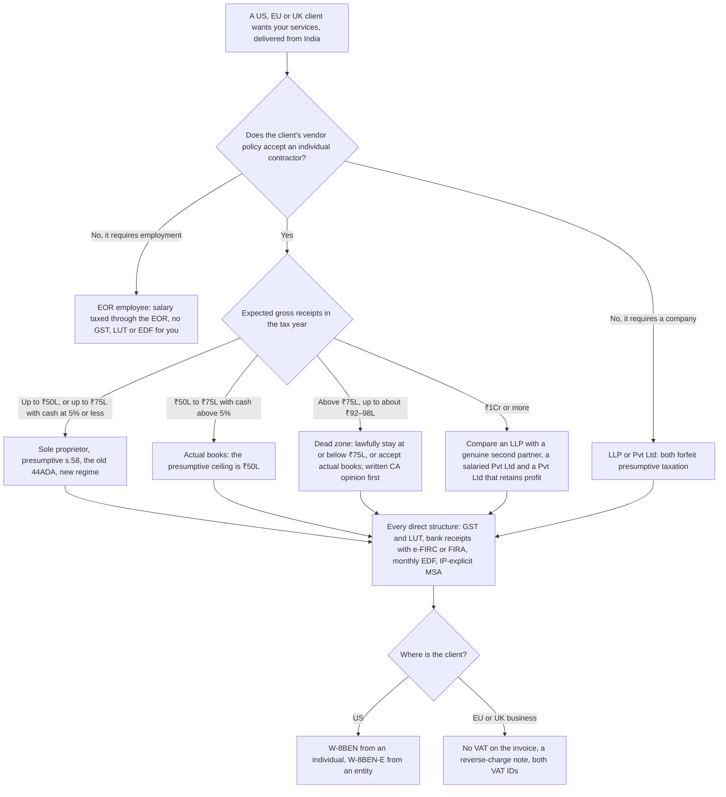

# India Remote Tax: Structure, Thresholds and Traps

> For India-based engineers paid directly by US, EU or UK clients: which structure fits which billing level, the ₹75 lakh presumptive-tax cliff, GST and the LUT, FEMA export reporting, client forms and the EOR trade-off, as dated pointers rather than tax advice.

> [!WARNING]
> **Not legal or tax advice.** This page curates one research session, [T0-07](../../research/sessions/T0-07-india-remote-tax-statutory-compliance.md): a synthesis written by an AI assistant, not by a Chartered Accountant (CA), lawyer or financial adviser. Its position is as at **21 October 2026**, in a year in which the income-tax statute, its rules and the FEMA export regulations all changed. Confirm anything you act on with a practising CA for income tax, GST and FEMA, and with a lawyer or US tax adviser for the MSA and US forms [T0-07 L38].

**Scope.** Despite "remote" in the title, this page is for India-based engineers who sell their services to foreign clients as contractors (a sole proprietor, an LLP or a company); an employer of record appears only as the alternative to compare, and salaried employment with an Indian employer or a GCC is outside it [T0-07 title, L74]. To choose between those routes first, use the [India remote playbook](../11-tracks/india-remote-playbook.md).

**Dates and grades.** Statutory, GST and FEMA facts are as at 21 October 2026; re-verify them by 2026-11-21. Take-home figures come from T0-07's model for tax year 2026-27 and are only as good as the assumptions listed with it. Grades (EGP-1.0): A primary or measured; B transparent secondary; C vendor or single source, attributed; D judgement or recalled; M model output, which inherits its weakest input; P practice-curated and unmeasured. T0-07 rates its own confidence at 0.62: high on statutory mechanics where official text was seen, medium on the 1 October 2026 FEMA regime, medium-low on take-home figures [T0-07 L32–33].

## The short answer

1. **Up to ₹75 lakh of gross receipts, with cash receipts at 5% or less, work as a sole proprietor under presumptive taxation.** In the Income-tax Act 2025 this is s.58, which carries over the substance of §44ADA: 50% of receipts is deemed profit, there is no tax audit, and advance tax is one instalment [A · T0-07.F2; B · T0-07.F10]. T0-07's model keeps 83–84% of billing this way, against 67–73% under the actual-books structures [M · T0-07.F4].
2. **Treat ₹75 lakh as a cliff, not a slope.** One rupee over the line costs about ₹11.8 lakh of extra tax, and you need roughly ₹92–98 lakh of billing to get back to the ₹75 lakh take-home. Plan the year before it starts and track receipts monthly [M, inputs B · T0-07.F3].
3. **Register for GST and furnish a Letter of Undertaking (LUT) each financial year, before that year's first export.** Exports count toward the ₹20 lakh registration threshold, so registration is compulsory at ₹30 lakh and above. The LUT lets you invoice zero-rated, without paying IGST [B · T0-07.F6].
4. **Take payment through the banking channel, and report it.** Ask for an e-FIRC or FIRA quoting purpose code P0802 [A · T0-07.F8]. From October 2026 invoices, file an Export Declaration Form (EDF) each month through your AD bank or platform; the first is due by 30 November 2026. Realise each invoice within 9 months [B · T0-07.F7].
5. **Give each client the right paper.** A US client withholds nothing on work you perform in India; give it a W-8BEN with your PAN as the foreign TIN [A · T0-07.F9]. EU and UK business clients get an invoice without VAT and a reverse-charge note (Solidgate and ACCA summaries) [C · T0-07 L400]. Every client signs an MSA with an explicit perpetual, worldwide IP assignment [B · T0-07.F11].
6. **Use an employer of record (EOR) when the client requires employment or you want statutory benefits, and price it.** At the same client spend, EOR cash is 22–24% below presumptive take-home up to ₹75 lakh, so ask for a budget about 27–32% higher. At ₹1.2 crore the gap to sole-proprietor books is about 4% [M; prices A/B · T0-07.F5].

## At a glance: from client to structure



The ₹20 lakh GST line sits below every band shown. Under it registration is not compulsory, though practitioners flag interpretive caution on the small-supplier exemption for inter-state services [B/C · T0-07 L309].

## The structure ladder: four billing bands and one override

This is T0-07's provisional rule; validate it with a CA before acting [T0-07 L117–127].

| Expected gross receipts in the tax year | Structure | Why | Main watch-outs | Evidence |
|---|---|---|---|---|
| Up to ₹75L with cash receipts at 5% or less; up to ₹50L at any cash share | Sole proprietor, presumptive s.58, new regime | 83–84% take-home in the model; no tax audit; one advance-tax instalment | A hard ceiling; the cash test; GST, LUT and EDF still apply; ITR-3, not ITR-4, if you hold foreign assets or claim a foreign tax credit; the work must genuinely fit the information-technology or technical-consultancy profession | A/B · T0-07.F2; M · T0-07.F4 |
| ₹50–75L with cash receipts above 5% | Actual books; no presumptive claim | The statutory ceiling falls to ₹50L | Domestic cash receipts count toward the 5%; foreign bank credits normally do not | A · T0-07 L124, L189 |
| Above ₹75L to about ₹92–98L: the dead zone | Decide deliberately: lawfully stay at or below ₹75L, or accept actual-books taxation | About ₹92–98L is needed to match the ₹75L take-home | Receipt-timing, scope-splitting or family-splitting arrangements invite scrutiny; GAAR exposure was not researched; get a written CA opinion first | M · T0-07 L125 |
| ₹1Cr and above | An LLP with a genuine second partner; or a salaried Pvt Ltd with employer NPS, if you value locked retirement savings; or a Pvt Ltd that retains and reinvests, if you are building a company | Cash outcomes sit within about ₹3–10L of each other at ₹1.2Cr | The LLP's US classification for W-8 forms; ₹0.9–1.2L a year of compliance; second-layer tax when retained profit is extracted; the LLP's edge rests on a recalled remuneration cap | M; D for the cap · T0-07 L126 |
| **Override, at any level:** the client mandates employment, or you want statutory benefits | EOR | A fixed fee of about ₹6.9L a year; salary taxation | Negotiate a budget uplift: about 27–32% up to ₹75L, about 4% at ₹1.2Cr | M; prices A/B · T0-07 L127 |

Two rules sit beside the ladder. A client whose vendor policy refuses individual contractors may require a company or an EOR, whatever you bill [D · T0-07 L147]. And presumptive taxation is open only to resident individuals and partnership firms other than LLPs, so choosing an LLP or a company forfeits it [A · T0-07 L187].

**Why the bands fall where they do** [M · T0-07 D3]:

- **The 50% deemed deduction drives the result.** Presumptive taxation loses only if true costs approach half of receipts; T0-07 assumes realistic costs of about ₹4–5 lakh [M · T0-07.F4].
- **A Pvt Ltd is a business decision, not a tax one.** It never beats presumptive taxation up to ₹75 lakh, and never beats sole-proprietor books when all profit is extracted (it adds about ₹35k of compliance). It leads sole-proprietor books only at face value, while profit stays in the company; extraction as dividends, at about 35.9%, erases the lead within the modelled range [M · T0-07 L274–278]. Exit through a share sale was not researched [T0-07 L280].
- **An LLP needs a real partner.** It beats sole-proprietor books by ₹1.7–2.9 lakh from roughly ₹55 lakh upward, but only with a genuine second partner and a partner-remuneration cap that T0-07 recalled and could not verify in the 2025 Act. With no deductible remuneration it is worse at every level [D · T0-07.F4; M · T0-07 L299].
- **Above the line, the slope is ordinary.** Each extra ₹100 billed keeps roughly ₹62–67 after tax between ₹80 lakh and ₹2 crore [M · T0-07 L259].
- **T0-07 gives no row between about ₹98 lakh and ₹1 crore.** Presumptive taxation is unavailable there, so the actual-books comparison in the ₹1 crore row is the nearest guide [D].

### Section numbers, old and new

The Income-tax Act 2025 replaced the 1961 Act from 1 April 2026, and FY 2026-27 is "Tax Year 2026-27". Returns for FY 2025-26, filed in 2026, stay under the 1961 Act, which is why older guides, and that year's return, still say §44ADA [B · T0-07.F1, L171].

| Topic | Income-tax Act 1961 | Income-tax Act 2025 | Grade |
|---|---|---|---|
| Presumptive taxation | 44AD, 44ADA, 44AE | s.58 (some commentary cites 61(2); numbering unresolved) | B |
| Specified professions | 44AA(1), with IT notified by S.O. 385(E) of 4 May 2001 | s.62(4), which names "information technology" | B/C |
| Tax audit | 44AB | s.63 | B |
| Advance tax; presumptive single instalment | 207–211; 211(1)(b) | ss.404; 408(2) | B/C |
| Employer NPS deduction | 80CCD(2) | s.124(2) | C |
| Return forms, Form 67 | ITR-3, ITR-4, Form 67 | Renumbered under the Income-tax Rules 2026 (not verified) | D |

Source: [T0-07 L173–183]. T0-07 did not fetch the Act's own text [T0-07.F1].

## Thresholds and deadlines, as at 21 October 2026

| Item | Threshold or deadline | What it means | Grade · source |
|---|---|---|---|
| Presumptive ceiling | ₹75L of gross receipts if cash receipts are 5% or less; otherwise ₹50L | Above it, presumptive treatment is lost for the year | A · T0-07 L189 |
| Deemed profit | 50% of gross receipts, or more if declared | No further deductions on top | A/B · T0-07 L190 |
| Declaring below 50% | While income exceeds the basic exemption limit | Books of account and a tax audit (s.63) | B · T0-07 L193 |
| Professional tax-audit threshold | ₹50L | The general threshold outside the presumptive scheme | B · T0-07 L193 |
| Tax regime | The new regime is the default | For presumptive incomes the old regime wins only with deductions of about ₹5.4L (₹30L billing) to ₹7.75L (₹50–75L billing); typical 80C, 80CCD(1B) and 80D totals are about ₹2.25–2.5L | B · T0-07 L108; M · T0-07 L282 |
| GST registration | ₹20L of aggregate turnover, exports included (₹10L in special-category states) | Compulsory at ₹30L and above | B · T0-07 L96 |
| LUT (Form GST RFD-11) | Each financial year, before its first export | Lapses at year-end; without it the supply is treated as taxable at 18% IGST, refundable later (practitioner guides) | B · T0-07 L131; C · T0-07 L324 |
| GST realisation | One year from the invoice, or longer if the Commissioner allows | Otherwise IGST plus interest falls due within 15 days of expiry | B · T0-07 L311 |
| FEMA realisation | 9 months from the invoice date (12 months for INR) | Set by a 22 September 2026 amendment before the regulations commenced; stricter than the GST year, and runs in parallel | B · T0-07 L99, L511 |
| EDF | Within 30 days of the end of the invoice month; one EDF can cover a month's service invoices | Replaces SOFTEX, whose withdrawal is reported by one CA source (C) | B · T0-07 L99, L345 |
| First EDF | 30 November 2026, for October 2026 invoices | Then one a month | B · T0-07 L346 |
| EDPMS closure on declaration | Invoices up to ₹10L | Banks load EDF data to EDPMS within five working days | B · T0-07 L345 |
| Advance tax | Presumptive: 100% by 15 March (15 March 2027 for tax year 2026-27). Others: 15%, 45%, 75% and 100% by 15 June, 15 September, 15 December and 15 March | Default interest moves to ss.424 and 425 (single source, C) | B · T0-07 L108, L137, L181 |
| Return form | ITR-4; ITR-3 if you hold foreign assets or claim a foreign tax credit | ITR-1 and ITR-4 have no Schedule FA, FSI or TR | A · T0-07 L194 |
| W-8BEN | Valid from signing to the end of the third following calendar year | Replace within 30 days of a change in circumstances | A · T0-07 L105 |
| e-invoicing | Not triggered below ₹5Cr | Recalled, not verified | D · T0-07 L333 |

## The take-home model, worked

T0-07 asked: if a client's all-in annual spend is ₹30 lakh, ₹50 lakh, ₹75 lakh or ₹1.2 crore, how much cash does the engineer keep after tax, compliance, platform and FX costs and, for an EOR, the EOR fee? Every figure below is model output [M · T0-07 D3]. Its main assumptions [T0-07 L204–217]:

- A resident individual under 60, tax year 2026-27, new regime.
- Own work costs of ₹3 lakh fixed plus 1% of receipts; FX and platform costs of 1% of receipts (vendors report 0.3–2%, C).
- Compliance costs per year, T0-07's estimates (D): ₹40k presumptive; ₹85k sole-proprietor books with audit; ₹90k LLP; ₹1.2 lakh Pvt Ltd; ₹5k as an EOR employee.
- USD/INR at ₹96 (about 95.5 on 25 August and 96.8 on 10 October 2026); an EOR at $599 a month with a 1% FX margin, and the client supplying equipment.
- The same all-in client spend under every structure.

**Net cash in hand, ₹ lakh (share of billing)** [M · T0-07 L221–230]

| Structure | ₹30L | ₹50L | ₹75L | ₹1.2Cr |
|---|---|---|---|---|
| Sole proprietor, presumptive s.58 | 24.91 (83.0%) | 42.17 (84.3%) | 62.77 (83.7%) | not eligible |
| Sole proprietor, actual books and audit | 21.95 (73.2%) | 35.43 (70.9%) | 50.55 (67.4%) | 77.96 (65.0%) |
| LLP, two partners, one working | 21.40 (71.3%) | 35.40 (70.8%) | 52.25 (69.7%) | 80.85 (67.4%) |
| Pvt Ltd, all profit extracted | 21.94 (73.1%) | 35.42 (70.8%) | 50.58 (67.4%) | 78.00 (65.0%) |
| EOR, cash take-home | 19.42 (64.7%) | 32.86 (65.7%) | 47.90 (63.9%) | 75.01 (62.5%) |
| EOR, cash plus employer-funded PF and gratuity (locked) | 20.38 (67.9%) | 34.29 (68.6%) | 49.91 (66.6%) | 78.06 (65.1%) |

Employer NPS is open only to salaried structures, an EOR employee or a Pvt Ltd director. NPS money is locked until retirement, so T0-07 counts it separately [M · T0-07 L235].

**The cliff for a sole proprietor** [M, inputs B · T0-07 L250–259]

| Billing | Regime | Tax | Net cash |
|---|---|---|---|
| ₹75.00L | Presumptive | ₹7.33L | ₹62.77L |
| ₹76.00L | Actual books and audit | ₹19.44L | ₹51.19L |
| ₹80.00L | Actual books | ₹20.78L | ₹53.77L |
| ₹90.00L | Actual books | ₹24.14L | ₹60.21L |
| ₹100.00L | Actual books | ₹27.51L | ₹66.64L |
| ₹120.00L | Actual books | ₹35.79L | ₹77.96L |

Billing needed to get back to the ₹62.77 lakh take-home: ₹94.0 lakh with sole-proprietor books, ₹92.4 lakh as an LLP, ₹93.9 lakh as a Pvt Ltd extracting everything, ₹98.4 lakh through an EOR. A Pvt Ltd that retains profit matches it at ₹85.5 lakh only at face value, and only by leaving ₹50 lakh or more in the company indefinitely [M · T0-07 L259, L277].

**How stable is this?** The ranking holds across T0-07's sensitivities: FX costs of 0.3% or 2%, own fixed costs of ₹1.5 lakh or ₹6 lakh, an EOR fee of $699, USD/INR at 90 or 100 [M · T0-07 L284–297]. The ₹1.2 crore comparison is the fragile one. T0-07's first cost assumption (10% of receipts) put EOR ₹2.1 lakh ahead of sole-proprietor books there; its final one puts EOR ₹3.0 lakh behind [M · T0-07 L301]. Replace the cost inputs with your own quotes.

## Contractor or EOR

| Dimension | Direct contractor: sole proprietor, presumptive | EOR employee | Evidence |
|---|---|---|---|
| Who employs you | Nobody: you sell a service to the client | The EOR's Indian entity; the client directs the work and pays the EOR's invoice | D · T0-07 L405 |
| Income tax | 50% of receipts deemed profit up to ₹75L; one advance-tax instalment by 15 March | Salary, with tax deducted by the EOR | A/B · T0-07 L189–190; B · T0-07 L108 |
| GST and LUT | Yours: registration above ₹20L, an LUT each financial year | None: an employee makes no taxable supply | B · T0-07.F6; D · T0-07 L405 |
| e-FIRC, EDF and realisation | Yours, with your bank or platform | With the EOR and the client | D · T0-07 L405 |
| Cash kept at ₹30L / ₹50L / ₹75L of client spend | 83.0% / 84.3% / 83.7% | 64.7% / 65.7% / 63.9% | M · T0-07 L223, L229 |
| Cash kept at ₹1.2Cr | Presumptive not available; sole-proprietor books keep 65.0% | 62.5% | M · T0-07 L224, L229 |
| Client budget needed to match contractor take-home | — | +27% / +32% / +31% at ₹30L / ₹50L / ₹75L; +4% against sole-proprietor books at ₹1.2Cr | M · T0-07 L265–268 |
| Benefits | None | PF, gratuity accrual, leave, employment-law protection | D · T0-07 L415 |
| Code you write | You own it unless the MSA assigns it; a silent assignment defaults to five years and India only | The employer owns work made in the course of employment, absent a contrary agreement | B · T0-07.F11, L415 |
| Other work | Allowed unless the MSA restricts it | Employment contracts usually restrict outside work; notice periods apply | D · T0-07 L415 |
| The client's exposure | Misclassification risk if the arrangement works like employment | Lower misclassification and permanent-establishment exposure | D · T0-07 L415, L498 |

**EOR prices** (list prices, converted by T0-07 at ₹96/$) [T0-07 L407–411, L261]:

| Vendor | EOR price | Grade |
|---|---|---|
| Remote | $599 per employee per month paid annually; $699 month to month | A (vendor page) |
| Deel | $599 per month, from several independent aggregators | B/C |
| Oyster | Mostly reported at $699 per month; a few sources say $599 | C |

At $599 a month the fee is ₹6.90 lakh a year: 23.0%, 13.8%, 9.2% and 5.8% of client spend at ₹30 lakh, ₹50 lakh, ₹75 lakh and ₹1.2 crore, before about 1% FX margin and about 2.4% employer statutory load [M · T0-07 L261–268]. The four Labour Codes, in force from 21 November 2025, enlarge the PF and gratuity base, so that load may be understated where an EOR contributes PF on full wages [B/C · T0-07.F12].

**Platforms in between.** Contractor-management and Contractor-of-Record platforms are payment and compliance overlays; they do not change your income-tax position. For GST, what matters is who the contractual recipient of your service is, because zero-rating needs a recipient outside India. T0-07 found no authoritative source on the Contractor-of-Record flow, so read the counterparty clause before you invoice without GST [C · T0-07 L417].

## Client geography: US, EU and UK

- **US clients** [A · T0-07 L386–395]. US withholding applies to US-source income. Pay for services performed outside the US is foreign-source, so work done from India attracts no US withholding, even without a treaty claim. The W-8BEN is the client's evidence of your foreign status. Part II is only for treaty claims; if a payer insists on one, vendor guides split between Article 7 (business profits) and Article 15 (independent personal services), and none gave an authoritative India-specific template [C · T0-07 L393]. Write "services performed entirely in India" in the MSA and on invoices [T0-07 L396].
- **An LLP or company signing US forms** [A · T0-07 L398]. Entities use W-8BEN-E. Vendor guides call an Indian LLP a partnership, but under Treas. Reg. §301.7701-3(b)(2) a foreign entity whose members all have limited liability is a corporation by default, and the W-8BEN-E itself routes foreign partnerships to W-8IMY unless they claim treaty benefits. Get US tax counsel to sign off first.
- **EU and UK business clients** [C · T0-07 L400]. In Solidgate and ACCA summaries, for business-to-business services the place of supply is the customer's country, so the customer accounts for VAT: the EU reverse charge under Articles 44 and 196; in the UK, the supply is outside the scope of UK VAT for the supplier. Invoice without VAT, show both parties' VAT IDs where available, and add a short reverse-charge note. On the Indian side the same invoice is a zero-rated export under the LUT.
- **A client that withholds tax anyway.** Withholding by country was not researched. T0-07's recalled route to relief is India's foreign-tax-credit claim (Form 67 before the return due date, on ITR-3), with a Tax Residency Certificate and Form 10F to reduce withholding at source [D · T0-07 L400].
- **Intermediary-type services.** The Finance Act 2026 omitted IGST s.13(8)(b), effective 30 March 2026, so intermediary-type services to overseas recipients can qualify as exports. The definition of "intermediary" is unchanged, and the treatment of advances or invoices straddling that date is contested [B · T0-07 L336].

## How to do it

1. **Forecast the tax year.** Add up expected receipts by contract and month, at an FX rate you write down, and the share that will arrive as domestic cash. Place yourself on the ladder. *Done when:* you have a written forecast, a band and your headroom below ₹75 lakh, or below ₹50 lakh if cash exceeds 5% [P; thresholds A · T0-07.F2].
2. **Get a written CA opinion before the first invoice.** Cover the profession classification (information technology, named in s.62(4)), the regime and any dead-zone plan. T0-07 found no tribunal or High Court ruling for or against IT freelancers under §44ADA and rates the residual risk as moderate [B · T0-07 L506]. T2-01 sets the structure decision before the first invoice [D · T2-01 L174], and decision [D-006](../../research/DECISIONS.md) records it as a one-way door. *Done when:* the opinion is on file.
3. **Register for GST and furnish the LUT.** On gst.gov.in: Services → User Services → Furnish Letter of Undertaking (LUT); choose the financial year; sign with EVC (OTP) or DSC as a proprietor, or with DSC as a company or LLP. The portal issues an ARN, which serves as the LUT reference [B · T0-07 L314–321; C · T0-07 L322]. *Done when:* the GSTIN is active and the LUT acknowledgement is saved.
4. **Set up the receiving rail.** Use an AD-bank account or an RBI-authorised cross-border payment provider. Check any fintech on RBI's own list of authorised payment aggregators, because vendor-reported statuses conflict [C · T0-07 L380]. An EEFC account can take 100% of export earnings [A · T0-07 L382]. T0-07 found no EDF procedure published by SBI, HDFC or ICICI as at 21 October 2026, so ask who files the EDF, in what format, and how closure is confirmed [B · T0-07 L347]. *Done when:* the bank or platform has confirmed this in writing, and that each e-FIRC or FIRA will quote P0802.
5. **Onboard each client.** A W-8BEN for US clients; VAT IDs for EU and UK clients; an MSA with the clauses under Templates. *Done when:* the MSA is signed and the form is with the client, never sent to the IRS [A · T0-07 L395].
6. **Invoice and close each month.** Raise zero-rated invoices quoting the LUT ARN, collect the e-FIRC or FIRA, file the EDF and reconcile. *Done when:* the month's folder holds the invoice, contract, bank advice, e-FIRC or FIRA and EDF acknowledgement [B · T0-07 L136].
7. **Close the year.** Pay advance tax, file ITR-4 or ITR-3, and furnish the next financial year's LUT before its first export. Make GST turnover, ITR gross receipts and bank credits tell the same story, because the AIS and TIS cross-check them [B · T0-07 L136–137]. *Done when:* the challan, the ITR acknowledgement and the new LUT ARN are filed.

## Templates and examples

### Structure forecast [P]

```text
Tax year:                 [2026-27]
Contracts:                [client] × [months] × [rate] at [₹ per $, assumed] = [₹ amount]
Expected gross receipts:  [₹ amount]
Domestic cash receipts:   [₹ amount]   share: [..%]   (₹75L ceiling only at 5% or less)
Client vendor policy:     [individual accepted / company only / EOR only]
Band on the ladder:       [band]
Headroom below ceiling:   [₹ amount]   review in: [month]
CA opinion on file:       [date, name]
```

### Export invoice under an LUT

```text
[Your name or trade name], [address], GSTIN [number]
Invoice [number]                                   Date [date]
Bill to: [client legal name], [address], [country]          VAT ID: [EU or UK client]
Service: [description], SAC [9983 group code, for example 998314 IT design and development]
Period: [month]    Amount: [USD, EUR or GBP amount]    INR equivalent: [₹ amount] at [rate]
IGST: nil. Supply meant for export under LUT without payment of integrated tax. LUT ARN: [number]
Services performed entirely in India.
[EU or UK business client] Reverse charge: recipient accountable for VAT.
Terms: [30–45] days; payer bears bank and intermediary charges.    Pay to: [AD-bank account or authorised provider]
```

Grades by line: names, country, currency and INR value, and the LUT endorsement [B/C · T0-07 L330–332]; the SAC codes are recalled [D · T0-07 L330]; the "performed in India" line supports the foreign-source position [A · T0-07 L396]; the reverse-charge note [C · T0-07 L400]; the terms [D · T0-07 L429]. Payment-provider and tax-service guides add that charging 18% IGST "to be safe" breaks zero-rating and locks up cash [C · T0-07 L332], and that bank and FX conversion charges carry 18% GST, which a registered exporter can generally claim as input credit [C · T0-07 L334].

### W-8BEN for an individual or sole proprietor [A · T0-07 L388–395]

```text
Line 1    Name:                         [as on PAN and passport]
Line 2    Country of citizenship:       India
Line 3    Permanent residence address:  [address in India; not a PO box or c/o]
Line 4    Mailing address:              [only if different]
Line 5    US TIN:                       [blank if you have no SSN or ITIN]
Line 6a   Foreign TIN:                  [PAN]
Line 8    Date of birth:                [if the payer requires it]
Part II   Lines 9–10:                   [blank unless claiming treaty benefits]
Part III  Signature and date:           [an e-signature must show it was signed electronically]
Send to:  the client, not the IRS.      Replace: [end of the third calendar year after signing], or within 30 days of a change
```

### MSA clauses: weak and strong

Only the IP rule is source-checked [B · T0-07.F11]; the other rows are T0-07's drafting practice [D · T0-07 L421], and all wording is [P]. Have a lawyer review the contract.

| Clause | Weak | Strong |
|---|---|---|
| IP | "Contractor assigns the deliverables to Client." | "Contractor hereby assigns to Client all intellectual property in the deliverables, perpetual, worldwide, in all media and modes, irrevocably, for the consideration in Schedule [x]. Background IP listed in Schedule [y] is licensed, not assigned." |
| Status | A label: "independent contractor" | Label and substance: you control methods, hours and place; no exclusivity or minimum hours; own equipment; deliverables-based fees; no authority to bind the client |
| AI deliverables | Silent | Who owns fine-tuned weights, prompts, evaluation sets and outputs; no training of third-party models on client data |
| Taxes | Silent | Fees exclusive of VAT and GST; you supply the W-8BEN and handle Indian taxes; the client handles its VAT and withholding; gross-up if withholding is imposed |
| Liability | An uncapped indemnity | Indemnity limited to third-party IP infringement by your deliverables and breach of confidentiality; a cap at fees paid in the prior 12 months; consequential damages excluded |
| Payment | Open-ended terms | 30–45-day terms, payer bears charges, no set-off, late fees, so that realisation stays inside the 9-month FEMA limit |
| Restraints | A broad non-compete | Confidentiality and a narrow non-solicit; T0-07 recalls that Indian Contract Act s.27 voids post-termination restraints |

### Asking a client to fund EOR parity [P; figures M · T0-07 L265–267]

```text
You have budgeted [₹ amount] a year, all-in. Through an EOR, the fee (about [$599–699] a month),
the FX margin and employer contributions come out of that budget, which leaves me about [22–24]%
less cash than contracting directly at the same spend. To keep the same take-home, the all-in
budget would need to be about [27–32]% higher. Could we either [contract directly] or [agree a
budget of ₹ amount]?
```

## Checklist

### One-time setup

- [ ] Written CA opinion on profession classification, regime and structure [B · T0-07 L506]
- [ ] GST registration once aggregate turnover, exports included, will pass ₹20L [B · T0-07 L131]
- [ ] AD-bank account or RBI-authorised provider, with PA-CB status checked on RBI's list [C · T0-07 L380]
- [ ] EDF responsibility agreed in writing with your bank or platform [B · T0-07 L347; D · T0-07 L495]
- [ ] Each bank's own fee schedule obtained: compilers' figures conflict (HDFC FIRC from ₹200 + GST to ₹1,500; SBI from nil to ₹1,000; FX markups 0.5–3.5%) [C/D · T0-07 L369]
- [ ] Signed MSA with the IP, status, tax and liability clauses [B, D · T0-07 L423–437]

### Every month

- [ ] Cumulative gross receipts checked against ₹75L, or ₹50L if cash exceeds 5% [D · T0-07 L491]
- [ ] Invoices raised zero-rated under the LUT ARN, with no IGST [B/C · T0-07 L332]
- [ ] e-FIRC or FIRA quoting P0802 for each remittance or month; allow roughly 4–7 business days at banks, per vendor guides [B · T0-07 L132; C · T0-07 L369]
- [ ] EDF filed within 30 days of month-end; October 2026 invoices by 30 November 2026 [B · T0-07 L133]
- [ ] Any invoice nearing 9 months unrealised chased, with an extension requested through the AD bank before expiry [D · T0-07 L494]
- [ ] Proceeds brought to an Indian or EEFC account, not left in a foreign-held balance [C · T0-07 L382]
- [ ] GSTR-1 and GSTR-3B filed, monthly or quarterly under QRMP (cadence recalled) [D · T0-07 L333]

### Every year

- [ ] LUT furnished before the financial year's first export; calendar it for 1 April [D · T0-07 L493]
- [ ] Advance tax: one instalment by 15 March if presumptive (15 March 2027 for tax year 2026-27), otherwise four [B · T0-07 L137]
- [ ] ITR-4 filed, or ITR-3 if you hold foreign assets or claim a foreign tax credit [A · T0-07 L194]
- [ ] GST turnover, ITR gross receipts, bank credits and AIS/TIS reconciled [B · T0-07 L136]
- [ ] The following year's structure decided before Q4 if receipts are heading toward ₹75L [D · T0-07 L491]
- [ ] Section numbers, forms and FEMA rules re-checked against primary text [D · T0-07 L500]

### On every change

- [ ] W-8BEN replaced within 30 days of a change in circumstances, and before it expires [A · T0-07 L105]
- [ ] Each new client's vendor policy, MSA and forms checked before work starts [D · T0-07 L147]

## Pitfalls

| Red flag | Why it hurts | Fix | Evidence |
|---|---|---|---|
| A lumpy receipt pushes the year just over ₹75L | Tax rises by about ₹11.8L at the line | Track monthly; plan before Q4 | M · T0-07 L491 |
| The return uses §44AD (6% or 8% of turnover) instead of the profession scheme | Notices and recomputation | File under the profession scheme; CA review of the business code and section | B · T0-07 L84, L492 |
| 18% IGST added "to be safe" | Breaks zero-rating and locks up cash | Invoice under the LUT, without IGST | C (vendor guides) · T0-07 L332 |
| No LUT for the year | IGST demand, or cash locked in refunds | File before the first export each year | C (practitioner guides) · T0-07 L324 |
| A missed EDF | A reporting default flagged in EDPMS | Agree who files with your bank or platform | D · T0-07 L495 |
| A late-paying client | Past 9 months, a FEMA contravention; past one year, IGST plus interest | Short payment terms; an extension through the AD bank before expiry | B · T0-07 L311, L511 |
| Proceeds parked in a foreign virtual account | A FEMA repatriation question; Schedule FA and ITR-3 | Repatriate to an Indian or EEFC account; disclose foreign assets | C (T0-07 inference) · T0-07 L382 |
| ITR-4 filed while holding foreign assets | ITR-4 has no Schedule FA, FSI or TR | Use ITR-3 | A · T0-07 L194 |
| An IP clause silent on duration and territory | The assignment defaults to five years and India only | A perpetual, worldwide assignment | B · T0-07 L111 |
| An LLP signs a W-8BEN-E as a partnership | The US default for such an entity is a corporation; withholding or form rejection follows | US tax adviser sign-off before an LLP signs a W-8 | A · T0-07 L105, L499 |
| Receipts shifted across years, scopes or family members to stay under ₹75L | Invites scrutiny; GAAR exposure was not researched | A written CA opinion first | D · T0-07 L125 |
| A vendor promises a "15-month" GST window, or a licence it may not hold | Rule 96A says one year, extendable by the Commissioner; vendor-reported PA-CB statuses conflict | Read the rule; check RBI's list | B · T0-07 L96; C · T0-07 L380 |
| Article 12 claimed on the W-8BEN | T0-07 advises against claiming Article 12 (royalties and fees) unless the income genuinely is royalties | Leave Part II blank unless claiming a treaty benefit | C · T0-07 L393 |
| Full-time, single-client work dressed as contracting | Reclassification and benefits claims | Substance-over-label drafting, or an EOR | D · T0-07 L498 |

## Evidence and limits

- **Primary (A):** the ₹50 lakh and ₹75 lakh ceilings, the 5% cash test and the 50% deemed profit (the Income Tax Department's ITR-4 FAQ); RBI's purpose codes; the IRS rules on the W-8BEN and US-source income; the Treasury regulation on LLP classification; Remote's EOR price; the ITR-4 schedule limits [T0-07 L83–105, L194].
- **Secondary (B):** the 2025 Act's section map, the GST and LUT mechanics, and the FEMA 2026 regime. RBI's primary text (the January 2026 regulations and the 22 September 2026 amendment) was not fetched, and the Big-4 alert T0-07 saw predates the amendment [T0-07 L474, L344].
- **Model (M):** every take-home, cliff and EOR figure. Its cost inputs (compliance fees, own costs, FX costs, employer load) are T0-07's own estimates; replace them with quotes [T0-07 L483].
- **Recalled (D):** the LLP partner-remuneration cap, which drives the LLP result; the SAC codes; the GSTR filing cadence; the e-invoicing threshold; the GST interest rate; and all MSA drafting beyond the IP clause [T0-07 L211, L311, L330–333, L421].
- **Searched and not found** [T0-07 L516–525]: tribunal or High Court rulings on IT freelancers under §44ADA; any CBDT circular or statistic on enforcing the 5% cash test; bank-published e-FIRC and EDF procedures; an authoritative RBI list confirming Wise, Payoneer and Skydo; the primary text of s.58 and s.62; an India-specific W-8BEN Line 10 template.
- **Not researched:** GAAR or sham-arrangement exposure; misclassification under Indian labour and social-security law; foreign withholding by country; exit taxes for a Pvt Ltd; state-level items (professional tax, shops-and-establishments, Udyam); GST on foreign-platform fees [T0-07 L125, L338, L480–485]. Whether platform fees netted before payout count as gross receipts is unverified [D · T0-07 L190].
- **Unsettled readings:** whether SWIFT or TT credits count as "prescribed electronic modes" for the cash test is an inference [D · T0-07 L191]; the s.58 sub-section numbering differs across commentaries [B · T0-07 L175].
- **Sources that differ.** T2-01's decision table times GST registration and the LUT "before receipts exceed ₹20L" [T2-01 L175]. This page follows T0-07: register once turnover passes ₹20 lakh, and furnish an LUT before each financial year's first export [T0-07 L131].
- **Errata and decisions.** No entry in [ERRATA](../../research/ERRATA.md) (U1–U26, as of 2026-11-06) corrects T0-07 or T2-01's decision table at L168–180; U19 corrects T2-01's dollar version of the dead zone (L706) to T0-07's rupee band, which this page uses. Decision D-006 (accepted 2026-10-21, a one-way door, confidence high) cites T0-07 KF1 and KF7 among its evidence [DECISIONS L359–365].
- **What would change this advice** [T0-07 L140–147]: the primary text of s.58 or s.62 differs from the commentary; a tribunal or High Court excludes software development from the profession list; RBI's operational circulars make the EDF burden heavy enough to favour a platform or an EOR; old-regime deductions above about ₹5.4–7.75 lakh; foreign assets or foreign withholding (a move to ITR-3, not a change of structure); plans to scale into an agency, which strengthen the Pvt Ltd case; a client that refuses individual contractors.

## Next steps

- Choosing the route first (GCC job, EOR, contracting or relocation): [India remote playbook](../11-tracks/india-remote-playbook.md).
- Finding and keeping clients on MSA terms: [Freelance and fractional work](../11-tracks/freelance-fractional.md).
- Pricing the work and the offer: [Pay benchmarks](pay-benchmarks.md), [Offer evaluation](offer-evaluation.md), [Negotiation playbook](negotiation-playbook.md).
- Moving abroad instead: [Visa and relocation](../11-tracks/visa-and-relocation.md).
- Role hubs for client-billing work: [Independent AI consultant](../02-roles/hubs/independent-ai-consultant.md), [Fractional AI leader](../02-roles/hubs/fractional-ai-leader.md).
- Evidence: [T0-07](../../research/sessions/T0-07-india-remote-tax-statutory-compliance.md), [T2-01](../../research/sessions/T2-01-tier-calibrated-execution-playbooks.md), [findings for this stage](../../research/findings.md#stage-09), [decision D-006](../../research/DECISIONS.md); terms in the [glossary](../00-start/glossary.md).
