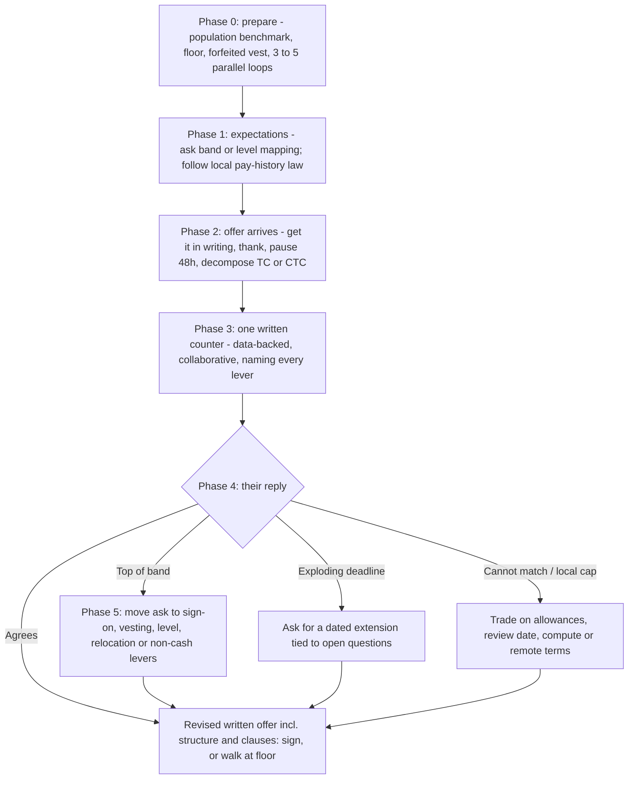

# Negotiation Playbook: Phases, Scripts and Levers

> How to negotiate a GenAI offer in six phases: fill-in scripts for expectations, counters, competing offers, deadlines and India CTC breakdowns; the 13 levers; if-then replies; and regional playbooks for the US, India, UK, Europe and beyond.

**Dates.** The six-phase structure and scripts adapt §6.5 of [T1-03](../../research/sessions/T1-03-interview-execution-offer-negotiation.md) (2026-10-25) and [T0-17](../../research/sessions/T0-17-compensation-progression-plateaus-equity.md) (2026-10-23), refreshed with [T0-44](../../research/sessions/T0-44-pay-us-uk-europe-singapore-gulf.md) (retrieved 2026-11-13: US field experiment, pay-transparency laws, relocation surveys, and international negotiation evidence) and [T0-45](../../research/sessions/T0-45-pay-negotiation-india-city-employer.md) (retrieved 2026-11-13: India legal anchors, CTC structure, Labour Codes, notice periods and switch-hike evidence). Statutory updates — India's EPFO wage-ceiling revision (S.O. 5109(E), effective 2026-09-17) and EU Pay Transparency Directive transposition status — were verified externally on 2026-11-19. Page-level `review_by` is **2027-01-19** (90 days from oldest retained Phase 0 pay data, D-018); re-check V0/V1 legal items (US state counts, EU national transposition, India's proposed Shakti Samman Bill) before relying on them. **Grades** (EGP-1.0): A primary or measured; B transparent secondary; C vendor, survey or single source; D judgement or unverified relay; E untraceable (never asserted); M arithmetic; P practice-curated. **Not advice.** Nothing here is legal, tax or financial advice [T1-03 L18].

## The short answer

1. **Countering works — expect roughly +12%, not the +21–24% coaching headline.** In a field experiment on 3,858 tech job seekers via Levels.fyi (May 2023–Feb 2025; NBER w33903), encouraged candidates countered at 61% vs 54% of controls, **counterers gained 12.45% on average (~$27,000 a year)**, and employer backlash was rare [B · T0-44 L66, L333, L644–L645]. Levels.fyi's +21–24% coaching uplift reflects self-selected clients with competing leverage; in the same experiment, an 80% discount on paid coaching did not raise negotiation attempts [B/C · T0-44 L82, L374, L684].
2. **Get the offer in writing and build competing alternatives first.** About 40% of tech offers in the NBER sample arrived verbally and could be withheld or shifted before writing [B · T0-44 L66, L682]. Run 3–5 staggered loops so offers overlap, and note that "best and final" offer framing has risen since May 2025 [D · T1-03 L270; B/C · T0-44 L333].
3. **Know whether salary-history questions are lawful in your jurisdiction.** In the US, there is no federal ban, but ~18–20 states plus DC bar private employers from asking pay history (Virginia from 2026-07-01), and 13 states mandate ranges in postings [B/C · T0-44 L66, L333, L658–L659]. In **India, asking current CTC is lawful** — no statute bans it (a private member's bill introduced on 2026-02-06 is not law); prepare an evidence-backed expected range and keep documents consistent [C · T0-45 L61, L285, L856].
4. **Pause 48 hours, decompose the full structure and ask which part of a wide band fits your level.** Frontier-lab posted bands span several internal levels (up to 2.4× wide, e.g., Anthropic London £260K–£630K, OpenAI $293K–$385K) [A · T0-44 L76, L145]. In India, demand the written CTC breakdown (basic, HRA, PF, gratuity, variable, ESOPs, clawbacks) before accepting, because the four Labour Codes (in force from 2025-11-21) can cut monthly in-hand pay at the same headline CTC [A/B/P · T0-45 L59, L72, L292].
5. **Negotiate level before money, then send one written counter.** Level steps drive ×1.38–1.46 TC in the US [B · T0-44 L57] and +65% at Bengaluru Big Tech (Google L4 ₹77.2L → L5 ₹127.4L, M) [B/M · T0-45 L291]. Put base, sign-on (covering forfeited vest), equity/vesting and relocation or non-cash asks in one collaborative email anchored on external data [B/C · T1-03 L309–L313; T0-44 L78].
6. **Adapt tactics to local norms.** Do not use US scripts blindly: India requires explicit written terms on CTC structure, notice buy-out and service bonds [A/C/D · T0-45 L72–L75]; Germany and France require checking collective agreements first [B/C · T0-44 L79]; the Gulf favours allowances and gratuity basis over base [C · T0-44 L79]; Israel rewards sign-on and options [C · T0-44 L338]; Japan rewards offer-stage negotiation [C · T0-44 L341].

## At a glance



## The six phases

### Phase 0: before the first conversation

| Action | How | Grade · source |
|---|---|---|
| Research the right population | Levels.fyi `.md` percentiles (P25–P75) by exact title, level and city; for India, match the employer tier on the 7.5× gradient (Big Tech/GCC vs Indian product vs IT services) ([pay benchmarks](pay-benchmarks.md)) | B · T0-44 L75; T0-45 L71 |
| Define your floor | The minimum cash-equivalent TC (or in-hand fixed cash in India) at which you walk | D · T1-03 L268; P |
| Compute the forfeited vest | Grant × (1 − vested fraction at departure). At 24 months an Amazon-style 5/15/40/40 grant is 20% vested and a Google-style 33/33/22/12 grant is 66% | B/C · T1-03 L269; T0-17 L202–L211 |
| Assemble competing processes | 3–5 parallel loops, staggered so offers overlap | D · T1-03 L270 |
| Know your stay value | US merit: all employees 3.4%, R&D 3.7%, AI/ML **4.4%** (Pave May 2026) [C · T0-44 L661]. India increments: **9.0%** actual 2026 / **9.1%** projected 2027 overall, IT services **6.6%**, GCCs **9.3–9.4%**, tech products **9.5%** (Aon Oct 2026) [B · T0-45 L57] | B / C · T0-44 L661; T0-45 L57 |

- **Why parallel loops come first.** Cold inbound yields ≈ 0.2% to hire (~460–520 applications per hire; ~340–380 to offer) [B/C · T1-03.F1; ERRATA U24], while referrals convert 11–36× higher; stage rates live in the [application operating system](../06-job-search/application-operating-system.md). Offers spaced weeks apart cannot reinforce each other [P].
- **Staying is leverage.** In the US, moving beats staying on money alone only when the risk-adjusted premium clears ~25% or promotion is blocked [A/B/C · T1-03.F7]. In India, increment surveys (6.6–9.5%) describe staying, not switch offers; do not plan a switch around a mythical "30–50% hike" [B/C · T0-45 L57–L58, L860–L861].
- **Paid coaching verdict (refreshed November 2026):** Buy coaching **only when you hold a competing offer**, and prefer success-fee structures [B/C · T0-44 L82]. In the NBER field experiment, discounting coaching by 80% failed to raise negotiation attempts — information about norms and low backlash risk moved behaviour instead [B · T0-44 L82, L684]. Tool status as of 2026-11-13: Levels.fyi Negotiation Coaching reports 650+ negotiations / ~$40M total (~$61.5K each, +21–24% self-selected, B [T0-44 L374]); Rora charges a percentage of the increase (B, COI; the Phase 0 "$2,250+" figure was not found [T0-44 L375]); **Candor** is unverifiable (no primary page found, E [T0-44 L376]); **Josh Doody's book** has no outcome data (stale, E [T0-44 L377]). Verdicts: [tool catalog](../00-start/tool-catalog.md).

### Phase 1: deflect the expectations question (and anchor on level)

- **Ask for the approved band and level mapping first.** Posted ranges at frontier labs and large tech firms often span two or three internal levels (e.g., Anthropic London £260K–£630K, OpenAI $293K–$385K) [A · T0-44 L76, L145]. Ask which level you are being evaluated for and where that level sits in the band [P · T0-44 L686].
- **If pressed for a number, give a P75–P90 total-comp range** anchored on the exact employer population, with your floor at the bottom, and state flexibility on cash vs equity [D · T1-03 L277].
- **Pay-history disclosure depends on law:**
  - **US:** No federal ban, but ~18–20 states plus DC prohibit private employers from asking pay history (Virginia effective 2026-07-01) [B/C · T0-44 L333, L658]. Decline politely and cite the state rule where it applies.
  - **India:** Lawful to ask (no statute bans it; the Shakti Samman Bill introduced in Rajya Sabha on 2026-02-06 is a private member's bill, not law) [C · T0-45 L61, L285]. Pivot to your market-anchored expected range; if a portal or recruiter insists on current CTC, never fabricate figures — verification checks can request pay slips, and consequences of misstatement are documented in anecdotes though unmeasured [D · T0-45 L76, L286].
- **Wording:** Script 1 (global) and Script 5 (India CTC) below.

### Phase 2: get it in writing and take the 48-hour pause

About **40% of offers in the NBER tech sample were verbal** [B · T0-44 L66, L682]. Do not counter a verbal headline — ask for the written breakdown first, then pause 48 hours [C/D · T1-03 L282–L288; T0-44 L78]:

| Step | What to do |
|---|---|
| 1. Thank and request writing | "I'm very excited about this. Could you send the full written breakdown — base, bonus, equity terms [and for India: fixed/variable/PF/gratuity/clawbacks] — so I can review everything carefully over the next 48 hours?" [C/D · T1-03 L282; P] |
| 2. Decompose TC / CTC | Separate guaranteed fixed cash, target variable (haircut variable where payouts run below 100%, e.g., Indian IT services 70–80%), liquid RSUs and paper equity ([offer evaluation](offer-evaluation.md)) |
| 3. Benchmark the exact population | Levels.fyi title/level/city `.md` percentiles, named employer ladder, competing written offers |
| 4. Find the exact gaps | Level, base, sign-on (forfeited vest or notice buy-out), equity type/vesting, relocation, non-financial terms |
| 5. Run written diligence | Send the equity diligence questions (and for India, check ESOP liquidity history, Labour Code wage split and bond/clawback text) in [offer evaluation](offer-evaluation.md) |

### Phase 3: one written counter

The structured single-email method remains the clean baseline: collaborative tone, one comprehensive written ask, external data anchors, and a real commitment to sign [B/C · T1-03 L309–L313; T0-44 L78].

- **How much to ask for:** Traditional playbooks suggest countering **10–20% above the initial offer** [B · T1-03 L311], though T0-44 notes that the *ask* size itself is untested while the measured *realised* average gain among counterers in NBER w33903 is **+12.45%** (~$27K/yr) [B/P · T0-44 L645, L683]. Anchor your counter in the 10–20% range when external data support it, and calibrate expectations around ~10–15% unless you hold a higher competing offer [P].
- **Watch for "best and final" framing:** T0-44 notes "best and final" employer framing increased from May 2025 onward [B/C · T0-44 L333]. When an employer uses that phrasing, verify whether non-base levers (sign-on, level review date, start date, relocation or compute budget) remain open rather than pushing repeatedly on base [P].
- **Never negotiate against yourself:** Put every ask in one email (Script 2) [T1-03 L119–L124].

### Phase 4: counter-moves, if → then

| If they say | Then | Script fragment (adapted from T1-03 L319–L323 unless marked) |
|---|---|---|
| "That's the top of the band." | Move the ask to non-base levers | "If base is capped for this level, could we bridge the gap with a higher sign-on, cliff removal, a committed 12-month refresh or re-checking whether the scope fits [next level]?" |
| "Equity is better than cash." | Risk-adjust the equity aloud | "I'm excited about the equity. To value it, I need the fully diluted share count, last 409A, preference stack and lock-up or tender terms. At my risk-adjusted model ([RAV/DF]), I'd need base or sign-on of at least $[Y]." |
| "This is our best and final offer." [P] | Check whether non-base terms still move; compare with your floor | "Thank you for being direct. I want to make this work — is there any flexibility on [sign-on / start date / relocation lump sum / 6-month level review]?" |
| "We need an answer by Friday." | Buy time with a dated commitment | Script 4 |
| "We can't match the competing offer." | Trade on non-financial or regional terms | "I understand. Without matching cash, could we agree on [6-month review / double-trigger acceleration / compute budget / remote stipend / Gulf allowances / notice buy-out]?" |
| Your employer counters to keep you | Treat it as market data, not a decision | Ask whether it fixes why you looked. Neither US nor India evidence validates the viral "leave within 12–18 months" rule [D · T1-03 L323; C · T0-45 L283, L857] |
| "What would it take to sign?" [P] | Restate your one written target | "If we reach $[target TC] with [the one key term] in writing, I'm ready to sign by [date]." |
| They want a verbal yes before sending numbers [P] | Tie acceptance to written terms | "I'll confirm immediately once I receive the revised written offer with the full breakdown." |

### Phase 5: the 13 levers

| # | Lever | When it moves | Expected effect | Grade |
|---|---|---|---|---|
| 1 | Parallel offers | You hold two or more written offers at the same level [T1-03 L362] | Field experiment avg **+12.45%** across counterers (B); coaching clients +21–24% self-selected (B/C) | B [T0-44 L66, L645] |
| 2 | Level / designation | Before the offer is final [P]; US level steps ×1.38–1.46 (×1.21 Staff→Principal) [T0-44 L57]; India Google L4→L5 +65% [T0-45 L291] | Largest single lever: up to +38–65% | B/M [T0-44 L57; T0-45 L291] |
| 3 | Sign-on = forfeited vest or notice buy-out | Leaving unvested equity, or paying an Indian notice buy-out; base is capped [T1-03 L319; T0-45 L75] | Recovers 30–80% of a forfeited grant (US, C); offsets notice buy-out (India, D) | C / D [T1-03 L331; T0-45 L75] |
| 4 | Vest shape, cliff removal | Grant has a 1-year cliff or back-loaded schedule; OpenAI dropped its cliff for new hires in Dec 2025 [T0-17 L180] | At 24 months: Google 38/32/20/10 (70%) or 33/33/22/12 (66%) vs Amazon 5/15/40/40 (20%) | B/C [T0-17 L207–L208; T0-45 L216] |
| 5 | Cash for paper at risk-adjusted parity | Private startup or pre-IPO lab pushes paper over base [T1-03 L320; T0-44 L77] | $100K private lab paper ≈ $50–80K liquid (T0-17); value Indian startup ESOPs at ₹0 until liquidity is documented | C/D [T1-03 L333; T0-45 L74] |
| 6 | Tender eligibility / lock-up clarity | Pre-IPO labs and late-stage startups with tenure-gated tenders, price-triggered lock-ups (SpaceX/xAI $175.50 cliff) or tender-price regret (Anthropic Apr $350B tender vs May $965B primary) [T0-17 L154–L165; T0-44 L691] | Day-one tender eligibility or clarified lock-up tranches bring liquidity 1–2 years earlier and reduce transfer/ROFR surprises | B/C [T0-17 L154–L165, L476; T0-44 L691] |
| 7 | Promotion and refresh commitments | Base is capped or cannot match [T1-03 L319, L322] | Written review timeline; Phase 0 Pave cited +39% equity at promotion (T0-44 could not re-locate that figure [T0-44 L383]) | B/C [T1-03 L335; T0-44 L383] |
| 8 | Exercise terms & UK EMI | Option grants [T1-03 L336] | Early exercise + 83(b) tax-timing; extended post-termination window; in UK startups, EMI options (limits expanded 2026-04-06) | B/D [T1-03 L336, L374] |
| 9 | Information rights | Any private equity before signing [P] | Fully diluted share count, preference stack, 409A, tender/buy-back history make valuation possible | D / C [T1-03 L337; T0-45 L853] |
| 10 | M&A protections | Startups exposed to acqui-hire or licence-and-hire deals [T1-03 L322] | Double-trigger acceleration and no new-hire carve-out (Windsurf precedent) | B/D [T1-03 L338] |
| 11 | India CTC structure, bonds & foreign equity | Any India offer, or unlisted foreign shares held in India [T0-45 L72, L75; T1-03 L339] | Written fixed/variable/PF/gratuity split under the Labour Codes; shortened bond/clawback window; cash-heavy mix if offered unlisted foreign shares | A/B/C [T0-45 L59, L61, L72; T1-03 L339] |
| 12 | Relocation package & tax gross-up | Cross-city or cross-border moves [T0-44 L81, L346] | Negotiate lump sum vs managed move, tax gross-up (present in 81–91% of partial lump-sum US programmes, generic survey) and repayment period in writing | C [T0-44 L81, L346] |
| 13 | Regional allowances & non-financial terms | Base capped; Gulf, Europe or Australia norms [T0-44 L79, L342; T1-03 L340] | Gulf housing/schooling/flights + higher basic for gratuity; Australia perks (97% of 500 employers open); compute/conference/remote budgets | C/D [T0-44 L79, L342; T1-03 L340] |

## How to do it

1. **Build the alternatives first.** Start 3–5 loops so offers overlap [D · T1-03 L270]. *Done when* at least two processes are at the same stage [P].
2. **Set your numbers on the exact employer population.** Write down P25–P75–P90 for your title, level, city and employer archetype, plus your floor, forfeited vest (or notice buy-out cost) and stay value [T0-44 L75; T0-45 L71; T1-03 L267–L269]. *Done when* all four are on paper.
3. **Anchor on level and band first; follow local pay-history law.** Use Script 1 (or Script 5 in India). *Done when* the employer names a band, level or offer.
4. **Get the offer in writing and pause 48 hours.** Never counter a verbal headline [B · T0-44 L66, L78]. *Done when* you have every component in writing and have valued the offer at both ends of the equity band ([offer evaluation](offer-evaluation.md)).
5. **Send one written counter.** Use Script 2 (adding local clauses from Geography notes). *Done when* one email states level/base, sign-on, one equity or structural ask, relocation (if applicable), a target and an honest commitment to sign.
6. **Handle counter-moves from the if → then table.** *Done when* every agreed term — including CTC breakdown, vesting, relocation and clawback period — appears in the revised written offer.
7. **Close cleanly.** Sign the written offer (and in India, hold the written offer and start date before resigning [T0-45 L858]), then withdraw politely from other processes [P]. *Done when* you have signed and closed every open loop.

## Templates and examples

### Script 1: the expectations and level-mapping question

Adapted from T1-03 L276–L278 (C/D) and T0-44 L76, L686 (P). Use the bracketed statutory clause only where a ban applies (18–20 US states + DC; **do not** cite a statutory ban in India [T0-44 L333; T0-45 L285]).

```text
Recruiter: "What are your salary expectations?"
You: "I'm focused on the technical fit and scope. Because [AI infrastructure / evaluation /
agent platform] ownership varies widely across companies — and posted bands often span
multiple levels — I'd like to learn which internal level the role maps to first. What is the
approved compensation band for that level?"

Recruiter: "We need a number to move forward."
You: "I understand you need to calibrate. Based on Levels.fyi benchmarks for [level] in
[city] at comparable [employer type] teams, I'd expect total compensation around $[P75]–$[P90],
and I'm flexible on the mix of base, equity and sign-on. I'd prefer to see the team's offer first."

Recruiter: "What is your current salary?"
You: "I'd rather not share my prior pay[, and [state] law prohibits requiring salary history].
I'd prefer to anchor on the scope of this role and the market band for [level]."
```

### Script 2: the counter email

Adapted from T1-03 L294–L307 (C/D) and T0-44 L78, L81. Write the commitment to sign only if you will genuinely sign at that target [P].

```text
Subject: [Company] offer: [your name]

Hi [recruiter name],

Thank you for sending the written offer. I'm excited about [company] and the chance to
[specific contribution, e.g. scale the inference platform / build the evaluation harness].

I've reviewed the full breakdown carefully. Given my experience in [one or two AI-specific
strengths] and the market data for [level] [role] in [city] (Levels.fyi P50–P75), I'd like
to ask for the following adjustments:

- Base salary of [currency][target] (from [offered]), aligned with [level] at comparable
  [employer type] teams.
- A sign-on bonus of [currency][target], covering the [unvested equity I forfeit:
  [grant] × (1 − [vested fraction]) / notice-period buy-out of [amount]].
- [Equity / vesting / lock-up / relocation]: [one specific ask, e.g. cliff removal / written
  relocation lump sum with tax gross-up / clarified lock-up tranche].

If we can reach total compensation of about [currency][target TC] with these terms in writing,
I'm ready to sign by [date] and commit fully.

Best regards,
[name]
```

### Script 3: the competing-offer note [P]

Follows T1-03's collaborative, data-backed framing [B/C · T1-03 L309–L313]; wording is practice. Cite only offers you hold in writing, and state equity type clearly because liquid RSUs and private paper are not equivalent ([offer evaluation](offer-evaluation.md)).

```text
Hi [recruiter name],

I want to be transparent with you. I've received a written offer from [company, or "a
comparable company"] for [level]: [base] base, [annual equity] a year in [public RSUs /
private stock], and a [sign-on] sign-on, with a decision date of [date].

[Company] remains my first choice because [specific reason]. If you can [match the level /
close the gap on base or sign-on], I'm ready to sign by [date].

Thank you,
[name]
```

### Script 4: the deadline-extension ask

Adapted from T1-03 L321 (C/D):

```text
Hi [recruiter name],

Thank you. This is a major decision and I want to give it proper care. I can commit to a
final answer by [date, about a week out], assuming we can resolve [the written breakdown /
equity or relocation details] by then.

Best,
[name]
```

Companion note to accelerate other active loops [P]:

```text
Hi [recruiter name],

I've received a written offer with a decision date of [date]. [Company] is a strong preference
for me. Is there a way to complete the remaining steps before then?

Thanks,
[name]
```

### Script 5: India CTC breakdown, current-CTC pivot and notice buy-out ask [P]

Practice wording grounded in T0-45's decision rules (written CTC breakdown under the Labour Codes, lawful current-CTC question, notice buy-out and bond checks before resigning [T0-45 L72–L76, L854–L856]):

```text
[At recruiter screen — when asked for current CTC]
"Based on my experience in [LLM serving / evals / applied AI] and [employer tier] benchmarks
in [city], I am targeting [₹X–₹Y lakh] fixed plus equity/bonus for a [level] role. My current
package is structured as [fixed + variable + stock — stated accurately if required], and I'd
like us to evaluate fit against the band for [level]."

[When the verbal offer arrives — before countering or resigning]
"Thank you for the offer — I'm very interested in joining [team]. Before we finalise, could
you share the written offer with the full CTC break-up: basic salary, HRA, special allowance,
employer PF and gratuity under the Labour Codes wage structure, target variable (and typical
payout history), RSU/ESOP grant terms, and any joining-bonus clawback or notice buy-out
reimbursement?"
```

### Weak → strong

| Moment | Weak | Strong |
|---|---|---|
| Expectations | "I'm on $[salary], so I'm looking for a bit more." | Ask which internal level and band the role maps to; if pressed, give a P75–P90 range for that employer tier (Script 1) |
| Verbal offer | "That sounds great, can you bump base by 10%?" | "Thank you — please send the written breakdown so I can review it over 48 hours." (~40% of US tech offers are verbal [B · T0-44 L66]) |
| Counter | "Is there any flexibility on the salary?" | One email with exact figures for base, sign-on, one equity/relocation lever, external anchors and a real commitment to sign (Script 2) |
| India CTC | Comparing ₹55L CTC headline against ₹50L fixed | Comparing monthly in-hand fixed cash after Labour Code basic/PF split, realistic variable payout (e.g., 70–80%) and ₹0 for unliquidated ESOPs (Script 5) [T0-45 L72, L74] |
| India switch anchor | "AI switchers get 30–50%, so add 40% to my current CTC." | Anchoring on the target employer's level band (e.g., Levels.fyi employer page for Big Tech/product/GCC), not a percentage over old pay [T0-45 L71, L73, L860] |
| Wide frontier band | Assuming an offer will land near the top of £260K–£630K | Asking in writing which internal level you are slated for and where that level sits in the band [A/P · T0-44 L76, L145] |

## Geography notes

### India

T0-45 closes much of the Phase 0 India gap with legal texts, platform benchmarks and survey data, while confirming that **India negotiation outcome rates (share who negotiate, success rate, counter-offer outcomes, buy-out prevalence) remain unmeasured** [T0-45 L62, L294].

- **Anchor on employer tier and level, not current CTC or "30–50% hike" myths.** Named Bengaluru senior medians span **7.5×** from Wipro (₹17.0L) through Siemens (₹25.5L), Razorpay (₹40.3L) and Microsoft L63 (₹76.3L) to Google L5 (₹127.4L) and Amazon L6 (₹137.7L) [B/M · T0-45 L54, L183]. Negotiating level moves pay more than arguing over a percentage hike: Google Bengaluru L4 to L5 is **₹77.2L → ₹127.4L (+65%, M)** [B/M · T0-45 L73, L291]. Treat Michael Page's "up to 30%" switch hike as a recruiter ceiling and Randstad's "30–50%" as an unsourced executive quote [C/D · T0-45 L58, L267–L273, L860]. Full city and employer bands: [pay benchmarks: India](pay-benchmarks.md#india-by-city-level-and-employer).
- **Current-CTC questions are lawful.** No Indian statute or regulator guidance bans salary-history questions; the *Shakti Samman Bill, 2026* (introduced in Rajya Sabha on 2026-02-06) proposes barring mandatory past-salary requirements, but is a private member's bill, not law (V0) [C · T0-45 L61, L285]. State an evidence-based expected range and keep any disclosed figures consistent with pay documents [D · T0-45 L76, L856].
- **Demand the written CTC breakdown under the four Labour Codes.** All four codes took effect on **2025-11-21** [A · T0-45 L59, L209], final central rules were notified in May 2026 [B · T0-45 L209; external check 2026-11-19: 2026-05-08], and the EPFO statutory wage ceiling rose from ₹15,000 to **₹25,000/month** effective **2026-09-17** (Notification S.O. 5109(E), external verification 2026-11-19; ESIC remains ₹21,000). Moving basic pay towards 50% of CTC can reduce monthly take-home at the same CTC (illustrative drop of ₹3,500–7,000/month at ₹7–15L CTC) [C · T0-45 L211]. Also ask for variable payout history: IT-services variable payouts are shares of the variable component, not CTC (Infosys Q1 FY27 avg 70%, TCS Q3 FY26 up to 80%, Wipro Q3 FY26 100%), whereas HCLTech reportedly merged quarterly variable into fixed pay in Q2 FY26 [C · T0-45 L206, L258, L850].
- **Notice period and buy-out.** An undated AIM report puts ~1 in 3 IT roles on 90-day notice (43% for 14+ years' experience) while 54.1% of organised-sector roles have ≤1 month, **37.5% of analytics and data-science roles have 1-month notice**, and IT 3-month notice ranges by city from **47.7% in Kolkata to 26.4% in Delhi** [C · T0-45 L281]. An HR-tech guide notes employers are not obliged to accept a buy-out even when policy mentions one [D · T0-45 L282]. Confirm early-release or buy-out reimbursement in writing **before resigning** [D · T0-45 L75, L855].
- **Service bonds, joining-bonus clawbacks and non-competes.** Section 27 of the Indian Contract Act 1872 voids agreements restraining a lawful profession [A · T0-45 L61, L290]. However, on **2025-05-14** (*Vijaya Bank v. Prashant B. Narnaware*), the Supreme Court upheld a 3-year, ₹2L service bond as operative during active employment (not a post-employment restraint), while noting unequal bargaining power in standard-form contracts and placing the burden of proof on the employer [A/B · T0-45 L61, L215, L289]. Although that case involved a public-sector bank, do not assume private joining-bonus or relocation clawbacks are unenforceable — read every clause and negotiate a shorter repayment period [A/D · T0-45 L75, L854].
- **ESOPs and unlisted foreign equity.** Value Indian private-company ESOPs at **zero** unless liquidity is documented (buy-backs can be small, selective or priced below the last round, such as Unacademy's ₹50Cr buy-back in Feb 2026) [C · T0-45 L74, L225, L852]. If offered unlisted foreign shares while resident in India, ask for a cash-heavy mix and model perquisite tax at vest/exercise with a chartered accountant [C · T1-03 L369; T0-17 L229] (pointers, not tax advice; see [India remote tax](india-remote-tax.md)).
- **Hold the written offer before resigning; do not bank on counter-offers.** No 2025–2026 India data measures counter-offer retention or employer offer withdrawals (an ACCA survey shows 81% of Indian respondents plan to ask for a raise — intent only — and a 2023 Gartner-credited 50% reneging study is stale and not India-specific) [C · T0-45 L283–L284, L288, L857–L858].

### UK and Continental Europe

- **EU Pay Transparency Directive (2023/970) status (V0/V1):** The formal transposition deadline (**2026-06-07**) passed with fragmented rollout across member states (external check 2026-11-19). Where national rules took effect, posting transparency jumped sharply: **Italy** surged from 35% (Jan 2026) to **61%** (Jul 2026) [B · T0-44 L313], and **Poland** enacted partial recruitment-stage rules (62.1% of Just Join IT offers are B2B vs 32% UoP employment contracts, which are not comparable gross-for-gross [C · T0-44 L239, L318]). **Germany** (12–14% transparency), **Netherlands** (49.5%), **France** (43%) and **Ireland** (34–39%) missed the deadline with delayed or phased implementation; **Sweden** paused/resisted transposition ("enligt avtal" collective-bargaining model) [B/C · T0-44 L232, L312; external check 2026-11-19].
- **Germany and France:** Check whether the employer operates under a collective agreement (Tarifvertrag / convention collective) and verify your pay-grade classification before negotiating base [B/C · T0-44 L79, L336, L690]. Note that works-council involvement, European notice periods and European counter-offer outcomes remain unsourced [T0-44 L336, L402].
- **United Kingdom:** Despite no posting mandate, **56–60%** of UK postings show pay (Mar–Jul 2026) [B · T0-44 L311], and 67% of UK HR directors report greater willingness to negotiate (Robert Half UK) [C · T0-44 L335]. Anchor on UK ML TC (£104.9K P50, £213.6K P90, n = 114) or posted bands, and at qualifying UK startups ask whether your grant is an **EMI option** (limits expanded from 2026-04-06 to 500 employees, £120M assets, £6M cap, 15-year life) [B · T0-44 L189; T1-03 L374].

### US and Canada

- **United States:** Leverage peaks with two or more written offers at the same level. Use state pay-history bans (~18–20 states + DC) and posting-range mandates (13 states as of 2026-07-01; 49% of US postings carry pay) [B/C · T0-44 L315, L333, L658–L659]. For visa-dependent hires, treat H-1B LCA wages as floors and ask which prevailing-wage level will be filed [B/C · T0-44 L80, L692]. Ask for relocation form (lump sum vs managed), tax gross-up (81–91% of partial lump-sum programmes in generic US surveys) and repayment terms in writing [C · T0-44 L81, L346].
- **Canada:** Ontario's pay-transparency law lifted posting ranges from 49% to **71%** (Canada overall 57%, rest of Canada 41%, Jun 2026); anchor on Ontario and BC posted ranges [B · T0-44 L314]. McGill (2026-02-09) notes Canadian employers are more open to negotiation than candidates assume [C · T0-44 L334].

### Israel, Gulf, Japan, Australia and Singapore

| Region | Regional tactic | Evidence & caveats | Grade |
|---|---|---|---|
| **Israel** | Negotiate sign-on (up to six monthly salaries reported) and stock options; AI offers frequently break stated salary bands | GotFriends via Globes (2025-07-20); single recruiter source | C [T0-44 L79, L338, L688] |
| **Gulf (UAE / Saudi)** | Negotiate **allowances (housing, schooling, flights)** and **basic salary share** (which sets end-of-service gratuity), not base headline alone | Employers hold leverage; Michael Page 2026 press relays conflict (43% negotiated vs 49% attempted and **15% succeeded**) | C [T0-44 L79, L340, L687] |
| **Japan** | Negotiate at the offer stage — it is far more common in Japanese tech than stereotypes suggest | Kikkake Creation survey (n = 393 IT engineers, May 2026): **74.5%** negotiated at job change and **90.8%** got a raise (small vendor survey) | C [T0-44 L79, L341, L689] |
| **Australia** | Ask for 6–15% uplift or structured perks if outside range | Robert Half AU (n = 500 employers, Feb 2026): **97%** would offer perks; stated max uplifts cluster at 6–10% (40%) and 11–15% (29%) | C [T0-44 L342] |
| **Singapore** | Confirm whether 13th-month AWS is included in the annual quote | 13th-month pay customary [B]; only ~10% of postings show pay [C]; no negotiation outcome data found | B / C [T0-44 L256, L317, L339] |

## Checklist

- [ ] I benchmarked the exact employer population (and in India, the right tier on the 7.5× gradient), and wrote down my floor, forfeited vest (or notice buy-out) and stay value.
- [ ] At least two interview processes are at the same stage so offers can overlap.
- [ ] I asked which internal level maps to any wide posted band, and checked whether salary-history questions are banned or lawful in my jurisdiction.
- [ ] I requested the full offer **in writing** (~40% of US tech offers arrive verbally) and took 48 hours before countering.
- [ ] I valued the offer with [offer evaluation](offer-evaluation.md) (risk-adjusted equity at both ends of the band, plus the equity diligence questions sent).
- [ ] My counter is one collaborative written email naming base, sign-on, one equity/structural ask, relocation (if relevant), a target and an honest commitment to sign.
- [ ] I raised level before money and kept expectations calibrated (~12% field-experiment average without competing leverage, higher with competing written offers).
- [ ] India: I received the full written CTC breakdown under the Labour Codes, checked variable payout history, valued unliquidated ESOPs at zero, verified notice buy-out and read every bond/clawback clause before resigning.
- [ ] Europe/Gulf/APAC: I checked collective agreements (DE/FR), EMI status (UK), B2B vs UoP (PL), 13th-month basis (SG/CH/NL) or allowances and gratuity basic share (UAE/SA).
- [ ] Every agreed term appears in the revised written offer before I sign.

## Pitfalls

| Red flag | Why it hurts | Fix |
|---|---|---|
| Countering a verbal offer before seeing it in writing | ~40% of tech offers in NBER w33903 were verbal and terms can shift [B · T0-44 L66] | Ask for the written breakdown first, then pause 48 hours |
| Paying for coaching without a competing offer | An 80% discount on coaching did not raise counter rates in NBER w33903; Candor is unverifiable (E) [B/E · T0-44 L82, L376] | Build competing loops first; use coaching only with leverage |
| Anchoring on a US salary-history ban while interviewing in India | Asking current CTC is lawful in India; citing a non-existent ban creates friction [C · T0-45 L285] | Use Script 5: anchor on employer-tier bands and keep disclosed figures accurate |
| Comparing India CTC headlines without checking Labour Code structure | Shifting basic towards 50% (Labour Codes in force from 2025-11-21; EPFO ceiling ₹25,000 from 2026-09-17) can cut monthly in-hand pay at the same CTC [A/C · T0-45 L59, L211; ext. check 2026-11-19] | Demand the written fixed/variable/PF/gratuity breakdown before accepting |
| Assuming Indian service bonds or clawbacks are void under s.27 | Supreme Court upheld a 3-year ₹2L bond on 2025-05-14 (*Vijaya Bank*, public-sector bank); private clawback reach is untested [A/D · T0-45 L61, L215] | Read every clawback/bond clause and negotiate the repayment period before signing |
| Planning an India switch around a "30–50% hike" | Michael Page's "up to 30%" is a ceiling and Randstad's "30–50%" is an unsourced quote [C/D · T0-45 L58, L273] | Benchmark the target employer's level band directly |
| Assuming a frontier-lab posted band is for one level | Bands run up to 2.4× wide across multiple internal levels [A · T0-44 L145] | Ask in writing which internal level you map to |
| Negotiating in rounds or accepting under an exploding deadline | Conceding round-by-round negotiates against yourself; exploding deadlines erase leverage [T1-03 L119–L124, L431] | Send one complete email (Script 2) and request a dated extension (Script 4) |
| Accepting paper equity or Indian ESOPs at headline value | Lab paper discounts to ~0.5–0.88× before liquidity, and Indian startup buy-backs can price below the last round [B/C/D · T0-02.F8; T0-45 L225] | Value via [offer evaluation](offer-evaluation.md); ask for cash where paper is illiquid |
| Ignoring relocation tax gross-up and repayment clauses | Employer postings rarely disclose amounts or clawbacks [C · T0-44 L81, L346] | Request lump sum vs managed move, gross-up and repayment window in writing |

## Evidence and limits

- **Measured (A/B):** NBER w33903 field experiment on 3,858 tech job seekers (61% vs 54% countered; **+12.45%** average gain; ~40% verbal; 80% coaching discount null effect) [B · T0-44 L66, L82, L644–L645]; US SWE level steps (×1.46, ×1.38, ×1.46, ×1.21) [B · T0-44 L57]; India Google L4→L5 (+65%, M) [B/M · T0-45 L291]; India Labour Codes commencement (2025-11-21), s.27 Contract Act and Supreme Court *Vijaya Bank* judgment (2025-05-14) [A · T0-45 L59, L61]; Indeed Hiring Lab posting-transparency shares [B · T0-44 L311–L315]; Aon India 2026–27 increments [B · T0-45 L57].
- **Self-selected, vendor or relayed (C/D):** Levels.fyi coaching (+21–24% self-selected, 650+ negotiations) [B/C · T0-44 L374]; regional negotiation surveys for UK, Australia, Japan, Israel and UAE (relays conflict in UAE at 43% vs 49%/15%) [C · T0-44 L335–L342]; US state ban counts (18 vs ~20 states + DC) [B/C · T0-44 L415]; India AIM notice periods (undated, C) and Salarybox buy-out guide (D) [T0-45 L281–L282]; generic US relocation surveys (Atlas/NEI, C) [T0-44 L346].
- **Judgement and practice (D/P):** Scripts 1–5, floor setting, 3–5 parallel loops and the 10–20% counter-ask target (realised avg is 12.45%; ask size itself is untested) [D/P · T1-03 L34, L268–L270; T0-44 L683].
- **Remaining gaps:** India negotiation participation/success rates, counter-offer outcomes, buy-out prevalence and 2025–2026 offer drop-out rates [E · T0-45 L294, L413]; Continental Europe works councils, notice periods and counter-offers [E · T0-44 L402]; Singapore, Saudi and Australian realised outcomes [E · T0-44 L403]; GenAI-specific relocation amounts [E · T0-44 L404]; private-sector Indian court rulings on joining-bonus clawbacks [E · T0-45 L215]; Candor and Doody outcome data [E · T0-44 L376–L377].
- **Errata applied:** ERRATA U14 (India anchors, not tier bands) and U24 (≈0.2% is application-to-hire, ~340–380 applications to offer).
- **What would change this page:** A measured India switch-hike or negotiation-outcome study; private-sector Indian court rulings on joining-bonus clawbacks or post-employment non-competes; enactment of India's Shakti Samman Bill or completed EU national Pay Transparency transposition; a 2026–2027 replication of NBER w33903 in a tighter hiring cycle.
- **Dates:** T0-44 and T0-45 retrieved 2026-11-13; India EPFO ceiling and EU Directive transposition verified externally 2026-11-19; Phase 0 sessions 2026-10-21 to 2026-10-25. Re-verify by 2027-01-19.

## Next steps

- **Value every offer before you counter:** [offer evaluation](offer-evaluation.md).
- **City, level and employer benchmarks:** [pay benchmarks](pay-benchmarks.md).
- **Build competing offers:** the [job-search strategy](../06-job-search/job-search-strategy.md), [referrals and outreach](../07-networking/referrals-and-outreach.md) and the [application operating system](../06-job-search/application-operating-system.md).
- **Get to offers:** [interview loops](../08-interviewing/interview-loops.md) and [behavioural calibration](../08-interviewing/behavioral-calibration.md).
- **India and relocation:** [India remote tax](india-remote-tax.md), the [India remote playbook](../11-tracks/india-remote-playbook.md) and [visa and relocation](../11-tracks/visa-and-relocation.md).
- **After signing:** [first 90 days](../10-onboarding/first-90-days.md) and [growth and progression](../10-onboarding/growth-and-progression.md).
- **Roles:** hubs for the [AI Engineer](../02-roles/hubs/ai-engineer.md), [ML Engineer](../02-roles/hubs/ml-engineer.md), [Forward-Deployed Engineer](../02-roles/hubs/forward-deployed-engineer.md) and [AI Engineering Manager](../02-roles/hubs/ai-engineering-manager.md).
- **Evidence:** the [stage 09 findings](../../research/findings.md#stage-09); sessions [T0-44](../../research/sessions/T0-44-pay-us-uk-europe-singapore-gulf.md), [T0-45](../../research/sessions/T0-45-pay-negotiation-india-city-employer.md), [T1-03](../../research/sessions/T1-03-interview-execution-offer-negotiation.md), [T0-17](../../research/sessions/T0-17-compensation-progression-plateaus-equity.md) and [T0-02](../../research/sessions/T0-02-global-regional-compensation-benchmarks.md); the [glossary](../00-start/glossary.md).
