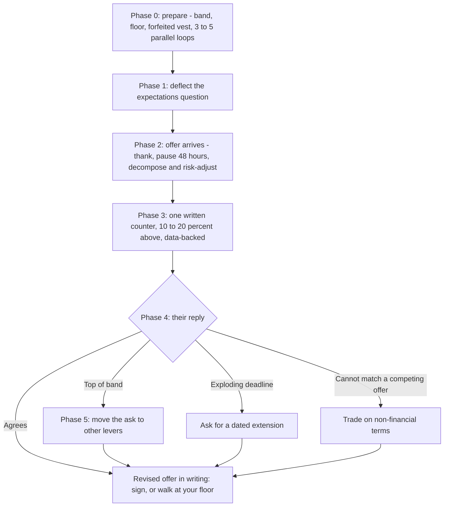

# Negotiation Playbook: Phases, Scripts and Levers

> How to negotiate a GenAI offer in six phases: fill-in scripts for the expectations question, the counter email, a competing offer and a deadline extension; the 12 levers and when each moves; and if-then replies to the employer's counter-moves.

**Dates.** The phases, scripts and levers adapt §6.5 of [T1-03](../../research/sessions/T1-03-interview-execution-offer-negotiation.md) (2026-10-25), which codifies [T0-17](../../research/sessions/T0-17-compensation-progression-plateaus-equity.md) (2026-10-23); pay-mix facts come from [T0-02](../../research/sessions/T0-02-global-regional-compensation-benchmarks.md) (evidence as of 2026-10-21). Re-verify figures by 2027-01-19. **Grades** (EGP-1.0): A primary or measured; B transparent secondary; C vendor or single source; D judgement; M model output; P practice-curated and unmeasured. **Confidence.** T1-03 rates its negotiation scripts medium (C/D) and its India and Europe playbooks lower (C/G) [T1-03 L34]. The scripts are frameworks to adapt, not promises of an outcome. They are not legal, tax or financial advice, and T1-03 suggests that an experienced coach review high-stakes variants [T1-03 L18–19].

## The short answer

1. **Leverage comes from alternatives, not wording.** Coaching services report that about 80–87% of candidates who negotiate receive a positive adjustment, but the lift depends on competing offers; without leverage, coaching returns are marginal [B/C · T1-03.F10]. Run 3–5 parallel loops, staggered so that offers overlap [D · T1-03 L270].
2. **Do not name the first number.** Never disclose your pay; ask for the approved band; let the employer make the first offer [B/C · T1-03.F9; T1-03 L276]. Many US jurisdictions ban salary-history questions [B · T1-03 L276].
3. **Pause 48 hours, then value the offer.** Thank them, decompose the offer, risk-adjust any private equity and run the equity checklist before you counter [C/D · T1-03 L280–288]. The method is in [offer evaluation](offer-evaluation.md).
4. **Counter once, in writing, 10–20% above the offer.** Anchor on external data, keep it collaborative and include a commitment to sign [B/C · T1-03 L309–313]. Levels.fyi's coaching cohort reports median uplifts of +21–24%, from self-selected clients [B/C · T1-03.F9].
5. **Negotiate level before money.** Level-median steps are ×1.38–1.46 [B/C · T1-03 L330], and stock scales with level while base is compressed [B · T0-02.F5].
6. **When base is capped, move the ask to other levers.** Use a sign-on that covers forfeited unvested equity, vesting shape, tender eligibility, a refresh or review commitment, and non-financial terms such as a compute budget [C/D · T1-03 L319, L322, L331–340].

## At a glance



## The six phases

### Phase 0: before the first conversation

| Action | How | Grade · source |
|---|---|---|
| Research the band | Levels.fyi level medians and Pave benchmarks for your level and location ([pay benchmarks](pay-benchmarks.md)) | A/B · T1-03 L267 |
| Define your floor | The minimum TC (base + risk-adjusted equity + sign-on) at which you walk | D · T1-03 L268 |
| Compute the forfeited vest | Grant × (1 − vested fraction at departure). At 24 months an Amazon-style grant is 20% vested and a Google-style grant 66–70% | B/C · T1-03 L269; T0-17 L202–211 |
| Assemble competing processes | 3–5 parallel loops, staggered so that offers overlap | D · T1-03 L270 |
| Know your stay value | Merit +3.4% a year (AI/ML ≈ +4.4%); a same-tier move is worth ≈ +15–25% TC and a level-up ≈ +35–50% | B; C; B/C · T0-17 L194–197 |

- **Why the loops come first.** In T1-03's funnel math, cold inbound applications convert to offers at about 0.2% (340–380 applications per offer); referrals yield 11–36× more per application [B/C · T1-03.F1]. Offers that arrive weeks apart cannot be weighed against each other [P].
- **Staying is an alternative too.** A move beats staying only when the premium exceeds roughly 25% or promotion is blocked [A/B/C · T1-03.F7]. Below that bar you can decline without loss, which lets you hold your counter [P].
- **Coaching pays mainly with leverage.** Levels.fyi Negotiation Coaching reports a median client uplift of +21–24% (self-selected, B); Candor and Rora are rated C; Josh Doody's Fearless Salary Negotiation is the most-cited method (B) [T1-03 L381–384]. Because the lift depends on competing offers, the case for paying is strongest when you hold them [B/C · T1-03.F10]. Tool verdicts: [tool catalog](../00-start/tool-catalog.md).

### Phase 1: deflect the expectations question

- **Ask for the approved band first.** It makes the employer anchor and stops you anchoring low [T1-03 L276].
- **If pressed, give a total-compensation range at P75–P90** for the level and location, and say you are flexible on the mix of base, equity and sign-on. Set the low end no lower than your floor [D · T1-03 L277].
- **Do not share your pay.** Many US jurisdictions ban salary-history questions [B · T1-03 L276]; where a ban applies, say so [T1-03 L278]. The corpus has no evidence on salary-history rules or norms outside the US.
- **Wording:** Script 1 below.

### Phase 2: the 48-hour pause

Steps from T1-03 L282–288 (C/D):

| Step | What to do |
|---|---|
| 1. Thank warmly | "I'm very excited about this. Thank you for putting it together. I'd like 48 hours to review the details carefully." |
| 2. Decompose TC | Base + sign-on + annualised equity + bonus; risk-adjust any private equity ([offer evaluation](offer-evaluation.md)) |
| 3. Benchmark | Levels.fyi level medians, Pave AI/ML benchmarks, competing offers |
| 4. Find the gaps | Base, sign-on, equity (headline against risk-adjusted), missing non-financial terms |
| 5. Run the equity checklist | The ten written questions in [offer evaluation](offer-evaluation.md) |

### Phase 3: one written counter

The Doody/Fearless method is the most-cited framework: never disclose your salary, let them make the first offer, counter 10–20% above it, and send a single data-backed email [B/C · T1-03.F9]. Its four principles [B/C · T1-03 L309–313]:

1. Position the ask as collaborative, not adversarial.
2. Counter 10–20% above the initial offer [B · T1-03 L311].
3. Anchor on external data (Levels.fyi, Pave), not on feelings.
4. Include a commitment to sign: it removes the employer's risk of a drawn-out negotiation.

Put every ask in the one email; T1-03's rule is never to negotiate against yourself [T1-03 L119–124]. Levels.fyi's coaching cohort reports median improvements of about 21% (mid), 23% (senior) and 24% (staff). The clients are self-selected, and the figure covers any offer negotiation, not only job changes [B · T0-17 L114]. Template: Script 2.

### Phase 4: counter-moves, if → then

| If they say | Then | Script fragment (adapted from T1-03 L319–323 unless marked) |
|---|---|---|
| "That's the top of the band." | Move the ask to non-base levers | "If base is capped, could we bridge the gap with a higher sign-on, accelerated vesting, or a committed equity refresh at 12 months?" |
| "Equity is better than cash." | Risk-adjust the equity aloud | "I'm excited about the equity. To value it, I need the fully diluted share count, the last 409A value and the preference stack. My risk-adjusted model values the grant at $[grant × RAV], so I'd need base of at least $[Y]." |
| "We need an answer by Friday." | Buy time with a date | Script 4 |
| "We can't match the competing offer." | Trade on non-financial terms | "I understand. Without matching, could we agree on [an accelerated performance review at 6 months / double-trigger acceleration / a remote stipend / a compute budget]?" |
| Your employer counters to keep you | Treat it as market data, not a decision | Ask whether it fixes the reason you started looking. The claim that retained employees leave within 12–18 months is widely cited without a primary source (D) [T1-03 L323, L411] |
| "What would it take to sign?" [P] | Restate the single target from your email | "If we reach $[target TC] with [the one non-cash term], I'm ready to sign by [date]." |
| They want a verbal yes first [P] | Tie the decision to the written terms | "I'll confirm as soon as I have the revised offer in writing." |

T1-03's fragments are graded C/D [T1-03 L34]; rows marked [P] are practice.

### Phase 5: the 12 levers

| # | Lever | When it moves | Expected effect | Grade |
|---|---|---|---|---|
| 1 | Parallel offers | You hold two or more offers at the same level [T1-03 L362]; without them, returns are marginal [T1-03.F10] | ≈ +20% (selection-biased coaching data) | B |
| 2 | Level | Before the offer is final [P]; level-median step ×1.38–1.46, but ×1.21 from Staff to Principal [T0-17 L129] | Up to +38–46% | B/C |
| 3 | Sign-on = forfeited unvested | You are leaving unvested equity; base is capped [T1-03 L319] | Recovers 30–80% of a grant | C |
| 4 | Vest shape, cliff removal | The grant has a cliff or a back-loaded schedule; OpenAI removed its cliff for new hires in December 2025 [T0-17 L180] | At 24 months: Google-style 66% vested against Amazon-style 20% | B/C |
| 5 | Cash for paper at risk-adjusted parity | They say equity is better than cash [T1-03 L320] | $100K of lab paper ≈ $50–80K liquid | C/D |
| 6 | Tender eligibility | Private company with tenure-gated tenders [T0-17 L158–160] | Day-one eligibility or a committed first tender converts paper to cash 1–2 years earlier | B |
| 7 | Promotion and refresh commitments | Base is capped, or they cannot match [T1-03 L319, L322] | Larger post-promotion equity (+39% median ongoing equity at promotion) | B |
| 8 | Exercise terms | Option grants | Early exercise + 83(b) gives a tax-timing benefit; a longer window avoids the 90-day expiry trap | B/D |
| 9 | Information rights | Any private equity, before you value it [P] | Fully diluted count, preference stack, 409A and tender history make the RAV computable | D |
| 10 | M&A protections | Startups exposed to acqui-hires; they cannot match [T1-03 L322] | Double-trigger acceleration and no carve-out for new hires protect against acqui-hire loss (Windsurf precedent) | B/D |
| 11 | India pay structure | India-based, offered unlisted foreign shares | A cash-heavy mix, planned perquisite tax and a clarified pay band avoid dry tax on unlisted foreign shares | C/G |
| 12 | Non-financial terms | They cannot match cash [T1-03 L322] | Remote stipend, compute budget, conference budget, relocation: marginal cost to the employer, high value to you | D |

Levers, effects and grades are from T1-03 L327–340, codified from T0-17 §6.9. The "when it moves" column cites its source where one exists; the rest is practice [P].

## How to do it

1. **Build the alternatives first.** Start 3–5 loops so that offers overlap [D · T1-03 L270]. *Done when* at least two processes are at the same stage [P].
2. **Set your numbers.** Write down the band (P50, P75 and P90 for your level and location), your floor, your forfeited vest and your stay value [T1-03 L267–269; T0-17 L194]. *Done when* all four are on paper.
3. **Hold the first number back.** Use Script 1. *Done when* the employer has named a band or made an offer.
4. **Pause and value the offer.** *Done when* you know each gap in dollars and, for private equity, the risk-adjusted value at both ends of the band ([offer evaluation](offer-evaluation.md)).
5. **Send one counter.** Use Script 2. *Done when* one email states base, sign-on, one equity or vesting ask, a TC target and a commitment to sign.
6. **Answer counter-moves from the if → then table.** *Done when* the revised offer is in writing.
7. **Close.** Accept in writing, then tell the other companies promptly and politely [P]. *Done when* you have signed and closed the other processes.

## Templates and examples

### Script 1: the expectations question

Adapted from T1-03 L276–278 (C/D). Use the bracketed legal clause only where a salary-history ban applies [B · T1-03 L276].

```text
Recruiter: "What are your salary expectations?"
You: "I'm focused on the technical fit and scope. Because [AI infrastructure / evaluation /
agent platform] ownership varies widely between companies, I'd like to learn more about the
team's requirements first. What is the approved compensation band for this level?"

Recruiter: "We need a number to move forward."
You: "I understand you need to calibrate. Based on my research for this level and location,
I'd expect total compensation in the range of $[P75]–$[P90] [Levels.fyi, level, city], and
I'm flexible on the mix of base, equity and sign-on. I'd prefer to see what the team thinks
is fair first."

Recruiter: "What is your salary?"
You: "I'd rather not share that[, and in [state or country] employers can't require it].
I'd prefer to focus on the value I can bring and the market rate for this level."
```

### Script 2: the counter email

Adapted from T1-03 L294–307 (C/D). Counter 10–20% above the initial offer [B · T1-03 L311]. Write the commitment to sign only if you will sign at that number [P].

```text
Subject: [Company] offer: [your name]

Hi [recruiter name],

Thank you for the offer. I'm excited about [company] and the chance to [specific
contribution, e.g. scale the inference platform / build the evaluation harness].

I've reviewed the package carefully. Given my experience in [one or two AI-specific
strengths, e.g. production LLM serving / agent evaluation infrastructure] and the market
rate for [level] AI engineers, I'd like to ask for three adjustments:

- Base salary of $[target] (from $[offered]), in line with the [P50/P75] for [level] at
  comparable companies on Levels.fyi.
- A sign-on bonus of $[target], which covers the unvested equity I would forfeit at
  [employer]: $[grant] × (1 − [vested fraction at departure]).
- [Equity / vesting / tender eligibility]: [one specific ask, e.g. removal of the
  one-year cliff / tender eligibility from day one].

If we can reach total compensation of about $[target TC], I'm ready to sign [by date]
and commit fully.

Best regards,
[name]
```

### Script 3: the competing-offer note [P]

The framing follows T1-03's principles: collaborative, data-backed, with a commitment to sign [B/C · T1-03 L309–313]; the note itself is practice. Cite only offers you hold in writing, and state them accurately [P]. State the equity type, because a liquid RSU grant and private paper are not worth the same ([offer evaluation](offer-evaluation.md)). Whether naming the other company helps is not measured, and the legal limits of playing offers against each other were not analysed (D) [T1-03 L410].

```text
Hi [recruiter name],

I want to be transparent with you. I've received a written offer from [company, or "a
company at a similar stage"] for [level]: $[base] base, $[annual equity] a year in
[public RSUs / private stock], and a $[sign-on] sign-on, with a decision date of [date].

[Company] remains my first choice because [specific reason]. If you can [match the level /
close the gap on base or sign-on], I'm ready to sign by [date].

Thank you,
[name]
```

### Script 4: the deadline-extension ask

Adapted from T1-03 L321 (C/D):

```text
Hi [recruiter name],

Thank you. This is a major decision and I want to give it proper care. I can commit to a
final answer by [date, about a week out], assuming we can resolve [base / the equity
details] by then.

Best,
[name]
```

The companion note to your other processes [P]:

```text
Hi [recruiter name],

I've received an offer with a decision date of [date]. [Company] is a strong preference for
me. Is there a way to complete the remaining steps before then?

Thanks,
[name]
```

### Weak → strong

| Moment | Weak | Strong |
|---|---|---|
| Expectations | "I'm on $[salary], so I'm looking for a bit more." | Ask for the approved band; if pressed, give a P75–P90 range whose low end is your floor (Script 1) |
| Offer call | "That sounds great, I accept." | "Thank you, I'm excited. I'd like 48 hours to review the details." |
| Counter | "Is there any flexibility on the salary?" | One email with a number for each lever, an external anchor, a TC target and a commitment to sign (Script 2) |
| Equity | Accepting paper at headline value in place of base | "At [RAV band] the grant is worth $[grant × RAV]; to clear my floor, base needs to be $[Y]." |
| Deadline | "OK, I'll decide by Friday." | A dated answer, conditional on resolving the open terms (Script 4) |

Pattern from T1-03 L276–321; the pairs are practice [P].

## Geography notes

### India

- **Evidence gap.** T1-03 rates its India guidance lower confidence (C/G) [T1-03 L34]. The corpus has no data on Indian negotiation outcomes and no evidence on Indian norms for disclosing pay; the salary-history bans T1-03 cites are a US protection [T1-03 L276].
- **Ask for a cash-heavy structure (lever 11).** Indian advisory blogs (Wisemonk, Treelife) report that unlisted foreign shares are taxed as a perquisite at vest or exercise and again as capital gains on sale, creating a cash crunch before liquidity [C · T1-03 L369; T0-17 L229, L702–L703]. **Not tax advice:** confirm with a chartered accountant, and see [India remote tax](india-remote-tax.md).
- **Anchor on measured figures, not tier bands.** Greater Bengaluru Senior SWE: median ≈ ₹56.0L, P90 ≈ ₹1.07Cr; top-employer senior medians ≈ ₹1.06–1.22Cr (Levels.fyi, n = 4,836) [B · T0-17 L137]. The research's two India tier-band sets are not measured ([errata U14](../../research/ERRATA.md)).
- **Remote pay compression** for India-based hires has no controlled evidence (G) [T1-03 L406]; see the [India remote playbook](../11-tracks/india-remote-playbook.md).

### Europe

- **Evidence gap.** T1-03 rates its Europe guidance lower confidence (C/G) [T1-03 L34]; evidence on remote or US-band routes from Europe is thin (G) [T1-03 L375].
- **Pay anchor.** London Senior median ≈ £122K, P90 ≈ £221K on Levels.fyi [C · T1-03 L373]; T0-17 notes that this comes from a search snippet [T0-17 L143].
- **UK startups.** From 6 April 2026, EMI limits rise to 500 employees, £120M of assets, a £6M option cap and a 15-year option life [B · T1-03 L374]. At a qualifying UK startup, ask whether your grant is an EMI option [P].

### US

Leverage is greatest with two or more competing offers at the same level. Risk-adjust lab equity (RAV 0.5–0.8), and negotiate a sign-on that covers the forfeited vest [D · T1-03 L361–364].

## Checklist

- [ ] I have the band (P50, P75, P90) for my level and location, a written floor, my forfeited-vest figure and my stay value.
- [ ] At least two processes are at the same stage, so that offers can overlap.
- [ ] I did not name a number or disclose my pay before the offer.
- [ ] I thanked the recruiter and took 48 hours.
- [ ] I valued the offer with [offer evaluation](offer-evaluation.md): risk-adjusted equity at both ends of the band, and the diligence questions sent.
- [ ] My counter is one email: base, sign-on, one equity or vesting ask, a TC target, and a commitment to sign only if I mean it.
- [ ] The counter sits 10–20% above the initial offer and cites external data.
- [ ] I raised level before money.
- [ ] I have if-then replies ready for "top of band", "equity beats cash", an exploding deadline and "can't match".
- [ ] Every agreed term is in the revised written offer before I sign.

## Pitfalls

| Red flag | Why it hurts | Fix |
|---|---|---|
| You name a number first, or share your pay | You anchor low and the offer caps near it [T1-03 L276] | Script 1 |
| You negotiate in rounds, conceding as you go | It is negotiating against yourself; T1-03's rule is one data-backed email [T1-03 L119–124] | Script 2, with every ask at once |
| You negotiate with no alternative | Without competing offers, returns are marginal [B/C · T1-03.F10]; the risk is high in constrained markets [T1-03 L428] | Build parallel loops before the offer stage |
| You accept paper equity at headline in place of base | Lab paper is worth ≈ $50–80K per $100K [C/D · T1-03 L333] | Value it at RAV; use the "equity is better than cash" reply |
| You forget the forfeited vest | You absorb the loss yourself | Ask for a sign-on of grant × (1 − vested) [T1-03 L301] |
| You accept under an exploding deadline | You lose your leverage [T1-03 L431] | Script 4; stagger loops so that offers overlap |
| You cite an offer you do not hold, or inflate it | The corpus did not analyse this; legal norms vary by jurisdiction (D) [T1-03 L410] | Cite only written offers, accurately [P] |
| You take a retention counter-offer on the number alone | It may not fix the reason you looked (D) [T1-03 L323, L432] | Judge it against the reason for leaving |
| You fixate on base | Base is compressed and stock scales with level [B · T0-02.F5] | Ask about level, equity, refresh and vesting |
| You sign on a verbal promise | Terms not in the offer letter are hard to rely on [P] | Ask for the revised written offer |

## Evidence and limits

- **Measured.** The US level ladder: Levels.fyi 2025 medians step ×1.46, ×1.38, ×1.46 and ×1.21 from Entry to Principal [B · T0-17 L129]. Pave's +39% median ongoing equity at promotion [B · T1-03 L335]. Vest fractions computed from published schedule shapes [B/C · T0-17 L202–209].
- **Self-selected.** The +21–24% uplift comes from Levels.fyi coaching clients and covers any negotiation, not only job changes [B · T0-17 L114]. The 80–87% positive-adjustment rate comes from coaching services [B/C · T1-03.F10]. There is no controlled evidence of coaching returns for candidates without competing offers [T1-03 L405].
- **Judgement.** The scripts (C/D) and the floor and parallel-loop targets (D) [T1-03 L34, L268–270]; the competing-offer note, the companion note and the weak → strong pairs [P].
- **Gaps.** India and Europe playbooks (C/G) [T1-03 L34]; legal limits of playing offers against each other (D) [T1-03 L410]; counter-offer retention rates (D) [T1-03 L411]; remote pay compression for India-based hires (G) [T1-03 L406].
- **Errata applied.** India anchors follow [errata U14](../../research/ERRATA.md).
- **What would change this page.** Controlled data on negotiation outcomes without competing offers; India or Europe negotiation data; Levels.fyi's end-of-year 2026 report and Pave H2 2026 data, two of T0-17's re-run triggers [T0-17 L233].
- **Dates.** T1-03 2026-10-25; T0-17 2026-10-23; T0-02 evidence as of 2026-10-21. Re-verify figures by 2027-01-19.

## Next steps

- **Value every offer first:** [offer evaluation](offer-evaluation.md).
- **Benchmarks:** [pay benchmarks](pay-benchmarks.md).
- **Build the alternatives:** the [job-search strategy](../06-job-search/job-search-strategy.md), [referrals and outreach](../07-networking/referrals-and-outreach.md) and the [application operating system](../06-job-search/application-operating-system.md).
- **Get to offers:** [interview loops](../08-interviewing/interview-loops.md) and [behavioural calibration](../08-interviewing/behavioral-calibration.md).
- **India and relocation:** [India remote tax](india-remote-tax.md), the [India remote playbook](../11-tracks/india-remote-playbook.md) and [visa and relocation](../11-tracks/visa-and-relocation.md).
- **After signing:** [first 90 days](../10-onboarding/first-90-days.md) and [growth and progression](../10-onboarding/growth-and-progression.md).
- **Roles:** hubs for the [AI Engineer](../02-roles/hubs/ai-engineer.md), [ML Engineer](../02-roles/hubs/ml-engineer.md), [Forward-Deployed Engineer](../02-roles/hubs/forward-deployed-engineer.md) and [AI Engineering Manager](../02-roles/hubs/ai-engineering-manager.md).
- **Evidence:** the [stage 09 findings](../../research/findings.md#stage-09); sessions [T1-03](../../research/sessions/T1-03-interview-execution-offer-negotiation.md), [T0-17](../../research/sessions/T0-17-compensation-progression-plateaus-equity.md) and [T0-02](../../research/sessions/T0-02-global-regional-compensation-benchmarks.md); the [glossary](../00-start/glossary.md).
